# **Installation Manual**

## Contents

- [Document history](#document-history)
- [Introduction](#introduction)
  - [App installation](#app-installation)
  - [License key activation](#license-key-activation)
  - [App updates](#app-updates)
    - [Manual extension update](#manual-extension-update)
    - [Major Business Central updates](#major-business-central-updates)
    - [Minor Business Central updates](#minor-business-central-updates)

**Localization for Ireland**

<figure>

<figcaption>
Microsoft Dynamics 365 Business Central
</figcaption>
</figure>

companial.com

**Disclaimer:** This document is intended solely for internal use by partners and users of Microsoft Dynamics 365 Business Central. Companial is the author and holds exclusive copyright to this material. Unauthorized copying, modification, or sale of the content is strictly prohibited without the author's prior written consent.

# Document history

| Application release | Release date | User manual version | Summary of changes |
|:--:|----|----|----|
| 2.0.0.0 | 16 September 2026 | 2.0 | License key activation update |
| 1.0.0.0 | 6 May 2026 | 1.0 | Installation manual creation |

# Introduction

This manual is designed to help you quickly and confidently set up Localization for Ireland for Dynamics 365 Business Central, ensuring a smooth start for your or your Customer’s organization. Whether you are installing the app for the first time or updating to the latest version, this guide provides clear, step-by-step instructions for every stage of the process -from app installation to license activation. Our goal is to make the installation experience as straightforward as possible, so you can focus on leveraging the features of Localization for Ireland within Microsoft Dynamics 365 Business Central.

## App installation

To begin the installation of Localization for Ireland, log in to the Microsoft Dynamics 365 Business Central environment where you intend to install the extension. Ensure you are using an account that has the necessary permissions to install apps and manage extensions. Typically, this requires the user to have either the **“SUPER”** permission set or the **“Extension Management”** permission set assigned.

Find the **“Environment”** name of that environment. This name is available navigating to **“?”** and then **"Help & Support"** page of the Business Central application:

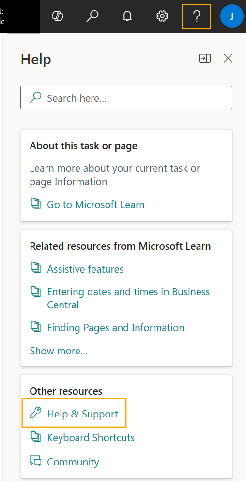

The location where you can find the environment name is highlighted in the following image:

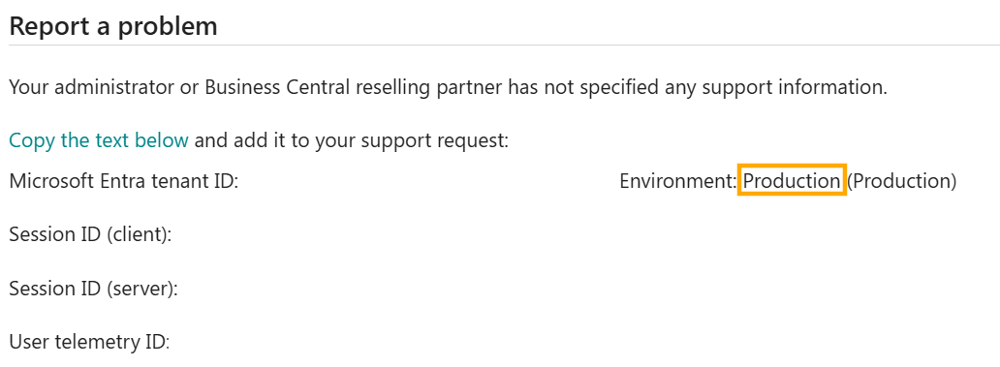

Within the Localization for Ireland subscription confirmation email, you should have received the installation link with the preconfigured Microsoft Tenant ID which links to the licensed tenant. Paste the received link into the address bar of the browser where your Business Central environment is open. Ensure you are signed in with a user account that has the required extension management permissions, as noted previously. This action will open the “Install Extension” page.

Carefully review the information presented on the installation page and select the appropriate identified environment. When you are ready, click **“Install”** to begin the installation process. Once the installation is complete and you have confirmed success, you may close the browser window.

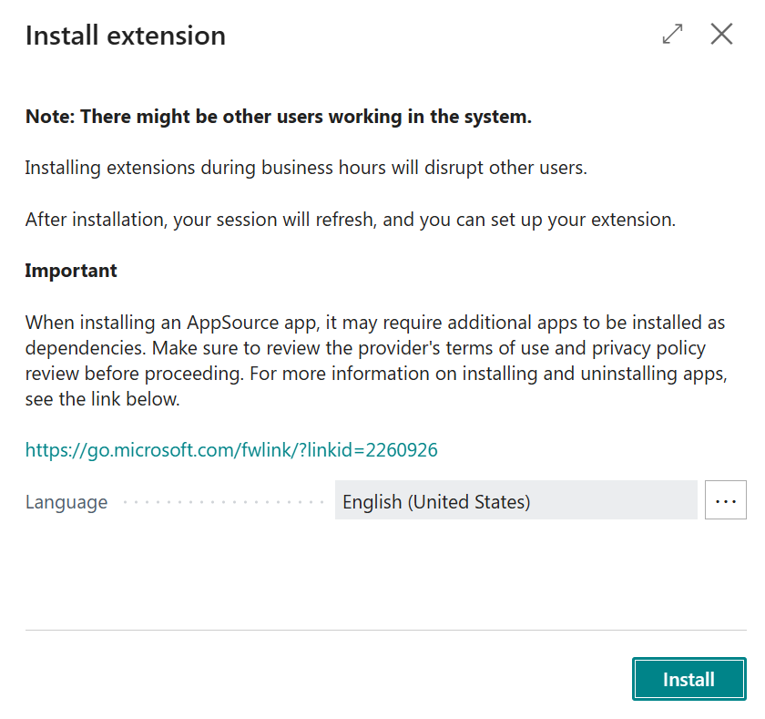

## License key activation

In order to activate the license, it is required to validate the license, input the license key for the Microsoft Tenant ID & accept the associated End User License Agreement (EULA), validate the license and assign the users to access the application.

1.  Go to “Extension Management” page:

    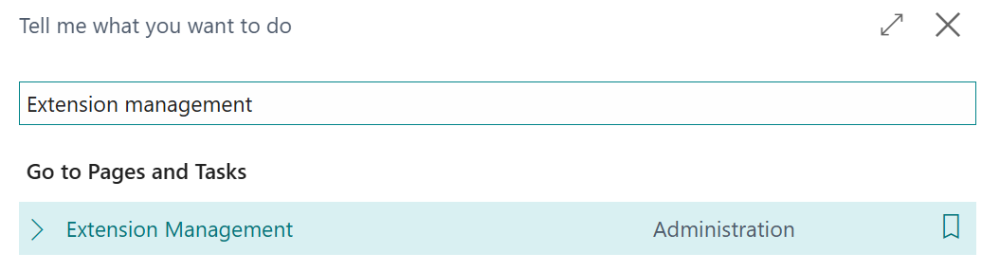

2.  Search and select *Companial License Management* application

    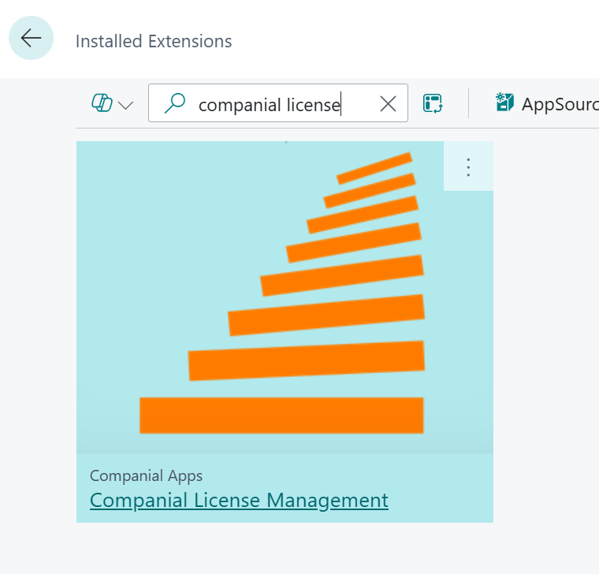

3.  Enable “Allow HttpClient Requests” for Companial License Management. If you plan to use CRO integration, also select Localization for Ireland in Extension Management and enable “Allow HttpClient Requests” for that application:

    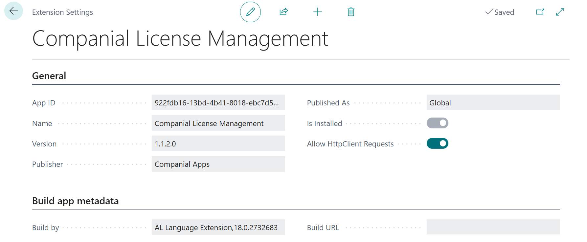

4.  Once HttpClient Requests is enabled, go to “Companial Licenses” page:

    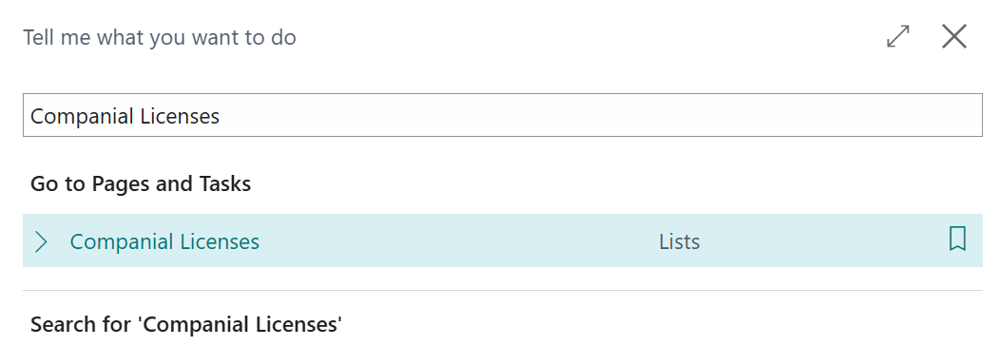

5.  Click “Validate License” action:

    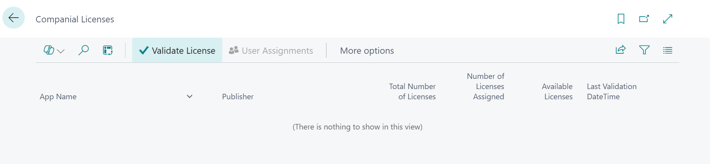

6.  “End User Agreement License” window will pop up. Review the conditions, mark “I accept the terms and conditions” and click OK:

    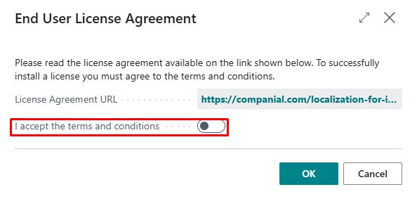

7.  Enter the license key received with onboarding notification:

    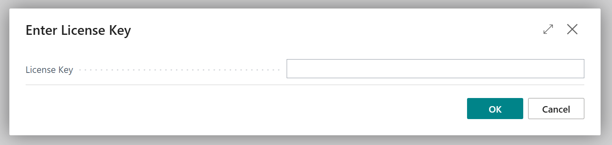

8.  The following record will be created in “Companial Licenses” page:

    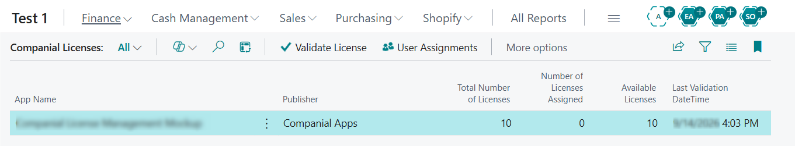

9.  Click on “User Assignment” action:

    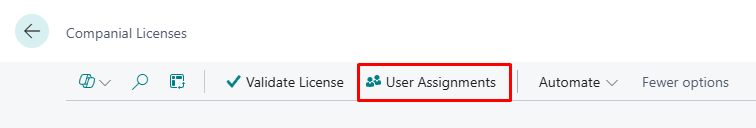

10. “App User Assignment” page will pop up. Click on “Add All Users”:

    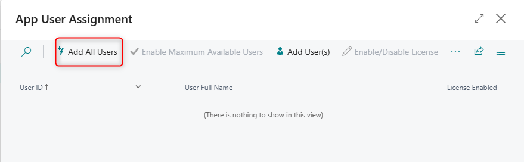

11. App User Assignment list is populated with available users, and notification message is shown with number of users added

    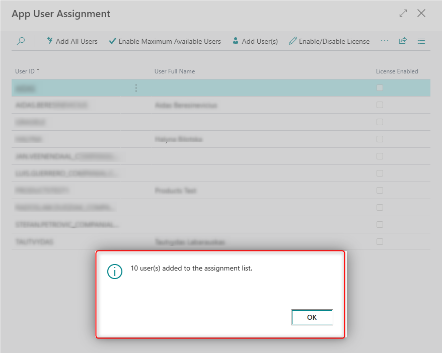

12. Set focus on the user record and click on “Enable/Disable License”

    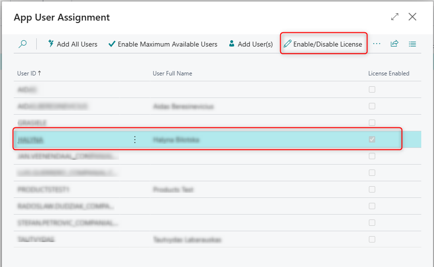

13. The user is enabled.

## App updates

### Manual extension update

In order to manually update Localization for Ireland to the latest version, please review the official [Microsoft instructions on managing apps](https://learn.microsoft.com/en-us/dynamics365/business-central/dev-itpro/administration/tenant-admin-center-manage-apps).

Navigate to the Business Central Admin Center and select the environment with Localization for Ireland installed:

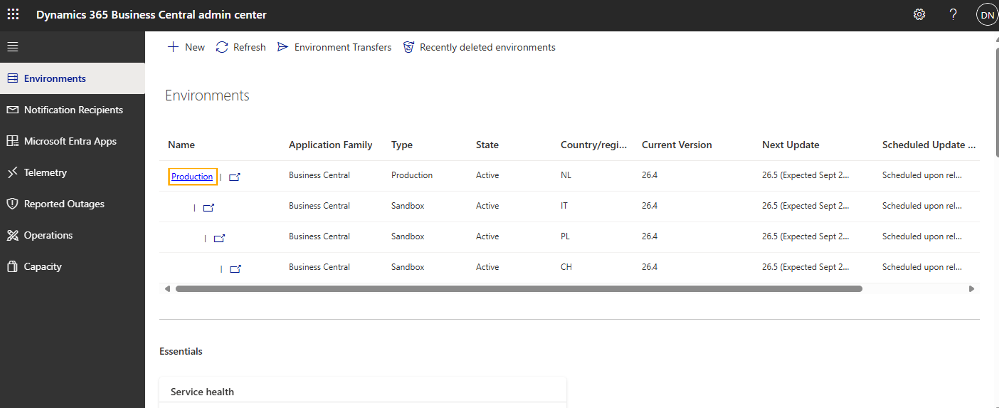

*Please note, that it is always highly recommended to update in a Sandbox environment and test, prior to Production environment update.*

Afterwards, navigate to **“Apps”** -> **“Manage Apps”** and select **“App Type: Global”**:

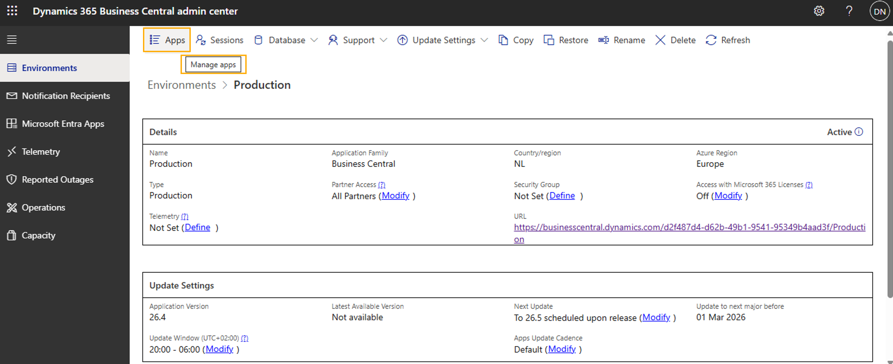

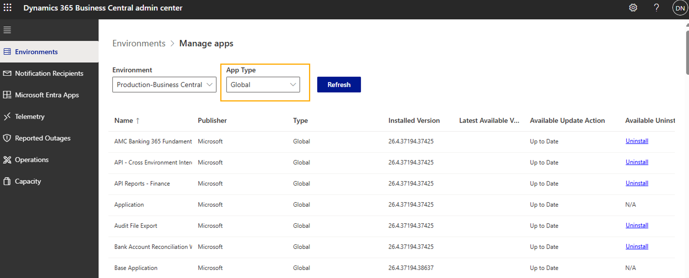

Locate the Localization for Ireland extension in the list of installed apps. If an update is available, select Localization for Ireland and choose the “Update” action. Follow the on-screen prompts to complete the update process.

### Major Business Central updates

Localization for Ireland is updated automatically whenever a major version of Microsoft Dynamics 365 Business Central is updated as a default setting. This ensures that Localization for Ireland remains fully compatible and benefits from the latest platform features without requiring any manual intervention.

### Minor Business Central updates

Localization for Ireland by default is not updated with minor Business Central updates. However, Business Central also offers an option to enable automatic updates for extensions when minor platform versions are released. This can be configured in the Environment management view by selecting **“App Update Cadence: Default (<u>Modify</u>)”** and adjusting the update cadence to **“With minor and major updates”:**

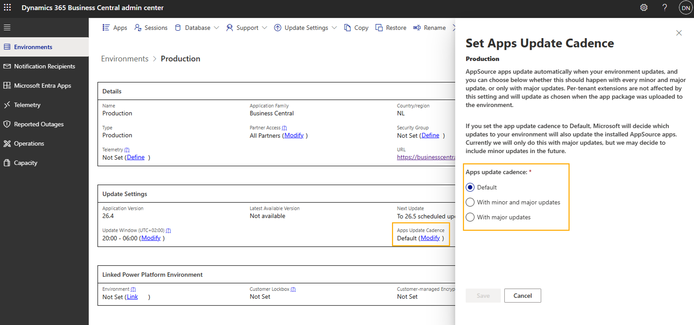