# **User Manual**

## Contents

- [Document history](#document-history)
- [Introduction](#introduction)
- [License Activation & User Assignment](#license-activation-user-assignment)
- [Permission Sets](#permission-sets)
  - [Initial Setup](#initial-setup)
    - [VAT Report Setup](#vat-report-setup)
    - [VAT Report Configuration](#vat-report-configuration)
    - [Country/Region Setup](#countryregion-setup)
    - [VAT3 Return Configuration](#vat3-return-configuration)
      - [VAT Statement Setup](#vat-statement-setup)
      - [Configuring VAT Statement](#configuring-vat-statement)
      - [VAT3 Return Mapping](#vat3-return-mapping)
    - [VAT based on payments received](#vat-based-on-payments-received)
  - [VAT3 Return Process](#vat3-return-process)
    - [Creating VAT Return Periods](#creating-vat-return-periods)
    - [Standard VAT Return](#standard-vat-return)
    - [Corrective VAT Return](#corrective-vat-return)
    - [Supplementary VAT Return](#supplementary-vat-return)
    - [Generating VAT3 XML File](#generating-vat3-xml-file)
    - [XML File Contents](#xml-file-contents)
    - [Submitting VAT Returns](#submitting-vat-returns)
    - [VAT Settlement](#vat-settlement)
    - [VAT Entries](#vat-entries)
  - [VAT Reporting](#vat-reporting)
    - [VAT Audit Report](#vat-audit-report)
    - [VAT Entry Exception Report](#vat-entry-exception-report)
- [Sales Documents](#sales-documents)
  - [Posted Sales Invoice](#posted-sales-invoice)
    - [Posted Sales Credit Memo](#posted-sales-credit-memo)
    - [Report Selection](#report-selection)
- [Post Code Localization](#post-code-localization)
- [Company Lookup from Companies Registration Office](#company-lookup-from-companies-registration-office)
  - [CRO CORE API access](#cro-core-api-access)
  - [CRO CORE Integration Setup](#cro-core-integration-setup)
  - [Lookup from CRO](#lookup-from-cro)
    - [Existing Entity validation flow](#existingentityvalidation-flow)
    - [A new Entity approach](#a-newentityapproach)
    - [Lookup Logs](#lookup-logs)
- [Section 56 Authorization](#section-56-authorization)
  - [Section 56 basic setup](#section-56-basic-setup)
  - [Customer Section 56 Authorization](#customer-section-56-authorization)
  - [Section 56 Processing](#section-56-processing)

**Localization for Ireland**

<figure>

<figcaption>
Microsoft Dynamics 365 Business Central
</figcaption>
</figure>

companial.com

# Document history

| Application release | Release date | User manual version | Summary of changes |
|:--:|----|----|----|
| 2.0.0.0 | 16 September 2026 | 2.0 | Added guidance for accounting for VAT on moneys received, including unrealized VAT configuration, cash-basis VAT posting setup, and payment-based VAT entries. Added CRO CORE integration guidance covering access prerequisites, connection setup, lookup configuration, field mapping, company lookup, overwrite behavior, and integration logs. Added Section 56 guidance covering prerequisites, VAT setup, customer authorization, certificate validity, and sales-document processing. |
| 1.1.0.1 | 20 July 2026 | 1.1 | Added guidance for bypassing Ireland-specific VAT3 validations and explained the related control of the Allow Modification setting on VAT Report Setup. Added and updated screenshots supporting license activation and configuration. |
| 1.0.0.0 | 6 May 2026 | 1.0 | Initial user manual covering license activation and user assignment, permission sets, initial VAT configuration, VAT3 return processing, VAT reporting, localized sales documents, and postcode localization. |

**Disclaimer:** This document is intended solely for internal use by partners and users of Microsoft Dynamics 365 Business Central. Companial is the author and holds exclusive copyright to this material. Unauthorized copying, modification, or sale of the content is strictly prohibited without the author's prior written consent.

# Introduction

This manual is designed to help you quickly and confidently learn Localization for Ireland for Dynamics 365 Business Central, ensuring a smooth start for your or your Customer’s organization within the Irish regulatory environment. It covers the information from the Localization for Ireland license activation to the individual functionalities available within the extension. We hope it serves you well in using our extension!

# License Activation & User Assignment

Upon installation of the Localization for Ireland extension, it is required to accept the associated End User License Agreement (EULA), validate the license for the Microsoft Tenant ID and assign the users to access the application.

1.  Go to “Companial Licenses” page.

2.  Click on “Validate License” action.

    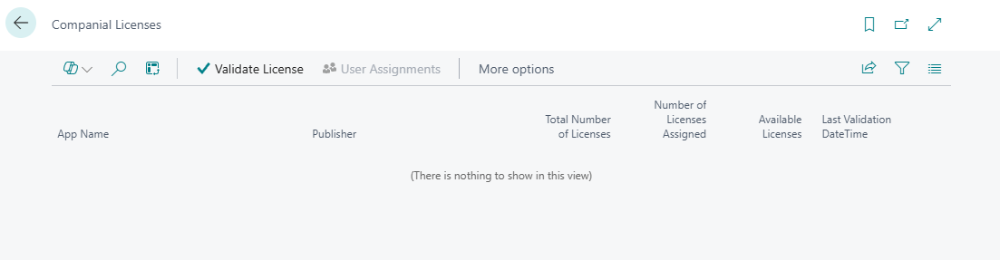

3.  “End User Agreement License” window will pop up. Review the conditions and mark “I accept the terms and conditions” and Click OK.

    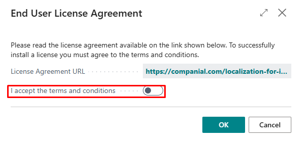

4.  Save the Key and Click OK.

    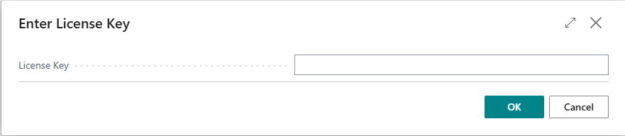

5.  The following record will be created in “Companial Licenses” page.

    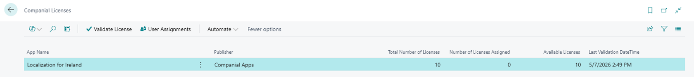

6.  Click on “User Assignment” action

    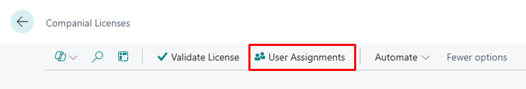

7.  “App User Assignment” page will pop up

8.  Click on “Add All Users”

    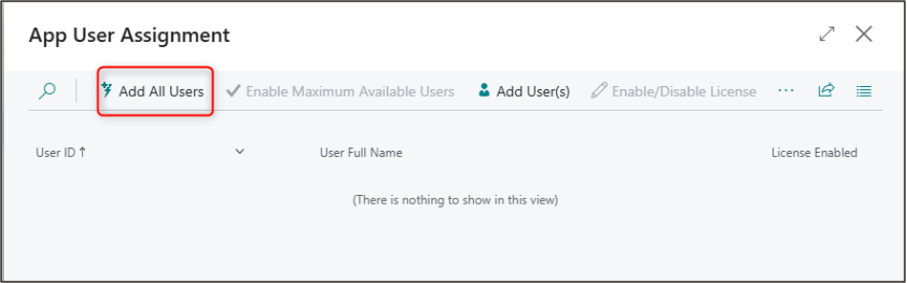

9.  App User Assignment list is populated with available users, and notification message is shown with number of users added

10.  Set focus on the user record and click on “Enable/Disable License”

     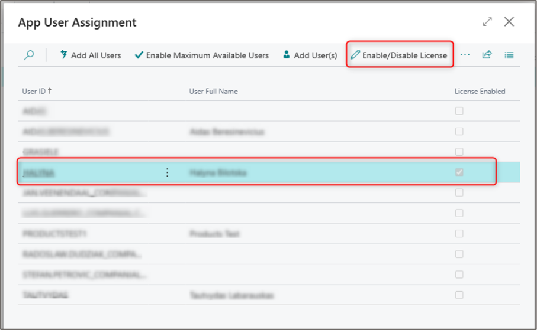

11.  Once users are assigned, they will have access to the extension functionalities.

# Permission Sets

The system contains one permission set that grants access to all Irish functionality:

EXW IE All

- Caption: All permissions

- Access Level: Internal

**To Assign**: Navigate to **Users** → Select user → **User Permission Sets** → Add **EXW IE All**

## Initial Setup

Before using the Localization for Ireland functionality, complete the following setup steps.

### VAT Report Setup

On the VAT report setup, the following fields must be configured:

- VAT Return No. Series: Specifies the number that will be used for VAT return

- VAT Return Period No. Series: Specifies the number that will be used for VAT return Period

- Report Version: Specifies the VAT report version that is used for the VAT reporting

  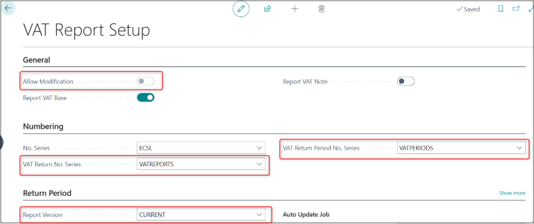

Allow Modification field is read-only and disabled unless Bypass IE Localization Checks is enabled on VAT Setup page

1.  VAT Setup

2.  Navigate to VAT Setup (search for "VAT Setup")

3.  Locate the Ireland VAT3 Return FastTab

    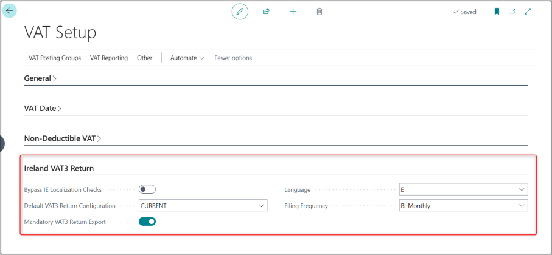

| Field | Description | Options |
|:--:|----|----|
| Mandatory VAT3 Export | If enabled, users cannot mark VAT returns as submitted until the VAT3 XML file has been generated | Yes/No |
| VAT3 Return Language | Language for VAT3 XML file | English (E) / Irish (I) |
| VAT3 Filing Frequency | How often VAT3 returns are submitted | Bi-Monthly / Repayment Only / Other / Four Monthly / Bi-Annual |
| Bypass IE Localization Checks | Disabled by default. If enabled, the full Ireland-specific validations will not be applied to use standard BC VAT reporting. | Yes/No |

**Recommendation**: Enable Mandatory **VAT3 Export** to ensure all returns are properly exported before submission.

### VAT Report Configuration

1.  Navigate to VAT Report Configuration (search for "VAT Report Configuration")

2.  Locate or create the configuration for VAT Report Type = VAT Return

3.  Configure the following fields:

| Field | Value | Description |
|:--:|----|----|
| VAT Report Type | VAT Return | Fixed value |
| VAT Report Version | Current | Description that identifies the report version for Ireland |
| Suggested Lines Codeunit ID | 73011582 | Ireland extension - suggests VAT3 lines and filters supplementary entries |
| Content Codeunit ID | 73011579 | Ireland extension - generates VAT3 XML |
| Validate Codeunit ID | 73011578 | Ireland extension - validates VAT3 |

### Country/Region Setup

The Ireland Localization allows you to customize the name of the "Post Code" field based on country-specific terminology.

1.  Navigate to Countries/Regions (search for "Countries/Regions")

2.  Select a country (e.g., IE - Ireland)

    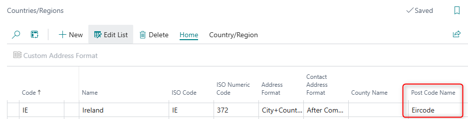

    1. Ireland: Eircode

    2. Other countries: Leave blank to use default "Post Code"

This setting automatically changes the field caption across all address-related pages and reports.

Note: Similar behaviour as “County Name” field

### VAT3 Return Configuration

#### VAT Statement Setup

The VAT Statement must be structured according to the Irish VAT3 Return requirements. The system requires **exactly 7 box numbers**:

| Box No. | Description | VAT Type | Usage |
|:--:|----|----|----|
| T1 | VAT Due | Sales and Purchase | Total VAT due on supplies, intra-EU acquisitions, postponed-accounting imports, and received services |
| T2 | VAT Deductible | Purchase | Total VAT reclaimable on qualifying purchases, intra-EU acquisitions, postponed-accounting imports, and received services |
| E1 | Intra-EU Supplies of Goods | Sales | Total value of goods supplied to customers in other EU countries |
| E2 | Intra-EU Acquisitions of Goods | Purchase | Total value of goods received from suppliers in other EU countries |
| ES1 | Intra-EU Supplies of Services | Sales | Total value of services supplied to customers in other EU countries |
| ES2 | Intra-EU Acquisitions of Services | Purchase | Total value of services received from suppliers in other EU countries |
| PA1 | Postponed Accounting Imports | Purchase | Customs value of goods imported under postponed accounting, plus Customs Duty |

#### Configuring VAT Statement

1.  Navigate to VAT Statements (search for "VAT Statements")

2.  Create or modify your VAT Statement Template for Ireland

    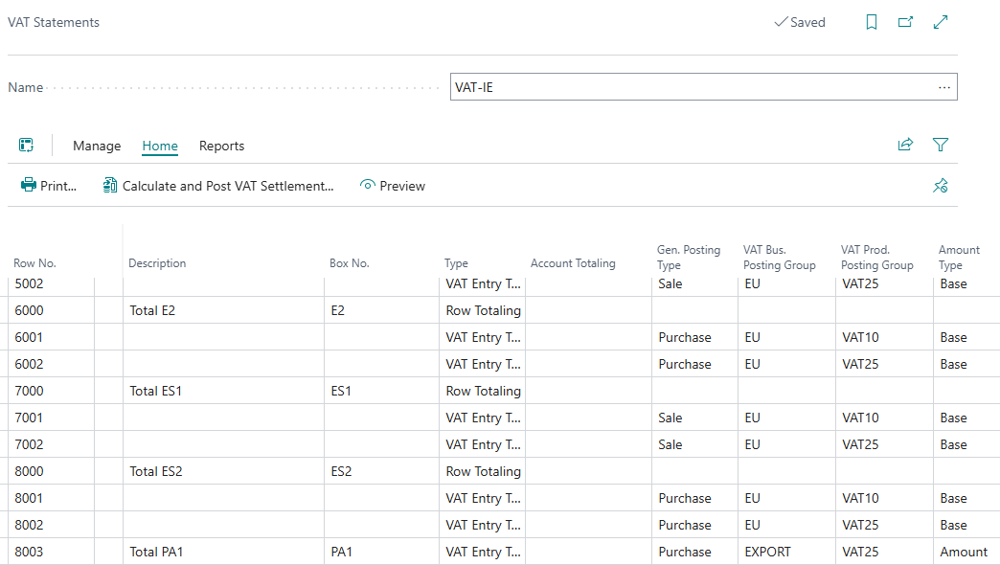

3.  Ensure each row includes:

    1. Row No. - Sequential number

    2. Description - Descriptive text

    3. Type - VAT Entry Totalling

    4. VAT Bus. Posting Group - Appropriate group (Domestic, EU)

    5. VAT Prod. Posting Group - Appropriate group (Goods, Services)

    6. Row Totalling - Formula for calculation

    7. Amount Type - Base or Amount

    8. Box No. - One of: T1, T2, E1, E2, ES1, ES2, PA1

**Validation**: When generating a VAT3 Return, the system validates that all 7 box numbers exist in your VAT Statement.

#### VAT3 Return Mapping

The VAT3 Return Mapping table links VAT Statement box numbers to XML elements in the VAT3 Return file.

**Auto-Fill Mapping (Recommended)**

1.  Navigate to VAT Return page

2.  Click Actions → VAT3 Return Mapping

    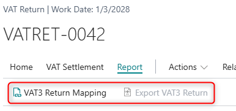

3.  On the VAT3 Return Mapping page, click Auto-fill Mapping

4.  The system creates default mappings:

| VAT Statement Box | →   | XML Element          |
|:-----------------:|-----|----------------------|
|        T1         | →   | Sales                |
|        T2         | →   | Purchases            |
|        E1         | →   | Goods To             |
|        E2         | →   | Goods From           |
|        ES1        | →   | Services To          |
|        ES2        | →   | Services From        |
|        PA1        | →   | Postponed Accounting |

**Important**: Mapping must be completed before generating any VAT3 Return XML files.

### VAT based on payments received

Specifies that VAT should be reported using the Payments Received basis, where VAT is recognized and included in VAT reporting only when payment is received from customers, rather than when the invoice is posted. This functionality is supported through standard Microsoft Dynamics 365 Business Central configuration.

1.  Go to the “General Ledger Setup page”.

2.  Ensure that the “Unrealized VAT” toggles are enabled:

    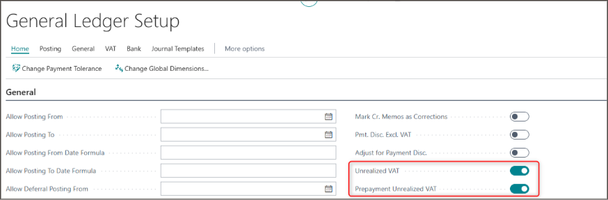

3.  Create or select a cash-basis VAT Business Posting Group (for example, “DOMESTIC-CASH”). In VAT Posting Setup, configure each applicable VAT Business/Product Posting Group combination with the appropriate VAT rate, Sales VAT Account, Sales VAT Unreal. Account, and Unrealized VAT Type (for example, Percentage for proportional recognition as payments are applied). Assign the configured group to the customer, directly or through a customer template. “DOMESTIC-CASH” and “Cash-Payment Customer” are example names; create and configure them if they are not already available.

    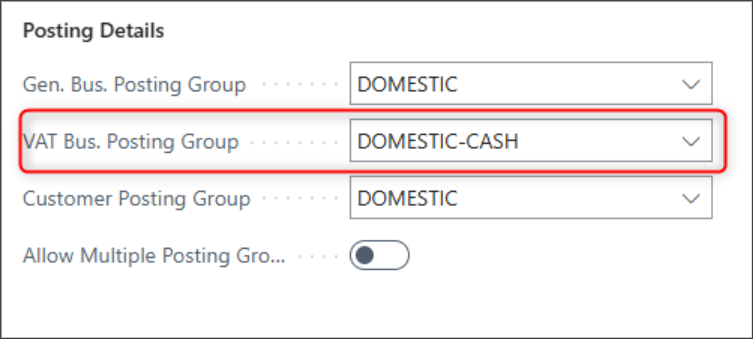

4.  After the invoice is posted and the cash receipt journal is applied, two VAT entries are created with document types of: Invoice and Payment.

5.  The VAT entry with type “Payment” will be exported in the VAT Return within the reporting period.

## VAT3 Return Process

### Creating VAT Return Periods

VAT Return Periods define the time frames for VAT reporting.

1.  Navigate to VAT Return Periods (search for "VAT Return Periods")

    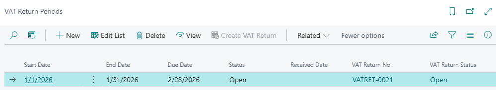

2.  Click New and enter:

    1. Start Date - First day of VAT period (e.g., 01/01/2026)

    2. End Date - Last day of VAT period (e.g., 31/01/2026)

    3. Due Date - Submission deadline (e.g., 28/02/2026)

3.  Click Create VAT Return to generate a new VAT Return

### Standard VAT Return

Standard VAT Returns are the normal, periodic submissions to Irish Revenue.

1.  Create VAT Return

    1. From VAT Return Periods, click Create VAT Return (Also it can be created from VAT Returns list, “New” action)

    2. A new VAT Return card opens

    3. Select VAT Report Version (the one from VAT Report Configuration)

       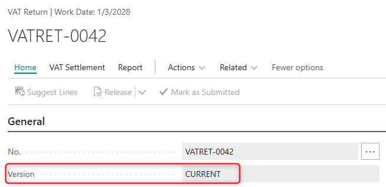

    4. Specify Return Period (Start Date, End Date)

    5. Period and Date fields will be automatically filled in based on the Return Period selected

    6. VAT Report Type defaults to "Standard" (correct for initial returns)

    7. Filing Frequency is automatically set from VAT Setup (can be changed if needed)

2.  Generate VAT Return Lines

    1. On the VAT Return card, click Actions → Suggest Lines

       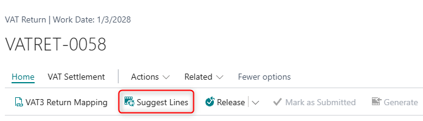

    2. On the request page, configure:

        1. Include VAT Entries:

            1. Open - Entries not yet included in a settlement

            2. Closed - Entries already settled

            3. Open and Closed - All entries (most common)

        2. Include VAT Entries:

            1. Within Period - Only entries in this period

            2. Before and Within Period - Include prior period entries (if needed)

        3. VAT Statement Template - Select your Ireland template

        4. VAT Statement Name - Select your Ireland statement name

    3. Click OK. The system populates the Report Lines FastTab with VAT amounts for each box.

       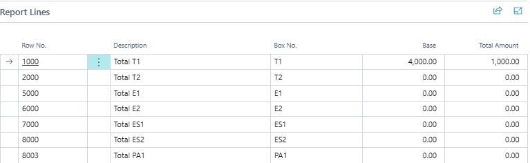

3.  Review Report Lines

On the **Report Lines** FastTab, verify:

- Box No. - Should show T1, T2, E1, E2, ES1, ES2, PA1

- Description - Descriptive text from VAT Statement

- Base - Transaction base amounts

- Amount - VAT amounts

4.  Step 4: Unusual Expenditure (if applicable)

If your business has unusual or exceptional expenditure that needs to be reported, proceed as follows:

a. On the Unusual Expenditure FastTab:

- Unusual Expenditure - Set to Yes

- Unusual Expenditure Amount - Enter the amount

- Unusual Expenditure Details - Enter description (max 50 characters)

    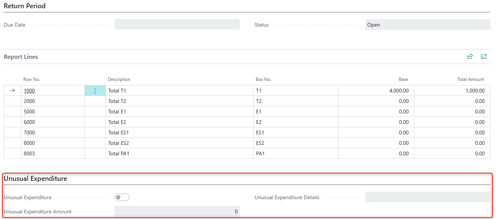

5.  Release VAT Return

    1. Click Actions → Release

    2. The system validates:

        1. VAT return has lines

        2. No duplicate standard returns for the same period

        3. Start date is before end date

If validation passes, the status changes to **Released**.

### Corrective VAT Return

Corrective VAT Returns replace a previously submitted Standard or Corrective return when errors are discovered.

**Key Characteristics**

- Replaces the original return completely

- Links to Original Report No.

- Updates the VAT3 Return No. field on affected VAT entries

- Only one corrective return allowed per original return

- Cannot correct a Supplementary return

**Process**

1.  Create a new VAT Return (from VAT Return Period or manually)

2.  On the General FastTab:

    1. VAT Report Type - Select Corrective

    2. Original Report No. - Select the Standard or Corrective return being corrected

3.  Click Suggest Lines

4.  The system loads all the VAT entries from the Return Period selected

5.  Complete Release → Generate → Submit workflow

**Effect**: When the corrective return is exported, VAT entries are updated to reference the new return number.

### Supplementary VAT Return

Supplementary VAT Returns report additional transactions that were omitted from a Standard return.

**Key Characteristics**

- Adds to (does not replace) the original return

- Links to Original Report No.

- Uses VAT3 Suppl. Ret. No. field on VAT entries (separate from standard returns)

- Multiple supplementary returns allowed for the same original return

- Automatically filters out entries already included in other returns

**Process**

1.  Create a new VAT Return

2.  On the General FastTab:

    1. VAT Report Type - Select Supplementary

    2. Original Report No. - Select the Standard return being supplemented, or the latest Corrective return if that Standard return has already been corrected.

3.  Click Suggest Lines

4.  The system filters VAT entries to exclude:

    1. Entries already in the original Standard return

    2. Entries already in other Supplementary returns for this period

5.  Complete Release → Generate → Submit workflow

**Effect**: VAT entries are marked with the Supplementary Return No., maintaining a separate audit trail.

### Generating VAT3 XML File

Once a VAT Return is released, generate the XML file for submission to Irish Revenue.

**Process**

1.  On the released VAT Return, click Home → Generate

    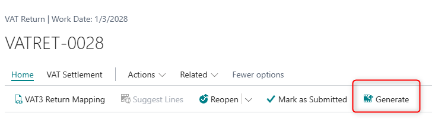

2.  The system:

    1. Validates VAT3 Return Mapping is configured

    2. Exports VAT3 Return XML file

    3. Saves the file to your Downloads folder (default name: VAT3 Return.xml)

    4. Attaches the XML to the VAT Return as a Document Attachment

       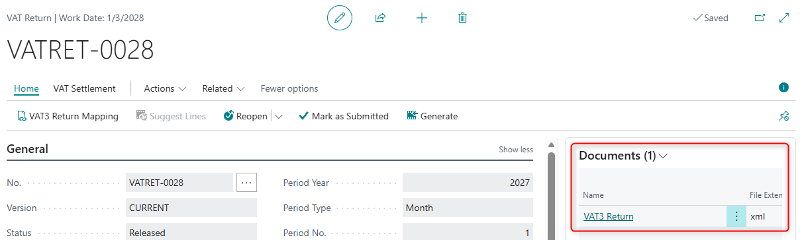

**Note**: Submitted VAT3 Return attachments cannot be deleted

5. Marks VAT entries with the VAT Return No. and Supplementary VAT Return if applies.

### XML File Contents

The VAT3 Return XML includes:

- Company Name and Registration Number (from Company Information)

- VAT Return Period (Start Date, End Date)

- Currency (default: E for Euro)

- Values for all 7 boxes (T1, T2, E1, E2, ES1, ES2, PA1): VAT amounts for T1 and T2, transaction values for E1, E2, ES1 and ES2, and the import value under postponed accounting for PA1

- Form Version (fixed at 1)

- Language (English or Irish, from VAT Setup)

- Filing Frequency (from VAT Setup)

- Unusual Expenditure details (if applicable)

  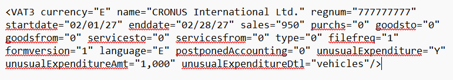

### Submitting VAT Returns

**Mark as Submitted**

After uploading the VAT3 Return XML to Irish Revenue's ROS (Revenue Online Service):

1.  On the VAT Return card, click Actions → Mark as Submitted

2.  Validation: If Mandatory VAT3 Export is enabled in VAT Setup and Bypass IE Localization Checks is disabled, the system blocks submission if no VAT3 XML has been generated. Enabling the bypass disables this safeguard.

3.  The status changes to Submitted

**Important**: In Ireland, submitted VAT Returns **cannot be modified**. If changes are needed, create a Corrective or Supplementary return.

**Mark as Accepted**

Once Irish Revenue confirms acceptance of the VAT3 Return:

4.  Click Actions → Mark as Accepted

5.  The status changes to Accepted

### VAT Settlement

After the VAT return is accepted, post the VAT settlement:

1.  Navigate to Calc. and Post VAT Settlement (search for "Calc. and Post VAT Settlement")

2.  Enter the appropriate date range and posting date

3.  Click OK to post the settlement

This creates balancing entries in the General Ledger and closes the VAT entries for the period.

### VAT Entries

The VAT Entries page has been enhanced to show which VAT returns included each entry.

**Additional Fields**

1.  Navigate to VAT Entries (search for "VAT Entries")

2.  Two new columns are visible:

    1. VAT3 Return No. - Shows the Standard or Corrective return that included this entry

    2. VAT3 Suppl. Ret. No. - Shows the Supplementary return that included this entry

**Audit Trail**

These fields provide complete traceability:

- Identify which entries were included in which returns

- Distinguish between standard and supplementary reporting

- Support audit requests for entry-level details

**Example**:

Entry \#12345:

- VAT3 Return No. = VATR-001 (Standard return for Jan-Feb 2026)

- VAT3 Suppl. Ret. No. = (blank)

Entry \#12789:

- VAT3 Return No. = VATR-001 (Standard return for Jan-Feb 2026)

- VAT3 Suppl. Ret. No. = VATR-005 (Supplementary for omitted entries)

## VAT Reporting

### VAT Audit Report

The VAT Audit Report exports data in CSV format for audit purposes. It provides three separate exports:

**Accessing the Report**

1.  Navigate to VAT Statements (search for "VAT Statements")

2.  Click Reports → VAT Audit Report

    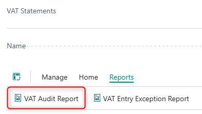

3.  Report Request Page:

    1. Data Set Selection (Checkboxes):

        1. Export Customers: Export the Customer master data table

        2. Export Open Payments: Export open negative customer ledger entries, such as unapplied payments and credit memos; ordinary positive unpaid invoices are excluded

        3. Export Late Invoicing: Export closed payment entries where the delay between payment posting and invoice posting exceeds the Late Invoice Delay threshold

        4. Export Vendors: Export the Vendor master data table

        5. Export VAT Entries: Export the VAT Entry table for the specified period

    2. Configuration Parameters:

        1. Late Invoice Delay (Days): Threshold in days for identifying late invoicing scenarios (default: 14 days)

            1. Example: If set to 14 days, the report identifies closed payments where the invoice was posted more than 14 days after the payment date

            2. Purpose: Helps detect cash-basis accounting irregularities or delayed invoicing practices

        2. File Name Configuration: Default filenames are automatically assigned:

            1. Customer.CSV

            2. OpenPay.CSV

            3. LateInv.CSV

            4. Vendor.CSV

            5. VATentry.CSV

        3. Date Filters:

            1. VAT Entry dataset: Explicit date range filters available ("VAT Reporting Date" and "Posting Date")

            2. Other datasets (Customer, Vendor, Ledger Entries): Standard table filters available but no specific date range filter on request page

               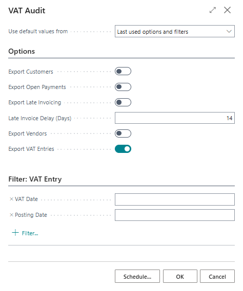

    3. User Feedback. Progress windows display during export for each dataset:

        1. "Exporting Customers..."

        2. "Exporting Open Payments..."

        3. "Exporting Late Invoicing Entries..."

        4. "Exporting Vendors..."

        5. "Exporting VAT Entries..."

        6. Current record being processed is displayed

4.  Exported Data Sets

Note: Only one table is exported (the latest from the list of checks on the request page) following the GB Audit Report behavior.

1. Customer Master Data:

|    Field     | Type | Description                       |
|:------------:|------|-----------------------------------|
| Customer No. | Text | Customer number                   |
|     Name     | Text | Customer name                     |
|   Address    | Text | Address line 1                    |
|  Address 2   | Text | Address line 2                    |
|     City     | Text | City                              |
|    County    | Text | County (Irish localization field) |
|  Post Code   | Text | Postal code/Eircode               |

2. Open Payments (Unapplied Credits):

|      Field      | Type    | Description                        |
|:---------------:|---------|------------------------------------|
|    Entry No.    | Integer | Ledger entry number                |
|  Customer No.   | Text    | Customer number                    |
|   Description   | Text    | Entry description                  |
|  Document Type  | Text    | Document type (formatted as text)  |
|  Document No.   | Text    | Document number                    |
|  Posting Date   | Date    | Entry posting date                 |
| Original Amount | Decimal | Original amount in LCY (CalcField) |

**Note**: Includes open customer ledger entries with negative amounts, such as unapplied payments and credit memos; ordinary positive unpaid invoices are excluded

3. Late Invoicing:

| Field | Type | Description |
|:--:|----|----|
| Entry No. | Integer | Payment entry number |
| Customer No. | Text | Customer number |
| Description | Text | Entry description |
| Document Type | Text | Document type (formatted as text) |
| Document No. | Text | Document number |
| Payment Posting Date | Text | Posting date of the payment entry |
| Invoice Posting Dates | Text | Semicolon-delimited list of invoice posting dates that exceeded the threshold (max 250 characters) |
| Original Amount | Decimal | Original amount in LCY (CalcField) |

**Note**: Identifies closed payment entries where invoicing occurred more than \[Late Invoice Delay\] days after payment, searching both forward and reverse application relationships

4. Vendor Master Data:

|   Field    | Type | Description    |
|:----------:|------|----------------|
| Vendor No. | Text | Vendor number  |
|    Name    | Text | Vendor name    |
|  Address   | Text | Address line 1 |
| Address 2  | Text | Address line 2 |
|    City    | Text | City           |
|   County   | Text | County         |
| Post Code  | Text | Postal code    |

5. VAT Entries:

| Field | Type | Description |
|:--:|----|----|
| Posting Date | Date | Transaction posting date |
| VAT Reporting Date | Date | VAT reporting date (may differ from posting date per EU rules) |
| Document No. | Text | Internal document number |
| Document Type | Text | Document type (formatted as text) |
| Base Amount | Decimal | VAT base amount |
| VAT Amount | Decimal | VAT amount |
| VAT Calculation Type | Text | Normal VAT, Reverse Charge, etc. |
| Type | Text | Sale or Purchase |
| Bill-to/Pay-to No. | Text | Customer/Vendor number |
| External Document No. | Text | Vendor invoice number or external reference |
| Entry No. | Integer | VAT entry number |

### VAT Entry Exception Report

The VAT Entry Exception Report identifies VAT entries with potential errors or unusual characteristics.

**Accessing the Report**

1.  Navigate to VAT Statements

2.  Click Reports → VAT Entry Exception Report

    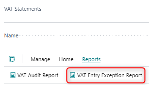

3.  Report Request Page

    1. Validation Checks (Checkboxes):

        1. Check VAT Base Discount: Identifies entries where the VAT Base Discount % field exceeds maximum base discount percentage

        2. Check Manual VAT Difference: Flags manual VAT adjustments (VAT Difference field) above specified threshold

        3. Check VAT Calculation Types: Detects mismatches between VAT entry calculation type and VAT posting setup configuration

        4. Check VAT Rate: Identifies calculated VAT rate differences exceeding tolerance percentage

**Note**: At least one validation check must be enabled to run the report.

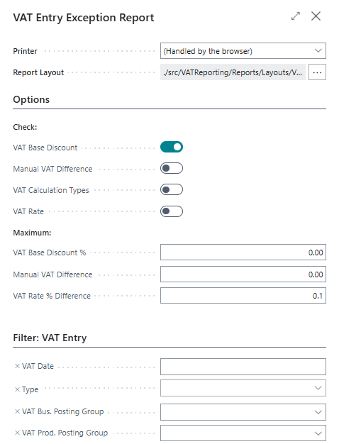

2. Threshold Parameters:

    1. Maximum VAT Base Discount %: Upper limit for base discount (0-100%, e.g., 5%)

        1. Default: Initialized from General Ledger Setup "VAT Tolerance %" field

    2. Maximum Manual VAT Difference: Absolute amount threshold for manual adjustments (e.g., 100)

        1. Default: Initialized from General Ledger Setup "Max. VAT Difference Allowed" field

    3. Maximum VAT Rate % Difference: Tolerance for calculated VAT rate variations (0-100%, e.g., 0.1%)

        1. Default: 0.1% if not previously set

3. Standard Filters:

    1. VAT Reporting Date range (recommended for performance)

    2. Type (Purchase/Sale)

    3. VAT Business Posting Group

    4. VAT Product Posting Group

    5. Other standard VAT Entry filters

4. Exception Details (per entry):

    1. Entry No.: VAT Entry identifier

    2. VAT Reporting Date: Date used for VAT reporting

    3. Document Type: Invoice, Credit Memo, etc.

    4. Document No.: Internal document number

    5. External Document No.: Vendor/customer document reference

    6. VAT Calculation Type: Normal VAT, Reverse Charge VAT, Full VAT, etc.

    7. VAT Business/Product Posting Groups: Posting group combination

    8. Base: VAT base amount

    9. VAT Base Discount %: Discount percentage applied to base

    10. Amount: VAT amount

    11. VAT Difference: Manual VAT adjustment amount

    12. ErrorText: Comma-separated description of all validation failures for this entry

5. Grouping and Totals:

    1. Entries grouped by Type (Purchase/Sale)

    2. Subtotals per Type showing aggregate Base, Amount, and VAT Difference

    3. Group header displays: "Total for Type [Purchase/Sale]"

6. Validation Logic

    1. VAT Base Discount Check:

        1. Compares the "VAT Base Discount %" field value from VAT Entry to the user-specified maximum threshold

        2. Flags entries where the field value exceeds the maximum percentage

        3. Helps identify unusual discount patterns that may require justification

        4. Error message format: "VAT Base Discount % > [threshold]"

    2. Manual VAT Difference Check:

        1. Compares the absolute value of the "VAT Difference" field from VAT Entry to the maximum threshold

        2. The VAT Difference field contains manual adjustments made during posting

        3. Flags entries where Abs(VAT Difference) > threshold

        4. Detects manual interventions that may need documentation for audit purposes

        5. Error message format: "VAT Difference > [threshold]"

    3. VAT Calculation Type Check:

        1. Compares VAT Entry "VAT Calculation Type" to the expected type from VAT Posting Setup

        2. Retrieves expected type using VAT Bus. Posting Group + VAT Prod. Posting Group combination

        3. Flags mismatches that could indicate incorrect posting group selection or setup issues

        4. Special handling: If VAT Posting Setup combination doesn't exist, expected type = "Missing"

        5. Helps ensure consistency with configuration

        6. Error message format: "Setup VAT Calculation Type is [actual] compared to setup [expected]"

    4. VAT Rate Check:

        1. Calculates effective VAT rate from Base and Amount after applying base discount

        2. Calculation steps:

        3. Adjust Base: Adjusted Base = Base × (1 - VAT Base Discount % / 100)

        4. Calculate Rate: Calculated Rate = (Amount / Adjusted Base) × 100

        5. Compares calculated rate to configured "VAT %" from VAT Posting Setup

        6. Flags differences exceeding tolerance threshold

        7. Special Handling:

        8. Reverse Charge VAT entries excluded from rate validation (0% VAT expected)

        9. Zero base detection: If Base = 0 but Amount <> 0, flags as exception

    5. Error message formats:

        1. "VAT % is [calculated] compared to setup [expected]" (rate mismatch)

        2. "Base is 0 and Amount is <> 0" (zero base exception)

7. Data Sources

    1. VAT Entry: Transaction data containing posted VAT entries

    2. VAT Posting Setup: Reference configuration for expected VAT calculation types and rates

    3. General Ledger Setup: Source of default threshold values

# Sales Documents

## Posted Sales Invoice

Irish tax authorities require the customer's VAT Registration Number to be displayed on VAT invoices.

1.  Standard Sales - Invoice Report (Extended)

    1. New Data Column:

        1. Customer VAT Registration No.: Retrieved from Customer table

    2. Custom Layout:

        1. Layout Name: "Sales Invoice - VAT Spec (Word) IE"

        2. Format: Word (.docx)

        3. Display Location: Customer VAT registration number printed in customer information section.

           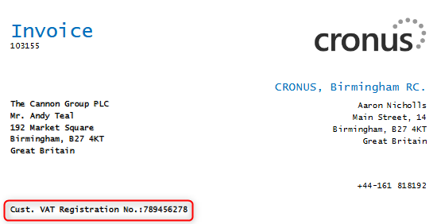

### Posted Sales Credit Memo

Similar to invoices, credit memos must display the customer's VAT Registration Number.

1.  Standard Credit Memos Report (Extended)

    1. New Data Column:

        1. Customer VAT Registration No.: Retrieved from Customer table

    2. Custom Layout:

        1. Layout Name: "Sales Credit Memo (Word) IE"

        2. Format: Word (.docx)

        3. Display Location: Customer VAT registration number printed in customer information section.

           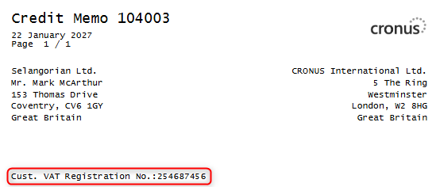

### Report Selection

Irish localized layouts available in Report Selection for Sales Invoice and Credit Memo. Administrators can set these as default layouts for all sales documents.

# Post Code Localization

The Ireland Localization includes a comprehensive Post Code Caption Class system that dynamically changes the "Post Code" field name based on the country.

**How It Works**

- Each Country/Region record can define a Post Code Name

- When that country is selected on an address, the field caption changes automatically

- Example: Ireland uses "Eircode" instead of "Post Code"

**Affected Modules**

The Post Code Caption Class applies to all those tables across all modules:

**Foundation**

- Company Information

- Standard Address

- Autocomplete Address

**Sales**

- Customer, Customer Bank Account, Customer Template

- Sales documents (Quote, Order, Invoice, Credit Memo, Return Order)

- Posted Sales documents (Shipment, Invoice, Credit Memo, Return Receipt)

- Archived Sales documents

- Ship-to Address

- Reminder/Fin. Charge documents

- All Sales Entity Buffers (API integration)

**Purchases**

- Vendor, Vendor Bank Account, Vendor Template

- Purchase documents (Quote, Order, Invoice, Credit Memo, Return Order)

- Posted Purchase documents (Receipt, Invoice, Credit Memo, Return Shipment)

- Archived Purchase documents

- Order Address, Remit Address

- All Purchase Entity Buffers

**Services**

- Service Item

- Service documents (Quote, Order, Invoice, Credit Memo)

- Posted Service documents

- Service Contracts (Active and Filed)

**Projects**

- Resource

- Job, Job Task

- Job Archive, Job Task Archive

**Inventory/Manufacturing**

- Location, Responsibility Centre

- Transfer documents (Header, Shipment, Receipt)

- Work Centre, Machine Centre

**Human Resources**

- Employee, Employee Template

- Alternative Address

- Union

**CRM**

- Contact

- Contact Alternative Address

- Bank Account

- Bank Account

- Payment Export Data

**Intercompany**

- All IC Inbox/Outbox Sales and Purchase headers (10 tables)

**Configuration Example**

|      Country       | Post Code Name | Result                     |
|:------------------:|----------------|----------------------------|
|    IE (Ireland)    | Eircode        | Field shows as "Eircode"   |
| US (United States) | ZIP Code       | Field shows as "ZIP Code"  |
|    DE (Germany)    | (blank)        | Field shows as "Post Code" |

**User Experience**

When entering a customer address:

1.  Select Country/Region Code = IE

2.  The Post Code field automatically relabels to Eircode

3.  Users see the familiar local terminology

# Company Lookup from Companies Registration Office

## CRO CORE API access

The CRO CORE Integration connects Business Central directly to the Companies Registration Office (CRO) CORE system - the official registry of Irish companies and business names.

To begin using CRO service: 

- Step 1 - Get an API Key:

To access Open Services, you will need to [<u>sign up</u>](https://services.cro.ie/signup.aspx), input your details and complete and sign a copy of the [<u>Open Services Terms and Conditions</u>](https://services.cro.ie/downloads/Web_Service-CRO-21-12-2021.pdf). The signed copy of the Terms and Conditions can be scanned and [<u>Emailed to CRO</u>](mailto:crosupportservices@cro.ie). When the CRO receives this, you will be given an API Key and granted full access.

- Step 2 – Follow the further instructions using your Email Address and API Key to setup the connection

## CRO CORE Integration Setup

To enable the connection, start by completing the setup in the relevant setup page. The Assisted Setup wizard can help to configure the connection.

1.  Navigate to CRO CORE Integration Setup page:

    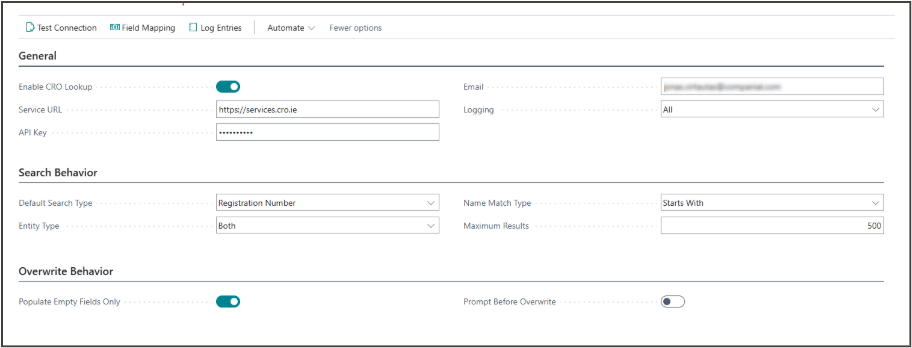

2.  On Integration setup, following fields must be configured:

    1. Enable CRO Lookup

    2. Service URL

    3. API Key

    4. Email

3.  Test Connection action validates that your CRO credentials are correct and the CRO service is reachable before you use the lookup feature:

    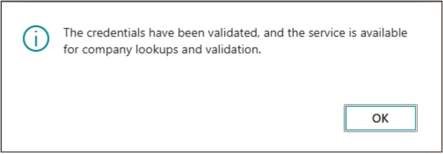 

4.  Configure the following fields:

<table style="width:100%;">
<colgroup>
<col style="width: 14%" />
<col style="width: 56%" />
<col style="width: 28%" />
</colgroup>
<thead>
<tr>
<th style="text-align: center;"><strong>Field</strong></th>
<th style="text-align: center;"><strong>Description</strong></th>
<th style="text-align: center;"><strong>Options</strong></th>
</tr>
</thead>
<tbody>
<tr>
<td style="text-align: center;"><strong>Enable CRO Lookup</strong></td>
<td><blockquote>

Specifies whether the CRO CORE integration functionality is enabled. When enabled, users can perform CRO lookups and submit requests to the external service.  

</blockquote></td>
<td style="text-align: center;">Yes/No</td>
</tr>
<tr>
<td style="text-align: center;"><strong>Service URL</strong></td>
<td><blockquote>

Specifies the base URL of the CRO/CORE service endpoint used for integration. 

</blockquote></td>
<td style="text-align: center;">Test. By default it is: https://services.cro.ie</td>
</tr>
<tr>
<td style="text-align: center;"><strong>API Key</strong></td>
<td><blockquote>

Specifies the password associated with the API user account. The value is stored securely and is not displayed to users.  

</blockquote></td>
<td style="text-align: center;">Secret Text </td>
</tr>
<tr>
<td style="text-align: center;"><strong>Email</strong></td>
<td><blockquote>

Specifies the email address used for communication with the CRO CORE service. 

</blockquote></td>
<td style="text-align: center;">Text</td>
</tr>
<tr>
<td style="text-align: center;"><strong>Default Search Type</strong></td>
<td><blockquote>

Specifies the default search method used when performing a CRO company lookup.   

</blockquote></td>
<td style="text-align: center;">Registration Number / Company Name</td>
</tr>
<tr>
<td style="text-align: center;"><strong>Entity Type</strong></td>
<td><blockquote>

Specifies which part of the CRO registry is searched when users perform a company lookup. 

</blockquote></td>
<td style="text-align: center;">Companies / Business Names / Both</td>
</tr>
<tr>
<td style="text-align: center;"><strong>Name Match Type</strong></td>
<td><blockquote>

Specifies how the system matches company names when you search by name. It defines the search matching strategy. 

</blockquote></td>
<td style="text-align: center;">Exact Match / Starts With / Contains Phrase</td>
</tr>
<tr>
<td style="text-align: center;"><strong>Maximum Results</strong></td>
<td><blockquote>

Specifies the maximum number of records that can be returned from a CRO lookup request. This helps control response size, improve performance, and prevent excessive data retrieval. If the number of matching records exceeds this value, only the first set of results up to the specified limit is returned.  

</blockquote></td>
<td style="text-align: center;">Integer</td>
</tr>
<tr>
<td style="text-align: center;"><strong>Populate Empty Fields Only </strong></td>
<td><blockquote>

Specifies whether information retrieved from the CRO service should only populate fields that are currently empty in Business Central. When enabled, existing values are preserved, and only blank fields are updated. When disabled, retrieved values may overwrite existing data.  

</blockquote></td>
<td style="text-align: center;">Yes/No</td>
</tr>
<tr>
<td style="text-align: center;"><strong>Prompt Before Overwrite </strong></td>
<td><blockquote>

Specifies whether the user should be prompted for confirmation before existing Business Central values are replaced with data returned from the CRO service. When enabled, a confirmation dialog displays the fields that will be updated, allowing the user to approve or cancel the changes.  

</blockquote></td>
<td style="text-align: center;">Yes/No</td>
</tr>
</tbody>
</table>

**Note:** Populate Empty Fields Only and Prompt Before Overwrite checkboxes cannot be enabled at the same time.

Defines how fields in Business Central are mapped to corresponding fields in the external system. Use field mappings to control which data is exchanged during synchronization and ensure information is transferred to the correct destination fields. The mapping can be configured and maintained according on the **Field Mapping** page.

## Lookup from CRO

Retrieve company information from the Companies Registration Office (CRO) by searching using the company registration number or name. The system sends a request to the CRO service and returns the latest available company details, helping to reduce manual data entry and improve data accuracy.

1.  Navigate to Lookup from CRO action:

    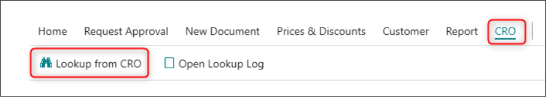

The CRO lookup is available on three card pages: 

- Customer Card - Search for Customers in the search bar, open a customer, find Lookup from CRO action in the Processing menu

- Vendor Card - Search for Vendors, open a vendor, find Lookup from CRO in the Processing menu

- Contact Card - Search for Contacts, open a contact card, find Lookup from CRO in the Processing menu

2.  Enter search criteria in the dialog page:

    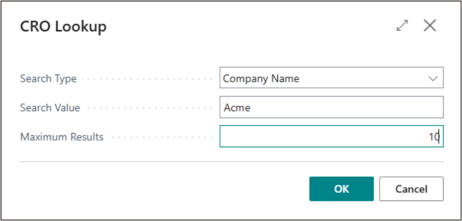

3.  Review the results list - list opens showing all matching companies from the CRO:

    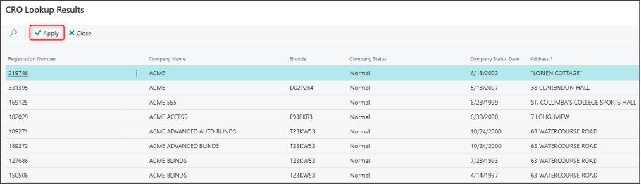

4.  Select the correct company by clicking the row with the company you want. The first result is pre-selected. Click Apply - CRO data is applied into your entity record:

    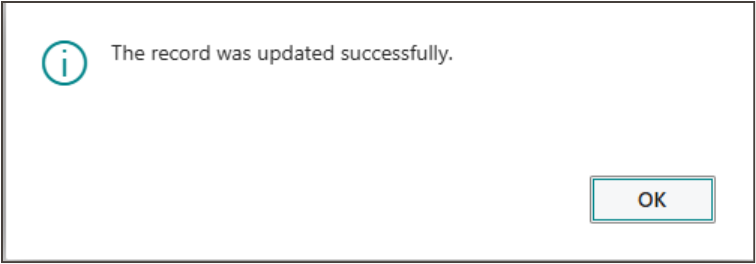

### Existing Entity validation flow 

When updating an existing Customer, Vendor, or Contact record, the system intelligently handles conflicts between local data and CRO data through configurable validation rules. 

Key Characteristics: 

- System recognizes existing field values

- System checks configuration settings before applying

- Can preserve existing data or prompt for confirmation

### A new Entity approach 

When creating a new Customer, Vendor, or Contact record, the CRO lookup provides a fast, automated way to populate all fields with official data from the first lookup. 

Key Characteristics: 

- New record is empty, so all CRO data flows directly into fields

- Single lookup populates the entire record

- Official CRO data prevents manual entry errors

- Since fields are blank, no overwrite risk

### Lookup Logs

The **Logging** field on the CRO CORE Integration Setup page controls which activities are recorded and defaults to **Error Only**. Choose **All**, **Error Only**, or **Disabled** before using the lookup; the behaviors are described below. 

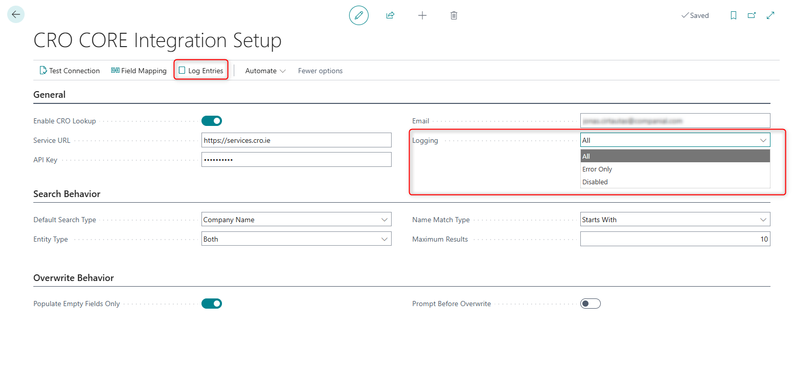

When All is selected on Setup page, the system creates a log entry for: 

- Connection tests

- Requests sent to CRO

- Responses received

- Successful submissions

- Failed submissions

When Errors Only is selected, the system creates log entries only for errors and failures. 

When Disabled is selected, no CRO integration log entries are created. 

How to open the log: 

1.  Click the Log Entries action from Integration setup page

2.  Search for CRO Log Entries in the search bar

3.  From any Customer, Vendor, or Contact card, click Open Lookup Log in the Processing menu. This shows only lookups for that specific record:

    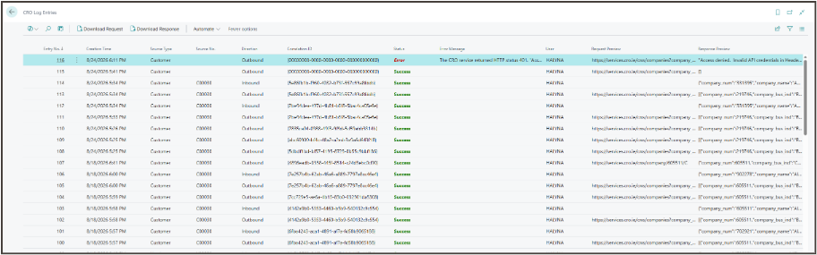 

The table contains the list of fields: 

- Entry No. - Unique sequential number automatically assigned to each log entry. Primary identifier for tracking individual CRO operations.

- Creation Time- The exact date and time when the log entry was created. Sorted descending (most recent first).

- Source Type - Identifies the entity type: Customer, Vendor, or Contact. Used for filtering log entries.

- Source No. - The code/number of the Customer, Vendor, or Contact associated with the CRO operation.

- Direction - Shows if message is outbound (sent to CRO) or inbound (received from CRO).

- Correlation ID - Unique GUID that links related request and response entries for the same transaction.

- Status - Operation result (Success/Error). Styled green for success, red for errors.

- Error Message - Detailed error description when operation fails.

- User - Username who initiated the CRO operation.

- Request Preview - First 250 characters of the JSON request sent to CRO service.

- Response Preview - First 250 characters of the JSON response from CRO service.

Actions: 

- Download Request - Exports the full JSON request payload to a file for detailed troubleshooting.

- Download Response - Exports the full JSON response payload to a file for detailed troubleshooting.

# Section 56 Authorization 

Before a customer can transact under the Section 56 VAT relief scheme, the following prerequisites must be satisfied: 

- The customer has obtained a valid Section 56 Authorisation from Irish Revenue.

- The authorisation certificate number is available.

- The authorisation is within its validity period.

- The customer is entitled to purchase qualifying goods and services under the Section 56 scheme.

Assumptions: 

- Business Central does not validate the certificate directly with Revenue.

- Certificate validity is maintained manually by users.

- Only customers with an active Section 56 authorisation can benefit from the VAT relief.

## Section 56 basic setup 

1.  Navigate to VAT Setup (search for "VAT Setup").

2.  Locate the Ireland Section 56  FastTab:

    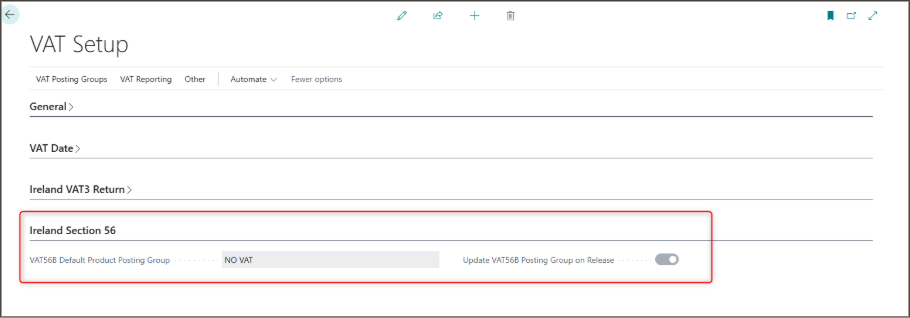

3.  Configure the following fields:

<table style="width:100%;">
<colgroup>
<col style="width: 17%" />
<col style="width: 65%" />
<col style="width: 16%" />
</colgroup>
<thead>
<tr>
<th style="text-align: center;"><strong>Field</strong></th>
<th style="text-align: center;"><strong>Description</strong></th>
<th style="text-align: center;"><strong>Options</strong></th>
</tr>
</thead>
<tbody>
<tr>
<td style="text-align: center;"><strong>VAT56B Default Product Posting Group</strong></td>
<td><blockquote>

Specifies the VAT Product Posting Group that will be applied to sales document lines when a customer is identified as a valid Section 56 authorised customer. The VAT % must be 0 for VAT56B Default Product Posting Group. 

</blockquote></td>
<td style="text-align: center;">The VAT Product Posting Groups list.</td>
</tr>
<tr>
<td style="text-align: center;"><strong>Update VAT56B Posting Group on Release</strong></td>
<td><blockquote>

Specifies whether the system should automatically update the VAT Product Posting Group on sales document lines when the document is released. 

When enabled, Business Central revalidates the customer's VAT56B (Section 56) certificate during release and replaces the existing VAT Product Posting Group with the VAT56B Default Product Posting Group on every sales line whose Type is not blank. The system does not validate whether individual goods or services qualify, so users must verify line eligibility before release.  

</blockquote></td>
<td style="text-align: center;">Yes\No</td>
</tr>
</tbody>
</table>

## Customer Section 56 Authorization

1.  Navigate to Customer Card (search for "Customers" list).

2.  Locate the Invoicing FastTab:

    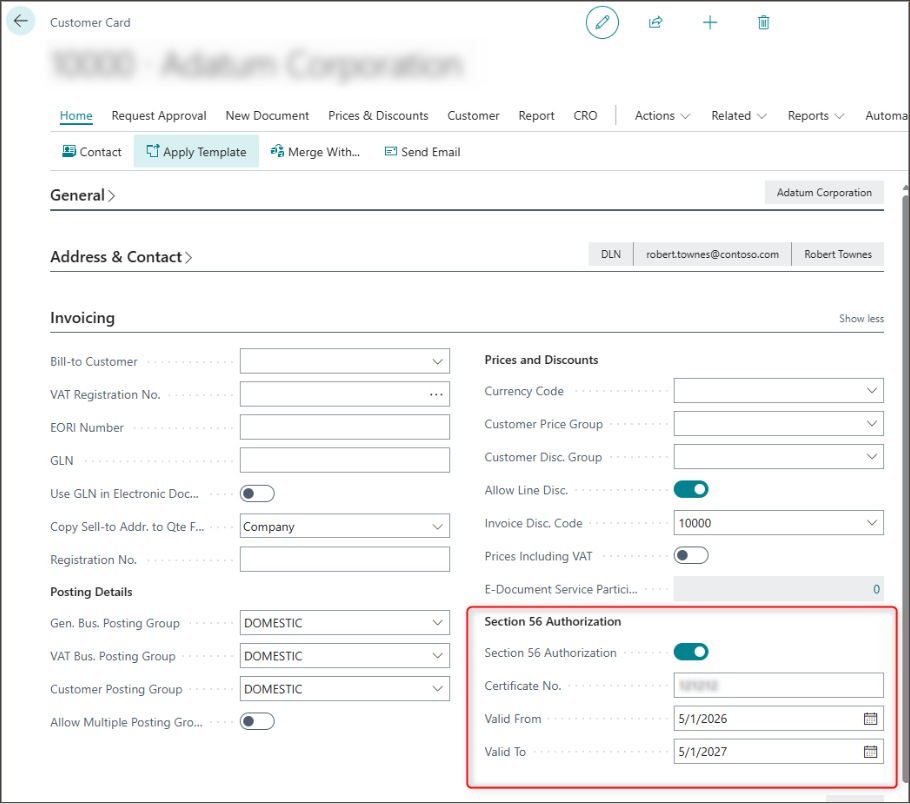

The section contains the list of fields: 

- Section 56 Authorization - Indicates whether the customer holds a valid Section 56 Authorisation and is eligible for VAT relief under the Irish Section 56 scheme. This field is used by the system to determine whether Section 56-specific VAT posting logic should be executed during sales order or invoice processing.

- Certificate No. - Specifies the Section 56 Authorisation Certificate Number issued by the Irish Revenue Commissioners to the customer.

- Valid From - Specifies the date from which the customer's Section 56 Authorisation becomes effective.

- Valid To - Specifies the expiry date of the customer's Section 56 Authorisation.

## Section 56 Processing

1.  Go to “Sales Invoices” or “Sales Orders” page.

2.  Click on action “+ New”:

    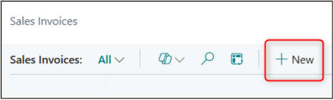

3.  Select Customer No. 50000.

4.  Set document date in the valid certificate date range

5.  On Lines section, select Item No. 1896-S.

6.  Set Quantity = “1”.

7.  “Post” action (for Sales Order “Ship and Invoice” option).

8.  Confirm lines update if Update Document VAT56B Posting Group on Release disabled on Setup page:

    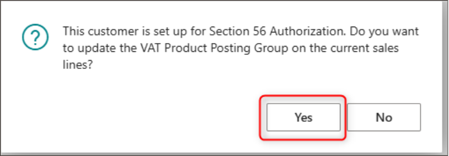

9.  Open a new Posted Sales Invoice and click “Find Entries”:

    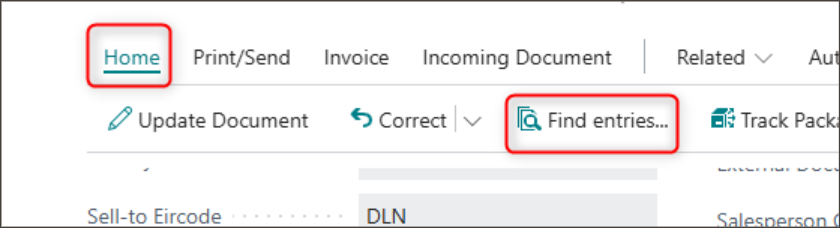

10.  Click on “VAT Entry” and confirm that VAT56B Default Product Posting group is applied:

     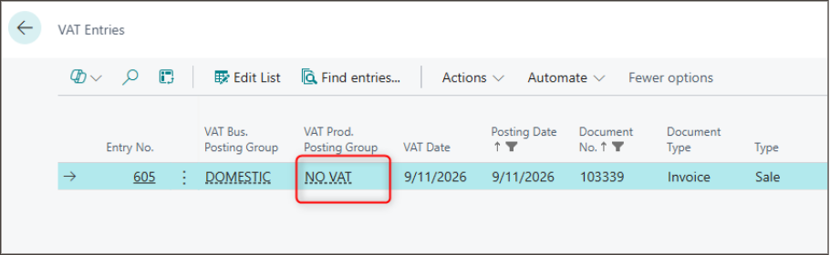
