# **User Manual**

## Contents

- [Permission Sets](#permission-sets)
- [General Ledger](#general-ledger)
  - [Exchange rate differences in banks](#exchange-rate-differences-in-banks)
  - [Configuration](#configuration)
  - [Calculation, posting and reporting of exchange rate differences](#calculation-posting-and-reporting-of-exchange-rate-differences)
  - [Balance sheet valuation](#balance-sheet-valuation)
  - [Balance sheet G/L](#balance-sheet-gl)
  - [Balance Sheet/Profit and Loss Account](#balance-sheetprofit-and-loss-account)
  - [Item Journal Batches](#item-journal-batches)
- [VAT Maintenance and reporting](#vat-maintenance-and-reporting)
  - [VAT Date](#vat-date)
  - [Service/goods delivery date](#servicegoods-delivery-date)
  - [Detailed VAT Entries](#detailed-vat-entries)
  - [VAT Reverse Charge Mechanism](#vat-reverse-charge-mechanism)
  - [Configuration](#configuration-1)
  - [Posting](#posting)
  - [Full VAT posting](#full-vat-posting)
  - [Configuration](#configuration-2)
  - [Posting](#posting-1)
  - [Postponed VAT](#postponed-vat)
  - [Configuration](#configuration-3)
  - [Posting](#posting-2)
  - [VAT Postpone Worksheet](#vat-postpone-worksheet)
  - [Posting VAT from the G/L journals (Incidental Contractors).](#posting-vat-from-the-gl-journals-incidental-contractors)
- [Accounts Receivable and Accounts Payable](#accounts-receivable-and-accounts-payable)
  - [Mandatory document receipt date](#mandatory-document-receipt-date)
  - [Sales Credit Memos](#sales-credit-memos)
    - [Item Correction](#item-correction)
    - [Customer Data Correction](#customer-data-correction)
    - [Descriptive Corrections of Sales Documents](#descriptive-corrections-of-sales-documents)
    - [Bulk discount sales credit memos](#bulk-discount-sales-credit-memos)
  - [Sales documents printouts](#sales-documents-printouts)
  - [Printing G/L Account number on sales documents](#printing-gl-account-number-on-sales-documents)
  - [Customer and Vendor Balance Reconciliation](#customer-and-vendor-balance-reconciliation)
  - [Split Payment mechanism (SP or MPP – Mechanizm podzielonej płatności)](#split-payment-mechanism-sp-or-mpp--mechanizm-podzielonej-płatności)
  - [Polish Classification of Goods and Services (PKWiU)](#polish-classification-of-goods-and-services-pkwiu)
- [SAFT files](#saft-files)
  - [SAFT configuration](#saft-configuration)
  - [Extension of the Text Filter and support for special characters](#extension-of-the-text-filter-and-support-for-special-characters)
  - [VAT 7 Statement lines](#vat-7-statement-lines)
    - [Handling Foreign Customers and VAT Country Codes](#handling-foreign-customers-and-vat-country-codes)
  - [Fixed Assets](#fixed-assets)
  - [Examples of VAT dimensions](#examples-of-vat-dimensions)
  - [Posting groups](#posting-groups)
  - [VAT Posting Setup](#vat-posting-setup)
  - [VAT Entries](#vat-entries)
  - [SAFT VAT file generation](#saft-vat-file-generation)
  - [Archiving SAFT Files](#archiving-saft-files)
    - [Creating an archive](#creating-an-archive)
    - [Scope of archived data](#scope-of-archived-data)
    - [Archive structure](#archive-structure)
    - [Browsing the archive](#browsing-the-archive)
    - [Re-exporting and restoring SAFT data](#re-exporting-and-restoring-saft-data)
  - [SAFT File Visualization/Edit](#saft-file-visualizationedit)
  - [SAFT (JPK) KR_PD and SAFT (JPK) ST_KR Setup](#saft-jpk-kr_pd-and-saft-jpk-st_kr-setup)
  - [SAFT FA files generation](#saft-fa-files-generation)

**Localization for Poland**

<figure>

<figcaption>
Microsoft Dynamics 365 Business Central
</figcaption>
</figure>

companial.com

All paths to the system are presented in the manual like this:

→ the name of the location in the system

The document *Localization for Poland for Microsoft Dynamics 365 Business Central* is a manual that presents solutions for adapting Microsoft Dynamics 365 Business Central system to the standards of Polish law. The document is intended to indicate a list of functions or adjustments to the system, along with settings and support for the functionality in question. Many of them are based on years of experience in implementing and servicing the Business Central system.

**Disclaimer:** This document is intended solely for internal use by partners and users of Microsoft Dynamics 365 Business Central. Companial is the author and holds exclusive copyright to this material. Unauthorized copying, modification, or sale of the content is strictly prohibited without the author's prior written consent.

# Permission Sets

System contains permission sets which allow use modifications created for Polish functionality. Each set is responsible for a certain range of functionalities.

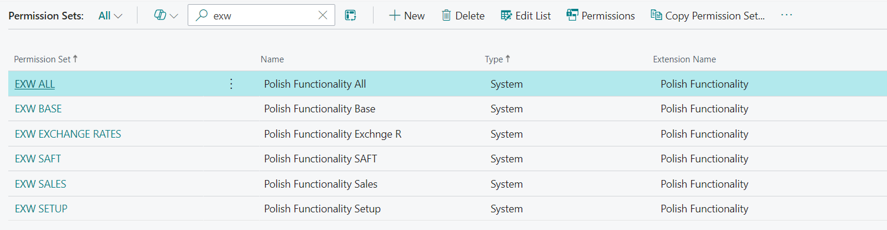

- **EXW ALL** – contains all permissions needed for Polish functionality (like permission SUPER)

- **EXW BASE** – basic permissions, mandatory for proper use of Polish functionality

- **EXW EXCHANGE RATES** - Bank Exchange Rates and Adjust Exchange Rates

- **EXW SAFT** - SAFT Functionality (without setup)

- **EXW SALES** - Credit Memo, Sales Reports

- **EXW SETUP** - SAFT Setup

# General Ledger

## Exchange rate differences in banks

The Polish functionality includes a mechanism that allows automatic calculation, posting and reporting of exchange rate differences realized on bank accounts and cash registers, operating according to the FIFO valuation method, and prepares balance sheet valuation of cash.

Additional functionality in Microsoft Dynamics 365 Business Central is the ability to display ***Detailed entries of exchange rate differences*** created after calculating the differences - the connections of the entries (input - output with presentation of amounts, exchange rates and calculated differences) are presented, as well as expansion of the posting mechanism with the option to post exchange rate differences to partially settled input amounts. In addition, support for accounts with credit balances has been implemented - a reversed mechanism for calculating exchange rate differences, i.e. triggered when funds are credited to the account, i.e. partial or full repayment of the credit balance.

## Configuration

→ General Ledger Setup → Bank and journals

- ***Bank Exchange Differences No. Series*** - for automatic posting, this field allows you to select the numbering series according to which the system will generate posting numbers.

- ***Bank Exchange Differences Description*** - description that will appear in posted entries of foreign exchange differences.

- ***Posting on the basis of detailed entries of exchange rate differences*** - is an optional field, which should be set once during system implementation. Checking this field results in posting of exchange rate differences to the ***Detailed Exchange Rate Difference Entries*** table, a list that indicates in detail the accrued amounts of the differences and the information from which they result. Failure to check this box causes the system to post exchange rate differences on the basis of the standard list of ***Bank Account Ledger Entries***, which in turn may result in a lack of detail in the entries and difficult analysis of the calculated differences.

**Important**

If this box is checked and there are already detailed entries of exchange rate differences, it is not possible to uncheck this box at a later time.

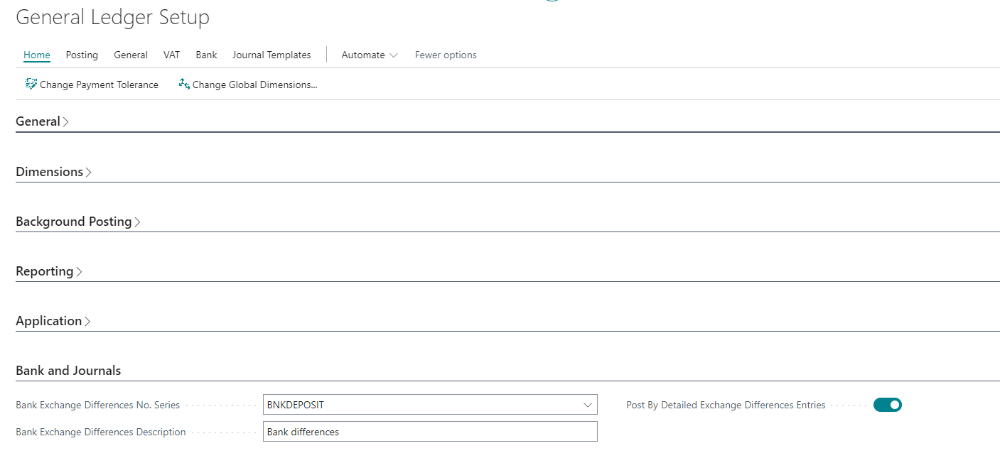

## Calculation, posting and reporting of exchange rate differences

→ Bank Accounts

For calculating, posting and generating an exchange rate differences report, there is a function located on the ***Bank Accounts*** page. To access them, select one specific one from the list of existing bank accounts and go to its page. Then use ***Exchange differences report.***

- 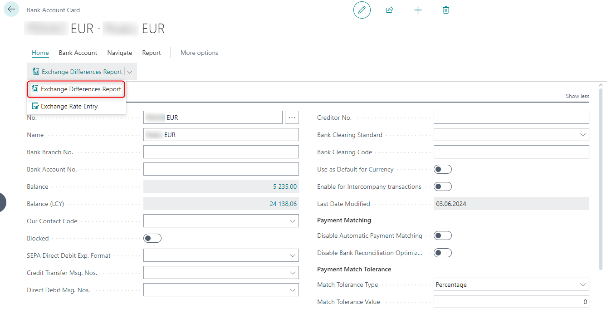***Exchange differences report –*** calculating exchange rate differences, creating report and posting calculated entries. The differences are calculated based on the FIFO valuation method. The system takes into account the rate at which the funds entering the bank account were credited (input rate) and the rate at which the outgoing transfer of funds was credited (output rate).

Before running the report, which is automatically filtered to the selected bank account, optionally indicate the date range for which the report is to be generated.

**If a start date is not specified** or there are transactions with a date earlier than the provided start date, the report will automatically use as the start date:

- the date of the **oldest posted difference** or

- the **first day of the month** in which such a transaction occurred.

**When a user runs the report again for the same period**, specifying a start date, the report will display **only entries within the selected date range**. This happens because unposted differences prior to that period have already been posted during the first run of the report.

**If a user runs the report again without specifying a start date**, the report will display **only transactions from a single day** - **the end date**.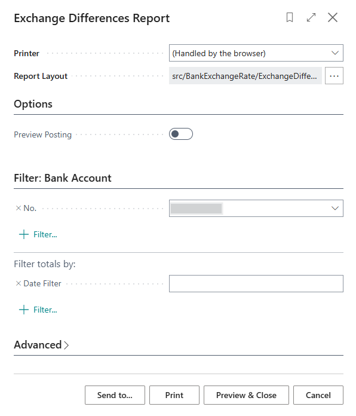

Prior to posting the document, the correctness of the generated entries can be verified using the **Preview Posting** function.

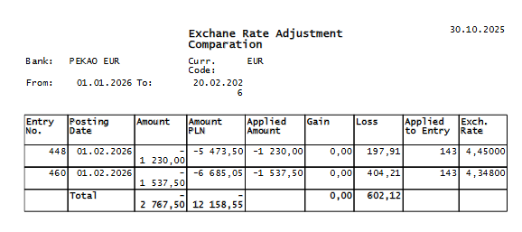

Only after posting the exchange rate differences, do they appear in the report and in the ***Exchange Rate Entries*** table:

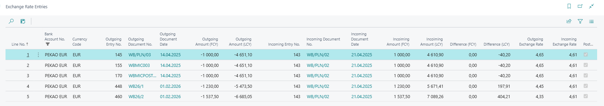

The exchange rate difference report can be generated in the system, can be printed, or exported to a file.

## Balance sheet valuation

This functionality enables calculation of exchange rate differences, created on open settlements of customers and vendors according to the exchange rate of the day when the valuation is carried out, and posting of the created differences to the appropriate accounts for a specific document (also the possibility of de-recognition of exchange rate differences with the date of the next period). In addition, this functionality also enables the presentation of data in the form of a report. It is possible to run the function in test mode and check the correctness of the calculation without posting the differences on the accounts, as well as to run the calculation separately for the customer's or vendor's account. For easy access to historical data, a new table was created - ***Register of exchange rate adjustments.***

→ Adjusting exchange rates

- ***Start Date*** and ***End Date*** - specify the time interval for which exchange rate differences are calculated. Leaving the ***Start Date*** field blank means that all entries from the period before and on the date specified in the ***End Date field*** will be adjusted. It is mandatory to fill in the ***End Date*** field.

- ***Posting description*** - the description that will be transferred to the general ledger entries after the script is executed. The field is filled automatically by the system, but, if necessary, you can manually change its content.

- ***Posting Date*** - the date on which the entries will be posted as a result of running the function. The field is filled automatically by the system based on the ***End Date***, but if necessary, you can manually change it to another date between ***Start Date*** and ***End Date**.*

- ***Document No.*** - the ability to enter the document number with which the system will post the adjustment.

- ***Adjust Customers*** - switching on this option indicates that customer accounts will be included in posting of exchange rate differences.

- ***Adjust Vendors*** – switching on this option indicates that vendor accounts will be included in posting of exchange rate differences.

- **Adjust Employees** - switching on this option indicates that employee accounts will be included in posting of exchange rate differences

- **Adjust Bank Accounts** - switching on this option indicates that bank accounts will be included in posting of exchange rate differences (this option is not necessary to be switched on, calculation of exchange differences is done during FIFO valuation of bank accounts).

- ***Adjust G/L accounts for additional reporting currency*** - switching on this option results in correcting the amounts in G/L accounts for additional reporting currency when the function is run.

- ***Adjust per entry** – switching on this option results in posting the differences for every entry in customers and vendors accounts where such exchange rate differences occur.*

- ***Post Back*** - switching on this option results in automatic de-recognition of exchange differences on the date indicated in the *Post Back Date* field*.*

- ***Post Back Date*** - the date on which the entries will be posted as a result of running the function.

- ***Preview Posting*** - this box is checked when the user wants to test how the system will calculate exchange rate differences in a preview mode; when switched on, a simulation of the difference calculation report is generated, but no postings to accounts are created.

  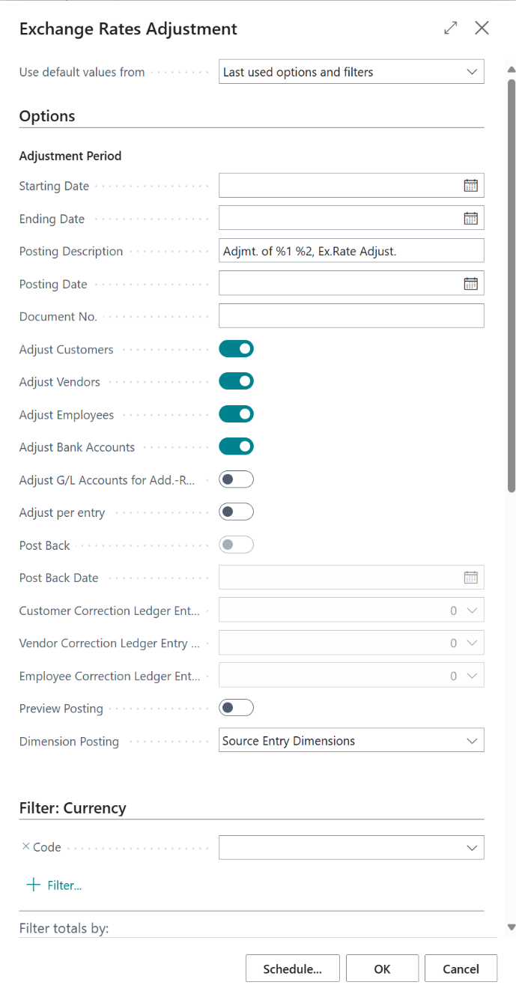

The report is run by selecting OK.

After the report is executed, entries will be generated. If the report is generated for different account types, it is divided into sections - differences calculated for entries in the customer and vendor ledgers.

Each calculated gain or loss amount is linked to a specific document and additional information about the document and the calculated difference is included.

When the report is run without ***Preview Posting***, the system will create the appropriate postings to general ledger accounts. If the ***Preview Posting*** checkbox is not selected, exchange rate adjustments during script execution will be automatically posted.

In addition to postings in the chart of accounts, the system also creates entries in the **Exchange Rate Adjustment Registers**.

→ Exchange rate adjustment registers

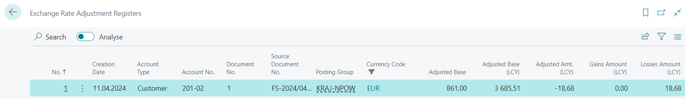

## Balance sheet G/L

This functionality allows the generation of statutory reports (Article 18 of the Accounting Act, hereafter referred to as the Accounting Act), which are required to be prepared at the end of each reporting period, at least at the end of the month. The reports contain information on the beginning balance, the turnover of the period, the turnover cumulatively since the beginning of the financial period and the balance as of the date of the report, for all general ledger accounts, customer accounts and vendor accounts. In addition, reports can be generated in English and with account descriptions in a foreign language.

All three reports work on similar principles - they provide a summary of turnover and balances for a selected group of accounts and for the date range selected in the ***Date Filter*** field.

→ G/L Acc. Net Change & Balance

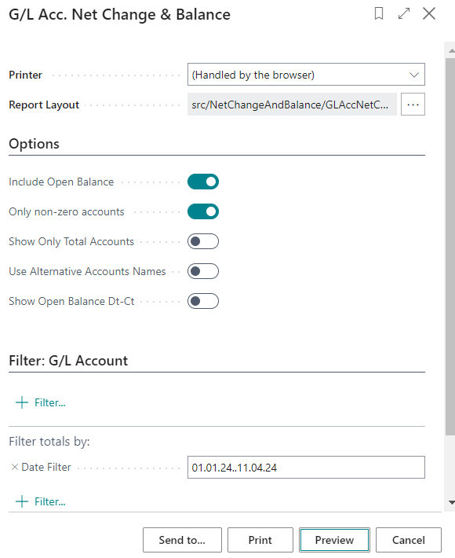

→ G/L turnover and balance

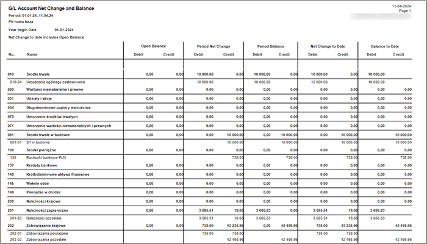

In addition, it is possible to list the turnover and balances in a layout based on the chart of accounts. Start and end dates must be filled in. This functionality also allows you to upload the data to Excel. The list and totals can be filtered by various criteria. Since the window shows accounts in a statement of turnover and balances layout, the columns do not have summaries.

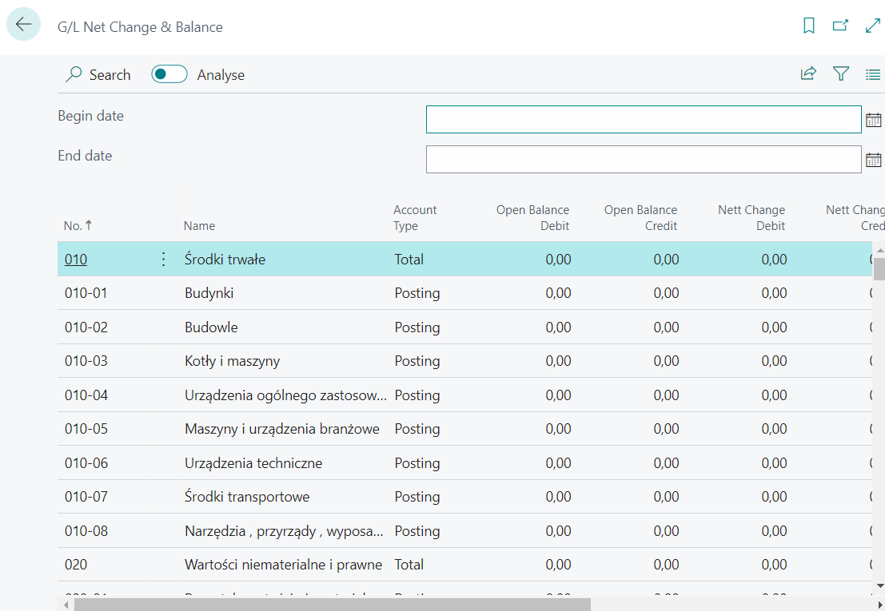

## Balance Sheet/Profit and Loss Account

The primary tool for financial reporting is the functionality of the Balance Sheet and Income Statement. Both documents are structured strictly according to the Accounting Act. The setup of these statutory reports into the system is a one-time task and the configuration is simplified. With this functionality, it is possible to create a Balance Sheet and a Profit and Loss Statement for a given reporting period, the values of which are created based on the chart of accounts defined in Business Central.

In order to configure the financial reports, you need to correctly specify the account type. This is possible by navigating to the ***Chart*** ***of Accounts*** and then to the record of the corresponding account. Here you should choose whether the account is to be included in the ***Balance Sheet*** or in the ***Income Statement***.

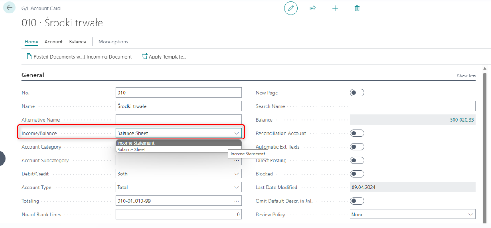

→ Financial Reports

The added modifications allow you to configure the balance sheet based on credit records only or debit records only. The source of data will then be additional ledgers of vendors and customers. According to current regulations, it is necessary to be able to present general ledger accounts in both assets and liabilities. This depends on the type of balances shown.

To set up the balance sheet correctly, go to ***Financial Reports*** and select ***Balance Sheet***.

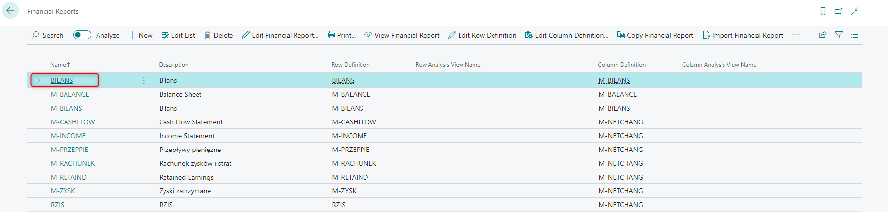

→ Definitions → Row definition

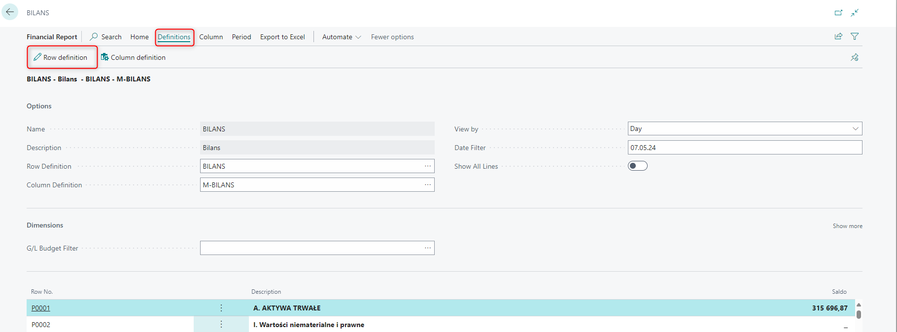

Information will then be displayed on how the values in each line are calculated. You should select:

- **Totaling type** - determines what type of values will be entered into the Totaling field.

- **Totaling** - depending on the type, it is necessary to enter the data source. For example, for **Posting Accounts** it is necessary to enter the account numbers from which the values will be totaled in a given line of the report.

- **Row Type** - determines whether the amounts will be reported as **Net Change**, **Change per day** or **Initial Balance**.

- **Amount Type**- where you specify what type of records will be counted in the line. In addition to the three that are included in the standard version of the system: **Net Amount, Debit Amount, Credit Amount** these have been added for the Polish localization:

    - **Customer Debit** - determines balance of transactions with customers, displays debit amount

    - **Customer Credit** - determines balance of transactions with customers, displays credit amount

    - **Vendor Debit** - determines balance of transactions with vendors, displays debit amount

    - **Vendor Credit** - determines the balance of transactions with vendors, displays the amount of credit

      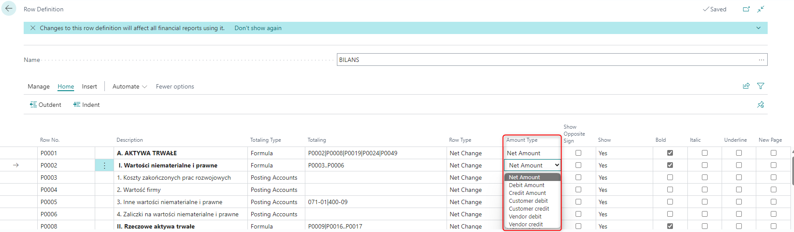

You can also modify the definition of columns.

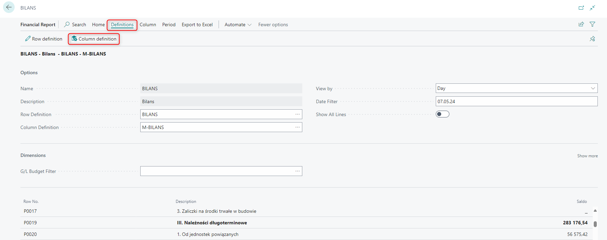

You can configure what you want the column to be called - Column ***Header, Column Type, Ledger Entry Type*** or ***Amount Type***.

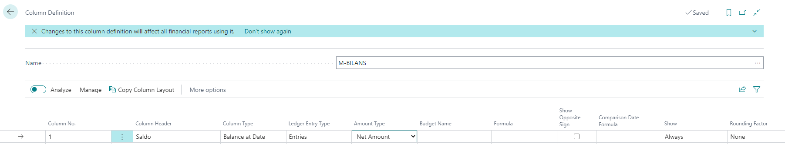

Once the ***Balance Sheet** has been* properly configured, you can return to the ***Financial Report*** page and ***Recalculate** the* totals on the report, which will show you the result of the configured Balance Sheet.

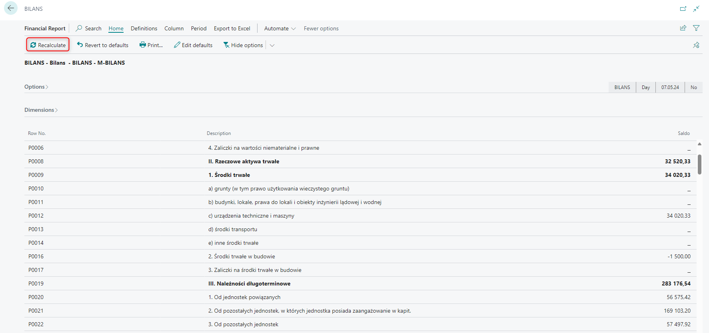

→ Income Statement

The second mandatory statement is the **Income Statement**. For it, the general ledger accounts defined by the type of **Income Statement** will be taken. The process of creating it is similar to the Balance Sheet. After going to Financial Reports, select **RZIS,** and in the next steps define the definition of columns and rows. After recalculation, the calculated Income Statement will appear.

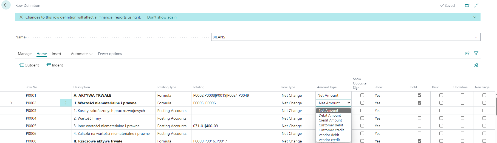

## Item Journal Batches

This functionality assigns the set ***General Business Posting Group*** to the selected instance, and then assigns it on the lines created in ***Item Journals***, thus avoiding the user from completing this field manually each time.

→ Item Journal Batches

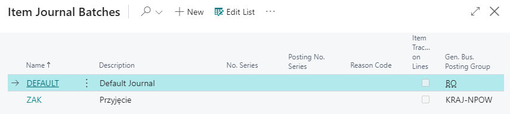

→ Item Journals

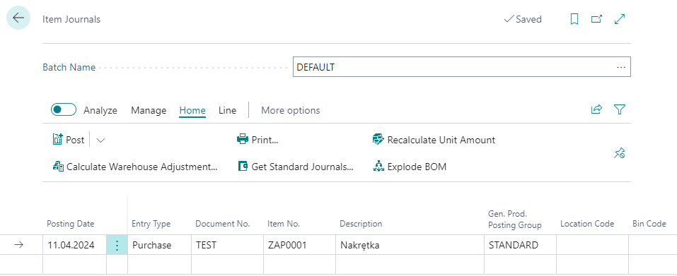

# VAT Maintenance and reporting

## VAT Date

A functionality supporting the ***VAT Date*** has been introduced in Microsoft Dynamics 365 Business Central. This field has been added to documents and journals to meet the requirements of Polish law, which indicate that it is possible to settle VAT in a different period than the posting date of the document. Therefore, a ***VAT Date*** field has appeared in documents and journals, which can be set independently of the posting date. The ***VAT date*** is transferred to the VAT entries, and based on this date, the VAT register printout is created and the VAT return is calculated.

Before starting postings that result in the creation of entries shown in VAT registers and returns, you must configure the VAT settings in ***VAT Setup***.

→ VAT Setup → VAT Date

***The VAT*** tab includes the fields

- ***Allow VAT Date From*** indicates the start date of the defined period in which VAT posting will be allowed. Attempting to post VAT outside of this period will result in an error during posting and will prevent the posting from being done.

- ***Allow VAT Date To*** indicate the end date of the defined period in which VAT posting will be allowed. Attempting to post VAT outside of this period will result in an error during posting and will prevent the posting from being done.

  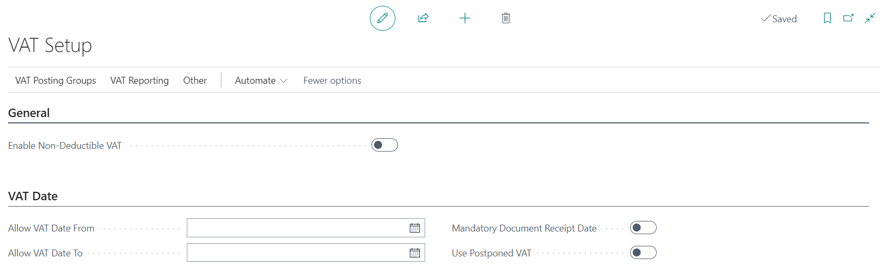

The ***VAT Date*** field has been added both for newly entered sales invoices and purchase invoices, as well as in the journals where entries are created in G/L, customer and vendor entries are created.

Once the transaction is posted, the ***VAT Date*** is transferred to ***VAT Entries***.

→ VAT Entries

In addition to the ***VAT Date*** in the ***VAT Entries,*** fields have been added for the vendor: name, address, postal code, city. All this data is visible in the ***Sales and Purchase VAT Entries generated*** later.

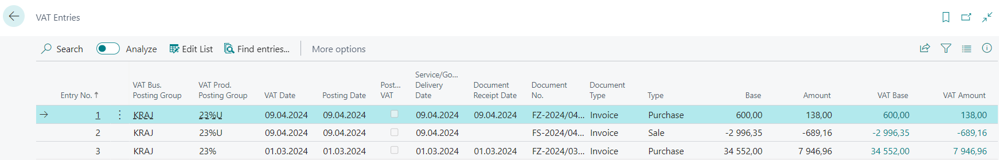

→ VAT Register of Sales and Purchases

Selecting a date range generates a ***Sales/Purchase VAT Register*** for the specified period.

This is a basic report for calculating the amount of output and input VAT for the selected accounting period. To adapt the report to the requirements of the Polish Value Added Tax Act, it is possible to filter the VAT entry by VAT settlement date (***VAT Date***) in the report. In addition, in the ***Filter: VAT Entries tab***, we can set the report's printout according to a number of other filters, including Country Code, VAT Business Posting Group or VAT Product Posting Group. On the ***General*** tab, we choose whether we want to generate the report for sales, purchases, or both types of transactions. The report displays the VAT base amount, the VAT amount, the unrealized VAT amount, and detailed information about the customer or vendor for each document.

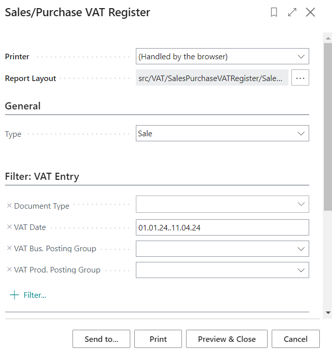

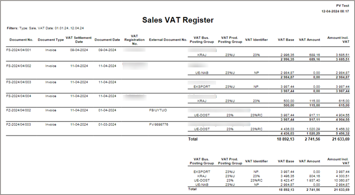

## Service/goods delivery date

Following the provisions of Polish law, the date of delivery of goods or performance of a service must be included on invoices documenting sales. In Microsoft Dynamics 365 Business Central, this date has been added to purchase and sales documents and document printouts and it is transferred to the ***VAT Register***. In addition, it is possible to indicate settings that will retrieve the exchange rate of currency measurements or automatically set the VAT date relative to the date of execution of the service/supply of goods.

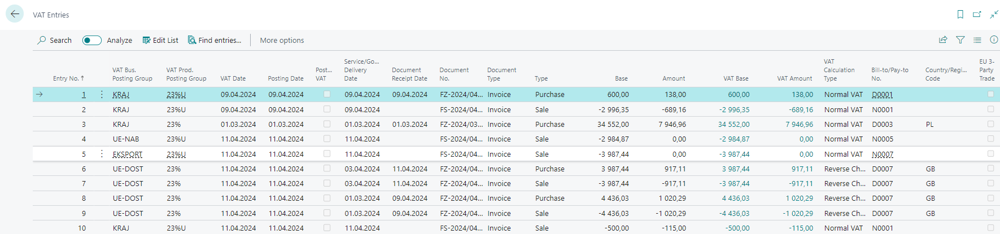

## Detailed VAT Entries

For the needs of Polish accounting, the ***Detailed VAT Entries*** functionality has been added to Microsoft Dynamics 365 Business Central for more accurate analysis and better control over changes in VAT and the period in which it is to be settled.

Detailed VAT entries are created similarly to detailed entries in other subsidiary ledgers, such as detailed entries of the customers’ or vendors’ ledger. The sum of the detailed VAT entries is reflected in ***VAT Entries***.

In the *Detailed **VAT Entries***, you should pay attention to two important pieces of information in particular:

- ***Entry type*** - determines the origin of the VAT entry. The following types of entries are distinguished in the system:

    - ***Initial entry*** - this is the initial (first) detailed VAT entry for a given VAT entry or the reversal of this entry.

    - ***VAT postponed*** - means that the fact of VAT postponement or reversal has been recorded in this VAT detail entry.

    - ***Realized VAT*** - means that the fact of realization of the superior VAT in the given VAT entry or reversal of this entry has been registered in this detailed VAT entry.

    - ***Change of VAT obligation date*** - means that for this VAT detail entry the VAT obligation date has been changed or reversed.

    - ***Reverse charge adjustment*** - means that this detailed VAT entry has recorded the amount of the reverse charge base and VAT converted at a different rate than the conversion of the purchase and liability amounts was made.

    - ***Change skip in VAT entries*** - indicates that a change has been made to the Skip in ***VAT entry*** field for this detailed VAT entry.

    - ***Change of VAT attributes*** - indicates that a change of VAT attributes has been made for this VAT detail entry.

- ***VAT entry number*** - specifies the number of the associated entry for this particular VAT entry.

  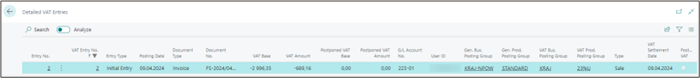

## VAT Reverse Charge Mechanism

According to Polish law, Intra-Community Acquisition of Goods (IAC) and Services, as well as Import of Services are subject to VAT. Accordingly, these transactions, along with the calculated VAT, must be shown in VAT registers. For this purpose, the reverse charge mechanism is used. Thanks to it, all transactions of WNT and purchase/import of services are shown both in the VAT sales register and the VAT purchase register. In addition, the Polish functionality allows VAT to be calculated in the local currency at an exchange rate from a different date than the date of conversion of the value of purchases and liabilities for accounting purposes. For this purpose, an additional date is provided to establish a separate exchange rate for calculating the amount of VAT in local currency.

## Configuration

→ VAT Posting Setup

In order to correctly post purchase invoices for intra-Community acquisition of goods or import of services, you have to make the appropriate settings in the ***VAT Posting Setup*** window.

- Here, for each line (each combination of ***VAT Business Posting Group*** and ***VAT Product Posting Group***) that will be used when posting invoices, set the ***VAT Calculation Type.***

- For each combination for which it is reasonable ***to*** apply the reverse charge mechanism, set Reverse ***Charge VAT*** in the ***VAT Calculation Type*** field and specify the G/L account numbers in the ***Reverse VAT Account*** and ***Non-Reverse VAT Account*** columns***.***

- ***The VAT Reverse Charge Account*** will be credited with the amount of output VAT calculated for transactions of intra-Community acquisition of goods and services and import of services.

- ***The Unrealized VAT Reverse Charge Account*** will be credited with the unrealized amount of output VAT calculated for intra-Community acquisition of goods and services and import of services transactions.

- With the above settings, the system will create two VAT lines when posting a document/journal line: due and input. Both VAT entries will also be visible in the ***VAT Register***.

  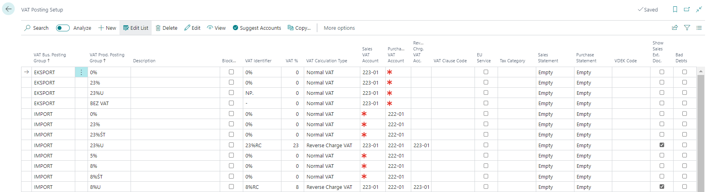

## Posting

Posting of purchase invoices for goods and services purchased within the European Union and for services purchased outside the European Union is done with the ***Reverse Charge VAT*** calculation type. These postings result in the calculation and posting of output and input VAT, but do not affect the value of purchases and the amount of liabilities to vendors.

- The purchase invoice is entered into the system in the standard way. If the business transaction meets the conditions for VAT calculation according to the reverse charge mechanism, check whether the ***VAT Business Posting Group*** and ***VAT Product Posting Group*** have been correctly selected for this invoice.

- Enter a value into the ***VAT Date*** field if it is different from the date of issuance of the document.

- The exchange rate for converting the value of purchase and payables from the purchase invoice into local currency is taken from the exchange rate table by date in the ***Document Date or Posting Date or VAT Date** (depending on settings in the **Purchases & Payables Setup**)* field, and the exchange rate for converting the VAT amount into local currency is taken from the exchange rate table by date in the ***VAT Date*** field.

## Full VAT posting

Fulfilling the requirements of the Polish law, a full VAT posting function has been created, which allows the user to enter the VAT base amount manually, regarding postings that include only the VAT amount.

This functionality is particularly important for recording purchases from outside the EU. For such transactions, two documents must be posted:

- a purchase invoice showing the net value of purchases, which is a liability to the vendor;

- Certified Customs Declaration (PZC), which takes into account VAT and other additional customs costs charged to the delivery from outside the EU.

Since the net value forming the basis of the VAT calculation is posted on the basis of the purchase invoice, it cannot be posted again on the basis of the PZC document when posting VAT. Therefore, the posting of the PZC document includes only the tax amount, while the VAT calculation basis is given only for information, which ensures the correctness of the printing of the purchase transaction in the VAT register.

## Configuration 

In order to be able to post only VAT on the basis of the purchase document, it is necessary to define the right settings.

→ VAT Posting Setup

You need to define the correct combination of VAT Business Posting Group and VAT Product Posting Group, for which **Full VAT** will be selected in the ***VAT Calculation Type*** field, while the G/L account selected in the **Purchase VAT Account** field will be assigned a VAT Product Posting Group the same as the one used in the setup just defined.

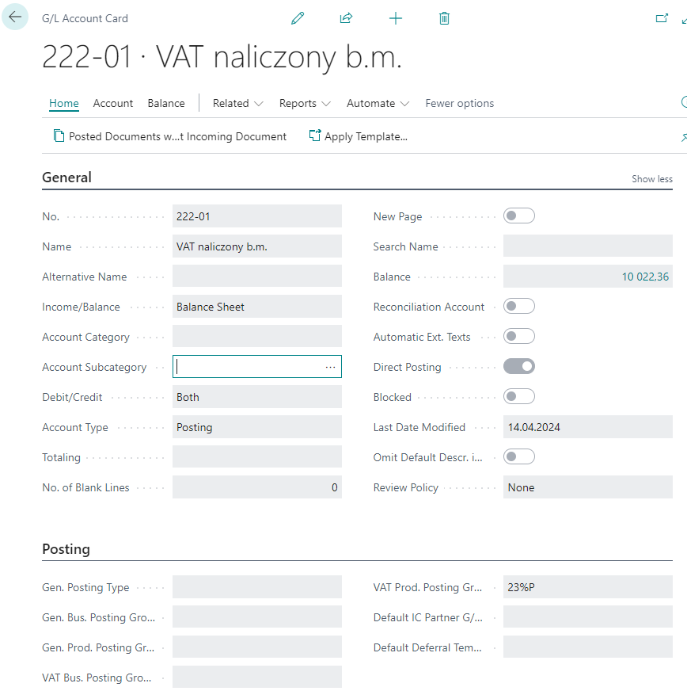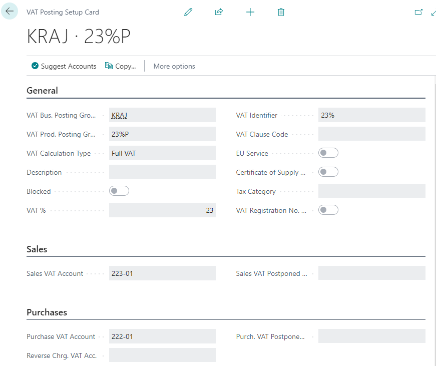

## Posting

The PZC document is entered similarly to a regular purchase invoice or by posting through the journal.

**→ by using purchase invoice**

The file of the customs and tax office is selected as the vendor. On the lines we enter:

- **Type** - G/L account

- **Account No.** - number of account defined as input VAT account in VAT posting setup

- **Quantity** - enter the number 1

- **Direct unit cost without VAT** - enter the VAT amount shown on the PZC document

- **VAT base amount** - enter the amount that is the basis for calculating VAT, shown on the PZC document

Complete the remaining fields in a standard way and post the document.

Posting the document will result in the VAT amount in the books on the indicated input VAT account, as well as a liability to the customs and tax office in the same amount. The manually entered VAT base amount will be shown in the VAT Entries associated with the posted purchase invoice (PZC document) and will also appear in the purchase VAT register.

**→ by using general journal**

In the general journal line enter:

- **Posting Date** – the date the liability arises

- **Document Type** – select: ***Invoice***

- **Document No.** – the number under which the transaction is to be recorded

- **Account Type** – select: ***G/L Account***

- **Account No.** – the number of the account defined as the input VAT account in **VAT Posting Setup**

- **Gen. Posting Type** – select: ***Purchase***

- **VAT Bus. Posting Group** – enter the appropriate VAT Business Posting Group

- **VAT Prod. Posting Group** – enter the appropriate VAT Product Posting Group for which full VAT is configured

- **Amount** – enter the VAT amount shown on the PZC document

- **Full VAT Base Amount** – click the ***VAT Amount*** field, then expand the context menu (“...” visible next to the field), and in the newly opened window find the ***Full VAT Base Amount*** field and enter the value

- **Bal. Account Type** – select: ***G/L Account***

- **Bal. Account No.** – enter the number of the balancing G/L account

Then post the journal.

Posting the journal will result in the VAT amount being recorded in the ledgers on the specified input VAT account. The manually entered VAT base amount will be shown in the **VAT Entries** linked to the posted journal line.

## Postponed VAT

Functionality that allows deferring the settlement of output and input VAT in a situation when there is no possibility to settle the VAT amount at the moment. The mechanism also allows posting deferred VAT amounts to separate G/L accounts. As a result, the sum of turnover in the VAT register in a given period is consistent with the sum of turnover of G/L accounts, on which current input and output VAT is recorded.

The system has VAT posting control, as well - if the **Postponed VAT** functionality is activated, VAT posting to another period is prohibited if the ***Postponed VAT*** option has not been selected in the document.

## Configuration 

→ VAT Setup

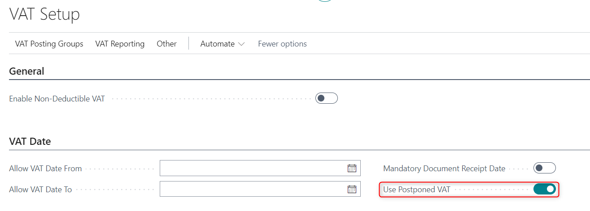

To allow users to use postponed VAT on the ***VAT Setup*** page ***Use Postponed VAT*** option must be enabled.

→ VAT Posting Setup

The accounts dedicated to posting the postponed VAT amounts are configured in the **VAT Posting Setup:**

- Sales VAT Postponed Account

- Purch. VAT Postponed Account

  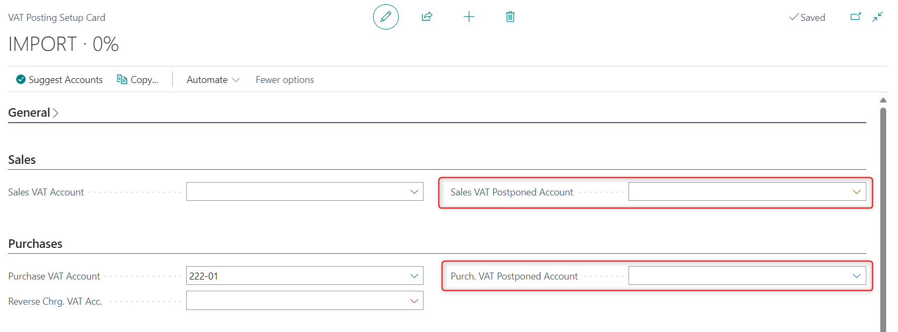

## Posting

In sales and purchase documents, a Postponed VAT field is available in the header. If it is checked, the VAT entry is recorded as postponed and is posted on the account selected in VAT Posting Setup.

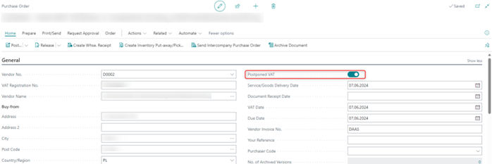

## VAT Postpone Worksheet 

If you want to postpone VAT on invoice which is already posted use VAT Postpone Worksheet.*** *** 

→ VAT Postpone Worksheet* *

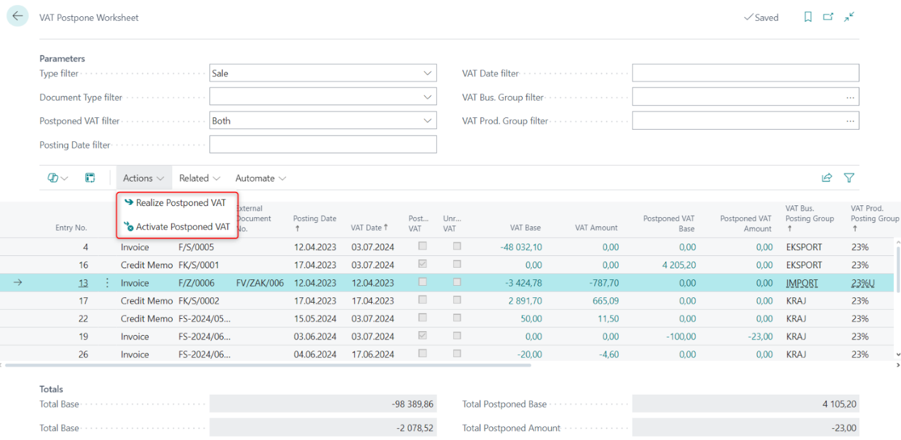

Find invoice line which you want to postpone, then **Activate Postponed VAT** and set new **Posting date**. Now field **Postponed** on this line is checked, amount from **VAT Base** is in column **Postponed VAT Base** and amount from **VAT Amount** is already in **Postponed VAT Amount**. 

In order to finish the VAT postponement process you need to use function **Realize Postponed VAT** and then enter the **New VAT Reporting Date**. After this **VAT Date** will be updated.

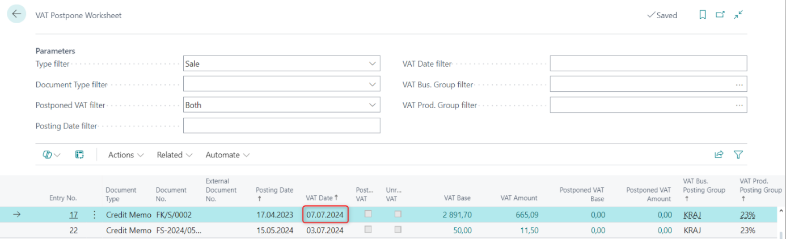

## Posting VAT from the G/L journals (Incidental Contractors).

Functionality that allows simplified recording of business events, without the need to create purchase invoices and set up separate directories for vendors with whom we have established only a one-time transaction. The list of incidental contractors contains basic data about entities for which we do not want to set up records in the system, and which can be used during VAT posting from the level of journals. The functionality was created as a response to the requirements of Polish law regarding the obligation of businesses to include counterparty data in the VAT register of purchases and sales.

A list of Incidental Contractors has been created, which can be supplemented with the data of vendors with whom the company conducts occasional transactions and does not want to create a record for such entities in the system.

*→* Incidental Contractors

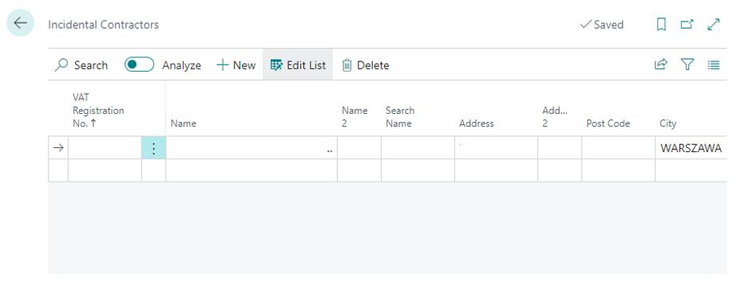

In the created line of the **General Journal**, to indicate the information to the VAT register, you need to specify the value in the column **Gen. posting type**.

In the VAT Amount column, expand the value (via the assist button) and fill in additional information to go into the VAT register. If the user wants to indicate an incidental contractor from the list, use the drop-down list in the TIN field or enter the contractor's data manually.

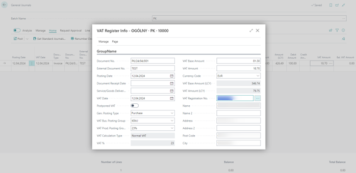

# Accounts Receivable and Accounts Payable

## Mandatory document receipt date

There is an option in the system to force users to complete the ***Document Receipt Date*** on purchase documents. To do this, it is necessary to check the box ***Mandatory Document Receipt Date*** on ***VAT Setup***.

→ VAT Setup → VAT Date

Enable the Mandatory Document Receipt Date option.

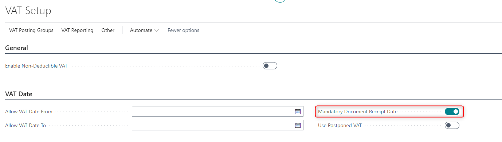

When this is done, users on every purchase order and invoice need to complete field ***Document Receipt Date***.

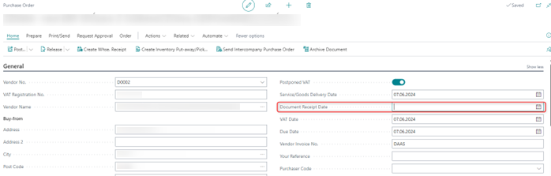

## Sales Credit Memos

Often in companies there is a need to correct sales, and therefore sales invoices. When this happens, a ***Sales*** ***Credit Memo*** is issued to the previously issued sales invoice. To make the process of creating a Sales Credit Memo easier and more efficient, several functionalities have been introduced:

- Creation of **Corrections Lines** (before/after) to a previously indicated sales invoice

- Creation of different ***Types of correction*** (price, quantity, etc.).

- Indication Correction reasons

- Adjusting quantities (possible increase of stock), prices, VAT rates, discounts

- Issue one sales adjustment invoice to:

    - Invoices that do not exist in the Business Central system (useful after implementation and feeding the system with the Opening Balance)

    - Single invoice

    - Multiple sales invoices (summary adjustments)

For bulk adjustments, it is possible to retrieve adjusted lines for a preset time period and automatically impose a percentage discount or an amount discount (with a value key) for the retrieved lines. These functions are particularly useful for generating periodic bonus adjustments.

In the Microsoft Dynamics 365 Business Central version, controls have been added for: copying inventory prices from the before/after lines, not from the inventory price list, and additionally, during a ***Cancel*** type adjustment, it is not possible to retrieve only part of the lines of the original invoice or to delete some lines after retrieval. The system forces the retrieval of all lines from the original document and their cancellation. Deletion of lines is possible only when changing the number of the corrected (original) document.

An additional functionality is ***Correction reasons***, which is an editable list in which it is possible to define the reasons for corrections, indicate the reason in the document and display the reason on the correction invoice printout.

→ Sales Credit Memo

- In the ***General*** section, fill in all the required and relevant fields for ***the credit memo,***

- In the Adjustment ***Details*** section, check the ***Correction*** box, select the ***Type*, *Number*** (*of the* original invoice to which the adjustment applies), and ***Code,*** which indicates the reason for the correction.

  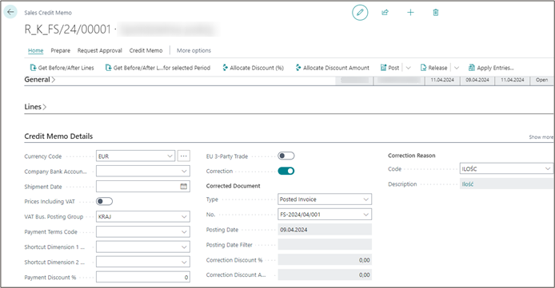

- In the next step, you need to go to the ***Get Before/After Lines*** functionality, located on the ribbon under the ***Home*** tab***.***

  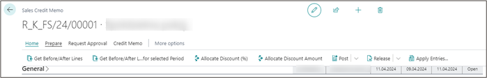

- Then, in the newly opened dialog box, select the "**Get Correction Lines**" function.

  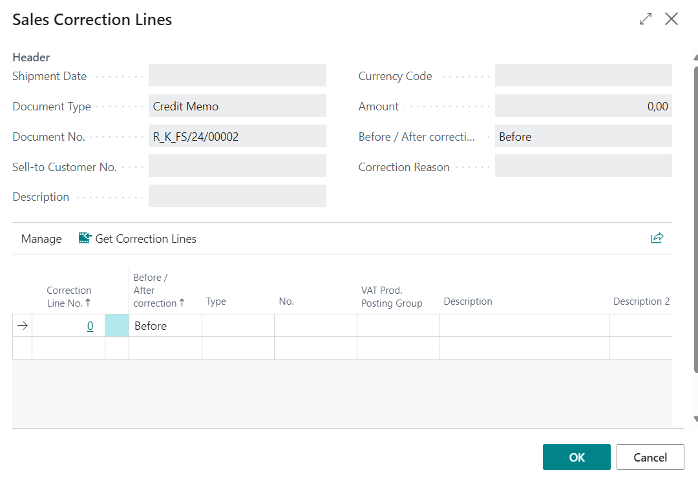

- In the ***Sales*** Correction ***Lines*** window, two lines appear for each line from the original sales invoice: the ***Before*** line, which remains unchanged, and the ***After*** line, on which the data should be adjusted according to the reason for adjustment entered earlier (for example, the quantity or amount). Approve the changes made with the ***OK*** button.

- After approval, the program returns to the Sales Credit Memo card, where two lines ***Before*** and ***After*** appear in the lines of the credit memo - if the correction was related to the price, was related to the discount given or to the VAT rate. If the correction was related to quantity, only one line for the quantity difference (the difference between the quantity shown on the original sales invoice and the correct quantity) appears when you return to the Sales Credit Memo card. Also, for the cancellation of a sales invoice, the ***Before*** and ***After lines do*** not appear, an analogous number of lines appear as on the original invoice with the same data, which, when the correction invoice is posted, reverses the entries from the original sales invoice.

- If the ***Posted Invoices (cumulative)*** option is selected in the document type, then we do not use the ***No.*** field, instead we select the Reason ***for the correction***, and then go to the ***Get Before/After Lines for selected Period*** and ***Get Correction Lines*** options and select invoice numbers and specific lines from those invoices to be adjusted from the list.

- The function for generating bonus/rebate adjustments, e.g., for exceeding the turnover for a given period, is available only for the ***Posted invoices (cumulative)*** option. You should then select the reason for the adjustment ***Rebate granted***:

    - Option to ***Get Before/After Lines for selected period*** for all invoices from the set period;

    - Automatic ***allocation to the lines of correction Before/Post of*** discount in percentage or discount in amount - allocation of the amount of discount by value key to the items of correction - translated into the amount of discount on each ***item Before/Post***.

- To print a sales document to PDF, go to the ***Print/Send*** tab on the ribbon and then *Attach as PDF*.

### Item Correction

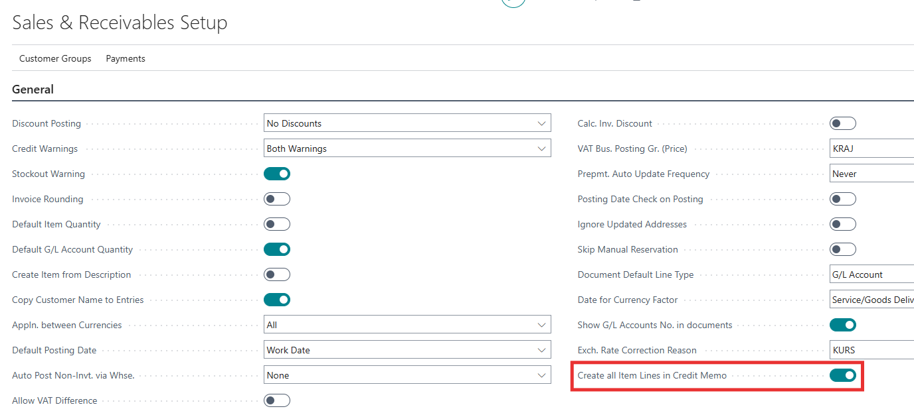When creating a sales credit memo for items, correction lines are not generated if neither the quantity nor the amount is changed. If the user wants such lines to appear on the document, the “**Create all Item Lines in Credit Memo”** option must be enabled on the **Sales & Receivables Setup** page.

Sales correction lines (no change in quantity or unit price):

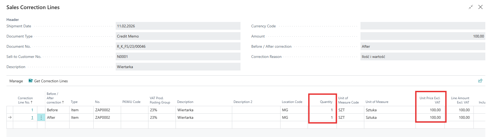

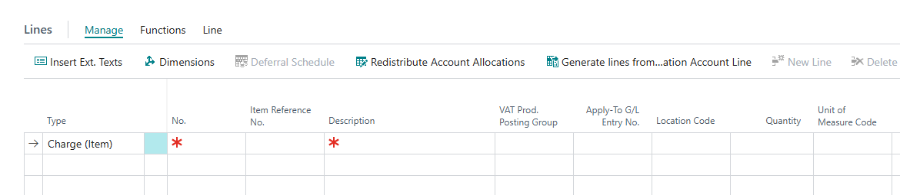Document lines with the option disabled:

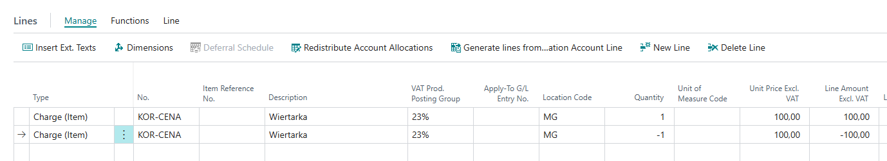Document lines with the option enabled:

### Customer Data Correction

A correction of customer data is a document used to correct the identification details of the customer specified on the original invoice.

The correction applies only to formal data, such as the customer’s name or address, and does not affect any financial values on the document.

To create a customer data correction, update the customer data on the **Customer Card** and then create a **Sales Credit Memo**:

- from the Posted Sales Invoice

- or from the Sales Credit Memos list page.

On the document, select a correction reason with the type **Customer Data (KSeF2K):**

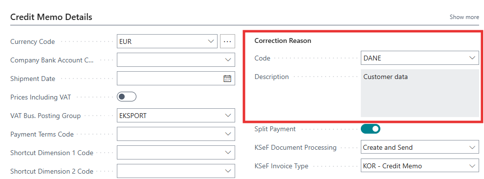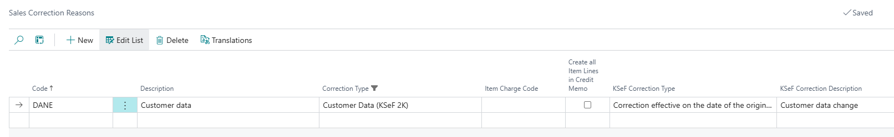This correction reason is required to ensure the proper generation of the Podmiot2K section within the KSeF structure.

After posting the credit memo and generating the KSeF document, the system will create an XML structure containing the Podmiot2K section, presenting the customer data in accordance with KSeF requirements.

For more information about the Podmiot2K element and the way it is presented in the XML structure, refer to the KSeF User Guide, section Correction of customer data in KSeF

### Descriptive Corrections of Sales Documents

Functionality enables the issuance of descriptive corrective invoices used to modify non-financial information on a sales document without affecting its value. Such corrections are also supported in the KSeF document generation process.

The following capabilities are available for a user:

- issuing descriptive corrections that are not related to changes in customer data (Podmiot2K),

- changing the delivery date or service completion date,

- changing the payment due date,

- changing document annotations, e.g. the Split Payment Mechanism (MPP) indication,

- posting corrections without affecting document values,

- creating corrections without the need to add document lines,

- generating KSeF documents for descriptive corrections, presenting the updated data after the change.

To create a descriptive correction of an invoice, create a corrective sales invoice either:

- from the Posted Sales Invoice page or

- from the Sales Credit Memos list page.

  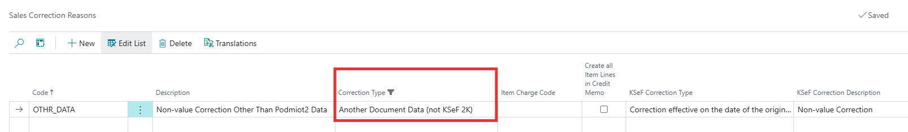Next, on the credit memo, select a correction reason of the type: **Additional Document Data (non-KSeF 2K).**

  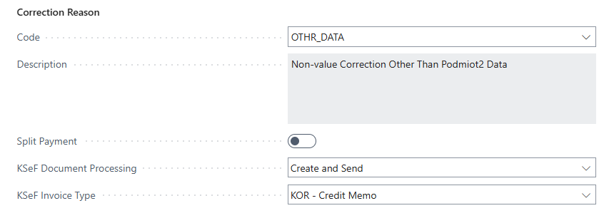This correction reason is used to introduce changes to the descriptive information of a document other than customer data. Unlike the DANE (Data) correction reason, it does not result in the generation of the Podmiot2K section within the KSeF structure.

After posting the credit memo and generating the KSeF document, the system will create an XML structure containing the updated descriptive data of the document in accordance with KSeF requirements.

### Bulk discount sales credit memos

If a post-sale discount is granted to a customer for all shipments made to that customer during a given period, the company may issue a bulk sales credit memo.

To ensure that such a document is presented correctly in the structured electronic format, a dedicated correction reason of the type **Collective Discount** must be specified on the credit memo being created.

To ensure correct presentation in the general ledger, the **Sales Discount Credit Memo Account** in the **General Posting Setup** must be specified. This account will be used when the discount applies to inventory items:

On the **Sales Credit Memo**, select the appropriate **Correction Reason** and specify the details of the corrected documents:

- Type - Posted Invoices (Cumulative)

- Posting Date Filter: the period for which the discount is to be granted

- Corr. Period Description: the value transferred to the KSeF structure

- Correction Discount % or Correction Discount Amount

  Next, retrieve the Before/After lines for selected period to which the discount should be applied. Do not make any changes to these lines and click OK.

  After returning to the Sales Credit Memo, select either **Allocate Correction Discount (%)** or **Allocate Discount Amount**, depending on the type of discount you want to grant

  Collective credit memo lines will be generated. For inventory items, the lines will be created using the G/L account specified in the setup:

## Sales documents printouts

Printouts related to sales in the system have been visually improved and adapted to the requirements of Polish law. These are: Sales Order Confirmation, Sales Order, Sales Proforma Invoice, Sales Invoice, Service Sales Invoice, Sales Credit Memo, Sales Shipment Confirmation, Sales Return Receipt.

To assign new printouts to to respective document types, go to page **Report Selection - Sales** and then select from the list the appropriate report ID numbers for the corresponding document types.

## Printing G/L Account number on sales documents

To allow users to decide whether the G/L account number should be visible on printed sales documents, a checkbox ***Print G/L Account No. on Invoice*** has been added to the **Sales & Receivables Setup** page:

→ **Sales & Receivables Setup**

When enabled, the G/L account number will be visible in the document line on the printouts of: Pro Forma Invoice, Posted Sales Invoice, Posted Sales Credit Memo, Posted Service Invoice.

## Customer and Vendor Balance Reconciliation

One of the principles of inventory is to reconcile the balance of receivables from customers and payables to vendors. In Microsoft Dynamics, the user can generate documents calling for balance reconciliation with a list of individual transactions and other necessary information.

*→* Customer Balance Reconciliation

*→* Vendor Balance Reconciliation

Selecting "Preview" generates a report with all open items posted to the counterparty's account for a given reconciliation date, ready to be sent to the counterparty for balance confirmation.

If documents are issued in different currencies, checking the **Print Amounts in Currency** checkmark will generate summaries for each currency on the report.

## Split Payment mechanism (SP or MPP – Mechanizm podzielonej płatności)

This functionality enables the use of the Split Payment mechanism on sales documents, in accordance with the provisions of the Polish VAT Act. Its purpose is to ensure compliance with tax obligations under Polish regulations and allow proper marking of transactions subject to mandatory or voluntary application of the Split Payment mechanism.

The mechanism can be activated directly on a **Sales Invoice** by enabling the ***Split Payment Mechanism*** checkbox located in the **Invoice Details** tab.

Alternatively, it can be assigned to selected **payment methods** by enabling the **Split Payment Mechanism** checkbox available on the **Payment Methods** page.

Activating the checkbox will automatically enable the SP when the selected payment method is chosen on a sales invoice.

The checkbox value can also be changed on a **posted sales invoice** - it is visible in the **Invoice Details** tab.

If the Split Payment mechanism is enabled on the sales invoice, this **information will also appear on the printout** of the posted sales invoice in the **Payment Type** field.

The Split Payment mechanism is also available on **sales credit memos** and works in a similar way as on sales invoices.

## Polish Classification of Goods and Services (PKWiU)

PKWiU is used in statistics, records, documentation, accounting, and in official registers and information systems of public administration.

As part of the Polish localization, the system allows you to enter various PKWiU codes with descriptions and assign them to **item cards** and then use them on **sales document lines**.\
→ **PKWiU**\
Open the **PKWiU** page and fill it with codes and descriptions in accordance with the regulation of the Polish government.

Next, assign the codes to items on their **item cards** in the **PKWiU Code** field.

When creating a **sales document**, the PKWiU code will be retrieved from the item card and displayed in the line in the **PKWiU Code** column. If the code was not entered earlier, it can also be selected directly on the document; however, this will **not** automatically update the item card.

# SAFT files

As new tax audit rules took effect in January 2018, companies are required to submit tax data to tax audit offices in the structured XML file format.

Thanks to the extensions introduced under Polish Localization, SAFT files can be generated directly from Business Central.

## SAFT configuration

→ SAFT Setup

In the fields below, set the dimensions that will carry the SAFT codes:

Click the + in the page header to start the completion:

- ***Tax office code*** - contains the code of the tax office in the SAFT files.

- ***Company province*** - specifies the name of the province in which the company's headquarters is located

- ***Company district*** - specifies the name of the district in which the company is located

- ***Company commune*** - specifies the name of the municipality in which the company is located

- ***Company street*** - specifies the name of the street where the company is located

- ***House and local No.*** - specify the house number and apartment number of the company's proper residence

- ***Company's Post office*** - specifies the name of the post office competent for the company's headquarters

- ***Email*** - contains the email address to be included in SAFT files

- ***Purchase dimension*** - applies to purchase documents

- ***Sales dimension 1, 2, 3*** - applies to sales documents

- ***Text filter*** - contains characters that can occur in text fields

- ***Amount text filter*** - contains allowed characters that can occur in numeric fields

- ***SAFT file suffix*** - contains characters that are appended in the names of generated files

  

## Extension of the Text Filter and support for special characters

The **Text Filter** field defines which characters are allowed in text fields in generated XML files (e.g. SAFT files). Customer and vendor master data (such as names and addresses) may contain special and diacritical characters used in various languages.

In the current version of the solution, the system supports default characters from Latin alphabets (including diacritical characters), digits and basic punctuation marks. The default text filter is applied automatically and does not require any additional user configuration.

If non-standard characters occur that are not covered by the default filter, the user can extend the filter. Any **characters entered by the user are added to the default filter rather than replacing it** and are taken into account during the generation of XML files (e.g. KSeF files).

Proper configuration of the **Text Filter** field affects:

- the correctness of generated XML files,

- compliance of data with SAFT schema requirements,

- avoidance of issues related to omitted or incorrectly processed special characters.

The current default text filter value applied when the **Text Filter** field is left blank is:

^\[A-Za-zÀÁÂÃÄÅĀĂĄÆÇĆĈĊČÐÈÉÊËĒĔĖĘĚĜĞĠĢĤĦÌÍÎÏĨĪĬĮİIJĴĶĹĻĽĿŁÑŃŅŇÒÓÔÕÖØŌŎŐŒŔŖŘŚŜŞŠŢŤŦÙÚÛÜŨŪŬŮŰŲŴÝŶŸŹŻŽÞàáâãäåāăąæçćĉċčðèéêëēĕėęěĝğġģĥħìíîïĩīĭįıijĵķĺļľŀłñńņňòóôõöøōŏőœŕŗřśŝşšţťŧùúûüũūŭůűųŵýŷÿźżžþ0-9 ,.\\\\'()\]+\$

## VAT 7 Statement lines

In the VAT 7 Statement lines table, there are records grouping declaration values into specific sections. Data in this table should be generated automatically during the installation of the Localization for Poland extension. However, if this does not happen, the default settings should be initialized by selecting the **Create VAT 7 Statement lines** action.

### Handling Foreign Customers and VAT Country Codes

This functionality enables the automatic determination of a customer's country code for electronic reporting structures based on the customer's VAT Registration No. For foreign customers, the system analyzes the VAT number prefix and uses it as the source of the country code applied during the generation of tax-related data.

As a result, the system can correctly identify the customer's tax registration country even when the customer's address country differs from the country in which the VAT number was issued.

**Notes:**

- The customer's address country continues to be used for address-related information and presentation,

- The tax registration country is determined based on the customer's VAT Registration No.

- The functionality applies to domestic, intra-EU and non-EU customers.

## Fixed Assets

In the Fixed Assets section it is necessary to select the Taxable Depreciation Book and the Accounting Depreciation Book. These settings are required for JPK (SAFT) CIT purposes.

## Examples of VAT dimensions

The values of the purchase and sales dimension are SAFT codes that can be used in purchase and sales documents.

To see the values of created codes, edit them, delete them or add new ones, you need to search:

→ Dimensions

Select the line of interest and choose ***Dimension Values*** on the ribbon in the ***Dimension*** option. Dimension values should be completed with VAT codes before the first use, in accordance with the applicable laws. When posting purchase and sales documents, dimensions are transferred to ledger entries and then processed and transferred to VAT entries. The defined codes must appear in the SAFT file.

## Posting groups

For the Polish functionality, an additional field was added to the posting groups: ***VDEK Code***. Analogous to the dimensions for which codes are defined, the ***VDEK Code,*** which is assigned to a given posting group, will be taken for SAFT file generation.

→ Customer Posting Groups

Here you can define new customer posting groups and assign VDEK codes to them.

If there is a separate group of customers in the company - related/group customers, it is worth creating a separate posting group for them and assigning a separate VDEK code, such as TP (related transactions), which will be automatically substituted by the system for all such customers for which documents will be made.

Note that when you create a new customer, you must select the customer's posting group in the customer's card on the ***Invoicing*** tab, so that the corresponding VDEK code will pull in all postings on that customer in the future.

As with customer posting groups, you can define vendor posting groups and assign VDEK codes to them, which are then downloaded when SAFT files are generated. On the same basis, VDEK codes are assigned for other posting groups:

→ Vendor Posting Groups

→ General Product Posting Groups

→ VAT Product Posting Groups

→ General Product Posting Groups

→ VAT Business Posting Groups

## VAT Posting Setup

In the VAT posting setup, assign appropriate values for the following fields. To do this, select the row of the selected VAT posting group and select the ***View*** option on the ribbon. Then, in the ***SAFT*** tab, assign settings to individual fields. Each of the fields in the ***SAFT tab*** is also reflected in the columns located on the main view of VAT posting setup.

→ VAT Posting Setup

- ***Sales statement*** - in this field you can assign an item to specific columns of the sales part of the declaration. Example assignment:

- Selecting K_19 - the basis will go to column 19 of the declaration

- Choosing K_20 - VAT will go to column 20 of the return

- Selecting K_19_20 - Base will go to column 19 and VAT will go to column 20

    - ***Purchase statement***- in this field you can assign an item to specific columns of the purchase part of the declaration.

    - ***VDEK code*** - in this field you can enter the default VAT code - analogous to the above posting groups.

    - ***Show External Document No. in Sales*** - checking this box means that if an external document number is given in sales documents, it will be entered in the SAFT file.

    - ***Bad debts*** - this field should be checked to see if the VAT configuration applies to bad debt relief. These amounts will be shown in SAFT files in additional columns related to bad debts.

## VAT Entries

When generating a SAFT file, the information in the following columns found in VAT entries plays an important role.

→ VAT Entries

- ***Skip in SAFT** -* this box should be checked if you do not want a given document to be shown in the SAFT file.

- ***VDEK code*** - this field is updated before the data is exported to SAFT files, and after the update, all codes from posting groups and dimensions will be entered in the fields of this column and separated by commas. If a code has been entered, it will not be designated a second time. On the other hand, if the word *NONE* is entered in the VDEK code field, the system will not designate codes for the document in question.

- ***Sales Statement*** and ***Purchase Statement*** - in these fields you can change the assignment of individual amounts to columns at the VAT entry level.

For example, if you misidentify a group and book an ordinary purchase that should be in fixed assets, in the ***Purchase Statement*** field on the line for that invoice, change the code assigned in that column to one that is specific to fixed assets.

## SAFT VAT file generation

SAFT VAT files are generated and sent to the IRS on a monthly and unsolicited basis. They consist of two parts - the declaration and the lines included in that declaration.

→ SAFT Setup

To generate a SAFT file you need to:

- Fill in the ***dates*** defining the period for which the file is generated

- Select the appropriate functions depending on the stage of work / type of declaration:

    - Stage 1 – preparation

        - ***Update VAT codes*** - VAT codes from accounting dimensions and groups are updated. This update is done only once, before generating the declaration;

        - ***Calculate Statement*** - selecting this function causes individual documents to be entered into the SAFT file entries by group/column, which should appear in the declaration field;

        - ***Show statement aggregation*** - a simulation of the entries that will appear in the generated file is created.

          

    - Stage 2 - generation of SAFT file

        - ***Create SAFT file*** - a SAFT file is generated based on the previously performed code update and simulated report.

          

    - Submission of another declaration for the same month / correction of the declaration

        - ***Statement correction*** - a function selected when another declaration / declaration correction for the same month is needed.

    - Filing a quarterly return

        - ***Quarter Statement*** - a function that is used to generate a quarterly declaration.

    - Creating a declaration without a header

        - ***Skip Export Statement Header***- a function that is used to generate declarations with the header omitted. Changes are made only on lines, for example, when it is necessary to correct a supplier document.

    - Create declarations with skip lines

        - ***Skip Export Statements Lines*** - a function that is used to generate statements with skipped lines, for example, in the case of a refund request.

<u>Sample SAFT file entries</u>: the generated file contains individual documents with their numbers, marking whether they relate to purchases or sales, dates, contractors' VAT numbers as well as an indication of which column the amounts went into. The last line is the Header, which contains fields from the VAT return.

## Archiving SAFT Files

The SAFT archive functionality enables storing the history of generated SAFT files together with the full source data used to create them.

This provides the ability to reconstruct declarations, verify data and analyze changes between successive versions of reports.

### Creating an archive

When generating a SAFT file, the user can fill in the Archive Description field.

Entering a value in this field causes the data to be saved in the archive.

If the Archive Description field is not filled in, the archive is not created.

Each generation of a file with a description creates a new archive version associated with a given period and declaration (e.g. original declaration or correction).

### Scope of archived data

After generating the SAFT file, the system saves in the archive:

- the generated XML file (e.g. VDEK),

- the source data used to create it (VAT entries),

- descriptive information regarding the declaration, such as:

<!-- -->

- archive description,

- archive version,

- date range (declaration period),

- SAFT structure version,

- XML file name.

The archive stores detailed data corresponding to SAFT entries, including:

- entry number and entry type (e.g. within period, header),

- VAT entry number,

- transaction type (e.g. sale / purchase),

- document number,

- dates (VAT Date, Posting Date),

- VAT registration number,

- KSeF identifier,

- external document number,

- values assigned to VAT declaration fields.

Thanks to this, the archive contains a complete picture of the data used to generate the declaration.

### Archive structure

Archive data is stored on two levels:

> **Archive header** - contains information about the declaration (period, version, XML file),
>
> **Archive lines** - contain detailed VAT entries used to create the file.

### Browsing the archive

The archive is accessible from dedicated pages:

- **SAFT Archive List** - list of archives (headers),

- **SAFT Archive Lines** - details of data for the selected archive.

From the archive list, the following actions are available:

- **Open SAFT Archive Lines** - navigate to the detailed entries,

- **Export XML File** - re-download the generated file,

- **Restore SAFT Entry from Archive** - restore archived data to the system.

### Re-exporting and restoring SAFT data

The archive enables operations on historical data without the need to regenerate the SAFT file.

Available functions include:

- re-exporting the XML file - allows downloading the previously generated file,

- reviewing source data - analysis of the VAT entries used for reporting,

- restoring data from the archive - reconstruction of the entries used when generating the declaration.

This functionality allows for:

- reconstructing the historical state of SAFT data,

- verifying the data used in reporting,

- analyzing changes between successive versions of declarations,

- supporting correction processes.

## SAFT File Visualization/Edit

During the report calculation, records are entered into the SAFT Entry table, based on which an XML file is generated in the next stage. Before generating the XML file, there is an option to visualize and edit the VAT7 declaration.

→ VAT 7 Statement

The declaration document is separated into five sections: Header, Sales, Purchase, Footer, and Statement parameters. Records in the Sales, Purchase, and Footer sections are generated based on VAT declaration settings. The data in the **Statement parameters** section is editable and must be completed before generating the XML file.

After editing the declaration, you can export it using the function on the Actions ribbon → Create SAFT file.

##  SAFT (JPK) KR_PD and SAFT (JPK) ST_KR Setup

As of 1 January 2025, the provisions of the CIT Act came into force, introducing new obligations for selected entities, including companies belonging to tax capital groups. Under the new regulations, companies will be required to keep accounting books using computer software. These books will be submitted electronically to the relevant head of the tax office, and the files will have to meet certain logical structure requirements.

→ Account Tags

The table with the account tag dictionary is used to properly categorize G/L accounts for the purposes of JPK (SAFT) CIT. This table is generated automatically during the installation of the Localization for Poland extension. However, if this does not happen, you should run the **Create Account Tag Dictionary** function available on the ribbon.

→ G/L Account Card

The classification of the G/L Account for JPK (SAFT) CIT purposes should be selected directly in the account card under the **Reporting → SAFT KR_PD** section.

→ Fixed Asset Card

On the Fixed Asset Card, you can add information about the acquisition and/or retirement of an asset that does not result directly from accounting entries. If a fixed asset is entered through the opening balance, the system does not have information on the actual acquisition date and document. In such a case, it is necessary to complete the required information in the **SAFT** section of the asset card.

→ FA Depreciation Books

Information about the depreciation method and the write-off frequency of fixed assets must be entered in the fixed assets depreciation book.

→ FA Classes

Each fixed asset class must be assigned the appropriate SAFT FA Class Code (Symbol klasyfikacji środków trwałych - Classification of Fixed Assets (KŚT)) for JPK (SAFT) CIT purposes.

→ FA Posting Groups

Each fixed asset posting group must be assigned the appropriate SAFT Posting Group Type for JPK (SAFT) CIT purposes.

## SAFT FA files generation

In addition to the SAFT VAT, businesses can generate other SAFT FA files, such as SAFT for ledgers, warehouse, bank or invoices. Then, as before, fill in the dates and select one of the following options. The SAFT file will be generated automatically, without any additional intervention. Such additional files are generated at the request of the Tax Office.

