# **Podręcznik użytkownika KSeF**

## Spis treści

- [Lista kontrolna kroków konfiguracji](#lista-kontrolna-kroków-konfiguracji)
- [Wymagania wstępne i ogólna konfiguracja KSeF](#wymagania-wstępne-i-ogólna-konfiguracja-ksef)
  - [Dane firmy](#dane-firmy)
  - [Zarządzanie funkcjami](#zarządzanie-funkcjami)
  - [Dostęp HTTP Client](#dostęp-http-client)
- [Zestawy uprawnień](#zestawy-uprawnień)
- [Konfiguracja](#konfiguracja)
  - [Ustawienia KSEF](#ustawienia-ksef)
    - [Zakładki zawierające dane widoczne w fakturze ustrukturyzowanej](#zakładki-zawierające-dane-widoczne-w-fakturze-ustrukturyzowanej)
    - [Zakładki systemowe KSeF i pola konfiguracyjne](#zakładki-systemowe-ksef-i-pola-konfiguracyjne)
    - [Import wizualizacji KSeF z XLS](#import-wizualizacji-ksef-z-xls)
    - [Dodatkowe informacje w wizualizacji KSeF](#dodatkowe-informacje-w-wizualizacji-ksef)
  - [Mapowanie stawek VAT KSeF](#mapowanie-stawek-vat-ksef)
  - [KSeF - odwrotne obciążenie](#ksef---odwrotne-obciążenie)
    - [Logika wypełniania pola P_18](#logika-wypełniania-pola-p_18)
  - [Ustawienia krajów/regionów](#ustawienia-krajówregionów)
  - [Konfiguracja kont bankowych i opis mechanizmu](#konfiguracja-kont-bankowych-i-opis-mechanizmu)
    - [Rachunek bankowy dla mechanizmu podzielonej płatności (MPP)](#rachunek-bankowy-dla-mechanizmu-podzielonej-płatności-mpp)
  - [Konfiguracja połączenia z KSeF](#konfiguracja-połączenia-z-ksef)
  - [Generowanie i konwertowanie certyfikatów KSeF](#generowanie-i-konwertowanie-certyfikatów-ksef)
  - [Zarządzanie sesjami połączeń z KSeF i UPO](#zarządzanie-sesjami-połączeń-z-ksef-i-upo)
  - [Uwagi dotyczące danych tekstowych](#uwagi-dotyczące-danych-tekstowych)
- [Generowanie i wysyłka dokumentów do KSeF](#generowanie-i-wysyłka-dokumentów-do-ksef)
  - [Dodatkowe pola na zaksięgowanych fakturach sprzedaży](#dodatkowe-pola-na-zaksięgowanych-fakturach-sprzedaży)
  - [Utworzenie dokumentu KSEF](#utworzenie-dokumentu-ksef)
  - [Pominięcie wysyłki do KSeF dla faktury sprzedaży](#pominięcie-wysyłki-do-ksef-dla-faktury-sprzedaży)
  - [Korekta danych nabywcy w KSeF](#korekta-danych-nabywcy-w-ksef)
    - [Wykonanie korekty](#wykonanie-korekty)
    - [Uwagi](#uwagi)
  - [Korekty opisowe w KSEF](#korekty-opisowe-w-ksef)
    - [Wykonanie korekty](#wykonanie-korekty-1)
  - [Lista dokumentów KSEF](#lista-dokumentów-ksef)
  - [KSeF – Lista faktur – QR Code II](#ksef--lista-faktur--qr-code-ii)
- [Automatyczna wysyłka dokumentów do KSeF](#automatyczna-wysyłka-dokumentów-do-ksef)
  - [Mechanizm automatycznej wysyłki - architektura logiczna](#mechanizm-automatycznej-wysyłki---architektura-logiczna)
  - [Konfiguracja Job Queue dla wysyłki do KSeF](#konfiguracja-job-queue-dla-wysyłki-do-ksef)
  - [Zakres dokumentów przetwarzanych przez Job Queue](#zakres-dokumentów-przetwarzanych-przez-job-queue)
  - [Tryb tworzenia faktur KSeF](#tryb-tworzenia-faktur-ksef)
  - [Sposób przetwarzania dokumentu KSeF](#sposób-przetwarzania-dokumentu-ksef)
  - [Relacja Job Queue i statusów dokumentów](#relacja-job-queue-i-statusów-dokumentów)
  - [Monitorowanie wysyłki](#monitorowanie-wysyłki)
- [Odbieranie i przetwarzanie dokumentów z KSeF](#odbieranie-i-przetwarzanie-dokumentów-z-ksef)
  - [Ustawienia połączenia KSeF – odbieranie faktur zakupu](#ustawienia-połączenia-ksef--odbieranie-faktur-zakupu)
  - [Wysłanie zapytania do MF](#wysłanie-zapytania-do-mf)
  - [Przetwarzanie faktur zakupu](#przetwarzanie-faktur-zakupu)
  - [Korekty z wierszami „przed/po” – zachowanie przy imporcie z KSeF](#korekty-z-wierszami-przedpo--zachowanie-przy-imporcie-z-ksef)
  - [Utworzenie nagłówka faktury zakupu](#utworzenie-nagłówka-faktury-zakupu)
  - [Automatyczne tworzenie nagłówków dokumentów zakupu](#automatyczne-tworzenie-nagłówków-dokumentów-zakupu)
  - [Wizualizacja faktury KSeF](#wizualizacja-faktury-ksef)
  - [Podgląd dokumentu KSeF na fakturze zakupu](#podgląd-dokumentu-ksef-na-fakturze-zakupu)
  - [Podgląd dokumentu KSeF na zaksięgowanej fakturze zakupu](#podgląd-dokumentu-ksef-na-zaksięgowanej-fakturze-zakupu)
  - [Monitorowanie importu dokumentów KSeF](#monitorowanie-importu-dokumentów-ksef)
    - [Włączenie logowania importu KSeF](#włączenie-logowania-importu-ksef)
    - [Logi KSeF](#logi-ksef)
  - [Automatyzacja cyklicznego importu dokumentów KSeF](#automatyzacja-cyklicznego-importu-dokumentów-ksef)
  - [Podmiot 3 - identyfikator wewnętrzny](#podmiot-3---identyfikator-wewnętrzny)
  - [Nieprawidłowe aktywne sesje](#nieprawidłowe-aktywne-sesje)
    - [Nieprawidłowy status faktury (Wysłane zamiast Błąd)](#nieprawidłowy-status-faktury-wysłane-zamiast-błąd)

**Polska Lokalizacja**

<figure>

<figcaption>
Microsoft Dynamics 365 Business Central
</figcaption>
</figure>

companial.com

**Nota prawna:** Niniejszy dokument jest przeznaczony wyłącznie do użytku wewnętrznego przez partnerów i użytkowników Microsoft Dynamics 365 Business Central. Companial jest autorem dokumentu i posiada wyłączne prawa autorskie do jego treści. Nieautoryzowane kopiowanie, zmiany lub sprzedaż dokumentu bądź jego treści jest surowo zabronione bez uzyskania wcześniejszej pisemnej zgody autora.

Ścieżki dostępu do opisywanych funkcji lub ustawień w systemie są zawsze prezentowane w niniejszym podręczniku w następujący sposób:

→ nazwa miejsca w systemie

# Lista kontrolna kroków konfiguracji

Krok 1 – Sprawdzenie i uzupełnienie danych firmy

→ Informacje o firmie

Uzupełnij co najmniej następujące dane:

- Pełna nazwa firmy

- Adres siedziby (ulica, kod pocztowy, miasto, kraj)

- Kod kraju/regionu = PL

- Numer NIP (bez prefiksu kraju)

Jeżeli firma korzysta z numeru GLN, ustaw parametr Użyj GLN w dokumentach elektronicznych na wartość True.

Krok 2 – Włączenie wymaganych funkcji

→ Zarządzanie funkcjami

Upewnij się, że wszystkie funkcje związane z Usługami e-dokumentów są włączone.

→ Zarządzanie funkcjami – Polska Lokalizacja

Upewnij się, że funkcjonalność KSeF jest aktywna.

Krok 3 – Zezwolenie na komunikację HTTP (API MF)

→ Zarządzanie rozszerzeniami / konfiguracja środowiska

Zezwól na wychodzącą komunikację HTTP dla aplikacji:

- Localization for Poland

- Localization for Poland Extended

- E-Documents Core

pozostałych aplikacji E Documents używanych do komunikacji z KSeF

Krok 4 – Nadanie uprawnień użytkownikom

Użytkownikom pracującym z dokumentami KSeF nadaj zestaw uprawnień:

- EXW KSeF

Dodatkowe standardowe uprawnienia Business Central mogą być wymagane w zależności od konfiguracji VAT i E-dokumentów.

Krok 5 – Konfiguracja Ustawień KSeF

→ Ustawienia KSeF

Uzupełnij dane w zakładkach przenoszonych do faktury ustrukturyzowanej XML (dane ogólne, adresowe, kontaktowe, stopka – zgodnie z wymaganiami firmy).

→ Ustawienia KSeF → zakładka KSeF

Skonfiguruj kluczowe parametry systemowe, w tym:

- Numery dokumentów KSeF

- Tryb tworzenia faktur KSeF

- Datę rozpoczęcia KSeF

- Dozwoloną edycję numeru, typu i statusu dokumentu

- Parametry dodatkowe (np. pomijanie wierszy komentarzy, okres wsteczny wysyłki do KSeF)

Krok 6 – Mapowanie stawek VAT dla KSeF

→ Ustawienia księgowe VAT

Dla kombinacji księgowych przypisz właściwą Stawkę VAT KSeF.

Wybór wartości Brak oznacza, że dana kombinacja nie będzie eksportowana do KSeF.

Krok 7 – Konfiguracja krajów i regionów

→ Kraje/regiony

Dla krajów należących do UE uzupełnij pole Kod kraju/regionu UE, aby zapewnić poprawną kwalifikację kraju w generowanych dokumentach XML.

Krok 8 – Konfiguracja rachunków bankowych dla KSeF

→ Kartoteka konta bankowego

Na zakładce KSeF uzupełnij dla rachunków wykorzystywanych na fakturach:

- Nazwa konta bankowego KSeF

- Typ własnego konta bankowego KSeF

Dane te są przekazywane do KSeF zamiast standardowej nazwy rachunku.

Krok 9 – Konfiguracja usługi e dokumentu (eksport do KSeF)

→ Usługa e dokumentu

Utwórz nową usługę dla KSeF i ustaw:

- Format dokumentu = KSeF FA(3)

- Integracja usługi = KSeF – Polski system e faktur

Następnie wybierz Konfiguracja integracji usługi i wskaż środowisko (Test / Demo / Produkcyjne). System automatycznie uzupełni adres API.

Krok 10 – Certyfikat KSeF: generowanie, konwersja i import

Wygeneruj certyfikat w Aplikacji Podatnika KSeF i pobierz pliki .crt oraz .key.

Przekonwertuj plik .key do formatu .pem przy użyciu OpenSSL.

W systemie Business Central przejdź do:

→ Usługa e dokumentu → usługa KSeF → Konfiguracja integracji usługi → Kreator konfiguracji

Zaimportuj certyfikat (.crt) oraz klucz prywatny (.pem), a następnie pobierz certyfikaty publiczne.

Krok 11 – Konfiguracja połączenia KSeF dla odbioru dokumentów zakupowych

→ Ustawienia połączenia KSEF

- Wklej token autoryzacyjny

- W sekcji Odbieranie wybierz Podmiot 2

- Ustaw Dni początkowej synchronizacji

- Ustaw Rozmiar strony zapytania zgodnie z potrzebami

Krok 12 – Weryfikacja połączenia (test importu)

→ Usługa e dokumentu → Odbierz

> lub

→ E dokumenty → Pobierz dokumenty KSeF

Pobrane dokumenty powinny pojawić się na stronie Dokumenty przychodzące.

# Wymagania wstępne i ogólna konfiguracja KSeF

Przed rozpoczęciem jakiejkolwiek konfiguracji związanej z KSeF należy spełnić następujące ogólne wymagania wstępne.

## Dane firmy

**→ Informacje o firmie**

Poniższe dane muszą zostać poprawnie uzupełnione, ponieważ są one przenoszone do faktury ustrukturyzowanej (pliku XML) i podlegają walidacji po stronie KSeF.

Minimalny zakres wymagany do wysyłki faktur do KSeF:

- Nazwa firmy

- Adres siedziby (ulica, kod pocztowy, miasto, kraj)

- Kod kraju/regionu = PL

- Numer NIP – bez prefiksu kraju

Dane wymagane warunkowo (w zależności od scenariusza):

- Numer rejestracyjny

- Numer GLN

- **Użyj GLN w dokumentach elektronicznych** – parametr ten musi być ustawiony na „True”, jeśli firma chce, aby numer GLN był widoczny na fakturach wysyłanych do KSeF.

Jeżeli wymagane dane nie zostaną uzupełnione, walidacja KSeF zakończy się niepowodzeniem i faktury nie zostaną wysłane do KSeF.

## Zarządzanie funkcjami

**→ Zarządzanie funkcjami**

Należy upewnić się, że wszystkie funkcje związane z Usługami e‑dokumentów są włączone.

**→ Zarządzanie funkcjami – Polska Lokalizacja**

Należy upewnić się, że wszystkie funkcje związane z Polską Lokalizacją są włączone (np. KSeF).

## Dostęp HTTP Client

**→ Zarządzanie rozszerzeniami / konfiguracja środowiska**

Ponieważ komunikacja z KSeF oparta jest na wywołaniach API do Ministerstwa Finansów, należy zezwolić na wychodzącą komunikację HTTP dla następujących aplikacji:

- Localization for Poland

- Localization for Poland Extended

- E‑Document Core

- Wszystkie pozostałe aplikacje E‑Documents wykorzystywane przez firmę do komunikacji z KSeF

# Zestawy uprawnień

Dla użytkowników pracujących z dokumentami KSeF wymagany jest następujący zestaw uprawnień:

- EXW KSeF – pełny zestaw uprawnień wymaganych do tworzenia i przetwarzania dokumentów KSeF, generowania plików XML oraz wysyłki dokumentów do rządowej aplikacji KSeF. Zapewnia dostęp do wszystkich tabel związanych z funkcjonalnością KSeF – w tym do Ustawień KSeF.

Dodatkowe uprawnienia (np. w ramach Usług e‑dokumentów) są wymagane do poprawnej konfiguracji połączenia z KSeF oraz do ustawienia innych elementów Business Central – np. Ustawień księgowych VAT. Są one dostępne w standardowych tabelach Business Central i dlatego nie są objęte dedykowanym zestawem uprawnień KSeF.

# Konfiguracja

## Ustawienia KSEF

→ Ustawienia KSeF

Strona umożliwia wprowadzenie danych identyfikacyjnych firmy oraz ustawień związanych z integracją z Krajowym Systemem e-Faktur (KSeF). Poprawne wypełnienie pól na tej stronie jest warunkiem prawidłowego działania pozostałych procesów: generowania, wysyłki i odbioru faktur w KSeF.

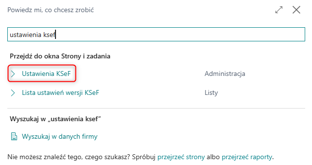

### **Zakładki zawierające dane widoczne w fakturze ustrukturyzowanej**

Strona Ustawień KSeF zawiera zakładki, z których wartości są przenoszone do pliku XML faktury ustrukturyzowanej i są widoczne zarówno dla odbiorcy, jak i dla organów podatkowych. Pola, których nazwy zostały poniżej wyróżnione pogrubieniem, są obowiązkowe dla poprawnej walidacji w KSeF i muszą zostać uzupełnione. Należy pamiętać, że pozostałe pola, choć opcjonalne z punktu widzenia walidacji KSeF, **mogą być wymagane dla określonych firm lub scenariuszy biznesowych. Odpowiedzialność za zapewnienie przekazania do KSeF wszystkich prawnie wymaganych danych spoczywa wyłącznie na firmie.**

**Ogólne**

- **Pełna nazwa** – pełna, zarejestrowana nazwa firmy

- **Kod kraju** – kraj siedziby firmy

- **Prefiks podatnika** – opcjonalny

- **Adres** – bez wymaganego formatowania, minimum jeden znak; zazwyczaj ulica i numer

- **Adres 2** – opcjonalny; zazwyczaj kod pocztowy i miasto

- **Numer EORI** – opcjonalny

- **Status podatnika** – należy pozostawić „Brak” lub wybrać odpowiednią opcję z listy

- **Numer KRS** – opcjonalny, walidowany przez KSeF, jeśli zostanie uzupełniony

- **Numer BDO** – opcjonalny

- **Metoda kasowa** – informacja o stosowaniu metody kasowej (True/False)

- **Domyślna jednostka miary** – nie jest bezwzględnie wymagana do wysyłki faktur do KSeF, jednak zalecane jest jej uzupełnienie. Wartość z tego pola jest stosowana dla pozycji faktury, dla których nie wskazano jednostki miary podczas wysyłki faktury do KSeF. KSeF nie zaakceptuje faktury, jeśli na pozycji faktury nie zostanie określona żadna jednostka miary.

**Adres korespondencyjny**

Zakładka ta może zostać uzupełniona danymi adresowymi wykorzystywanymi do korespondencji – w tym krajem/regionem, adresem, dodatkową linią adresu oraz numerem GLN. Żadne z tych pól nie jest obowiązkowe, jednak mogą być wymagane dla niektórych firm i specyficznych scenariuszy.

**Kontakt**

Zakładka ta może zostać uzupełniona danymi kontaktowymi firmy: adresami e‑mail oraz numerami telefonów. Żadne z tych pól nie jest obowiązkowe, jednak mogą być wymagane dla niektórych firm i specyficznych scenariuszy.

**Stopka**

Zakładka ta może zostać uzupełniona informacjami, które firma chce wyświetlać w stopce faktury. Mogą to być standardowe informacje umieszczane w stopce wydruku faktury – np. dane rejestrowe firmy, adres strony internetowej itp. KSeF nie narzuca żadnych szczególnych wymagań w tym zakresie.

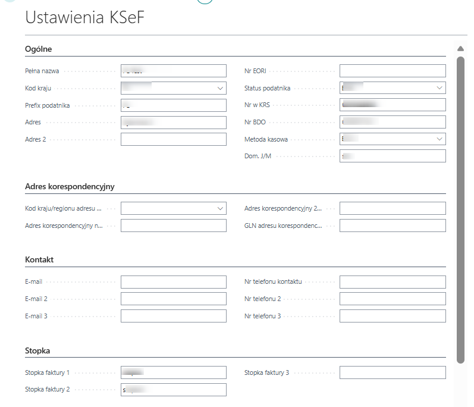

### **Zakładki systemowe KSeF i pola konfiguracyjne**

**KSeF**

Zakładka ta umożliwia konfigurację parametrów specyficznych dla komunikacji z KSeF oraz zarządzania dokumentami przekazywanymi do KSeF.

- **Bieżąca wersja KSeF** – wybór wersji schemy KSeF, z której system ma korzystać podczas generowania i wysyłki faktur

- **Numery dokumentów KSeF** – dla dokumentów wychodzących KSeF należy przypisać oddzielną serię numeracji. Seria ta będzie używana dla nowego typu dokumentu (wprowadzonego przez Polską Lokalizację) – faktur KSeF. Dotyczy wyłącznie dokumentów sprzedaży.

- **Tryb tworzenia faktur KSeF** – ustaw wartość „Automatycznie”, jeśli faktury KSeF mają być tworzone automatycznie w momencie księgowania faktury sprzedaży. Jeśli ustawiono „Twórz ręcznie”, wówczas po zaksięgowaniu faktury sprzedaży użytkownik musi ręcznie utworzyć fakturę KSeF lub zostanie ona utworzona automatycznie w momencie uruchomienia kolejki zadań do wysyłki dokumentów do KSeF.

- **Dozwolona edycja numeru KSeF** – umożliwia ręczną edycję numeru dokumentu KSeF. Może to być wymagane w sytuacji, gdy faktura została poprawnie wysłana do KSeF, lecz z jakiegoś powodu (np. problemów z połączeniem) numer KSeF ID nie został zwrócony.

- **Dozwolona edycja sposobu przetwarzania dokumentu** – umożliwia zmianę sposobu przetwarzania dokumentu w KSeF. Jeśli pole to ustawione jest na „True”, użytkownik może edytować sposób przetwarzania na kartotece klienta oraz na dokumencie (przed zaksięgowaniem). Jeśli ustawione jest na „False”, użytkownik może ustawić sposób przetwarzania wyłącznie na poziomie Grupy księgowej odbiorcy, w polu Przetwarzanie dokumentu KSeF. Wartość z tego pola jest następnie automatycznie przenoszona na kartoteki klientów oraz dokumenty sprzedaży.

- **Dozwolona edycja typu faktury** – umożliwia zmianę typu dokumentu KSeF, np. z faktury VAT (VAT) na fakturę zaliczkową (ZAL). Typ faktury jest uzupełniany automatycznie na podstawie typu dokumentu utworzonego w Business Central. Przy ustawieniu tego pola na „True” użytkownik może ręcznie zmienić typ faktury dla konkretnego dokumentu.

- **Dozwolona edycja statusu dokumentu KSeF** – umożliwia ręczną zmianę statusu faktury KSeF.

- **Data rozpoczęcia KSeF** – ustawia datę początkową dla dokumentów objętych systemem KSeF. Dokumenty wystawione przed tą datą nie będą poprawnie funkcjonować w KSeF. Odpowiednie układy wydruków dokumentów są również stosowane w zależności od tej daty.

- **Używaj wierszy przed/po** – określa sposób prezentowania i przesyłania wierszy korekty typu „przed” i „po” dla faktur korygujących wysyłanych do KSeF. Ustawienie to wpływa na strukturę danych przekazywanych do KSeF oraz na sposób, w jaki faktura korygująca jest prezentowana odbiorcy w aplikacji rządowej KSeF.

    - Jeżeli wartość pola Używaj wierszy przed/po jest ustawiona na Prawda:

        - faktury korygujące są wysyłane do KSeF z wierszami typu „przed” i „po”,

        - wiersze te odzwierciedlają:

            - stan danych przed korektą,

            - stan danych po korekcie,

        - odbiorca dokumentu widzi w aplikacji KSeF szczegółowe porównanie wartości przed i po korekcie.

    - Jeżeli wartość pola Używaj wierszy przed/po jest ustawiona na Fałsz:

        - faktury korygujące są wysyłane do KSeF bez wierszy typu „przed” i „po”,

        - do KSeF przekazywane są wyłącznie wartości wynikowe korekty,

        - dokument prezentowany jest w uproszczonej formie, bez rozbicia na stan przed i po korekcie.

    Uwaga

    W przypadku importu faktur zakupu z KSeF zawierających wiersze „przed/po” sposób tworzenia dokumentów zakupu różni się od standardowego. Szczegóły opisano w sekcji dotyczącej przetwarzania faktur zakupu.

- **Pomiń wiersze komentarzy –** określa, czy linie oznaczone jako komentarze są pomijane podczas wysyłania dokumentu do KSeF.

- **Okres wsteczny wysyłki do KSeF (dni)** – określa, z jakiego okresu czasowego Kolejka zadań (Job Queue) ma wyszukiwać dokumenty oczekujące i kwalifikujące się do wysłania do Krajowego Systemu e‑Faktur (KSeF).

    Wartość tego pola jest interpretowana jako liczba dni wstecz od momentu uruchomienia kolejki zadań, w ramach których system analizuje dokumenty sprzedażowe pod kątem wysyłki do KSeF.

    - Jeżeli pole nie jest uzupełnione (puste lub równe 0), Kolejka zadań:

        - analizuje wyłącznie dokumenty z ostatnich 24 godzin,

        - wysyła dokumenty wystawione w tym okresie, które spełniają warunki wysyłki do KSeF.

    - Jeżeli pole zawiera wartość większą od 0, Kolejka zadań:

        - analizuje dokumenty wystawione od daty uruchomienia kolejki minus wskazana liczba dni,

        - wyszukuje wszystkie dokumenty z tego okresu, które:

            - nie zostały jeszcze wysłane do KSeF,

            - nie są oznaczone jako Pomiń w KSeF,

            - posiadają sposób przetwarzania oraz status umożliwiający wysyłkę.

- **Użyj własnego pliku XSL wizualizacji** –określa, czy system ma korzystać z niestandardowego pliku XSL do wizualizacji faktury KSeF.

Włączone – system wykorzystuje zdefiniowany przez użytkownika plik XSL do transformacji danych XML faktury KSeF do postaci wizualnej,Wyłączony – system korzysta z domyślnej wizualizacji dostarczonej w ramach rozwiązania.

- **Plik XSL wizualizacji KSeF** - pole służy do wskazania pliku XSL wykorzystywanego do wizualizacji faktury KSeF. Plik XSL definiuje reguły transformacji danych z formatu XML (ustrukturyzowana faktura KSeF) do czytelnej formy wizualnej. Pole jest aktywne wyłącznie w przypadku włączenia parametru Użyj własnego pliku XSL wizualizacji.

### **Import wizualizacji KSeF z XLS**

Funkcjonalność umożliwia import własnej wizualizacji zawartej w pliku XLS:

Aby zaimportować plik, wybierz Akcje → **Użyj własnego pliku XSL wizualizacji**

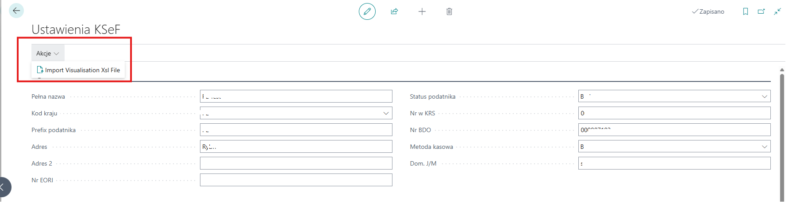

### Dodatkowe informacje w wizualizacji KSeF

- W przypadku korzystania z wizualizacji (zarówno domyślnej, jak i własnej), system prezentuje rozszerzony zakres danych z dokumentu KSeF, obejmujący m.in.:sekcję „Podmiot 2K” dla korekt danych nabywcy,

- typ oraz powód korekty,

- listę faktur korygowanych,

- informacje o fakturach zaliczkowych,

- sekcję „Podmiot 3” (w wizualizacji prezentowany jest jeden wpis, mimo że w strukturze może występować wiele),

- informacje o umowie (numer, data),

- informacje o zamówieniu (numer, data, wartość),

- wiersze zamówienia.

Dodatkowo wizualizacja dostępna jest bezpośrednio na dokumencie KSeF (faktury sprzedaży), co umożliwia podgląd danych XML przed ich wysłaniem. Funkcjonalność ta znacząco ułatwia weryfikację i testowanie dokumentów.

**Ustawienia wersji KSeF**

Zakładka ta umożliwia zarządzanie użyciem wersji struktur logicznych KSeF zgodnie z wymaganiami Ministerstwa Finansów.

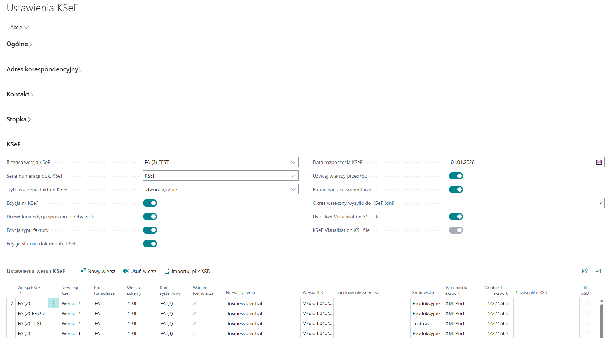

## Mapowanie stawek VAT KSeF

→ Ustawienia księgowe VAT

W polu **Stawka VAT KSeF** należy przypisać stawki VAT do odpowiednich kombinacji księgowych, które mają być eksportowane do KSeF w fakturach ustrukturyzowanych.

- Każda kombinacja kont księgowych powinna mieć przypisaną odpowiednią **stawkę VAT KSeF**, która będzie wysyłana do KSeF.

- Wybranie opcji **Brak** oznacza, że dana kombinacja **nie będzie eksportowana** do KSeF.

Poprawne przypisanie stawek VAT jest niezbędne, aby generowane faktury były zgodne z wymaganiami KSeF

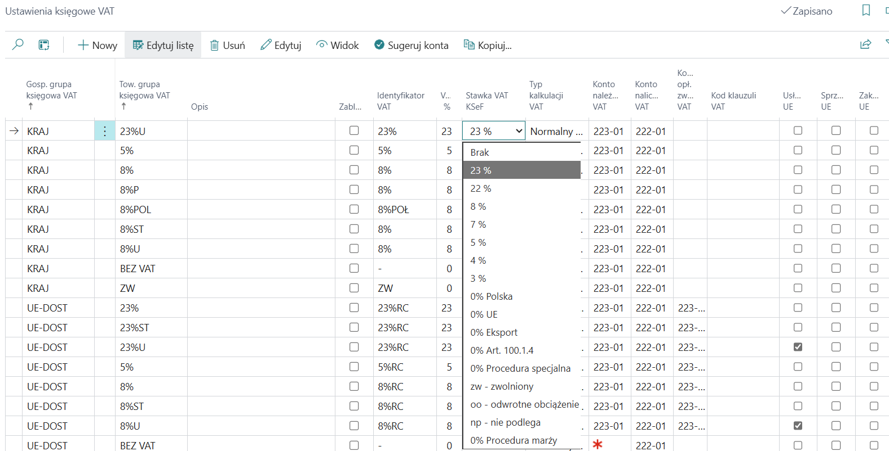

- Można zdefiniować pola Domyślny status KSeF zakupu oraz Domyślny status KSeF sprzedaży dla odpowiednich kombinacji. Wartość z tych pól będzie stosowana dla dokumentów, dla których status nie został określony. Mogą to być np. dokumenty nieistniejące w KSeF. Dla takich dokumentów można wybrać np. „BFK Faktura poza KSeF” lub „DI Inny dokument”. **Jeśli dokument nie będzie miał przypisanego żadnego statusu KSeF oraz nie będzie posiadał numeru KSeF ID, mogą wystąpić błędy podczas tworzenia deklaracji JPK VAT (SAFT).**

- Aby zdefiniować przepis prawny stanowiący podstawę zwolnienia z VAT i wpływający na uzupełnienie pól P_19_A/B/C w KSeF, jego nazwę należy wprowadzić w odpowiedniej kolumnie dla danej kombinacji w **Ustawieniach księgowych VAT**.

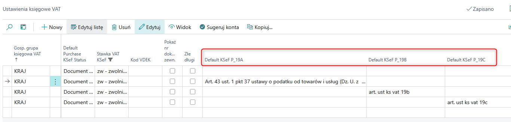

## KSeF - odwrotne obciążenie

Pole P_18 w fakturze ustrukturyzowanej KSeF informuje, czy dana faktura podlega mechanizmowi odwrotnego obciążenia.

Jeżeli to nabywca jest zobowiązany do rozliczenia VAT (lub podatku o podobnym charakterze), pole P_18 musi przyjąć wartość„1”. W pozostałych przypadkach przekazywana jest wartość„2”.

Polska Lokalizacja obsługuje to pole w pełni i może je wypełnić na podstawie konfiguracji albo automatycznie, zgodnie z logiką systemową.

Pole P_18 – Adnotacja „odwrotne obciążenie” należy wypełnić:

- wartość „1” – jeżeli faktura dokumentuje dostawę towarów lub świadczenie usług, dla których nabywca rozlicza VAT,

- wartość „2” – we wszystkich pozostałych przypadkach.

Pole to dotyczy zarówno:

- transakcji międzynarodowych, jak i

- krajowych przypadków odwrotnego obciążenia, w tym wynikających z art. 145e ustawy o VAT, gdzie faktura musi zawierać adnotację „odwrotne obciążenie” (art. 106e ust. 1 pkt 18 ustawy).

<u>Uwaga</u>: obejmuje to również „historyczne” odwrotne obciążenie na podstawie art. 17 ust. 1 pkt 7 lub 8 ustawy (w brzmieniu sprzed 1.11.2019 r.).

Pole P_18 jest w pełni obsługiwane w strukturze FA(3) KSeF. Polska Lokalizacja zawsze przekazuje do KSeF wartość„1” lub „2”, zgodnie z obowiązującymi przepisami.

### Logika wypełniania pola P_18

**Priorytet: konfiguracja VAT**

→ Ustawienia księgowania VAT

Jeżeli w **Ustawieniach księgowania VAT,** na poziomie kombinacji księgowych VAT, pole „KSeF Reverse Charge” ma wartość *Prawda*, to system respektuje to ustawienie i bezwarunkowo używa go przy generowaniu faktury KSeF.

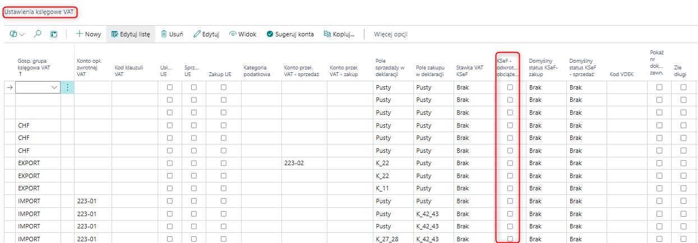

Oznacza to, że użytkownik może wymusić zachowanie P_18 dla konkretnych scenariuszy.

Jeżeli pole„KSeF Reverse Charge” ma wartość *Fałsz* w konfiguracji, wówczas Polska Lokalizacja automatycznie wylicza, czy transakcja spełnia warunki odwrotnego obciążenia, na tej podstawie ustawia:

- P_18 = „1” – gdy VAT rozlicza nabywca,

- P_18 = „2” – w pozostałych przypadkach.

Logika ta opiera się na:

- rodzaju transakcji (krajowa / zagraniczna),

- statusie podatkowym stron,

- konfiguracji VAT i kraju/regionu.

## Ustawienia krajów/regionów

→ Kraje/Regiony

Strona **Kraje/regiony** musi być poprawnie skonfigurowana, aby funkcjonalność KSeF mogła prawidłowo określić, czy dany kraj powinien zostać zaklasyfikowany jako państwo członkowskie UE, kraj krajowy (Polska) czy kraj spoza UE. Jest to niezbędne do zapewnienia poprawności struktury generowanych plików XML.

Dla każdego kraju UE znajdującego się na liście należy ustawić odpowiedni kod w kolumnie **Kod kraju/regionu UE**.

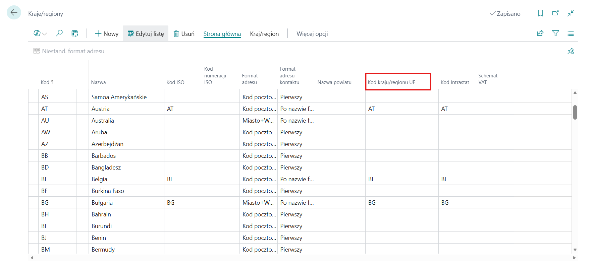

## Konfiguracja kont bankowych i opis mechanizmu

→ Kartoteka konta bankowego

Na kartotece konta bankowego dostępna jest dodatkowa zakładka dedykowana dla KSeF. Powinna być ona uzupełniona wyłącznie dla rachunków bankowych wykorzystywanych na fakturach wysyłanych do KSeF. Dla takich rachunków należy uzupełnić pola **Nazwa konta bankowego KSeF** oraz **Typ własnego konta bankowego KSeF**. Pozostałe pola są opcjonalne. Nazwa rachunku bankowego oraz opis z tej zakładki KSeF są przesyłane do KSeF zamiast wartości z pola Nazwa w zakładce ogólnej.

Aby uniknąć błędów walidacji KSeF podczas eksportu faktur do KSeF, funkcjonalność Polskiej Lokalizacji wprowadza mechanizm określający rachunek bankowy używany w fakturach KSeF na podstawie priorytetów i dostępnych danych. Mechanizm ten działa w następujący sposób:

- Rachunek bankowy wskazany bezpośrednio na fakturze sprzedaży jest przekazywany do KSeF.

- Jeśli na fakturze sprzedaży nie wskazano rachunku bankowego, system stosuje rachunek bankowy w tej samej walucie co dokument, ale tylko wtedy, gdy pola **Nazwa konta bankowego KSeF** oraz **Typ własnego konta bankowego KSeF** są uzupełnione dla tego rachunku.

- Jeśli nie zostanie znaleziony taki rachunek bankowy, system zastosuje domyślny rachunek bankowy wskazany na stronie **Informacje o firmie** dla danej faktury sprzedaży i prześle go do KSeF.

Jeżeli żaden rachunek bankowy nie będzie dostępny, walidacja KSeF może zakończyć się niepowodzeniem.

### Rachunek bankowy dla mechanizmu podzielonej płatności (MPP)

Polska Lokalizacja umożliwia wskazanie dedykowanego rachunku bankowego wykorzystywanego dla mechanizmu podzielonej płatności (MPP), który następnie może być używany na fakturach sprzedaży oraz przekazywany do dokumentu KSeF.

<u>Ważne</u>: aby możliwe było wskazanie rachunku MPP, należy najpierw utworzyć taki rachunek jako osobną kartotekę konta bankowego w Business Central. Dopiero istniejące konto bankowe może zostać wybrane w polu Konto bankowe dla MPP na kartotekach innych rachunków.

Rachunek bankowy dla mechanizmu podzielonej płatności wskazuje się na kartotece konta bankowego:

→ Kartoteka konta bankowego → zakładka Ogólne

→ pole „Konto bankowe dla MPP”

W polu tym wybierany jest inny, wcześniej zdefiniowany rachunek bankowy, który pełni rolę rachunku MPP.

Po wskazaniu rachunku MPP:

- system automatycznie podpowiada ten rachunek na fakturach sprzedaży, dla których stosowany jest mechanizm podzielonej płatności,

- jeżeli rachunek MPP zostanie użyty na fakturze, zostanie on:

    - uwzględniony na dokumencie sprzedaży,

    - przekazany do dokumentu KSeF jako rachunek płatności.

Wskazanie rachunku MPP nie zastępuje standardowych ustawień KSeF na kartotece konta bankowego (pola Nazwa konta bankowego KSeF oraz Typ własnego konta bankowego KSeF).

Do KSeF zawsze przekazywany jest rachunek faktycznie użyty na fakturze, w tym – jeżeli dotyczy – rachunek oznaczony jako MPP.

## Konfiguracja połączenia z KSeF

Strona **Usługa e-dokumentu** służy m in. do wyboru ustawień eksportu i importu plików do i z KSeF. Po otwarciu strony należy utworzyć nową usługę do celów **KSeF** poprzez dodanie nowego wiersza.

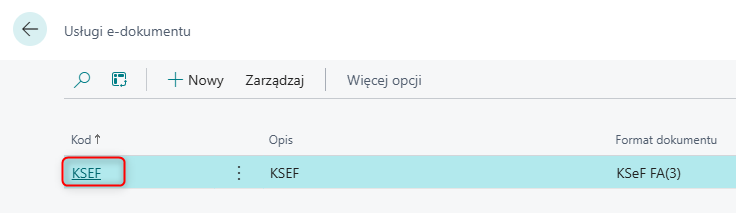

W polu **Format dokumentu** należy wskazać KSeF FA(3) oraz wybrać KSeF - Polski system e-faktur w polu **Integracja usługi**.

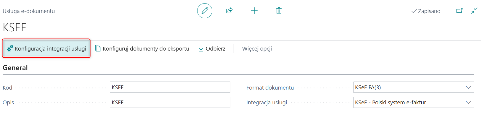

Po wybraniu opcji **Konfiguracja integracji usługi**, możliwy jest wybór środowiska: Testowego, Demo lub Produkcyjnego używając opcji **Środowisko**. Na podstawie wybranego środowiska KSeF automatycznie wybierany jest adres API w pozycji **API Base URL**.

Można też pobrać certyfikaty publiczne za pomocą opcji **Pobierz certyfikaty publiczne**. Nie jest to jednak konieczne na tym etapie, ponieważ jest to jeden z kroków w ramach Kreatora konfiguracji KSeF, co zostało opisane w kolejnych rozdziałach tego podręcznika. Certyfikaty publiczne można pobierać wielokrotnie i są one nadpisywane.

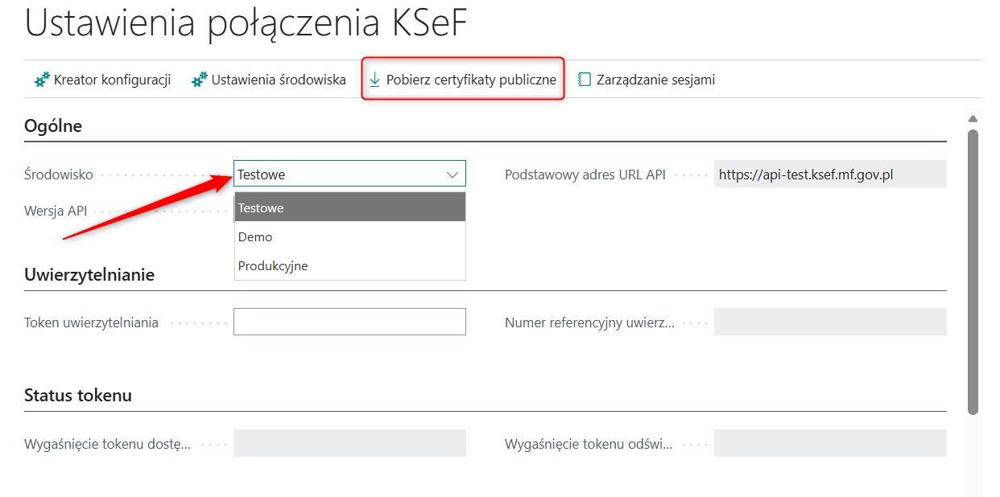

## Generowanie i konwertowanie certyfikatów KSeF

Aby poprawnie korzystać z funkcjonalności KSeF, które wymagają certyfikatu KSeF, certyfikat musi zostać najpierw wygenerowany w Aplikacji Podatnika KSeF, z nadaniem mu nazwy oraz hasła.

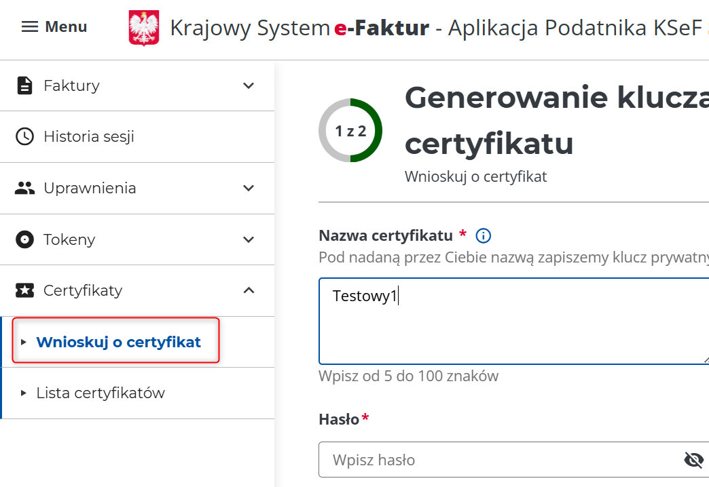

Po wygenerowaniu certyfikatu należy go pobrać. Zostaną pobrane dwa pliki - jeden w formacie .crt oraz drugi w formacie .key.

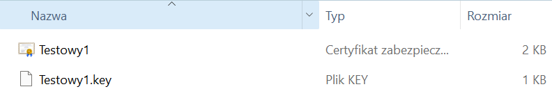

**\*Poniższe kroki powinny być wykonywane przez administratora IT lub z jego pomocą.**

- Certyfikat pobrany z KSeF wymaga konwersji, aby działał poprawnie w Microsoft Business Central.

- W pierwszej kolejności należy upewnić się, że na komputerze użytkownika jest zainstalowane oprogramowanie **OpenSSL**.

- Jeśli **OpenSSL** jest już zainstalowany, należy otworzyć narzędzie **Windows PowerShell**.

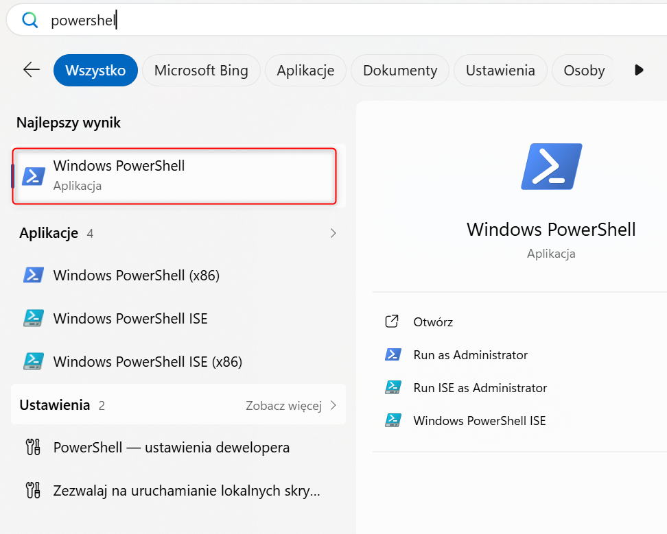

- Po otwarciu narzędzia **Windows PowerShell** użytkownik będzie mógł wprowadzać polecenia.

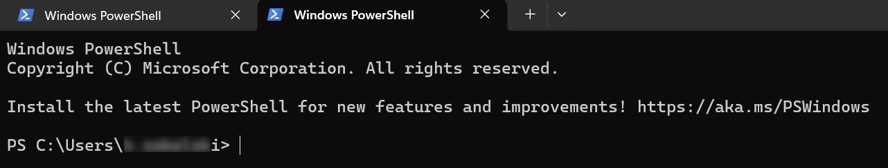

- Aby poprawnie przekonwertować certyfikat, należy wpisać odpowiednie polecenie w narzędziu, a następnie nacisnąć ENTER:

**.\openssl.exe pkcs8 -in \<ścieżka do certyfikatu do konwersji\> -out \<ścieżka do certyfikatu wyjściowego\>.pem**

- Na przykład dla certyfikatu o nazwie „Testowy1”, zapisanego w folderze o ścieżce „C:\CertyfikatyKSeF”, polecenie powinno wyglądać następująco:

**.\openssl.exe pkcs8 -in C:\CertyfikatyKSeF\Testowy1.key -out C:\CertyfikatyKSeF\Testowy1.pem**

- Następnie użytkownik zostanie poproszony o wprowadzenie hasła. W tym miejscu należy wpisać hasło certyfikatu – takie samo, jakie zostało podane w Aplikacji Podatnika KSeF podczas generowania certyfikatu – a następnie nacisnąć ENTER.

- <u>Należy pamiętać, że podczas wpisywania hasła nie będzie ono widoczne w żadnej formie</u>: ani jako litery, cyfry czy znaki specjalne, ani jako kropki, gwiazdki czy inne symbole, które zwykle pojawiają się w polach wprowadzania hasła.

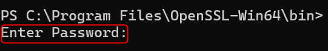

- Po wykonaniu powyższych kroków w folderze, w którym użytkownik wcześniej zapisał pliki certyfikatu pobrane z Aplikacji Podatnika KSeF, pojawi się dodatkowy plik w formacie .pem.

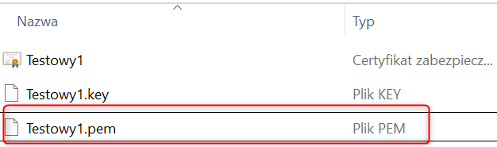

- Następnie w Microsoft Business Central należy przejść do strony **Usługi e‑dokumentu**, wybrać usługę utworzoną wcześniej dla KSEF, a następnie wybrać opcję **Konfiguracja integracji usługi**, po czym uruchomić **Kreator konfiguracji**.

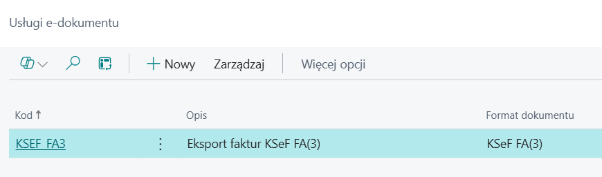

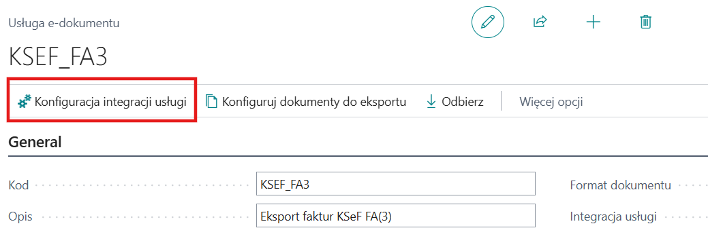

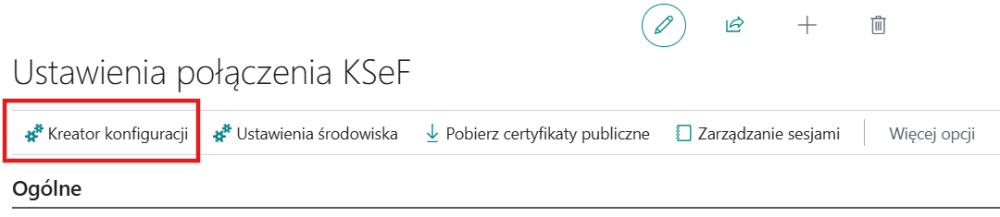

- W **Kreatorze konfiguracji środowiska KSeF** należy przejść do kroku „Importuj certyfikat podpisujący ECDSA”. W polu Akcja certyfikatu należy wybrać **Importuj nowy certyfikat**, a następnie kliknąć Dalej.

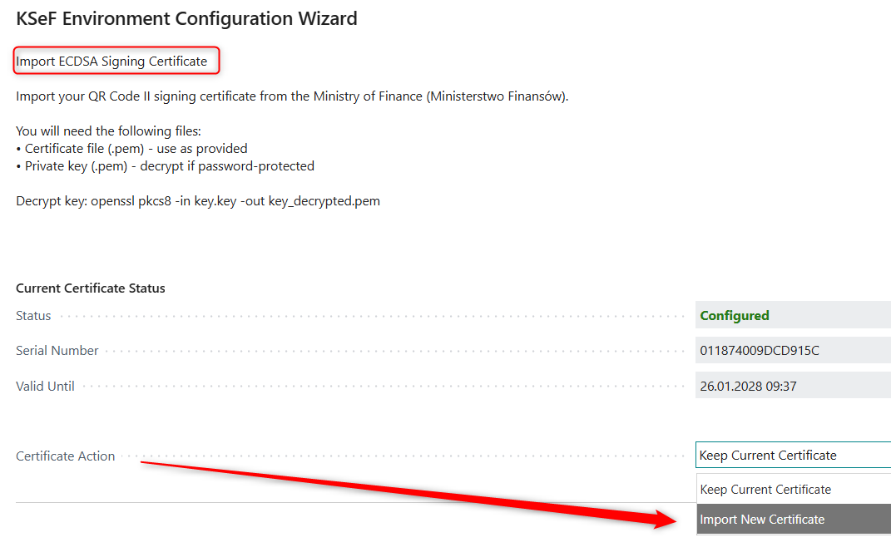

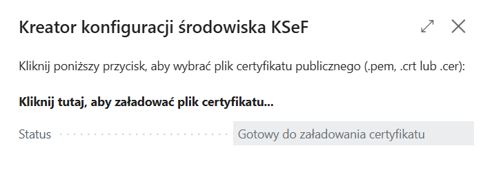

- W kolejnym kroku należy wybrać **Kliknij tutaj, aby załadować plik certyfikatu** i wskazać plik certyfikatu z rozszerzeniem .crt, a następnie wybrać Dalej.

- W następnym kroku należy użyć opcji **Kliknij tutaj, aby załadować plik klucza prywatnego**, wskazać plik certyfikatu w formacie .pem, a następnie wybrać Dalej.

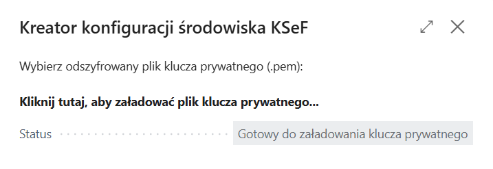

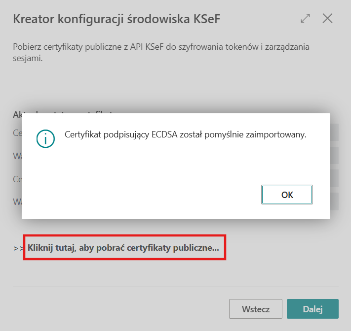

- Użytkownik zostanie poinformowany, że certyfikat został pomyślnie zaimportowany.

- Następnie należy pobrać certyfikaty publiczne, klikając \>\> **Pobierz certyfikaty publiczne**. Po wykonaniu tej czynności użytkownik zostanie poinformowany, że certyfikaty publiczne zostały pomyślnie pobrane.

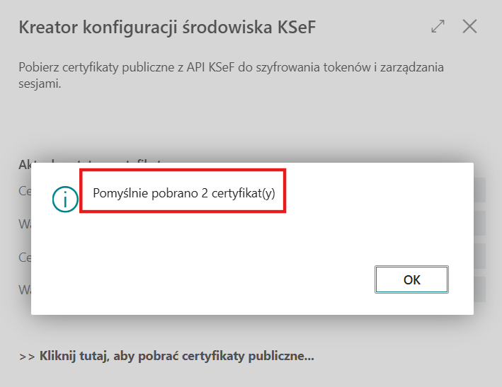

- W ostatnim kroku użytkownik musi potwierdzić zakończenie konfiguracji. Zostanie wyświetlony komunikat informujący, że środowisko KSeF zostało pomyślnie skonfigurowane.

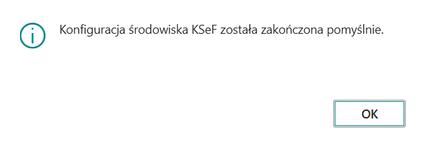

## Zarządzanie sesjami połączeń z KSeF i UPO

Użycie przycisku **Zarządzanie sesjami** przenosi użytkownika do widoku menedżera sesji, gdzie można zobaczyć wszystkie sesje łączenia oraz ich statusy. System w czasie wysyłki pliku KSeF nawiązuje sesję, w oparciu o te sesję wysyłka pliki, pobiera UPO i zapisuje ją w tym widoku. Widok ten umożliwia sprawdzenie m.in. środowisko sesji, typ sesji, status sesji i kod statusu sesji, ile plików razem zostało wysłanych w ramach tej sesji, ile zostało wysłanych skutecznie, ile nieskutecznie, czy sesja została zakończona.

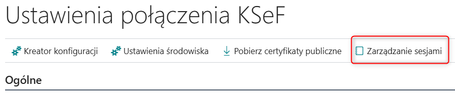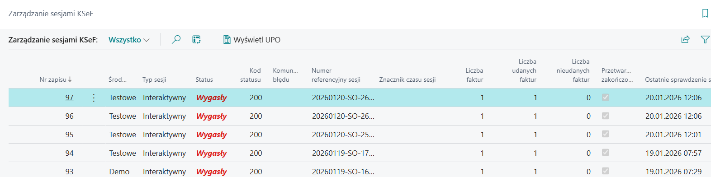

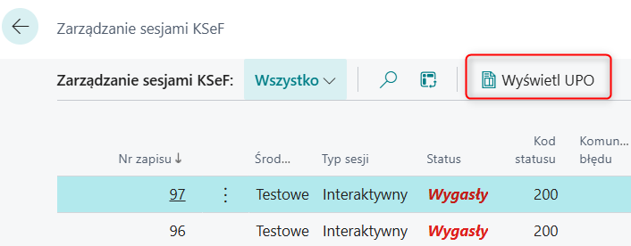

Aby uzyskać dostęp do podglądu UPO należy w widoku **Zarządzanie sesjami KSeF** zaznaczyć odpowiednią sesję i wybrać opcję **Wyświetl UPO.**

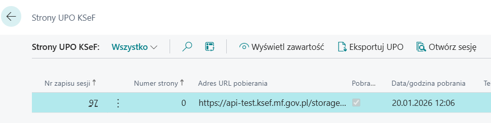

UPO dla wysłanych dokumentów KSeF można też sprawdzić z poziomu konkretnego dokumentu w widoku **KSeF – Faktura** w sekcji **UPO**. Znajdują się tam informacje o tym, czy UPO zostało przeprocesowane, kiedy zostało wysłane oraz zakodowany numer UPO.

W sekcji **Sesja** użytkownik może sprawdzić numer sesji, w której został wysłany dany dokument oraz datę i godzinę wysyłki.

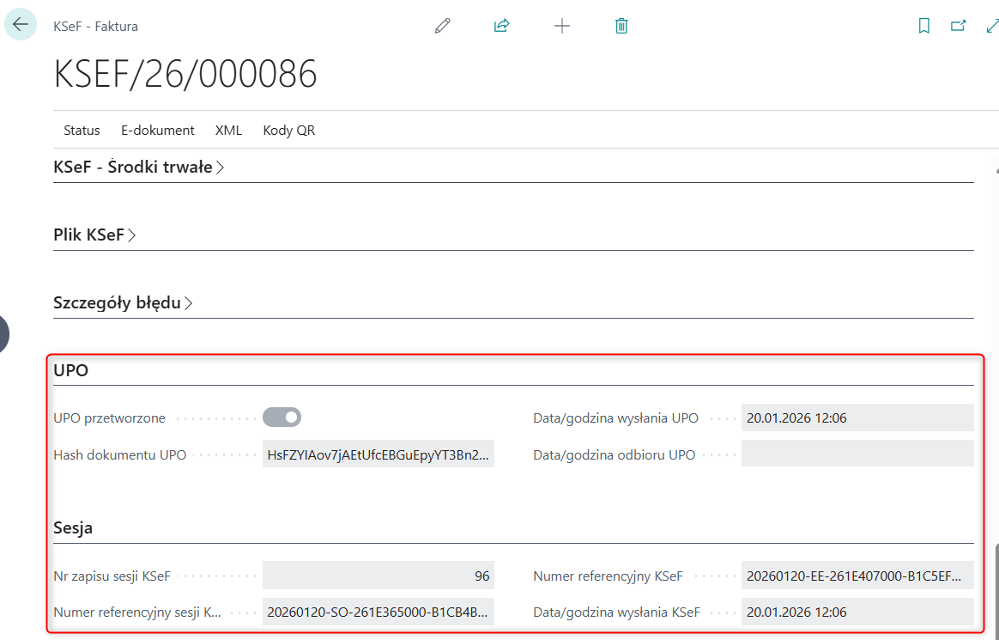

W przypadku gdy sekcje **UPO** i **Sesja** nie są widoczne dla użytkownika, należy dodać je przy pomocy opcji **Personalizuj**.

## Uwagi dotyczące danych tekstowych

Poprawność danych tekstowych przekazywanych do KSeF (np. nazwy kontrahentów, adresy) zależy od konfiguracji filtra tekstu.

W przypadku wystąpienia niestandardowych znaków należy upewnić się, że zostały one uwzględnione w ustawieniach:

→ Ustawienia JPK → Filtr tekstu

Szczegółowy opis działania filtra znajduje się w rozdziale dotyczącym konfiguracji JPK.

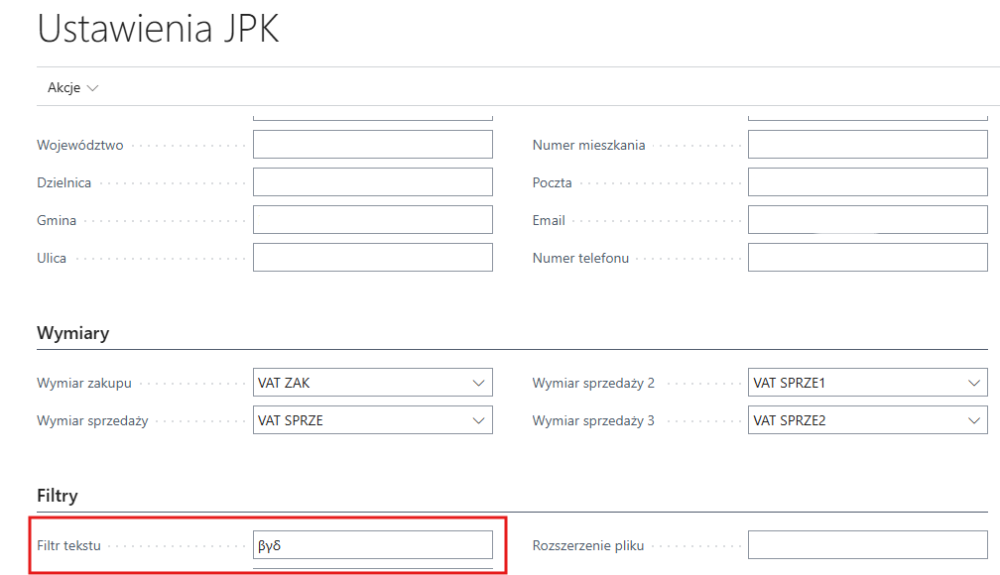

# Generowanie i wysyłka dokumentów do KSeF

Proces generowania i wysyłki dokumentów do Krajowego Systemu e-Faktur (KSeF) rozpoczyna się od wystawienia faktury sprzedaży lub faktury korygującej. Dokument można utworzyć z poziomu stron: **Zaksięgowana faktura sprzedaży**, **Zaksięgowane faktury sprzedaży**, **KSeF - Lista faktur,** **Zamówienie sprzedaży**, **Zamówienie zwrotu sprzedaży** lub **Faktura korygująca sprzedaży**. Faktura wystawiana jest w standardowy sposób, poprzez uzupełnienie wszystkich wymaganych pól i zaksięgowanie dokumentu. Samo zaksięgowanie dokumentu nie powoduje automatycznego przesłania do KSeF, chyba że skonfigurowano automatyczną wysyłkę do KSeF każdorazowo po zaksięgowaniu faktury. Jednak w każdym przypadku księgowanie i wysyłka do KSeF są całkowicie odrębnymi procesami w Business Central.

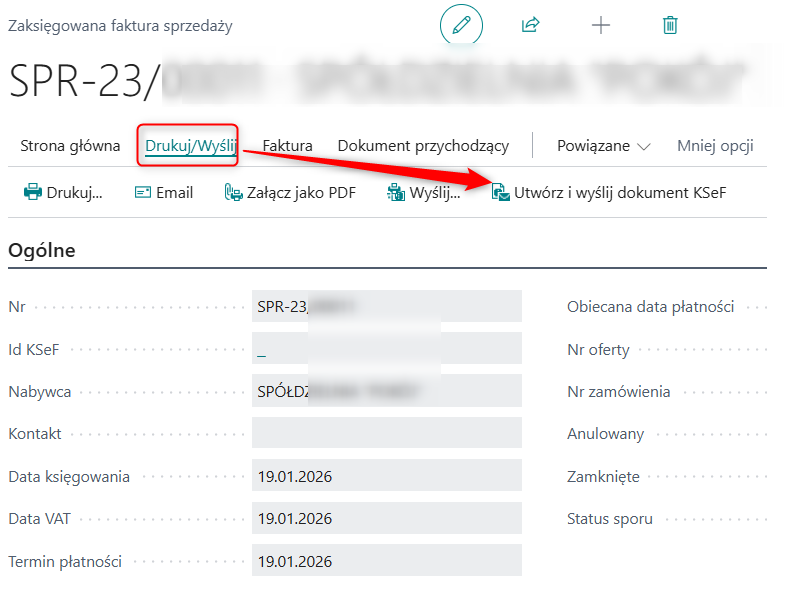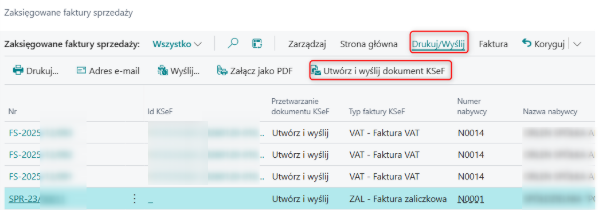

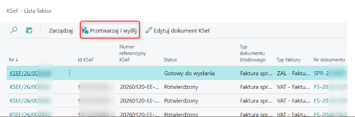

## Dodatkowe pola na zaksięgowanych fakturach sprzedaży

Na zaksięgowanych fakturach sprzedaży znajdują się dodatkowe pola związane z KSeF:

- **Id KSeF** – unikalny numer nadawany przez Ministerstwo Finansów. Numer ten pojawia się automatycznie na zaksięgowanej fakturze po wysłaniu dokumentu i pozytywnej weryfikacji w KSeF. Numer ID KSeF po jego nadaniu jest widoczny na stronach **KSef – Faktura**, **Zaksięgowana Faktura sprzedaży**, **Zaksięgowana faktura korygująca sprzedaży, Zaksięgowana faktura zakupu, Zaksięgowana faktura korygująca zakupu**, **Zapisy VAT**.

- **Przetwarzanie dokumentu KSeF** – określa sposób przetwarzania dokumentu po jego utworzeniu. Pole to jest domyślnie ukryte – aby korzystanie z niego było możliwe należy je dodać za pomocą opcji **Personalizuj.** Możliwe jest wybranie następujących opcji:

    1. **Utwórz i wyślij** – faktura jest przeznaczona do automatycznej wysyłki do KSeF, bez dodatkowych działań użytkownika. Faktyczna wysyłka jest realizowana przez procesy działające w tle (Kolejka zadań). Jeżeli wymagane wpisy w kolejce zadań nie są skonfigurowane lub nie są uruchomione, dokument NIE zostanie wysłany automatycznie po zaksięgowaniu. Opcja ta powoduje zaksięgowanie faktury, utworzenie dokumentu KSeF oraz jego wysłanie do KSeF.

    2. **Utwórz i edytuj** – dokument otrzymuje status „Nowy” i oczekuje na ręczną aktualizację statusu, którymusi zostać zmieniony na „Gotowy do wysłania”, aby dokument został wysłany do KSeF. Kolejka zadań wysyła do KSeF wyłącznie dokumenty ze statusem „Gotowy do wysłania”.

    3. **Utwórz i ustaw Gotowy do wysłania** - opcja powoduje zaksięgowanie faktury oraz utworzenie dokumentu KSeF ze statusem „Gotowy do wysłania”. Kolejka zadań wyśle dokument do KSeF.

    4. **Pomiń w KSeF** – faktura nie zostanie wysłana do KSeF.

- **Typ faktury KSeF** – typ faktury wybierany jest automatycznie. W razie potrzeby istnieje możliwość zmiany typu faktury również po zaksięgowaniu, ale przed wysyłką do KSeF.

## Utworzenie dokumentu KSEF

Po zaksięgowaniu faktury należy utworzyć dokument KSeF. W tym celu z zaksięgowanej faktury sprzedaży lub faktury korygującej wybiera się opcję:

**Powiązane → KSeF**

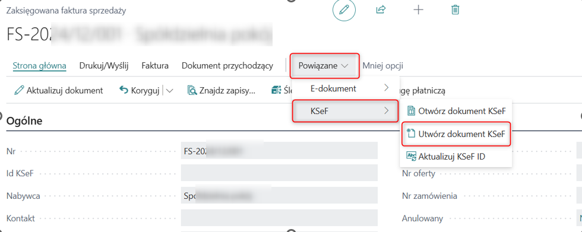

- **Otwórz dokument KSeF** – jeśli dokument KSeF został już wcześniej utworzony, zostaje on wyświetlony.

- **Utwórz dokument KSeF** – jeśli dokument KSeF nie istnieje, należy go wygenerować za pomocą tej opcji. W przypadku gdy dokument KSeF już istnieje, uruchomienie tej akcji utworzy nowy dokument jednocześnie kasując poprzedni, o ile dokument nie został jeszcze wysłany.

Po wybraniu akcji Otwórz/Utwórz dokument KSeF otwiera się strona **KSeF - Faktura**, która prezentuje dane dokumentu przygotowanego do wysyłki do KSeF. Formularz zawiera informacje pobrane z faktury źródłowej oraz dodatkowe elementy ze struktury XML wysyłanej do KSeF.

Do strony **KSeF – Faktura** można również uzyskać dostęp poprzez stronę **KSeF – Lista faktur**, wybierając dany dokument poprzez kliknięcie na jego numer w kolumnie Nr.

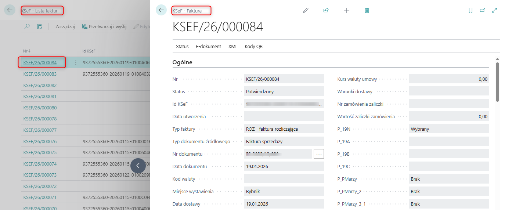

Na stronie **KSeF – Faktura** możliwe jest edytowanie wybranych pól przed wysyłką dokumentu. Zawarte tam dane odpowiadają strukturze pliku XML, który zostanie przekazany do systemu KSeF.

Jeżeli dla zaksięgowanej faktury został wybrany typ wysyłki **Utwórz i edytuj**, dokument KSeF otrzymuje początkowy status **Nowy**. W takiej sytuacji użytkownik ma możliwość zmiany statusu dokumentu na **Gotowy do wysyłki** lub **Anulowany** po wybraniu **Akcje → Status**.

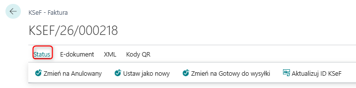

Dodatkowo z poziomu KSeF – Faktura dostępne są operacje związane z plikiem XML, takie jak: utworzenie dokumentu XML, eksport pliku, import pliku zewnętrznego, weryfikacja poprawności struktury oraz podgląd pliku XML.

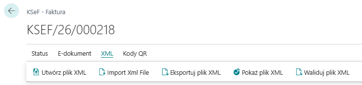

## Pominięcie wysyłki do KSeF dla faktury sprzedaży

- Jeżeli w **Ustawieniach KSeF** zaznaczona jest **Dozwolona edycja sposobu przetw. dok.**, wówczas z poziomu faktury sprzedaży lub zaksięgowanej faktury sprzedaży (ale jeszcze nie wysłanej do KSeF) w polu **Przetwarzanie dokumentu KSeF** dostępna jest opcja **Pomiń w KSeF**. Pozwala ona pominąć dany dokument w procesie wysyłki do KSeF.

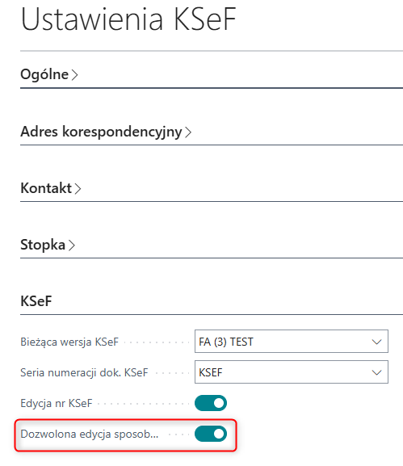

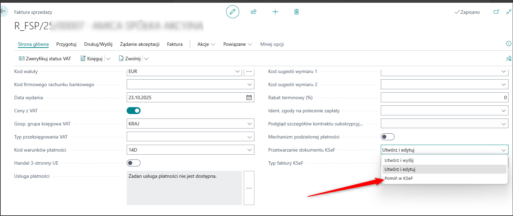

Możliwe jest także zdefiniowanie sposobu przetwarzania faktur na kartotece Nabywcy. Dla wybranego kontrahenta można określić, że jego dokumenty mają być pomijane w KSeF – wówczas opcja Pomiń w KSeF przenosi się automatycznie na wszystkie wystawiane dla niego faktury.

## Korekta danych nabywcy w KSeF

Korekta danych nabywcy stanowi szczególny rodzaj korekty opisowej, służący do zmiany danych identyfikacyjnych kontrahenta bez wpływu na wartości dokumentu.

W przeciwieństwie do pozostałych korekt opisowych, takich jak zmiana terminu płatności, daty dostawy czy adnotacji dokumentu, korekta danych nabywcy wymaga prezentacji aktualnych danych kontrahenta w dedykowanej sekcji **Podmiot2K** struktury KSeF FA(3).

Sekcja ta jest generowana wyłącznie dla korekt danych nabywcy wystawionych z przyczyną korekty typu **DANE**.

Pozostałe korekty opisowe, takie jak zmiana terminu płatności, daty dostawy lub adnotacji dokumentu, nie powodują wygenerowania sekcji Podmiot2K.

Sekcja **Podmiot2K**:

- prezentuje dane nabywcy przed korektą, pobrane z faktury pierwotnej,

- jest generowana wyłącznie dla korekt danych nabywcy,

- 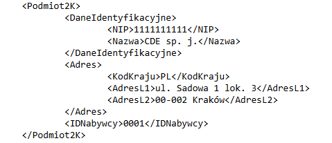zapewnia zgodność dokumentu z wymaganiami struktury KSeF FA(3).

### Wykonanie korekty

Szczegółowy sposób utworzenia korekty danych nabywcy (w tym aktualizacji danych klienta i wystawienia faktury korygującej) opisano w podręczniku głównym Polskiej Lokalizacji:

→ Podręcznik użytkownika Polska Lokalizacja → Faktury korygujące sprzedaży → Korekta danych nabywcy

### Uwagi

- brak odpowiedniego typu przyczyny korekty skutkuje brakiem sekcji Podmiot2K w strukturze XML,

- korekta danych nabywcy nie wpływa na wartości finansowe dokumentu.

## Korekty opisowe w KSEF

Funkcjonalność umożliwia wystawianie faktur korygujących służących do zmiany danych opisowych dokumentu sprzedaży bez wpływu na jego wartość, np. termin płatności, data dostawy. Korekty tego typu są obsługiwane również w procesie generowania dokumentów KSeF.

### Wykonanie korekty

Szczegółowy sposób utworzenia korekty opisowej opisano w podręczniku głównym Polskiej Lokalizacji:

→ Podręcznik użytkownika Polska Lokalizacja → Faktury korygujące sprzedaży → Korekty opisowe dokumentów sprzedaży

## Lista dokumentów KSEF

Strona **KSeF – Lista faktur** prezentuje wszystkie dokumenty przygotowane lub przesłane do KSeF.

Widok listy umożliwia szybkie sprawdzenie statusów dokumentów i zawiera m.in. następujące informacje:

- **Nr** – numer wewnętrzny dokumentu KSeF,

- **ID KSeF** – unikalny numer nadany przez Ministerstwo Finansów po przyjęciu dokumentu,

- **Status** – bieżący stan dokumentu (np. *Nowy*, *Gotowy do wysyłki*, *Wysłany*, *Anulowany*),

- **Typ dokumentu źródłowego** – typ dokumentu źródłowego w systemie (np. *Faktura sprzedaży*, *Faktura korygująca sprzedaży*),

- **Typ faktury** – rodzaj faktury (np. *VAT – faktura sprzedaży*, *ZAL – faktura zaliczkowa*, *KOR – korekta faktury*),

- **Nr dokumentu** – numer dokumentu źródłowego,

- **Data dokumentu** – data wystawienia dokumentu,

- **Kod waluty** – waluta dokumentu,

- **P_15** – wartość brutto dokumentu,

- **Nr nabywcy / Nazwa Nabywcy / Adres nabywcy / Kod kraju/regionu nabywcy** – dane kontrahenta.

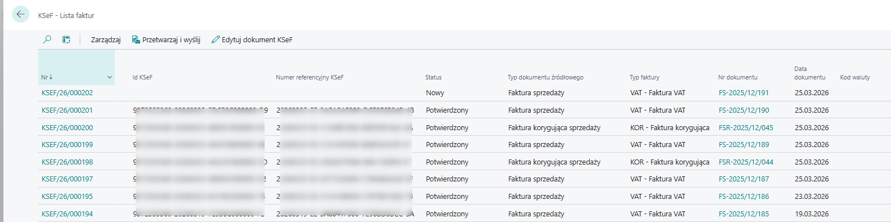

Dzięki temu widokowi można w jednym miejscu monitorować wszystkie faktury zgłoszone do KSeF, kontrolować ich statusy oraz identyfikować dokumenty wymagające wysyłki.

W przypadku, gdy dokument w widoku **KSeF – Lista faktur** ma status *Błąd walidacji* oznacza to, że dokument nie przeszedł prawidłowo walidacji i wygenerowany został błąd. Opis tego błędu można sprawdzić po kliknięciu na numerze dokumentu w oknie **KSeF – Faktura** w sekcji **Szczegóły błędu.**

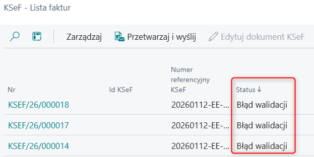

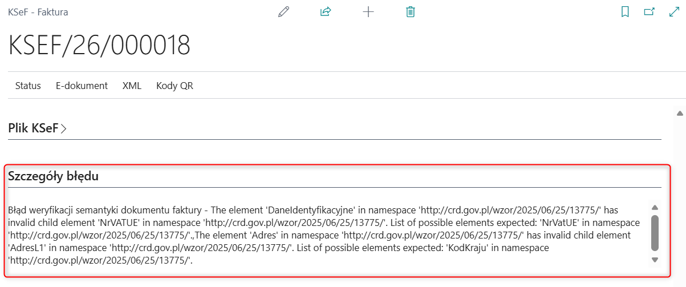

## KSeF – Lista faktur – QR Code II

Na stronie listy faktur KSeF dodano dodatkową akcję „Generuj Kody QR II dla daty roboczej”. Akcja ta umożliwia jednoczesne wygenerowanie kodów QR II dla wszystkich dokumentów KSeF jednym kliknięciem, na podstawie daty roboczej.

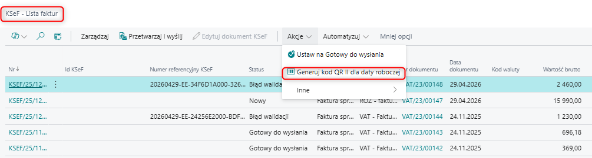

W przypadku gdy faktura nie posiada identyfikatora KSeF (tryb offline), należy ją wydrukować ręcznie, ponieważ w przeciwnym razie dokument zostałby wysłany bez kodu QR II.

# **Automatyczna wysyłka dokumentów do KSeF**

Automatyczna wysyłka dokumentów do Krajowego Systemu e‑Faktur (KSeF) umożliwia samoczynne tworzenie i przekazywanie faktur ustrukturyzowanych z systemu Microsoft Dynamics 365 Business Central do systemu KSeF, bez konieczności ręcznej interwencji użytkownika.

Mechanizm automatycznej wysyłki opiera się na:

- konfiguracji Ustawień KSeF,

- określeniu sposobu przetwarzania dokumentu KSeF,

- wykorzystaniu Kolejki zadań (Job Queue) i standardowego mechanizmu E‑Dokumentów,

- umożliwia zarówno bieżącą wysyłkę dokumentów, jak i wysyłkę zaległą z określonego okresu,

- zapewnia pełną kontrolę nad tym, które dokumenty są wysyłane do KSeF.

## Mechanizm automatycznej wysyłki - architektura logiczna

Automatyczna wysyłka realizowana jest przez dedykowaną kolejkę zadań, która cyklicznie:

- identyfikuje dokumenty KSeF spełniające warunki wysyłki,

- generuje pliki XML w strukturze FA(3),

- wysyła dokumenty do KSeF,

- przetwarza odpowiedzi zwrotne z KSeF (status, numer KSeF, UPO).

Cały proces wykorzystuje standardowy mechanizm E‑Documents w Business Central, rozszerzony o logikę wymaganą przez KSeF w ramach Polskiej Lokalizacji.

## Konfiguracja Job Queue dla wysyłki do KSeF

Do automatycznej wysyłki dokumentów sprzedażowych do KSeF wykorzystywany jest następujący codeunit:

- EXW KSeF Sales Job

Codeunit ten odpowiada za przetwarzanie dokumentów sprzedaży objętych KSeF i może być uruchamiany cyklicznie w ramach standardowej kolejki zadań.

Aby uruchomić automatyczną wysyłkę, należy utworzyć wpis w Kolejce zadań:

Typ obiektu: Codeunit

ID obiektu: EXW KSeF Sales Job

Status: Gotowy

Harmonogram: zgodnie z wymaganiami organizacyjnymi

Job Queue może działać w tle i przetwarzać dokumenty bez udziału użytkownika.

## Zakres dokumentów przetwarzanych przez Job Queue

Zakres dokumentów analizowanych podczas uruchomienia Job Queue zależy od konfiguracji w **Ustawieniach KSeF**.

→ Ustawienia KSeF

Jeżeli w Ustawieniach KSeF **nie określono liczby dni wstecz**, Job Queue:

- analizuje dokumenty z okresu **ostatnich 24 godzin**,

- uwzględnia dokumenty wystawione w tym czasie, które spełniają warunki wysyłki.

Zakres ten odpowiada standardowemu scenariuszowi bieżącej, niezwłocznej wysyłki dokumentów do KSeF.

Jeżeli w **Ustawieniach KSeF** określono **liczbę dni wstecz**, Job Queue:

- każdorazowo analizuje dokumenty wystawione od daty uruchomienia kolejki **minus wskazana liczba dni**,

- wysyła wszystkie dokumenty z tego okresu, które:

    - nie zostały jeszcze wysłane do KSeF,

    - nie są oznaczone jako *Pomiń w KSeF*,

    - posiadają status umożliwiający wysyłkę.

Mechanizm ten jest wykorzystywany m.in. w przypadku:

- pracy w trybie offline,

- pierwszego uruchomienia automatycznej wysyłki,

- konieczności wysłania zaległych dokumentów z wcześniejszego okresu.

## Tryb tworzenia faktur KSeF

Pole **Tryb tworzenia faktur KSeF** określa moment utworzenia dokumentu KSeF na podstawie dokumentu sprzedaży.

**→ Ustawienia KSeF**

**→ zakładka KSeF**

Dostępne wartości:

**Automatycznie:**

- dokument KSeF tworzony jest automatycznie w momencie księgowania faktury sprzedaży,

- dokument KSeF powstaje niezależnie od tego, czy zostanie wysłany natychmiast, czy przez Job Queue,

- dalsze przetwarzanie dokumentu (wysyłka / wstrzymanie) zależy od sposobu przetwarzania dokumentu KSeF.

**Twórz ręcznie:**

- dokument KSeF nie jest tworzony automatycznie w momencie księgowania,

- dokument KSeF może zostać:

- utworzony ręcznie przez użytkownika z poziomu zaksięgowanego dokumentu sprzedaży (→ Zaksięgowana faktura sprzedaży → Powiązane → KSeF → Utwórz dokument KSeF)

> lub

- utworzony automatycznie w momencie uruchomienia Job Queue.

**W tym trybie Job Queue pełni podwójną rolę:**

- tworzy dokumenty KSeF dla zaksięgowanych faktur,

- wysyła je do KSeF zgodnie z dalszą konfiguracją.

## Sposób przetwarzania dokumentu KSeF

Pole: **Przetwarzanie dokumentu KSeF**

(dostępne na zaksięgowanych dokumentach sprzedaży po personalizacji widoku)

**Dostępne wartości:**

**Utwórz i wyślij**

- dokument KSeF jest tworzony automatycznie,

- dokument jest automatycznie wysyłany do KSeF,

- Job Queue uwzględnia dokument bez dodatkowych warunków.

**Utwórz i edytuj**

- dokument KSeF jest tworzony automatycznie,

- dokument otrzymuje status **Nowy**,

- przed wysyłką wymagane jest ręczne ustawienie statusu **Gotowy do wysyłki**,

- Job Queue wysyła dokument dopiero po zmianie statusu.

**Pomiń w KSeF**

- dokument nie jest wysyłany do KSeF,

- Job Queue pomija dokument niezależnie od zakresu dat.

Wartość *Pomiń w KSeF* może być ustawiona:

- bezpośrednio na dokumencie,

- na kartotece klienta (działa domyślnie dla wszystkich dokumentów tego klienta).

## Relacja Job Queue i statusów dokumentów

Job Queue przetwarza wyłącznie dokumenty, które:

- mieszczą się w analizowanym zakresie dat,

- mają sposób przetwarzania umożliwiający wysyłkę,

- posiadają odpowiedni status dokumentu KSeF – *Gotowy do wysyłki*

Dokumenty oznaczone jako *Pomiń w KSeF* nie są uwzględniane w procesie automatycznej wysyłki.

## Monitorowanie wysyłki

Statusy dokumentów wysyłanych do KSeF można monitorować na stronie **KSeF – Lista faktur**, gdzie dostępne są m.in.:

- status dokumentu,

- numer KSeF,

- informacje o sesji wysyłki,

- informacje o UPO.

# **Odbieranie i przetwarzanie dokumentów z KSeF**

W module odbierania i przetwarzania dokumentów z KSeF, system umożliwia pobieranie faktur zakupu z KSeF do Business Central po wcześniejszym skonfigurowaniu połączenia.

## Ustawienia połączenia KSeF – odbieranie faktur zakupu

Aby móc pobierać faktury zakupu z KSEF, konieczne jest wcześniejsze skonfigurowanie ustawień połączenia na stronie **Ustawienia połączenia KSEF**. Należy tam wkleić wygenerowany token autoryzacyjny. W sekcji **Odbieranie** należy wskazać, dla którego podmiotu będą pobierane faktury – dla faktur zakupu należy wybrać **Podmiot 2**.

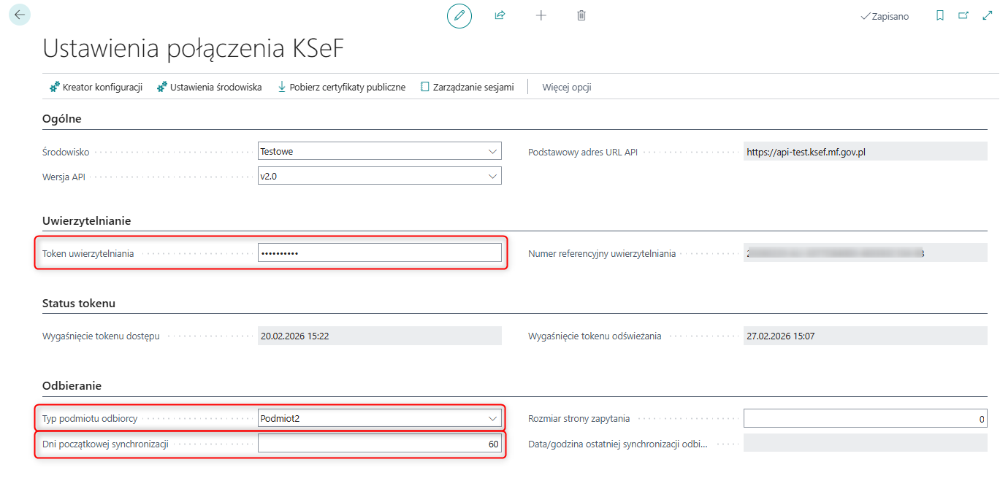 

W polu **Dni początkowej synchronizacji** jest opcja określenia liczby dni, od których ma rozpocząć się synchronizacja w przypadku pierwszego pobrania dokumentów. Umożliwia to określenie, ile dni wstecz system sprawdzi i pobierze faktury z KSEF.

Pole **Rozmiar strony zapytania** określa, ile dokumentów zostanie pobranych i sprawdzonych podczas jednego wywołania API. W przypadku uzupełnienia pola wartością 0 – używana jest domyślna ilość 100.

## Wysłanie zapytania do MF

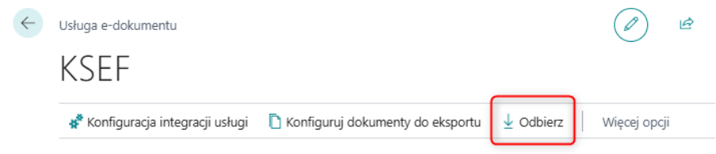

Aby wysłać zapytanie o pobranie faktur z KSeF, należy przejść do strony **Usługa e-dokumentu** i wybrać przycisk **Odbierz**.

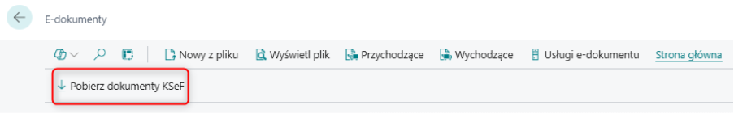

Alternatywnie, można skorzystać z poziomu menu **E-dokumenty** i wybrać opcję **Pobierz dokumenty KSeF**. W obu przypadkach system rozpocznie proces komunikacji z KSeF i pobierze dostępne dokumenty zgodnie z ustawieniami połączenia oraz zakresem synchronizacji określonym w konfiguracji.

 

Pobrane dokumenty będą widoczne na stronie **Dokumenty przychodzące**.

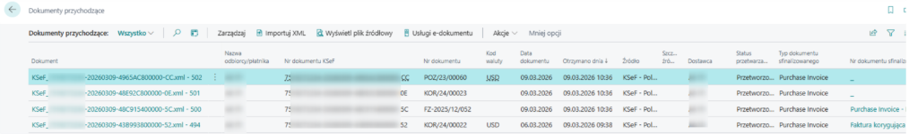

## Przetwarzanie faktur zakupu 

Po otwarciu wybranego dokumentu z poziomu strony **Dokumenty przychodzące**, użytkownik zostaje przeniesiony bezpośrednio do szczegółowego widoku danego **e-dokumentu**.

W tym miejscu prezentowane są kluczowe **dane nagłówkowe** pochodzące z faktury, takie jak: numer dokumentu, numer dokumentu KSeF, data wystawienia, termin płatności, kwota netto, kwota brutto, kod waluty, numer i nazwa dostawcy oraz **wiersze faktury**.

Aby przetworzyć całą fakturę – nagłówek i wiersze, konieczne jest stworzenie mapowań opisu pozycji do odpowiednich kont księgowych poprzez funkcję **Mapuj tekst na konto**.

Jeżeli któraś z pozycji na fakturze nie zostanie prawidłowo zmapowana, podczas przetwarzania dokumentu pojawi się błąd widoczny w sekcji **Komunikaty o błędzie**.

 

Następnie należy wybrać opcję **Przetwórz dokument ponownie**. Jeśli w trakcie ponownego przetwarzania nie zostaną wykryte żadne błędy, system utworzy fakturę zakupu na podstawie przetworzonego e-dokumentu.

Po prawidłowym przetworzeniu dokumentu jego status zostanie automatycznie zmieniony na „**przetworzony**”. W widoku dokumentu pojawi się również **odnośnik do utworzonej faktury zakupu** z uzupełnionymi danymi nagłówkowymi oraz wierszami.

## Korekty z wierszami „przed/po” – zachowanie przy imporcie z KSeF

W przypadku importu faktur korygujących z KSeF, które zawierają wiersze typu „przed/po”, sposób utworzenia dokumentu zakupu w systemie różni się od standardowego.

Po przetworzeniu e‑dokumentu:

- dane nagłówka dokumentu są poprawnie uzupełniane,

- natomiast sekcja wierszy dokumentu pozostaje pusta.

Zachowanie to wynika z ograniczeń standardowego mechanizmu Business Central, który nie interpretuje poprawnie wierszy typu „przed/po” i traktuje je jako standardowe wiersze i może błędnie sumować wartości.

W celu uniknięcia niepoprawnych kalkulacji kwot, zaburzenia wartości dokumentu, w rozwiązaniu zastosowano mechanizm polegający na pominięciu wierszy przy tworzeniu dokumentu zakupu.

**Uwagi**

- Brak wierszy nie oznacza błędu importu dokumentu.

- Dane dokumentu dostępne są w strukturze KSeF (XML).

- W przypadku konieczności dalszego przetwarzania dokumentu w BC, wiersze należy wprowadzić manualnie posiłkując się przy tym wizualizacją faktury z KSeF.

## Utworzenie nagłówka faktury zakupu

Aby utworzyć tylko nagłówek faktury zakupu bez wierszy, należy na e-dokumencie wybrać opcję **Utwórz nagłówek dokumentu zakupu**. Po jej kliknięciu pojawi się możliwość wyboru typu dokumentu – **faktura zakupu**, **zamówienie zakupu** lub **korekta faktury zakupu**. Po zatwierdzeniu wyboru utworzony zostanie dokument z uzupełnionymi danymi nagłówkowymi.

  

## Automatyczne tworzenie nagłówków dokumentów zakupu

W przypadku dużych wolumenów dokumentów przychodzących, ręczne tworzenie nagłówka dla każdego dokumentu staje się nieefektywne. W celu automatyzacji tego procesu na stronie **Ustawienia KSeF** należy określić sposób przetwarzania importowanych dokumentów:

Dostępne są następujące opcje w polu Przetwarzanie:

1.  **Ręcznie** - dla każdego zaimportowanego dokumentu użytkownik samodzielnie utworzy dokument zakupu.

2.  **Wszystkie dokumenty** - dla wszystkich importowanych dokumentów będautomatycznie tworzone nagłówki dokumentów zakupu.

3.  **Według ustawień dostawcy** - sposób przetwarzania dokumentów będzie zależał od konfiguracji określonej na kartotece poszczególnych dostawców.

Jeżeli automatyczne tworzenie dokumentów zakupu ma odbywać się wyłącznie dla wybranych dostawców, należy wybrać opcję **Według ustawień dostawcy**, a następnie na kartotece danego dostawcy ustawić wartość **Automatycznie** w polu **Utwórz nagłówki KSeF**:

W celu automatycznego utworzenia nagłówków zakupu dla dokumentów, które zostały już zaimportowane, należy na stronie **E-dokumenty** wybrać akcję **Utwórz dokument zakupu.**

## Wizualizacja faktury KSeF

Na e-dokumencie dostępna jest opcja **Podgląd**, która umożliwia wizualizację faktury KSeF na podstawie danych z faktury ustrukturyzowanej XML. Dodatkowo użytkownik ma możliwość wyświetlenia pliku XML.

 

## Podgląd dokumentu KSeF na fakturze zakupu

Podgląd PDF dokumentu KSeF jest również dostępny z poziomu strony faktury zakupu. Aby go otworzyć, przejdź do sekcji „Przygotuj” i wybierz opcję „Podgląd dokumentu KSeF”.

## Podgląd dokumentu KSeF na zaksięgowanej fakturze zakupu

Na stronie zaksięgowanej faktury zakupu przejdź do sekcji „Faktura” i wybierz opcję „Podgląd dokumentu KSeF”.

## Monitorowanie importu dokumentów KSeF

W celu zwiększenia niezawodności procesu synchronizacji dokumentów z KSeF oraz ułatwienia diagnostyki potencjalnych problemów z importem dokumentów, dostępny jest mechanizm logowania i weryfikacji synchronizacji.

### Włączenie logowania importu KSeF

→ Ustawienia KSeF

Aby włączyć funkcję logowania pobierania z KSeF, należy przejść do strony Ustawienia KSeF i w polu: "Log importu E-Dokumentów" ustawić wartość na Prawda. Po włączeniu tej opcji system rejestruje szczegółowe informacje dotyczące procesu pobierania dokumentów z KSeF.

### Logi KSeF

Na stronie Logi KSeF można śledzić i analizować przebieg synchronizacji dokumentów.

Dla każdej operacji rejestrowane są między innymi:

- data i godzina operacji,

- identyfikator użytkownika,

- numer KSeF dokumentu,

- nazwa przetwarzanego pliku,

- komunikaty informacyjne,

- informacje o błędach występujących podczas importu.

- rejestrowane zdarzenia.

W dzienniku zapisywane są następujące zdarzenia:

- data i czas rozpoczęcia procesu synchronizacji,

- liczba przetworzonych metadanych faktur,

- pomyślne pobranie dokumentu,

- błąd pobrania dokumentu,

- błąd przetwarzania metadanych,

- błąd odczytu numeru KSeF,

- błędy autoryzacji lub tokenu dostępowego,

- informacja o dokumencie z numerem KSeF, który już istnieje w systemie.

Przykładowe komunikaty w dzienniku:

- „Rozpoczęcie procesu odbioru dokumentów KSeF od %1 do %2”.

- „Przetworzono %1 metadanych faktur”.

- „Nie udało się pobrać faktury o numerze KSeF”.

- „Dokument o tym samym numerze KSeF już istnieje w systemie”.

## Automatyzacja cyklicznego importu dokumentów KSeF

W przypadku firm przetwarzających dużą liczbę dokumentów zakupowych, ręczny import dokumentów z KSeF może być niewystarczający. W takich scenariuszach dostępny jest mechanizm automatycznego, cyklicznego importu dokumentów KSeF realizowany za pomocą Kolejki zadań.

Automatyczny import umożliwia okresowe sprawdzanie systemu KSeF oraz pobieranie dokumentów przychodzących bez udziału użytkownika. Proces ten może być zaplanowany do uruchamiania w określonych odstępach czasu, w tym również poza godzinami pracy użytkowników systemu.

Do automatyzacji importu dokumentów zakupowych z KSeF wykorzystywany jest następujący codeunit:

- Codeunit 72271608 – EXW KSeF Purchase Job

Codeunit ten jest przeznaczony do uruchamiania w ramach Kolejki zadań i odpowiada za:

- komunikację z systemem KSeF w zakresie dokumentów przychodzących,

- pobieranie dostępnych dokumentów KSeF,

- rejestrację pobranych dokumentów w standardowym mechanizmie E‑Documents w Business Central.

Aby skonfigurować cykliczny import dokumentów KSeF, należy:

**→ Kolejka zadań**

Utworzyć nowy wpis:

- Typ obiektu: Codeunit

- ID obiektu: 72271608 (EXW KSeF Purchase Job)

- Status: Gotowy

- Harmonogram: zgodnie z wymaganiami organizacyjnymi (np. cyklicznie)

Po uruchomieniu wpisu Kolejki zadań system będzie automatycznie pobierał dokumenty zakupowe z KSeF zgodnie z konfiguracją połączenia oraz zakresem synchronizacji określonym w ustawieniach.

## Podmiot 3 - identyfikator wewnętrzny

Pole Partner 3 - identyfikator wewnętrzny na karcie klienta służy do przechowywania wewnętrznego identyfikatora klienta.

Wartość z tego pola jest przenoszona do struktury NSEI, do sekcji \<Podmiot3\>.

## Nieprawidłowe aktywne sesje

Aktywne sesje oznaczone jako wysłane, ale nieprzetworzone.

W niektórych przypadkach poszczególne sesje pozostają w stanie „aktywne” i nie są przetwarzane w KSeF:

liczba dokumentów = 0

dokumenty zakończone sukcesem = 0

dokumenty z błędem = 0

Sesje te są błędnie oznaczane statusem „Wysłane”, mimo że żadne dokumenty nie zostały przetworzone ani przekazane do KSeF. W rezultacie wyglądają na „zablokowane” w systemie i nie są przekazywane do KSeF. Wskazuje to na lukę w obsłudze sesji, gdzie puste lub nieprzetworzone sesje nie są poprawnie kończone ani zamykane.

### Nieprawidłowy status faktury (Wysłane zamiast Błąd)

Niektóre faktury mają status „Wysłane”, mimo że nie zostały poprawnie przetworzone przez KSeF i system nie otrzymał informacji o błędzie.

W przypadku problemów z dalszym przetwarzaniem, na stronie listy sesji dodano akcję „Zamknij sesję”.
