# **Podręcznik użytkownika**

## Spis treści

- [Zestawy uprawnień](#zestawy-uprawnień)
- [Księga główna](#księga-główna)
  - [Różnice kursowe w bankach](#różnice-kursowe-w-bankach)
  - [Konfiguracja](#konfiguracja)
  - [Kalkulacja, księgowanie i raportowanie różnic kursowych](#kalkulacja-księgowanie-i-raportowanie-różnic-kursowych)
  - [Wycena bilansowa](#wycena-bilansowa)
  - [Zestawienie obrotów i sald kont Księgi Głównej](#zestawienie-obrotów-i-sald-kont-księgi-głównej)
  - [Bilans/Rachunek Zysków i Strat](#bilansrachunek-zysków-i-strat)
  - [Szablony dzienników zapasów](#szablony-dzienników-zapasów)
- [VAT – obsługa i sprawozdawczość](#vat--obsługa-i-sprawozdawczość)
  - [Data VAT](#data-vat)
  - [Data wykonania usługi/dostawy towaru](#data-wykonania-usługidostawy-towaru)
  - [Szczegółowe zapisy VAT](#szczegółowe-zapisy-vat)
  - [Mechanizm Odwrotnego Obciążenia VAT](#mechanizm-odwrotnego-obciążenia-vat)
  - [Konfiguracja](#konfiguracja-1)
  - [Księgowanie](#księgowanie)
  - [Księgowanie pełnego VAT](#księgowanie-pełnego-vat)
  - [Konfiguracja](#konfiguracja-2)
  - [Księgowanie](#księgowanie-1)
  - [Przełożenie VAT](#przełożenie-vat)
  - [Konfiguracja](#konfiguracja-3)
  - [Księgowanie](#księgowanie-2)
  - [Arkusz przełożonego VAT](#arkusz-przełożonego-vat)
  - [Księgowanie VAT z poziomu dzienników K/G (Kontrahenci Incydentalni)](#księgowanie-vat-z-poziomu-dzienników-kg-kontrahenci-incydentalni)
  - [Ulga za złe długi](#ulga-za-złe-długi)
- [Należności i zobowiązania](#należności-i-zobowiązania)
  - [Obowiązkowa data otrzymania dokumentu](#obowiązkowa-data-otrzymania-dokumentu)
  - [Faktury korygujące sprzedaży](#faktury-korygujące-sprzedaży)
    - [Korekta części](#korekta-części)
    - [Korekta danych nabywcy](#korekta-danych-nabywcy)
    - [Korekty opisowe dokumentów sprzedaży](#korekty-opisowe-dokumentów-sprzedaży)
    - [Zbiorcze korekty sprzedaży z tytułu rabatów](#zbiorcze-korekty-sprzedaży-z-tytułu-rabatów)
  - [Wydruki dokumentów sprzedaży](#wydruki-dokumentów-sprzedaży)
  - [Wydruk numeru konta K/G na dokumentach sprzedaży](#wydruk-numeru-konta-kg-na-dokumentach-sprzedaży)
  - [Uzgodnienie salda nabywcy i Uzgodnienie salda dostawcy](#uzgodnienie-salda-nabywcy-i-uzgodnienie-salda-dostawcy)
  - [Mechanizm podzielonej płatności (MPP)](#mechanizm-podzielonej-płatności-mpp)
  - [Polska Klasyfikacja Wyrobów i Usług (PKWiU)](#polska-klasyfikacja-wyrobów-i-usług-pkwiu)
- [Jednolite Pliki Kontrolne (JPK)](#jednolite-pliki-kontrolne-jpk)
  - [Konfiguracja JPK](#konfiguracja-jpk)
    - [Rozszerzenie filtra tekstu i obsługa znaków specjalnych](#rozszerzenie-filtra-tekstu-i-obsługa-znaków-specjalnych)
  - [Ustawienia deklaracji VAT](#ustawienia-deklaracji-vat)
  - [Środki trwałe](#środki-trwałe)
  - [Przykłady wymiarów VAT](#przykłady-wymiarów-vat)
  - [Grupy księgowe](#grupy-księgowe)
  - [Ustawienia księgowe VAT](#ustawienia-księgowe-vat)
  - [Zapisy VAT](#zapisy-vat)
  - [Generowanie pliku JPK VAT](#generowanie-pliku-jpk-vat)
  - [Archiwizacja plików JPK](#archiwizacja-plików-jpk)
    - [Tworzenie archiwum](#tworzenie-archiwum)
    - [Zakres archiwizowanych danych](#zakres-archiwizowanych-danych)
    - [Struktura archiwum](#struktura-archiwum)
    - [Przeglądanie archiwum](#przeglądanie-archiwum)
    - [Ponowny eksport i przywracanie danych JPK](#ponowny-eksport-i-przywracanie-danych-jpk)
  - [Wizualizacja/edycja pliku JPK](#wizualizacjaedycja-pliku-jpk)
  - [Konfiguracja dla deklaracji JPK_KR_PD oraz JPK_ST_KR](#konfiguracja-dla-deklaracji-jpk_kr_pd-oraz-jpk_st_kr)
  - [Generowanie pozostałych plików JPK](#generowanie-pozostałych-plików-jpk)

**Polska Lokalizacja**

<figure>

<figcaption>
Microsoft Dynamics 365 Business Central
</figcaption>
</figure>

companial.com

Ścieżki dostępu do opisywanych funkcji lub ustawień w systemie są zawsze prezentowane w niniejszym podręczniku w następujący sposób:

→ nazwa miejsca w systemie

Dokument "Polska Lokalizacja dla Microsoft Dynamics 365 Business Central" jest podręcznikiem, który szczegółowo opisuje rozwiązania dostosowujące system Microsoft Dynamics 365 Business Central do polskiego prawa. Zawiera opis funkcji, dostosowań oraz ustawień i jest oparty na wieloletnim doświadczeniu w zakresie wdrażania i serwisowania rozwiązań dla Business Central.

**Nota prawna:** Niniejszy dokument jest przeznaczony wyłącznie do użytku wewnętrznego przez partnerów i użytkowników Microsoft Dynamics 365 Business Central. Companial jest autorem dokumentu i posiada wyłączne prawa autorskie do jego treści. Nieautoryzowane kopiowanie, zmiany lub sprzedaż dokumentu bądź jego treści jest surowo zabronione bez uzyskania wcześniejszej pisemnej zgody autora.

# Zestawy uprawnień

W celu umożliwienia korzystania z przygotowanych modyfikacji zostały stworzone specjalne zestawy uprawnień. Każdy zestaw pokrywa pewien obszar z zakresu Polskiej funkcjonalności. 

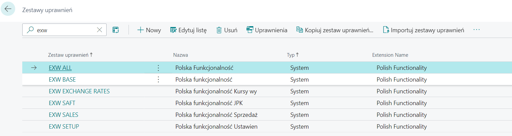

- **EXW ALL** – zawiera wszystkie uprawnienia potrzebne do korzystania z Polskiej funkcjonalności (jak zestaw SUPER)

- **EXW BASE** – podstawowe uprawnienia, konieczne do korzystania z Polskiej funkcjonalności** **

- **EXW EXCHANGE RATES** – kursy wymiany i dostosowywanie kursów wymiany

- **EXW SAFT** – funkcjonalność JPK (bez ustawień)

- **EXW SALES** – faktury korygujące i raporty sprzedaży ** **

- **EXW SETUP** – ustawienia JPK

# Księga główna

## Różnice kursowe w bankach 

W ramach polskiej funkcjonalności działa mechanizm pozwalający na automatyczne obliczanie, księgowanie i raportowanie różnic kursowych zrealizowanych na rachunkach bankowych i kasach, działający zgodnie z metodą wyceny FIFO oraz przygotowuje wycenę bilansową środków pieniężnych. 

Dodatkowa funkcjonalność w Microsoft Dynamics 365 Business Central to możliwość wyświetlenia ***Szczegółowych zapisów różnic kursowych*** utworzonych po obliczeniu różnic – prezentowane są powiązania zapisów (wejściowy - wyjściowy wraz z prezentacją kwot, kursów walut oraz wyliczonych różnic) oraz rozbudowanie mechanizmu księgującego o opcję księgowania różnic kursowych do częściowo rozliczonych kwot transz wejściowych. Dodatkowo zaimplementowana została obsługa rachunków o saldach kredytowych – odwrócony mechanizm naliczania różnic kursowych, tj. wyzwalany w momencie wpływu środków na rachunek, czyli częściowej lub całkowitej spłaty salda kredytowego. 

## Konfiguracja

→ Ustawienia księgi głównej → Bank i dzienniki 

- ***Seria numeracji bankowych różnic kursowych –*** dla księgowań automatycznych pole to pozawala na wybranie serii numeracji, według której system będzie generował numery księgowań.

- ***Opis księgowania bankowych różnic kursowych –*** opis, który będzie się pojawiał na zaksięgowanych zapisach różnic kursowych.*** ***

- ***Księgowanie na podstawie szczegółowych zapisów różnic kursowych -*** jest polem opcjonalnym, które należy ustawić jednorazowo podczas wdrożenia systemu. Zaznaczenie tego pola skutkuje księgowaniem różnic kursowych do tabeli ***Szczegółowych zapisów różnic kursowych***, czyli listy, która w szczegółowy sposób wskazuje naliczone kwoty różnic i informacje z czego one wynikają. Brak zaznaczenia tego pola powoduje, że system księguje różnice kursowe na podstawie standardowej listy ***Zapisów księgi kont bankowych***, co z kolei może skutkować brakiem szczegółowości zapisów i utrudnioną analizą obliczonych różnic.

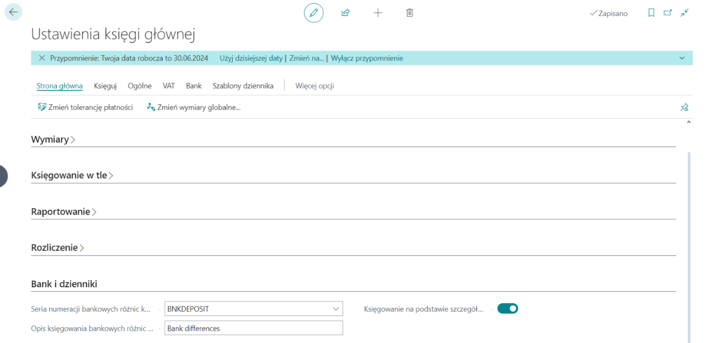

## Kalkulacja, księgowanie i raportowanie różnic kursowych

→ Konta bankowe

Do kalkulacji, księgowania i generowania raportu różnic kursowych służy funkcja znajdująca się na kartotece ***Kont bankowych***. Aby do nich przejść należy z wykazu istniejących kont bankowych wybrać jedno konkretne i przejść do jego kartoteki. W zakładce należy wybrać ***Raport różnic kursowych***. 

- ***Raport różnic kursowych –*** podgląd i księgowanie skalkulowanych różnic kursowych. Różnice są obliczane w oparciu o metodę wyceny FIFO. System bierze pod uwagę kurs, po którym zostały zaksięgowane środki wchodzące na rachunek bankowy (kurs wejściowy) oraz kurs, po którym został zaksięgowany przelew wychodzący środków (kurs wyjściowy).

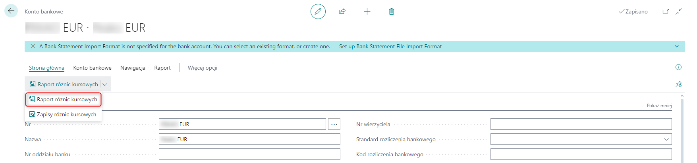

**Przed uruchomieniem raportu, który automatycznie jest** zafiltrowany do wybranego konta bankowego, należy **wskazać daty** dla których ma zostać wygenerowany raport.  

**Jeśli nie zostanie wskazana data początkowa** lub istnieją transakcje z datą wcześniejszą niż podana data początkowa, raport automatycznie przyjmie jako datę początkową:

- datę **najstarszej zaksięgowanej korekty** lub

- **pierwszy dzień miesiąca**, w którym wystąpiła taka transakcja.

**Gdy użytkownik uruchomi raport ponownie dla tego samego okresu**, wskazując datę początkową, raport pokaże **tylko zapisy mieszczące się w wybranym zakresie dat**.\
Dzieje się tak, ponieważ niezaksięgowane korekty sprzed tego okresu zostały już zaksięgowane podczas pierwszego uruchomienia raportu.

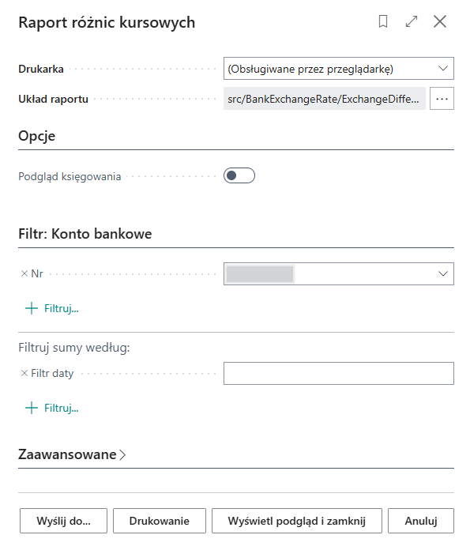**Jeśli użytkownik uruchomi raport ponownie bez wskazania daty początkowej**, raport pokaże **tylko transakcje z jednego dnia**, czyli z **daty końcowej**.

Przed zaksięgowaniem dokumentu istnieje możliwość zweryfikowania poprawności wygenerowanych zapisów za pomocą funkcji **Podgląd księgowania**.

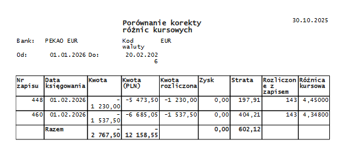

Po zaksięgowaniu różnic kursowych pojawiają się one w raporcie oraz w tabeli **Zapisy kursów wymiany**.

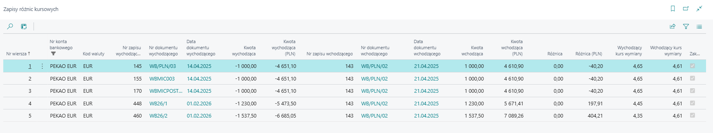

Raport różnic kursowych można wygenerować w systemie, wydrukować go lub wyeksportować do pliku. 

## Wycena bilansowa

Funkcjonalność umożliwia kalkulację różnic kursowych, powstałych na otwartych rozrachunkach nabywców i dostawców według kursu waluty z dnia przeprowadzenia wyceny oraz zaksięgowanie powstałych różnic na odpowiednich kontach z dokładnością do konkretnego dokumentu (także możliwość wyksięgowania różnic kursowych z datą kolejnego okresu). Dodatkowo funkcjonalność umożliwia także prezentację danych w postaci raportu. Istnieje możliwość uruchomienia funkcji w trybie testowym i sprawdzenia poprawności kalkulacji bez księgowania różnic na kontach, a także możliwość uruchomienia kalkulacji osobno dla konta nabywcy czy dostawcy. Aby uzyskać łatwy dostęp do danych historycznych powstała nowa tabela - ***Rejestr korekt kursów wymiany.*** 

  → Korekta kursów wymiany 

- ***Data początkowa** i **Data końcowa*** – określają przedział czasu, dla którego obliczane są różnice kursowe. Pozostawienie pustego pola ***Data początkowa*** oznacza, że skorygowane zostaną wszystkie zapisy z okresu przed datą określoną w polu ***Data końcowa ***włącznie. Wypełnienie pola ***Data końcowa jest obowiązkowe.***

- ***Opis księgowania*** – opis, jaki zostanie przeniesiony do zapisów księgi głównej po wykonaniu skryptu. Pole wypełniane jest automatycznie przez system, w razie potrzeby można ręcznie zmienić jego zawartość.

- ***Data księgowania*** – data, z jaką zostaną zaksięgowane zapisy w wyniku uruchomienia skryptu. Pole jest wypełniane automatycznie przez system w oparciu o ***Datę końcową***, w razie potrzeby, można ją ręcznie zmienić na inną datę w okresie od ***Daty początkowej*** do ***Daty końcowej***.

- ***Nr dokumentu*** – możliwość wpisania numeru dokumentu, z jakim system zaksięguje wycenę.

- ***Koryguj nabywców*** – zaznaczenie tej opcji skutkuje zaksięgowaniem różnic kursowych na kontach nabywców.

- ***Koryguj dostawców*** – zaznaczenie tej opcji skutkuje zaksięgowaniem różnic kursowych na kontach dostawców.

- **Skoryguj pracowników**– zaznaczenie tej opcji skutkuje zaksięgowaniem różnic kursowych na kontach pracowników.

- ***Koryguj konta bankowe*** – zaznaczenie tej opcji skutkuje zaksięgowaniem różnic kursowych na kontach bankowych (ta opcja nie jest konieczna do uruchamiania, naliczanie różnic kursowych na kontach bankowych następuje podczas wyceny bilansowej FIFO).

- ***Koryguj konta K/G dla dodatkowej waluty raportowania*** – zaznaczenie pola skutkuje tym, że podczas uruchomienia raportu skorygowane zostają kwoty na kontach K/G dla dodatkowej waluty raportowania.

- **Koryguj wg zapisu** – zaznaczenie określa, czy korekta powinna być zaksięgowana dla każdego zapisu księgi nabywców lub księgi dostawców, którego dotyczą wahania kursu wymiany walut.

- ***Wycofaj korektę kursu wymiany*** – zaznaczenie tej pozycji skutkuje automatycznym wyksięgowaniem różnic kursowych w dacie wskazanej w polu Data księgowania wycofania korekty.

- ***Data księgowania*** **wycofania korekty** – określa datę, pod którą zostanie zaksięgowane wycofanie korekty kursu wymiany..

- ***Podgląd księgowania*** – pole jest zaznaczane wówczas, gdy użytkownik chce w sposób próbny sprawdzić, jak system naliczy różnice kursowe; po jego zaznaczeniu i uruchomieniu raportu generuje się symulacja zapisów z kalkulacji różnic, nie powstają jednak żadne księgowania na kontach.

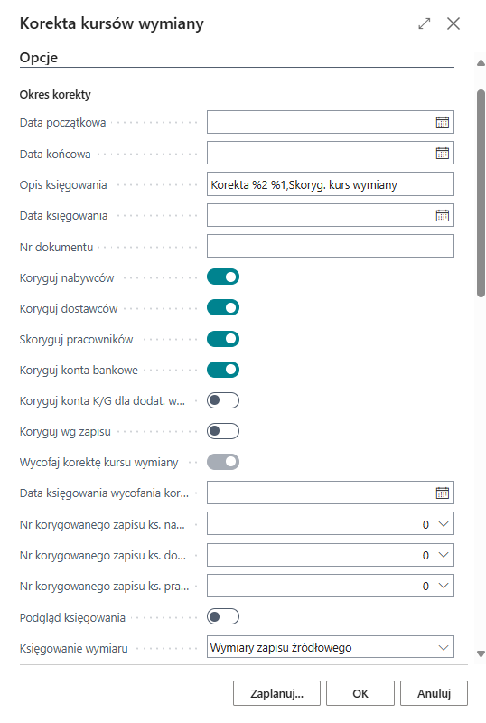

Uruchomienie raportu następuje poprzez wybranie ***OK.*** 

Po uruchomieniu raportu zostaną wygenerowane zapisy. Jeśli generujemy raport dla różnych rodzajów kont, jest on podzielony na części – różnice obliczone dla zapisów ksiąg nabywców oraz dostawców. Każda obliczona kwota zysku lub straty jest powiązana z konkretnym dokumentem oraz dołączone są dodatkowe informacje o dokumencie i obliczonej różnicy.  

Po uruchomieniu raportu bez włączonego ***Podglądu Księgowania***, system utworzy odpowiednie księgowania na kontach Księgi Głównej. Brak zaznaczenia pola ***Podgląd księgowania*** powoduje, że korekty kursów wymiany podczas wykonywania skryptu zostaną automatycznie zaksięgowane. 

Oprócz księgowań na planie kont, system tworzy także zapisy w **Rejestrze korekt kursów wymiany.* ***

→ Rejestry korekty kursu wymiany 

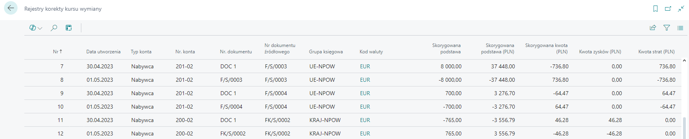

## Zestawienie obrotów i sald kont Księgi Głównej

Funkcjonalność umożliwia wygenerowanie raportów ustawowych (art. 18 Ustawy o Rachunkowości), które należy obowiązkowo przygotowywać na koniec każdego okresu sprawozdawczego, nie rzadziej niż na koniec miesiąca. Raporty zawierają informacje o saldzie początkowym, obrotach okresu, obrotach narastająco od początku okresu finansowego oraz saldzie na dzień sporządzania raportu, dla wszystkich kont księgi głównej. Dodatkowo raporty mogą być generowane w języku angielskim i z opisami kont w obcym języku.

Wszystkie trzy raporty działają na podobnych zasadach – stanowią zestawienie obrotów i sald dla wybranej grupy kont oraz dla wybranego w polu ***Filtr daty*** zakresu dat.

→ Zestawienie obrotów i sald K/G

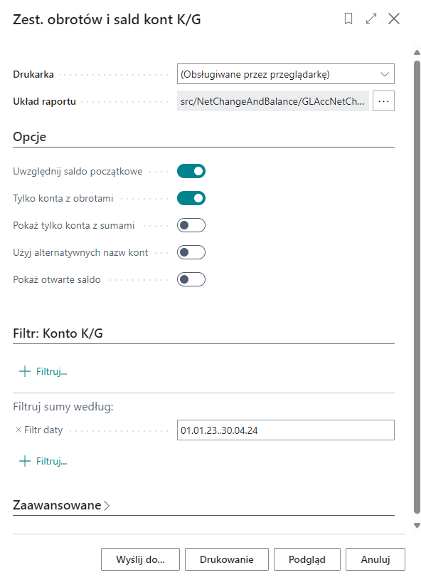

→ Obroty i saldo K/G

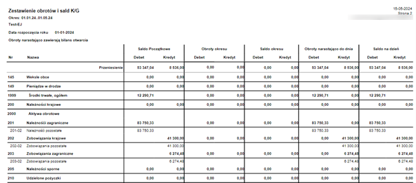

Dodatkowo istnieje możliwość zestawienia obrotów i sald w układzie opartym na planie kont. Należy uzupełnić daty początku i końca. Funkcjonalność ta umożliwia również przesłanie danych do Excela. Listę i sumy można filtrować według różnych kryteriów. Ponieważ w oknie tym przedstawione są konta w układzie zestawienia obrotów i sald, kolumny nie mają podsumowań. 

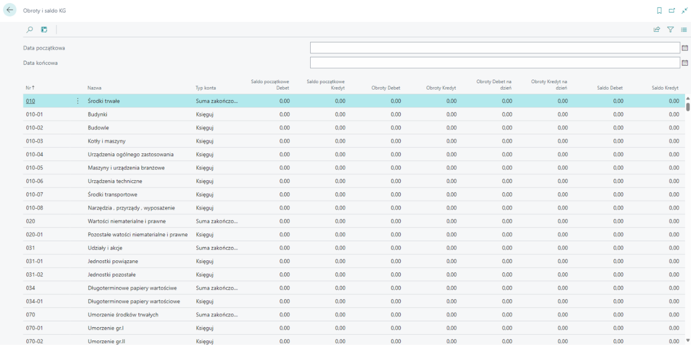

## Bilans/Rachunek Zysków i Strat

Podstawowym narzędziem dla sprawozdawczości finansowej jest funkcjonalność Bilansu i Rachunku wyników. Oba dokumenty mają strukturę ściśle określoną w Ustawie o Rachunkowości. Wprowadzenie struktury tych raportów ustawowych do systemu jest jednorazowe, a konfiguracja uproszczona. Dzięki tej funkcjonalności możliwe jest stworzenie Bilansu oraz Rachunku Zysków i Strat dla danego okresu sprawozdawczego, których wartości powstają w oparciu o plan kont zdefiniowany w Business Central.  

W celu skonfigurowania raportów finansowych należy poprawnie określić typ konta. Jest to możliwe po przejściu na ***Plan Kont***, a następnie na kartotekę odpowiedniego konta. W tym miejscu należy wybrać, czy konto ma się zawierać w ***Bilansie*** czy w ***Rachunku wyników***. 

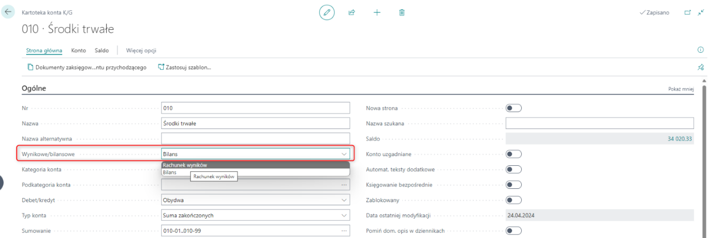

→ Bilans

Dodana modyfikacja pozwala skonfigurować bilans w oparciu o tylko zapisy kredytowe lub tylko zapisy debetowe. Źródłem danych będą wtedy księgi pomocnicze dostawców i nabywców. Zgodnie z obowiązującymi przepisami konieczna jest możliwość prezentowania kont księgi głównej zarówno w aktywach jak i pasywach. Zależne jest to od typu wykazywanych sald.

W celu poprawnego skonfigurowania bilansu należy przejść na ***Raporty Finansowe*** i wybrać ***Bilans***.

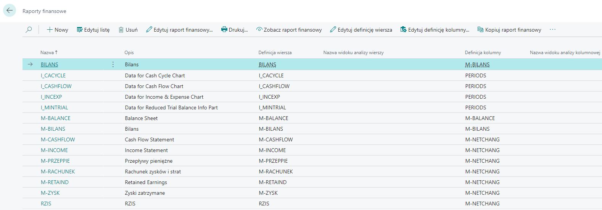

→ Definicje → Definicje wiersza.

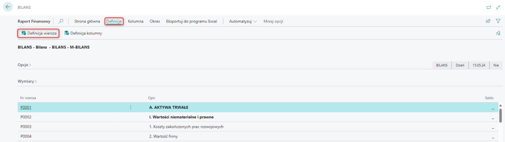

Zostaną wtedy wyświetlone informacje w jaki sposób wyliczane są wartości w poszczególnych wierszach. Należy wybrać: 

- ***Typ sumowania*** – określa jakiego typu będą wartości wprowadzane do komórki ***Sumowanie***

- ***Sumowanie*** – w zależności od typu konieczne jest wprowadzenie źródła danych. Przykładowo dla ***Kont księgowych*** należy wpisać numery kont, z których wartości będą sumowane w danym wierszu raportu.

- Typ wiersza – określa, czy kwoty będą podawane jako Obroty netto, Obroty na dzień czy Saldo początkowe.

- ***Typ kwoty*** – gdzie określane zostaną jakiego typu zapisy będą podliczane w danym wierszu. Oprócz trzech, które zawierają się w standardowej wersji systemu: ***Kwota netto, Kwota debet, Kwota kredyt*** w ramach Polskiej lokalizacji zostały dodane:

- ***Nabywca debet* –** określa saldo transakcji z nabywcami, wyświetla kwotę debet

- ***Nabywca kredyt* –** określa saldo transakcji z nabywcami, wyświetla kwotę **kredyt  **

- ***Dostawca debet* –** określa saldo transakcji z dostawcami, wyświetla kwotę debet**  **

- ***Dostawca kredyt* -** określa saldo transakcji z dostawcami, wyświetla kwotę kredyt** **

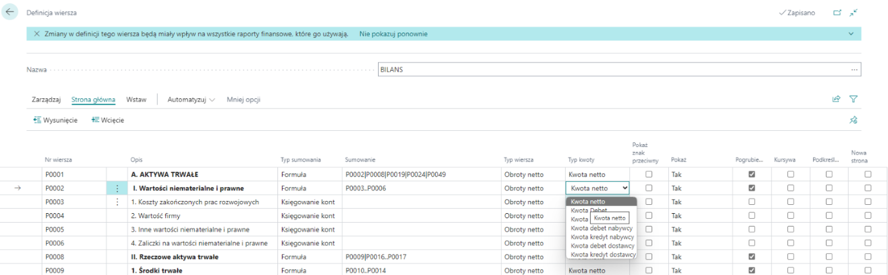

Modyfikować również można definicję kolumn.

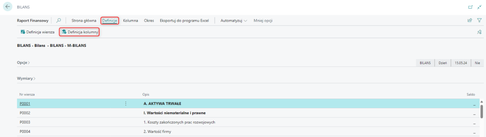

Można skonfigurować, jak ma się nazywać kolumna – ***Nagłówek kolumny, Typ kolumny,*** ***Typ zapisu księgi*** czy ***Typ kwoty***.

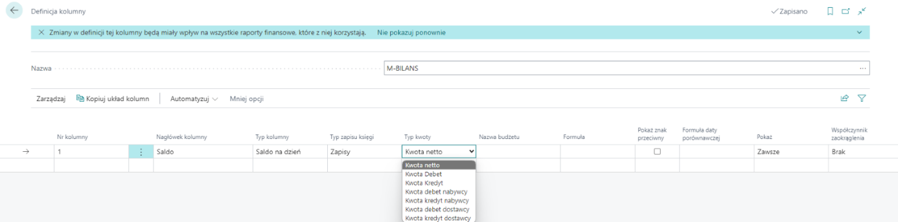

Po prawidłowym skonfigurowaniu ***Bilansu*** można wrócić na stronę ***Raportu finansowego*** i dzięki funkcji ***Oblicz ponownie*** przeliczyć sumy na raporcie, które pokażą użytkownikowi wynik skonfigurowanego bilansu.

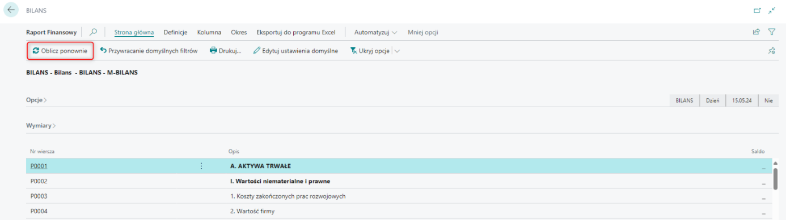

→ Rachunek zysku i strat

Drugim obligatoryjnym sprawozdaniem jest ***Rachunek zysków i strat***. Do niego brane będą konta księgi głównej określone typem ***Rachunek wyników***. Proces jego tworzenia jest podobny do Bilansu. Po przejściu na Raporty finansowe należy wybrać ***RZIS***, a w kolejnych krokach zdefiniować definicję kolumn oraz wierszy. Po ponownym obliczeniu ukaże się wyliczony ***Rachunek zysków i strat***. 

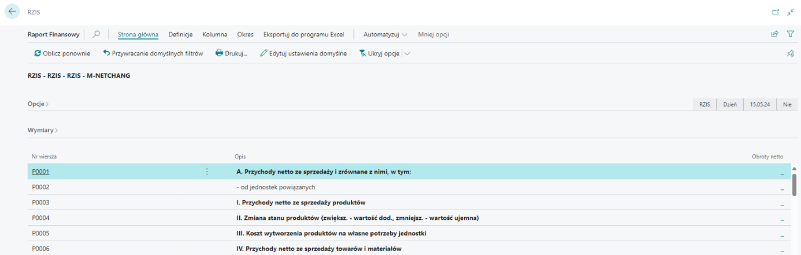

## Szablony dzienników zapasów

Funkcjonalność ta przypisuje ustawioną ***Główną grupę księgową*** do wybranej instancji, a następnie przypisuje ją na wierszach tworzonych w ***Dziennikach zapasów***, co pozwala uniknąć uzupełniania tego pola każdorazowo manualnie przez użytkownika.

→ Instancje dzienników zapasów

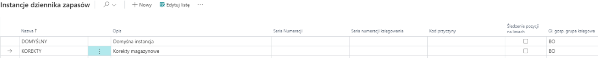

→ Dziennik zapasów

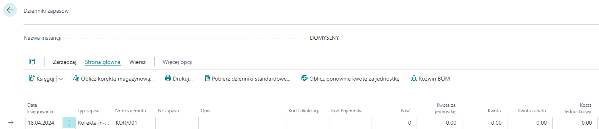

# VAT – obsługa i sprawozdawczość

## Data VAT

W systemie Microsoft Dynamics 365 Business Central wprowadzona została funkcjonalność obsługująca ***Datę VAT***. Pole to zostało dodane do dokumentów i dzienników, aby spełnić wymagania przepisów polskiego prawa, które wskazują, że możliwe jest rozliczenie podatku VAT w innym okresie niż data księgowania dokumentu. Dlatego też w dokumentach i dziennikach pojawiło się pole ***Data VAT***, które może być ustawiane niezależnie od daty księgowania. ***Data VAT*** przenoszona jest do zapisów VAT i na podstawie tej daty tworzony jest wydruk rejestru VAT oraz obliczana deklaracja VAT.

Przed rozpoczęciem księgowań, które skutkują tworzeniem zapisów wykazywanych w rejestrach i deklaracjach VAT, należy skonfigurować VAT w ***Ustawieniach VAT***.

→ Ustawienia VAT → Data VAT

W zakładce ***Data VAT*** znajdują się pola 

- ***Dozwolona data VAT*** od wskazuje datę początkową definiowanego okresu, w którym dozwolone będzie księgowanie VAT. Próba zaksięgowania VAT poza tym okresem spowoduje pojawienie się błędu podczas księgowania i uniemożliwi zrobienie tego księgowania.*** ***

- ***Dozwolona data VAT do*** wskazuje datę końcową zdefiniowanego okresu, w którym dozwolone będzie księgowanie VAT. Próba zaksięgowania VAT poza tym okresem spowoduje pojawienie się błędu podczas księgowania i uniemożliwi zrobienie tego księgowania.*** ***

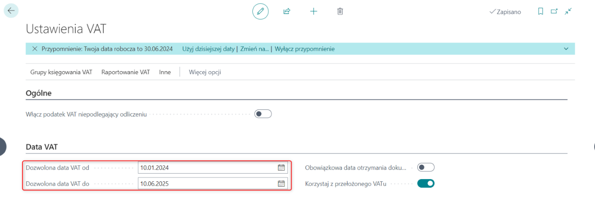

Pole ***Data VAT*** zostało dodane zarówno dla wprowadzanych nowych faktur sprzedażowych, faktur zakupowych, jak również w dziennikach, gdzie tworzone są zapisy na kontach K/G, kontach nabywców i dostawców.

Po zaksięgowaniu transakcji, ***Data VAT*** jest przenoszona do ***Zapisów VAT***.

→ Zapisy VAT

Oprócz ***Daty VAT*** w ***Zapisach VAT*** dodano także pola dotyczące kontrahenta: nazwa, adres, kod pocztowy, miasto. Wszystkie te dane są widoczne w generowanym później ***Rejestrze VAT Sprzedaży i Zakupu***.

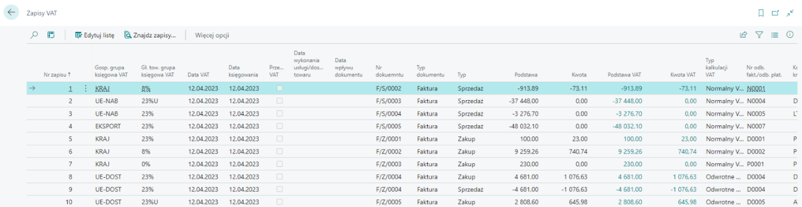

→ Rejestr VAT Sprzedaży i Zakupu

Wybierając zakres dat generujemy ***Rejestr VAT Sprzedaży i Zakupu*** dla zadanego okresu.

Jest to podstawowy raport do kalkulacji kwoty podatku VAT należnego i naliczonego za wybrany okres rozliczeniowy. Aby dostosować raport do wymagań polskiej Ustawy o podatku od towarów i usług w raporcie możliwe jest filtrowanie rejestru VAT według daty rozliczenia VAT (***Data VAT***). Ponadto, w zakładce ***Filtr: Zapis VAT*** możemy ustawiać wydruk raportu według wielu innych filtrów, m.in. kod kraju, gosp. grupa księgowa VAT czy też gł. tow. grupa księgowa VAT. W zakładce ***Ogólne*** wybieramy czy chcemy wygenerować raport dla sprzedaży, zakupu, czy też obu rodzajów transakcji. W raporcie wyświetlana jest kwota podstawy VAT, kwota VAT, kwota VAT niezrealizowanego oraz szczegółowe informacje o nabywcy lub dostawcy dla każdego dokumentu.

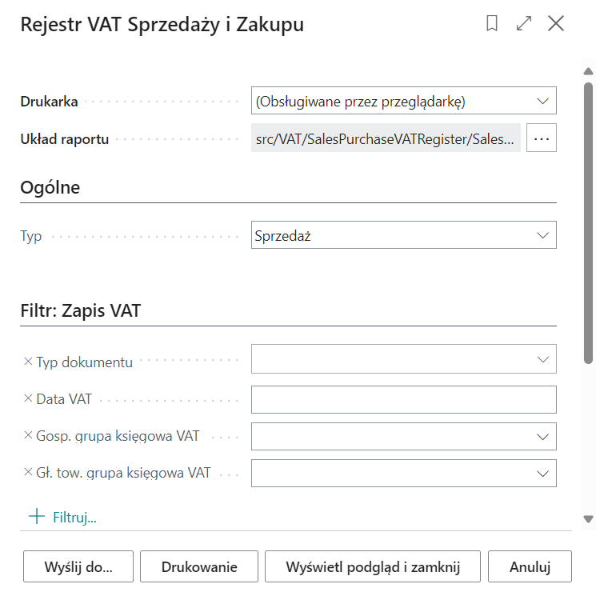

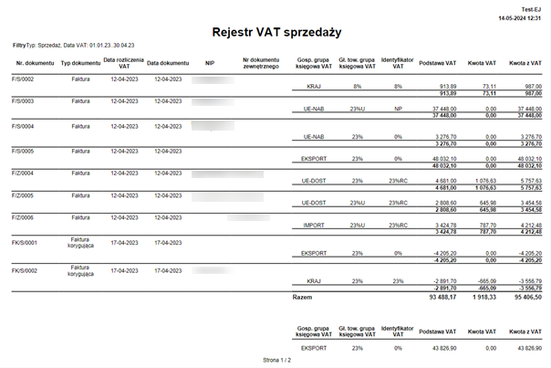

## Data wykonania usługi/dostawy towaru 

Stosując się do przepisów polskiego prawa na fakturach dokumentujących sprzedaż należy umieszczać datę dokonania dostawy towarów lub wykonania usługi. W systemie Microsoft Dynamics 365 Business Central data ta została dodana do kartotek dokumentów zakupu oraz sprzedaży oraz do wydruków dokumentów, a także jest przenoszona do **Rejestru VAT**. Dodatkowo istnieje możliwość wskazania ustawień, które będą pobierały kurs wymiary waluty bądź automatycznie ustawiały datę VAT względem daty wykonania usługi/dostawy towaru.

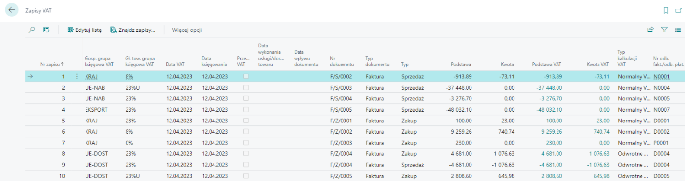

## Szczegółowe zapisy VAT

Na potrzeby polskiej księgowości, w celu dokładniejszej analizy i większej kontroli nad zmianami podatku VAT i okresu w jakim ma być rozliczany, do systemu Microsoft Dynamics 365 Business Central dodano funkcjonalność ***Szczegółowe zapisy VAT***.

Szczegółowe zapisy VAT tworzone są podobnie jak szczegółowe zapisy w innych księgach pomocniczych, takich jak szczegółowe zapisy księgi nabywców czy dostawców. Suma szczegółowych zapisów VAT znajduje odzwierciedlenie w ***Zapisach VAT.***

W ***Szczegółowych Zapisach VAT*** należy zwrócić uwagę przede wszystkim na dwie istotne informacje:

- **Typ zapisu –** określa pochodzenie zapisu VAT. W systemie wyróżnione zostały następujące typy zapisów:

    - ***Zapis wstępny -*** jest to początkowy (pierwszy) szczegółowy zapis VAT dla danego zapisu VAT lub odwrócenie tego zapisu;

    - ***Przełożony VAT -*** oznacza, że w tym szczegółowym zapisie VAT został zarejestrowany fakt przełożenia VAT lub odwrócenie tego zapisu;

    - ***Zrealizowany VAT*** - oznacza, że w tym szczegółowym zapisie VAT został zarejestrowany fakt realizacji przełożonego VAT w danym zapisie VAT lub odwrócenie tego zapisu;

    - ***Zmiana daty obowiązku VAT*** - oznacza, że dla tego szczegółowego zapisu VAT zmieniona została data obowiązku VAT lub odwrócenie tego zapisu;

    - ***Korekta odwrotnego obciążenia*** - oznacza, że ten szczegółowy zapis VAT zarejestrował kwotę podstawy i podatku VAT z tytułu odwrotnego obciążenia przeliczoną według innego kursu, niż zostało dokonane przeliczenie kwot zakupu i zobowiązania;

    - ***Zmiana pominięcia w ewidencji VAT*** - oznacza, że dla tego szczegółowego zapisu VAT dokonana została zmiana w polu Pomiń w ewidencji VAT;

    - ***Zmiana atrybutów VAT*** - oznacza, że dla tego szczegółowego zapisu VAT dokonana została zmiana atrybutów VAT.

- ***Nr zapisu VAT –*** określa numer zapisu powiązanego dla tego konkretnego zapisu VAT.

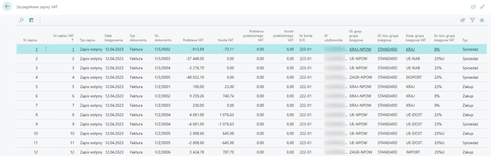

## Mechanizm Odwrotnego Obciążenia VAT

Zgodnie z przepisami polskiego prawa, Wewnątrzwspólnotowe Nabycie Towarów (WNT) i Usług, a także Import Usług podlegają opodatkowaniu VAT. W związku z tym transakcje te wraz z obliczonym podatkiem VAT należy wykazywać w rejestrach VAT. W tym celu stosuje się mechanizm odwrotnego obciążenia. Dzięki niemu, wszystkie transakcje WNT i zakupu/importu usług wykazywane są zarówno w rejestrze VAT sprzedaży jak i rejestrze VAT zakupu. Dodatkowo polska funkcjonalność pozawala na kalkulację podatku VAT w walucie lokalnej według kursu wymiany z innego dnia niż data przeliczenia wartości zakupu i zobowiązań na potrzeby ksiąg rachunkowych. W tym celu podaje się dodatkową datę do ustalenia odrębnego kursu wymiany waluty do obliczenia kwoty podatku VAT w walucie lokalnej. 

## Konfiguracja

→ Ustawienia księgowe VAT

Aby możliwe było poprawne zaksięgowanie faktur zakupu dotyczących wewnątrzwspólnotowego nabycia towarów lub importu usług należy dokonać odpowiednich ustawień w oknie ***Ustawienia księgowe VAT***.

- W tym miejscu, dla każdego wiersza (każdej kombinacji **Gosp. grupy księgowej VAT** i **Tow. grupy księgowej VAT**), które zostaną użyte podczas księgowania faktur, należy ustawić **Typ kalkulacji VAT.**

- Dla każdej kombinacji, dla której zasadne jest zastosowanie mechanizmu odwrotnego obciążenia, w polu **Typ kalkulacji VAT** należy ustawić **Odwrotne obciążenie** oraz określić numery kont K/G w kolumnach **Konto odwrotnego obciążenia VAT** oraz **Konto odwrotnego obciążenia VAT niezr**.

- Na **Konto odwrotnego obciążenia VAT** będzie księgowana kwota podatku VAT należnego obliczona dla transakcji wewnątrzwspólnotowego nabycia towarów i usług oraz importu usług.

- Na **Konto odwrotnego obciążenia VAT niezrealizowanej** będzie księgowana niezrealizowana kwota podatku VAT należnego obliczona dla transakcji wewnątrzwspólnotowego nabycia towarów i usług oraz importu usług.

- Dzięki powyższym ustawieniom system podczas księgowania dokumentu/wiersza dziennika utworzy dwa wiersze VAT: należny i naliczony. Oba zapisy VAT widoczne będą także w** Rejestrze VAT**.

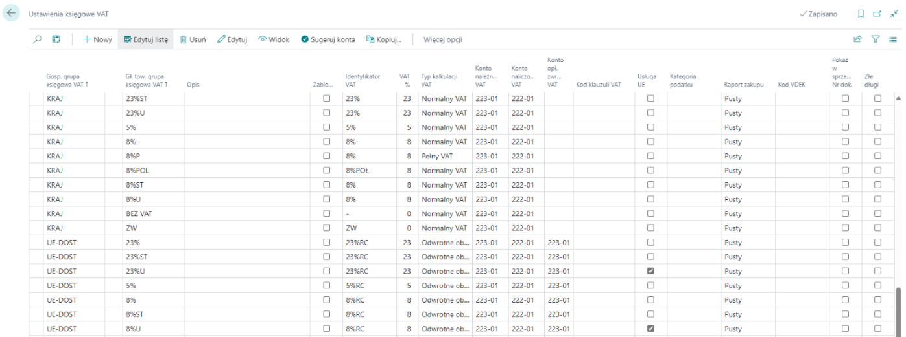

## Księgowanie

Księgowanie faktur zakupu za towary i usługi nabyte na terenie Unii Europejskiej oraz za usługi nabyte poza Unią Europejską odbywa się z typem kalkulacji VAT ***Odwrotne obciążenie***. Księgowania te powodują obliczanie i księgowanie podatku VAT należnego i naliczonego, nie wpływają jednak na wartość zakupów i wysokość zobowiązań wobec dostawców. 

- Faktura zakupu jest w standardowy sposób wprowadzana do systemu.  Jeśli transakcja gospodarcza spełnia warunki do kalkulacji VAT zgodnie z mechanizmem odwrotnego obciążenia, należy sprawdzić, czy dla tej faktury zostały prawidłowo wybrane **Gosp. grupa księgowa VAT i Tow. grupa księgowa VAT**;

- Należy wprowadzić wartość do pola ***Data VAT***, jeśli jest różna od daty wystawienia dokumentu. Data ta przenosi się do pola ***Data dostawy towaru/wykonania usługi***, które z kolei jest wykazywana w pliku JPK_VAT z deklaracją w dacie sprzedaży dla podatku VAT należnego.

- Kurs wymiany waluty do przeliczenia na walutę lokalną wartości zakupu i zobowiązań z faktury zakupu pobierany jest z tabeli kursów według daty w polu ***Data dokumentu lub Data księgowania lub Data VAT*** (w zależności od ustawień w **Ustawieniach zakupów i zobowiązań**), a kurs wymiany waluty do przeliczenia na walutę lokalną kwoty podatku VAT pobierany jest z tabeli kursów według daty w polu ***Data VAT***.

## Księgowanie pełnego VAT

Realizując wymogi polskiego prawa utworzona została funkcja księgowania pełnego VAT, która umożliwia wprowadzenie kwoty podstawy VAT manualnie przez użytkownika, odnośnie księgowań, które obejmują wyłącznie kwotę podatku VAT.  

Ta funkcjonalność ma szczególne znaczenie dla ewidencji zakupów spoza UE. W przypadku takich transakcji muszą być zaksięgowane 2 dokumenty: 

- faktura zakupu, na której wykazana została wartość netto zakupów, będąca zobowiązaniem wobec dostawcy;

- Poświadczone Zgłoszenie Celne (PZC), które uwzględnia podatek VAT i inne dodatkowe koszty celne obciążające dostawę spoza terytorium UE.

Ponieważ wartość netto stanowiąca podstawę kalkulacji podatku VAT jest zaksięgowana na podstawie faktury zakupu, nie może być zaksięgowana ponownie na podstawie dokumentu PZC podczas księgowania podatku VAT. Z tego względu księgowanie dokumentu PZC obejmuje jedynie kwotę podatku, natomiast podstawa kalkulacji podatku VAT podawana jest wyłącznie informacyjnie, co zapewnia poprawność wydruku transakcji zakupu w rejestrze VAT.

## Konfiguracja 

Aby możliwe było księgowanie wyłącznie podatku VAT na podstawie dokumentu zakupu, konieczne jest zdefiniowanie właściwych ustawień.

→ Ustawienia księgowe VAT

Należy zdefiniować właściwą kombinację Gospodarczej grupy księgowej VAT i Gł. towarowej grupy księgowej VAT, dla której w polu ***Typ kalkulacji VAT*** będzie wybrana opcja **Pełny VAT**, natomiast konto K/G wybrane w polu ***Konto naliczonego VAT*** będzie miało przypisaną Gł. towarową grupę księgową VAT taką samą jak ta, która użyta została w definiowanych właśnie ustawieniach. 

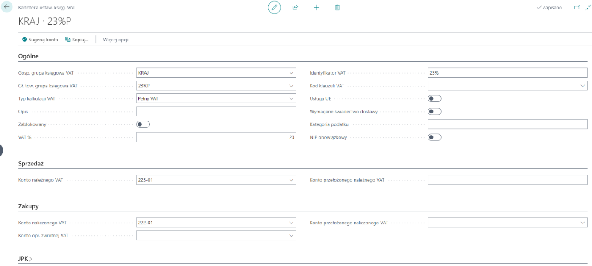

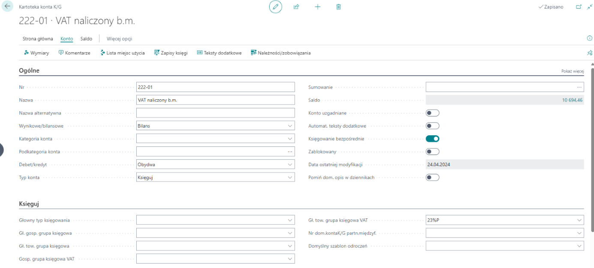

## Księgowanie

Dokument Poświadczenia Zlecenia Celnego wprowadzany jest analogicznie, jak zwykła faktura zakupu lub też poprzez księgowanie przez dziennik. 

> → poprzez fakturę zakupu

Jako dostawcę wybiera się kartotekę urzędu celno-skarbowego. Na wierszach wprowadzamy: 

- **Typ** – Konto K/G

- **Nr konta** – numer konta zdefiniowanego jako konto VAT-u naliczonego w Ustawieniach księgowania VAT

- **Ilość** – należy wprowadzić cyfrę 1

- **Bezpośr. koszt jedn. bez VAT** – należy wprowadzić kwotę podatku VAT wykazaną na dokumencie PZC

- **Kwota podstawy VAT** – należy wprowadzić kwotę będącą podstawą do obliczenia podatku VAT, wykazaną na dokumencie PZC

Pozostałe pola należy uzupełnić standardowo i zaksięgować dokument. 

Zaksięgowanie dokumentu spowoduje powstanie w księgach kwoty podatku VAT na wskazanym koncie VAT-u naliczonego, a także zobowiązania wobec urzędu celno-skarbowego w tej samej wysokości. Ręcznie wprowadzona kwota podstawy VAT zostanie wykazana w Zapisach VAT powiązanych z zaksięgowaną fakturą zakupu (dokumentem Poświadczenia Zlecenia Celnego) oraz pojawi się w rejestrze VAT zakupu.  

> → poprzez dziennik główny

W wierszu dziennika głównego wprowadzamy: 

- **Data księgowania** - data powstania zobowiązania

- **Typ dokumentu** – należy wybrać: ***Faktura***

- **Nr dokumentu** - numer pod jakim transakcja ma być ewidencjonowana

- **Typ** **konta** - należy wybrać: ***Konto K/G***

- **Nr konta** – numer konta zdefiniowanego jako konto VAT-u naliczonego w Ustawieniach księgowania VAT

- **Główny typ księgowania** - należy wybrać: ***Zakup***

- **Gosp. grupa księgowa VAT** - należy wprowadzić odpowiednią Gosp. Grupę księgową VAT

- **Tow. grupa księgowa VAT** - należy wprowadzić odpowiednią Tow. Grupę księgową VAT, dla której skonfigurowany jest pełny VAT

- **Kwota** – należy wprowadzić kwotę podatku VAT wykazaną na dokumencie PZC

- **Kwota podstawy pełnego VAT** - należy kliknąć w pole ***Kwota VAT***, a następnie rozwinąć menu kontekstowe („...” widoczne przy polu) i w nowo otwartym oknie odnaleźć pole ***Kwota podstawy pełnego VAT*** oraz uzupełnić w nim wartość

- **Typ konta przeciwstawnego** - należy wybrać: ***Konto K/G***

- **Nr konta przeciwstawnego** – należy wpisać numer bilansującego konta K/G

Następnie należy zaksięgować dziennik.

Zaksięgowanie dziennika spowoduje powstanie w księgach kwoty podatku VAT na wskazanym koncie VAT-u naliczonego. Ręcznie wprowadzona kwota podstawy VAT zostanie wykazana w **Zapisach VAT** powiązanych z zaksięgowanym wierszem dziennika.  

## Przełożenie VAT

Funkcjonalność pozwalająca odroczyć rozliczenie VAT należnego i naliczonego w sytuacji, kiedy nie ma możliwości rozliczenia kwoty VAT w danej chwili. Mechanizm umożliwia także zaksięgowanie kwot odroczonego podatku VAT na odrębne konta księgi głównej. Dzięki temu suma obrotów w rejestrze VAT w danym okresie jest zgodna z sumą obrotów kont księgi głównej, na których rejestrowany jest bieżący VAT naliczony i należny. Dodatkowo funkcjonalność umożliwia zarządzanie odroczonym podatkiem VAT. 

System ponadto posiada kontrolę księgowania VAT – jeśli aktywowana jest funkcjonalność **Przełożonego VAT** to zabronione jest księgowanie VAT do innego okresu, jeśli w dokumencie nie została zaznaczona opcja ‘**Przełożony VAT**’. 

## Konfiguracja

→ Ustawienia VAT

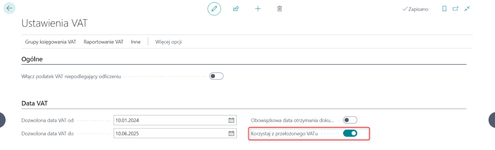

Aby umożliwić użytkownikom korzystanie z tej modyfikacji na **Ustawieniach VAT** należy włączyć opcję **Korzystaj z przełożonego VAT**.

→ Ustawienia księgowe VAT

Należy również skonfigurować dedykowane konta do przełożonego VATu w kartotece odpowiedniego ***Ustawienia księgowego VAT***: 

- Konto przełożonego należnego VAT

- Konto przełożonego naliczonego VAT

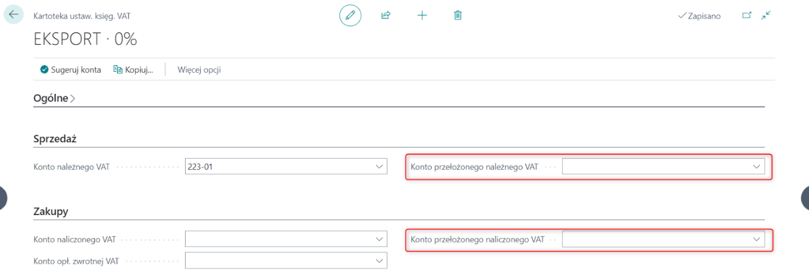

## Księgowanie

Zarówno w dokumentach sprzedaży jak i zakupu pole **Przełożony VAT** jest widoczne w nagłówku. Jeśli zostanie zaznaczone VAT będzie traktowany jako przełożony i księgowany na kontach uzupełnionych w ustawieniach księgowych VAT. 

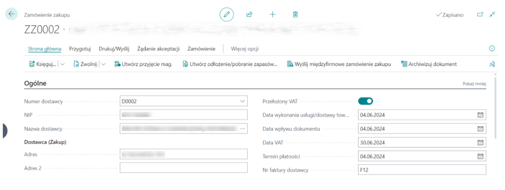

## Arkusz przełożonego VAT

W sytuacji, gdy już faktura jest zaksięgowana i użytkownik chce przełożyć zaksięgowany na niej VAT, należy skorzystać z ***Arkusza przełożonego VAT***.*** *** 

→ Arkusz przełożonego VAT

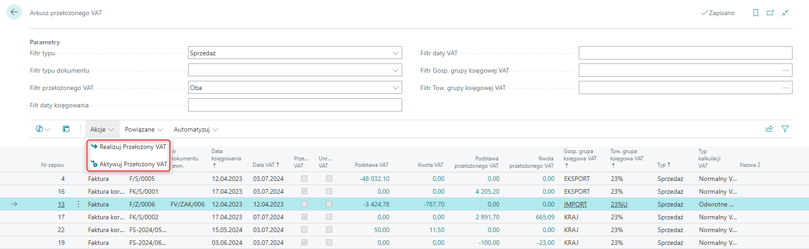

Wybierz wiersz faktury, którego VAT ma zostać przełożony i użyj funkcji ***Aktywuj przełożony VAT***, a następnie wybierz ***Datę księgowania***. Znacznik ***Przełożony VAT*** zaznaczy się w wybranym wierszu, wartość z ***Podstawy VAT*** przejdzie do ***Podstawy przełożonego VAT***, a wartość z ***Kwoty VAT*** przesunie się do ***Kwoty przełożonego VAT.***

Dodatkowo, dzięki polom **Dok. z przeł. VAT otwarty** oraz **Data rozl. dok. z przeł. VAT** użytkownik widzi czy i kiedy dany dokument został w całości opłacony.

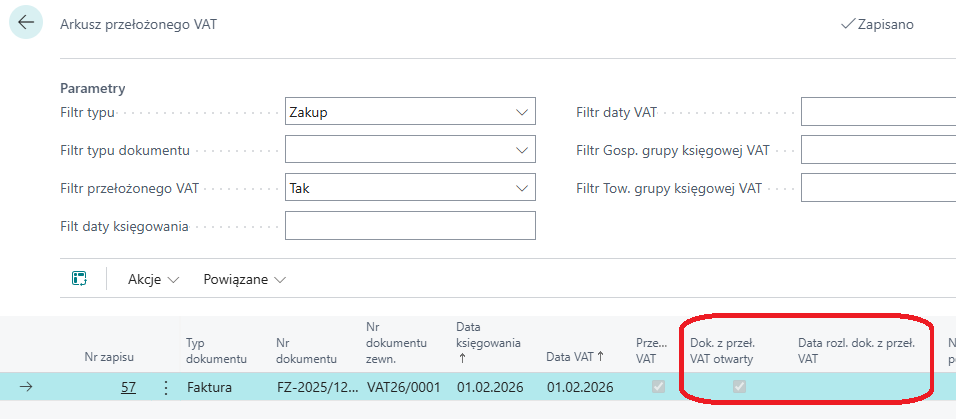Przed opłaceniem:

Po opłaceniu:

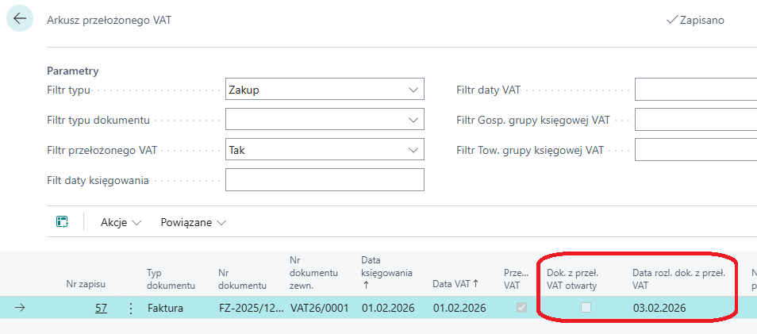

**Data rozl. dok. z przeł. VAT** to data zaksięgowania płatności.

W celu zakończenia procesu przełożonego VAT należy skorzystać z funkcji ***Realizuj przełożony VAT***, a następnie wprowadzić ***Nową datę raportowania VAT***. Po potwierdzeniu operacji ***Data VAT*** na zapisach się zaktualizuje.

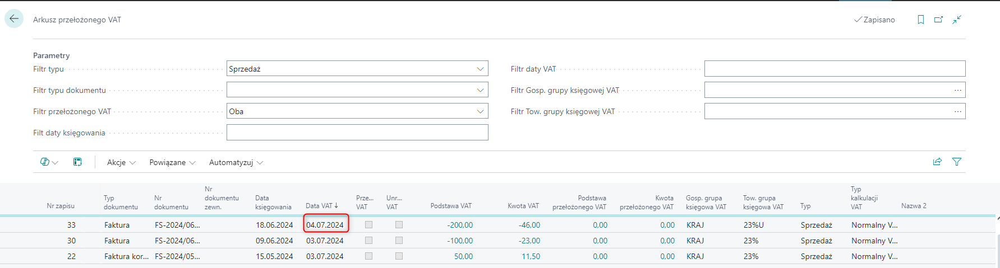

## Księgowanie VAT z poziomu dzienników K/G (Kontrahenci Incydentalni)

Funkcjonalność, która umożliwia uproszczone ewidencjonowanie zdarzeń gospodarczych, bez konieczności tworzenia faktur zakupu oraz zakładania osobnych kartotek dostawcom, z którymi nawiązaliśmy tylko jednorazową transakcję. Lista kontrahentów incydentalnych zawiera podstawowe dane o podmiotach, dla których nie chcemy zakładać kartotek w systemie, a z której można korzystać podczas księgowania VAT z poziomu dzienników. Funkcjonalność powstała jako odpowiedź na wymagania polskiego prawa odnośnie obowiązku przedsiębiorców do umieszczania danych kontrahentów w rejestrze VAT zakupu i sprzedaży.

Utworzona została lista Kontrahentów incydentalnych, którą można uzupełnić danymi kontrahentów z którymi firma prowadzi sporadyczne transakcje i nie chce tworzyć dla takich podmiotów kartoteki w systemie.

*→* Kontrahenci incydentalni

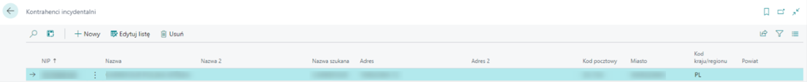

W stworzonym wierszu ***Dziennika głównego***, aby wskazać informacje do rejestru VAT należy określić wartość w kolumnie ***Główny typ księgowania***. 

W kolumnie Kwota VAT należy rozwinąć wartość (poprzez przycisk asysty) i uzupełnić dodatkowe informacje, które mają trafić do rejestru VAT. Jeśli użytkownik chce wskazać kontrahenta incydentalnego z listy, należy użyć listy rozwijanej w polu NIP lub wpisać dane kontrahenta manualnie. 

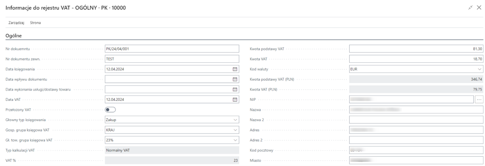

## Ulga za złe długi 

Funkcjonalność umożliwia ewidencjonowanie ulgi za złe długi zgodnie z obowiązującymi przepisami ustawy o podatku od towarów i usług.

Jej celem jest zapewnienie prawidłowego rozliczenia podatku VAT w przypadku nieuregulowanych należności lub zobowiązań, z zachowaniem zgodności z wymogami prawnymi i sprawozdawczymi obowiązującymi w Polsce.

Konfiguracja funkcjonalności polega na przygotowaniu odpowiednich Tow. grup księgowych VAT, a także ustawień księgowych VAT, dzięki czemu, po zaksięgowaniu dziennika głównego, zapisy związane z ulgą za złe długi zostaną poprawnie zaewidencjonowane w systemie, a także pojawią się we właściwych pozycjach deklaracji JPK VAT.

Na stronie Ustawienia księgowe VAT dodane zostały dwa znaczniki związane z ulgą za złe długi: **Pokaż nr dokumentu zewn. sprzedaży** oraz **Złe długi**. Należy je aktywować przy kombinacjach gosp. grupy księgowej VAT i tow. grupy księgowej VAT związanych z ulgą za złe długi i zmniejszeniem bądź zwiększeniem podatku VAT należnego.

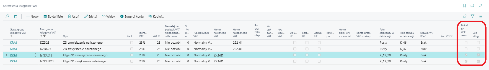

# Należności i zobowiązania

## Obowiązkowa data otrzymania dokumentu

W ustawieniach VAT została dodana funkcja, która wymusza na użytkownikach wypełnienie pola ***Data wpływu dokumentu*** na dokumentach zakupu.

→ Ustawienia VAT → Data VAT

Należy włączyć opcję Obowiązkowa data wpływu dokumentu.

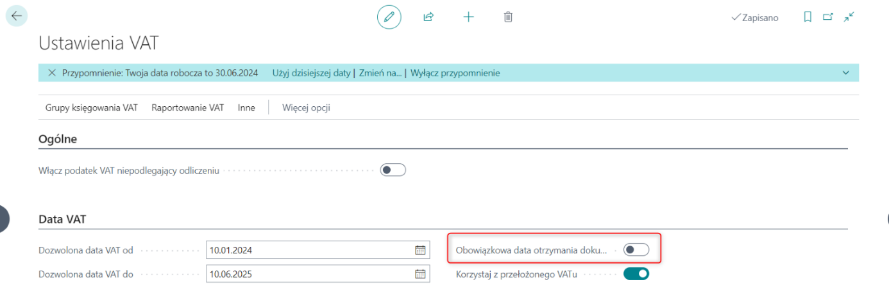

Gdy ta opcja jest włączona system nie pozwoli zaksięgować dokumentu zakupu bez uzupełnionej ***Daty wpływu dokumentu***.

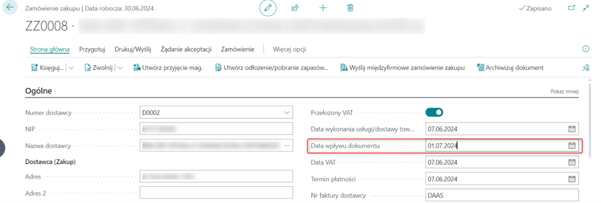

## Faktury korygujące sprzedaży

Często w firmach zachodzi konieczność skorygowania sprzedaży, a co za tym idzie, faktur sprzedaży. Wówczas do wystawionej wcześniej faktury sprzedaży wystawiana jest ***Faktura korygująca sprzedaży***. Aby ułatwić i usprawnić proces tworzenia ***Faktury korygującej sprzedaży*** wprowadzono kilka funkcjonalności:

- tworzenie ***Wierszy korekty*** (przed/po) do wcześniej wskazanej faktury sprzedaży

- tworzenie różnych ***Typów korekt*** (cenowa, ilościowa itp.)

- wskazanie Przyczyny korekty

- korygowanie ilości (możliwe zwiększenie ilości zapasu), cen, stawek VAT, rabatów

- wystawianie jednej faktury korygującej sprzedaży do:

    - faktur nieistniejących w systemie Business Central (przydatne po wdrożeniu i zasileniu systemu Bilansem Otwarcia)

    - pojedynczej faktury

    - wielu faktur sprzedaży (korekty zbiorcze)

Dla korekt zbiorczych istnieje możliwość pobrania wierszy korygowanych dla zadanego okresu czasu oraz automatycznego narzucenia rabatu procentowego lub rabatu kwotowego (kluczem wartościowym) dla pobranych wierszy. Funkcje te są szczególnie przydatne przy generowaniu korekt z tytułu udzielonych bonusów okresowych.

W wersji Microsoft Dynamics 365 Business Central dodane zostały kontrole dotyczące: kopiowania cen zapasu z wierszy przed/po, a nie z cennika zapasu oraz dodatkowo podczas korekty typu ***Anuluj*** nie ma możliwości pobrania tylko części wierszy pierwotnej faktury lub usunięcia kilku wierszy po pobraniu. System wymusza pobranie wszystkich wierszy z dokumentu pierwotnego i ich anulowanie. Usunięcie wierszy jest możliwe tylko podczas zmiany numeru dokumentu korygowanego (pierwotnego).

Dodatkową funkcjonalnością są ***Przyczyny korekty***, czyli lista edytowalna w której możliwe jest zdefiniowanie przyczyn korekt, wskazania przyczyny w dokumencie oraz wyświetlenia przyczyny na wydruku faktury korygującej.

→ Faktury korygujące sprzedaży

- W części ***Ogólne*** należy wypełnić wszystkie wymagane oraz istotne pola dotyczące ***faktury korygującej***,

- W części ***Szczegóły korekty*** należy zaznaczyć pole ***Korekta***, wybrać ***Typ, Numer*** (faktury pierwotnej, do której odnosi się korekta), a także ***Kod,*** który wskazuje na przyczynę korekty.

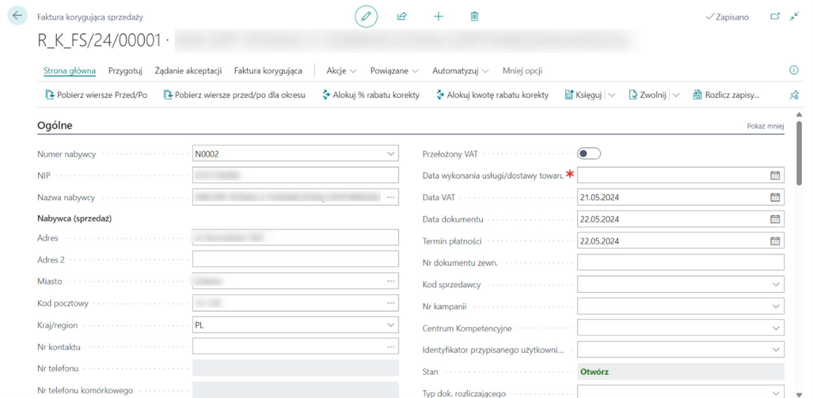

- W kolejnym kroku należy przejść do funkcjonalności ***Pobierz wiersze Przed/Po***, znajdującej się na wstążce w zakładce ***Strona główna***.

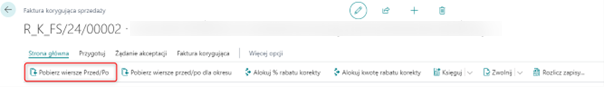

- Następnie w nowo otwartym oknie dialogowym należy wybrać funkcję „***Pobierz wiersze korekty***”.

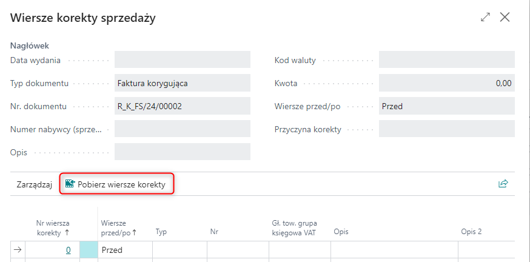

- W oknie ***Wiersze korekty sprzedaży*** pojawiają się po dwa wierze do każdego wiersza z pierwotnej faktury sprzedaży: wiersz ***Przed***, który pozostaje bez zmian, oraz wiersz ***Po***, na którym należy odpowiednio skorygować dane, zgodnie wprowadzoną wcześniej przyczyną korekty (na przykład ilość czy kwota). Wprowadzone zmiany zatwierdzamy przyciskiem ***OK***.

- Po zatwierdzeniu program wraca do kartoteki, gdzie w wierszach ***faktury korygującej*** pojawiają się dwa wiersze ***Przed i Po*** – jeśli korekta dotyczyła ceny, była związana z udzielonym rabatem lub ze stawką VAT. Jeśli korekta dotyczyła ilości, po powrocie do kartoteki pojawia się tylko jedna linia na różnicę ilości (różnicę między ilością wykazaną na pierwotnej fakturze sprzedaży a ilością poprawną). Również dla anulacji faktury sprzedaży nie pojawiają się wiersze ***Przed i Po***, pojawia się analogiczna ilość wierszy jak na fakturze pierwotnej z takimi samymi danymi, które po zaksięgowaniu faktury korygującej odwracają zapisy z pierwotnej faktury sprzedaży.

- Jeżeli w typie dokumentu zostanie wybrana opcja ***Zaksięgowane faktury (zbiorczo)*** to nie korzystamy z pola ***Nr***, wybieramy natomiast ***Przyczynę korekty***, a następnie przechodzimy do opcji ***Pobierz wiersze Przed/Po*** ***dla okresu*** oraz ***Pobierz wiersze korekty*** i z listy wybieramy numery faktur oraz konkretne linie wierszy z tych faktur, które mają zostać skorygowane.

- Ułatwienie dla generowania korekt bonusowych/związanych z udzielonym rabatem, np. z tytułu przekroczenia obrotów za dany okres, dostępne jest tylko dla opcji ***Zaksięgowane faktury (zbiorczo)***. Należy wówczas wybrać przyczynę korekty ***Udzielony rabat***:

    - Opcja pobierania wierszy ***Przed/Po*** dla wszystkich faktur z zadanego okresu;

    - Automatyczne ***alokowanie na wiersze korekty Przed/Po*** rabatu w ujęciu procentowym lub rabatu w ujęciu kwotowym - alokacja kwoty rabatu kluczem wartościowym na pozycje korekty – przekładana na kwotę rabatu na każdej pozycji ***Przed/Po***.

- Aby wydrukować dokument sprzedaży do pliku PDF należy przejść na wstążce do zakładki ***Drukuj/Wyślij*** a następnie Załącz jako PDF.

### Korekta części

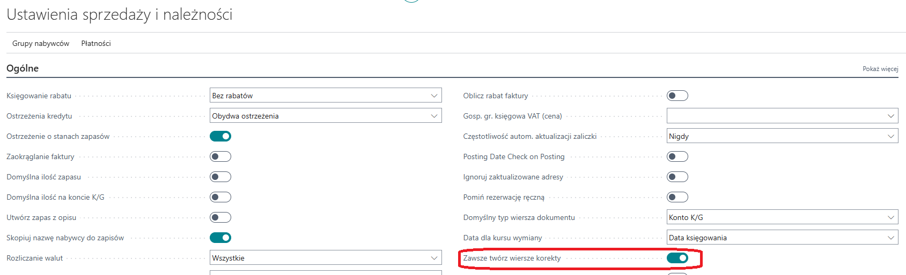W przypadku korekty sprzedaży części, jeżeli zmianie nie ulega ilość ani wartość, wiersze korekty nie generują się. Jeżeli użytkownik chce, aby takie wiersze pojawiły się na dokumencie, należy na stronie **Ustawienia sprzedaży i należności** włączyć znacznik „**Zawsze twórz wiersze korekty**”.

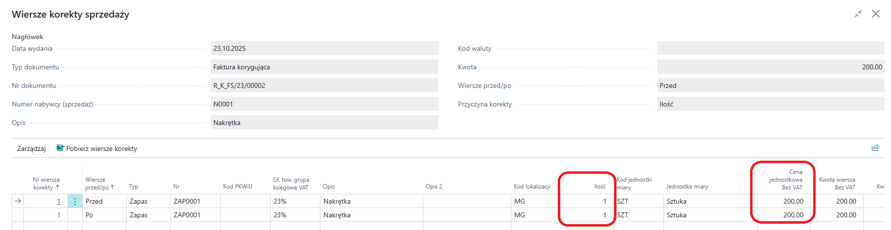Wiersze korekty sprzedaży (zmianie nie uległa ani ilość, ani cena jednostkowa):

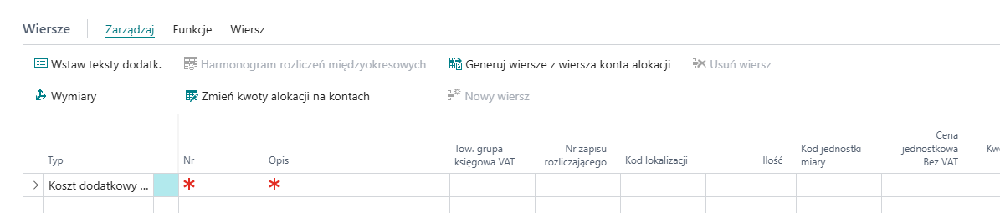Wiersze dokumentu bez włączonego znacznika:

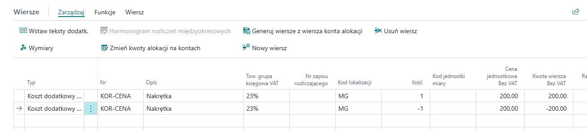Wiersze dokumentu z włączonym znacznikiem:

### Korekta danych nabywcy

Korekta danych nabywcy jest dokumentem służącym do poprawy danych identyfikacyjnych nabywcy wskazanych na fakturze pierwotnej.

Korekta obejmuje wyłącznie dane formalne, takie jak nazwa nabywcy, adres nabywcy i nie wpływa na wartości finansowe dokumentu.

Aby wykonać korektę danych nabywcy, zaktualizuj dane na kartotece klienta i utwórz fakturę korygującą:

- z poziomu zaksięgowanej faktury sprzedaży

- lub na stronie listy → Faktury korygujące sprzedaży

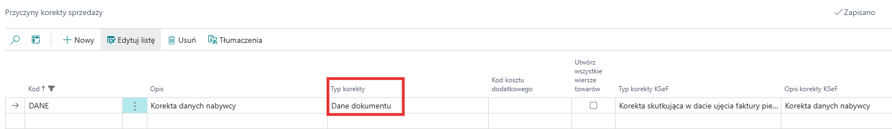Na dokumencie wybierz przyczynę korekty o typie: **DANE**.

Przyczyna ta jest wymagana do prawidłowego wygenerowania sekcji **Podmiot2K** w strukturze KSeF.

Po zaksięgowaniu i wygenerowaniu dokumentu KSeF, system utworzy strukturę XML zawierającą sekcję Podmiot2K, prezentującą dane nabywcy zgodnie z wymaganiami KSeF.

Więcej informacji dotyczących elementu **Podmiot2K** oraz sposobu jego prezentacji w strukturze XML znajduje się w podręczniku KSeF w rozdziale **Korekta danych nabywcy w KSeF**.

### Korekty opisowe dokumentów sprzedaży

Funkcjonalność umożliwia wystawianie faktur korygujących służących do zmiany danych opisowych dokumentu sprzedaży bez wpływu na jego wartość. Korekty tego typu są obsługiwane również w procesie generowania dokumentów KSeF.

Użytkownik ma możliwość:

- wystawiania korekt opisowych niezwiązanych ze zmianą danych nabywcy, dla których nie jest generowana sekcja **Podmiot2K**,

- zmiany daty dostawy lub wykonania usługi,

- zmiany terminu płatności,

- zmiany adnotacji dokumentu, np. Mechanizmu Podzielonej Płatności (MPP),

- księgowania korekt bez wpływu na wartości dokumentu,

- tworzenia korekt bez konieczności dodawania pozycji dokumentu,

- generowania dokumentów KSeF dla korekt opisowych z prezentacją aktualnych danych po zmianie.

Aby wykonać korektę danych opisowych faktury, należy utworzyć fakturę korygującą:

- z poziomu zaksięgowanej faktury sprzedaży

- lub na stronie listy → Faktury korygujące sprzedaży

Następnie na dokumencie wybrać przyczynę korekty o typie: **Dodatkowe dane dokumentu (nie KSeF 2K).**

Przyczyna korekty tego typu służy do wprowadzania zmian danych opisowych dokumentu innych niż dane nabywcy. W przeciwieństwie do przyczyny korekty typu DANE, nie powoduje ona wygenerowania sekcji Podmiot2K w strukturze KSeF.

 Po zaksięgowaniu i wygenerowaniu dokumentu KSeF, system utworzy strukturę XML zawierającą zaktualizowane dane opisowe dokumentu zgodnie z wymaganiami KSeF.

### Zbiorcze korekty sprzedaży z tytułu rabatów

Jeżeli rabat potransakcyjny jest udzielany nabywcy do wszystkich dostaw dokonanych na jego rzecz w danym okresie, firma może wystawić zbiorczą fakturę korygującą.

Aby taki dokument został poprawnie zaprezentowany w formie ustrukturyzowanej, na tworzonej korekcie należy wskazać dedykowaną przyczynę korekty o typie **Rabat zbiorczy:**

\
W celu poprawnej prezentacji w księdze głównej, w Głównych Ustawieniach księgowania należy wskazać **[Konto faktury korygującej rabatu](https://docker.nmierp.pl/PLF27/?company=Polska%20Firma&dc=0&signInRedirected=1&startTraceId=414bae9564a34e0888809f030a2230fc&tid=undefined&runinframe=1)** - będzie ono używane w przypadku rabatu dla zapasów:

Na fakturze korygującej sprzedaży należy wybrać właściwą przyczynę korekty, a także wskazać informacje o dokumentach korygowanych:

- Typ - Zaksięgowane faktury (zbiorczo)

- Filtr daty księgowania - okres, za który chce się udzielić rabatu

- Opis okresu korekty - wartość przenoszona do struktury KSeF

- Rabat % korekty lub Rabat kwotowy korekty

Następnie należy pobrać wiersze Przed/Po dla okresu faktur, do których chce się naliczyć rabat, nie wprowadzać w nich modyfikacji i wybrać OK:

Po powrocie na korektę wybrać **Alokuj % rabatu korekty** lub **Alokuj kwotę rabatu korekty** w zależności od tego, jaki rabat chce się udzielić:

Wygenerowane zostaną zbiorcze wiersze faktury korygującej- dla pozycji z zapasami pod numerem konta K/G wskazanego w ustawieniach:

Wygenerowane zostaną zbiorcze wiersze faktury korygującej - dla pozycji z zapasami pod numerem konta K/G wskazanego w ustawieniach:

## Wydruki dokumentów sprzedaży

Wydruki związane ze sprzedażą w systemie zostały poprawione wizualnie oraz dostosowane do wymagań polskiego prawa. Są to: Potwierdzenie zamówienia sprzedaży, Zamówienie sprzedaży, Faktura proforma sprzedaży, Faktura sprzedaży, Faktura serwisu, Faktura korygująca sprzedaży, Potwierdzenie wydania sprzedaży, Przyjęcie zwrotu sprzedaży.

Aby przypisać nowe wydruki do poszczególnych typów dokumentów należy przejść do strony **Wybór raportów – sprzedaż**, a następnie wybrać z listy odpowiednie numery ID raportów do odpowiednich typów dokumentów.

## Wydruk numeru konta K/G na dokumentach sprzedaży

Aby umożliwić użytkownikom decydowanie czy numer konta K/G ma być widoczny na wydrukach dokumentów sprzedaży, na stronie **Ustawienia sprzedaży i należności** dodano znacznik ***<u>Drukuj nr konta K/G na fakturze</u>***:

→ **Ustawienia sprzedaży i należności**

Jego aktywacja powoduje, że numer konta K/G będzie widoczny w wierszu dokumentu na wydrukach: faktury pro-forma, zaksięgowanej faktury sprzedaży, zaksięgowanej faktury korygującej sprzedaży oraz zaksięgowanej faktury sprzedaży serwisu.

## Uzgodnienie salda nabywcy i Uzgodnienie salda dostawcy

Jedną z zasad inwentaryzacji jest uzgodnienie salda należności od odbiorców i zobowiązań wobec dostawców. W Microsoft Dynamics użytkownik ma możliwość wygenerowania dokumentów wzywających do uzgodnienia stanu salda wraz z wykazem poszczególnych transakcji oraz innymi niezbędnymi informacjami.

*→* Uzgodnienie salda nabywcy I Uzgodnienie salda dostawcy

*→* Uzgodnienie salda dostawcy

Wybierając „Podgląd” generują nam się raporty z wszystkimi otwartymi pozycjami zaksięgowanymi na koncie kontrahenta na dany dzień uzgodnienia, gotowe do wysłania do kontrahenta w celu potwierdzenia salda.

Jeśli dokumenty są wystawiane w różnych walutach, zaznaczenie znacznika ***Drukuj kwoty w walucie*** spowoduje, że na raporcie zostaną wygenerowane sumy dla poszczególnych walut.

## Mechanizm podzielonej płatności (MPP)

Funkcjonalność umożliwia zastosowanie mechanizmu podzielonej płatności *(*Split Payment Mechanism*)* na dokumentach sprzedaży, zgodnie z przepisami ustawy o podatku od towarów i usług.

Jej celem jest zapewnienie zgodności z obowiązkami podatkowymi wynikającymi z polskich regulacji prawnych oraz umożliwienie prawidłowego oznaczenia transakcji objętych obowiązkowym lub dobrowolnym zastosowaniem mechanizmu podzielonej płatności.

Mechanizm można aktywować bezpośrednio na fakturze sprzedaży włączając znacznik ***Mechanizm podzielonej płatności*** znajdujący się w zakładce **Szczegóły faktury**:

Alternatywnie, można go przypisać do wybranych metod płatności poprzez włączenie znacznika ***Mechanizm podzielonej płatności*** dostępnego na stronie **Metody płatności**:

Aktywacja znacznika spowoduje automatyczne włączenie się MPP po wybraniu danej metody płatności na fakturze sprzedaży.

Wartość znacznika można zmienić także na **zaksięgowanej fakturze sprzedaży** - jest on widoczny w zakładce **Szczegóły faktury**.

Jeśli mechanizm podzielonej płatności jest włączony na fakturze sprzedaży, to **informacja o tym będzie również widoczna na wydruku** zaksięgowanej faktury sprzedaży w polu ***Metoda płatności***.

**Mechanizm podzielonej płatności jest dostępny także na** **fakturach korygujących sprzedaży** i działa w analogiczny sposób jak na fakturach sprzedaży. 

## Polska Klasyfikacja Wyrobów i Usług (PKWiU)

PKWiU ma zastosowanie w statystyce, ewidencji, dokumentacji, rachunkowości oraz w urzędowych rejestrach i systemach informacyjnych administracji publicznej.

W ramach Polskiej Lokalizacji została dodana możliwość wprowadzenia do systemu różnych kodów PKWiU wraz z opisem, przypisanie ich do kartotek zapasów, a następnie ich używanie na wierszach dokumentów sprzedaży.

→ PKWiU

Należy otworzyć stronę **PKWiU** i uzupełnić ją kodami i opisami zgodnymi z rozporządzeniem Rady Ministrów.

Następnie należy przypisać kody do zapasów na ich kartotekach w polu **Kod PKWiU**.

Tworząc dokument sprzedaży, kod PKWiU pobierze się z kartoteki zapasu i pojawi w kolumnie **Kod PKWiU.** Jeżeli kod nie został uzupełniony wcześniej, można go również wybrać bezpośrednio na dokumencie. Nie spowoduje to jednak automatycznej aktualizacji na kartotece zapasu.

# Jednolite Pliki Kontrolne (JPK)

W związku z tym, że od stycznia 2018 roku obowiązują nowe zasady kontroli podatkowej, przedsiębiorstwa są zobowiązane do składania do urzędów kontroli skarbowej danych podatkowych w postaci pliku w formie XML, tzw. Jednolitego Pliku Kontrolnego.

Dzięki rozszerzeniom wprowadzonym w ramach Polskiej Lokalizacji pliki JPK można generować bezpośrednio z Business Central.

## Konfiguracja JPK

→ Ustawienia JPK

W poniższych polach należy ustawić wymiary, które będą nośnikiem kodów JPK: 

Aby rozpocząć uzupełnianie należy kliknąć + w nagłówku strony: 

- **Kod urzędu** skarbowego – zawiera kod urzędu skarbowego w plikach JPK

- **Województwo firmy** – określa nazwę województwa, w którym znajduje się siedziba firmy

- **Dzielnica firmy** – określa nazwę dzielnicy, w której znajduje się siedziba firmy

- **Gmina firmy** – określa nazwę gminy, w której znajduje się siedziba firmy

- **Ulica firmy** – określa nazwę ulicy, przy której ma znajduje się siedziba firmy

- **Nr domu i nr mieszkania firmy** – określają nr domu i lokalu właściwego dla siedziby firmy

- **Poczta firmy** – określa nazwę urzędu pocztowego właściwego dla siedziby firmy

- **Email** – zawiera adres e-mail umieszczany w plikach JPK

- **Wymiar zakupu** – dotyczy dokumentów zakupu

- **Wymiar sprzedaży 1, 2, 3** – dotyczy dokumentów sprzedaży

- **Filtr tekstu** – zawiera znaki, które mogą wystąpić w polach tekstowych

- **Filtr tekstowy kwoty** – zawiera dopuszczone znaki, które mogą wystąpić w polach liczbowych

- **Rozszerzenie pliku JPK** – zawiera znaki, które są dopisywane w nazwach generowanych plików

### Rozszerzenie filtra tekstu i obsługa znaków specjalnych

Pole Filtr tekstu określa, jakie znaki mogą występować w polach tekstowych w generowanych plikach XML (np. JPK). W danych kontrahentów (np. nazwa, adres) mogą występować znaki specjalne oraz znaki diakrytyczne używane w różnych językach.

W aktualnej wersji rozwiązania system domyślnie obsługuje znaki alfabetów łacińskich (w tym znaki diakrytyczne), cyfry, podstawowe znaki interpunkcyjne, domyślny filtr tekstu jest stosowany automatycznie i nie wymaga dodatkowej konfiguracji przez użytkownika.

W przypadku wystąpienia znaków niestandardowych, które nie są objęte filtrem domyślnym, użytkownik może rozszerzyć filtr. Wprowadzone znaki **rozszerzają domyślny filtr, nie zastępują go, są uwzględniane podczas generowania plików XML** (np. KSeF).

Poprawna konfiguracja pola Filtr tekstu ma wpływ na poprawność generowanych plików XML,

zgodność danych z wymaganiami struktur JPK, uniknięcie problemów z pomijaniem lub niepoprawnym przetwarzaniem znaków specjalnych.

Aktualna domyślna formuła filtra tekstu w przypadku pozostawienia pustego pola **Filtr tekstu**:

^\[A-Za-zÀÁÂÃÄÅĀĂĄÆÇĆĈĊČÐÈÉÊËĒĔĖĘĚĜĞĠĢĤĦÌÍÎÏĨĪĬĮİIJĴĶĹĻĽĿŁÑŃŅŇÒÓÔÕÖØŌŎŐŒŔŖŘŚŜŞŠŢŤŦÙÚÛÜŨŪŬŮŰŲŴÝŶŸŹŻŽÞàáâãäåāăąæçćĉċčðèéêëēĕėęěĝğġģĥħìíîïĩīĭįıijĵķĺļľŀłñńņňòóôõöøōŏőœŕŗřśŝşšţťŧùúûüũūŭůűųŵýŷÿźżžþ0-9 ,.\\\\'()\]+\$

## Ustawienia deklaracji VAT

W tabeli z ustawieniami deklaracji VAT znajdują się rekordy grupujące wartości deklaracji w poszczególne sekcje. Tabela ustawień deklaracji VAT powinna zostać wygenerowana automatycznie podczas instalacji rozszerzenia Polska Lokalizacja. Gdyby jednak tak się nie stało, należy zainicjować domyślne ustawienia poprzez wybór opcji **Wygeneruj słownik ustawień deklaracji**.

Obsługa kontrahentów zagranicznych i kodów krajów VAT

Funkcjonalność umożliwia automatyczne ustalanie kodu kraju kontrahenta na potrzeby struktur elektronicznych na podstawie numeru identyfikacji podatkowej (VAT Registration No.). W przypadku kontrahentów zagranicznych system analizuje prefiks numeru VAT i wykorzystuje go jako źródło kodu kraju wykorzystywanego podczas generowania danych podatkowych.

Dzięki temu możliwe jest poprawne rozpoznawanie kraju identyfikacji podatkowej nawet wtedy, gdy kraj adresowy kontrahenta różni się od kraju, w którym został nadany numer VAT.

**Uwagi**

- Kraj adresowy kontrahenta nadal wykorzystywany jest do prezentacji danych adresowych.

- Kraj identyfikacji podatkowej ustalany jest na podstawie numeru VAT kontrahenta.

- Funkcjonalność ma zastosowanie dla kontrahentów krajowych, unijnych oraz poza unijnych

## Środki trwałe

W sekcji środków trwałych należy wybrać odpowiednią księgę amortyzacji podatkową i bilansową. Ustawienia te są wymagane na potrzeby JPK CIT.

## Przykłady wymiarów VAT 

Wartościami wymiaru zakupu i sprzedaży są kody JPK, które mogą być użyte w dokumentach zakupu oraz sprzedaży.

Aby zobaczyć wartości utworzonych kodów, edytować je, usuwać lub dodawać nowe należy wyszukać:

→ Wymiary

Należy zaznaczyć interesujący nas wiersz i na wstążce w opcji ***Wymiar*** wybrać ***Wartości wymiaru***. Wartości wymiaru należy przed pierwszym użyciem uzupełnić kodami VAT zgodnie z obowiązującymi przepisami prawa. W czasie księgowań dokumentów zakupu i sprzedaży, wymiary przenoszą się do zapisów ksiąg, a następnie są przetwarzane i przenoszone do zapisów VAT. Zdefiniowane kody muszą pojawić się w pliku JPK.

## Grupy księgowe

Na potrzeby polskiej funkcjonalności do grup księgowych zostało dodane dodatkowe pole: ***Kod VDEK***. Analogicznie do wymiarów, dla których definiuje się kody, ***Kod VDEK***, który jest przypisany do danej grupy księgowej, zostanie pobrany do generowania pliku JPK.

→ Grupy księgowe nabywców

W tym miejscu można definiować nowe grupy księgowe nabywców i przypisywać im kody VDEK.

Jeśli w przedsiębiorstwie istnieje oddzielna grupa klientów – klienci powiązani/grupowi, warto utworzyć dla nich osobną grupę księgową i przypisać osobny kod VDEK, np. TP (transakcje powiązane), który zostanie automatycznie podstawiony przez system dla wszystkich tego rodzaju klientów, dla których będą robione dokumenty.

Należy pamiętać, że przy tworzeniu nowego nabywcy, w jego kartotece w zakładce **Fakturowanie** należy wybrać grupę księgową nabywcy, dzięki czemu odpowiedni kod VDEK będzie się zaciągał przy wszystkich księgowaniach na tym kliencie w przyszłości.

Analogicznie do grup księgowych nabywców można definiować grupy księgowe dostawców i przypisywać im kody VDEK, które następnie będą się pobierały przy generowaniu plików JPK.

Na takiej samej zasadzie kody VDEK przypisywane są dla innych grup księgowych:

→ Grupy księgowe nabywców

→ Główne towarowe grupy księgowe

→ Towarowe grupy księgowe VAT

→ Główne gospodarcze grupy księgowe

→ Gospodarcze grupy księgowe VAT

## Ustawienia księgowe VAT

W kartotece ustawień księgowych VAT należy przypisać odpowiednie wartości dla poniższych pól. Aby to zrobić należy zaznaczyć wiersz wybranej gospodarczej grupy księgowej VAT i na wstążce wybrać opcję ***Widok***. Następnie w zakładce ***JPK*** należy przypisać ustawienia poszczególnym polom. Każde z pól w zakładce ***JPK*** ma też swoje odzwierciedlenie w kolumnach znajdujących się na widoku głównym ustawień księgowych VAT.

→ Ustawienia księgowe VAT

- ***Pole sprzedaży w deklaracji*** – w tym polu można przypisać pozycję do konkretnych kolumn części sprzedażowej deklaracji. Przykładowe przypisanie:

    - Wybierając K_19 – podstawa trafi do kolumny 19 deklaracji

    - Wybierając K_20 – VAT trafi do kolumny 20 deklaracji

    - Wybierając K_19_20 – Podstawa trafi do kolumny 19 a VAT do kolumny 20

- ***Pole zakupu w deklaracji*** – w tym polu można przypisać pozycję do konkretnych kolumn części zakupowej deklaracji.

- ***Kod VDEK*** – w tym polu można wpisać domyślny kod VAT – analogicznie jak w powyższych grupach księgowych.

- ***Pokaż w sprzedaży Nr dok. Zewnętrznego*** - zaznaczenie tego pola oznacza, że jeśli w dokumentach sprzedaży podany jest numer dokumentu zewnętrznego, to zostanie on wpisany do pliku JPK.

- ***Złe długi*** – pole to należy zaznaczyć, jeśli konfiguracja VAT dotyczy ulgi na złe długi. Kwoty te będą wykazane w plikach JPK w dodatkowych kolumnach związanych ze złymi długami.

## Zapisy VAT

Podczas generowania pliku JPK istotną rolę odgrywają informacje zawarte w poniższych kolumnach, które można znaleźć w zapisach VAT.

→ Zapisy VAT

- ***Pomiń w JPK_FA*** – to pole powinno być zaznaczony jeśli nie chcemy, aby dany dokument został pokazany w pliku JPK.

- ***Kod VDEK*** – pole to jest aktualizowane przed eksportem danych do plików JPK, i po aktualizacji wszystkie kody z grup księgowych oraz wymiarów zostaną wpisane w pola tej kolumny i rozdzielone przecinkami. Jeśli dany kod został wpisany, nie będzie on drugi raz wyznaczany. Natomiast jeśli w polu kodu VDEK wpisany został wyraz BRAK, to system dla danego dokumentu nie będzie wyznaczał kodów.

- ***Pole sprzedaży w deklaracji i Pole zakupu w deklaracji*** – w tych polach można zmienić przypisanie poszczególnych kwot do kolumn na poziomie zapisu VAT. Na przykład w przypadku błędnego określenia grupy i zaksięgowania zakupu zwykłego, który powinien być w środkach trwałych, w polu ***Raport zakupu*** na wierszu dotyczącym tej faktury należy zmienić przypisany w tej kolumnie kod na taki, który jest właściwy dla środków trwałych.

## Generowanie pliku JPK VAT

Pliki JPK VAT generowane są i wysyłane do Urzędu Skarbowego co miesiąc i bez wezwania. Składają się one z dwóch części – deklaracji oraz wierszy wchodzących w skład tej deklaracji.

→ Ustawienia JPK

Aby wygenerować plik JPK:

- uzupełnić ***daty*** określające okres, za który generowany jest plik

- wybrać odpowiednie funkcje w zależności od etapu pracy / rodzaju deklaracji:

    - etap 1 – przygotowanie

        - ***Aktualizuj kody VAT*** – aktualizowane są kody VAT z wymiarów i grup księgowych. Aktualizację tę robi się tylko raz, przed wygenerowaniem deklaracji;

        - ***Oblicz raport*** – wybranie tej funkcji powoduje, że do zapisów pliku JPK wpisywane są poszczególne dokumenty w rozbiciu na grupy/kolumny, które w polu deklaracji powinny się pojawić;

        - ***Pokaż zagregowany raport*** – tworzona jest symulacja zapisów, które pojawią się w wygenerowanym pliku.

          

    - etap 2 – generowanie pliku JPK

        - ***Utwórz plik JPK*** – generowany jest plik JPK w oparciu o przeprowadzoną wcześniej aktualizację kodów i symulację raportu.

          

    - Złożenie kolejnej deklaracji za ten sam miesiąc / korekty deklaracji

        - ***Korekta raportu*** – funkcja wybierana w sytuacji, gdy potrzebne jest złożenie kolejnej deklaracji / korekty deklaracji za ten sam miesiąc.

    - Złożenie deklaracji kwartalnej

        - ***Raport kwartalny*** – funkcja, która służy do generowania deklaracji kwartalnej.

    - Tworzenie deklaracji z pominięciem nagłówka

        - ***Pomiń eksport nagłówka raportu*** – funkcja, która służy do generowania deklaracji z pominięciem nagłówka. Zmiany są wprowadzane jedynie na wierszach, na przykład kiedy konieczne jest skorygowanie dokumentu dostawcy.

    - Tworzenie deklaracji z pominięciem wierszy

        - ***Pomiń eksport wierszy raportu –*** funkcja, która służy do generowania deklaracji z pominięciem wierszy, na przykład w przypadku prośby o zwrot pieniędzy.*** ***

<u>Przykładowe zapisy pliku JPK</u>: wygenerowany plik zawiera poszczególne dokumenty wraz z ich numerami, oznaczeniem czy dotyczą zakupu, czy sprzedaży, daty, numery NIP kontrahentów jak również wskazanie do jakiej kolumny trafiły kwoty. Ostatni wiersz jest Nagłówkiem, który zawiera pola z deklaracji VAT. 

## Archiwizacja plików JPK

Funkcjonalność archiwum JPK umożliwia przechowywanie historii wygenerowanych plików JPK wraz z pełnymi danymi źródłowymi wykorzystanymi do ich utworzenia.

Zapewnia to możliwość odtworzenia deklaracji, weryfikacji danych oraz analizowania zmian pomiędzy kolejnymi wersjami raportów.

### Tworzenie archiwum

Podczas generowania pliku JPK użytkownik może uzupełnić pole **Opis archiwum**.

Wprowadzenie wartości w tym polu powoduje zapisanie danych w archiwum.

Jeśli pole Opis archiwum nie zostanie uzupełnione, archiwum nie jest tworzone.

Każde wygenerowanie pliku z opisem tworzy nową wersję archiwum powiązaną z danym okresem i deklaracją (np. deklaracja pierwotna lub korekta).

### Zakres archiwizowanych danych

Po wygenerowaniu pliku JPK system zapisuje w archiwum:

- wygenerowany plik XML (np. VDEK),

- dane źródłowe wykorzystane do jego utworzenia (zapisy VAT),

- informacje opisowe dotyczące deklaracji, takie jak:

    - opis archiwum,

    - wersja archiwum,

    - zakres dat (okres deklaracji),

    - wersja struktury JPK,

    - nazwa pliku XML.

Archiwum przechowuje szczegółowe dane odpowiadające zapisom JPK, m.in.:

- numer zapisu oraz typ zapisu (np. w okresie, nagłówek),

- numer zapisu VAT,

- typ transakcji (np. sprzedaż / zakup),

- numer dokumentu,

- daty (Data VAT, Data księgowania),

- numer rejestracji VAT,

- identyfikator KSeF,

- numer dokumentu zewnętrznego,

- wartości przypisane do pól deklaracji VAT.

Dzięki temu archiwum zawiera pełny obraz danych wykorzystanych do wygenerowania deklaracji.

### Struktura archiwum

Dane archiwalne są przechowywane w dwóch poziomach:

- **Nagłówek archiwum** – zawiera informacje o deklaracji (okres, wersja, plik XML),

- **Pozycje archiwum** – zawierają szczegółowe zapisy VAT wykorzystane do utworzenia pliku.

### Przeglądanie archiwum

Archiwum dostępne jest z poziomu dedykowanych stron:

- **Lista archiwów JPK** – lista archiwów (nagłówki),

- **Pozycje archiwum JPK** – szczegóły danych dla wybranego archiwum.

Z poziomu listy archiwum dostępne są akcje:

- **Otwórz pozycje archiwum JPK** – przejście do szczegółowych zapisów,

- **Eksportuj plik XML** – ponowne pobranie wygenerowanego pliku,

- **Przywróć zapis JPK z archiwum** – przywrócenie danych archiwalnych do systemu.

### Ponowny eksport i przywracanie danych JPK

Archiwum umożliwia wykonanie operacji na danych historycznych bez konieczności ponownego generowania pliku JPK.

Dostępne funkcje obejmują:

- **ponowny eksport pliku XML** – umożliwia pobranie wcześniej wygenerowanego pliku,

- **przegląd danych źródłowych** – analiza zapisów VAT wykorzystanych do deklaracji,

- **przywracanie danych z archiwum** – odtworzenie zapisów wykorzystanych podczas generowania deklaracji.

Funkcjonalność ta pozwala na:

- odtworzenie historycznego stanu danych JPK,

- weryfikację danych wykorzystanych w raportowaniu,

- analizę zmian pomiędzy kolejnymi wersjami deklaracji,

- obsługę procesów korekt.

## Wizualizacja/edycja pliku JPK

W trakcie obliczania raportu, do tabeli zapisów JPK trafiają rekordy, na podstawie których w kolejnym etapie generowany jest plik XML. Przed wygenerowaniem pliku XML istnieje możliwość wizualizacji i edycji deklaracji VAT.

→ Deklaracja VAT7

Dokument deklaracji został podzielony na 5 sekcji: Nagłówek, Sprzedaż, Zakup, Stopka oraz Parametry deklaracji. Rekordy w sekcji Sprzedaż, Zakup i Stopka generowane są na podstawie ustawień deklaracji VAT. Dane w sekcji **Parametry deklaracji** są edytowalne i należy je uzupełnić przed wygenerowaniem pliku XML.

Po dokonaniu edycji deklaracji można ją wyeksportować korzystając z funkcji na wstążce Akcje 🡪 Utwórz plik JPK.

## Konfiguracja dla deklaracji JPK_KR_PD oraz JPK_ST_KR

Od 1 stycznia 2025 roku weszły w życie przepisy ustawy o CIT, które wprowadzają nowe obowiązki dla wybranych podmiotów, w tym spółek należących do podatkowych grup kapitałowych. Zgodnie z nowymi regulacjami firmy będą zobowiązane do prowadzenia ksiąg rachunkowych za pomocą oprogramowania komputerowego. Takie księgi będą przesyłane do właściwego naczelnika urzędu skarbowego w formie elektronicznej, przy czym pliki te muszą spełniać określone wymagania dotyczące struktury logicznej.

→ Znaczniki konta

Tabela ze słownikiem znaczników konta wykorzystywana jest w celu odpowiedniego skategoryzowania kont K/G na potrzeby JPK CIT. Tabela ta generuje się automatycznie podczas instalacji rozszerzenia Polska Lokalizacja. Gdyby jednak tak się nie stało, należy uruchomić funkcję **Wygeneruj słownik znaczników konta**, dostępną na wstążce.

→ Kartoteka konta K/G

Klasyfikację konta K/G na potrzeby JPK CIT należy wybrać bezpośrednio na kartotece konta w sekcji **Raportowanie 🡪 JPK KR_PD**.

→ Kartoteka środka trwałego

Na kartotece ŚT można uzupełnić informacje o nabyciu i/lub likwidacji środka trwałego, które nie wynikają bezpośrednio z zapisów księgowych. W przypadku wprowadzenia środka trwałego bilansem otwarcia, w systemie nie ma informacji o rzeczywistej dacie i dokumencie nabycia ŚT. W takim przypadku, konieczne jest uzupełnienie wymaganych informacji w sekcji **JPK** na kartotece ŚT.

→ Księga amortyzacji ŚT

W księdze amortyzacji środka trwałego należy uzupełnić informacje na temat metody i rodzaju amortyzacji środka trwałego.

→ Klasy ŚT

Do każdej klasy środka trwałego należy przypisać odpowiedni kod klasy ŚT na potrzeby JPK CIT (Symbol klasyfikacji środków trwałych (KŚT)).

→ Grupy księgowe ŚT

Każdej grupie księgowej ŚT należy przypisać odpowiedni typ grupy księgowej ŚT na potrzeby JPK CIT.

→ Kody źródłowe

Czasami konieczne jest wskazanie przyczyny powstania konkretnego zapisu w systemie, na przykład określenie, czy został on utworzony w wyniku zaksięgowania dziennika głównego, czy też faktury zakupu lub sprzedaży. Kod źródłowy identyfikuje miejsce, w którym zapis został wygenerowany. Zapisy powstają w trakcie księgowania dzienników, faktur oraz realizacji określonych zadań wsadowych. Każdy typ księgowania posiada przypisany kod źródłowy, który automatycznie nadawany jest podczas tworzenia danego zapisu.

Na potrzeby JPK KR PD dodana została możliwość przypisania kodu źródła oraz domyślnego typu i opisu dokumentu JPK do danego kodu źródłowego. Wartości należy wprowadzić na stronie Kody źródłowe:

Wprowadzone wartości pojawią się w utworzonym pliku JPK KR PD w odpowiednich polach.

## Generowanie pozostałych plików JPK

Oprócz JPK VAT przedsiębiorcy mogą generować inne pliki JPK, na przykład JPK dla ksiąg rachunkowych, magazynu, banku czy faktur. Wówczas, tak jak poprzednio, należy uzupełnić daty oraz wybrać jedną z poniższych opcji. Plik JPK zostanie wygenerowany automatycznie, bez dodatkowych ingerencji. Takie pliki dodatkowe generowane są na żądanie Urzędu Skarbowego.

