# Apuração ICMS/IPI: Configuração, Processamento e Arquivo EFD

**Data**: Setembro/2020

---

## Sumário

A **Apuração ICMS/IPI** consolida os documentos fiscais de entrada e saída registrados no período e calcula os débitos, os créditos e o saldo do ICMS, do ICMS ST, do ICMS DIFAL e do IPI. Na apuração o usuário lança os ajustes (outros débitos e créditos, estornos e deduções), informa as guias de recolhimento, confere os relatórios de apuração e dos livros fiscais e gera o arquivo da EFD ICMS/IPI para validação no PVA da Receita Federal.

O valor apurado de ICMS e ICMS ST é a base da guia de recolhimento estadual; o de IPI, do DARF. Para a estrutura do arquivo e a conferência dos registros, leia também [EFD-ICMS/IPI (SPED Fiscal)](Localization-for-Brazil_User-Manual_guia-fiscal-efd-icms-ipi.md).

## 1. Contexto

A apuração cobre os impostos:

- **ICMS**: Imposto sobre Operações relativas à Circulação de Mercadorias e sobre Prestações de Serviços de Transporte Interestadual e Intermunicipal e de Comunicação;
- **ICMS ST**: ICMS devido por substituição tributária;
- **ICMS DIFAL**: diferencial de alíquota do ICMS nas operações interestaduais;
- **IPI**: Imposto sobre Produtos Industrializados.

A legislação de cada estado deve ser consultada no site da Secretaria da Fazenda do domicílio do contribuinte. As regras da EFD estão no portal do SPED (`http://sped.rfb.gov.br`).

---

## 2. Pré-requisitos

Antes de apurar, confira se as notas de entrada e de saída do mês estão registradas com os impostos corretos. A apuração só escritura o que está nos documentos fiscais.

1. Na página **Documento Fiscal Registrado**, use **Documento** > **Impostos** para ver os impostos de um documento.

   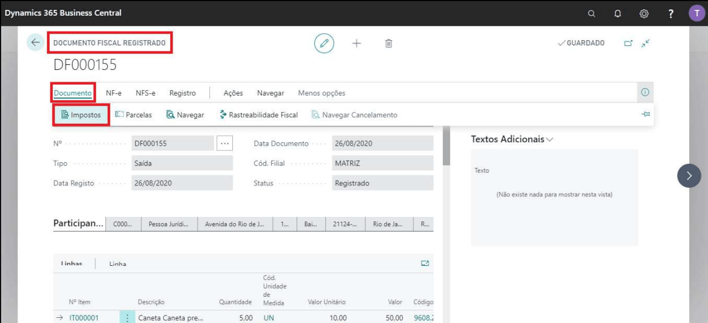

2. Para ver os impostos de todos os documentos, pesquise por **Movimentos de Impostos de Doc. Fiscal**.

   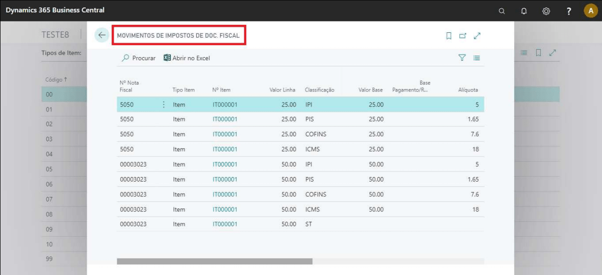

> **Nota**: o processamento exige o **CEP** da empresa (ou da filial da apuração) cadastrado na tabela **CEP** com o **Cód. Municipio IBGE** preenchido.

---

## 3. Configuração

Os cadastros da EFD ficam no Centro de Funções em **Configurações** > **Fiscal** > **EFD ICMS/IPI**.

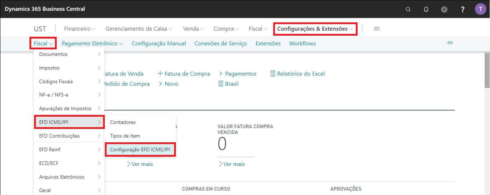

> **Nota**: nas imagens deste manual o menu aparece com o nome antigo **Configurações & Extensões**. O caminho a partir de **Fiscal** é o mesmo.

### 3.1. Configuração EFD ICMS/IPI

Pesquise por **Configuração EFD ICMS/IPI** ou abra **Configurações** > **Fiscal** > **EFD ICMS/IPI** > **Configuração EFD ICMS/IPI**.

| Seção | Campo | Descrição |
|-------|-------|-----------|
| **Geral** | **Perfil Padrão** | Perfil de apresentação da EFD (A, B ou C), que define quais registros são gerados |
| **Geral** | **Tipo Atividade** | Industrial ou equiparado a industrial, ou outros |
| **Geral** | **Tipo Atividade Industrial** | Tipo da atividade industrial informada na EFD |
| **Geral** | **Versão Layout** | Versão do leiaute do arquivo, conforme o manual da obrigação no site da Receita Federal (por exemplo, `020`) |
| **Geral** | **Período Apuração ICMS** e **Período Apuração IPI** | Apuração mensal ou decendial |
| **Geral** | **Nº Conta Total Inventário** | Conta contábil que totaliza o estoque do bloco H |
| **Registros** | **Gerar Registro 1601** | Gera o registro 1601 (vendas com instrumentos eletrônicos de pagamento). Veja [EFD ICMS/IPI: Registro 1601 por Forma de Pagamento](Localization-for-Brazil_User-Manual_EFD-ICMS-IPI-Registro-1601-Formas-Pagamento.md) |
| **CIAP** | Campos do CIAP | Cálculo do crédito de ICMS do ativo. Veja [CIAP: Inclusão do IPI no Total das Saídas via Valor Contábil](Localization-for-Brazil_User-Manual_CIAP-Valor-Contabil-Total-Saidas.md) |

Na parte **Perfil por Filial**, crie uma linha por filial quando a empresa tiver filiais com perfil ou atividade diferentes: **Cód. Filial**, **Perfil**, **Tipo Atividade Industrial** e **Gerar Registro 1601**.

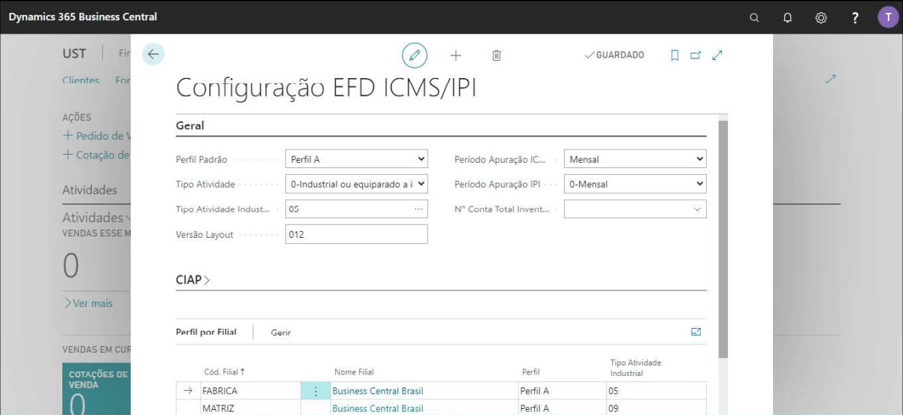

> **Nota**: preencha a **Versão Layout**. Em branco, o sistema escolhe a versão pela data inicial da apuração, mas só até a versão 016, de 2022, que não serve para os períodos atuais.

### 3.2. Contadores

Pesquise por **Contadores EFD** ou abra **Configurações** > **Fiscal** > **EFD ICMS/IPI** > **Contadores**. Se o contador ainda não estiver cadastrado, use **Novo** e informe os dados dele (**CPF**, **Nome**, **CRC**, **CNPJ**, endereço, contatos e **Data Início Serviço**).

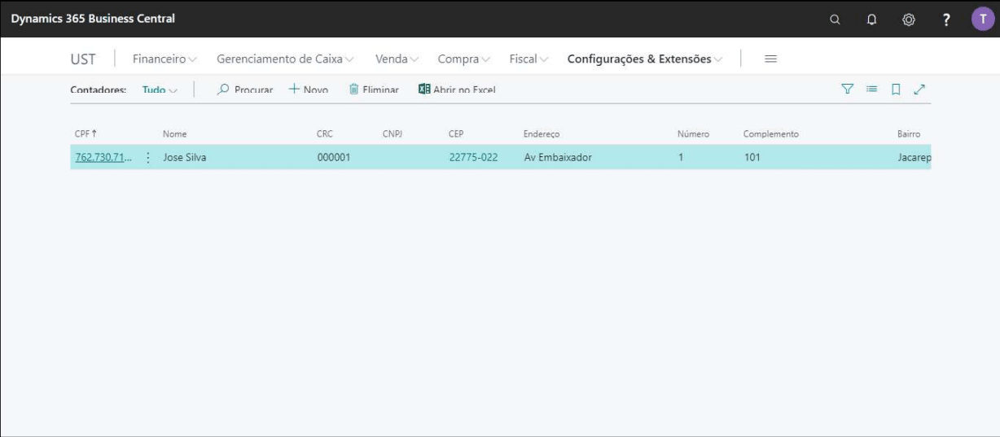

> **Nota**: o contador só sai no registro 0100 se estiver com **EFD ICMS/IPI** marcado. Na apuração de uma filial, ele também precisa ter a filial na parte **Responsável por... (EFD)** do cartão **Contador EFD**.

### 3.3. Tipos de item EFD

Pesquise por **Tipos de Item EFD** ou abra **Configurações** > **Fiscal** > **EFD ICMS/IPI** > **Tipos de Item**. Se a lista estiver vazia, use **Novo** e cadastre os tipos de item da tabela da EFD:

| Código | Descrição |
|--------|-----------|
| 00 | Mercadoria para revenda |
| 01 | Matéria-prima |
| 02 | Embalagem |
| 03 | Produto em processo |
| 04 | Produto acabado |
| 05 | Subproduto |
| 06 | Produto intermediário |
| 07 | Material de uso e consumo |
| 08 | Ativo imobilizado |
| 09 | Serviços |
| 10 | Outros insumos |
| 99 | Outras |

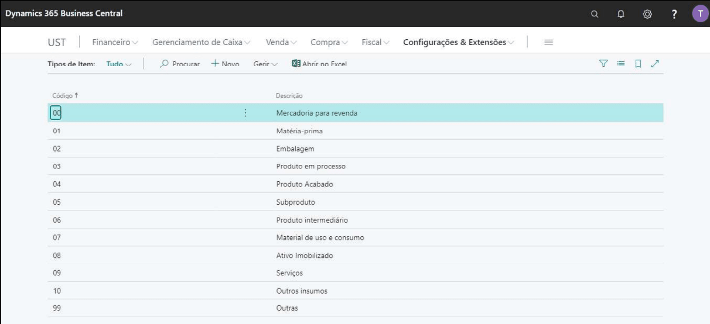

---

## 4. Criar a apuração

Pesquise por **Apurações de ICMS/IPI** ou, no Centro de Funções, abra **Fiscal** > **Livros Fiscais** > **Apurações de ICMS/IPI**.

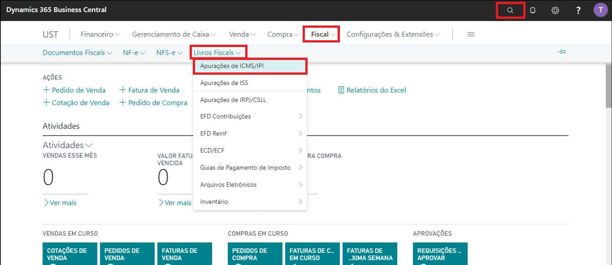

### 4.1. Criação automática

1. Na lista, use **Novo** > **Criar Apurações**.

   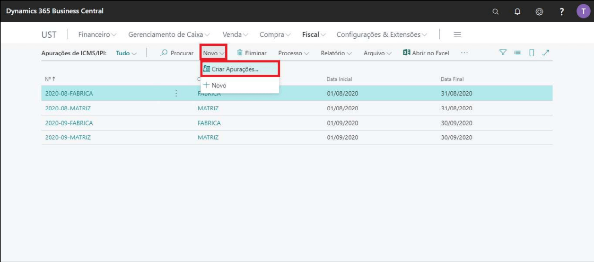

2. Na página **Criar Apurações Imposto**, informe o **Ano** e o **Mês** e clique em **OK**.

   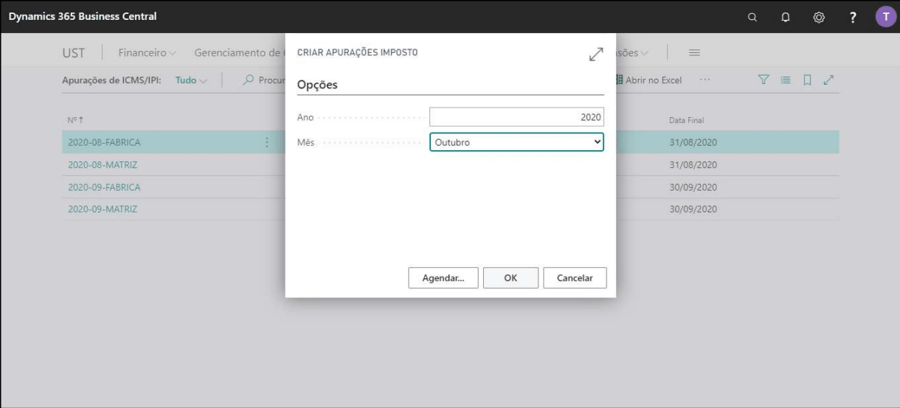

O sistema cria uma apuração para cada filial, numerada como `AAAA-MM-<filial>` (por exemplo, `2020-10-MATRIZ`), com as datas inicial e final do mês. Sem filiais cadastradas, cria uma única apuração numerada `AAAA-MM`. Uma apuração que já existe com o mesmo número não é recriada.

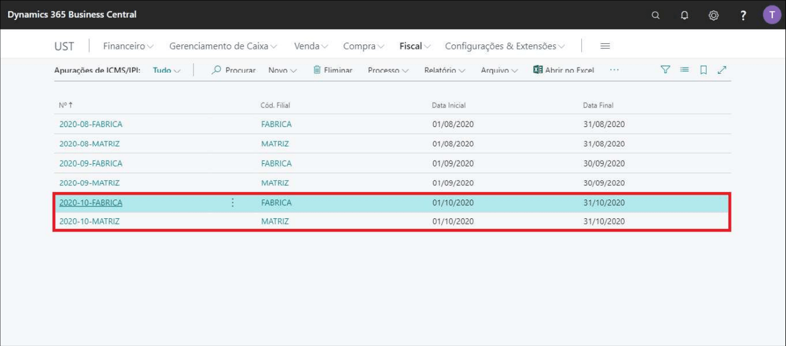

### 4.2. Criação manual

1. Na lista, use **Novo** > **Novo**.

   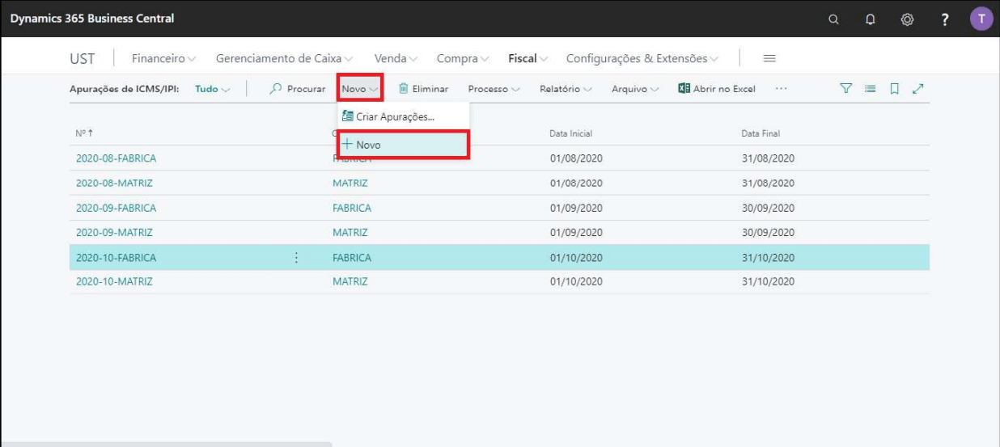

2. Na seção **Geral** do cartão **Apuração ICMS/IPI**, preencha:

| Campo | Descrição |
|-------|-----------|
| **Nº** | Código da apuração |
| **Cód. Filial** | Filial apurada, se a empresa tiver filiais |
| **Data Inicial** e **Data Final** | Período da apuração |

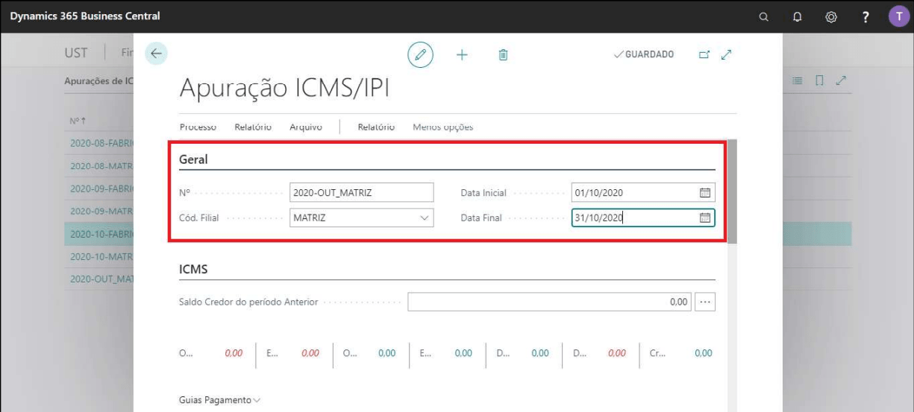

---

## 5. Processar a apuração

No cartão da apuração (ou na lista, com a apuração selecionada), use **Processo** > **Processar**.

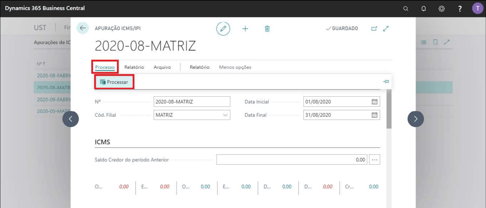

Ao final, o sistema mostra a notificação **Apuração &lt;nº&gt; processada com sucesso.**

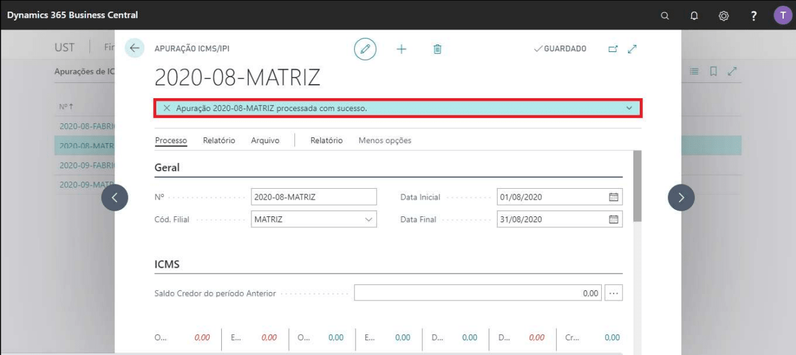

> **Nota**: se houver no período documentos cancelados no sistema com a NF-e ainda autorizada na SEFAZ, o processamento lista esses documentos e pergunta se deve continuar. Veja [NF-e: Cancelamento na SEFAZ no Mesmo Fluxo, Prazo de Cancelamento por Filial e Cancelamentos Pendentes](Localization-for-Brazil_User-Manual_NFe-Cancelamento-SEFAZ-Prazo-Pendencias.md).

Reprocesse a apuração sempre que registrar ou corrigir documentos do período.

---

## 6. Relatórios de conferência

### 6.1. Apuração do ICMS

1. No cartão da apuração, use **Relatório** > **Apuração ICMS**.

   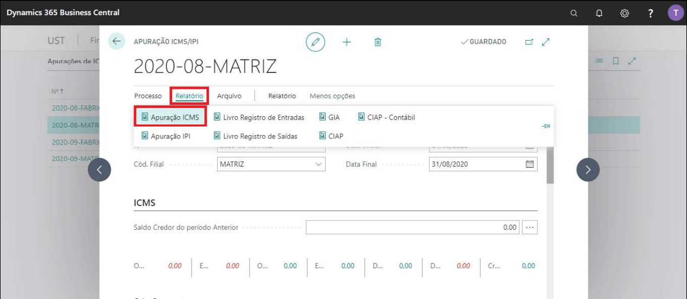

2. Clique em **Pré-visualizar**.

   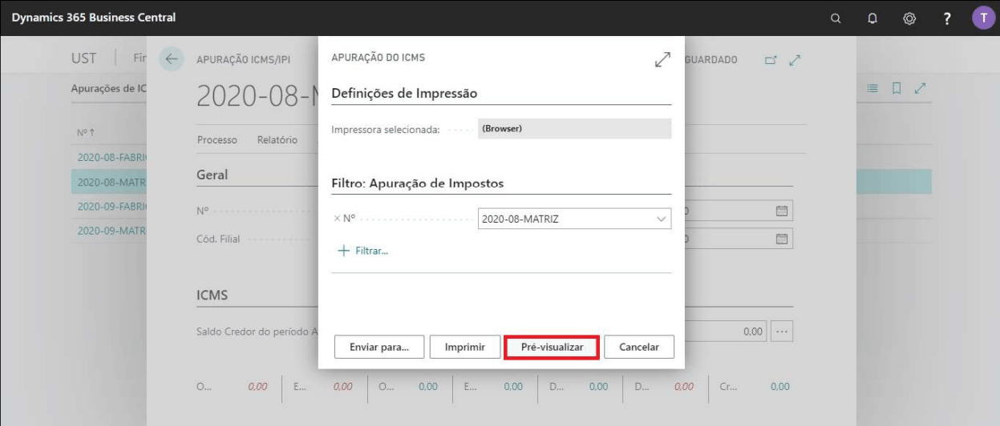

O relatório mostra as entradas e as saídas por CFOP e, na última página, o demonstrativo de débitos, créditos e saldo.

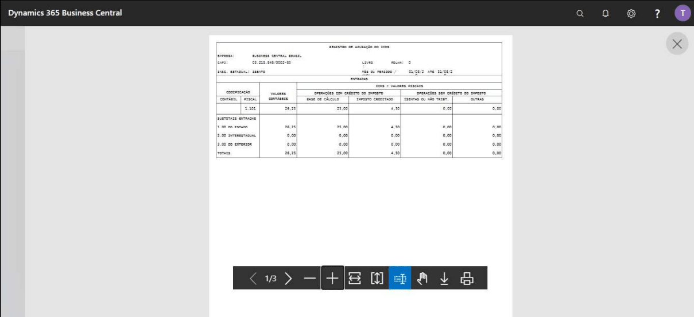

### 6.2. Apuração do IPI

Use **Relatório** > **Apuração IPI** e clique em **Pré-visualizar**. O relatório tem o mesmo formato do ICMS.

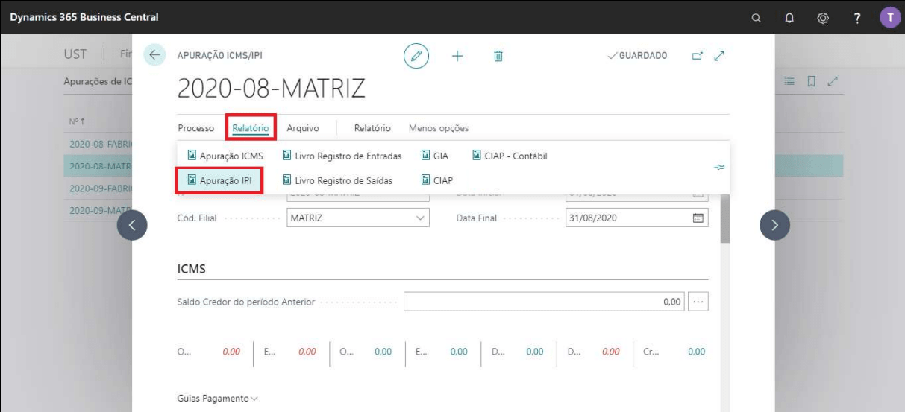

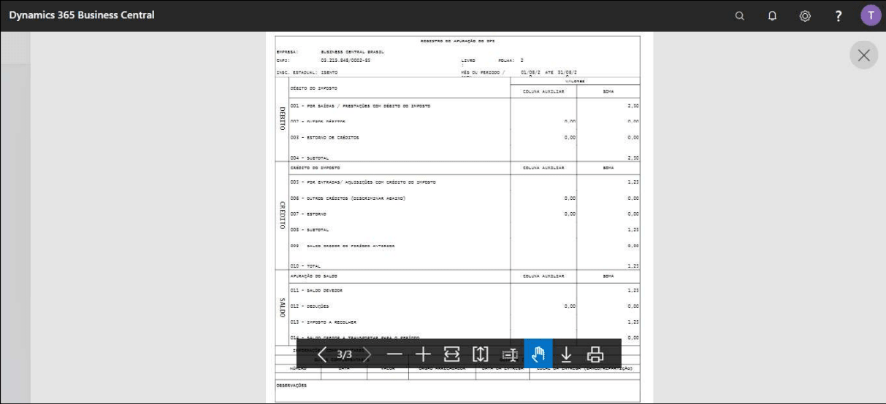

### 6.3. Outros relatórios

Em **Relatório** também ficam o **Livro Registro de Entradas**, o **Livro Registro de Saídas**, o **CIAP** e o **CIAP - Contábil**. O **Resumo Interestadual** e o **Resumo CFOP** de cada livro ficam no grupo **Imprimir...** das ações do cartão.

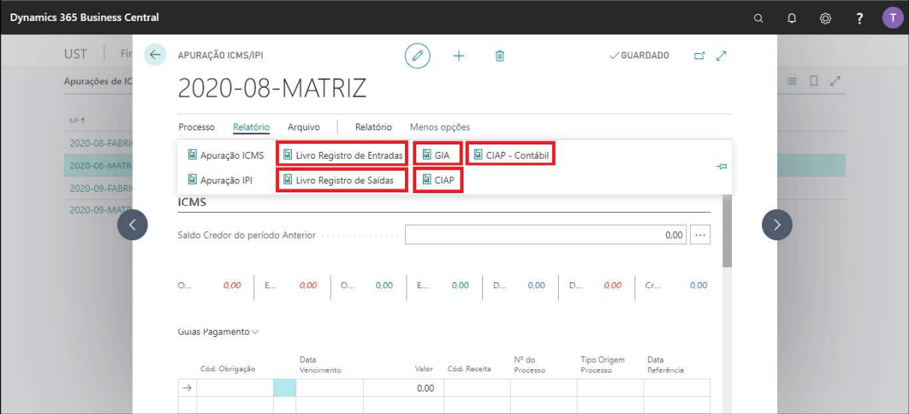

> **Nota**: as declarações estaduais aparecem conforme a UF da empresa ou da filial da apuração: **GIA** (Rio de Janeiro) e **GIA SP** (São Paulo) em **GIA**, e **DAPI MG** (Minas Gerais) em **Arquivos**. Para outras UFs essas ações ficam ocultas, e a seção **GIA** do cartão só aparece em São Paulo.

---

## 7. Ajustes da apuração

### 7.1. ICMS: outros débitos e créditos, estornos e deduções

A seção **ICMS** do cartão mostra os ajustes do período: **Outros Débitos**, **Estorno de Créditos**, **Outros Créditos**, **Estorno de Débitos**, **Deduções** e **Débitos Especiais**.

1. Abra o cartão da apuração e, na seção **ICMS**, clique no valor do ajuste que será lançado.

   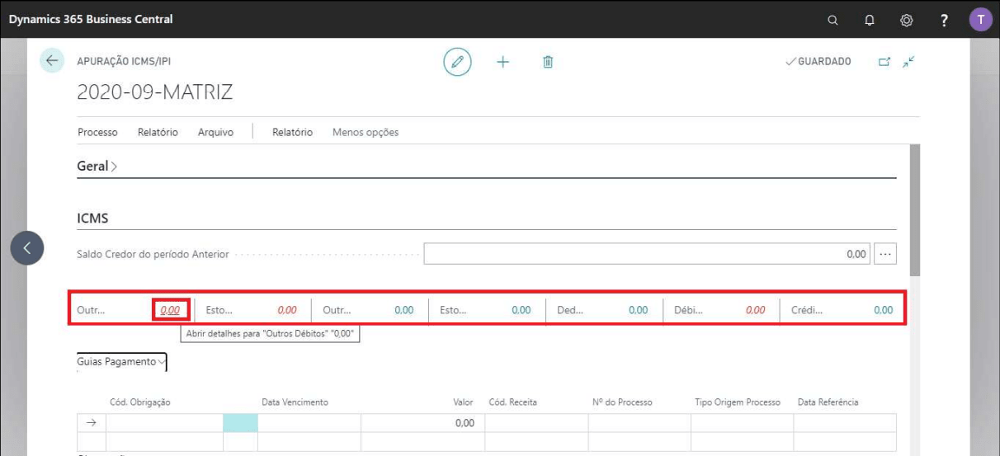

2. Na página **Valores Ajuste Apuração**, preencha uma linha por ajuste:

| Campo | Descrição |
|-------|-----------|
| **Descrição** | Descrição do ajuste |
| **Cód. Ajuste/Info. EFD** | Código do ajuste conforme a tabela da UF, cadastrado em **Configurações** > **Fiscal** > **Apurações de Impostos** > **Códs. Ajuste de Apuração** |
| **Base Cálculo** e **Alíquota** | Base e alíquota do ajuste. Com o **Valor** em branco, a alíquota calcula o valor sobre a base |
| **Valor** | Valor do ajuste |
| **Data Referência** e **Nº Documento** | Data e documento de referência do ajuste |
| **Cód. Ocorrência GIA** | Código de ocorrência da GIA, quando a UF exige |
| **Documentos** | Quantidade de documentos fiscais que compõem o ajuste |

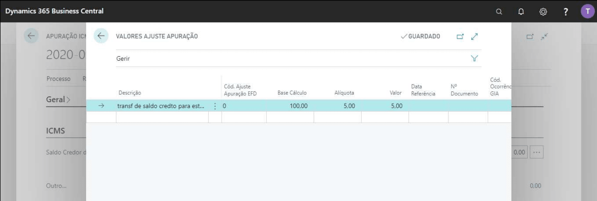

O total volta para o campo correspondente do cartão.

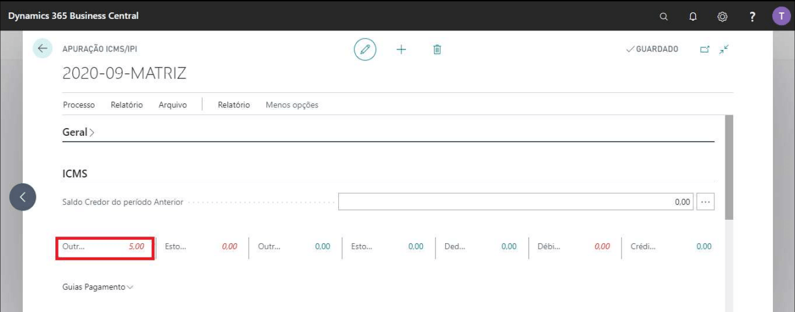

> **Nota**: as linhas geradas automaticamente pelo sistema aparecem destacadas. Uma linha com documentos fiscais vinculados (**Documentos** maior que zero) tem o **Valor** bloqueado; use **Documentos Relacionados** para ver esses documentos.

A seção **ICMS** também tem:

- **Saldo Credor do período Anterior**: o botão **...** busca o saldo credor a transportar da apuração anterior da mesma filial (a que termina na véspera da **Data Inicial**) e preenche os saldos credores do ICMS e do IPI;
- **Créditos Extras**: abre os **Créditos ICMS Extra-Apuração** vinculados à apuração;
- **Valores Declaratórios**: valores informativos, que não alteram o ICMS a recolher.

### 7.2. ICMS DIFAL e ICMS ST

As seções **ICMS DIFAL** e **ICMS ST** têm a parte **Apurações**, com uma linha por UF (**Cód. Território**), e a parte **Guias Pagamento**. No ICMS DIFAL, o campo **FCP** separa a apuração do Fundo de Combate à Pobreza.

Preencha as linhas conforme a necessidade. Para lançar ajustes de uma UF, selecione a linha e use **Editar** com a opção do ajuste (**Acréscimo Contribuição**, **Estorno de Créditos**, **Acréscimo Crédito**, **Estorno de Débitos**, **Deduções** ou **Débitos Especiais**); a página **Valores Ajuste Apuração** abre filtrada para a UF. **Recalcular Saldo** recalcula o saldo da UF selecionada.

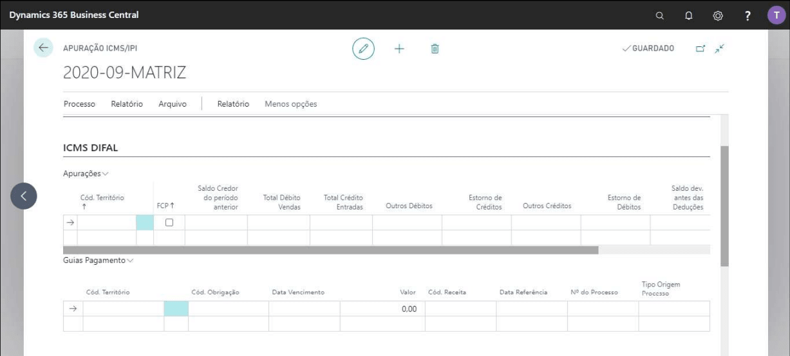

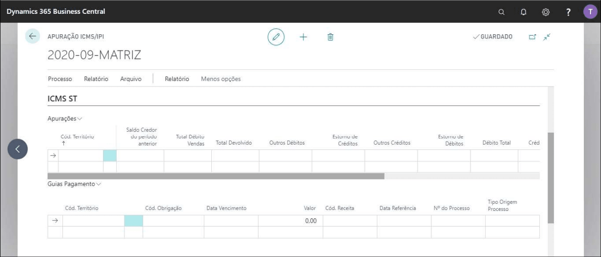

### 7.3. IPI: outros débitos e créditos, estornos e deduções

A seção **IPI** tem os ajustes **Outros Débitos**, **Estorno de Créditos**, **Outros Créditos**, **Estorno de Débitos** e **Deduções**, lançados da mesma forma que no ICMS: clique no valor, preencha a linha em **Valores Ajuste Apuração** e o total volta para o cartão. No IPI, a página tem o campo **Cód. Origem Documento** no lugar do **Cód. Ocorrência GIA**.

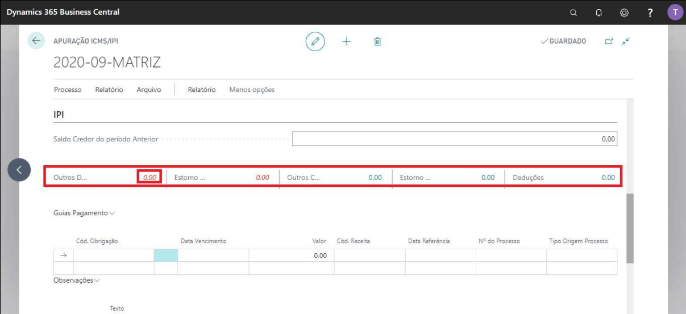

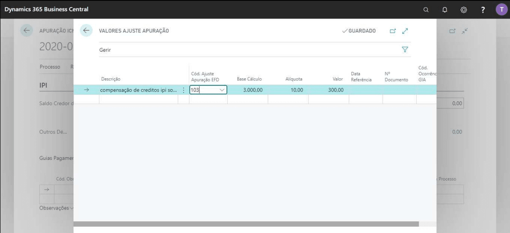

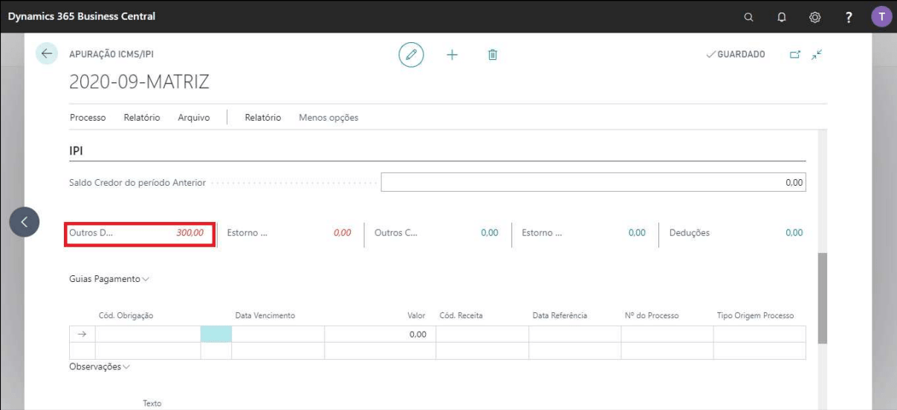

### 7.4. Guias de pagamento

As seções **ICMS**, **ICMS DIFAL**, **ICMS ST** e **IPI** têm a parte **Guias Pagamento**, onde se informam as guias de recolhimento do imposto. Essas linhas vão para a EFD.

| Campo | Descrição |
|-------|-----------|
| **Cód. Território** | UF da guia (somente no ICMS DIFAL e no ICMS ST) |
| **Cód. Obrigação** | Código da obrigação a recolher, cadastrado em **Configurações** > **Fiscal** > **Apurações de Impostos** > **Códigos Obrigação Imposto** |
| **Data Vencimento** | Vencimento da guia |
| **Valor** | Valor da guia |
| **Cód. Receita** | Código de receita do recolhimento |
| **Nº do Processo** e **Tipo Origem Processo** | Processo administrativo ou judicial ligado à obrigação e a origem dele (SEFAZ, justiça federal, justiça estadual ou outros), quando houver |
| **Data Referência** | Data de referência da obrigação |

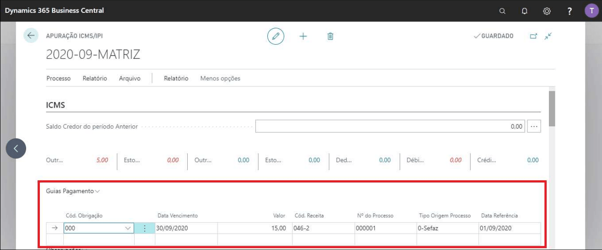

---

## 8. Dados da EFD e dos livros

### 8.1. Seção EFD

| Campo | Descrição |
|-------|-----------|
| **Tipo Arquivo** | **0-Remessa Arquivo Original** ou **1-Remessa Arquivo Substituto** |
| **Motivo Inventário** | Preenchido só quando a EFD deve levar o inventário (bloco H) por um motivo determinado, por exemplo **01 - No final no período** |
| **Data Inventário até** | Data do inventário |
| **Filtro de Filial Automático** | Marcado (padrão), o inventário considera os depósitos da filial da apuração |
| **Filtro Depósito Inventário** | Depósitos do inventário, quando o **Filtro de Filial Automático** está desmarcado |

As demais opções são os indicadores do registro 1010. Marque as que se aplicam à empresa: **Ocorreu averbação (conclusão) de exportação no período**, **Existem informações acerca de créditos de ICMS a serem controlados, definidos pela Sefaz**, **É comercio varejista de combustíveis**, **Usinas de açúcar e/álcool - O estabelecimento é produtor de açúcar e/ou álcool carburante**, **Existem informações a serem prestadas neste registro e o registro é obrigatório em sua Unidade da Federação**, **A empresa é distribuidora de energia e ocorreu fornecimento de energia elétrica para consumidores de outra UF**, **É obrigatório em sua unidade da federação o controle de utilização de documentos fiscais em papel**, **A empresa prestou serviços de transporte aéreo de cargas e de passageiros** e **Possui informações consolidadas de saldos de restituição, ressarcimento e complementação do ICMS?**.

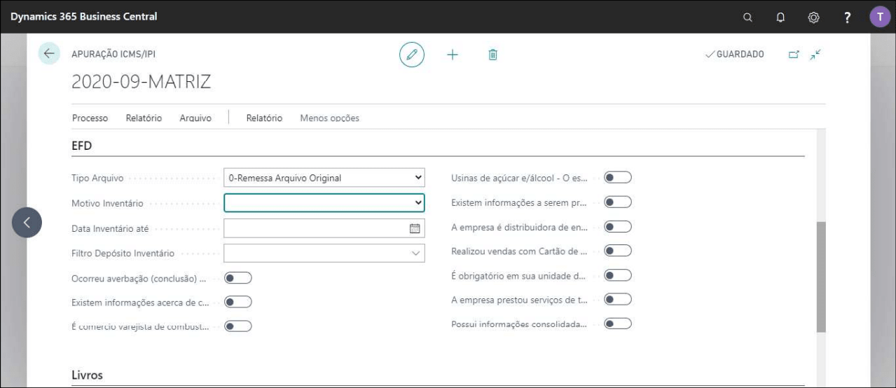

> **Nota**: a opção de vendas com cartão que aparece na imagem não existe mais no cartão. O indicador de vendas com instrumentos eletrônicos de pagamento do registro 1010 é preenchido automaticamente quando a apuração tem transações do registro 1601, consultadas em **EFD** > **Transações com Instrumentos de Pagamentos Eletrônicos (1601)** (ação visível com **Gerar Registro 1601** marcado na configuração).

### 8.2. Seção Livros

Preencha quando os números de livro e de página devem aparecer nos relatórios: **Nº Livro Apuração ICMS**, **Nº Página Apuração ICMS**, **Nº Livro Apuração IPI**, **Nº Página Apuração IPI**, **Nº Livro Registro de Entradas**, **Nº Página Registro de Entradas**, **Nº Livro Registro de Saídas** e **Nº Página Registro de Saídas**.

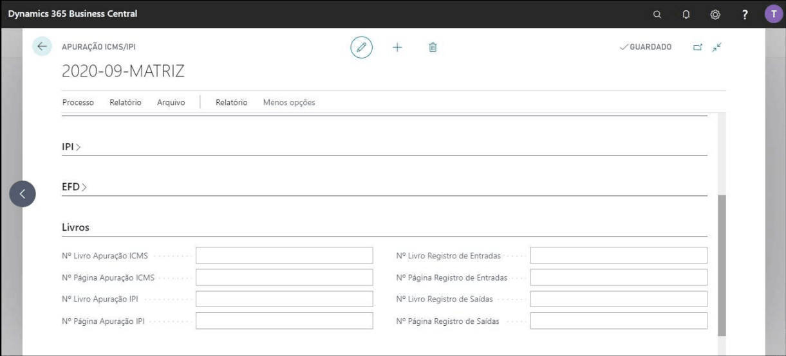

---

## 9. Gerar o arquivo da EFD ICMS/IPI

Depois de processar a apuração e preencher os dados manuais, gere o arquivo para validação no PVA.

1. No cartão da apuração, use **Processo** > **EFD ICMS/IPI**.

   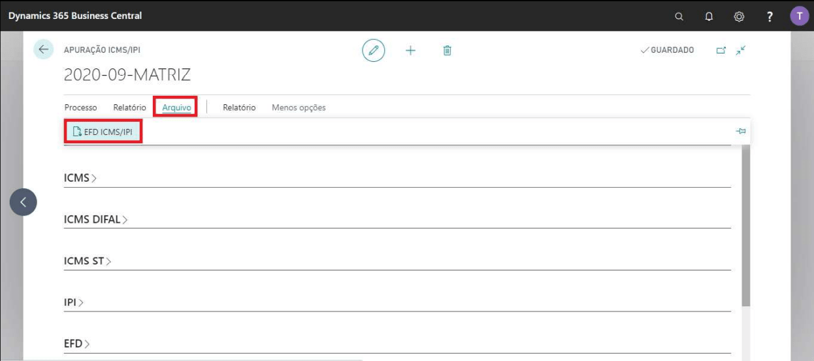

2. O sistema gera e baixa o arquivo TXT da EFD. Importe esse arquivo no programa validador (PVA) da Receita Federal.

   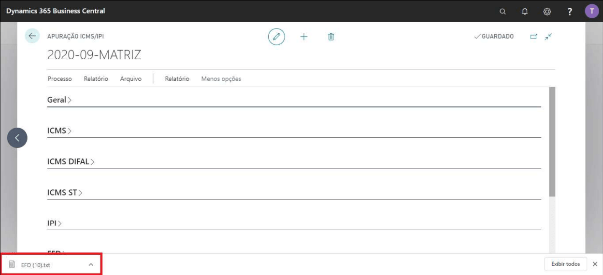

> **Nota**: na imagem a ação aparece em **Arquivo**. Hoje ela fica em **Processo**, ao lado de **Processar**, e também está disponível na lista **Apurações de ICMS/IPI**.
