# EFD Contribuições: Apuração de PIS/COFINS

**Data**: Setembro/2020

---

## Sumário

A **Apuração PIS/COFINS** reúne os documentos fiscais do período, os registros informados manualmente e os ajustes da escrituração, e gera o arquivo TXT da EFD-Contribuições para validação no PVA da Receita Federal. Este manual descreve as configurações necessárias, a criação da apuração por filial, o preenchimento dos registros que dependem do usuário, o processamento, a exportação do arquivo e a consolidação das filiais.

A declaração de imposto, a aprovação e a contabilização do PIS e da COFINS apurados estão em [Apuração Contábil de PIS/COFINS](Localization-for-Brazil_User-Manual_Apuracao-Contabil-PIS-COFINS.md). Os conceitos de PIS, COFINS e regimes de incidência estão em [PIS/COFINS e EFD-Contribuições](Localization-for-Brazil_User-Manual_guia-fiscal-pis-cofins.md).

## 1. Contexto

### O que é

A EFD-Contribuições é a escrituração digital em que a pessoa jurídica informa os documentos fiscais e os demonstrativos de apuração do PIS/PASEP, da COFINS e dos créditos da não cumulatividade, além da Contribuição Previdenciária sobre a Receita Bruta. O arquivo é validado, assinado e transmitido pelo PVA EFD-Contribuições (Programa Validador da Escrituração Fiscal Digital das Contribuições Incidentes sobre a Receita). Depois de importar o arquivo no PVA, o contribuinte ainda pode complementar dados diretamente no programa.

### Obrigatoriedade

Ficam obrigadas à EFD-Contribuições, nos termos do art. 2º do Decreto nº 6.022/2007, todas as pessoas jurídicas sujeitas à apuração do PIS/PASEP e da COFINS incidentes sobre o faturamento e a receita, nos regimes não cumulativo e cumulativo.

Estão dispensadas, entre outras:

- ME e EPP optantes pelo Simples Nacional;
- órgãos públicos, autarquias e fundações públicas;
- pessoas jurídicas ainda não inscritas no CNPJ e pessoas jurídicas inativas;
- pessoas jurídicas imunes e isentas do IRPJ cuja soma mensal de PIS/PASEP (sobre a receita), COFINS e CPRB seja igual ou inferior a R$ 10.000,00;
- condomínios edilícios; consórcios, grupos de sociedades e consórcios de empregadores;
- clubes de investimento registrados em bolsa, fundos de investimento imobiliário e fundos mútuos regulamentados pela CVM e pelo BACEN;
- representações permanentes de organizações internacionais; serviços notariais e registrais (cartórios);
- fundos especiais de natureza contábil ou financeira sem personalidade jurídica, criados no âmbito dos Poderes, Ministérios e Tribunais de Contas;
- candidatos a cargos políticos eletivos e comitês financeiros dos partidos políticos;
- incorporações imobiliárias sujeitas ao Pagamento Unificado de Tributos da Lei nº 10.931/2004 (a obrigação recai sobre a incorporadora, por incorporação submetida ao regime especial);
- empresas, fundações ou associações domiciliadas no exterior que possuam no Brasil bens e direitos sujeitos a registro;
- comissões sem personalidade jurídica criadas por ato internacional e comissões de conciliação prévia da Lei nº 9.958/2000.

### Prazo de entrega

O arquivo contém as operações de cada período de apuração mensal e é transmitido até o 10º (décimo) dia útil do 2º (segundo) mês subsequente ao mês de referência.

### Registros gerados

O arquivo é dividido em blocos. A localização gera os registros abaixo:

| Bloco | Registros |
|-------|-----------|
| **0** - Abertura e Identificação | `0000`, `0001`, `0035`, `0100`, `0110`, `0111`, `0120`, `0140`, `0150`, `0190`, `0200`, `0205`, `0206`, `0400`, `0450`, `0500`, `0600`, `0990` |
| **A** - Documentos Fiscais - Serviços (não sujeitos ao ICMS) | `A001`, `A010`, `A100`, `A110`, `A120`, `A170`, `A990` |
| **C** - Documentos Fiscais I - Mercadorias (ICMS/IPI) | `C001`, `C010`, `C100`, `C110`, `C120`, `C170`, `C175`, `C500`, `C501`, `C505`, `C990` |
| **D** - Documentos Fiscais II - Serviços (ICMS) | `D001`, `D010`, `D100`, `D101`, `D105`, `D200`, `D201`, `D205`, `D500`, `D501`, `D505`, `D990` |
| **F** - Demais Documentos e Operações | `F001`, `F010`, `F100`, `F120`, `F130`, `F500`, `F525`, `F600`, `F700`, `F990` |
| **I** e **P** | `I001`, `I990`, `P001`, `P990` (blocos sem movimento) |
| **M** - Apuração da Contribuição e Crédito | `M001`, `M200`, `M205`, `M210`, `M220`, `M225`, `M400`, `M410`, `M600`, `M605`, `M610`, `M620`, `M625`, `M700`, `M800`, `M810`, `M990` |
| **1** - Complemento da Escrituração | `1001`, `1100`, `1300`, `1500`, `1700`, `1900`, `1990` |
| **9** - Controle e Encerramento | `9001`, `9900`, `9990`, `9999` |

A maior parte dos registros sai dos documentos fiscais registrados e dos cadastros. Os registros que dependem de informação do usuário são preenchidos no cartão da apuração (seção [5](#5-preencher-os-registros-da-apuração)):

| Registro | Onde é informado |
|----------|------------------|
| `0000`, `0110`, `0111`, `0140` | **Configuração EFD Contribuições**, **Informações da Empresa**, **Informação Filial** e o próprio cartão da apuração |
| `0100` | **Contadores EFD** |
| `0500` | **Plano de Contas ECD** |
| `M220` / `M620` | Ajustes das seções **Apuração PIS** e **Apuração COFINS** |
| `1100` / `1500` | **Controle Créditos PIS (1100)** e **Controle Créditos COFINS (1500)** |
| `F100`, `F120`, `F130`, `F600`, `F700`, `1300`, `1700` | Seções de mesmo nome no cartão da apuração |

---

## 2. Pré-requisitos

### Naturezas da base de cálculo do crédito

1. Pesquise por **Naturezas Base Cálculo Crédito** ou, no Centro de Funções, abra **Configurações** > **Fiscal** > **EFD Contribuições** > **Códs. Base Cálculo Crédito**.
2. Confira se os códigos da tabela de natureza da base de cálculo do crédito estão cadastrados. Se faltar algum, clique em **Novo** e cadastre-o com o **Código** e a **Descrição** da tabela da Receita Federal.

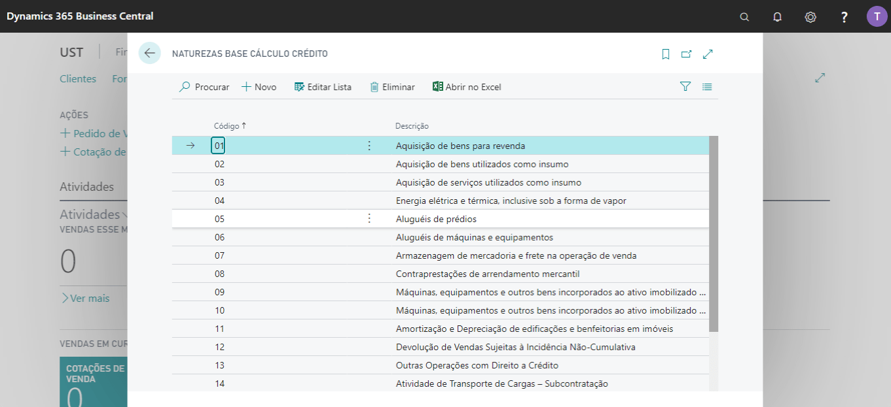

### Documentos do período

É preciso haver notas de entrada e/ou saída registradas no mês, com PIS e COFINS calculados. Para conferir, consulte os documentos fiscais registrados ou os movimentos de impostos do período.

---

## 3. Configuração

### Configuração EFD Contribuições

1. Pesquise por **Configuração EFD Contribuições** ou, no Centro de Funções, abra **Configurações** > **Fiscal** > **EFD Contribuições** > **Configuração EFD Contribuições**.

   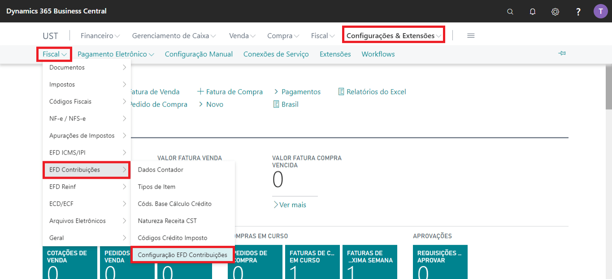

2. Na seção **Geral**, preencha:

| Campo | Descrição |
|-------|-----------|
| **Indicador Natureza Pessoa Jurídica** | Natureza da pessoa jurídica, como **Pessoa jurídica em geral (não participante de SCP como sócia ostensiva)** ou **Sociedade cooperativa (não participante de SCP como sócia ostensiva)** |
| **Tipo Atividade** | Atividade preponderante: **0-Industrial ou equiparado a industrial**, **1-Prestador Serviço**, **2-Atividade de Comércio**, **3-Atividade Financeira**, **4-Atividade Imobiliária** ou **9-Outros** |
| **Versão Layout** | Versão do leiaute da EFD-Contribuições. Confira a versão vigente no manual da obrigação, no site da Receita Federal |
| **Incidência Tributária** | **Não-Cumulativo**, **Cumulativo** ou **Não-Cumulativo e Cumulativo** |
| **Critério de Escrituração do Regime Cumulativo** | **Regime de Caixa** ou **Regime de Competência - Detalhado** |
| **Tipo de Receita do Regime Cumulativo** | Origem da receita no regime cumulativo, como **Documento Fiscal** ou **Cliente** |
| **Código Método Apropriação** | **1 - Método Apropriação Direta** ou **2 - Método de Rateio Proporcional (Receita Bruta)** |
| **Tipo Contribuiçao** | **1 - Apuração Contribuição Aliquota Básica** ou **2 - Apuração Contribuição Alíquotas Especificas** |

3. Na seção **Registros EFD**, marque **Incluir Conta/Centro Custo** para levar a conta contábil e o centro de custo às linhas da EFD e, nesse caso, informe a dimensão usada como centro de custo em **Cód. Dimensão Centro Custo**.

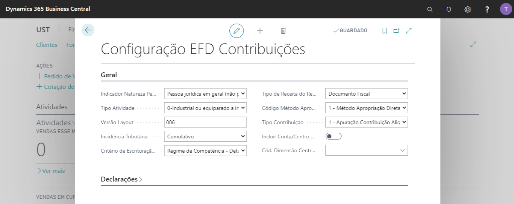

> **Nota**: **Critério de Escrituração do Regime Cumulativo** e **Tipo de Receita do Regime Cumulativo** só ficam habilitados quando a **Incidência Tributária** é **Cumulativo**.

A página tem ainda as seções **Declarações**, **Compensações** e **Reoneração PIS/COFINS**, usadas na declaração e na contabilização do imposto. Elas estão descritas em [Apuração Contábil de PIS/COFINS](Localization-for-Brazil_User-Manual_Apuracao-Contabil-PIS-COFINS.md) e em [EFD Contribuições: Reoneração PIS/COFINS (LC 224/2025)](Localization-for-Brazil_User-Manual_PIS-COFINS-Reoneracao-CST-06.md).

### Dados da empresa e das filiais

Os dados da empresa formam o registro `0000` (abertura e identificação).

1. Pesquise por **Informações da Empresa** e confira nome, endereço, **C.N.P.J.**, inscrição estadual e inscrição municipal.

   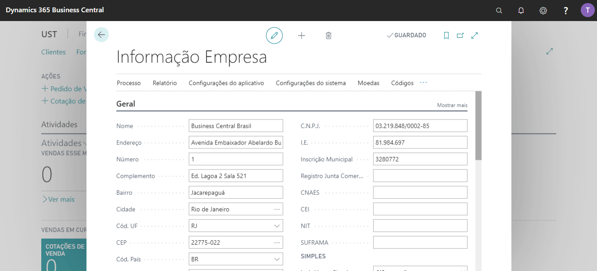

2. Se a empresa tiver filiais, pesquise por **Lista Filiais**, abra o cartão de cada filial e confira os mesmos dados.

> **Nota**: o processamento da apuração exige o **C.N.P.J.** da empresa ou da filial da apuração preenchido.

### Dados do contador

O contador forma o registro `0100`.

1. Pesquise por **Contadores EFD** ou, no Centro de Funções, abra **Configurações** > **Fiscal** > **EFD Contribuições** > **Dados Contador**.
2. Cadastre o contador com CPF, nome, CRC, CNPJ (se houver) e endereço.

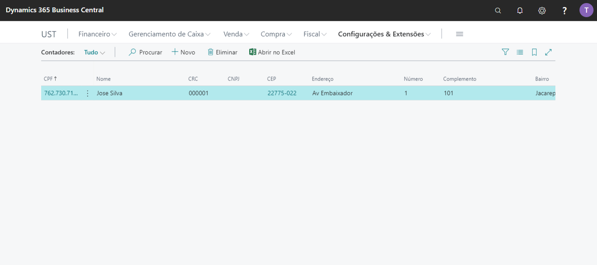

> **Nota**: só entra no registro `0100` o contador com o campo **EFD Contribuições** marcado. A opção **Dados Contador** do menu já abre a lista filtrada por esse campo.

### Plano de contas da ECD

O registro `0500` (plano de contas contábeis) é montado a partir do **Plano de Contas ECD**. Sem ele, as contas não saem no arquivo da EFD-Contribuições.

1. Pesquise por **Plano de Contas ECD** ou, no Centro de Funções, abra **Fiscal** > **Livros Fiscais** > **ECD/ECF** > **Plano de Contas**.
2. Se a lista estiver vazia, clique em **Importar Plano Contas**.

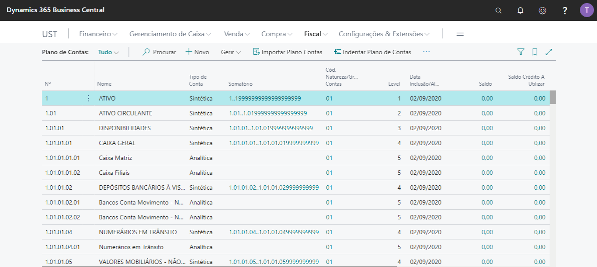

A importação e as regras do plano de contas estão em [ECD: Escrituração Contábil Digital](Localization-for-Brazil_User-Manual_ECD.md).

---

## 4. Criar a apuração

A apuração é criada por filial e por mês. Ela é a mesma **Apuração de Impostos** usada pelas demais apurações fiscais; a página **Apurações de PIS/COFINS** mostra os dados de PIS/COFINS dela.

### Criar as apurações automaticamente

1. Pesquise por **Apurações de PIS/COFINS** ou, no Centro de Funções, abra **Fiscal** > **Livros Fiscais** > **Apurações de PIS/COFINS**.
2. Clique em **Novo** > **Criar Apurações**.

   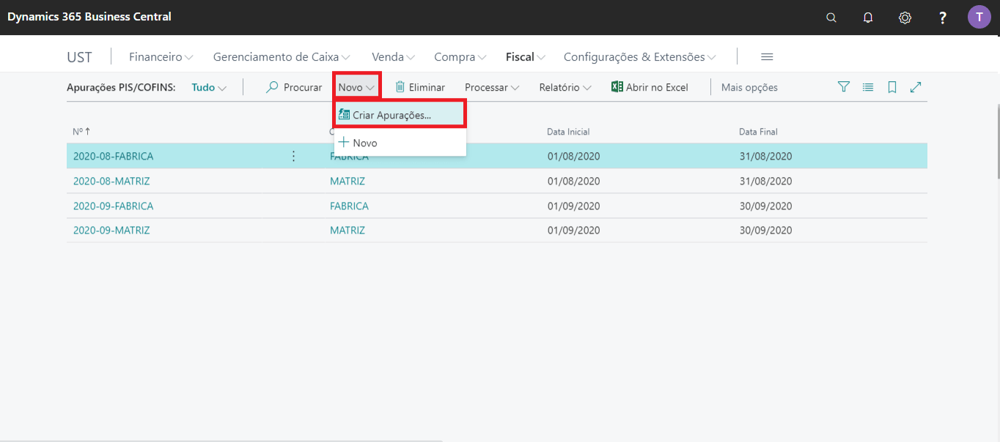

3. Na página **Criar Apurações Imposto**, informe o **Ano** e o **Mês** e clique em **OK**.

   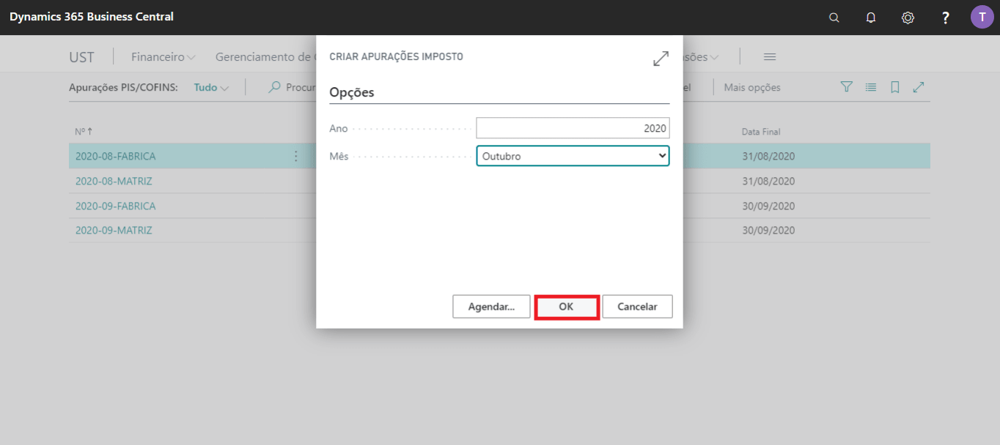

É criada uma apuração para cada filial cadastrada, com o número no formato `AAAA-MM-<filial>` e as datas inicial e final do mês. Sem filiais, é criada uma única apuração `AAAA-MM`. Uma apuração que já existe com esse número não é criada de novo.

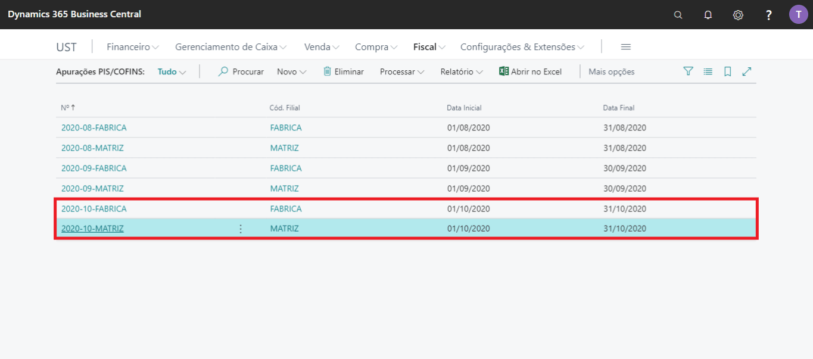

### Criar uma apuração manualmente

1. Na lista **Apurações de PIS/COFINS**, clique em **Novo** > **Novo**.
2. Na seção **Geral** do cartão, preencha:

| Campo | Descrição |
|-------|-----------|
| **Nº** | Código da apuração |
| **Cód. Filial** | Filial da apuração, se houver |
| **Data Inicial** / **Data Final** | Primeiro e último dia do período |
| **Tipo de Arquivo** | **Original** ou **Correção** (arquivo retificador) |
| **Nº Recibo da Escrituração Anterior** | Número do recibo da escrituração que está sendo retificada. Habilitado apenas quando o **Tipo de Arquivo** é **Correção** |
| **Situação Especial** | Preencha somente se for o caso: **Abertura**, **Cisão**, **Fusão**, **Incorporação** ou **Encerramento** |
| **Motivo Sem Dados** | Motivo da entrega do arquivo sem dados de movimento no período, como **Pessoa jurídica inativa** ou **Pessoa jurídica em geral sem operações geradoras de receita/crédito** |

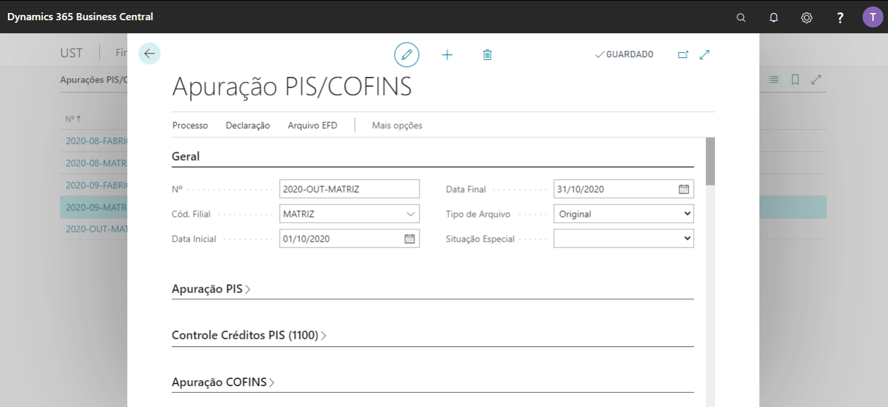

---

## 5. Preencher os registros da apuração

Depois de criar a apuração, abra o cartão **Apuração PIS/COFINS** para incluir ou editar os dados. Para detalhes de preenchimento de cada registro, consulte a versão mais atualizada do Guia Prático da EFD-Contribuições.

### Ajustes de PIS e de COFINS (`M220` e `M620`)

Use os ajustes quando a pessoa jurídica precisar acrescentar ou reduzir valores no período, em decorrência de ação judicial, processo de consulta, legislação tributária, estorno ou outras situações.

1. Na seção **Apuração PIS** (ou **Apuração COFINS**), grupo **Ajustes**, clique no valor do tipo de ajuste desejado: **Acréscimo Contribuição**, **Estorno de Créditos**, **Acréscimo Crédito** ou **Estorno de Débitos**.

   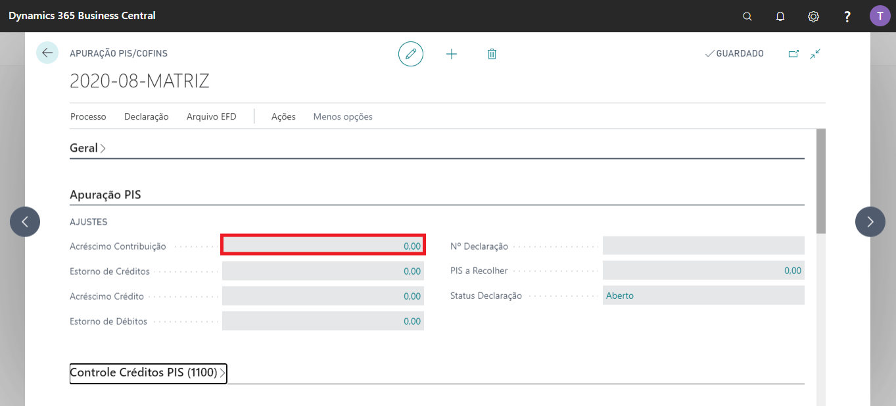

2. Na página **Valores Ajuste Apuração**, inclua uma linha por ajuste:

| Campo | Descrição |
|-------|-----------|
| **Descrição** | Descrição resumida do ajuste |
| **Cód. Ajuste/Info. EFD** | Código do ajuste da apuração |
| **Base Cálculo** | Base de cálculo do ajuste |
| **Alíquota** | Alíquota do ajuste |
| **Valor** | Calculado a partir da **Base Cálculo** e da **Alíquota**. Pode ser informado diretamente |
| **Data Referência** | Data a que o ajuste se refere |
| **Nº Documento** | Número do documento que fundamenta o ajuste, se houver |

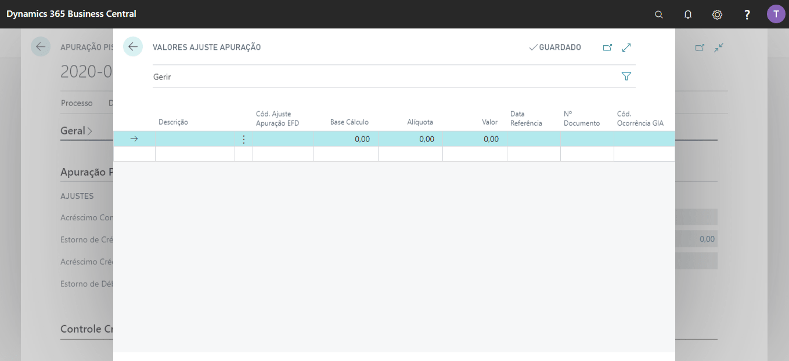

Os ajustes de PIS saem no registro `M220` e os de COFINS no `M620`. **Acréscimo Contribuição** e **Estorno de Créditos** são enviados como ajuste de acréscimo; **Acréscimo Crédito** e **Estorno de Débitos**, como ajuste de redução.

### Controle de créditos fiscais (`1100` e `1500`)

Os registros controlam os saldos de créditos de períodos anteriores e o eventual saldo credor apurado no próprio período. O PIS é informado em **Controle Créditos PIS (1100)** e a COFINS em **Controle Créditos COFINS (1500)**, com os mesmos campos:

| Campo | Descrição |
|-------|-----------|
| **Data Apuração Crédito** | Período de apuração do crédito |
| **Origem Crédito** | **01 - Crédito decorrente de operações próprias** ou **02 - Crédito transferido por pessoa jurídica sucedida** |
| **CNPJ Cedente do Crédito** | CNPJ da pessoa jurídica cedente, quando o crédito foi transferido |
| **Código Crédito** | Código do tipo de crédito |
| Demais colunas | Valores do crédito: **Valor Crédito Período Anterior**, **Crédito Utilizado Mediante Desconto**, **Saldo Crédito Disponível**, **Valor Crédito Descontado**, **Saldo Crédito A Utilizar** e os valores utilizados em pedido de ressarcimento ou declaração de compensação |

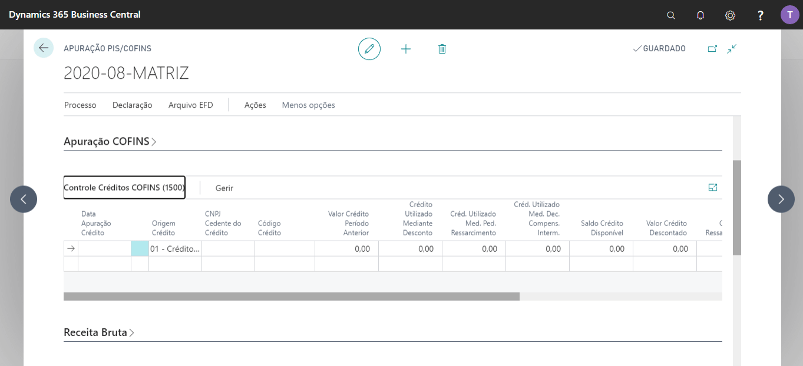

> **Nota**: no regime não cumulativo, o processamento preenche o **Valor Crédito Período Anterior** da linha de origem **01** com o saldo, até o dia anterior ao início da apuração, das contas informadas em **Créditos PIS** / **Retenções de PIS** e **Créditos COFINS** / **Retenções de COFINS** da **Configuração EFD Contribuições**. Sem esses filtros de contas, o valor não é atualizado.

### Receita bruta (`0111`)

A seção **Receita Bruta** é preenchida pelo processamento, com a receita classificada em **Não Cumulativa Trib.**, **Não Cumulativa Não Trib.**, **Não Cumulativa Exportação**, **Cumulativa** e **Receita Total**, conforme a **Incidência Tributária** da configuração.

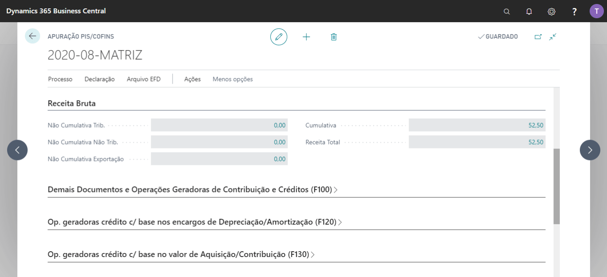

> **Nota**: o registro `0111` só sai no arquivo quando a **Incidência Tributária** não é **Cumulativo** e o **Código Método Apropriação** é **2 - Método de Rateio Proporcional (Receita Bruta)**.

### Demais documentos e operações (`F100`)

No `F100` entram as operações que, pela natureza ou pela documentação, não são escrituradas nos blocos A, C e D: demais receitas auferidas, com ou sem incidência das contribuições, e demais aquisições, despesas, custos e encargos com direito a crédito.

Na seção **Demais Documentos e Operações Geradoras de Contribuição e Créditos (F100)**, preencha:

| Campo | Descrição |
|-------|-----------|
| **Indicador Tipo Operação** | Tipo da operação (veja a tabela abaixo) |
| **Tipo Participante** / **Nº Participante** | Participante da operação |
| **Tipo Item** / **Nº Item** | **Item** ou **Ativo Fixo** da operação |
| **Data da Operação** | Data da operação. Se a operação não se referir a um dia específico ou abranger mais de um dia, informe o dia final de referência ou o último dia da escrituração |
| **Valor Operação** | Valor da operação |
| **Cód. CST PIS** / **Cód. Nat. Receita PIS** | CST e natureza da receita de PIS |
| **Valor Base PIS**, **% PIS**, **Valor PIS** | Base, percentual e valor do PIS |
| **Cód. CST Cofins** / **Cód. Nat. Receita COFINS** | CST e natureza da receita de COFINS |
| **Valor Base Cofins**, **% Cofins**, **Valor Cofins** | Base, percentual e valor da COFINS |
| **Cód. Natureza Base Crédito** | Natureza da base de cálculo do crédito, nas operações com crédito |
| **Indicador Origem Crédito** | **0-Operação Mercado Interno** ou **1-Operação de Importação** |
| **Cód. Conta Analítica Contábil** | Conta contábil da operação |
| **Cód. Centro Custo** | Centro de custo, se for o caso |
| **Descrição Operação** | Descrição da operação |

Relação entre o **Indicador Tipo Operação** e o CST:

| Indicador Tipo Operação | CSTs |
|-------------------------|------|
| **0** - aquisição de custos, despesas ou encargos sujeita a crédito | 50 a 56 ou 60 a 66 |
| **1** - receita auferida sujeita ao pagamento da contribuição | 01, 02, 03 ou 05 |
| **2** - receita auferida não sujeita ao pagamento da contribuição | 04, 06, 07, 08, 09, 49 ou 99 |

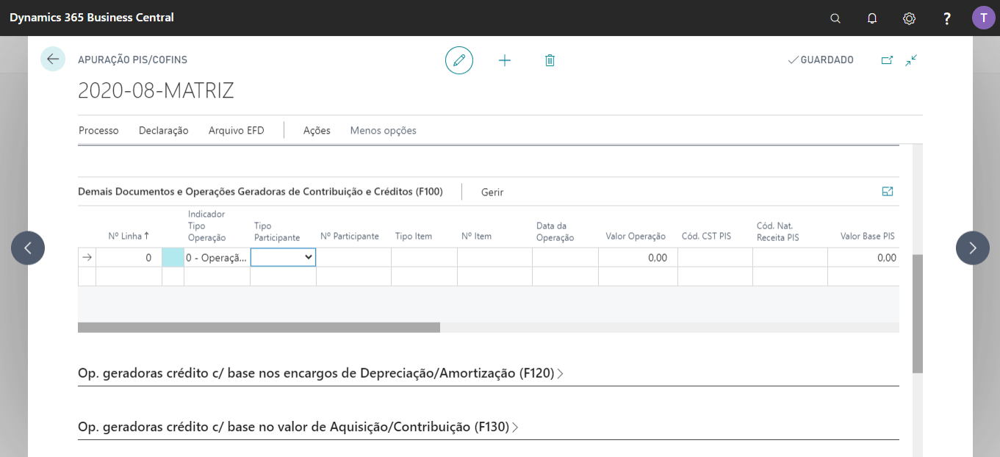

> **Nota**: o processamento também cria linhas de `F100`, por exemplo a partir de frete, seguro e outras despesas quando **Criar F100 de Frete/Seguro/Outras Despesas** está marcado na configuração. Essas linhas têm o campo **Lançamento Automático** marcado: não podem ser editadas nem excluídas e são recriadas a cada processamento. As linhas incluídas manualmente são mantidas.

### Crédito sobre encargos de depreciação e amortização (`F120`)

Registro dos créditos calculados sobre os encargos de depreciação de bens do ativo imobilizado usados na produção de bens destinados à venda ou na prestação de serviços, e sobre os encargos de amortização de edificações e benfeitorias em imóveis próprios ou de terceiros.

> **Importante**: bens cujo crédito foi calculado sobre o valor de aquisição (registro `F130`) não devem ser escriturados no `F120`.

Na seção **Op. geradoras crédito c/ base nos encargos de Depreciação/Amortização (F120)**, preencha **Cód. Base Cálculo Crédito**, **Identificação dos Bens**, **Ident. da Origem de Crédito**, **Ident. da Utilização dos Bens**, **Valor Depreciação**, **Parcela da Operação sem Crédito**, os CSTs, bases, alíquotas e valores de PIS e de COFINS, **Descrição do Bem**, **Nº Conta Contábil** e, se necessário, **Cód. Centro Custo**.

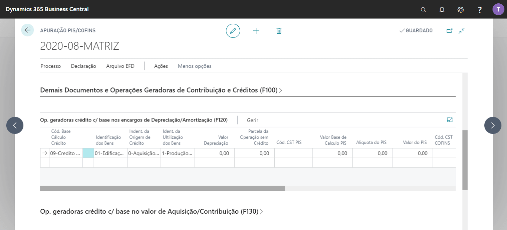

> **Nota**: quando o ativo fixo tem **Código de Crédito de Depreciação**, o processamento gera as linhas de `F120` a partir dos movimentos de crédito do ativo, com **Lançamento Automático** marcado. A configuração está em [Apuração Contábil de PIS/COFINS](Localization-for-Brazil_User-Manual_Apuracao-Contabil-PIS-COFINS.md), seção *Configuração de Crédito de Ativo Fixo*, e a escolha do livro de depreciação em [EFD Contribuições: Crédito de PIS/COFINS sobre Deprec./Amortiz.](Localization-for-Brazil_User-Manual_EFD-Credito-PIS-COFINS-Livro-Depreciacao.md).

### Crédito sobre o valor de aquisição (`F130`)

Registro dos créditos calculados sobre o valor de aquisição de bens do ativo imobilizado usados na produção de bens destinados à venda ou na prestação de serviços.

> **Importante**: bens cujo crédito foi calculado sobre os encargos de depreciação ou amortização (registro `F120`) não devem ser escriturados no `F130`.

Na seção **Op. geradoras crédito c/ base no valor de Aquisição/Contribuição (F130)**, preencha **Identificação dos Bens**, **Origem do Credito**, **Utilização dos Bens**, **Data Aquisição**, **Valor Aquisição**, **Base Isenta**, **Nº Parcelas** (número de parcelas mensais em que o crédito é apropriado), os CSTs, bases, percentuais e valores de PIS e de COFINS, **Descrição do Bem**, **Nº Conta Contábil** e, se necessário, **Cód. Centro Custo**.

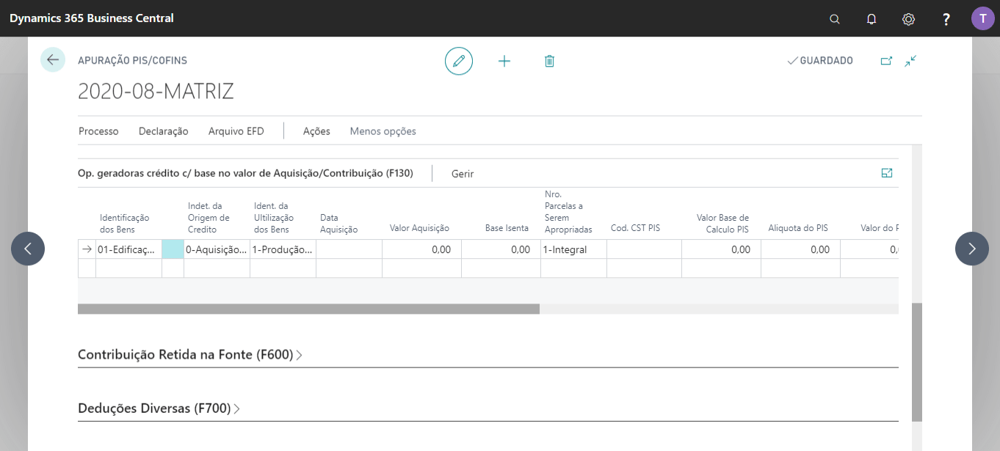

> **Nota**: quando o ativo fixo tem **Código de Crédito de Aquisição**, o processamento gera as linhas de `F130` com a parcela do mês, com **Lançamento Automático** marcado.

### Contribuição retida na fonte (`F600`)

Valores de PIS/PASEP e de COFINS retidos na fonte, informados pela pessoa jurídica beneficiária da retenção. Na seção **Contribuição Retida na Fonte (F600)**, preencha:

| Campo | Descrição |
|-------|-----------|
| **Natureza Retenção** | Natureza da retenção na fonte |
| **Data Retenção** | Data da retenção. Se houver mais de uma retenção no período, ou se a data for desconhecida, informe a data final da escrituração |
| **CNPJ** | CNPJ da fonte pagadora |
| **Valor Base** / **Valor Retenção** | Base e valor total da retenção da operação (PIS + COFINS + CSLL + IR) |
| **Cód. Receita Tributo** | Código de receita do tributo |
| **Natureza Receita** | Natureza da receita |
| **Valor PIS** / **Valor COFINS** | Parcelas de PIS e de COFINS retidas |
| **Condição Declarante** | Condição da pessoa jurídica declarante na operação |

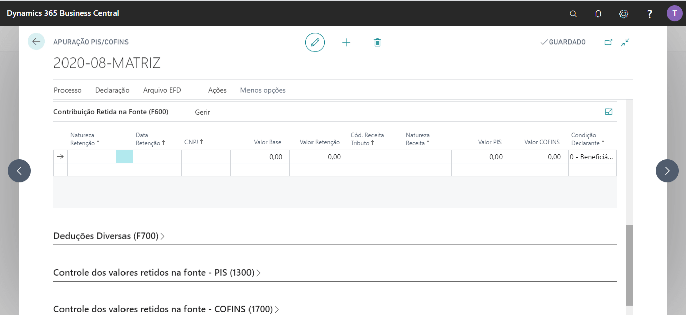

### Deduções diversas (`F700`)

Deduções previstas na legislação, inclusive créditos que não sejam específicos do regime não cumulativo, abatidas da contribuição a recolher nos registros `M200` (PIS) e `M600` (COFINS). Na seção **Deduções Diversas (F700)**, preencha **Origem Dedução**, **Natureza Dedução**, **Tipo Dedução Rateio Receita**, **Valor PIS**, **Valor COFINS**, **Valor Base**, o **CNPJ** da pessoa jurídica relacionada à operação e, se necessário, **Info. Complementares**.

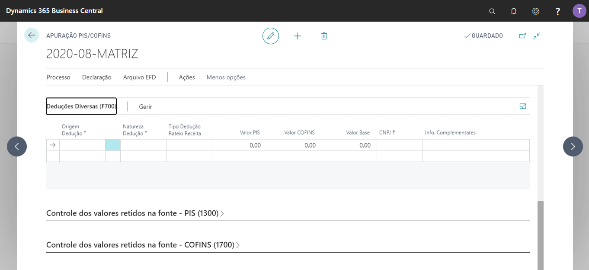

### Controle dos valores retidos na fonte (`1300` e `1700`)

Os registros controlam os saldos de valores retidos na fonte em períodos anteriores, que podem ser deduzidos da contribuição devida. O PIS é informado em **Controle dos valores retidos na fonte - PIS (1300)** e a COFINS em **Controle dos valores retidos na fonte - COFINS (1700)**:

| Campo | Descrição |
|-------|-----------|
| **Indicador Nat. Ret.** (PIS) / **Natureza da Retenção** (COFINS) | Natureza da retenção na fonte |
| **Período Retenção** | Período da retenção |
| **Valor Total da Retenção** | Valor total da retenção efetivamente sofrida, para a natureza informada |
| **Valor Dedução Contrib.** | Valor deduzido da contribuição devida, acumulado: o valor descontado no período atual somado aos deduzidos em períodos anteriores |
| **Valor da Ret. no Periodo de Restit.** | Valor utilizado em pedido de restituição, também acumulado |
| **Valor da Ret. Mediante Declaração de Compensação** | Valor utilizado em declaração de compensação, também acumulado |
| **Saldo Retenção** | Saldo a utilizar em períodos futuros |

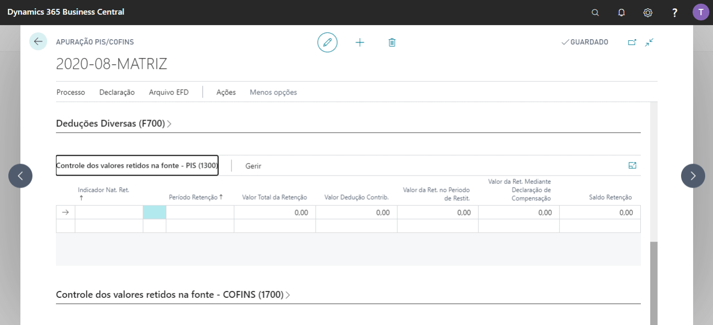

### Sugerir os valores de retenção

Os registros `F600`, `1300` e `1700` podem ser preenchidos automaticamente:

1. No cartão, clique em **Processo** > **Sugerir Valores Retenções**.

   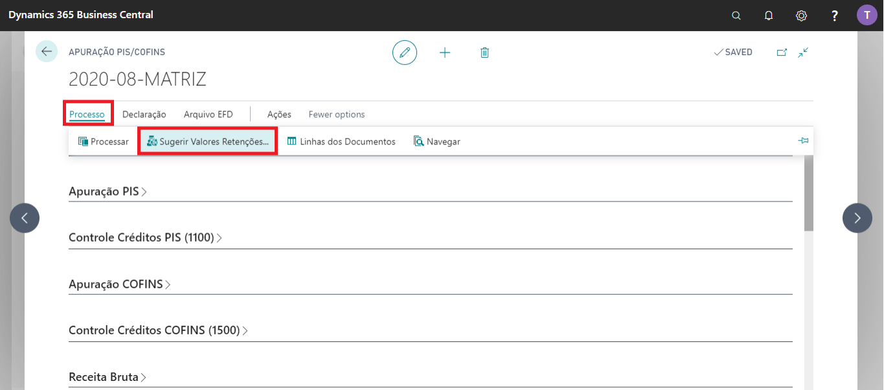

2. Confirme a mensagem.

   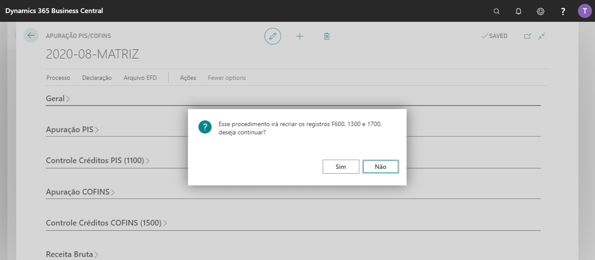

> **Nota**: a ação apaga e recria os registros `F600`, `1300` e `1700` da apuração. Valores digitados manualmente nesses registros são perdidos.

---

## 6. Processar e exportar o arquivo

1. No cartão **Apuração PIS/COFINS**, clique em **Processo** > **Processar**.

   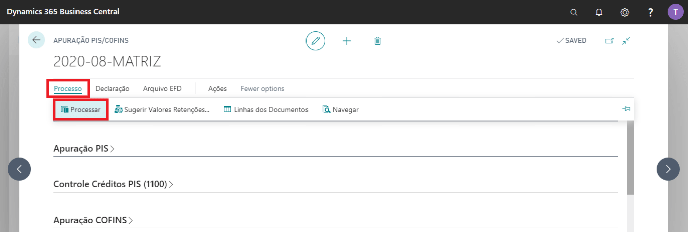

2. Ao final, é exibida a mensagem **Apuração &lt;nº&gt; processada com sucesso.**

   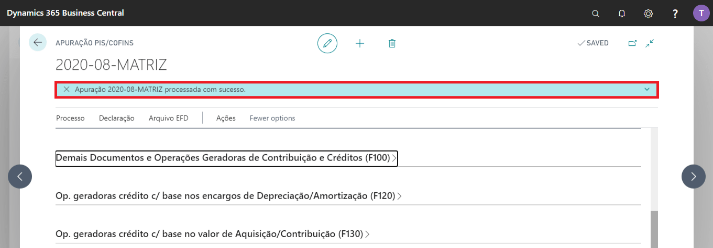

3. Revise os registros e preencha manualmente o que for necessário (seção [5](#5-preencher-os-registros-da-apuração)). A ação **Linhas dos Documentos** mostra as linhas de documento que compõem a apuração.
4. Clique em **Processo** > **Exportar**. É gerado um arquivo TXT para importação no PVA EFD-Contribuições.

Se corrigir documentos do período, processe de novo antes de exportar. As ações **Processar** e **Exportar** também estão disponíveis na lista **Apurações de PIS/COFINS**.

---

## 7. Consolidar as filiais

Com filiais cadastradas, as apurações da matriz e das filiais são consolidadas em um único arquivo.

1. Pesquise por **Consolidações EFD Contribuições** ou, no Centro de Funções, abra **Fiscal** > **Livros Fiscais** > **EFD Contribuições** > **Consolidações**.

   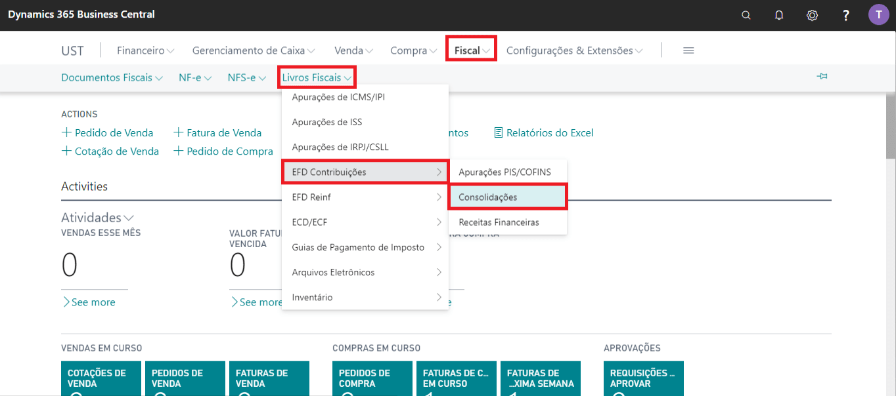

2. Clique em **Novo**.

   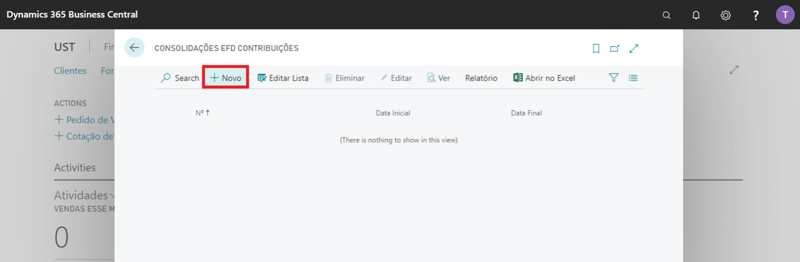

3. No cartão **EFD Contribuições Consolidado**, preencha:
   - **Nº**: código da consolidação;
   - **Data Inicial** e **Data Final** da apuração;
   - **Tipo de Arquivo**;
   - **Situação Especial**, se for o caso.
4. Na seção **Empresas**, inclua uma linha para cada apuração da matriz e das filiais, selecionando-a em **Nº Apuração Impostos**, e mantenha **Ativo** marcado.

   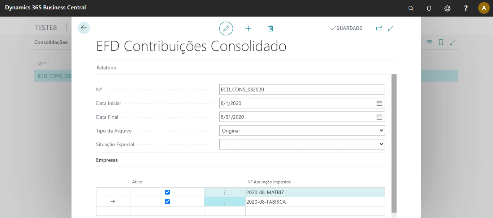

5. Clique em **Processo** > **Exportar EFD Contribuições**. É gerado um arquivo TXT para importação no PVA EFD-Contribuições.

A ação **Abrir Apuração** da seção **Empresas** abre o cartão da apuração da linha selecionada.
