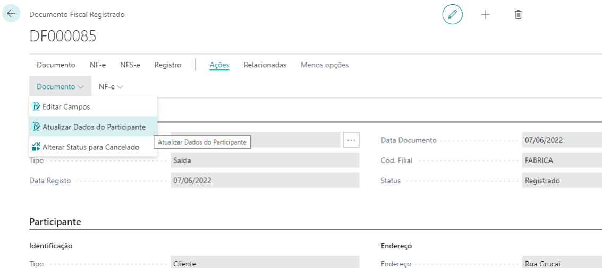
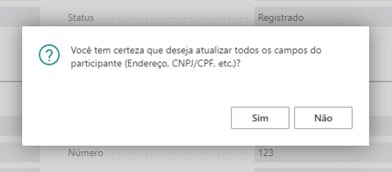
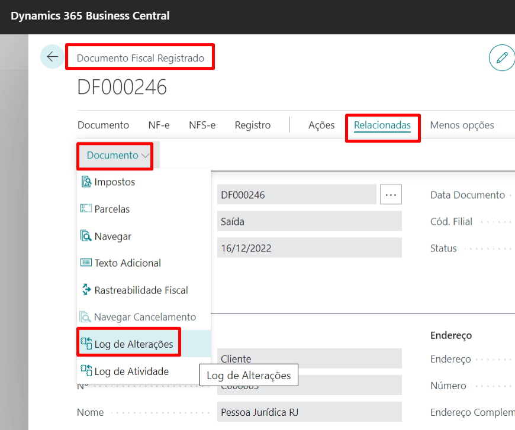
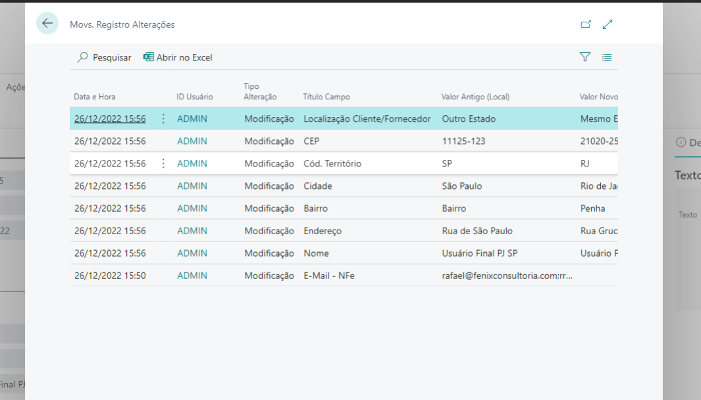

# Documento Fiscal: Atualizar Dados do Participante

**Data**: Dezembro/2022

---

## Sumário

O documento fiscal guarda uma cópia dos dados do participante (cliente, fornecedor ou filial) do momento em que foi gerado: nome, endereço, CNPJ/CPF, inscrições e indicadores fiscais. Quando o cadastro do participante é corrigido depois do registro, a ação **Atualizar Dados do Participante** copia de novo esses dados do cadastro atual para o **Documento Fiscal Registrado**, e cada campo alterado fica registrado no log de alterações do documento.

## 1. Contexto

### O que é atualizado

A ação lê o cadastro atual do participante do documento e reescreve no documento fiscal:

- nome, endereço, número, complemento, bairro, cidade, **Cód. Território**, CEP e país;
- categoria, CNPJ/CPF, inscrição estadual, inscrição municipal (CCM) e NIF;
- e-mail de envio da NF-e;
- indicadores fiscais, como não contribuinte do ICMS, consumidor final, optante do Simples, Suframa e tipo de entidade governamental;
- forma de envio e transportadora;
- **Localização Cliente/Fornecedor**, recalculada a partir do novo endereço.

### Quando se aplica

Use a ação quando o documento foi registrado com dados do participante que estavam errados ou desatualizados no cadastro, por exemplo para que a escrituração fiscal saia com o endereço ou a inscrição corretos. Corrija primeiro o cartão do cliente, do fornecedor ou da filial, e depois atualize o documento.

Para alterar outros campos do documento registrado, use a ação **Editar Campos**, descrita em [Editar Campos do Documento Fiscal Registrado](Localization-for-Brazil_User-Manual_Editar-Campos-Documento-Fiscal-Registrado.md).

---

## 2. Atualizar os dados do participante

1. Pesquise por **Documentos Fiscais Registrados** ou, no Centro de Funções, abra **Vendas** > **Documentos Fiscais Registrados** ou **Compras** > **Documentos Fiscais Registrados**.
2. Abra o documento desejado e escolha **Ações** > **Documento** > **Atualizar Dados do Participante**.

   

3. Confirme a mensagem *Você tem certeza que deseja atualizar todos os campos do participante (Endereço, CNPJ/CPF, etc.)?*.

   

Ao final, o sistema exibe a mensagem *Campos do participante atualizados com sucesso.*

> **Nota**: a ação fica desabilitada quando o documento é uma NF-e de emissão própria já autorizada pela SEFAZ. O XML autorizado não pode mais ser alterado, e os dados do documento precisam continuar iguais aos da nota transmitida.

> **Nota**: a mesma ação existe no **Documento Fiscal de Compra**, antes do registro, e lá atualiza os dados a partir do cadastro do fornecedor.

---

## 3. Conferir o que foi alterado

1. No **Documento Fiscal Registrado**, escolha **Relacionadas** > **Documento** > **Log de Alterações**.

   

2. A página **Movs. Registro Alterações** lista cada campo alterado, com a data e hora, o usuário, o valor antigo e o valor novo.

   
