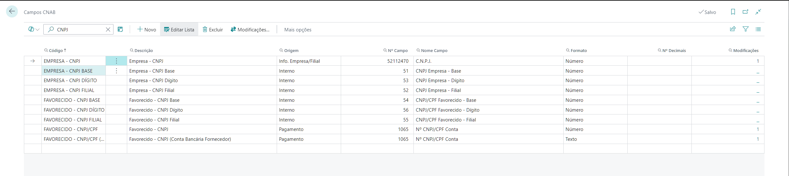
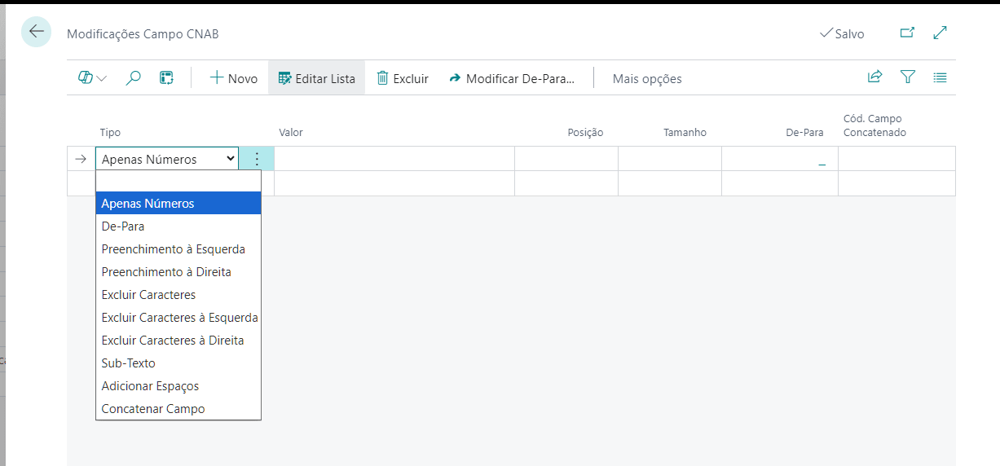
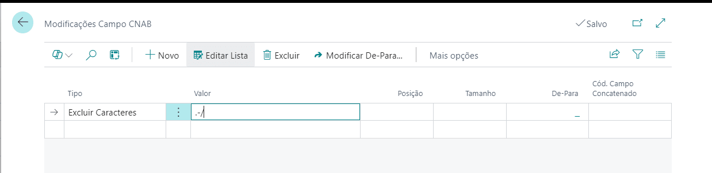

<!-- Commits: 6cff47cd, eac72995, 89ffe3e6 -->
# CNPJ Alfanumérico

**Data**: Abril/2026

---

## Sumário

A partir de **julho de 2026**, a Receita Federal passará a emitir CNPJs contendo letras (A-Z) além de dígitos nos 12 primeiros caracteres. A Localização para o Brasil foi adaptada para validar, formatar, armazenar e transmitir CNPJs no novo formato, com total retrocompatibilidade com os CNPJs numéricos já existentes. Não há configuração adicional. A atualização é transparente para o usuário.

---

## 1. Contexto

### O que é

Desde 1965 o CNPJ utiliza 14 caracteres numéricos. Com o esgotamento da numeração previsto para os próximos anos, a Receita Federal definiu um novo formato no qual os **12 primeiros caracteres** passam a poder conter letras maiúsculas (A-Z) além de dígitos (0-9). Os **2 últimos caracteres** (dígitos verificadores) permanecem sempre numéricos.

### Quando se aplica

- **A partir de julho de 2026**: novos CNPJs poderão ser emitidos em formato alfanumérico.
- **CNPJs existentes**: permanecem válidos e inalterados, e continuam sendo processados normalmente pelo sistema.

### Base legal

- Instrução Normativa RFB nº 2.229/2024
- Nota Técnica da Receita Federal publicada em `www.gov.br/receitafederal`

---

## 2. O Novo Formato do CNPJ

### Estrutura

| Posição | Conteúdo | Exemplo antigo | Exemplo novo |
|---------|----------|----------------|--------------|
| 1 a 8 | Raiz do CNPJ (identifica a pessoa jurídica), alfanumérica | `23.455.314` | `AN.RLD.H7M` |
| 9 a 12 | Ordem do estabelecimento (matriz/filial), alfanumérica | `0001` | `VGMH` |
| 13 a 14 | Dígitos verificadores, sempre numéricos | `84` | `86` |

### Máscara

A máscara visual permanece inalterada: `AA.AAA.AAA/AAAA-DD`. Sem máscara, o CNPJ continua com 14 caracteres.

Exemplos válidos:

- Numérico tradicional: `23.455.314/0001-84`
- Misto (raiz numérica, filial alfanumérica): `0K.0S6.0T3/M8NX-91`
- Totalmente alfanumérico: `AN.RLD.H7M/VGMH-00`

### Novo algoritmo de dígito verificador

O cálculo dos dois dígitos verificadores foi adaptado. Em vez de tratar cada caractere como valor numérico, o novo algoritmo utiliza o **valor ASCII do caractere menos 48**, de modo que '0' a '9' produzem 0 a 9 (igual ao método anterior) e 'A' a 'Z' produzem 17 a 42. Os pesos e a operação módulo 11 permanecem os mesmos.

Esse detalhe matemático é transparente para o usuário. O sistema valida automaticamente qualquer CNPJ informado.

---

## 3. Retrocompatibilidade

O novo algoritmo de validação é 100% retrocompatível com CNPJs numéricos. Nenhuma ação é necessária sobre cadastros existentes:

- Clientes, fornecedores e contatos com CNPJ numérico continuam sendo processados normalmente
- Documentos fiscais (NF-e, NFS-e, CT-e) já emitidos permanecem íntegros
- Arquivos SPED e CNAB gerados anteriormente continuam válidos
- Integrações com SEFAZ, bancos e sistemas externos não exigem reconfiguração

A diferença é que, a partir do momento em que um CNPJ alfanumérico for cadastrado, o sistema o reconhecerá como válido, em vez de rejeitá-lo por conter letras.

---

## 4. Módulos Afetados

O suporte ao CNPJ alfanumérico abrange toda a cadeia de processamento fiscal e financeiro:

### Fiscal e NF-e

- **Validação de CNPJ** em todos os cadastros (Cliente, Fornecedor, Informações da Empresa, Filial)
- **NF-e**: a geração do XML preserva letras nos campos CNPJ do emitente, destinatário e demais participantes
- **NFS-e**: transmissão web service e geração de arquivos com CNPJ alfanumérico
- **MD-e / Manifesto do Destinatário**: consultas e manifestações aceitam CNPJ alfanumérico
- **FCI (Ficha de Conteúdo de Importação)**: CNPJ do emitente no nome do arquivo
- **Leitor de XML de NF-e** (entrada de mercadorias): interpretação correta do CNPJ alfanumérico no XML recebido

### Livros Fiscais (SPED)

- **EFD-ICMS/IPI**: registros 0000, 0005, 0150 e demais que referenciam CNPJ de participantes
- **EFD-Contribuições (PIS/COFINS)**: registros de identificação e participantes
- **EFD-Reinf**: todos os eventos (R-1000, R-2010, R-2020, R-2030, R-2040, R-2055, R-2060, R-2098, R-2099, R-4010, R-4020, R-4040, R-4080, R-9000) com identificação de contribuinte, beneficiário ou tomador/prestador
- **ECD**: registros de participantes, relacionamentos e o registro J935
- **ECF**: identificação de sócios, associadas e pessoas vinculadas
- **DIRF**: identificação de declarante e beneficiários (Pessoa Física e Pessoa Jurídica)
- **DCTF / DCTFWeb**: CPF do responsável e CNPJ do estabelecimento
- **GIA-SP**: CNPJ da empresa
- **CIAP**: validação de CNPJ da empresa no cabeçalho do arquivo

### Integrações

- **Consulta CNPJ** (integração com serviço externo da Receita): aceita entrada alfanumérica

---

## 5. O que Muda para o Usuário

### Cadastros

Ao cadastrar um **Cliente**, um **Fornecedor** ou a **Informação da Empresa**, o campo **CNPJ** agora aceita letras. A validação é feita automaticamente ao sair do campo. Se o CNPJ for inválido (dígito verificador incorreto, comprimento errado ou caractere inválido nas posições dos DVs), o sistema exibe a mensagem de erro usual.

### Diferenciação CPF x CNPJ

O sistema continua identificando automaticamente se o documento informado é CPF (11 dígitos numéricos, sem letras) ou CNPJ (14 caracteres alfanuméricos). A regra é a mesma da versão anterior, baseada no comprimento do documento após a remoção da máscara.

### Máscara e formatação

A apresentação visual do CNPJ na máscara `AA.AAA.AAA/AAAA-DD` é preservada em todas as páginas, relatórios e documentos impressos (DANFe, DANFSE, boletos, comprovantes).

### Raiz do CNPJ

Funcionalidades que utilizam a **raiz do CNPJ** (8 primeiros caracteres) para agrupar ou comparar empresas, como o filtro de **Análise Crítica de Fornecedores** ou o agrupamento de filiais, funcionam de forma equivalente para raízes alfanuméricas. Por exemplo, todas as filiais de um fornecedor com raiz `AN.RLD.H7M` serão agrupadas corretamente.

---

## 6. Pontos de Atenção

### Layouts bancários (CNAB)

Os layouts atuais do FEBRABAN ainda especificam o campo CNPJ como **numérico** (formato `PIC 9(14)`). À medida que cada banco publicar a atualização oficial de seu layout para aceitar o formato alfanumérico, a Fênix disponibilizará os ajustes específicos por banco. Até lá:

- CNPJs numéricos continuam sendo exportados normalmente, com preenchimento de zeros à esquerda
- Se um CNPJ alfanumérico for exportado em um layout que ainda espera numérico, o banco poderá rejeitar o arquivo. Confirme junto a cada banco a compatibilidade antes de transmitir arquivos de clientes ou fornecedores com CNPJ alfanumérico

### Ajuste em Campos CNAB com Formato "Número"

Em instalações existentes, é comum que os **Campos CNAB** relacionados a CNPJ e CPF estejam configurados com o **Formato** = **Número**. Esse formato preenche o valor com zeros à esquerda e, se exceder o comprimento configurado, trunca os caracteres pela esquerda. É um comportamento adequado para CNPJs numéricos, mas que descaracteriza um CNPJ alfanumérico: letras e dígitos são tratados como número, e o preenchimento com zeros gera um valor inválido.

Para preservar as letras, altere o **Formato** dos Campos CNAB de CNPJ/CPF para um formato textual:

- **Texto à Direita**: alinha o valor à direita e preenche com espaços à esquerda. É o equivalente alfanumérico mais próximo do comportamento de **Número**, que alinha à direita com zeros à esquerda. Recomendado quando o layout do banco espera o documento alinhado à direita.
- **Texto**: alinha o valor à esquerda e preenche com espaços à direita. Use quando o layout do banco espera o documento alinhado à esquerda.

A escolha entre **Texto** e **Texto à Direita** depende da especificação de cada banco. Consulte o manual técnico do layout CNAB correspondente antes de optar.

**Passo a passo:**

1. Navegue até **Campos CNAB** (página `CNABFields`) e filtre pela descrição `CNPJ`

2. Identifique as linhas com **Formato** = **Número** (ex.: `EMPRESA - CNPJ`, `FAVORECIDO - CNPJ/CPF`)

3. Para cada uma, altere o campo **Formato** para **Texto à Direita** (ou **Texto**, conforme o layout do banco)

4. Saia do campo para confirmar. Repita o processo para todos os Campos CNAB de CNPJ/CPF com Formato numérico

> **Importante**: assim como o ajuste de modificações descrito a seguir, essa alteração é recomendada assim que a atualização da Localização for instalada, antes de qualquer CNPJ alfanumérico ser cadastrado. CNPJs numéricos continuam sendo exportados com preenchimento de zeros à esquerda, agora interpretados como texto, desde que o comprimento configurado seja compatível.

### Ajuste em Campos CNAB com modificação "Apenas Números"

Em instalações existentes, é comum que os **Campos CNAB** relacionados a CNPJ e CPF possuam uma modificação do tipo **Apenas Números** para eliminar a máscara antes da exportação. Essa modificação descarta todos os caracteres não numéricos, inclusive as letras de um CNPJ alfanumérico.

Para preservar as letras e continuar removendo apenas os caracteres de máscara, substitua **Apenas Números** por **Excluir Caracteres** com os caracteres `.-/`:

**Passo a passo:**

1. Navegue até **Campos CNAB** (página `CNABFields`) e filtre pela descrição `CNPJ`

   

2. Identifique as linhas em que a coluna **Modificações** é maior que zero (ex.: `EMPRESA - CNPJ`, `FAVORECIDO - CNPJ/CPF`) e clique na ação **Modificações...** para abri-las

3. Para cada modificação do tipo **Apenas Números**, altere o campo **Tipo** para **Excluir Caracteres**

   

4. No campo **Valor**, informe os caracteres a serem removidos: `.-/`

   

5. Saia do campo para confirmar. Repita o processo para todos os Campos CNAB de CNPJ/CPF com modificações

Com essa alteração, os CNPJs numéricos continuam sendo exportados sem a máscara (como antes), e os CNPJs alfanuméricos passam a ter apenas os caracteres `.`, `-` e `/` removidos, preservando as letras.

> **Importante**: essa ação é recomendada assim que a atualização da Localização for instalada, mesmo antes de qualquer CNPJ alfanumérico ser emitido. Assim, quando o primeiro CNPJ alfanumérico for cadastrado, as exportações CNAB já estarão preparadas.

### API do Banco do Brasil

A integração via API do Banco do Brasil (pagamentos e recebimentos) passou a enviar o CNPJ como **texto**. A confirmação final depende da atualização da documentação oficial da API do BB para aceitar CNPJ alfanumérico. Monitore a publicação oficial antes de enviar ordens com beneficiários alfanuméricos.

### Schemas XML (SEFAZ)

Os schemas XSD da SEFAZ para NF-e, NFS-e, CT-e e eventos serão atualizados pelo Fisco. A atualização da Localização garante que, tão logo os novos schemas entrem em vigor, o XML gerado preservará as letras corretamente. Até a publicação oficial, transmissões com CNPJ alfanumérico poderão ser rejeitadas pela SEFAZ com erro de validação de schema.

### Retenção de informações

Todos os campos CNPJ/CPF na Localização já são armazenados como texto de até 20 caracteres. Não há necessidade de conversão de dados ou migração de cadastros existentes.

---
