# Documento Fiscal: Cancelamento Automático e Manual de Documentos Fiscais

**Data**: Março/2021

---

## Sumário

O documento fiscal de uma fatura ou nota de crédito registrada pode ser cancelado de duas formas. No cancelamento automático, as ações **Corrigir**, **Cancelar** e **Criar Nota de Crédito Corretiva** da fatura, ou **Cancelar** da nota de crédito, estornam os movimentos e mudam o status do documento fiscal. No cancelamento manual, a ação **Alterar Status para Cancelado** muda só o status do documento fiscal, sem nenhum lançamento. Este manual apresenta as duas formas para compras e vendas.

## 1. Contexto

### Cancelamento automático

As ações de cancelamento das faturas e notas de crédito registradas registram um documento de estorno (nota de crédito ou fatura), estornam os movimentos financeiros e contábeis e mudam o **Status** do documento fiscal de forma automática. Esta é a forma indicada para desfazer um documento registrado.

### Cancelamento manual

A ação **Alterar Status para Cancelado** cancela apenas a parte fiscal de um documento registrado: o documento passa a constar como cancelado nos livros fiscais, sem nenhum lançamento contábil. Ela é usada quando não é possível registrar uma nota de crédito, por exemplo quando o período contábil já está fechado e não aceita mais lançamentos. Analise o cenário antes de usá-la, porque os movimentos financeiros e contábeis continuam em aberto.

> **Nota**: a alteração manual grava o documento fiscal, por isso o usuário precisa de permissão de modificação nos documentos fiscais, como a dos conjuntos de permissões **BR - Fiscal** ou **BR - Documento Fiscal**. Os conjuntos **BR - Vendas** e **BR - Compras** dão apenas leitura dos documentos fiscais.

---

## 2. Configuração

O cancelamento automático depende de um tipo de documento fiscal de cancelamento, atribuído aos documentos de estorno.

1. Pesquise por **Tipos Documento Fiscal** ou, no Centro de Funções, abra **Configurações** > **Fiscal** > **Documentos** > **Tipos Documento Fiscal**.
2. Marque o campo **Cancelamento** no tipo de documento fiscal usado para os cancelamentos, por exemplo **NC**.

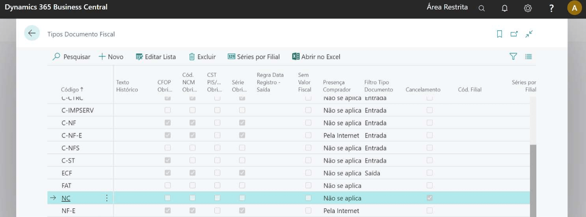

> **Nota**: apenas um tipo de documento fiscal pode ter o campo **Cancelamento** marcado. Ao marcá-lo, o tipo passa a ter **Emitente Documento** = **Sem Valor Fiscal**.

---

## 3. Cancelamento manual de um documento de compra

1. Pesquise por **Documentos Fiscais de Compra Registrados** ou, no Centro de Funções, abra **Compras** > **Documentos Fiscais Registrados**, e selecione o documento.

   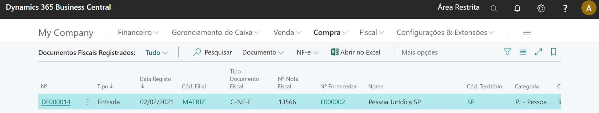

2. Abra o documento e confira o **Status** atual.

   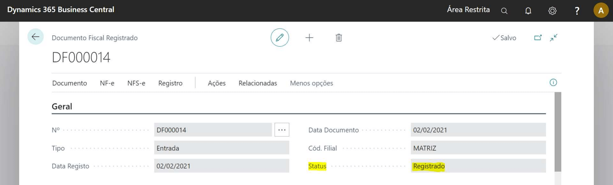

3. Clique em **Ações** > **Documento** > **Alterar Status para Cancelado**.

   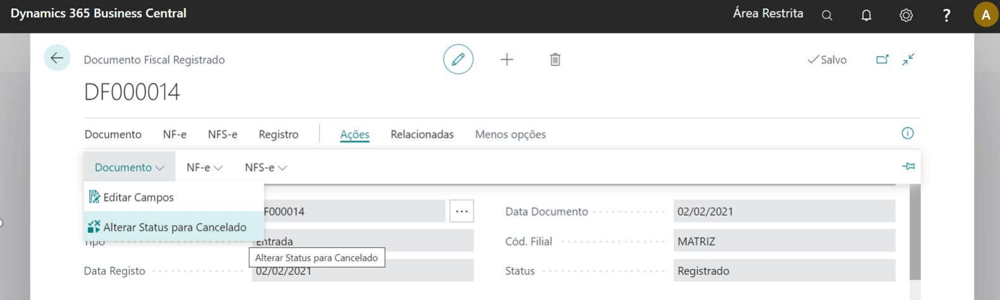

4. Na janela **Alterar Status do Documento Fiscal**, informe o motivo em **Observações**, campo obrigatório que aceita textos longos, e clique em **OK**.

   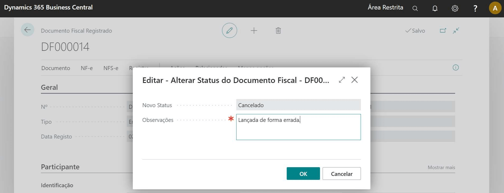

5. O **Status** passa a **Cancelado**, e a notificação *"Status alterado para Cancelado"* é exibida no topo da página.

   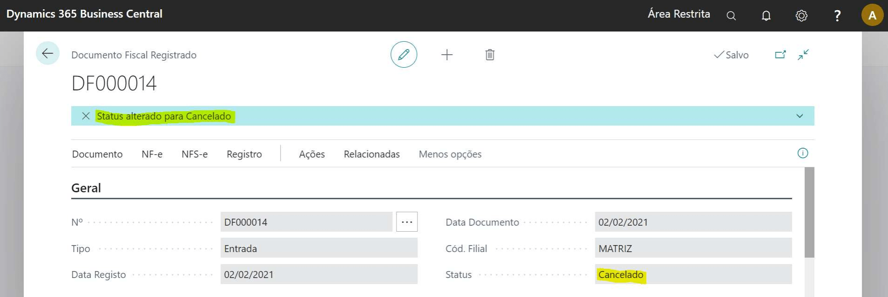

Da mesma forma, **Ações** > **Documento** > **Alterar Status para Registrado** devolve o documento ao status **Registrado**.

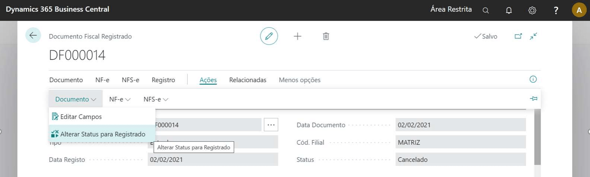

### Movimentos financeiros e contábeis

A alteração manual de status não estorna o documento no financeiro nem na contabilidade.

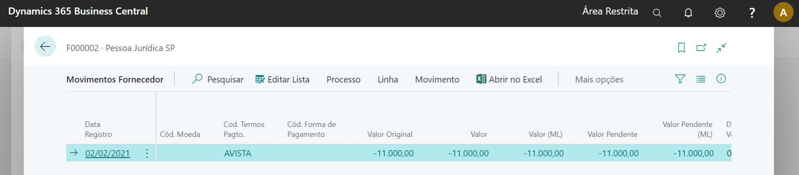

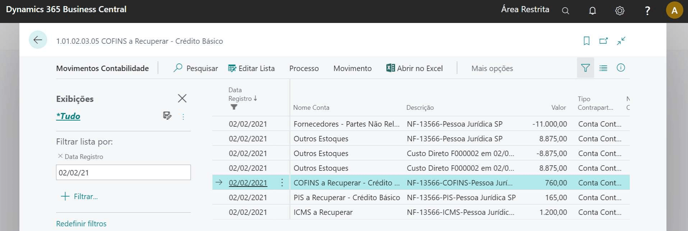

### Log de alterações e log de atividade

Toda alteração de status fica registrada, mesmo que o log de alterações do Business Central não esteja ativado. No documento fiscal, use **Relacionadas** > **Log de Alterações** ou **Relacionadas** > **Log de Atividade**.

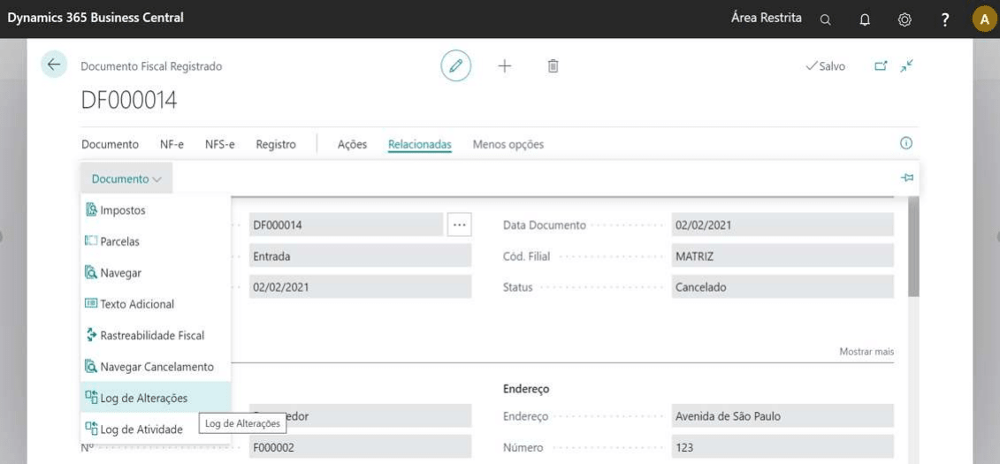

O **Log de Alterações** mostra cada alteração do **Status**, com o valor antigo e o novo.

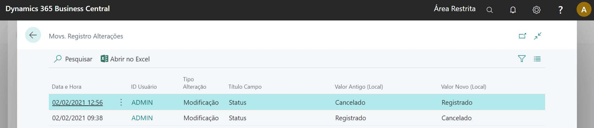

O **Log de Atividade** mostra o motivo informado em cada alteração. Quando o texto é longo, a coluna **Informação Detalhada Disponível** fica com **Sim**: clique nesse valor para baixar um arquivo de texto com a observação completa.

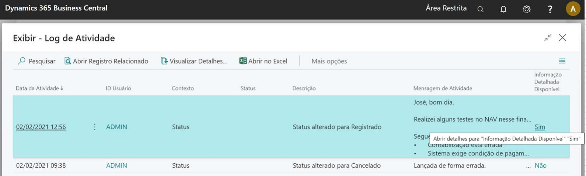

O detalhamento da alteração manual está em [Documento Fiscal: Alteração de Status do Documento Fiscal Registrado](Localization-for-Brazil_User-Manual_Doc-Fiscal-Registrado-Alteracao-Status.md).

---

## 4. Cancelamento manual de um documento de venda transmitido à SEFAZ

Para um documento de venda com NF-e autorizada, a alteração manual de status não transmite nada à SEFAZ. Primeiro altere o status e depois cancele a NF-e:

1. Pesquise por **Documentos Fiscais de Venda Registrados** ou, no Centro de Funções, abra **Vendas** > **Documentos Fiscais Registrados**, e abra o documento.

   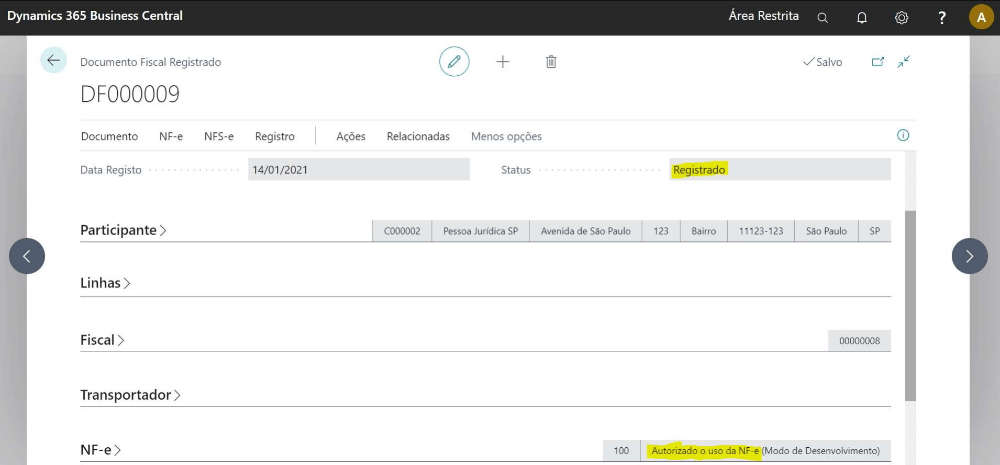

2. Clique em **Ações** > **Documento** > **Alterar Status para Cancelado**, informe o motivo em **Observações** e clique em **OK**.
3. Com o **Status** **Cancelado**, clique em **NF-e** > **Cancelar NF-e**. A ação só fica habilitada com o status **Cancelado** e a NF-e autorizada.

   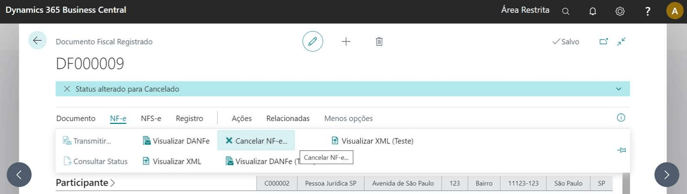

4. Confirme a pergunta *"Tem certeza que deseja cancelar o documento [nº] na SEFAZ?"*.

   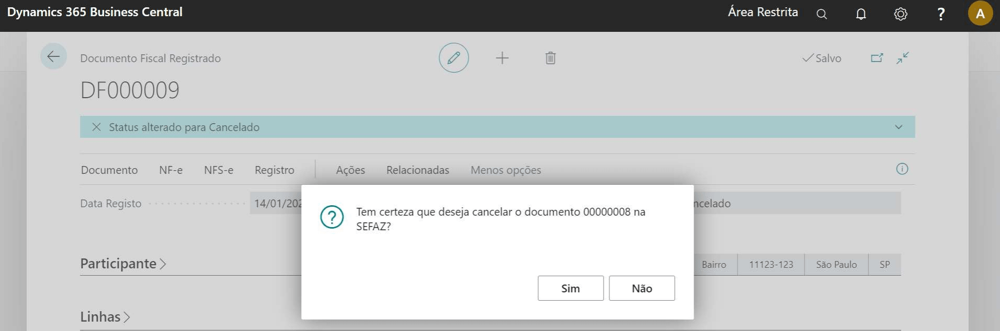

5. Informe a **Justificativa**, com pelo menos 15 caracteres, e clique em **OK**.

   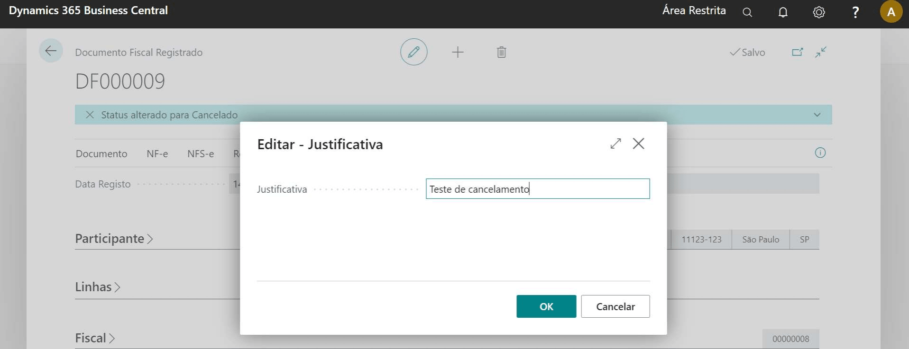

> **Nota**: a alteração manual de status não é bloqueada pelo prazo de cancelamento da NF-e. Enquanto a NF-e continuar autorizada, o documento aparece como cancelamento pendente. Veja [NF-e: Cancelamento na SEFAZ no Mesmo Fluxo, Prazo de Cancelamento por Filial e Cancelamentos Pendentes](Localization-for-Brazil_User-Manual_NFe-Cancelamento-SEFAZ-Prazo-Pendencias.md).

---

## 5. Cancelamento automático de uma fatura de compra

Pesquise por **Faturas Compra Registradas** ou, no Centro de Funções, abra **Compras** > **Faturas Compra Registradas**, selecione a fatura e clique em **Corrigir**.

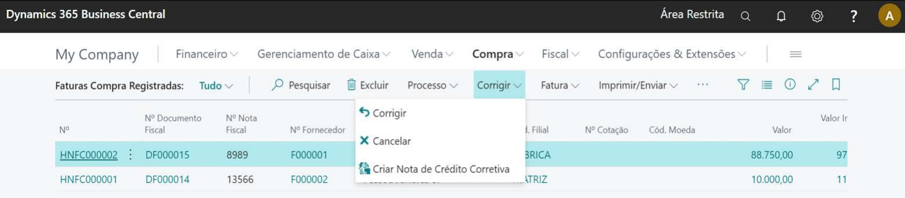

- **Corrigir** cancela a fatura registrada e cria uma nova fatura com os mesmos dados, para ser corrigida e registrada de novo.

  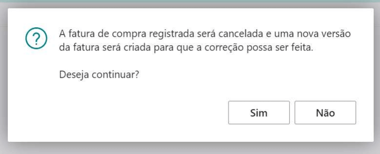

  Na lista **Faturas Compra Registradas**, a fatura cancelada fica com a coluna **Cancelada** = **Sim**.

  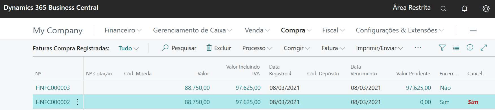

- **Cancelar** cancela a fatura registrada, criando e registrando uma nota de crédito que anula os lançamentos.

  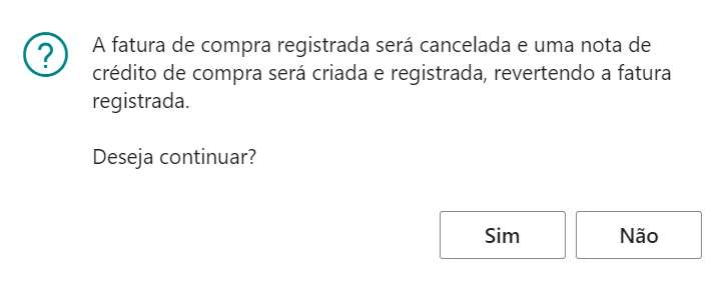

  Em seguida, o sistema pergunta se você deseja abrir a nota de crédito registrada.

  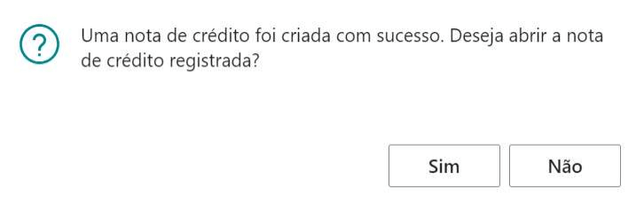

  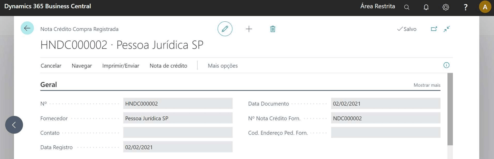

- **Criar Nota de Crédito Corretiva** cria uma nota de crédito em aberto, copiada da fatura, que só precisa ser conferida e registrada.

  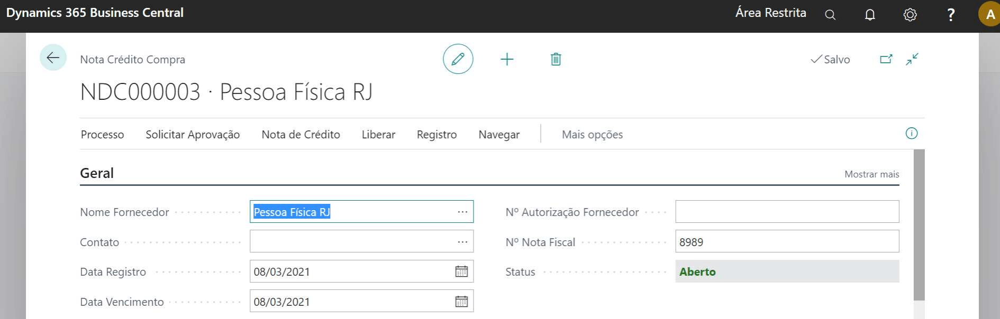

As três ações mudam o **Status** do documento fiscal da fatura para **Cancelado**. O passo a passo completo está em [Compras: Cancelamento de Fatura de Compra Registrada](Localization-for-Brazil_User-Manual_Cancelamento-Fatura-Compra-Registrada.md).

---

## 6. Cancelamento automático de uma fatura de venda

Pesquise por **Faturas Venda Registradas** ou, no Centro de Funções, abra **Vendas** > **Faturas Venda Registradas**, selecione a fatura e clique em **Corrigir**. As ações são as mesmas das compras: **Corrigir**, **Cancelar** e **Criar Nota de Crédito Corretiva**.

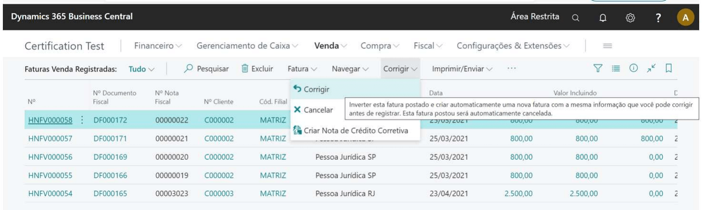

A fatura cancelada fica com a coluna **Cancelada** = **Sim**.

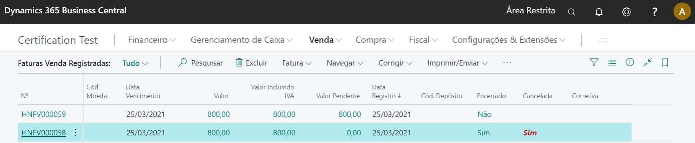

A nota de crédito criada por **Criar Nota de Crédito Corretiva** mostra uma notificação com o documento fiscal que ela vai cancelar quando for registrada.

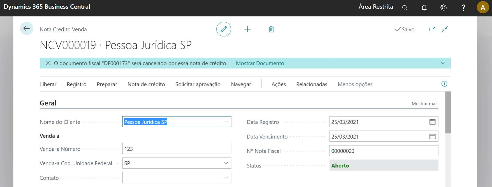

O passo a passo completo, inclusive o cancelamento da NF-e e da NFS-e, está em [Vendas: Cancelamento de Fatura de Venda Registrada](Localization-for-Brazil_User-Manual_Cancelamento-Fatura-Venda-Registrada.md).

> **Nota**: quando a filial tem **Transmitir cancelamento automaticamente** ligado na **Config. NF-e**, **Corrigir**, **Cancelar** e o registro da nota de crédito corretiva também cancelam a NF-e na SEFAZ, pedindo a justificativa na mesma ação. Veja [NF-e: Cancelamento na SEFAZ no Mesmo Fluxo, Prazo de Cancelamento por Filial e Cancelamentos Pendentes](Localization-for-Brazil_User-Manual_NFe-Cancelamento-SEFAZ-Prazo-Pendencias.md).

---

## 7. Cancelamento de uma nota de crédito de compra

Nas **Notas Crédito Compra Registradas**, as notas de crédito com a coluna **Corretiva** = **Sim** têm as ações **Cancelar** > **Cancelar** e **Cancelar** > **Mostrar Fatura Cancelada/Corretiva**.

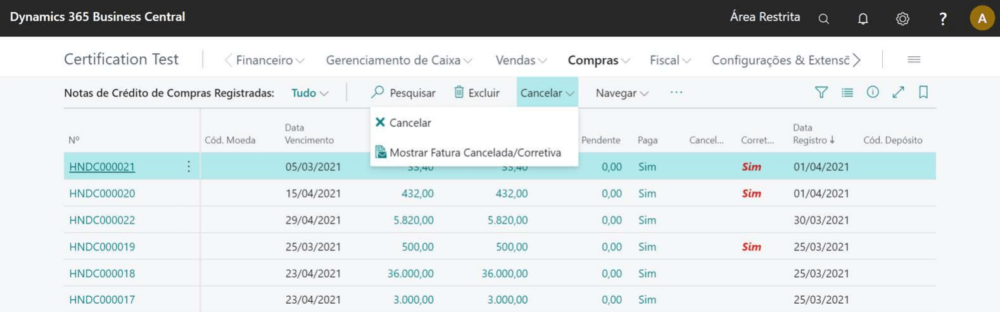

**Cancelar** cancela a nota de crédito, criando e registrando uma fatura de compra que a reverte.

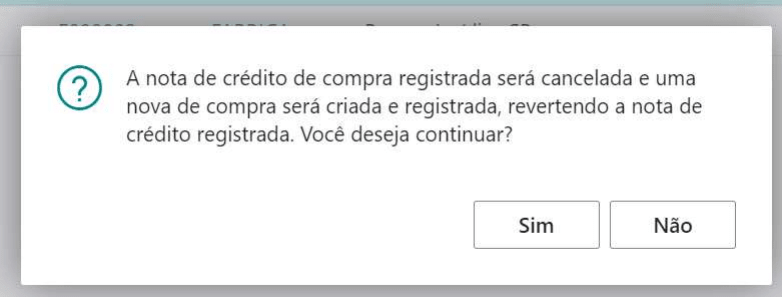

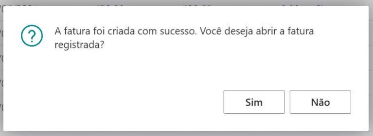

Depois do cancelamento, a fatura original deixa de constar como cancelada e seu documento fiscal volta ao **Status** **Registrado**. A fatura de estorno aparece com a coluna **Corretiva** = **Sim**.

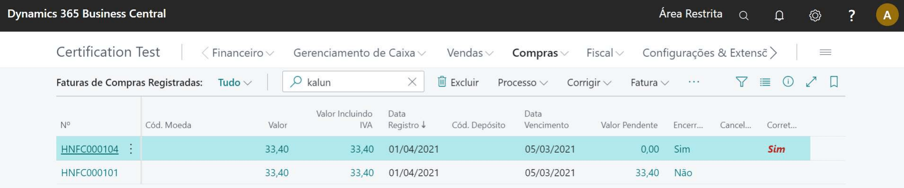

Na lista de notas de crédito, a nota cancelada passa a ter a coluna **Cancelada** = **Sim**.

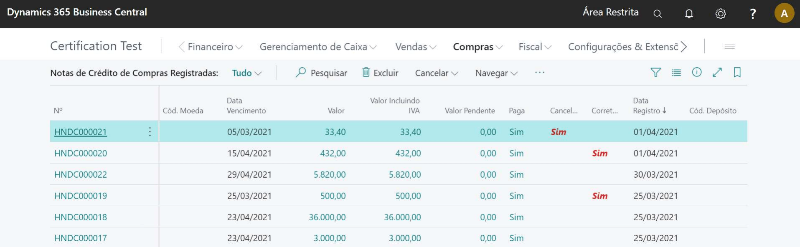

O passo a passo completo, inclusive o cancelamento de uma devolução, está em [Compras: Cancelamento de Nota de Crédito e de Devolução](Localization-for-Brazil_User-Manual_Cancelamento-Nota-Credito-Devolucao-Compra.md).

---

## 8. Cancelamento de uma nota de crédito de venda

Nas **Notas Crédito Venda Registradas**, as notas de crédito com a coluna **Corretiva** = **Sim** têm as mesmas ações **Cancelar** > **Cancelar** e **Cancelar** > **Mostrar Fatura Cancelada/Corretiva**.

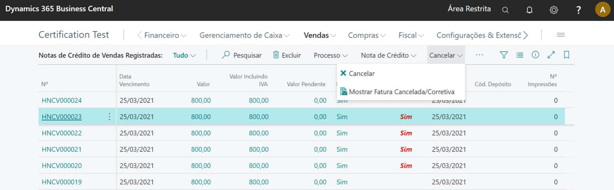

**Cancelar** cria e registra uma fatura de venda que reverte a nota de crédito. A fatura de estorno aparece com a coluna **Corretiva** = **Sim**, e a nota de crédito cancelada com a coluna **Cancelada** = **Sim**.

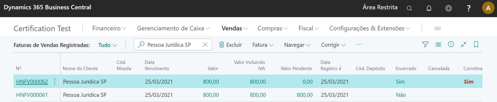

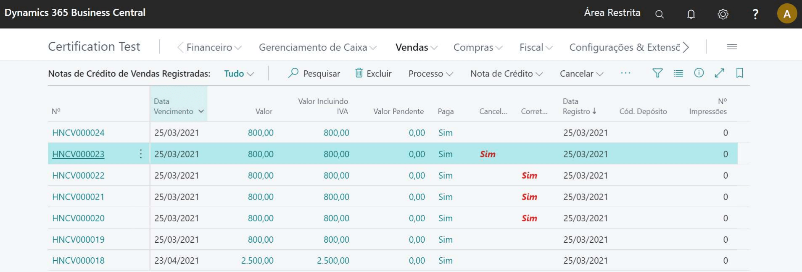

O passo a passo completo, inclusive o cancelamento de uma devolução, está em [Vendas: Cancelamento de Nota de Crédito e de Devolução](Localization-for-Brazil_User-Manual_Cancelamento-Nota-Credito-Devolucao-Venda.md).
