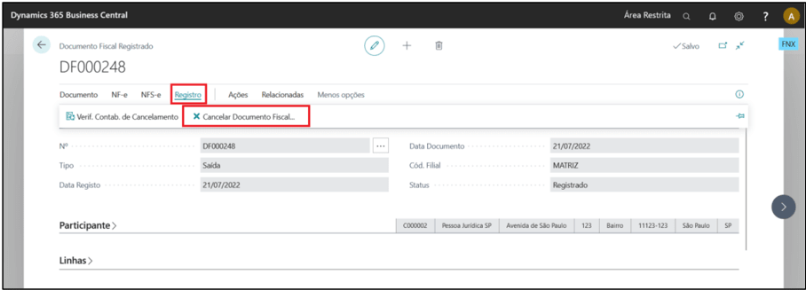
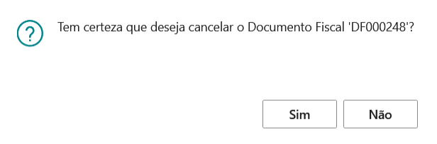
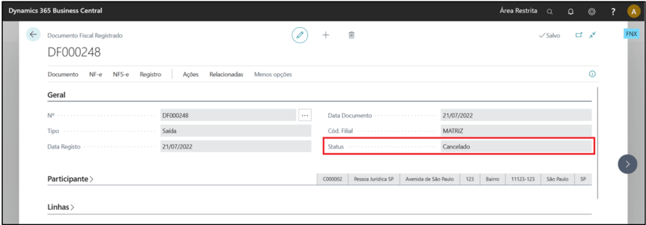
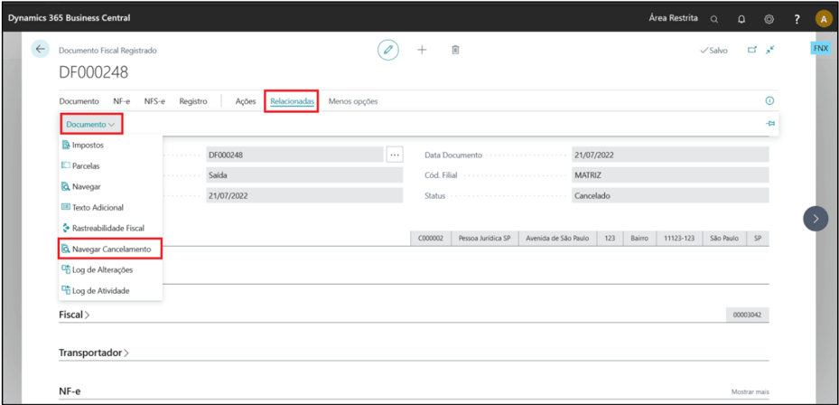
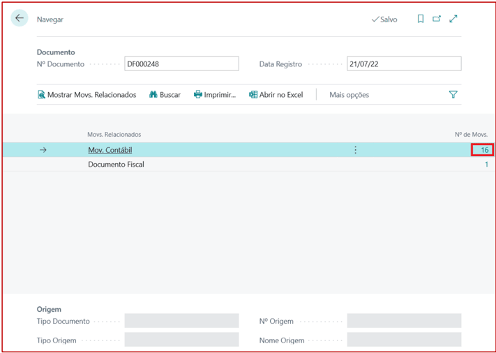
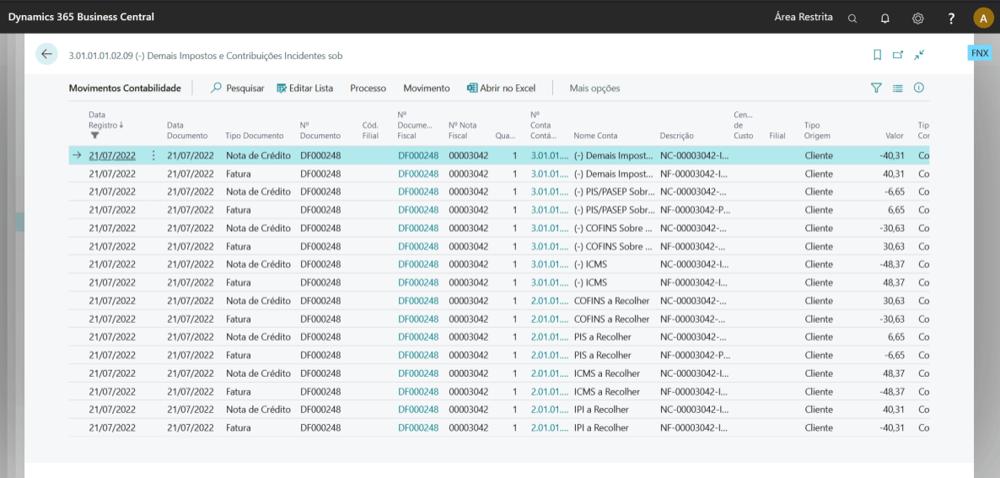
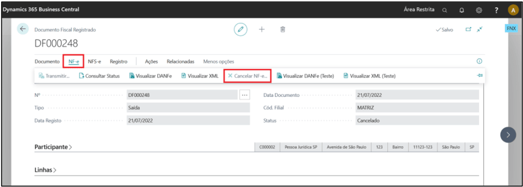

# Documento Fiscal: Cancelamento de Documento Fiscal Simples

**Data**: Maio/2022

---

## Sumário

Um documento fiscal registrado diretamente pelo **Documento Fiscal Simples**, como um documento fiscal de transferência, é cancelado pela ação **Cancelar Documento Fiscal** do próprio **Documento Fiscal Registrado**. O cancelamento registra os lançamentos de estorno, muda o status do documento para **Cancelado** e, quando o documento tem NF-e própria autorizada, permite cancelar a NF-e na SEFAZ.

## 1. Contexto

A ação **Cancelar Documento Fiscal** vale apenas para documentos fiscais registrados diretamente, a partir de um documento fiscal simples de venda, de compra ou de transferência. Os documentos fiscais gerados pelo registro de uma fatura ou nota de crédito de venda ou de compra são cancelados pelo cancelamento do documento de origem, descrito em [Vendas: Cancelamento de Fatura de Venda Registrada](Localization-for-Brazil_User-Manual_Cancelamento-Fatura-Venda-Registrada.md) e [Compras: Cancelamento de Fatura de Compra Registrada](Localization-for-Brazil_User-Manual_Cancelamento-Fatura-Compra-Registrada.md).

A ação fica habilitada quando:

- o **Status** do documento é **Registrado**;
- a **Data Registro** do documento está dentro do período de datas de registro permitido para o usuário;
- não há cancelamento de NF-e ou NFS-e em processamento para o documento.

---

## 2. Cancelar o documento fiscal

1. Pesquise por **Documentos Fiscais de Transferência Registrados** ou, no Centro de Funções, abra **Fiscal** > **Documentos Fiscais** > **Inventário** > **Documentos Fiscais de Transferência Registrados**. Os documentos simples de venda e de compra estão em **Documentos Fiscais de Venda Registrados** e **Documentos Fiscais de Compra Registrados**.
2. Abra o documento fiscal e clique em **Registro** > **Cancelar Documento Fiscal**.

   

   Para conferir antes os lançamentos que serão gerados, use **Registro** > **Verif. Contab. de Cancelamento**.

3. Confirme o cancelamento.

   

4. O **Status** do documento passa a **Cancelado**.

   

> **Nota**: quando o documento tem NF-e própria autorizada e a filial controla o prazo de cancelamento, o cancelamento é bloqueado depois do prazo. Quando a filial tem **Transmitir cancelamento automaticamente** ligado, o sistema pede a justificativa e cancela a NF-e na SEFAZ na mesma ação. Veja [NF-e: Cancelamento na SEFAZ no Mesmo Fluxo, Prazo de Cancelamento por Filial e Cancelamentos Pendentes](Localization-for-Brazil_User-Manual_NFe-Cancelamento-SEFAZ-Prazo-Pendencias.md).

---

## 3. Consultar os lançamentos de estorno

O cancelamento cria lançamentos de estorno. Para consultá-los, no documento fiscal cancelado clique em **Relacionadas** > **Navegar Cancelamento**. A ação fica habilitada quando o documento está com o status **Cancelado**.

A página **Navegar** mostra os movimentos relacionados ao cancelamento.

---

## 4. Cancelar a NF-e na SEFAZ

Quando o documento tem NF-e própria autorizada e a NF-e não foi cancelada na SEFAZ junto com o documento (por exemplo, porque a filial não transmite o cancelamento automaticamente), conclua o cancelamento na SEFAZ:

1. No documento fiscal cancelado, clique em **NF-e** > **Cancelar NF-e**. A ação só fica habilitada com o status **Cancelado** e a NF-e autorizada.
2. Confirme a pergunta *"Tem certeza que deseja cancelar o documento [nº] na SEFAZ?"*.
3. Informe a **Justificativa**, com pelo menos 15 caracteres, e clique em **OK**.

Enquanto a NF-e continuar autorizada, o documento aparece na lista **Cancelamentos de NF-e pendentes**.
