# Compras: Cancelamento de Fatura de Compra Registrada

**Data**: Maio/2022

---

## Sumário

Uma fatura de compra registrada é cancelada no sistema pelas ações do grupo **Corrigir**: **Corrigir**, **Cancelar** e **Criar Nota de Crédito Corretiva**. As três registram uma nota de crédito que estorna os movimentos da fatura e mudam o status do documento fiscal da fatura para **Cancelado**. Quando a fatura gerou uma NF-e própria transmitida à SEFAZ, como uma nota de importação, o cancelamento também precisa chegar à SEFAZ, o que pode acontecer na mesma ação ou depois, pelo documento fiscal.

## 1. Contexto

### Quando cancelar

O cancelamento é usado quando um documento registrado precisa ser desfeito no sistema, por exemplo por:

- erro de contabilização ou de dados preenchidos;
- rejeição na SEFAZ;
- cancelamento que não foi efetivado na SEFAZ;
- cancelamento de uma devolução na SEFAZ;
- qualquer outra causa que exija desfazer o registro.

### As três formas de cancelar

| Ação | O que faz |
|------|-----------|
| **Corrigir** | Cancela a fatura registrada, registrando uma nota de crédito que a estorna, e cria uma nova fatura com os mesmos dados para ser corrigida e registrada de novo. Quando a fatura veio de uma ordem de compra que ainda existe, a ordem é aberta para a correção em vez de uma nova fatura. Quando veio de várias ordens, ou a ordem já foi excluída, a fatura é apenas cancelada. |
| **Cancelar** | Cancela a fatura registrada, criando e registrando automaticamente uma nota de crédito que estorna os lançamentos. |
| **Criar Nota de Crédito Corretiva** | Cria uma nota de crédito em aberto, copiada da fatura, para ser conferida e registrada manualmente. O cancelamento acontece quando essa nota de crédito é registrada. |

O cancelamento acontece em três etapas:

1. Cancelar a fatura de compra registrada por uma das ações acima.
2. Conferir, no **Documento Fiscal Registrado** da fatura, que o **Status** passou a **Cancelado**.
3. Cancelar a NF-e na SEFAZ, quando a fatura gerou uma NF-e própria transmitida.

> **Nota**: **Corrigir** e **Cancelar** só aparecem em faturas que ainda não estão canceladas e são recusadas quando a fatura está total ou parcialmente paga, quando algum item da fatura já foi devolvido ou quando a própria fatura é o cancelamento de uma nota de crédito. Para estornar uma fatura paga, crie manualmente uma nota de crédito.

---

## 2. Configuração

As três formas de cancelamento dependem de um tipo de documento fiscal de cancelamento, que é atribuído à nota de crédito de estorno.

1. Pesquise por **Tipos Documento Fiscal** ou, no Centro de Funções, abra **Configurações** > **Fiscal** > **Documentos** > **Tipos Documento Fiscal**.
2. Marque o campo **Cancelamento** no tipo de documento fiscal usado para os cancelamentos.

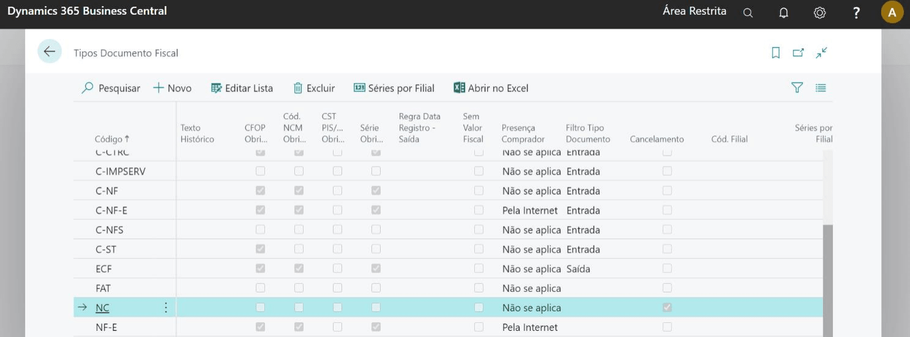

> **Nota**: apenas um tipo de documento fiscal pode ter o campo **Cancelamento** marcado. Ao marcá-lo, o tipo passa a ter **Emitente Documento** = **Sem Valor Fiscal**, e os campos que não se aplicam a um documento de cancelamento, como **Modelo Documento**, série e as obrigatoriedades de CFOP, NCM e CST, são limpos.

---

## 3. Cancelar a fatura de compra registrada

Pesquise por **Faturas Compra Registradas** ou, no Centro de Funções, abra **Compras** > **Faturas Compra Registradas**. Selecione a fatura na lista, ou abra a fatura, e clique em **Corrigir**. O grupo tem as três ações.

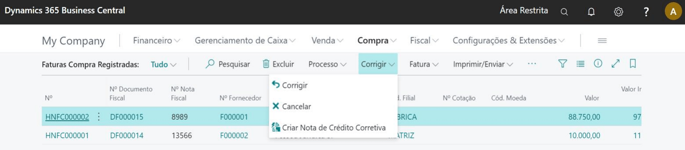

### Corrigir

1. Clique em **Corrigir** > **Corrigir**.
2. Confirme a pergunta. O texto varia conforme a origem da fatura: avulsa, de uma ordem ou de várias ordens.

   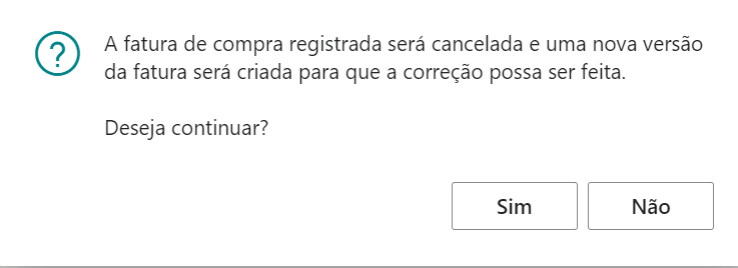

3. O sistema registra a nota de crédito que cancela a fatura e abre a nova fatura de compra, ou a ordem de compra de origem, para a correção. Corrija os dados e registre o documento normalmente.

### Cancelar

1. Clique em **Corrigir** > **Cancelar**.
2. Confirme a pergunta.

   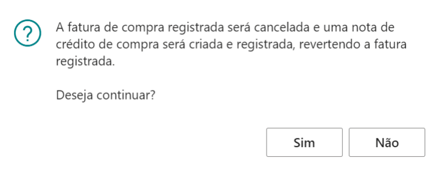

3. O sistema registra a nota de crédito e pergunta se você deseja abri-la.

   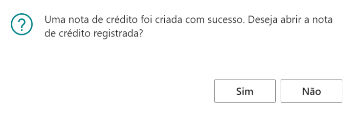

4. Clique em **Sim** para ver a nota de crédito registrada.

   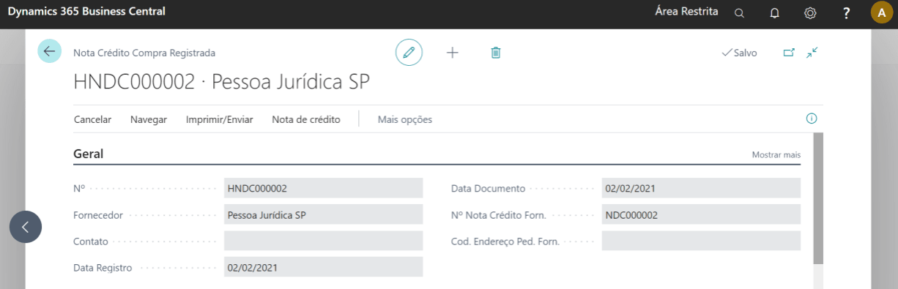

### Criar Nota de Crédito Corretiva

1. Clique em **Corrigir** > **Criar Nota de Crédito Corretiva**.
2. O sistema cria a nota de crédito em aberto, copiada da fatura e já com o tipo de documento fiscal de cancelamento.
3. Confira os dados e registre a nota de crédito.

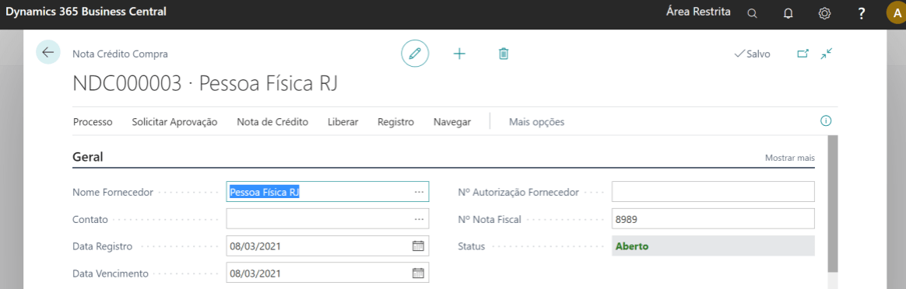

### Conferir a fatura cancelada

Na lista **Faturas Compra Registradas**, a fatura cancelada fica com a coluna **Cancelada** = **Sim**. Isso vale para as três formas de cancelamento: na **Criar Nota de Crédito Corretiva**, a marca aparece quando a nota de crédito é registrada.

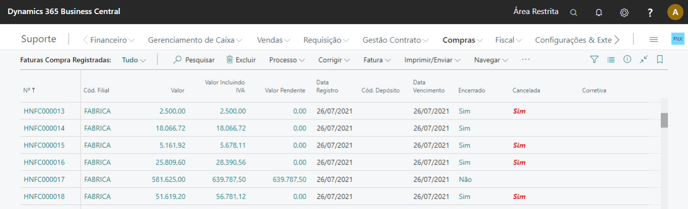

---

## 4. Conferir o status do documento fiscal

Cada fatura registrada está associada a um **Documento Fiscal Registrado**, cujo **Status** fica **Registrado** enquanto a fatura não é cancelada. O cancelamento por uma das ações acima muda esse status para **Cancelado** automaticamente.

1. Na fatura de compra registrada, seção **Fiscal**, clique no **Nº Documento Fiscal** para abrir o documento fiscal.

   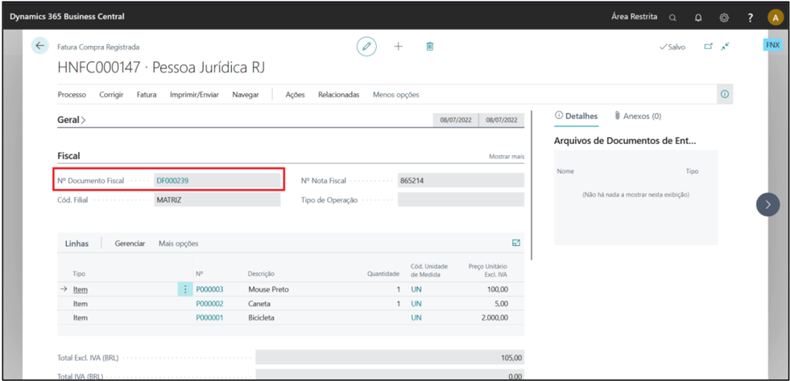

2. Confira, na seção **Geral**, o **Status** **Cancelado**.

   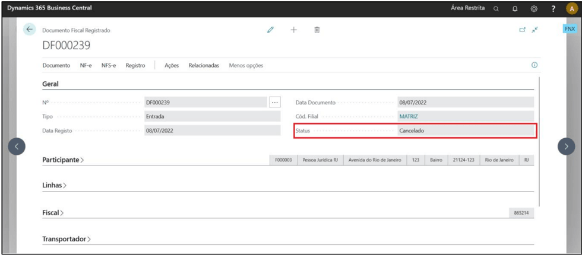

---

## 5. Cancelar na SEFAZ

Esta etapa só se aplica quando a fatura cancelada gerou uma NF-e própria transmitida à SEFAZ, como em uma nota de importação.

Quando a filial tem **Transmitir cancelamento automaticamente** ligado na **Config. NF-e**, **Corrigir** e **Cancelar** pedem a justificativa e cancelam a NF-e na SEFAZ na mesma ação, e o registro da nota de crédito corretiva faz o mesmo. Com o controle de prazo ligado, o cancelamento é bloqueado depois do prazo configurado na filial. Os detalhes estão em [NF-e: Cancelamento na SEFAZ no Mesmo Fluxo, Prazo de Cancelamento por Filial e Cancelamentos Pendentes](Localization-for-Brazil_User-Manual_NFe-Cancelamento-SEFAZ-Prazo-Pendencias.md).

Quando a NF-e não foi cancelada junto com a fatura:

1. No documento fiscal cancelado, clique em **NF-e** > **Cancelar NF-e**. A ação só fica habilitada com o **Status** **Cancelado** e a NF-e autorizada.

   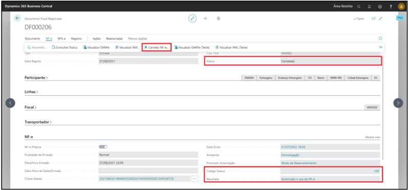

2. Confirme a pergunta e informe a **Justificativa**, com pelo menos 15 caracteres, e clique em **OK**.
3. O cancelamento é transmitido, e o **Código Status** e o **Resultado** da seção **NF-e** são atualizados.

   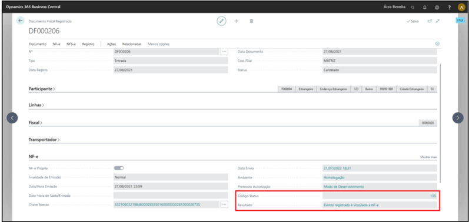
