# Vendas: Cancelamento de Nota de Crédito e de Devolução

**Data**: Maio/2022

---

## Sumário

Uma nota de crédito de venda registrada pode ser cancelada de duas formas, conforme a sua origem. A nota de crédito corretiva, criada pelo cancelamento ou pela correção de uma fatura, é cancelada pela ação **Cancelar**, que registra uma fatura de estorno e devolve a fatura original ao estado anterior. A nota de crédito de devolução não tem essa ação: ela é cancelada pelo registro de uma fatura de venda com o tipo de documento fiscal de cancelamento, vinculada à devolução.

## 1. Contexto

### Quando cancelar

O cancelamento é usado quando um documento registrado precisa ser desfeito no sistema, por exemplo por:

- erro de contabilização ou de dados preenchidos;
- rejeição na SEFAZ;
- cancelamento que não foi efetivado na SEFAZ ou na prefeitura;
- qualquer outra causa que exija desfazer o registro.

### Nota de crédito corretiva ou devolução

| Origem da nota de crédito | Como cancelar |
|---------------------------|---------------|
| **Corretiva**: criada por **Corrigir**, **Cancelar** ou **Criar Nota de Crédito Corretiva** em uma fatura registrada (coluna **Corretiva** = **Sim**) | Ação **Cancelar** da nota de crédito (seção 3) |
| **Devolução**: registrada a partir de uma ordem de devolução ou de uma nota de crédito de devolução | Fatura de venda de cancelamento vinculada à devolução (seção 4) |

---

## 2. Configuração

Os dois cancelamentos dependem de um tipo de documento fiscal de cancelamento.

1. Pesquise por **Tipos Documento Fiscal** ou, no Centro de Funções, abra **Configurações** > **Fiscal** > **Documentos** > **Tipos Documento Fiscal**.
2. Marque o campo **Cancelamento** no tipo de documento fiscal usado para os cancelamentos.

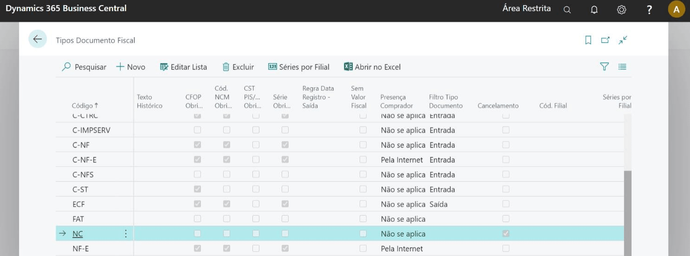

> **Nota**: apenas um tipo de documento fiscal pode ter o campo **Cancelamento** marcado. Ao marcá-lo, o tipo passa a ter **Emitente Documento** = **Sem Valor Fiscal**.

---

## 3. Cancelar uma nota de crédito corretiva

1. Pesquise por **Notas Crédito Venda Registradas** ou, no Centro de Funções, abra **Vendas** > **Notas Crédito Venda Registradas**. As notas de crédito que podem ser canceladas têm a coluna **Corretiva** = **Sim**.

   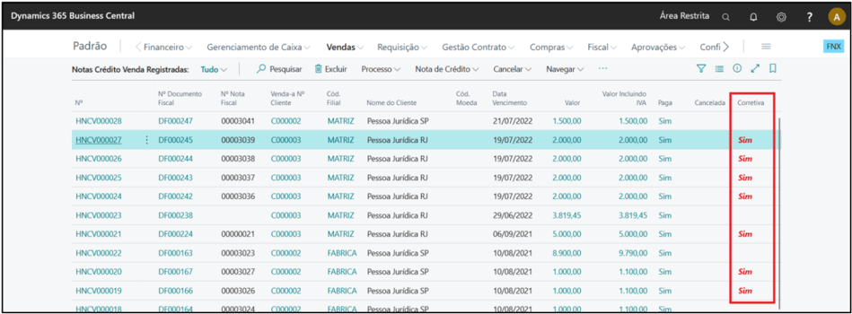

2. Abra a nota de crédito e clique em **Cancelar** > **Cancelar**. A ação só aparece em notas de crédito corretivas que ainda não foram canceladas.

   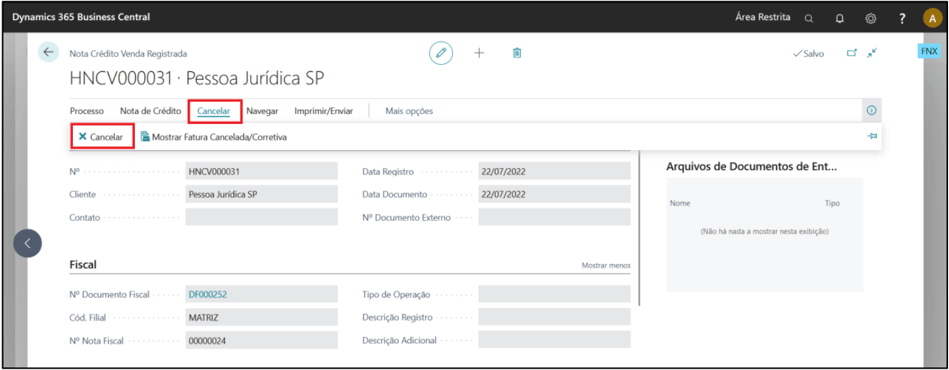

3. Confirme a pergunta: uma nova fatura de venda será criada e registrada, revertendo os movimentos da nota de crédito.

   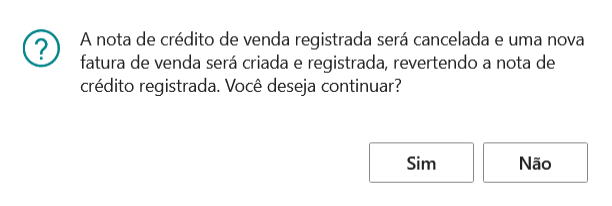

4. O sistema desaplica os movimentos da nota de crédito, registra a fatura de estorno e pergunta se você deseja abrir a fatura registrada. A fatura traz um comentário informando que ela cancela a nota de crédito.

   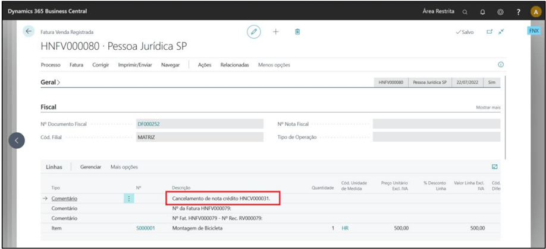

Depois do cancelamento:

- a nota de crédito passa a ter a coluna **Cancelada** = **Sim**, e a coluna **Corretiva** fica vazia;
- a fatura original deixa de constar como **Cancelada**;
- o **Documento Fiscal Registrado** da fatura original volta ao **Status** **Registrado**.

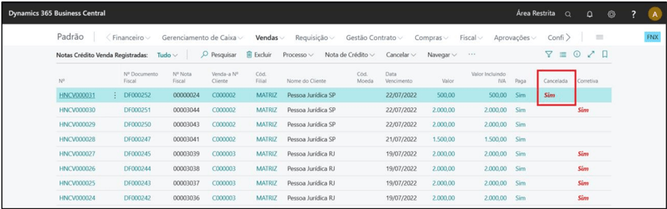

> **Nota**: o cancelamento é recusado quando a nota de crédito não está totalmente aplicada a uma fatura, quando a NF-e da fatura original não está mais autorizada (por exemplo, porque o cancelamento dela já foi homologado na SEFAZ) ou quando a data de registro do documento fiscal original está fora do período de datas de registro permitido.

---

## 4. Cancelar uma devolução de venda

A nota de crédito registrada por uma devolução não tem a ação **Cancelar**, porque não é corretiva. Ela é cancelada pelo registro de uma fatura de venda com o tipo de documento fiscal de cancelamento, vinculada à nota de crédito da devolução. O registro dessa fatura estorna os movimentos da devolução, muda o **Status** do documento fiscal da devolução para **Cancelado** e marca a nota de crédito como **Cancelada**.

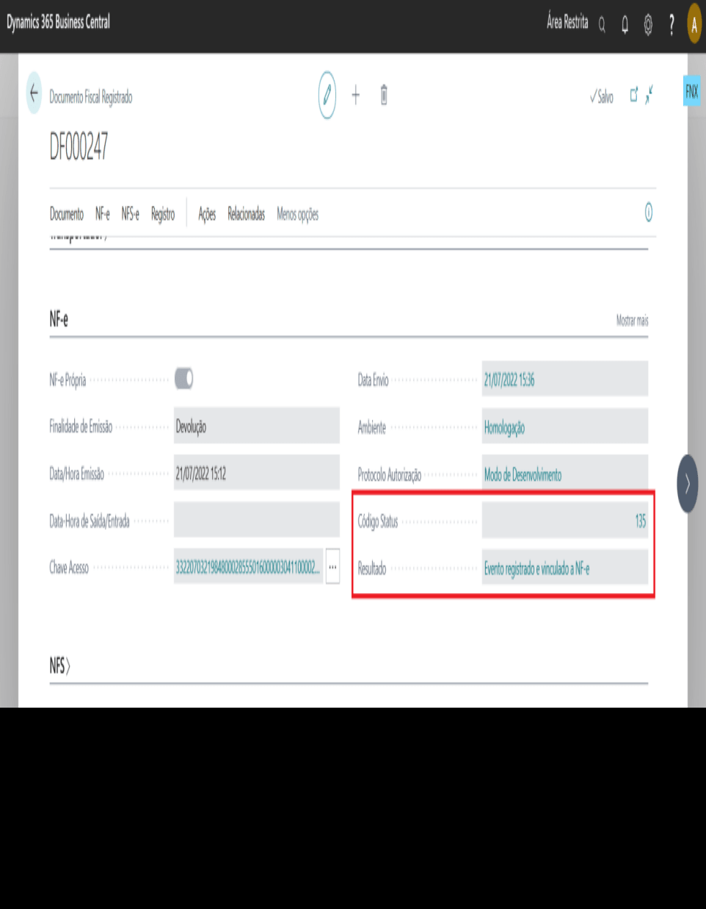

### 4.1. Identificar a devolução

Abra a nota de crédito da devolução em **Notas Crédito Venda Registradas** e anote o número dela e o **Nº Documento Fiscal**, na seção **Fiscal**.

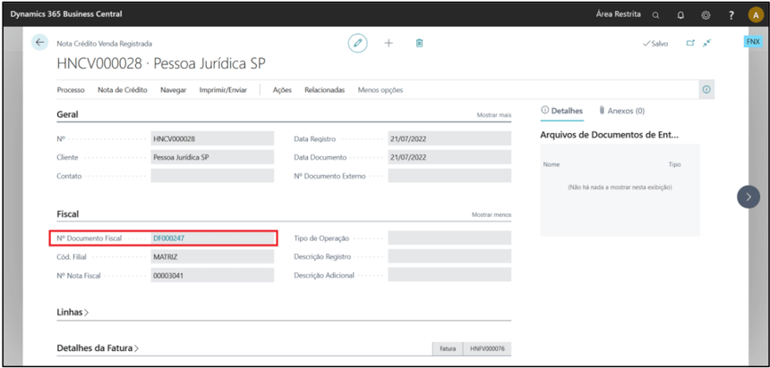

> **Importante**: não altere manualmente o status do documento fiscal da devolução antes de registrar a fatura. O registro cancela o documento fiscal e exige que ele esteja com o **Status** **Registrado**. Com o status já alterado, o registro é recusado com a mensagem *"Documento Fiscal [nº] não pode ser cancelado pois não possui status Registrado."*

### 4.2. Desaplicar a nota de crédito da devolução

Se a nota de crédito da devolução estiver aplicada a outro documento, desaplique-a para que a fatura de cancelamento possa ser aplicada a ela. Se ela não estiver aplicada, pule esta etapa.

1. Abra os **Movimentos Cliente** do cliente, selecione o movimento da nota de crédito e clique em **Processo** > **Desaplicar Movimentos**.

   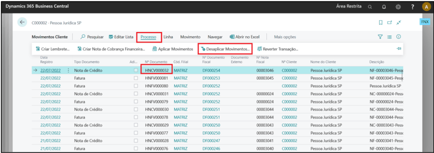

2. Na janela **Desaplicar Movimentos Clientes**, confirme a desaplicação.

   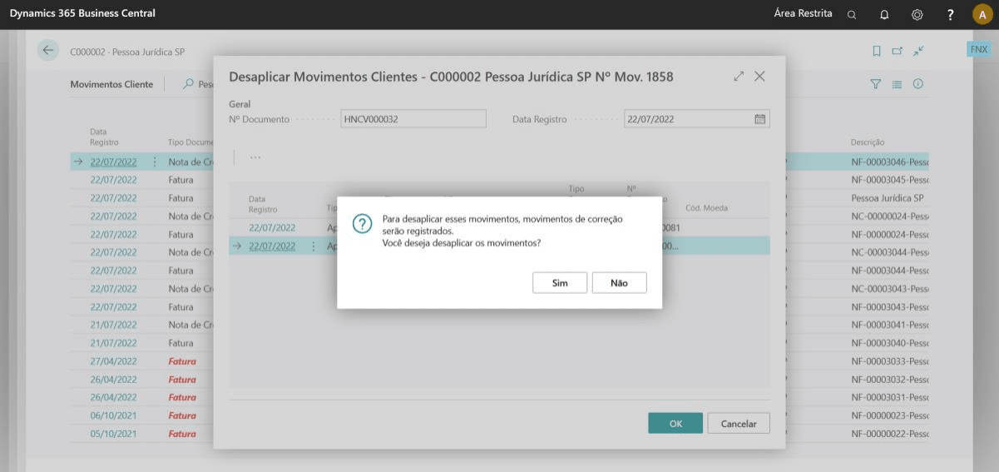

### 4.3. Criar e registrar a fatura de cancelamento

1. Pesquise por **Faturas de Venda** ou, no Centro de Funções, abra **Vendas** > **Faturas de Venda**, e crie uma nova fatura.
2. Use a ação **Copiar Documento** com **Tipo Documento** = **Nota de Crédito Registrada** e o **Nº Documento** da nota de crédito da devolução. Mesmo sendo uma devolução, o documento fica na lista de notas de crédito registradas.

   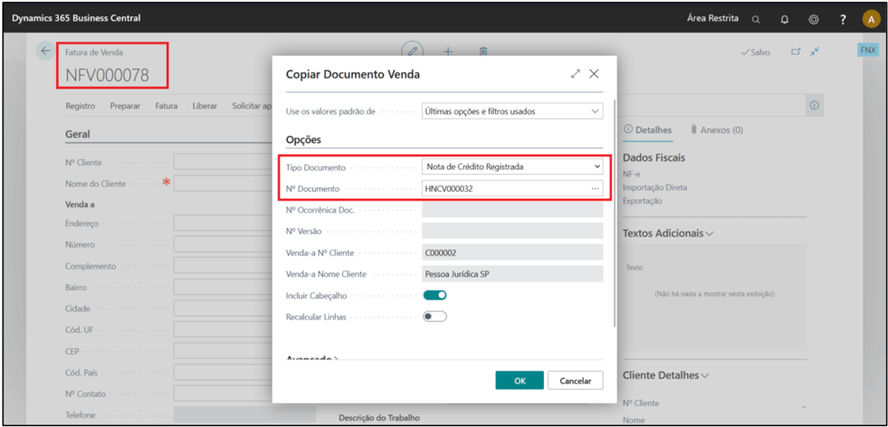

3. Na seção **Fiscal** da fatura, informe no **Tipo Documento Fiscal** o tipo marcado como **Cancelamento**. O grupo **Cancelamento** aparece na seção.
4. No grupo **Cancelamento**, informe **Aplicado por Tipo Doc.** = **Nota de Crédito** e, em **Aplicado-em Nº Doc.**, o número da nota de crédito da devolução.
5. Registre a fatura.

Ao registrar, o sistema:

- aplica a fatura à nota de crédito da devolução;
- muda o **Status** do documento fiscal da devolução para **Cancelado**, sem gerar um novo documento fiscal para a fatura;
- marca a nota de crédito da devolução como **Cancelada**.

> **Nota**: o registro de uma fatura com o tipo de documento fiscal de cancelamento é recusado quando **Aplicado por Tipo Doc.** ou **Aplicado-em Nº Doc.** estão em branco.

### 4.4. Cancelar a NF-e da devolução na SEFAZ

Quando a devolução foi transmitida pelo Business Central como NF-e própria e a filial tem **Transmitir cancelamento automaticamente** ligado na **Config. NF-e**, o registro da fatura pede a justificativa e cancela a NF-e na SEFAZ na mesma ação. Veja [NF-e: Cancelamento na SEFAZ no Mesmo Fluxo, Prazo de Cancelamento por Filial e Cancelamentos Pendentes](Localization-for-Brazil_User-Manual_NFe-Cancelamento-SEFAZ-Prazo-Pendencias.md).

Quando a NF-e não foi cancelada junto com o registro:

1. Abra o documento fiscal da devolução, já com o **Status** **Cancelado**, e clique em **NF-e** > **Cancelar NF-e**.
2. Confirme a pergunta e informe a **Justificativa**, com pelo menos 15 caracteres.
3. O cancelamento é transmitido, e o **Código Status** e o **Resultado** da seção **NF-e** são atualizados.

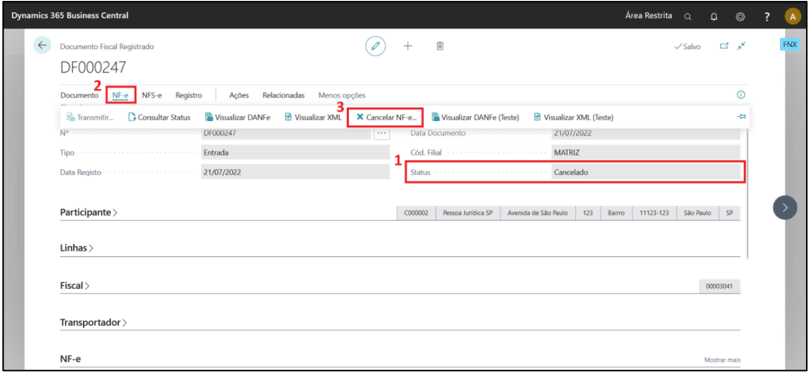

### 4.5. Conferir a aplicação

Volte aos **Movimentos Cliente**, selecione o movimento da fatura de cancelamento e clique em **Movimento** > **Movimentos Aplicados** para conferir que ela está aplicada à nota de crédito da devolução.

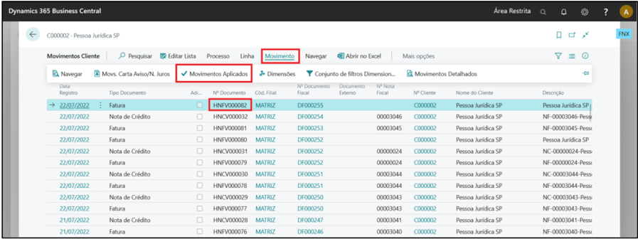

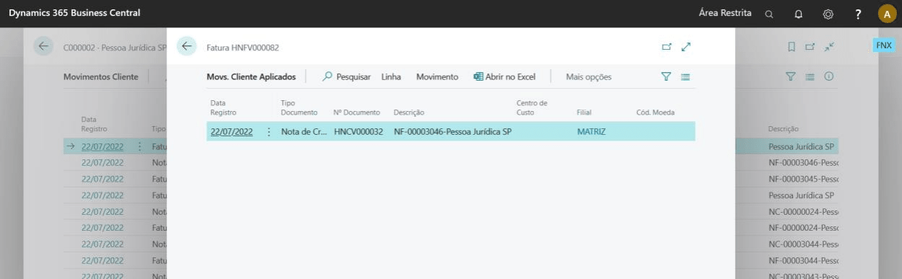

> **Nota**: dentro da nota de crédito da devolução, o campo **Aplicado-em Nº Doc.** continua mostrando o documento original, aquele a que a devolução foi aplicada quando foi registrada. É uma limitação padrão do Business Central, que não altera essa informação no documento registrado. A aplicação correta é a que aparece nos movimentos do cliente.

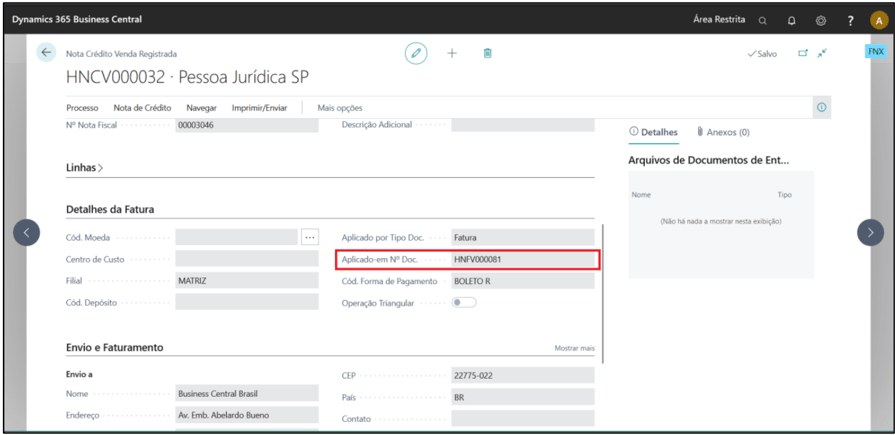
