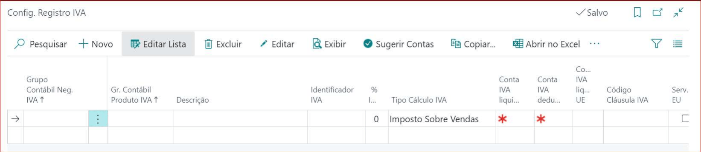
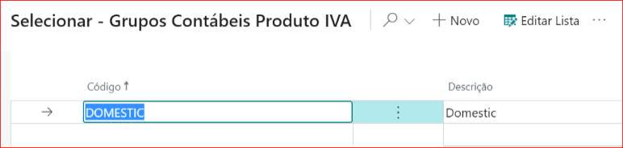
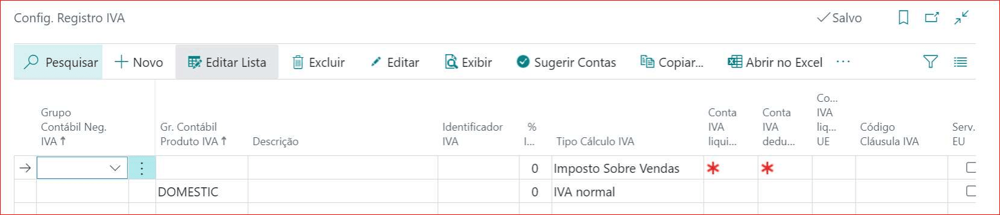
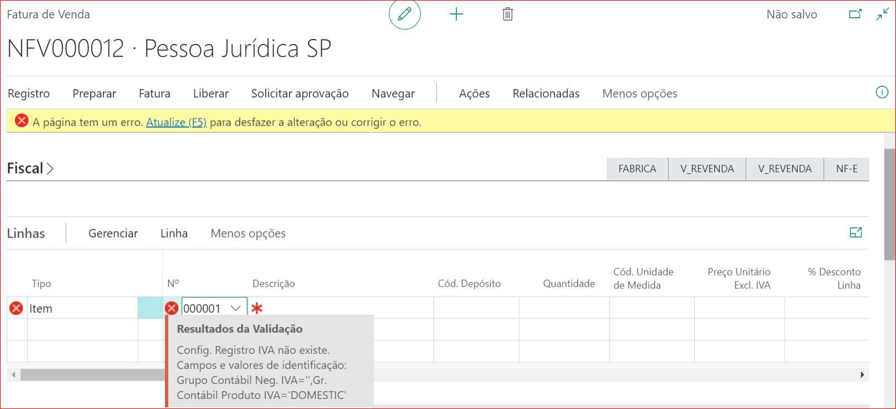
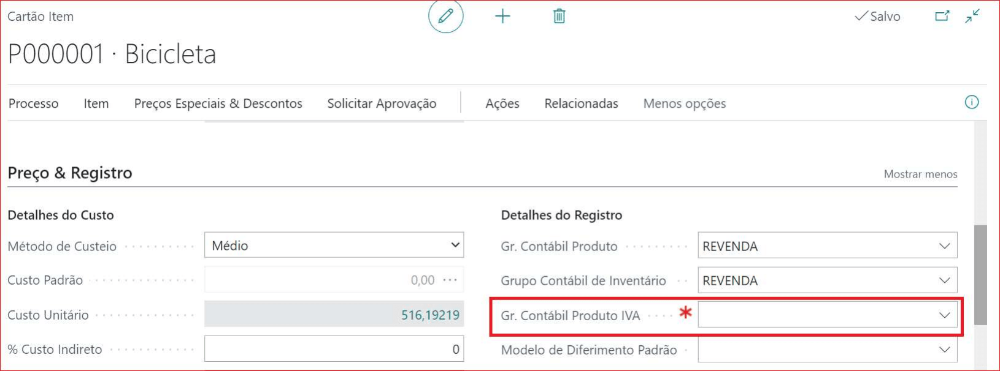
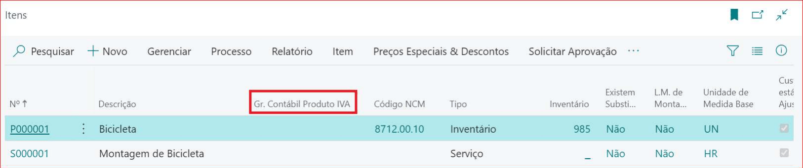
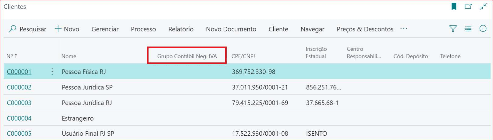
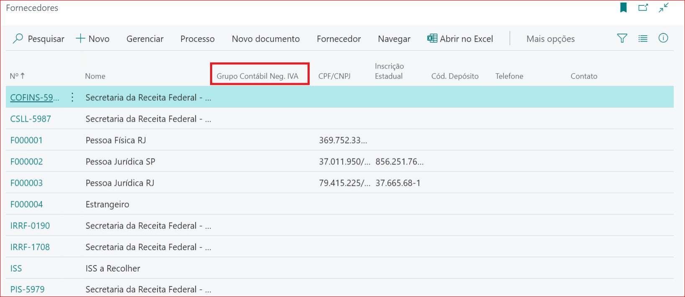

# Configurações: Desligar o IVA

**Data**: Julho/2021

---

## Sumário

O IVA (VAT) do Business Central padrão não é usado no Brasil: os tributos são calculados pela localização. Para que o IVA não interfira nos documentos, a **Config. Registro IVA** deve ter uma única linha, com os grupos contábeis de IVA em branco e **Tipo Cálculo IVA** **Imposto Sobre Vendas**, e os cadastros não devem ter grupos contábeis de IVA. Bases criadas com os dados de demonstração (CRONUS) trazem grupos de IVA preenchidos, que causam erro ao lançar itens nos documentos. Este manual mostra como identificar e corrigir essa configuração.

---

## 1. Configuração correta

A localização cria, na inicialização da empresa, a linha de **Config. Registro IVA** com **Grupo Contábil Neg. IVA** e **Gr. Contábil Produto IVA** em branco e **Tipo Cálculo IVA** **Imposto Sobre Vendas**. Essa deve ser a única linha da configuração.

Pela mesma razão, a localização oculta os campos de grupo contábil de IVA nos cartões de item, cliente e fornecedor e nos grupos contábeis de produto. Eles devem ficar em branco.

---

## 2. O erro causado pelos dados de demonstração

Nas bases criadas com os dados de demonstração, existe um **Gr. Contábil Produto IVA** (por exemplo, **DOMESTIC**), com a sua linha na **Config. Registro IVA** com o tipo de cálculo de IVA normal.

Um item com esse grupo, lançado num documento de um cliente sem **Grupo Contábil Neg. IVA**, procura a combinação dos dois grupos na **Config. Registro IVA**. Como ela não existe, o sistema não deixa incluir a linha e mostra o erro "Config. Registro IVA não existe", com os grupos procurados.

Com a configuração correta, as linhas dos documentos ficam com o **Tipo Cálculo IVA** **Imposto Sobre Vendas**.

---

## 3. Corrigir a configuração

### 3.1. Itens

O **Gr. Contábil Produto IVA** fica oculto no **Cartão Item**. Para conferir, use **Personalizar** e torne o campo visível. O campo aparece como obrigatório, mas não deve ser preenchido.

Para localizar todos os itens com o campo preenchido, mostre a coluna **Gr. Contábil Produto IVA** na lista **Itens** por personalização e filtre os itens com valor.

Limpe o campo de cada item.

### 3.2. Clientes e fornecedores

O IVA também tem o **Grupo Contábil Neg. IVA**, no cadastro de clientes e fornecedores. Faça a mesma verificação nas listas **Clientes** e **Fornecedores** e limpe o campo onde estiver preenchido.

### 3.3. Grupos contábeis e configuração de IVA

1. Nos grupos contábeis de produto e de negócio, confira também os campos **Gr. Registro Imp. Prod. Padrão** e **Gr. Registro Imp. Neg. Padrão**, ocultos pela localização. Quando preenchidos, o Business Central copia o grupo de IVA padrão para o item, cliente ou fornecedor ao informar o grupo contábil. Deixe-os em branco.
2. Pesquise por **Config. Registro IVA** e exclua as linhas que tenham grupo contábil de IVA preenchido, mantendo só a linha com os grupos em branco e **Tipo Cálculo IVA** **Imposto Sobre Vendas**.
3. Pesquise por **Grupos Contábeis Produto IVA** e **Grupos Contábeis Negócio IVA** e exclua os grupos que não são mais usados.

Depois da verificação, oculte de novo as colunas e campos exibidos por personalização, para evitar que sejam preenchidos por engano.
