# Configuração Fiscal: Cadastros Fiscais e Impostos

**Data**: Julho/2019

---

## Sumário

Este manual mostra, página a página, os cadastros que preparam a localização para atender à legislação fiscal brasileira: os códigos fiscais (CST, CFOP, NCM, origem do ICMS), os tipos de documento fiscal e de operação, os códigos de serviço da NFS-e, as jurisdições, áreas, contas e contabilizações de impostos, a **Matriz Impostos** e os impostos sobre encargos. No fim, mostra como corrigir campos de um documento fiscal registrado e como emitir os relatórios de impostos retidos.

Para o conceito por trás de cada cadastro e de como eles se ligam no cálculo, leia também [Jurisdições, Áreas de Impostos e Contabilizações](Localization-for-Brazil_User-Manual_guia-fiscal-jurisdicoes-areas-impostos.md) e [Configuração Fiscal — CFOP, NCM, CST, Matrizes](Localization-for-Brazil_User-Manual_guia-fiscal-setup-fiscal.md).

## 1. Onde ficam os cadastros

Todos os cadastros deste manual ficam no Centro de Funções em **Configurações** > **Fiscal**, divididos nos grupos **Documentos**, **Impostos**, **Códigos Fiscais**, **NF-e / NFS-e** e **Geral**. Cada página também pode ser aberta pela pesquisa (lupa) do Business Central, pelo nome indicado em cada seção.

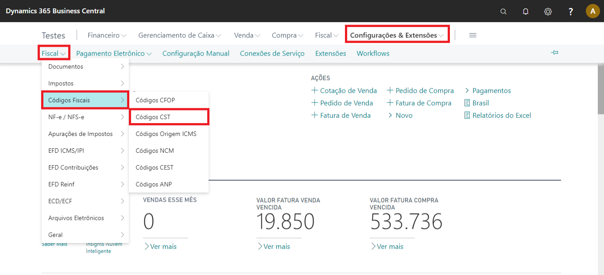

> **Nota**: nas imagens deste manual o menu aparece com o nome antigo **Configurações & Extensões**. O caminho a partir de **Fiscal** é o mesmo.

Uma ordem prática de configuração:

1. Códigos fiscais: CST, CFOP, NCM e origem do ICMS.
2. Tipos de documento fiscal e tipos de operação.
3. Códigos de serviço, códigos de tributação NFS-e e municípios, quando a empresa presta serviços.
4. Códigos receita tributo, jurisdições de impostos e alíquotas de ICMS por UF.
5. Contabilizações de imposto e contas de impostos.
6. Áreas de impostos.
7. Matriz Impostos e impostos sobre encargos de item.

Em todas as listas, use **Novo** para criar um registro, **Gerir** > **Editar Lista** para alterar registros existentes e **Eliminar** para excluir.

---

## 2. Códigos fiscais

### 2.1. CST — Código de Situação Tributária

O CST identifica o tratamento tributário de cada item na operação. Cada imposto tem sua tabela de CST, e o código é informado nas linhas dos documentos de compra e venda ou trazido pela **Matriz Impostos** (seção 11).

1. Pesquise por **Códigos CST** ou abra **Configurações** > **Fiscal** > **Códigos Fiscais** > **Códigos CST**.
2. Cadastre cada código com os campos abaixo.

| Campo | Descrição |
|-------|-----------|
| **Classificação Imposto** | Imposto a que o CST se refere (ICMS, IPI, PIS, COFINS etc.) |
| **Código** | Código do CST, igual ao publicado pela Receita Federal |
| **Descrição** | Descrição do código, igual à publicada pela Receita Federal |
| **Tipo** | **Entrada/Saída**, **Entrada** ou **Saída**: em que documentos o CST pode ser usado |
| **Simples Nacional** | Marque para os CST do Simples Nacional |
| **Crédito Imposto**, **Crédito Vinculado a Receita Tributada no Mercado Interno**, **Crédito Vinculado a Receita Não Tributada no Mercado Interno**, **Crédito Vinculado a Receita Exportação**, **Natureza Receita Obrigatória** | Marque as opções em que o CST se enquadra |

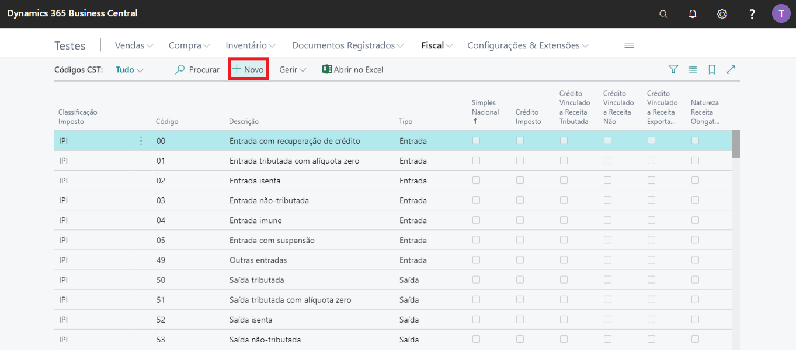

### 2.2. CFOP — Código Fiscal de Operações e Prestações

O CFOP é o código de 4 dígitos que identifica a natureza da circulação da mercadoria ou da prestação de serviço. É informado nas linhas dos documentos de compra e venda ou trazido pela **Matriz Impostos**.

1. Pesquise por **Códigos CFOP** ou abra **Configurações** > **Fiscal** > **Códigos Fiscais** > **Códigos CFOP**.
2. Cadastre cada código com os campos abaixo.

| Campo | Descrição |
|-------|-----------|
| **Nº** | Código do CFOP, igual ao publicado pela Receita Federal |
| **Descrição** e **Utilização** | Descrição e utilização publicadas pela Receita Federal |
| **Tipo** | **Compra** ou **Venda** |
| **Localização Cliente/Fornecedor** | **Mesmo estado**, **Outro estado** ou **Fora do Brasil** |
| **Identificação** | **Transporte**, **Ativo Fixo**, **Combustível** ou **Utilidade Pública**, quando o CFOP for de um desses casos |
| **Movimentação Definitiva** | **Sim**, **Não** ou em branco |
| **Devolução** | Marque quando o CFOP for usado em documentos de devolução |

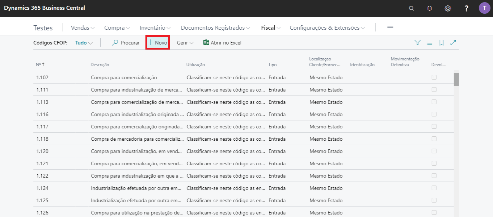

> **Nota**: a **Matriz Impostos** só oferece, em cada campo de CFOP, os códigos com o **Tipo** da matriz e com a **Localização Cliente/Fornecedor** correspondente (por exemplo, **CFOP - Mesmo Estado** só lista CFOPs de **Mesmo estado**). Preencha esses dois campos corretamente em todos os CFOPs.

### 2.3. NCM — Nomenclatura Comum do Mercosul

A NCM é o código de oito dígitos que classifica a mercadoria. Ela é informada no item e levada para as linhas dos documentos, e pode ter alíquotas próprias de impostos.

1. Pesquise por **Códigos NCM** ou abra **Configurações** > **Fiscal** > **Códigos Fiscais** > **Códigos NCM**.
2. Cadastre cada NCM com os campos abaixo.

| Campo | Descrição |
|-------|-----------|
| **Código** | Código da NCM, igual ao publicado pela Receita Federal |
| **Descrição** | Descrição publicada pela Receita Federal |
| **Data Inicial**, **Data Final** e **Fora da Nomenclatura Vigente** | Vigência do código. Veja [NCM: vigência e códigos extintos](Localization-for-Brazil_User-Manual_NCM-Vigencia-Codigos-Extintos.md) |
| **Unidade de Medida NF-e p/ Comércio Exterior** | Unidade de medida do governo para a NCM, usada quando ela aparece em documentos de comércio exterior |
| **Gênero** | Gênero da mercadoria |

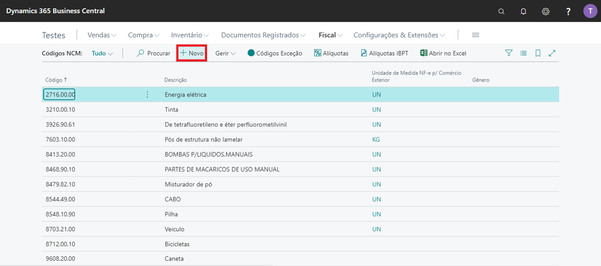

#### Alíquotas da NCM

Com a NCM selecionada, use a ação **Alíquotas** para cadastrar as alíquotas dos impostos que se aplicam a ela. Essas alíquotas são consideradas quando um documento com a NCM é calculado, conforme os impostos da área de imposto do documento.

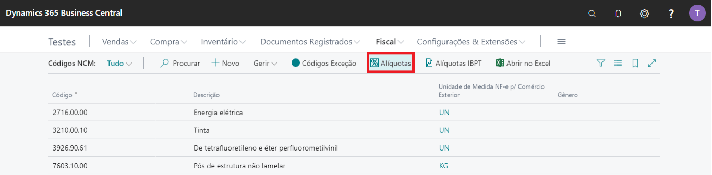

| Campo | Descrição |
|-------|-----------|
| **Cód. Exceção** | Preencha só quando a alíquota valer para uma exceção da NCM. O código precisa estar cadastrado antes (veja abaixo) |
| **Classificação Imposto** | Imposto ao qual a alíquota se aplica |
| **Data Início** e **Data Fim** | Período em que a alíquota vale. Fora dele, a alíquota não é considerada |
| **Alíquota** | Alíquota do imposto para a NCM |
| **Tipo Base Imposto** | **Base**, **Base Isenta** ou **Base Outros** |

A página também tem campos para **Cód. Território**, **Fator de Redução de Base**, **Alíquota Interna**, **Margem Valor Agregado**, **% Diferido**, **% Desonerado**, **CST (Saída)**, **CST (Entrada)**, **Cód. Texto Legal**, **Cód. Enquadramento Legal** e **Cód. Cálculo Imposto Customizado**, com o mesmo significado que têm na jurisdição do imposto (seção 6).

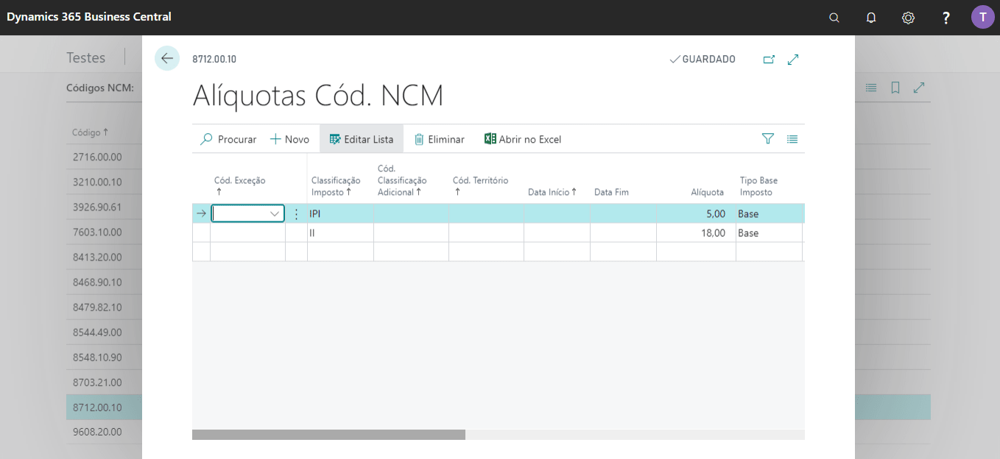

#### Códigos de exceção da NCM

Use a ação **Códigos Exceção** para cadastrar o código e a descrição de cada exceção da NCM.

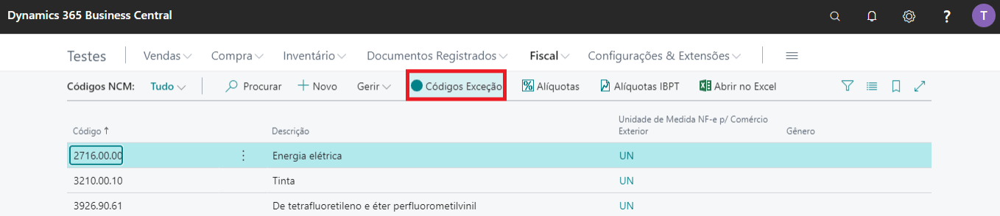

Para a exceção ser aplicada, além de estar nas alíquotas da NCM ela precisa ser informada na linha do documento ou no cartão do item, no campo **Cód. Exceção NCM**.

#### NCM no cartão do item

Informe a NCM no cartão do item, seção **Fiscal**, campo **Código NCM**. Ao lançar o item no documento, a NCM é preenchida automaticamente na linha.

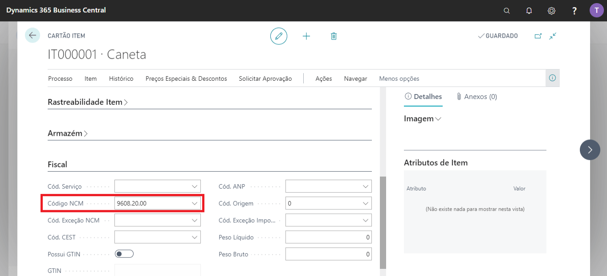

### 2.4. Código Origem ICMS

O código de origem indica se a mercadoria é nacional ou estrangeira. Ele é o primeiro dígito do CST do ICMS impresso no DANFE (o primeiro dígito é a origem e os dois seguintes são o CST).

1. Pesquise por **Códigos Origem ICMS** ou abra **Configurações** > **Fiscal** > **Códigos Fiscais** > **Códigos Origem ICMS**.
2. Cadastre os códigos conforme as definições da Receita Federal.

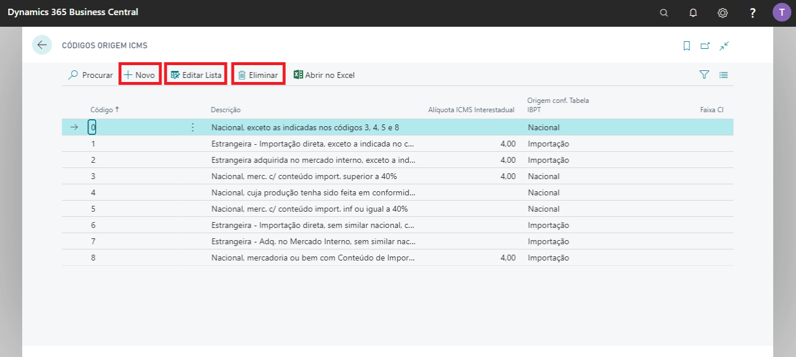

> **Nota**: quando a origem tem **Alíquota ICMS Interestadual** preenchida (por exemplo, 4% para mercadoria importada), essa alíquota é usada nas operações interestaduais no lugar da alíquota da tabela **Alíquotas ICMS por UF**.

O código de origem é informado no cartão do item (campo **Cód. Origem**) ou na **Matriz Impostos**.

---

## 3. Documentos

### 3.1. Tipos de documento fiscal

O tipo de documento fiscal identifica o modelo e a série dos documentos de compra e venda e controla quais dados são obrigatórios neles.

1. Pesquise por **Tipos Documento Fiscal** ou abra **Configurações** > **Fiscal** > **Documentos** > **Tipos Documento Fiscal**.

   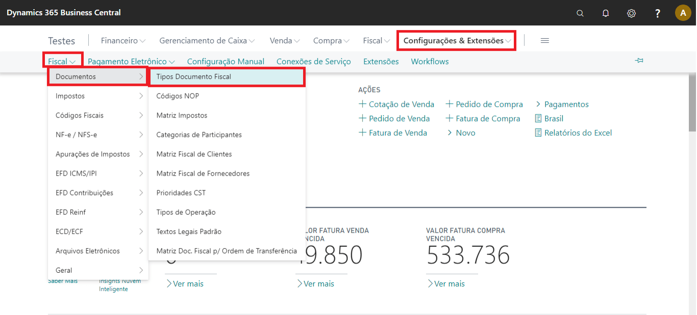

2. Cadastre cada tipo com os campos abaixo.

| Campo | Descrição |
|-------|-----------|
| **Código** | Código do tipo de documento fiscal |
| **Descrição** | Descrição do tipo |
| **Emitente Documento** | **Emissão Própria**, **Terceiros** ou **Sem Valor Fiscal** |
| **Modelo Documento** | Modelo do documento fiscal conforme a SEFAZ (por exemplo, 55 para NF-e) |
| **Espécie** | Espécie do documento fiscal |
| **Serviço** | Marque quando o tipo for usado em notas de serviço |
| **Nº Série Nota Fiscal** | Número de série do sistema que numera os documentos |
| **Série** | Série dos documentos. Quando preenchida, é levada para o campo **Série** do documento ao escolher o tipo |
| **CFOP Obrigatório** | Exige o CFOP no documento |
| **Cód. NCM Obrigatório** | Exige a NCM no documento |
| **CST PIS/COFINS Obrigatório** | Exige o CST de PIS e de COFINS no documento |
| **Série Obrigatória** | Exige a série no documento |
| **Sem Valor Fiscal** | Marque quando o tipo não tiver valor fiscal |
| **Presença Comprador** | Valor sugerido para o campo **Presença Comprador** do documento. Use **Não se aplica** quando a informação não se aplicar ao tipo |
| **Filtro Tipo Documento** | **Entrada** ou **Saída**, para limitar o uso do tipo a compras ou a vendas. Em branco, vale para os dois |
| **Cancelamento** | Marque no tipo usado nos documentos de cancelamento (notas de crédito que cancelam um documento) |
| **Cód. Filial** | Filial do tipo, quando ele for específico de uma filial |
| **Séries por Filial** | Quantidade de filiais com série própria para o tipo (veja abaixo) |

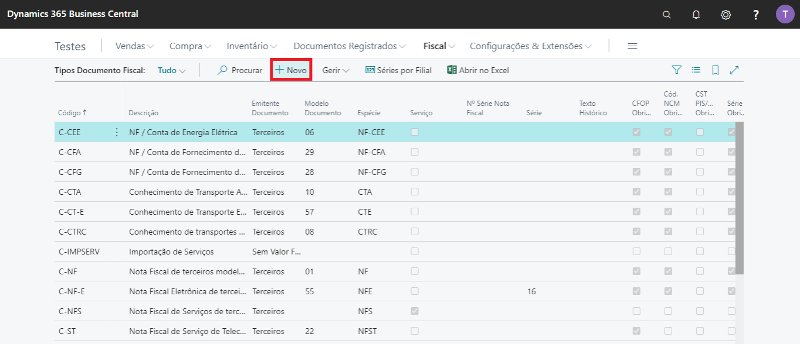

> **Nota**: só um tipo de documento fiscal pode ter **Cancelamento** marcado. Ao marcar, o sistema muda **Emitente Documento** para **Sem Valor Fiscal**, limpa os demais campos do tipo e os deixa não editáveis.

O tipo de documento fiscal é informado nos documentos de compra e venda, na seção **Fiscal**.

#### Séries por filial

Quando a empresa tem mais de uma filial que emite notas fiscais, cada filial pode ter sua série.

1. Selecione o tipo de documento fiscal e use a ação **Séries por Filial**.

   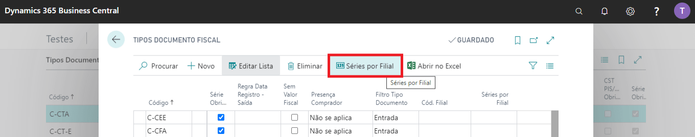

2. Informe o **Cód. Filial**, o **Nº Série Fiscal** (número de série do sistema para a filial) e a **Série** das notas emitidas pela filial.

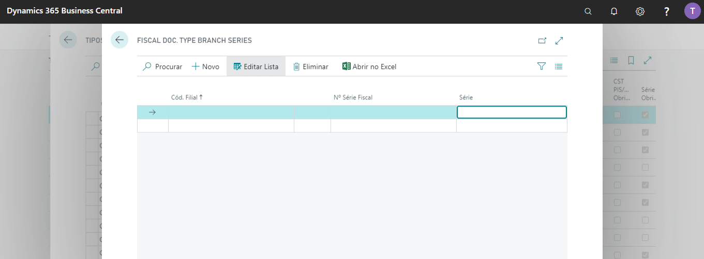

> **Nota**: a ação **Séries por Filial** só aparece quando há filiais cadastradas.

### 3.2. Tipos de operação

O tipo de operação restringe os movimentos que o documento gera no sistema. Por exemplo, uma remessa em que só a mercadoria é movimentada, sem financeiro.

1. Pesquise por **Tipos de Operação** ou abra **Configurações** > **Fiscal** > **Documentos** > **Tipos de Operação**.
2. Cadastre cada tipo com os campos abaixo.

| Campo | Descrição |
|-------|-----------|
| **Código** | Código do tipo de operação |
| **Descrição** | Descrição do tipo de operação |
| **Mov. Item** | Marque quando a operação movimenta somente o item (estoque) |
| **Mov. Cliente/Fornecedor** | Escolha **Valor Bruto** quando a operação movimenta somente o financeiro |
| **Custo Zero na Entrada** | Marque quando a entrada do item ocorre sem custo |
| **Zerar Valor Fiscal** | Zera a quantidade e os valores da linha do documento fiscal, para documentos fiscais legítimos de valor zero |
| **Gr. Contábil Produto** | Grupo contábil de produto usado nas linhas com este tipo de operação |
| **Conta Compensação Débito** e **Conta Compensação Crédito** | Contas contábeis dos lançamentos de compensação |

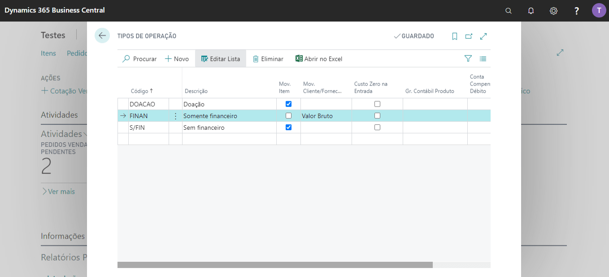

> **Nota**: o tipo de operação serve para restringir movimentos, por isso não pode movimentar item e cliente/fornecedor ao mesmo tempo. Ao marcar **Mov. Item** ou **Custo Zero na Entrada**, o sistema limpa **Mov. Cliente/Fornecedor**; ao escolher **Mov. Cliente/Fornecedor**, desmarca **Mov. Item** e **Custo Zero na Entrada**. Com **Zerar Valor Fiscal** marcado, **Mov. Cliente/Fornecedor** não pode ser alterado.

O tipo de operação é informado nos documentos de compra e venda, na seção **Fiscal** ou nas linhas.

---

## 4. Serviços e municípios

### 4.1. Códigos de serviço

Os códigos de serviço especificam os tipos de serviço prestados e sua tributação. Cada prefeitura tem seus próprios códigos.

1. Pesquise por **Códigos de Serviço NFS** ou abra **Configurações** > **Fiscal** > **NF-e / NFS-e** > **Códigos de Serviço**.
2. Cadastre cada serviço com os campos abaixo.

| Campo | Descrição |
|-------|-----------|
| **Código** e **Descrição** | Código e descrição do serviço |
| **Cód. Tributação** | Código de tributação conforme a prefeitura |
| **Item Lista Serviço** | Número do item na lista de serviços conforme a prefeitura |
| **Código CNAE** | CNAE do serviço, quando pertinente |
| **Cód. NBS** | NBS do serviço, quando aplicável |
| **Tipo Código IBPT** | **Serviço - NBS** ou **Serviço - LC 116**. O IBPT deve ser informado em vendas ou serviços prestados a consumidor final |
| **Código IBPT** | Código IBPT do serviço |
| **Cód. Cessão de Mão de Obra Reinf** | Código usado na EFD-Reinf |
| **Códigos por Filial** | Quantidade de filiais com código próprio (veja abaixo) |
| **Alíquotas ISS** | Quantidade de municípios com alíquota de ISS cadastrada (veja abaixo) |

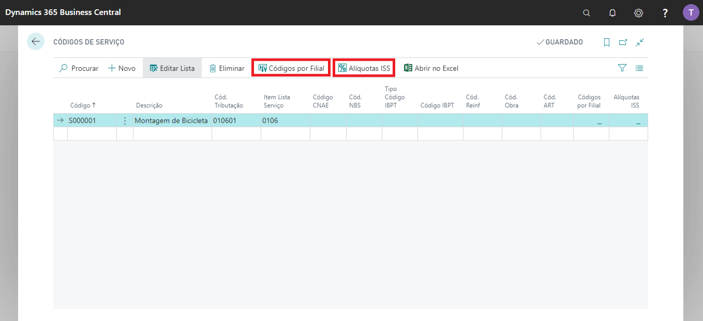

- **Códigos por Filial**: quando mais de uma filial emite notas de serviço, use a ação **Códigos por Filial**, escolha o **Cód. Filial** e cadastre os dados do serviço conforme a prefeitura da filial.
- **Alíquotas ISS**: use a ação **Alíquotas ISS** para informar, por município, o **Cód. Município** (a **Cidade** é preenchida a partir dele), o **% ISS** e, se houver retenção, o **% ISS Retido**.

### 4.2. Códigos de tributação NFS-e

Os códigos de tributação especificam como o serviço é tributado na NFS-e, conforme a prefeitura de cada filial.

1. Pesquise por **Códigos Tributação NFS-e** ou abra **Configurações** > **Fiscal** > **NF-e / NFS-e** > **Códigos Tributação NFS-e**.
2. Cadastre cada código com os campos abaixo.

| Campo | Descrição |
|-------|-----------|
| **Cód. Filial** | Filial que usa o código de tributação |
| **Código** e **Descrição** | Código e descrição da tributação |
| **Cód. Tributação** | Código de tributação da prefeitura. Alguns municípios usam letras, outros números |
| **Padrão** | Marque no código usado normalmente pela filial |

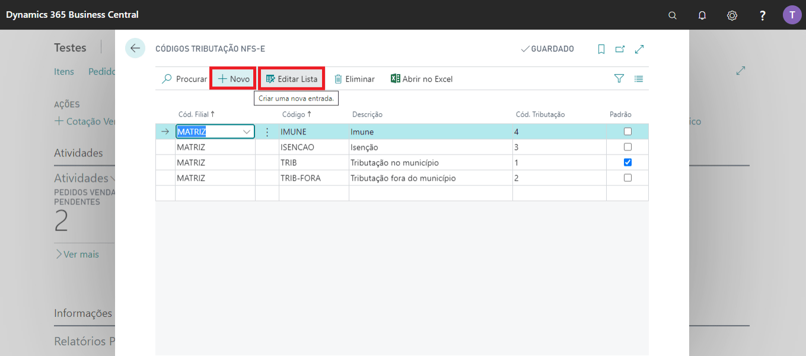

> **Nota**: a coluna **Significado nacional** só aparece quando há filial que emite NFS-e pelo ambiente nacional. Ela mostra o que o código significa no padrão nacional da NFS-e.

O código de tributação é usado nos documentos de venda de serviço, na seção **NFS-e**.

### 4.3. Municípios

O cadastro de municípios identifica o local da prestação do serviço informado na nota fiscal de venda.

1. Pesquise por **Municípios** ou abra **Configurações** > **Fiscal** > **Geral** > **Municípios**.
2. Cadastre cada município com os campos abaixo.

| Campo | Descrição |
|-------|-----------|
| **Código IBGE** | Código do município no IBGE |
| **Nome** | Nome do município |
| **Cód. SIAFI** | Código do município no SIAFI (Sistema Integrado de Administração Financeira do Governo Federal) |
| **Cód. Território** | UF em que o município fica |
| **Imposto Sem Incidência Sobre Desconto** | Marque quando aplicável ao município |
| **Imposto Sem Bitributação** | Marque quando o município tiver imposto sem bitributação |
| **Nº Fornecedor ISS Ret.** e **ISS Retido no Mesmo Município** | Tratamento do ISS retido. Veja [ISS retido: fornecedor por município](Localization-for-Brazil_User-Manual_ISS-Retido-Fornecedor-por-Municipio.md) e [ISS retido no mesmo município](Localization-for-Brazil_User-Manual_ISS-Retido-Mesmo-Municipio.md) |

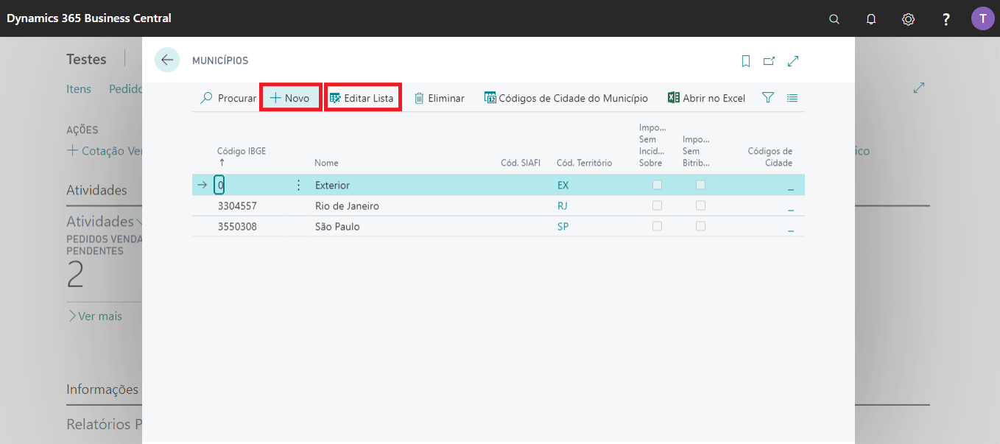

O município é usado nos documentos de venda de serviço, no campo **Município Prestação Serviço** da seção **NFS-e**.

---

## 5. Códigos receita tributo

O código receita tributo é o código com que a Receita Federal identifica cada tributo. Ele é informado na jurisdição do imposto e usado na geração dos DARFs e das declarações.

1. Pesquise por **Códigos Receita Tributo** ou abra **Configurações** > **Fiscal** > **Impostos** > **Códigos Receita Tributo**.
2. Cadastre cada código com os campos abaixo.

| Campo | Descrição |
|-------|-----------|
| **Código** | Código de receita do tributo, conforme a Receita Federal |
| **Descrição** | Descrição do código |
| **Grupo SPED Contribuições a Recolher** | **PIS Cumulativo**, **PIS Não Cumulativo**, **COFINS Cumulativo** ou **COFINS Não Cumulativo**, para os códigos de PIS e COFINS |
| **Grupo DCTF** | Grupo de imposto do código na DCTF |
| **Débito de SCP/INC** | **Demais**, **SCP** ou **INC** |

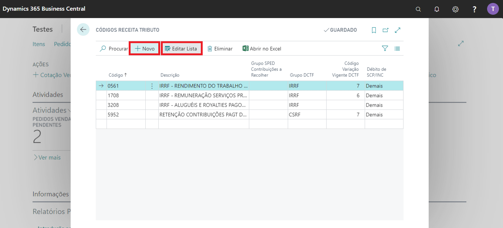

> **Nota**: as colunas **Grupo DCTF** e **Débito de SCP/INC** ficam ocultas por padrão; exiba-as pela personalização da página quando precisar preenchê-las. A coluna **Código Variação Vigente DCTF**, que aparece na imagem, não existe mais nesta página.

Depois de cadastrado, informe o código no campo **Cód. Receita Tributo** da jurisdição do imposto (seção 6), para que o DARF seja gerado corretamente.

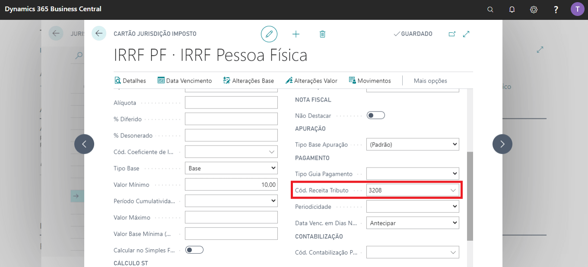

---

## 6. Jurisdições de impostos

A jurisdição configura cada imposto separadamente: alíquota, tipo de base, tipo de cálculo e demais regras. Depois de criadas, as jurisdições são agrupadas em áreas de impostos (seção 8), que são usadas nos documentos de compra e venda.

### 6.1. Cadastrar uma jurisdição

1. Pesquise por **Jurisdições de Impostos (Brasil)** ou abra **Configurações** > **Fiscal** > **Impostos** > **Jurisdições Impostos**.

   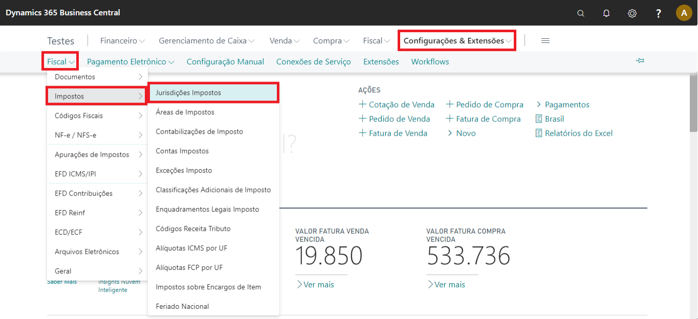

   > **Nota**: a pesquisa também mostra a página **Jurisdições Impostos** do Business Central padrão. Escolha **Jurisdições de Impostos (Brasil)**.

   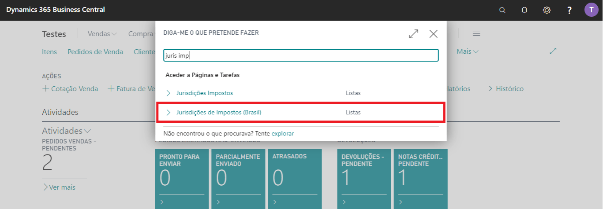

2. Use **Novo** para criar a jurisdição, ou selecione uma jurisdição e use **Editar** para abrir o **Cartão Jurisdição Imposto**.

   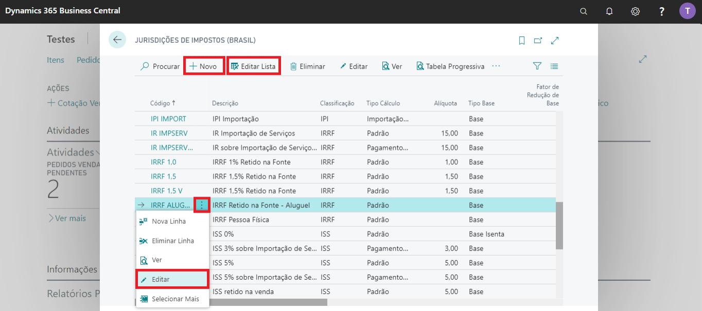

3. Preencha os campos abaixo.

| Seção | Campo | Descrição |
|-------|-------|-----------|
| **Geral** | **Código** e **Descrição** | Código e descrição da jurisdição |
| **Geral** | **Classificação** | Imposto a que a jurisdição se refere. Atenção nos impostos retidos, que têm classificação própria (por exemplo, **PIS Ret.**, **CSL Ret.**) |
| **Cálculo** | **Tipo Cálculo** | Como e quando o imposto é calculado (veja a tabela seguinte) |
| **Cálculo** | **Alíquota** | Alíquota da jurisdição, em percentual, sem o símbolo % |
| **Cálculo** | **Tipo Base** | **Base**, **Base Isenta** ou **Base Outros** |
| **Cálculo** | **Valor Mínimo** | Valor mínimo do imposto para que haja retenção |
| **Cálculo** | **Valor Máximo** | Valor máximo do imposto, se houver |
| **Cálculo** | **Valor Base Mínima (Mês)** | Base mínima a partir da qual o imposto passa a ser cumulativo no mês |
| **Redução Base** | **Fator** e **Tipo** | Fator de redução da base e o tipo de base da parte reduzida. É comum no INSS |
| **Pagamento** | **Tipo Guia Pagamento** | **DARF**, **DCTFWeb** ou **Outro**. Com **DARF**, o imposto da jurisdição sai na guia do DARF |
| **Pagamento** | **Cód. Receita Tributo** | Código receita tributo do imposto (seção 5), necessário para gerar o DARF |
| **Pagamento** | **Periodicidade** | Período de apuração: **Diário**, **Decendial**, **Quinzenal**, **Mensal** ou **Trimestral** |
| **Pagamento** | **Data Venc. em Dias Não Úteis** | **Antecipar** ou **Postergar** o vencimento que cair em dia não útil |
| **Contabilização** | **Cód. Contabilização Padrão** | Código de contabilização padrão da jurisdição (seção 10) |

Opções do **Tipo Cálculo**:

| Opção | Quando usar |
|-------|-------------|
| **Padrão** | O imposto é calculado no registro da nota |
| **Importação Direta** | O imposto é calculado pela fórmula de importação |
| **Pagamento (Valor do Documento)** | Imposto retido no pagamento, calculado sobre o valor da nota fiscal |
| **Pagamento (Valor da Parcela)** | Imposto retido no pagamento, calculado sobre o valor da parcela |
| **Pagamento (Valor do Pagamento)** | Imposto retido no pagamento, calculado sobre o valor pago |
| **ICMS-ST-DIFAL** | Cálculo de ICMS-ST com DIFAL |

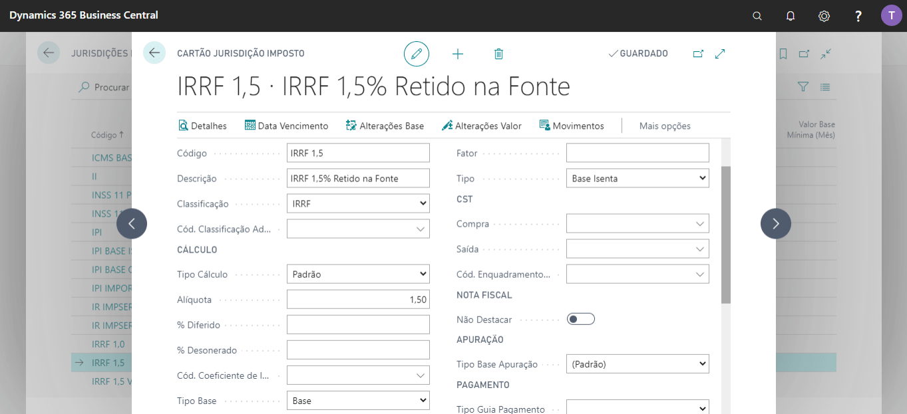

> **Nota**: não preencha a **Alíquota** nas jurisdições de ICMS. Com a alíquota em branco, o sistema busca a alíquota na tabela **Alíquotas ICMS por UF** (seção 7); preenchida, ela prevalece sobre a tabela. A exceção é o ICMS de importação, em que a alíquota deve ser informada na jurisdição. Também não preencha a alíquota nas jurisdições de IPI e II: como ela varia por NCM, deve ser cadastrada nas alíquotas da NCM (seção 2.3).

O cartão tem outros campos que não constam deste manual, como **% Diferido**, **% Desonerado**, **Cód. Cálculo Imposto Customizado** (veja [Cálculo de Imposto Customizado](Localization-for-Brazil_User-Manual_Calculo-Imposto-Customizado.md)), a seção **Cálculo ST** (**Alíquota Interna** e **Margem Valor Agregado**) e a seção **CST** (CST de **Compra** e de **Saída** e **Cód. Enquadramento Legal**).

> **Importante**: não altere uma jurisdição que já foi usada em documentos registrados; um cancelamento posterior pode gerar divergências. Crie uma nova jurisdição.

### 6.2. Alterações de base

Uma jurisdição pode ter a base de cálculo alterada pelo valor de outro imposto (por exemplo, somar o II na base do IPI de importação).

1. Selecione a jurisdição e use a ação **Alterações Base**.

   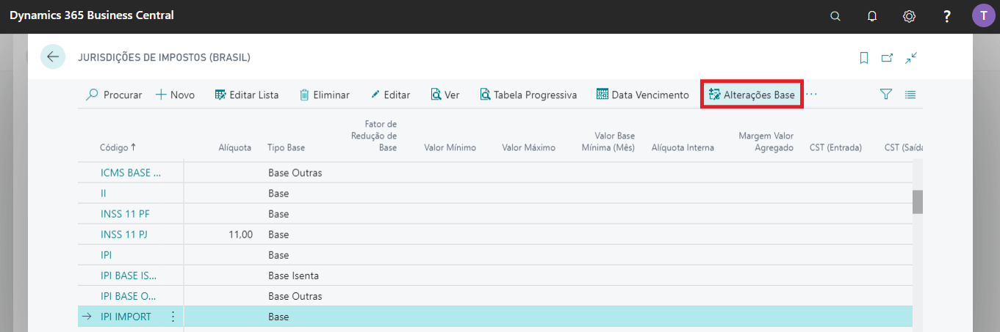

2. Na página **Alterações Base Imposto**, preencha:

| Campo | Descrição |
|-------|-----------|
| **Operação** | **Somar** ou **Subtrair** o imposto da base |
| **Classificação Imposto** | Imposto que será somado ou subtraído da base da jurisdição |
| **Antes do Fator de Redução** | Marque quando a alteração for aplicada antes da redução de base |
| **Considerar Valor Desonerado** | Usa o valor cheio do imposto em operações com imposto diferido. Veja [Impostos: flag para somar/subtrair impostos diferidos](Localization-for-Brazil_User-Manual_Impostos-Flag-Somar-Subtrair-Diferidos.md) |

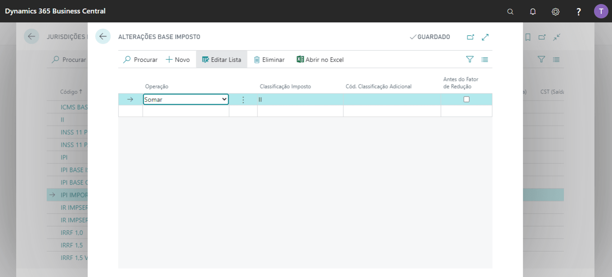

As jurisdições com alteração de base ficam com a coluna **Alterações Base/Valor** marcada.

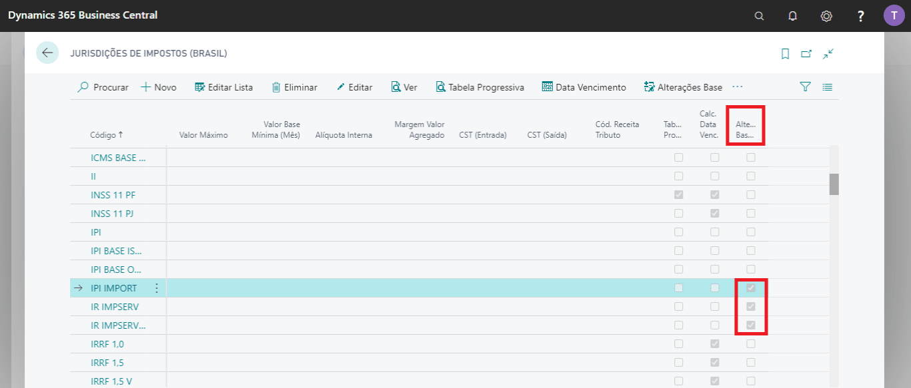

### 6.3. Data de vencimento

Use a ação **Data Vencimento** para definir o vencimento do imposto da jurisdição.

| Campo | Descrição |
|-------|-----------|
| **Dia Inicial** | Dia do mês em que começa o período considerado |
| **Dia Final** | Dia do mês em que termina o período considerado |
| **Fórmula Data** | Fórmula de data que calcula o vencimento |
| **Dias Úteis Adicionados** | Dias úteis somados ao vencimento calculado |

Exemplo: **Dia Inicial** = 1, **Dia Final** = 31 e **Fórmula Data** = `CM+20D`. Tudo o que for lançado entre os dias 1 e 31 vence no dia 20 do mês seguinte (fim do mês corrente mais 20 dias).

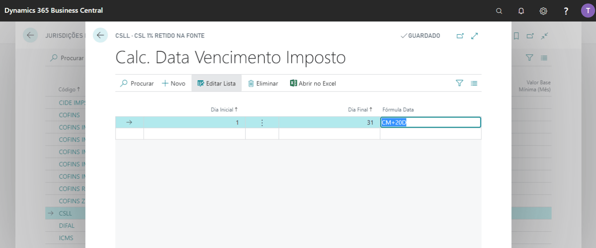

---

## 7. Alíquotas ICMS por UF

A alíquota de ICMS é buscada nesta tabela a partir da UF da empresa e da UF do cliente ou fornecedor. Por isso, ela não deve ser preenchida nas jurisdições de ICMS (exceto na importação).

1. Pesquise por **Alíquota ICMS por UF** ou abra **Configurações** > **Fiscal** > **Impostos** > **Alíquotas ICMS por UF**.
2. A página é uma matriz: as linhas são as UF de origem e as colunas, as UF de destino. Informe a alíquota de cada combinação.

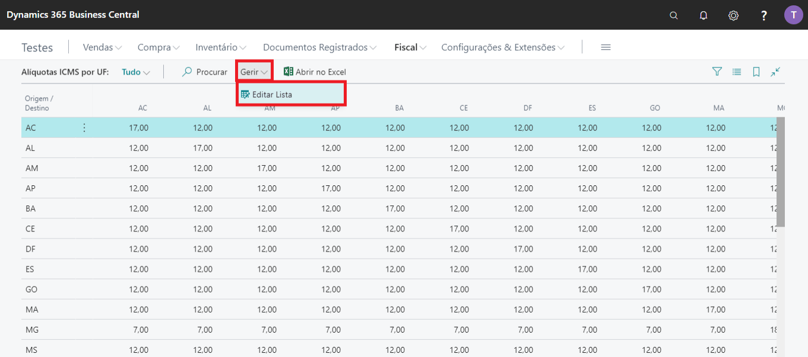

Mantenha a tabela atualizada sempre que a legislação mudar. O Fundo de Combate à Pobreza tem tabela própria, **Alíquotas FCP por UF**, no mesmo menu.

---

## 8. Áreas de impostos

A área de impostos define quais impostos são calculados no documento e como cada um é contabilizado.

1. Pesquise por **Áreas de Impostos (Brasil)** ou abra **Configurações** > **Fiscal** > **Impostos** > **Áreas de Impostos**.
2. Use **Novo** para criar uma área, ou selecione uma área e use **Editar** para abrir o cartão.

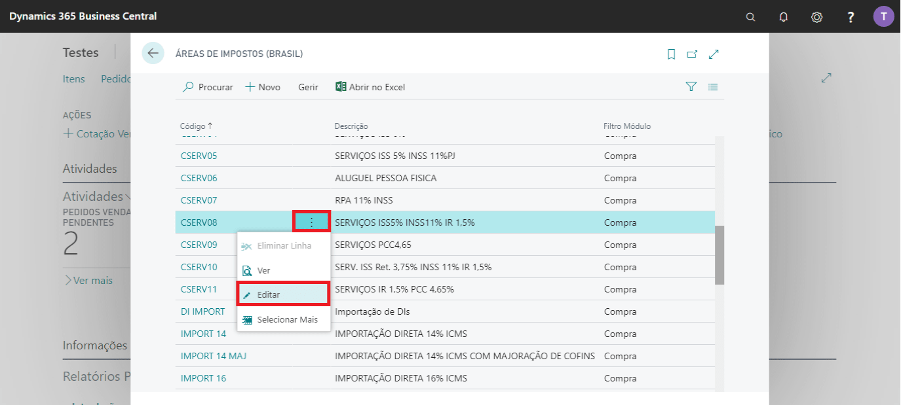

3. Na seção **Geral**, preencha:

| Campo | Descrição |
|-------|-----------|
| **Código** | Código da área, que será informado nos documentos de compra e venda |
| **Descrição** | Descrição da área |
| **Filtro Módulo** | **Compra** ou **Venda**. Em branco, a área pode ser usada nos dois módulos |

4. Na seção **Impostos**, inclua uma linha por jurisdição:

| Campo | Descrição |
|-------|-----------|
| **Cód. Jurisdição Imposto** | Jurisdição que faz parte da área. A **Descrição Jurisdição** é preenchida automaticamente |
| **Cód. Filial** | Preencha quando a linha for específica de uma filial |
| **Ordem Cálculo** | Ordem em que os impostos são calculados. Necessária quando um imposto compõe a base de outro |
| **Cód. Contabilização** | Em que momento (faturamento ou pagamento/recebimento) e de que forma o imposto é contabilizado (seção 10) |
| **Cód. CST** | CST do imposto na área, quando aplicável |
| **Cód. Texto Legal** | Texto legal do imposto na área, quando aplicável |
| **Cód. Enquadramento Legal** | Informe quando a jurisdição for de IPI |
| **Agrupar por Documento** | **Sim** agrupa o imposto em uma só linha por documento (nas estatísticas), mesmo que várias linhas tenham o imposto. Usado em IRRF e INSS |

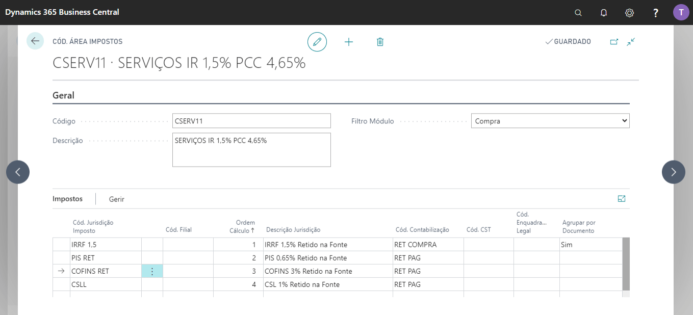

> **Importante**: não altere uma área de impostos que já foi usada em documentos registrados; um cancelamento posterior pode gerar divergências. Crie uma nova área.

As áreas de impostos são usadas nos documentos de compra e venda.

---

## 9. Contas impostos

A página **Contas Impostos** define em quais contas, fornecedores ou outras entidades os impostos são lançados.

1. Pesquise por **Contas Impostos** ou abra **Configurações** > **Fiscal** > **Impostos** > **Contas Impostos**.
2. Cadastre uma linha por imposto (ou por imposto e filtro):

| Campo | Descrição |
|-------|-----------|
| **Classificação Imposto** | Imposto que está sendo configurado |
| **Tipo Filtro** | **Grupo Contábil Negócio**, **Grupo Contábil Produto**, **Cliente**, **Fornecedor** ou **Jurisdição**. O mais comum é **Jurisdição** ou em branco: em branco, as contas valem para todas as jurisdições do imposto |
| **Cód. Filtro** | Código conforme o **Tipo Filtro** (por exemplo, a jurisdição) |
| **Tipo Conta a Pagar** e **N° Conta a Pagar** | Entidade e número da conta do imposto a pagar |
| **Tipo Conta a Recuperar** e **N° Conta a Recuperar** | Entidade e número da conta do imposto a recuperar |
| **Tipo Conta Despesa** e **N° Conta Despesa** | Entidade e número da conta de despesa |
| **Tipo Conta Estorno de Crédito** e **Nº Conta Estorno de Crédito** | Entidade e número da conta de estorno de crédito |

Os tipos de conta disponíveis são **Conta Contábil**, **Cliente**, **Fornecedor**, **Conta Bancária**, **Ativo Fixo** e **Parceiro IC**; os mais usados são **Conta Contábil** e **Fornecedor**. O número da conta lista as opções do tipo escolhido.

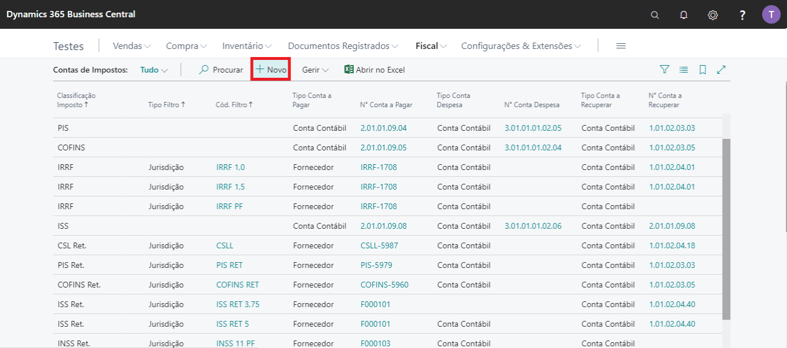

---

## 10. Contabilizações de imposto

A contabilização de imposto define o efeito do imposto: se entra no custo ou no preço do item, se altera o financeiro, se gera imposto a pagar, despesa ou crédito, e se isso ocorre no faturamento ou no pagamento/recebimento. Os efeitos de cada opção estão detalhados em [Jurisdições, Áreas de Impostos e Contabilizações](Localization-for-Brazil_User-Manual_guia-fiscal-jurisdicoes-areas-impostos.md).

1. Pesquise por **Lista Contabilizações Imposto** ou abra **Configurações** > **Fiscal** > **Impostos** > **Contabilizações de Imposto**.
2. Use **Novo** para abrir o **Cartão Contabilização Imposto** e preencha **Código** e **Descrição** na seção **Geral**.

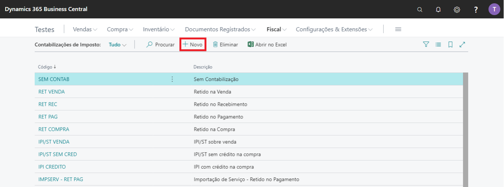

3. Configure uma das três seções seguintes.

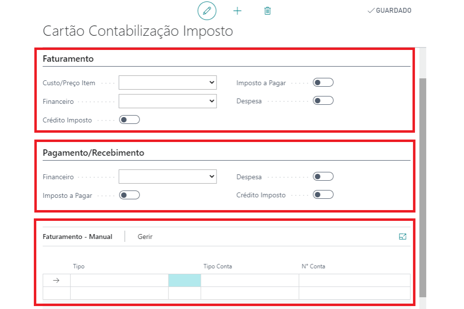

**Faturamento**: para impostos cujo fato gerador é o faturamento (registro do documento de compra ou venda).

| Campo | Descrição |
|-------|-----------|
| **Custo/Preço Item** | **Adicionar** ou **Subtrair** o imposto do custo/preço do item. Em branco quando o imposto não afeta o custo/preço |
| **Financeiro** | **Adicionar ao Total**, **Subtrair do Total**, **Subtrair da Primeira Parcela** ou **Adicionar a Outro Fornecedor**. Em branco quando não há efeito no financeiro |
| **Crédito Imposto**, **Imposto a Pagar**, **Despesa**, **Estorno de Crédito** | Marque os efeitos que se aplicam |

**Pagamento/Recebimento**: para impostos cujo fato gerador é o pagamento (fornecedores) ou o recebimento (clientes) dos títulos.

| Campo | Descrição |
|-------|-----------|
| **Financeiro** | **Adicionar ao Total** ou **Subtrair** |
| **Imposto a Pagar**, **Despesa**, **Crédito Imposto** | Marque os efeitos que se aplicam |

**Faturamento - Manual**: informa diretamente as contas do lançamento, em duas linhas (uma a débito e outra a crédito).

| Campo | Descrição |
|-------|-----------|
| **Tipo** | **Débito** ou **Crédito** |
| **Tipo Conta** | **Conta Contábil**, **Cliente**, **Fornecedor** ou **Conta Bancária** |
| **N° Conta** | Conta, conforme o **Tipo Conta** |

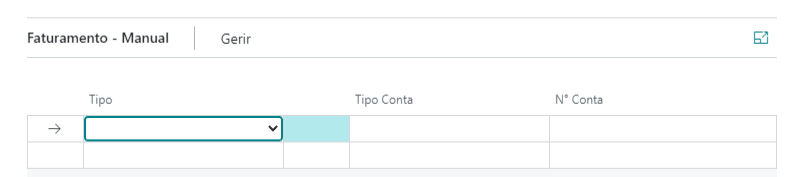

> **Importante**: configure somente uma das três seções em cada código. Um mesmo código não deve, por exemplo, contabilizar o imposto no faturamento e no pagamento/recebimento ao mesmo tempo.

Exemplos:

- Impostos retidos na venda: seção **Faturamento**, **Financeiro** = **Subtrair da Primeira Parcela** e **Crédito Imposto** marcado.

  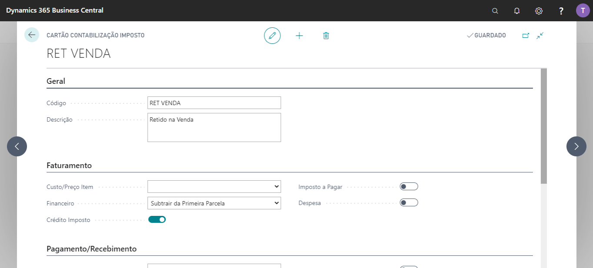

- Impostos retidos no recebimento: seção **Pagamento/Recebimento**, **Financeiro** = **Subtrair do Total** e **Crédito Imposto** marcado.

  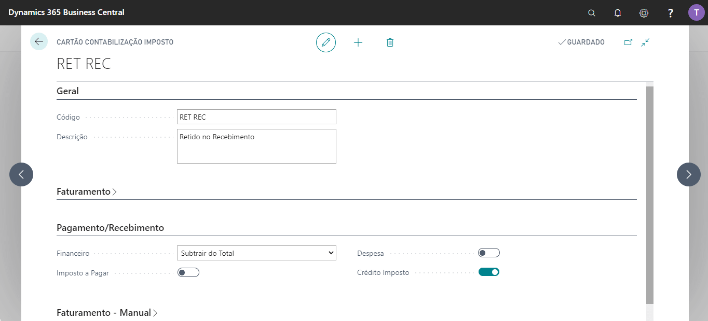

- Impostos retidos no pagamento: seção **Pagamento/Recebimento**, **Financeiro** = **Subtrair do Total** e **Imposto a Pagar** marcado.

  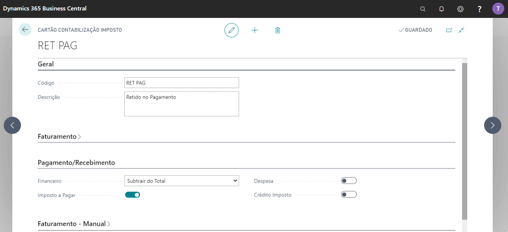

> **Nota**: nas imagens, o **Financeiro** do pagamento/recebimento aparece como **Subtrair do Total**; na versão atual a opção se chama **Subtrair**. A seção **Faturamento** também tem hoje o campo **Estorno de Crédito**, que não aparece nas imagens.

---

## 11. Matriz Impostos

A **Matriz Impostos** reúne, em um código, a configuração fiscal de uma operação: área de impostos, tipo de documento fiscal, CFOPs, CSTs, origem do ICMS e texto legal. Ao escolher a matriz no documento, esses campos são preenchidos automaticamente, o que evita erros de preenchimento. Antes de criá-la, cadastre os CST, CFOP, áreas de impostos e tipos de documento fiscal que ela vai usar.

1. Pesquise por **Matriz Impostos** ou abra **Configurações** > **Fiscal** > **Documentos** > **Matriz Impostos**.
2. Use **Novo** e preencha os campos abaixo.

| Campo | Descrição |
|-------|-----------|
| **Código** e **Descrição** | Identificação da matriz |
| **Tipo** | **Compra** ou **Venda** |
| **Natureza Operação** | Natureza da operação. Veja também [NOP — Natureza da Operação e Matriz Fiscal](Localization-for-Brazil_User-Manual_NOP-Natureza-Operacao.md) |
| **Cód. Área Impostos** | Área de impostos usada pela matriz |
| **Cód. Exceção Imposto** | Exceção de imposto das notas lançadas com a matriz, se houver |
| **Consumidor Final** | Marque quando a matriz for usada em notas para consumidor final |
| **Tipo Documento Fiscal** | Tipo de documento fiscal usado pela matriz |
| **CFOP - Mesmo Estado**, **CFOP - Fora Estado**, **CFOP - Fora Brasil** | CFOP de cada localização do cliente ou fornecedor |
| **CFOP - Usuário Final Mesmo Estado**, **CFOP - Usuário Final Fora Estado** | CFOP das operações com consumidor final |
| **Código Origem ICMS** | Origem do ICMS, se aplicável |
| **Código CST ICMS**, **Cód. CST PIS**, **Cód. CST COFINS**, **Cód. CST IPI** | CST de cada imposto |
| **Cód. Nat. Receita PIS** e **Cód. Nat. Receita COFINS** | Natureza da receita de PIS e de COFINS, se necessário |
| **Tipo Operação** | Tipo de operação (seção 3.2), quando a matriz for de uma operação restrita. Caso contrário, deixe em branco |
| **Cód. Texto Legal** | Texto legal levado para as notas que usam a matriz |

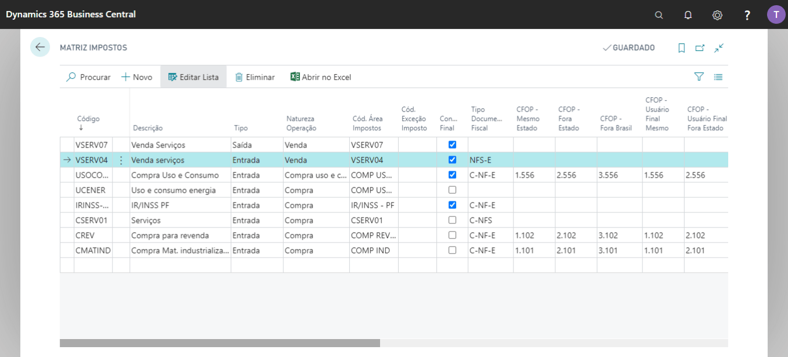

A matriz também tem campos da Reforma Tributária (**Cód. Class. Trib. IBS/CBS** e **Cód. Class. Trib. Regular IBS/CBS**), **Cód. Base Cálculo Crédito PIS/COFINS**, **Cod. Método de Envio** e **Cód. NOP**.

> **Nota**: quando o campo **Admin. Matriz de Impostos** das **Configurações Fiscais** está preenchido, só o usuário informado nele pode alterar a **Matriz Impostos**. Para os demais, a página abre somente para consulta.

A matriz é escolhida na seção **Fiscal** dos documentos de compra e venda.

---

## 12. Impostos sobre encargos de item

A página **Impostos sobre Encargos de Item** define quais impostos incidem sobre cada encargo de item usado nos documentos. É essencial principalmente na importação.

1. Pesquise por **Impostos sobre Encargos de Item** ou abra **Configurações** > **Fiscal** > **Impostos** > **Impostos sobre Encargos de Item**.
2. A página lista todos os encargos de item cadastrados, com uma coluna por imposto. Só as colunas dos impostos são editáveis.
3. Preencha **Sim** em cada imposto que incide sobre o encargo. Nas colunas vazias, o encargo não compõe a base do imposto.

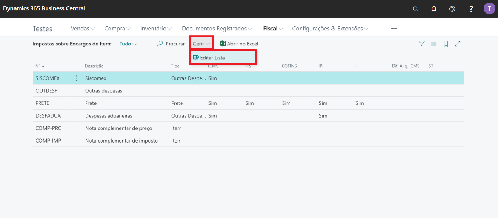

---

## 13. Editar campos de um documento fiscal registrado

A ação **Editar Campos** permite corrigir alguns campos de uma nota fiscal já registrada. A descrição completa dos campos editáveis e das travas está em [Editar Campos do Documento Fiscal Registrado](Localization-for-Brazil_User-Manual_Editar-Campos-Documento-Fiscal-Registrado.md).

1. Abra os **Documentos Fiscais Registrados** e abra o documento a corrigir.
2. Em **Ações**, use **Documento** > **Editar Campos**.

   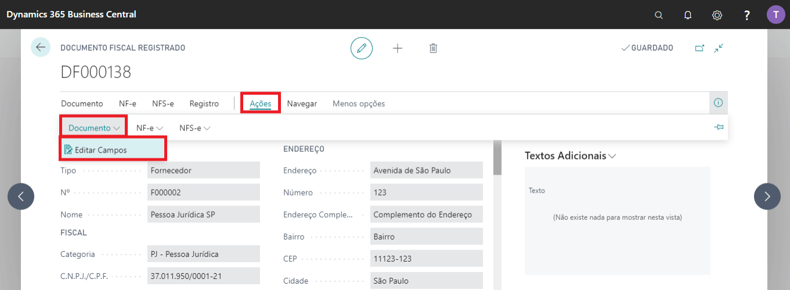

3. Confirme a mensagem informando que os dados são salvos automaticamente.
4. Altere os campos que ficarem editáveis (em branco); os campos em cinza não podem ser alterados.

   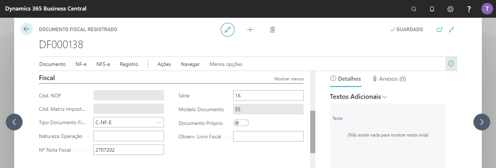

   Nas linhas, campos como **Nº Item**, **Quantidade**, **Valor** e **Cód. Área Imposto** não ficam editáveis.

   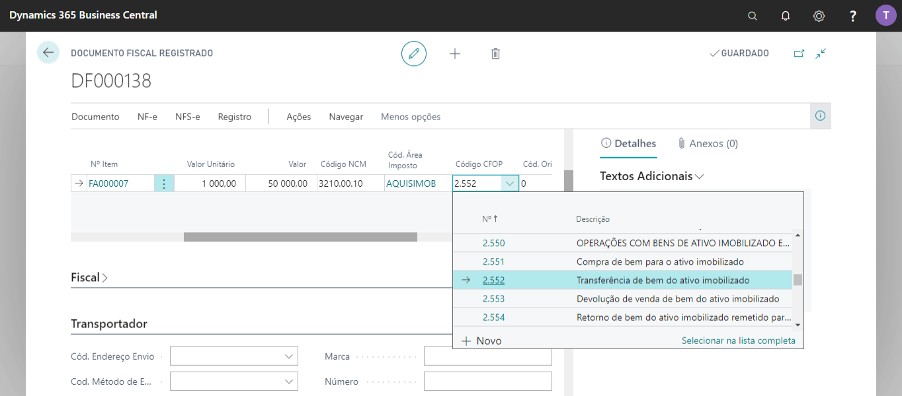

5. Ao terminar, basta sair da página.

---

## 14. Relatórios de impostos retidos

Os relatórios **Impostos Retidos - Compras** e **Impostos Retidos - Vendas** mostram os impostos retidos por documento fiscal registrado, nas compras e nas vendas de produtos e serviços.

1. Pesquise por **Impostos Retidos** e escolha o relatório.

   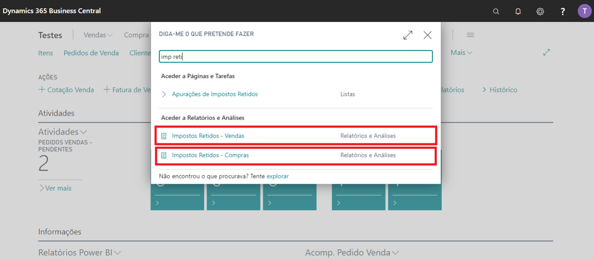

2. Informe os filtros:

| Filtro | Descrição |
|--------|-----------|
| **Data Registro** | Data ou intervalo de datas a analisar |
| **Data Documento** | Data ou intervalo de datas do documento |
| **Nº Participante** | Fornecedor (compras) ou cliente (vendas). Em branco, o relatório traz todos |
| **Nº Nota Fiscal** | Uma ou mais notas fiscais específicas |
| **Data de Pagamento Entre:** **Início** e **Final** | Na guia **Opções**, intervalo de datas de pagamento |

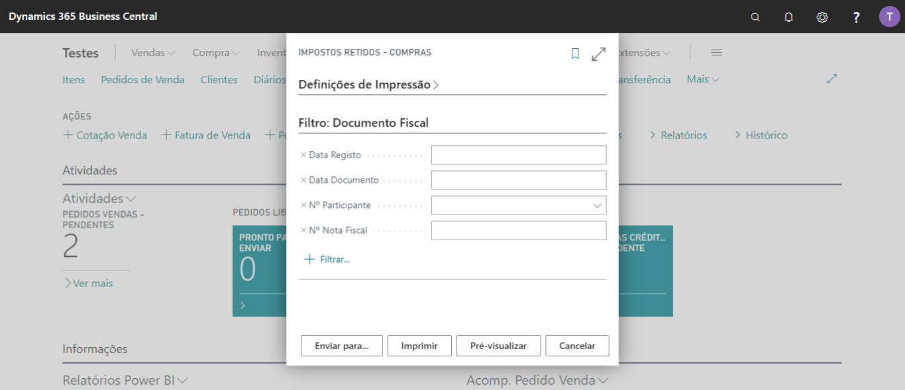

3. Use **Pré-visualizar** para ver o relatório, **Imprimir** para imprimi-lo ou **Enviar para** para exportá-lo.

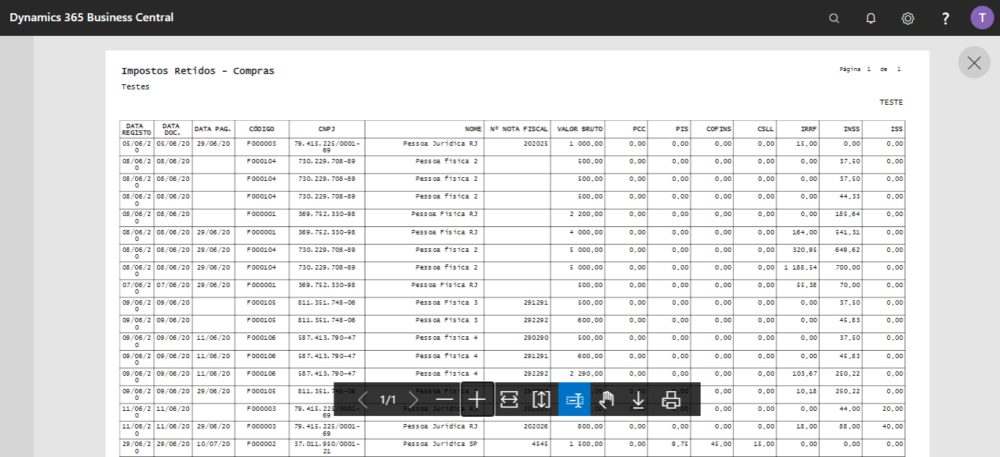

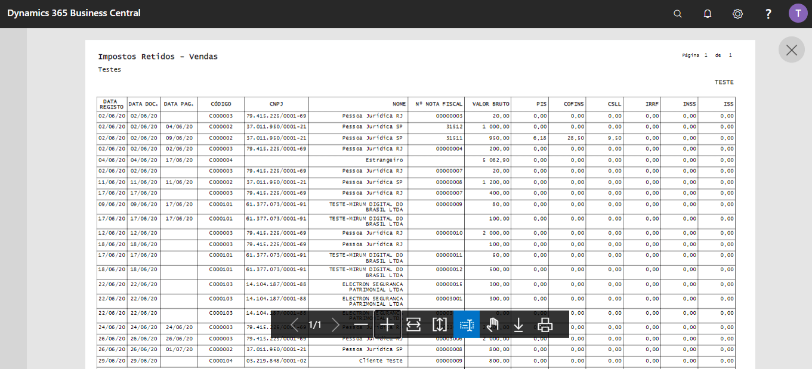
