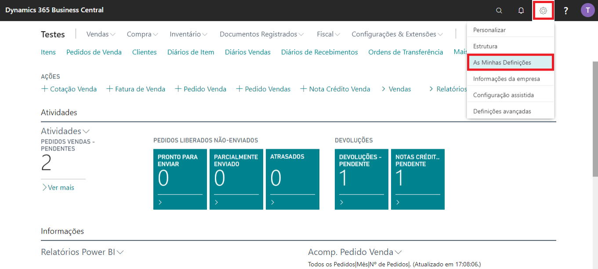
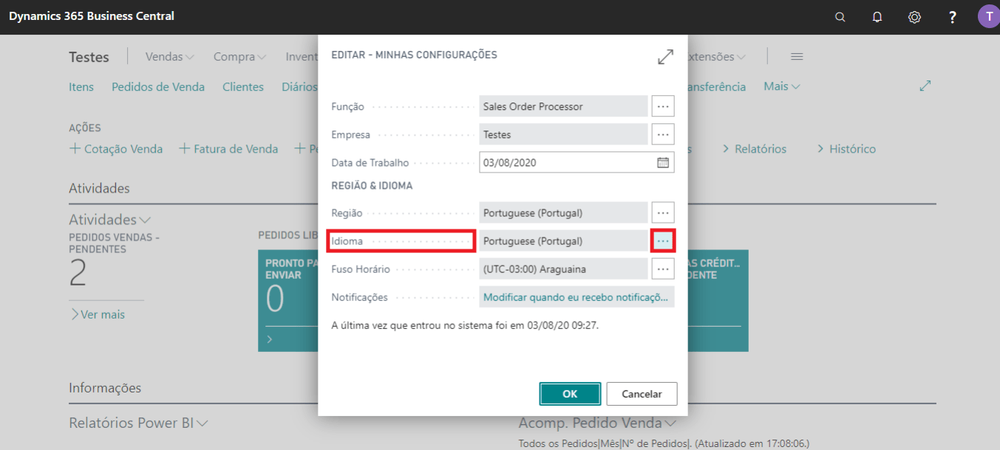
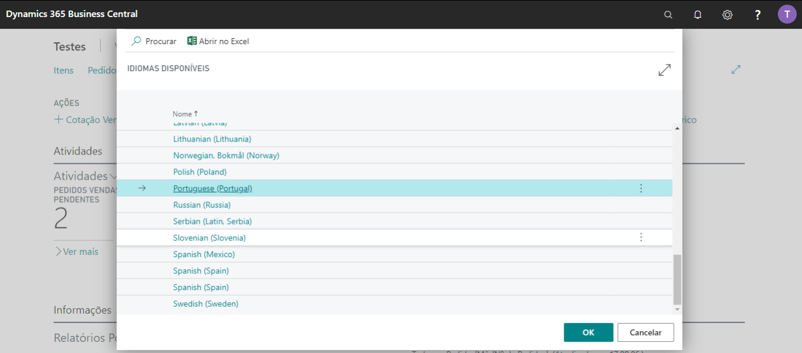
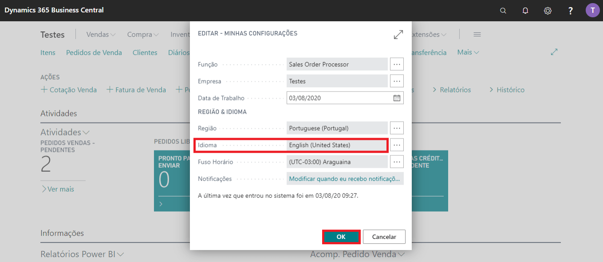
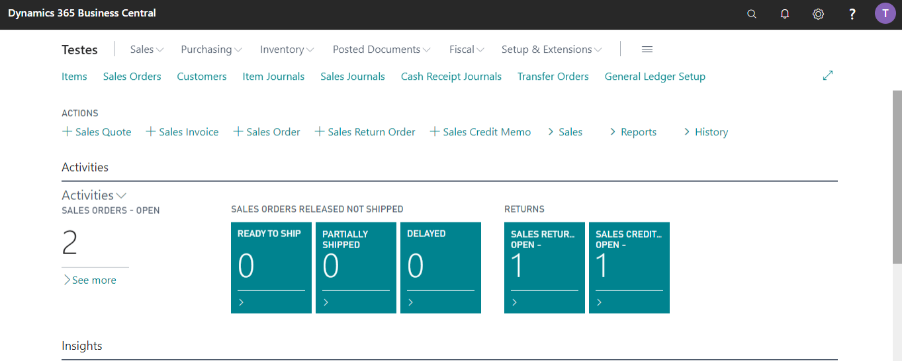
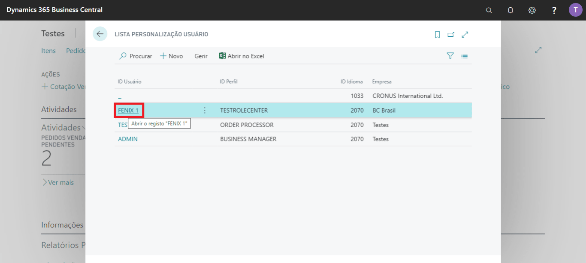
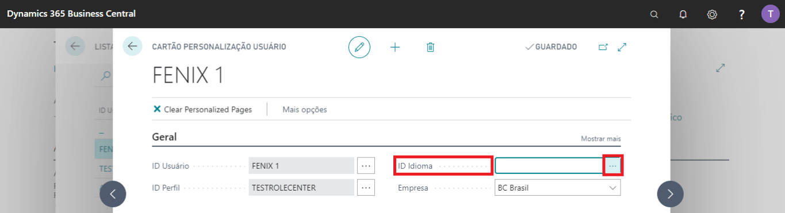

# Geral: Configuração de Idioma

**Data**: Julho/2020

---

## Sumário

O idioma em que o Business Central é exibido é uma configuração de cada usuário. O próprio usuário escolhe o idioma em **Minhas Configurações**, e o administrador pode definir o idioma de qualquer usuário na página **Preferências de usuário**. Os dois caminhos são recursos padrão do Business Central e alteram a mesma configuração.

---

## 1. Contexto

A localização não tem configuração própria de idioma: as páginas, campos e mensagens da localização seguem o idioma escolhido pelo usuário, como as do Business Central padrão. Para trabalhar em português do Brasil, escolha o idioma **Português (Brasil)**.

> **Nota**: a tradução para o português do Brasil das páginas padrão do Business Central vem do app **Portuguese language (Brazil)**, da Fênix. Sem ele instalado no ambiente, as páginas padrão aparecem no idioma de origem, e só as da localização ficam em português.

Ao trocar de idioma, alguns perfis (funções) podem deixar de aparecer na lista do campo **Função**. O motivo e a correção estão em [Funções indisponíveis em outros idiomas](Localization-for-Brazil_User-Manual_Funcoes-indisponiveis-em-outros-idiomas.md).

---

## 2. Escolher o idioma do próprio usuário

1. Clique no ícone de engrenagem, no canto superior direito, e escolha **Minhas Configurações**.

   

2. Na página **Minhas Configurações**, clique nas reticências do campo **Idioma**.

   

3. Na lista de idiomas disponíveis, escolha o idioma desejado e clique em **OK**.

   

4. De volta a **Minhas Configurações**, confira o idioma escolhido e clique em **OK**.

   

O Business Central é recarregado no idioma escolhido.

> **Nota**: as imagens são de uma versão anterior do Business Central, em português de Portugal (**As Minhas Definições**). Na versão atual, em português do Brasil, a opção se chama **Minhas Configurações**.

---

## 3. Definir o idioma de outro usuário

O administrador pode definir o idioma de um usuário para que ele já acesse o sistema nesse idioma:

1. Pesquise por **Preferências de usuário**.
2. Selecione o usuário e abra o cartão. Para um usuário que ainda não aparece na lista, use **Novo**.

   

3. No **Cartão Personalização Usuário**, clique nas reticências do campo **Idioma** e escolha o idioma desejado.

   

4. Feche o cartão.

A partir do próximo acesso, o usuário vê o sistema no idioma definido. Ele continua podendo trocar o idioma em **Minhas Configurações**, porque as duas páginas alteram a mesma configuração.

> **Nota**: nas imagens, a lista se chamava **Lista Personalização Usuário** e o campo do cartão era **ID Idioma**, preenchido com o código numérico do idioma (2070 é o português de Portugal; o português do Brasil é 1046). Na versão atual, a lista se chama **Preferências de usuário** e o campo **Idioma** mostra o nome do idioma.
