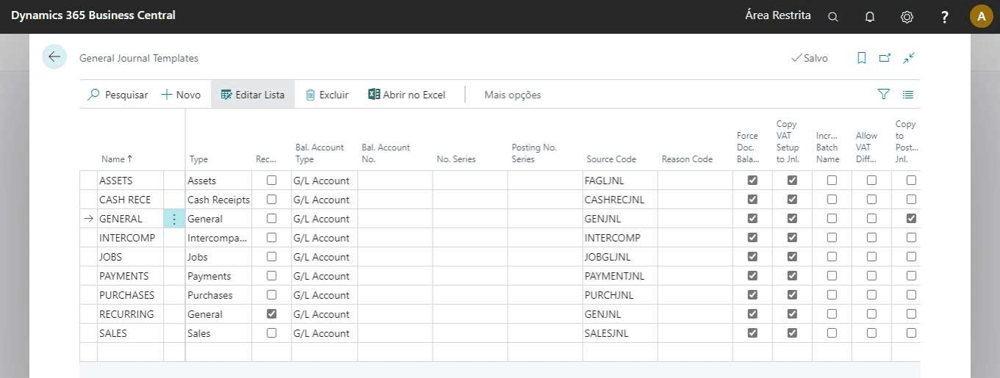
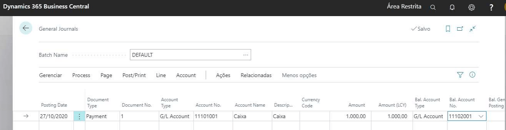
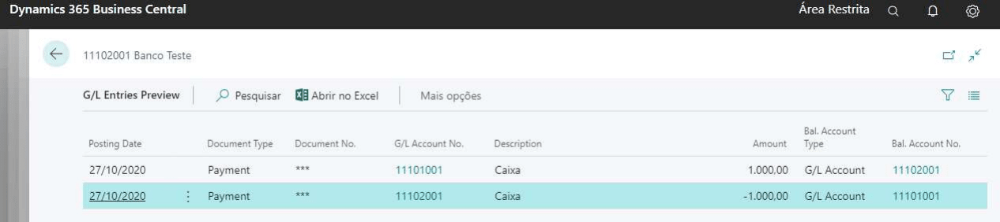
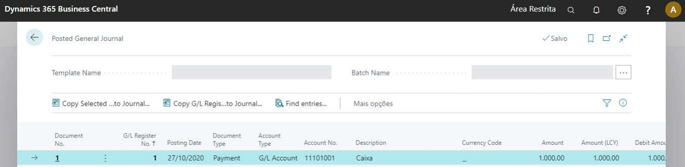
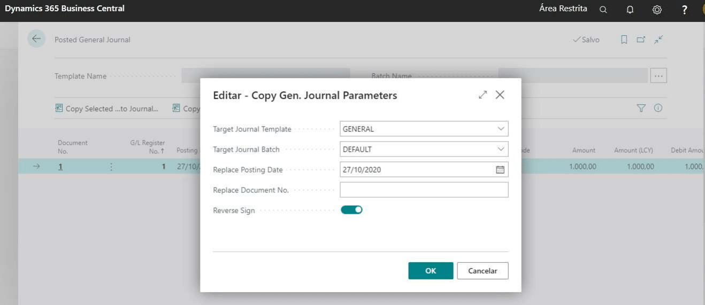
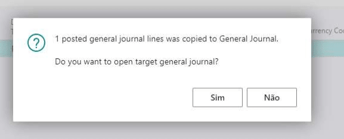
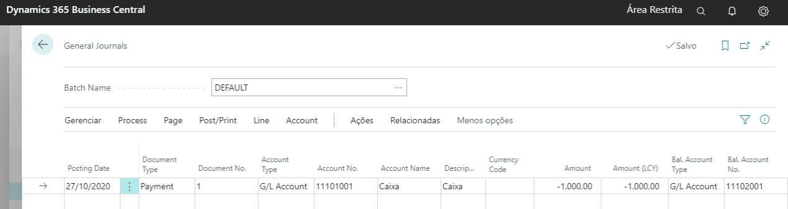
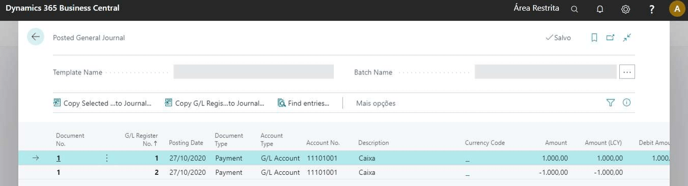

# Contabilidade: Copiar Linhas de Diários Registrados

**Data**: Outubro/2020

---

## Sumário

O Business Central guarda uma cópia das linhas registradas pelo diário geral e permite copiá-las de volta para um diário. O recurso poupa tempo quando é preciso estornar uma contabilização, copiando as linhas com o sinal invertido, ou refazê-la com outras contas ou valores a partir da mesma base. É um recurso padrão do Business Central, sem configuração própria da localização.

---

## 1. Configurar o diário geral

As linhas só ficam disponíveis para cópia quando o diário está configurado para guardá-las no registro:

1. Pesquise por **Modelos Diário Geral**.
2. No modelo de diário usado, marque **Copiar para Linhas Diário Reg.**.

A seção do diário tem o mesmo campo **Copiar para Linhas Diário Reg.**, para controlar o recurso por seção.

> **Nota**: só as linhas registradas depois de marcar o campo podem ser copiadas. Os registros anteriores não têm cópia guardada.

---

## 2. Registrar o lançamento

Lance e registre o diário geral normalmente. Antes de registrar, confira a contabilização pela pré-visualização do registro.

---

## 3. Copiar as linhas registradas

1. Pesquise por **Diário Geral Registrado**. A página lista as linhas registradas, com o nº do registro contábil de cada uma.

   

2. Selecione as linhas que deseja copiar e use **Copiar Linhas Selecionadas para o Diário**. Para copiar todas as linhas de um registro contábil, use **Copiar Registro G / L para Diário**.
3. Na página **Copiar Parâmetros do Diário Geral**, preencha os campos abaixo e clique em **OK**.

| Campo | Descrição |
|-------|-----------|
| **Modelo de Diário de Destino** | Modelo do diário que vai receber as linhas |
| **Lote de Diário de Destino** | Seção do diário que vai receber as linhas |
| **Substituir Data Registro** | Data de registro das linhas copiadas. Em branco, as linhas mantêm a data original |
| **Substitua o Nº do Documento** | Nº do documento das linhas copiadas. Em branco, as linhas mantêm o nº original |
| **Inversa Entrar** | Inverte o sinal dos valores, para gerar o estorno do lançamento original |

O sistema informa quantas linhas foram copiadas e pergunta se deseja abrir o diário de destino. Clique em **Sim**.

No diário, ajuste as linhas se necessário, confira a contabilização e registre.

Depois do registro, o **Diário Geral Registrado** mostra o lançamento original e o novo, cada um no seu registro contábil.

> **Nota**: as imagens são de uma versão do Business Central com parte das páginas em inglês. Os nomes usados no texto são os da versão atual em português.
