# Contabilidade: Correção de Dimensões

**Data**: Maio/2022

---

## Sumário

O Business Central permite corrigir as dimensões de movimentos contábeis já registrados, sem estornar nem registrar de novo o documento. A correção é preparada num rascunho, executada na hora ou agendada, fica registrada num histórico e pode ser desfeita.

A funcionalidade é padrão do Business Central. A localização acrescenta uma regra: a dimensão usada como filial não pode ser alterada em movimentos ligados a um documento fiscal (seção 3).

---

## 1. Contexto

A correção de dimensões atua sobre os **Movimentos Contabilidade**. Ela permite:

- trocar o valor de uma dimensão;
- incluir uma dimensão que faltou no registro;
- remover uma dimensão aplicada por engano.

Com **Atualizar Visões de Análise** marcado, os dados das visões de análise (esquemas de contas) também são atualizados.

---

## 2. Corrigir dimensões

### 2.1. Abrir o rascunho

1. Pesquise por **Movimentos Contabilidade** e selecione os movimentos que serão corrigidos.
2. Clique em **Relacionadas** > **Movimento** > **Corrigir Dimensões**.

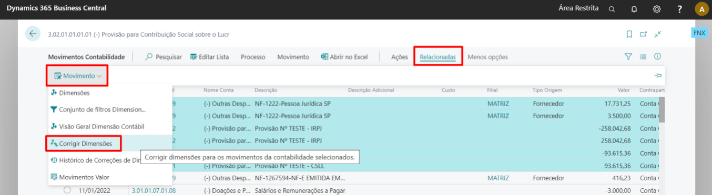

O sistema abre o **Rascunho da Correção de Dimensão**.

### 2.2. Aba Geral

A aba **Geral** mostra quem criou e quem modificou o rascunho por último, e quando.

| Campo | Descrição |
|-------|-----------|
| **Descrição** | Descrição da correção. Preencha com um resumo do que está sendo feito: é o que identifica a correção no histórico |
| **Status** | Situação da correção, que começa como **Rascunho** |
| **Atualizar Visões de Análise** | Atualiza também os dados das visões de análise (esquemas de contas) |

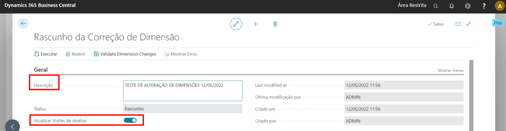

### 2.3. Alterações de Correção de Dimensão

A parte **Alterações de Correção de Dimensão** lista as dimensões dos movimentos selecionados:

| Campo | Descrição |
|-------|-----------|
| **Cód. Dimensão** | Dimensão aplicada aos movimentos registrados |
| **Código Valor Dimensão** | Valor atual da dimensão nos movimentos registrados |
| **Novo Cod. Valor Dimensão** | Novo valor que a dimensão vai receber |

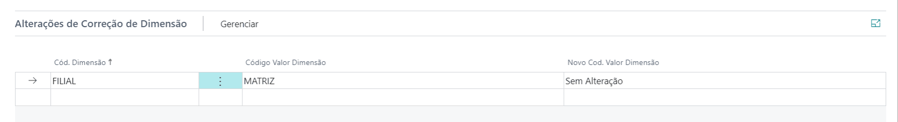

No menu **Gerenciar** da parte estão as ações:

| Ação | O que faz |
|------|-----------|
| **Reverter Todas as Alterações** | Desfaz todas as alterações informadas no rascunho |
| **Remover dimensão** | Marca a dimensão da linha para ser removida dos movimentos |
| **Reverta a mudança** | Desfaz a alteração informada na linha selecionada |
| **Nova Linha** | Inclui uma linha para adicionar uma dimensão que os movimentos não têm |

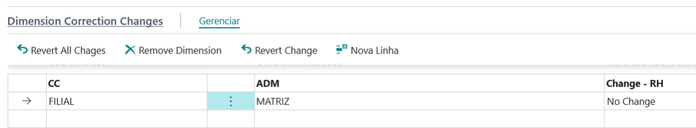

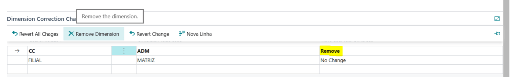

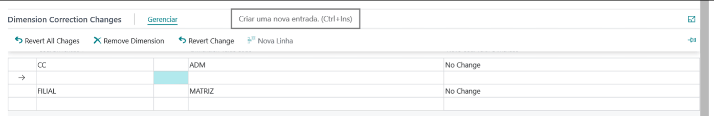

Para alterar uma dimensão, escolha o novo valor no campo **Novo Cod. Valor Dimensão**:

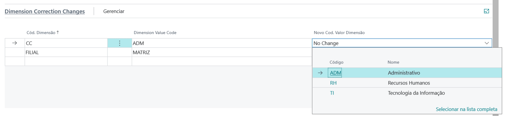

A linha alterada fica em negrito:

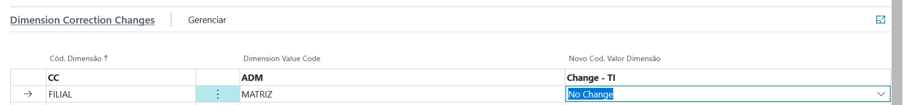

O campo **Novo Cod. Valor Dimensão** mostra o tipo da alteração junto com o valor: **Sem Alteração**, **Alterado**, **Adicionar** ou **Remover**.

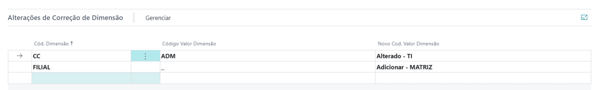

### 2.4. Movimentos Selecionados

A parte **Movimentos Selecionados** mostra os movimentos contábeis que a correção vai alterar.

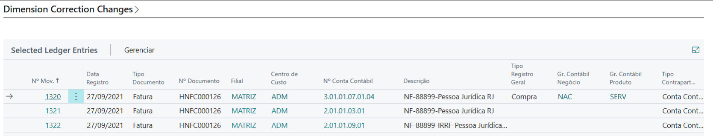

### 2.5. Executar

1. Com as alterações informadas, clique em **Executar**.
2. Na janela **Executar Correção de Dimensão**, marque **Executar imediatamente** ou preencha os **Parâmetros de agendamento** para que a correção rode em outro horário.
3. Clique em **OK**.

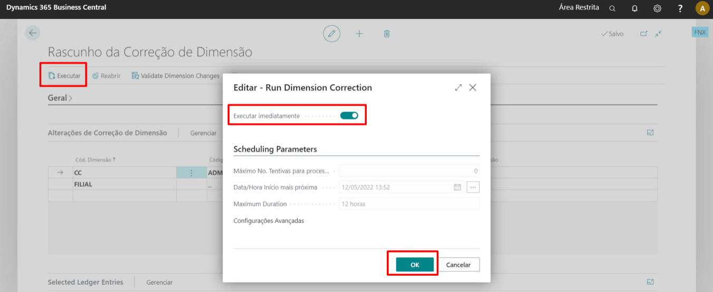

A correção é agendada e roda em segundo plano:

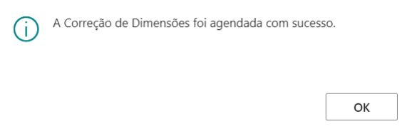

O andamento é acompanhado no histórico (seção 4).

---

## 3. Dimensão de filial

Quando a **Configuração Contabilidade** tem o **Cód. Dimensão Filial** preenchido, o valor dessa dimensão não pode ser alterado em movimentos ligados a um documento fiscal. Ao informar a alteração, o sistema exibe:

```
Não é permitido alterar o valor da dimensão Filial para o documento fiscal DF000217.
```

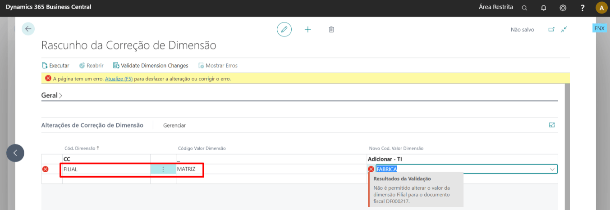

> **Nota**: a regra vale para qualquer alteração da dimensão de filial (troca, inclusão ou remoção) em movimentos com documento fiscal. Movimentos sem documento fiscal, como lançamentos de diário, podem ter a dimensão de filial corrigida.

---

## 4. Histórico de correções de dimensões

1. Em **Movimentos Contabilidade**, clique em **Relacionadas** > **Movimento** > **Histórico de Correções de Dimensões**.

   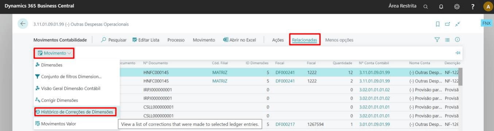

2. A lista **Correções de Dimensão** mostra cada correção com o **Nº Mov.**, a **Descrição** e o **Status**.

   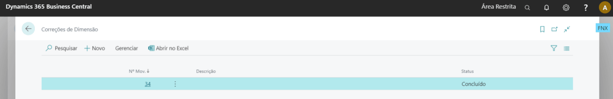

3. Clique no **Nº Mov.** para ver o que foi alterado na página **Correção de dimensões**, com o status da correção e o da atualização das visões de análise.

   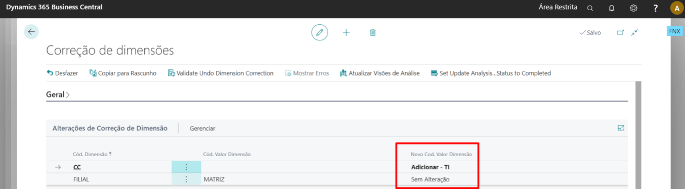

Com a **Descrição** preenchida no rascunho, a correção fica identificada no histórico:

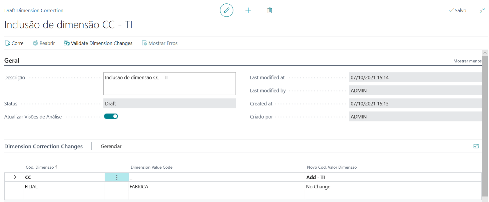

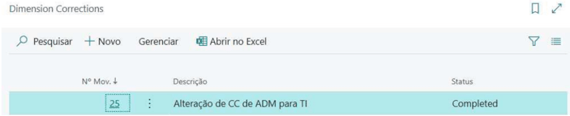

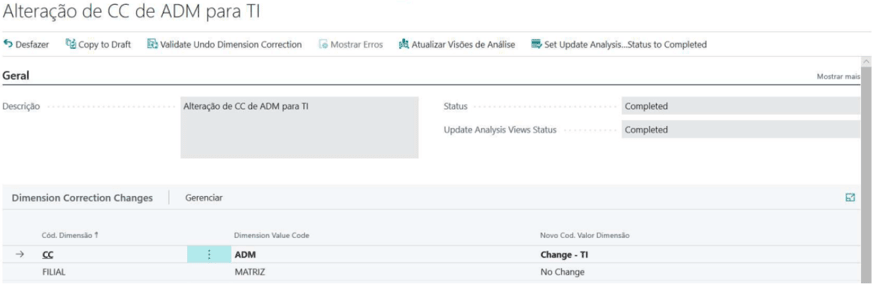

---

## 5. Desfazer uma correção

Na página **Correção de dimensões** de uma correção concluída, é possível desfazê-la. O processo é o mesmo, no sentido contrário.

1. Clique em **Desfazer**.
2. Na janela **Desfazer Correção de Dimensão**, marque **Executar imediatamente** ou agende a execução, e clique em **OK**.

   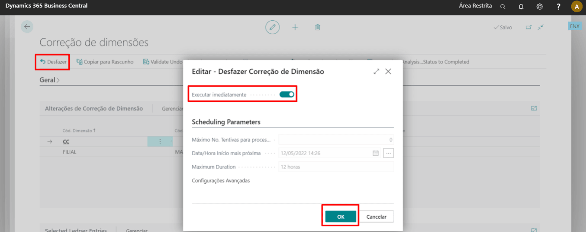

3. A correção passa ao status **Desfazer em Processo** e, ao terminar, a **Desfazer Concluído**. Os movimentos voltam às dimensões que tinham antes da correção.

   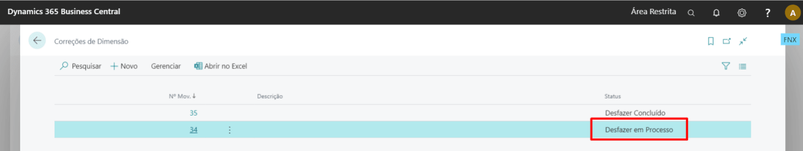

> **Nota**: só é possível desfazer correções concluídas.
