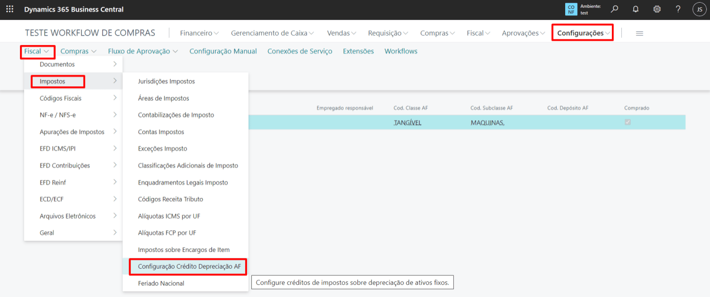
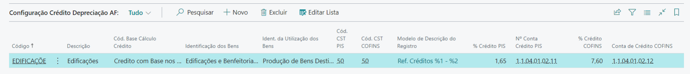
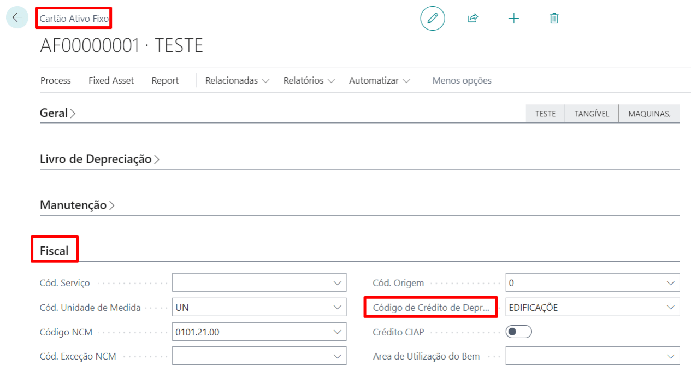
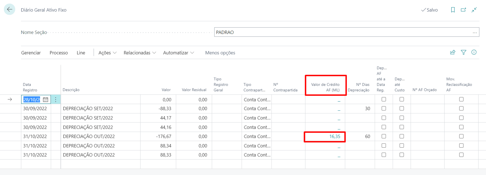
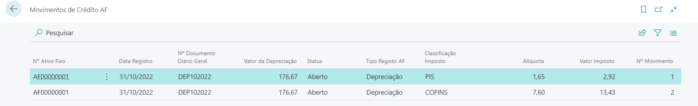
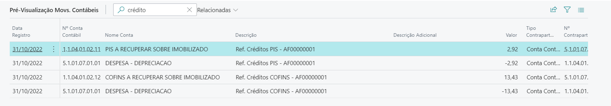
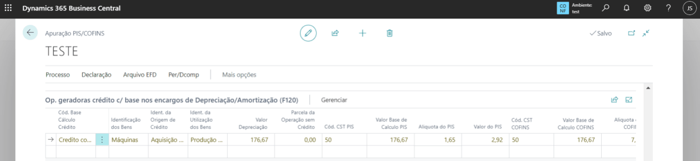

# PIS/COFINS: Crédito sobre Despesa com Depreciação

**Data**: Dezembro/2022

---

## Sumário

Empresas que apuram PIS/COFINS pelo regime não cumulativo têm direito a crédito sobre os encargos de depreciação ou amortização dos bens usados na produção de bens destinados à venda, na prestação de serviços ou na locação a terceiros. A localização calcula esse crédito junto com a depreciação: ao executar **Calcular Depreciação**, cada linha de depreciação de um ativo configurado gera os créditos de PIS e de COFINS, que são contabilizados no registro do diário e levados ao registro F120 da EFD-Contribuições.

---

## 1. Configurar o crédito

1. Pesquise por **Conf. Crédito Depreciação AF** ou, no Centro de Funções, abra **Configurações** > **Fiscal** > **Impostos** > **Configuração Crédito Depreciação AF**.

   

2. Crie um código para cada tipo de bem, com os campos abaixo:

| Campo | Descrição |
|-------|-----------|
| **Código** | Código do tipo de bem, informado depois no cartão do ativo fixo |
| **Descrição** | Descrição do tipo de bem |
| **Cod. Livro Depreciação** | Livro de depreciação de onde o crédito é calculado. Em branco, o crédito é calculado em qualquer livro. Veja [EFD Contribuições: Crédito de PIS/COFINS sobre Depreciação/Amortização por Livro de Depreciação](Localization-for-Brazil_User-Manual_EFD-Credito-PIS-COFINS-Livro-Depreciacao.md) |
| **Cód. Base Cálculo Crédito** | Se o crédito é calculado sobre os encargos de depreciação ou de amortização |
| **Identificação dos Bens** | Grupo de bens do ativo imobilizado ao qual o bem pertence |
| **Ident. da Utilização dos Bens** | Uso do bem que dá direito ao crédito: produção de bens destinados à venda, prestação de serviços, locação a terceiros ou outros |
| **Cód. CST PIS** | CST de PIS do crédito. Só aceita CSTs de crédito |
| **Cód. CST COFINS** | CST de COFINS do crédito. Só aceita CSTs de crédito |
| **Modelo de Descrição do Registro** | Descrição dos lançamentos contábeis do crédito. `%1` é o imposto (PIS ou COFINS), `%2` o nº do ativo fixo e `%3` a data de registro. O padrão é `Ref. Créditos %1 - %2` |
| **% Crédito PIS** | Alíquota do crédito de PIS, por exemplo 1,65 |
| **Nº Conta Crédito PIS** | Conta contábil do PIS a recuperar |
| **% Crédito COFINS** | Alíquota do crédito de COFINS, por exemplo 7,60 |
| **Conta de Crédito COFINS** | Conta contábil da COFINS a recuperar |

> **Nota**: o crédito de cada imposto só é calculado quando a alíquota dele é maior que zero, e nesse caso a conta de crédito do imposto é obrigatória. Os campos **Cód. Base Cálculo Crédito**, **Identificação dos Bens**, **Ident. da Utilização dos Bens**, **Cód. CST PIS** e **Cód. CST COFINS** alimentam o registro F120 e só aparecem com o app **Localization for Brazil - Tax Books** instalado.

---

## 2. Configurar os ativos fixos

No **Cartão Ativo Fixo** de cada bem que gera crédito, guia **Fiscal**, informe o código configurado no campo **Código de Crédito de Depreciação**.

---

## 3. Calcular e registrar o crédito

O crédito é calculado automaticamente quando a depreciação é calculada:

1. Execute **Calcular Depreciação**, como de costume. As linhas de depreciação vão para o **Diário Geral de Ativo Fixo**.
2. No diário, a coluna **Valor de Crédito AF (ML)** mostra o total dos créditos de PIS e COFINS de cada linha de depreciação.

   

3. Clique no valor para abrir os **Movimentos de Crédito AF** da linha, com a base, a alíquota e o valor de cada imposto. Enquanto o diário não é registrado, os movimentos ficam com **Status** **Aberto**.

   

4. Registre o diário. Para cada imposto, o crédito é debitado na conta de crédito da configuração, em contrapartida da **Conta Despesas Depreciação** do grupo contábil do ativo, com a mesma dimensão e filial da linha de depreciação. A pré-visualização do registro mostra esses lançamentos.

   

Os movimentos registrados passam a ter **Status** **Registrado** e podem ser consultados pela ação **Movimentos de Crédito** do **Cartão Ativo Fixo**.

> **Nota**: o crédito só é calculado para as linhas de depreciação geradas por **Calcular Depreciação** no **Diário Geral de Ativo Fixo**, isto é, em livros de depreciação integrados à contabilidade; linhas digitadas ou valores alterados depois do cálculo não geram nem recalculam o crédito. Se a **Configuração Crédito Depreciação AF** tem um **Cod. Livro Depreciação**, só a depreciação desse livro gera crédito.

> **Nota**: excluir a linha do diário antes do registro exclui também os créditos em aberto. Ao cancelar um movimento de depreciação pela ação **Cancelar Movimentos**, os créditos dele são estornados na contabilidade e passam para **Status** **Cancelado**. O estorno pela ação **Estornar Transação** não altera o status dos créditos, que continuam no registro F120.

---

## 4. EFD-Contribuições: registro F120

Na **Apuração PIS/COFINS**, os créditos registrados com data dentro do período da apuração são levados ao registro F120, com uma linha por ativo fixo. A linha reúne o valor da depreciação, as bases, as alíquotas e os valores de PIS e COFINS, e os dados da **Configuração Crédito Depreciação AF**: base de cálculo, identificação e utilização dos bens e CSTs.

