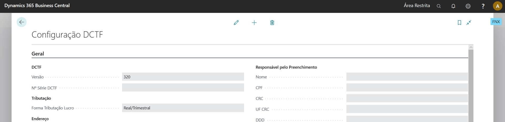
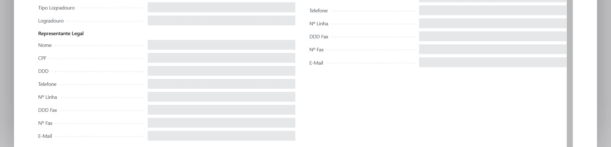
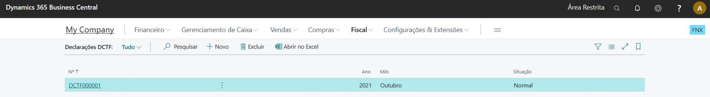
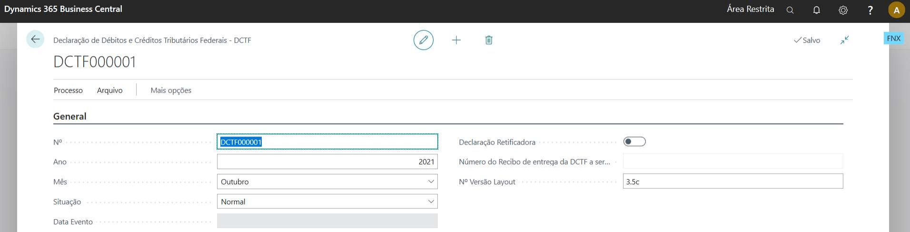
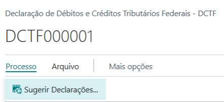
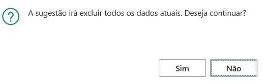
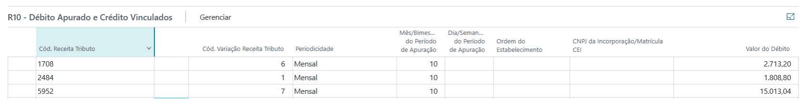
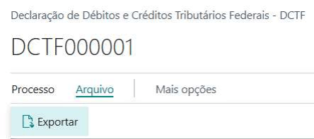
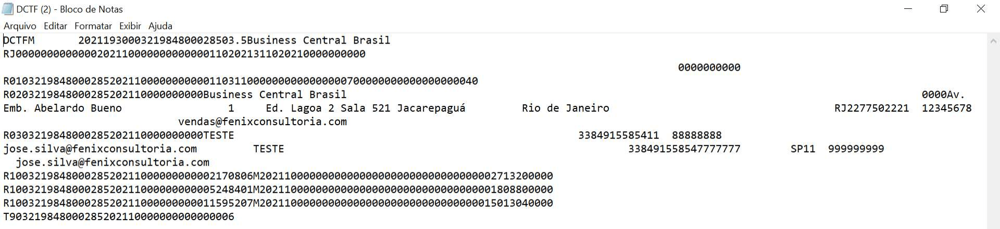

# DCTF: Configuração e Geração da Declaração

**Data**: Novembro/2021

---

## Sumário

A localização gera o arquivo da DCTF (Declaração de Débitos e Créditos Tributários Federais) para importação no programa da Receita Federal. A declaração é sugerida a partir dos movimentos de fornecedor dos impostos federais com guia do tipo DARF registrados no mês: o sistema cria as linhas de débito apurado (registro R10) por código de receita e vincula a elas os DARFs pagos (registro R11). Depois da conferência, a declaração é exportada em arquivo texto.

> **Nota**: a Receita Federal substituiu a DCTF pela DCTFWeb. Na localização, a página **Configuração DCTF** já agrupa os campos da DCTF sob **Obsoleto**, e os débitos de tributos federais que vão para a DCTFWeb fora do eSocial e da EFD-Reinf são informados pelo arquivo MIT, descrito no manual [MIT — Módulo de Inclusão de Tributos](Localization-for-Brazil_User-Manual_MIT-Modulo-Inclusao-Tributos.md). A geração da DCTF descrita aqui continua disponível no sistema.

## 1. Contexto

A DCTF informa, para cada tributo federal apurado no período, o débito e a forma de extinção (pagamento, compensação ou suspensão). Os conceitos da declaração estão no [Guia Fiscal: DCTF](Localization-for-Brazil_User-Manual_guia-fiscal-dctf.md).

### Pré-requisitos

- Módulo de obrigações avançadas (app **Localization for Brazil - Tax Books**).
- **Informações da Empresa** com nome, cidade, UF, CEP e CNPJ preenchidos: a exportação recusa o arquivo sem esses dados.
- Jurisdições de imposto federais com **Tipo Guia Pagamento** igual a **DARF**, **Periodicidade** e **Cód. Receita Tributo** preenchidos, e esse código de receita configurado como na seção 2.2.

---

## 2. Configuração

### 2.1 Configuração DCTF

1. Pesquise por **Configuração DCTF** ou, no Centro de Funções, abra **Configurações** > **Fiscal** > **Arquivos Eletrônicos** > **Configuração DCTF**.
2. Preencha os campos com as mesmas informações informadas no programa da Receita.

> **Nota**: na versão atual, a página abre com o grupo **MIT**, usado pela DCTFWeb. Os campos da DCTF mostrados nas imagens ficam no grupo **Obsoleto**, logo abaixo, com a mesma organização.

| Campo | Descrição |
|-------|-----------|
| **Versão** | Versão do layout da DCTF. É copiada para o campo **Nº Versão Layout** de cada nova declaração |
| **Nº Série DCTF** | Série numérica das declarações. Obrigatória para criar uma declaração |
| **Forma Tributação Lucro** | Forma de tributação do lucro da empresa, como **Real/Trimestral** ou **Presumido** |
| **Tipo Logradouro** / **Logradouro** | Endereço da empresa no formato da DCTF. Obrigatórios na exportação |
| **Representante Legal** | **Nome**, **CPF**, **DDD**, **Telefone**, **Nº Linha**, **DDD Fax**, **Nº Fax** e **E-Mail** do representante legal. **Nome** e **CPF** são obrigatórios na exportação |
| **Responsável pelo Preenchimento** | **Nome**, **CPF**, **CRC**, **UF CRC**, telefones e **E-Mail** do responsável pela declaração. **Nome** e **CPF** são obrigatórios na exportação |

### 2.2 Códigos Receita Tributo

Cada código de receita usado nos impostos federais precisa indicar o grupo de tributo da DCTF.

1. Pesquise por **Códigos Receita Tributo** ou, no Centro de Funções, abra **Configurações** > **Fiscal** > **Impostos** > **Códigos Receita Tributo**.
2. Preencha a coluna **Grupo DCTF** (IRPJ, IRRF, IPI, IOF, CSLL, PIS/PASEP, COFINS, CIDE, CSRF etc.) de cada código usado na declaração. Sem ela, a sugestão da declaração é interrompida com erro.
3. Quando a empresa declara débitos de SCP ou INC, preencha também a coluna **Débito de SCP/INC**.

> **Nota**: as colunas **Grupo DCTF** e **Débito de SCP/INC** ficam ocultas por padrão; exiba-as pela personalização da página.

O código de variação da receita sai do próprio código: cadastre o código no formato `0000-00` (por exemplo, `1708-06`), e o sistema usa os dois dígitos após o hífen como **Cód. Variação Receita Tributo**. Um código sem variação (`0000`) é declarado com variação zero. O código de variação vigente deve seguir as orientações da Receita Federal.

---

## 3. Gerar a declaração

### 3.1 Criar a declaração

1. Pesquise por **Declarações de Débitos e Créditos Tributários Federais - DCTF** ou, no Centro de Funções, abra **Fiscal** > **Livros Fiscais** > **Arquivos Eletrônicos** > **Declarações DCTF**.

   

2. Clique em **Novo** e preencha a seção **Geral**:

| Campo | Descrição |
|-------|-----------|
| **Nº** | Preenchido pela **Nº Série DCTF** da configuração |
| **Ano** / **Mês** | Período da declaração |
| **Situação** | **Normal**, **Extinção**, **Fusão**, **Incorporação/Incorporada**, **Incorporação/Incorporadora**, **Cisão Total** ou **Cisão Parcial** |
| **Data Evento** | Data do evento de extinção, fusão, incorporação ou cisão. Só fica editável quando a **Situação** não é **Normal** |
| **Declaração Retificadora** | Marque quando a declaração retifica uma DCTF já entregue |
| **Número do Recibo de entrega da DCTF a ser retificada** | Recibo da declaração original. Só fica habilitado com **Declaração Retificadora** marcada |
| **Débitos SCP para Declarar** | Marque quando a empresa tem débitos de SCP a declarar |
| **Nº Versão Layout** | Versão do layout, copiada da **Configuração DCTF** |

### 3.2 Sugerir as declarações

1. Com o período preenchido, clique em **Processo** > **Sugerir Declarações**.

   

2. Confirme a mensagem "A sugestão irá excluir todos os dados atuais. Deseja continuar?" clicando em **Sim**. As linhas que já existiam na declaração são apagadas e geradas de novo.

   

3. O sistema lista os débitos apurados no período na parte **R10 - Débito Apurado e Crédito Vinculados**, uma linha por código de receita e período de apuração.

A sugestão considera os movimentos de fornecedor registrados no mês, com jurisdição de imposto cujo **Tipo Guia Pagamento** é **DARF**, que não foram estornados nem pertencem a documento cancelado. Os valores são somados por CNPJ, código de receita e período de apuração da **Periodicidade** da jurisdição. Para IPI e CIDE, o débito é separado pelo CNPJ da filial do movimento.

Para cada débito, o sistema vincula os DARFs do mesmo código de receita e período de apuração que estão com **Status** **Liberado** e já não estão em aberto. Os vínculos podem ser conferidos e ajustados nas ações da parte R10:

| Ação | Registro |
|------|----------|
| **R11 - Pagamentos** | DARFs vinculados ao débito |
| **R12 - Compensações** | Compensações do débito, informadas manualmente |
| **R14 - Suspensões** | Suspensões do débito, informadas manualmente |

### 3.3 Exportar o arquivo

1. Depois de conferir os débitos e os vínculos, clique em **Arquivo** > **Exportar**.

   

2. O sistema gera o arquivo texto para importação no programa da DCTF da Receita Federal. Se faltar algum dado obrigatório (da declaração, da configuração, das **Informações da Empresa** ou o **Grupo DCTF** de um código de receita), a exportação mostra a lista de erros e não gera o arquivo.

