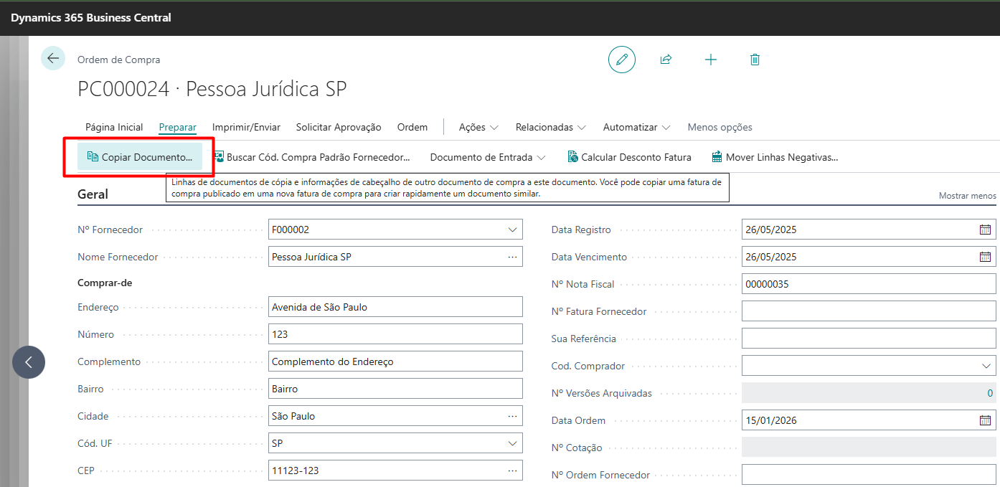
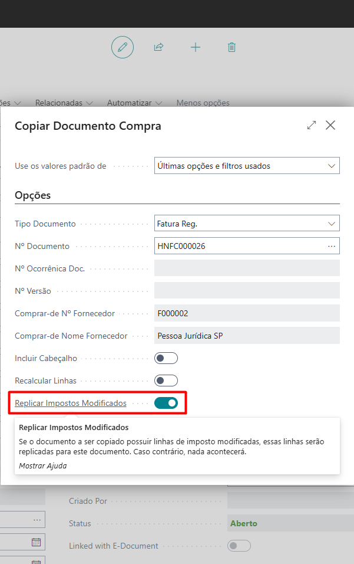
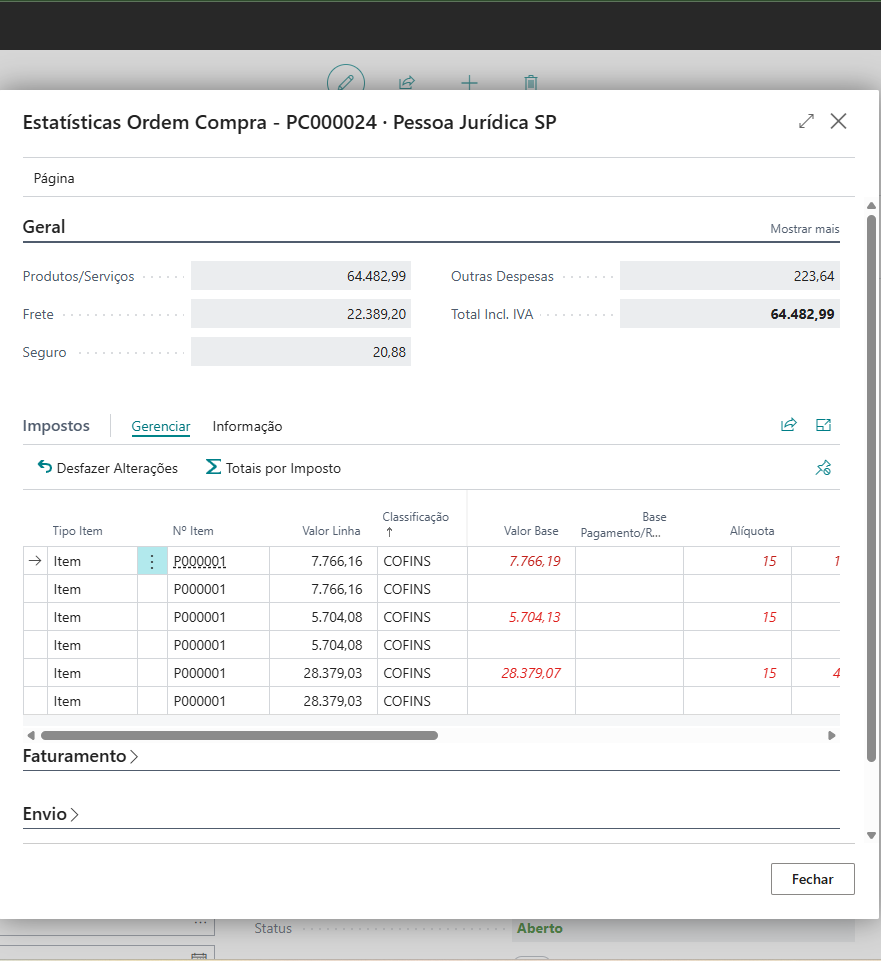
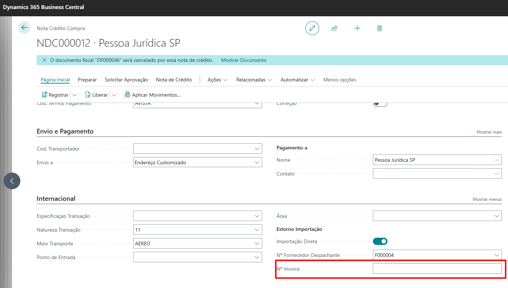

# DI: Flag adicionada na Cópia de Documentos de Compra para copiar linhas de Imposto Modificadas

Os documentos de Compra (Ordem de Compra, Nota de Crédito de Compra e Devolução de Compra) possuem a função **Copiar Documento**, que replica os dados de um documento já registrado ou em aberto. Até então, essa funcionalidade não trazia a possibilidade de copiar as linhas de imposto modificadas do documento de origem.

Foi criada agora a flag **Replicar Impostos Modificados**. Quando selecionada, a operação também replica qualquer linha de imposto modificada que o documento de origem possua — útil, por exemplo, para estornar notas geradas a partir da DI preservando os ajustes de imposto originais.

### Acessar Copiar Documento

Na Ordem de Compra (ou Nota de Crédito / Devolução de Compra), acione **Preparar > Copiar Documento...**.

### Habilitar Replicar Impostos Modificados

No diálogo **Copiar Documento Compra**, informe o tipo e o nº do documento de origem e ative a flag **Replicar Impostos Modificados**.

### Resultado nas Estatísticas

Após a cópia, as linhas de imposto modificadas aparecem nas **Estatísticas** do documento de destino com os valores de base e alíquota originais preservados (destacados em vermelho quando diferem do cálculo padrão).

### Nº Invoice na Nota de Crédito de Compra

No card de **Nota de Crédito de Compra**, na aba **Internacional**, em **Estorno Importação**, foi disponibilizado o campo **Nº Invoice** (referente ao número da Invoice da DI), que antes não estava visível. Esse campo é necessário ao estornar notas geradas a partir de uma Declaração de Importação.

