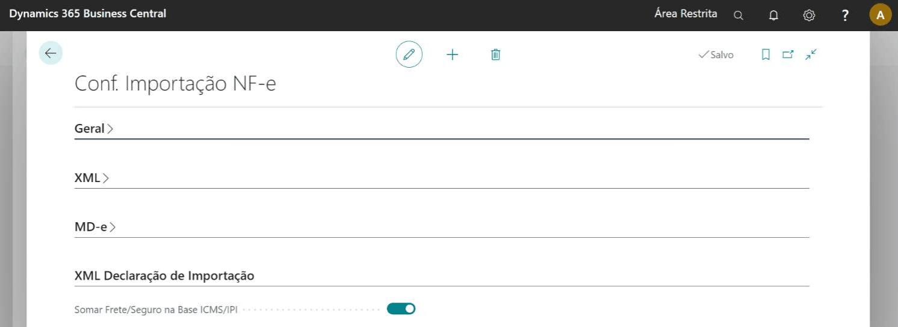

# DI: Frete e Seguro na Base do ICMS e do IPI

**Data**: Março/2021

---

## Sumário

Em alguns processos de importação, o frete e o seguro internacionais compõem a base de cálculo do ICMS e do IPI. A opção **Somar Frete/Seguro na Base ICMS/IPI**, na **Conf. Importação NF-e**, faz a declaração de importação somar esses valores às bases calculadas de cada linha.

## 1. Contexto

A opção vale para as declarações carregadas na página **Declarações de Importação**, tanto pelo XML da DI quanto pela importação da DUIMP pela API do Siscomex. As bases calculadas na declaração seguem para a fatura de compra criada a partir dela. O processo completo está em [Declaração de Importação (DI/DUIMP)](Localization-for-Brazil_User-Manual_Declaracao-de-Importacao-DI-DUIMP.md).

---

## 2. Configurar

1. Pesquise por **Conf. Importação NF-e** ou, no Centro de Funções, abra **Configurações** > **Fiscal** > **NF-e / NFS-e** > **Conf. Importação NF-e**.
2. Na seção **XML Declaração de Importação**, ajuste os campos:

| Campo | Descrição |
|-------|-----------|
| **Somar Frete/Seguro na Base ICMS/IPI** | Soma o **Valor Frete** e o **Valor Seguro** da linha às bases do ICMS e do IPI |
| **Preço Unitário inclui Frete** | Indica que o valor da mercadoria na declaração já inclui o frete. O frete é somado às bases do ICMS e do IPI, mesmo sem a opção anterior. Na importação do XML da DI, o frete também é descontado do valor da linha, para não ser contado duas vezes |
| **Utilizar Peso Líquido do Item** | Rateia o frete pelas linhas usando o peso líquido do cadastro do item, em vez do peso da declaração |

---

## 3. Como as bases são calculadas

Para cada linha da declaração:

| Base | Sem a opção | Com **Somar Frete/Seguro na Base ICMS/IPI** |
|------|-------------|---------------------------------------------|
| **Base IPI** | Valor da linha + II | Valor da linha + II + frete + seguro |
| **Base ICMS** | Valor da linha + outras despesas + PIS + COFINS + II + IPI + ICMS | A mesma soma + frete + seguro |

A **Base ICMS** só é calculada para as linhas com valor de ICMS. O **% ICMS** da linha é recalculado a partir do valor do ICMS e da base.

> **Nota**: a configuração é lida no momento em que a declaração é importada ou consultada. Alterar a opção não recalcula as declarações já carregadas.
