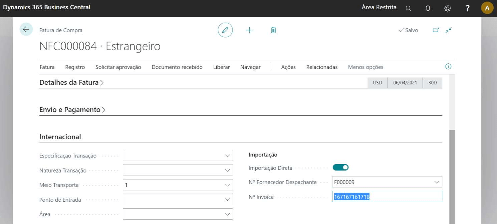
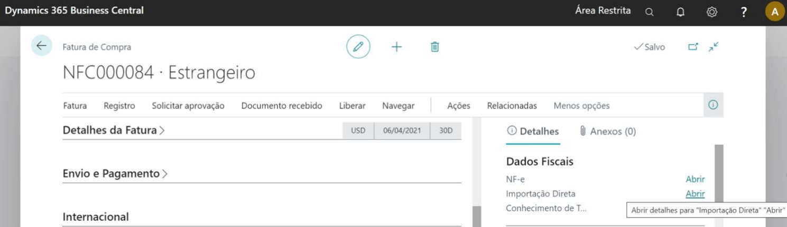
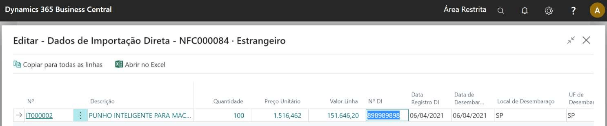
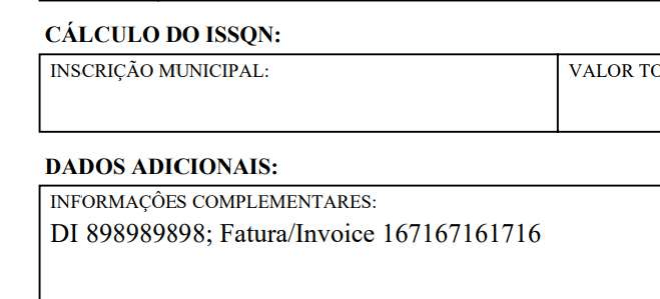

# Importação Direta: Observações Automáticas do Nº DI e da Invoice

**Data**: Março/2021

---

## Sumário

Na NF-e de entrada emitida para uma importação direta, os números das declarações de importação e o número da invoice do exportador saem automaticamente nas informações complementares, no texto `DI <nº>; Fatura/Invoice <nº>`. Não é preciso digitar esses dados de novo como texto adicional.

## 1. Contexto

Os dados vêm de campos que a importação direta já exige:

| Dado | Onde é informado |
|------|------------------|
| **Nº Invoice** | Fatura de compra, seção **Internacional**, grupo **Importação** |
| **Nº DI** | Página **Dados de Importação Direta**, em cada linha do documento |

Quando a fatura de compra é criada a partir de uma declaração de importação, os dados da DI das linhas já vêm preenchidos. Veja [Declaração de Importação (DI/DUIMP)](Localization-for-Brazil_User-Manual_Declaracao-de-Importacao-DI-DUIMP.md).

---

## 2. Preencher os dados da importação

1. Na fatura ou ordem de compra, seção **Internacional**, ative **Importação Direta** e informe o **Nº Invoice**.

   

2. Abra os dados da importação por **Dados Fiscais** > **Importação Direta**, ou pelo link **Importação Direta** do quadro **Dados Fiscais** ao lado do documento.

   

3. Na página **Dados de Importação Direta**, preencha o **Nº DI** e os demais dados da declaração em cada linha. **Copiar para todas as linhas** repete os dados da linha selecionada nas outras.

   

> **Nota**: com **Importação Direta** ativada, o registro exige o **Nº Fornecedor Despachante**, o **Nº Invoice**, o **Meio Transporte** e um **Cód. Termos Pagamento** sem parcelas. Em documentos de cancelamento, o **Nº Invoice** e o **Meio Transporte** não são exigidos.

---

## 3. Resultado no DANFe

No registro, o documento fiscal recebe o texto com os números de DI distintos das linhas e o número da invoice, que sai em **Dados Adicionais** > **Informações Complementares**:

Quando o documento tem linhas de mais de uma DI, todos os números aparecem após `DI`, separados por espaço.

> **Nota**: o texto só é criado em documentos de emissão própria, como a NF-e de entrada da importação, e na filial que tem **Config. NF-e**.
