<!-- Commits: 4de624a1, 0826a7cd, 32484798, 487eb3d9 -->
# Declaração de Importação (DI/DUIMP)

**Data**: Novembro/2026

---

## Sumário

Na importação direta, a empresa emite uma NF-e de entrada para nacionalizar as mercadorias compradas no exterior. A **Declaração de Importação (DI)** registra essa entrada no sistema aduaneiro; a **DUIMP** (Declaração Única de Importação) é o novo modelo eletrônico da Receita Federal, que substitui progressivamente a DI tradicional.

A localização busca a DUIMP diretamente na API do Siscomex ou lê o XML da DI fornecido pelo despachante. Nos dois casos, cria a **Declaração de Importação** com as adições, os encargos e os tributos (II, IPI, ICMS, PIS e COFINS) e, a partir dela, gera uma ou mais **Faturas de Compra** com os dados fiscais e tributários preenchidos, que dão origem à NF-e de nacionalização.

Este manual cobre a configuração do fluxo, a importação, a revisão da declaração, a criação da fatura e a emissão da NF-e. A classificação tributária do IBS/CBS (cClassTrib) declarada na DUIMP está em [DUIMP: Classificação Tributária (cClassTrib) na Declaração de Importação](Localization-for-Brazil_User-Manual_DUIMP-Classificacao-Tributaria-Declaracao-Importacao.md).

---

## 1. Contexto

### Formas de alimentar a declaração

| Método | Quando usar |
| --- | --- |
| **Importar DUIMP por número e versão** | Quando a importação foi registrada na DUIMP e a empresa tem credenciais OAuth do Siscomex |
| **Importar XML** | Quando o despachante fornece o XML da DI tradicional |
| Digitação manual | Importações pequenas ou ajustes pontuais em uma declaração já existente |

### Visão geral do fluxo

1. Configurar a importação (**Conf. Importação NF-e**, **Config. NF-e**, jurisdições, área de impostos e encargos) e, para a DUIMP, a **Config. DUIMP Siscomex**.
2. Cadastrar o fornecedor estrangeiro com os dados de importação.
3. Importar a DUIMP ou o XML da DI em **Declarações de Importação** e completar a declaração.
4. Criar a fatura de compra, conferir os dados fiscais e os impostos, e emitir a NF-e.

> **Importante**: o XML da DI não é tão estruturado quanto o XML de uma NF-e. Ele traz apenas o que o despachante informou nas tags, e cada DI pode ter sido calculada de forma diferente. Teste a configuração com um XML real da DI antes de entrar em produção.

---

## 2. Configuração da importação

### 2.1. Conf. Importação NF-e

Pesquise por **Conf. Importação NF-e** ou, no Centro de Funções, abra **Configurações** > **Fiscal** > **NF-e / NFS-e** > **Conf. Importação NF-e**.

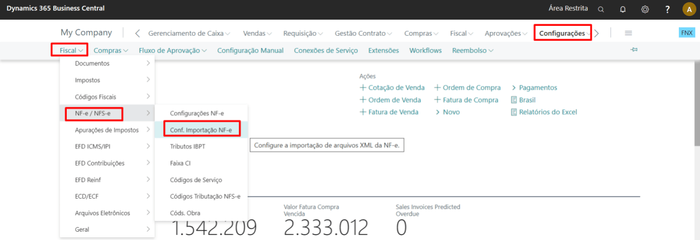

#### Aba Geral

Define os encargos de item que recebem os valores de frete, seguro e despesas da declaração.

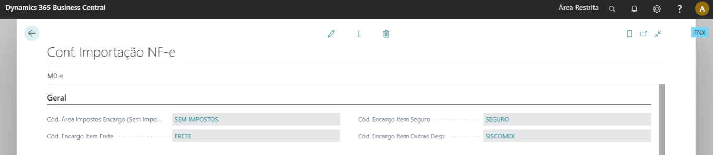

| Campo | Descrição |
|-------|-----------|
| **Cód. Área Impostos Encargo (Sem Impostos)** | Área de impostos genérica, sem impostos, aplicada às linhas de encargo |
| **Cód. Encargo Item Frete** | Encargo de item que recebe o frete da importação. Só aceita encargos com **Tipo** = **Frete** |
| **Cód. Encargo Item Seguro** | Encargo de item que recebe o seguro da importação. Só aceita encargos com **Tipo** = **Seguro** |
| **Cód. Encargo Item Outras Desp.** | Encargo de item que recebe a taxa Siscomex. Só aceita encargos com **Tipo** = **Outras Despesas** |
| **Cód. Encargo Item AFRMM** | Encargo de item que recebe o AFRMM (Adicional ao Frete para Renovação da Marinha Mercante) da declaração. Só aceita encargos com **Tipo** = **AFRMM** |

Os encargos são criados na página **Encargos Item**, com o **Tipo** correspondente. O encargo do Siscomex tem o campo **Siscomex** marcado.

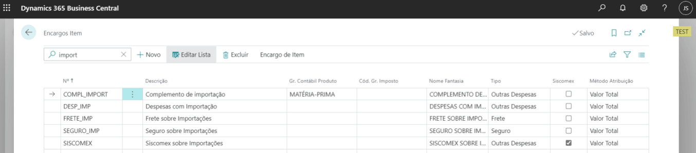

#### Aba XML

Os grupos **Compra** e **Opcionais** valem para toda importação de XML de compra, inclusive a de NF-e de fornecedor nacional. O grupo **Importação Direta** é específico para as notas de importação, geradas para fornecedores com **Importação Direta** marcado no cadastro.

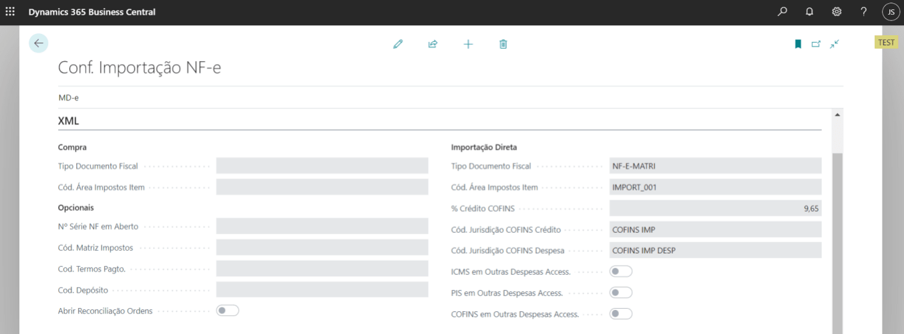

| Campo (grupo Importação Direta) | Descrição |
|-------|-----------|
| **Tipo Documento Fiscal** | Tipo de documento fiscal dos documentos criados a partir da declaração |
| **Cód. Área Impostos Item** | Área de impostos das linhas de item criadas a partir da declaração (veja a seção 3) |
| **% Crédito COFINS** | Parte da alíquota da COFINS-Importação que gera crédito. O restante é lançado como despesa |
| **Cód. Jurisdição COFINS Crédito** | Jurisdição de COFINS, da área de impostos acima, que recebe a parcela com crédito |
| **Cód. Jurisdição COFINS Despesa** | Jurisdição de COFINS, da área de impostos acima, que recebe a parcela sem crédito. Deve ser diferente da jurisdição de crédito |
| **ICMS em Outras Despesas Access.** | Soma o ICMS pago na importação ao valor de outras despesas acessórias do documento fiscal |
| **PIS em Outras Despesas Access.** | Soma o PIS pago na importação ao valor de outras despesas acessórias do documento fiscal |
| **COFINS em Outras Despesas Access.** | Soma a COFINS paga na importação ao valor de outras despesas acessórias do documento fiscal |
| **Máximo de Linhas por Documento** | Número máximo de linhas em cada fatura criada a partir da declaração. Com `0`, não há limite |
| **Dividir por CFOP** | Cria uma fatura separada para cada **Código CFOP** das linhas da declaração |

As jurisdições de crédito e de despesa da COFINS existem para importações com alíquota de 10,65%, em que 9,65% gera crédito e 1% é despesa. Esse tratamento deve ser validado pela área fiscal.

> **Nota**: os campos **Tipo Documento Fiscal**, **Cód. Área Impostos Item**, **% Crédito COFINS**, **Cód. Jurisdição COFINS Crédito** e **Cód. Jurisdição COFINS Despesa** do grupo **Importação Direta** são obrigatórios: sem eles, a criação do documento a partir da declaração é interrompida com erro. Ao trocar o **Cód. Área Impostos Item**, as duas jurisdições de COFINS são limpas e precisam ser informadas de novo.

#### Aba XML Declaração de Importação

Define como os valores da declaração são tratados no momento da importação.

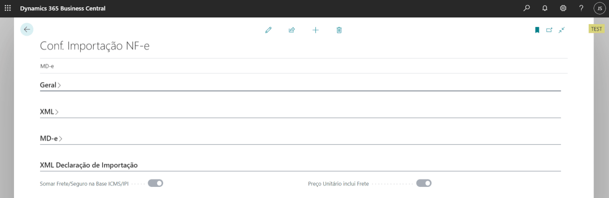

| Campo | Descrição |
|-------|-----------|
| **Utilizar Peso Líquido do Item** | Usa o peso líquido do cadastro do item para ratear frete, seguro e outras despesas entre as linhas, em vez do peso informado na declaração |
| **Somar Frete/Seguro na Base ICMS/IPI** | Soma o frete e o seguro às bases de cálculo do ICMS e do IPI. Detalhes em [DI: Frete e Seguro na Base do ICMS e do IPI](Localization-for-Brazil_User-Manual_DI-Frete-Seguro-Base-ICMS-IPI.md) |
| **Preço Unitário inclui Frete** | Indica que o preço unitário da declaração já inclui o frete, que então não é somado de novo |

### 2.2. Config. NF-e

Na **Config. NF-e** da filial que emite a nota, confira na aba **NF-e**:

- **Mostrar Impostos e Encargos**, no grupo **Observações**: leva os impostos e encargos da importação para as informações complementares da NF-e (veja a seção 10).
- **Adicionar Impostos DI em Valor Produto**, no grupo **XML**: soma os impostos da declaração ao valor do produto no XML da NF-e.

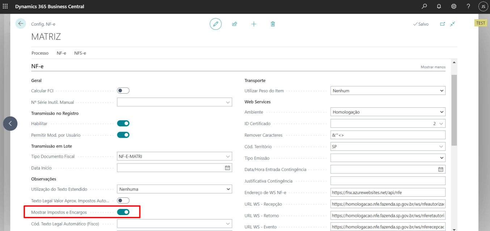

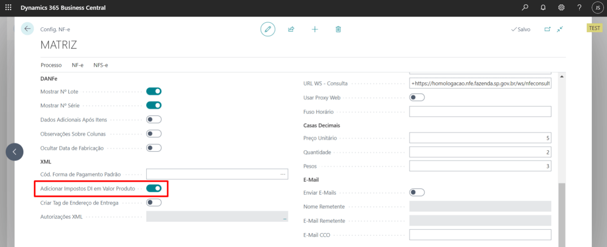

### 2.3. Config. DUIMP Siscomex

Necessária apenas para a importação pela API do Siscomex. Pesquise por **Config. DUIMP Siscomex** e preencha:

| Campo | Descrição |
| --- | --- |
| **Ambiente** | **Produção** para uso real com dados da Receita Federal, ou **Sandbox** para testes sem efeito legal |
| **CPF/CNPJ Sandbox** | Visível apenas quando **Ambiente** = **Sandbox**. Informe o CPF ou CNPJ utilizado no ambiente de testes |

> **Nota**: as credenciais OAuth (**Client-Id** e **Client-Secret**) são solicitadas em uma janela de autenticação no momento da primeira importação. Elas não ficam armazenadas permanentemente na configuração.

---

## 3. Configuração fiscal

### 3.1. Jurisdições de Impostos (Brasil)

Pesquise por **Jurisdições de Impostos (Brasil)** e cadastre uma jurisdição para cada tributo da importação (II, IPI, ICMS, PIS e COFINS, esta com uma jurisdição de crédito e outra de despesa).

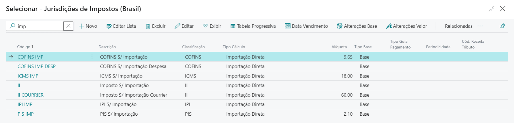

> **Nota**: o **Tipo Cálculo** das jurisdições de importação deve ser **Importação Direta**.

Verifique também, pela ação **Alterações Base**, quais tributos compõem a base de cálculo de cada jurisdição. No exemplo abaixo, a base do IPI soma o II, e a base do ICMS soma PIS, COFINS, II, IPI e o próprio ICMS. A composição correta deve ser definida pela área fiscal.

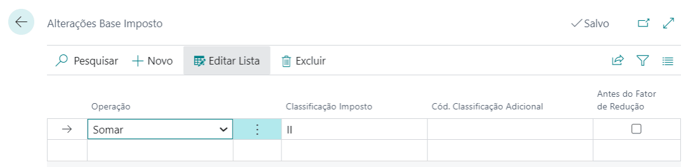

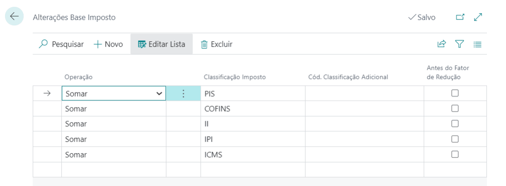

### 3.2. Cód. Área Impostos

Crie a área de impostos de importação, informada no campo **Cód. Área Impostos Item** da **Conf. Importação NF-e**, com as jurisdições da seção anterior.

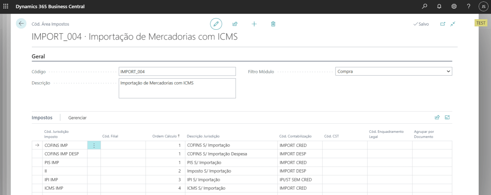

Mesmo quando a empresa não toma crédito de todos os tributos, eles são calculados e destacados; o que muda é a contabilização, definida pelo **Cód. Contabilização** de cada linha.

### 3.3. Impostos sobre Encargos de Item

Pesquise por **Impostos sobre Encargos de Item** e confira quais tributos incidem sobre cada encargo de importação. No exemplo, o frete compõe a base de ICMS, PIS, COFINS, IPI e II, e o seguro e o Siscomex compõem a base do ICMS.

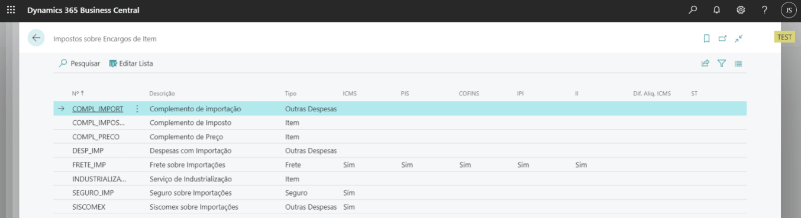

### 3.4. CFOP e itens

- CFOPs de importação cadastrados (tipo **Compra**, situação fora do Brasil).
- Itens cadastrados com **Código NCM** e **Cód. Unidade de Medida**.

---

## 4. Cadastro do fornecedor estrangeiro

No **Cartão Fornecedor**, aba **Faturamento**, grupo **Internacional**, preencha:

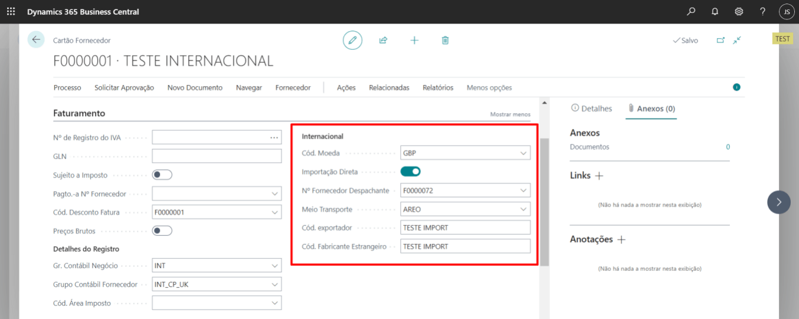

| Campo | Descrição |
|-------|-----------|
| **Cód. Moeda** | Moeda em que as operações com o fornecedor são feitas |
| **Importação Direta** | Marque quando o processo for de importação direta. Para outras formas de importação, verifique se a contabilização gerada atende ao resultado esperado |
| **Nº Fornecedor Despachante** | Fornecedor despachante nacional, no qual são contabilizados os impostos pagos na importação |
| **Meio Transporte** | Meio de transporte pelo qual a mercadoria chegou ao país |
| **Cód. exportador** | Código do exportador, conforme a declaração |
| **Cód. Fabricante Estrangeiro** | Código do fabricante estrangeiro, conforme a declaração |

Os códigos do exportador e do fabricante estão no extrato da DI:

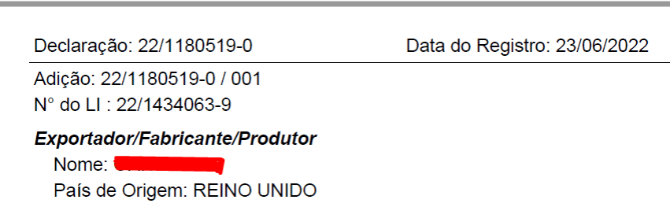

Com esses códigos no cadastro, ao informar o fornecedor na declaração, o **Cód. Exportador** e o **Cód. Fabricante Estrangeiro** são preenchidos automaticamente. Na importação da DUIMP, o próprio **Nº Fornecedor** é encontrado por esses códigos.

---

## 5. Importar a DUIMP pela API do Siscomex

### Passo 1: Iniciar a importação

1. Pesquise por **Declarações de Importação** e clique em **DUIMP** > **Importar DUIMP por número e versão**.
2. Se ainda não houver autenticação, abre a janela **Autenticação DUIMP**, que pede:
   - **Client-Id**: identificador OAuth fornecido pela Receita Federal.
   - **Client-Secret**: segredo OAuth correspondente.
3. Na primeira execução, a tabela de unidades aduaneiras da Receita Federal é baixada automaticamente. Esse processo é feito uma única vez.

> **Importante**: essas credenciais são obtidas no portal Siscomex (https://portalunico.siscomex.gov.br/portal/), no canto superior, em **Perfil**, no ícone que representa uma chave.

### Passo 2: Informar número e versão

1. Na janela **Requisição DUIMP**, preencha:
   - **No. DUIMP**: número da DUIMP atribuído pela Receita Federal.
   - **Versão**: versão da declaração (padrão: `1`; pode haver versões superiores em caso de retificação).
2. Clique em **OK**.

### Passo 3: O que o sistema faz automaticamente

1. Consulta a DUIMP e cria a **Declaração de Importação** com:
   - **Nº** = número da DUIMP.
   - **Data Registro DI** = data de registro da DUIMP.
   - **Data Desembaraço** = data do resultado do processamento do Tratamento Administrativo.
   - **Local Desembaraço** e **Cód. UF Desembaraço** = derivados da unidade local da Receita Federal.
2. Consulta os itens da DUIMP e, para cada um, o catálogo de produtos, para obter a denominação e os códigos internos.
3. Cria as linhas da declaração com os tributos (II, IPI, ICMS, PIS e COFINS) conforme os valores da DUIMP e rateia a taxa Siscomex entre as linhas.
4. Consulta o ICMS e o AFRMM da importação, que vêm de outra rota da Receita Federal, e os rateia entre as linhas proporcionalmente ao valor da linha somado ao frete e ao seguro, recalculando a base do ICMS. Se essa consulta falhar, a importação da DUIMP continua sem ela (veja a seção 7.4).
5. Preenche o **Nº Fornecedor** quando encontra um fornecedor com **Cód. Exportador** e **Cód. Fabricante Estrangeiro** correspondentes aos da declaração.

### Passo 4: Itens não encontrados

Se algum código de item da DUIMP não existir no cadastro de itens, abre a janela **Itens a Criar**, com:

- **Nº**: código do item vindo da declaração.
- **Descrição**: denominação do produto no catálogo aduaneiro.
- **Código NCM**: NCM do produto.
- **Unidade de Medida Base**: unidade da declaração aduaneira.
- **Preço Unitário**: valor calculado a partir da linha da declaração.

Confirme clicando em **OK**: os itens são criados e vinculados às linhas da declaração.

---

## 6. Importar o XML da DI

1. Pesquise por **Declarações de Importação**.
2. Clique em **Importar XML** e selecione o arquivo XML da DI fornecido pelo despachante.

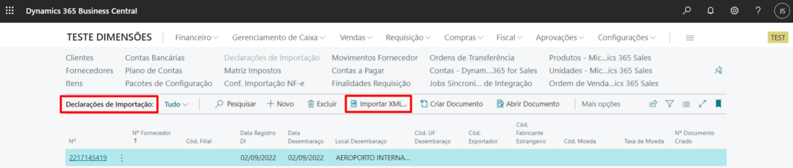

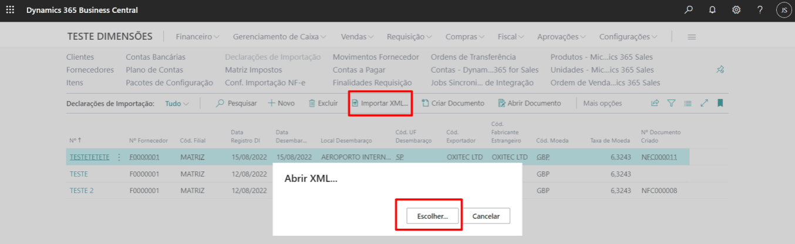

3. Abra a declaração criada.

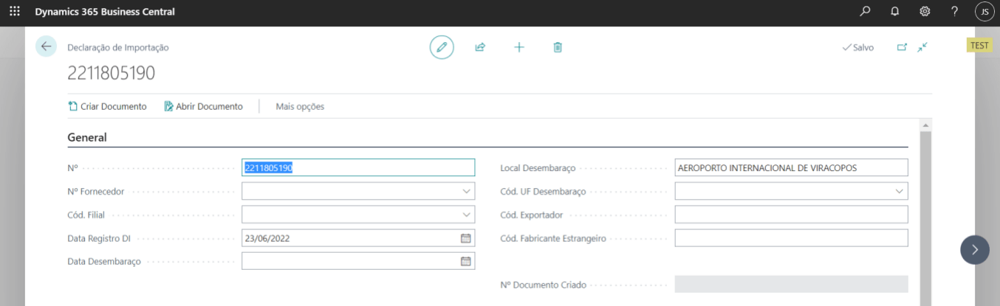

> **Atenção**: o XML da DI pode não trazer o **Nº Fornecedor**, o **Cód. Exportador** e o **Cód. Fabricante Estrangeiro**. Complete esses campos no cartão da declaração antes de criar o documento (seção 7).

---

## 7. Revisar a Declaração de Importação

Depois da importação (pela API ou pelo XML), abra o cartão da declaração clicando no **Nº** na lista.

### 7.1. Cabeçalho (aba Geral)

A importação preenche o **Nº**, a **Data Registro DI**, o **Local Desembaraço** e, quando disponível, a **Data Desembaraço**. Confira e complete:

| Campo | Descrição |
|-------|-----------|
| **Nº** | Número da DI ou da DUIMP |
| **Nº Fornecedor** | Fornecedor estrangeiro da importação. **Obrigatório** para criar o documento |
| **Cód. Filial** | Filial que recebe a importação |
| **Data Registro DI** | Data de registro da declaração na aduana |
| **Data Desembaraço** | Data em que as mercadorias foram liberadas; informe quando a importação não a trouxer |
| **Local Desembaraço** | Unidade aduaneira (porto, aeroporto, recinto) |
| **Cód. UF Desembaraço** | UF da unidade aduaneira de desembaraço |
| **Cód. Exportador** / **Cód. Fabricante Estrangeiro** | Preenchidos a partir do fornecedor; ajuste se necessário |

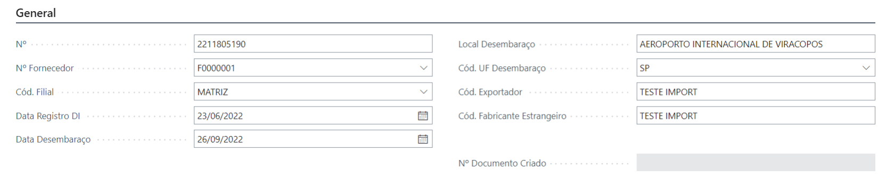

### 7.2. Aba Moeda

Informe o **Cód. Moeda** da importação e confira a **Taxa de Moeda**. Ao escolher a moeda, a taxa é sugerida pelo câmbio da **Data Registro DI**. A **Taxa de Moeda** só é editável com **Cód. Moeda** preenchido e é obrigatória para criar o documento quando há moeda.

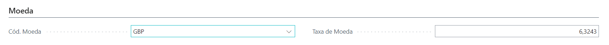

### 7.3. Linhas

A subpágina **Linhas** traz uma linha por item importado (adição). Preencha:

| Campo | Descrição |
|-------|-----------|
| **Nº Item** | Item (estoque, não estocável ou serviço) ou ativo fixo, conforme o **Tipo Item**. **Obrigatório** para criar o documento |
| **Cód. Unidade de Medida** | Carregado do cadastro do item. **Obrigatório** para criar o documento |
| **Código CFOP** | CFOP de importação. Não impede a criação do documento e pode ser informado depois, na fatura de compra. Com **Dividir por CFOP**, define em qual fatura a linha entra |

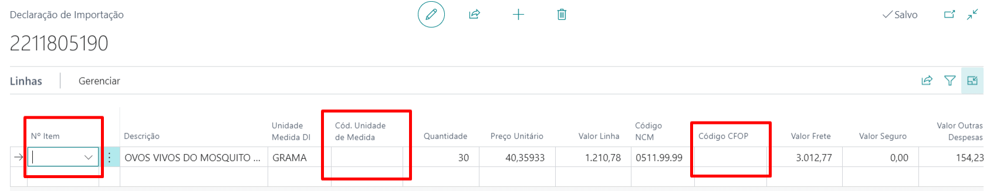

Os demais campos vêm da declaração. Confira-os em relação ao extrato da DI ou da DUIMP:

| Campo | Descrição |
| --- | --- |
| **Descrição** | Denominação do produto |
| **Unidade Medida DI** | Unidade de medida aduaneira (conforme o NCM) |
| **Quantidade** / **Preço Unitário** / **Valor Linha** | Quantidade, preço na moeda da declaração e valor total da linha |
| **Código NCM** / **Cód. Exceção NCM** | Classificação fiscal do produto |
| **Nº Adição** | Número da adição dentro da declaração |
| **Peso Líquido** | Peso líquido do item, usado no rateio do frete |
| **Valor Frete** / **Valor Seguro** / **Valor Outras Despesas** | Frete, seguro e outras despesas rateados para a linha |
| **Valor Siscomex** | Taxa de utilização do Siscomex rateada para a linha |
| **Valor AFRMM** | AFRMM rateado para a linha |
| **Cód. Origem** | Código de origem do ICMS |
| Bases, alíquotas e valores de **II**, **IPI**, **ICMS**, **PIS** e **COFINS** | Tributos da importação calculados para a linha |

As colunas de classificação tributária do IBS/CBS estão descritas em [DUIMP: Classificação Tributária (cClassTrib) na Declaração de Importação](Localization-for-Brazil_User-Manual_DUIMP-Classificacao-Tributaria-Declaracao-Importacao.md).

> **Nota**: alguns XML da DI não trazem as tags de ICMS, e os valores de ICMS ficam vazios. Com a parte fiscal configurada, abra as **Estatísticas** da fatura de compra criada e use **Desfazer Alterações** na parte **Impostos** para que os impostos sejam recalculados pela configuração; depois, confira os valores (seção 9).

### 7.4. Consultar ICMS (DUIMP)

Quando a declaração veio da DUIMP e o ICMS ou o AFRMM ainda não estavam disponíveis na importação, clique em **Consultar ICMS** no cartão da declaração. O ICMS e o AFRMM são consultados de novo na Receita Federal, pelo número da DUIMP, e rateados entre as linhas, substituindo os valores de ICMS e AFRMM anteriores. Se a Receita Federal ainda não tiver os dados, é exibida a mensagem *Não foram encontrados dados de ICMS para a DUIMP*.

### 7.5. Refazer Rateio Frete/Siscomex

A ação **Refazer Rateio Frete/Siscomex** redistribui o frete e a taxa Siscomex entre as linhas, proporcionalmente ao **Peso Líquido** de cada item, e redistribui os tributos proporcionalmente ao valor de cada linha. Use quando:

- o peso líquido das linhas foi alterado depois da importação;
- a taxa de câmbio foi ajustada e os rateios ficaram desatualizados;
- alguma linha foi incluída ou removida manualmente.

1. No cartão da **Declaração de Importação**, clique em **Refazer Rateio Frete/Siscomex**.
2. Confirme a mensagem.
3. São recalculados **Valor Frete**, **Valor Siscomex** e as bases e valores de II, IPI, PIS e COFINS de todas as linhas.

---

## 8. Criar a fatura de compra

Com os dados conferidos, clique em **Criar Documento**.

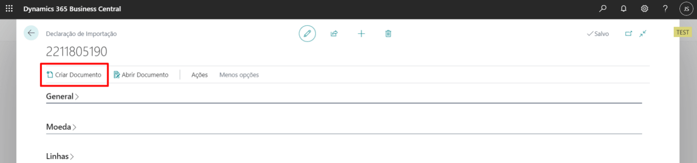

A criação confere que o **Nº Fornecedor**, a **Taxa de Moeda** (quando há moeda) e, em todas as linhas, o **Nº Item** e o **Cód. Unidade de Medida** estão preenchidos, além dos campos obrigatórios da **Conf. Importação NF-e** (seção 2.1).

As faturas de compra são criadas em aberto, e a lista **Documentos** se abre com os documentos gerados. Clique no **Nº Documento** para abrir a fatura. A mesma lista aparece na parte **Documentos** do cartão da declaração, com o **Nº Documento Reg.** depois do registro.

Cada fatura traz:

- os dados do fornecedor e da filial da declaração;
- as linhas de item com quantidades, preços, CFOP e NCM, e as linhas de encargo (frete, seguro, Siscomex e AFRMM);
- os tributos da declaração (II, IPI, ICMS, PIS e COFINS) como impostos modificados das linhas;
- os dados da declaração em cada linha: **Nº DI**, **Data Registro DI**, **Data Desembaraço**, **Local Desembaraço**, **Cód. UF Desembaraço**, **Cód. Exportador**, **Cód. Fabricante Estrangeiro** e **Nº Adição**;
- a moeda e a taxa de câmbio, quando informadas.

> **Nota**: conforme **Máximo de Linhas por Documento** e **Dividir por CFOP** da **Conf. Importação NF-e**, uma declaração pode gerar mais de uma fatura. **Criar Documento** cria documentos apenas para as linhas que ainda não têm documento; quando todas as linhas já têm, é exibido um erro. Depois que a declaração tem documento criado, o cabeçalho, a moeda e as linhas ficam bloqueados para edição.

---

## 9. Conferir a fatura de compra

Na **Fatura de Compra** criada, confira e complete os dados para a emissão da NF-e de nacionalização.

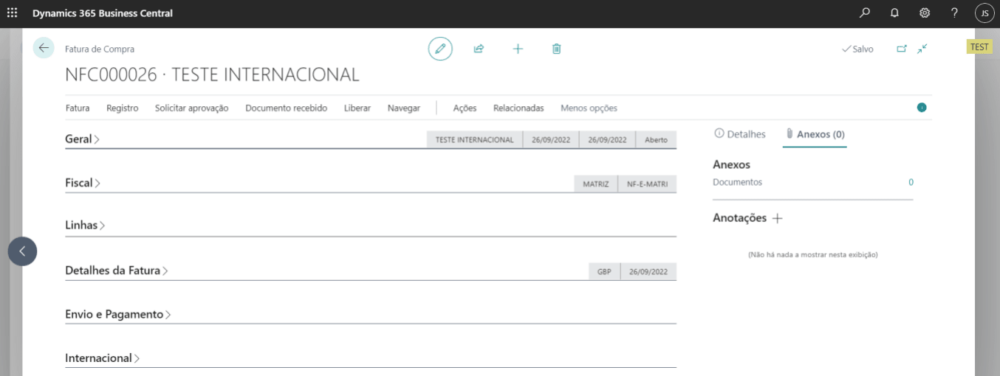

- **Geral**: traz o fornecedor estrangeiro, com código, nome e endereço.
- **Fiscal**: traz a filial preenchida. Informe a NOP (se usar) e o código da matriz de impostos.
- **Linhas**: traz os itens da declaração e as linhas de encargo da operação.

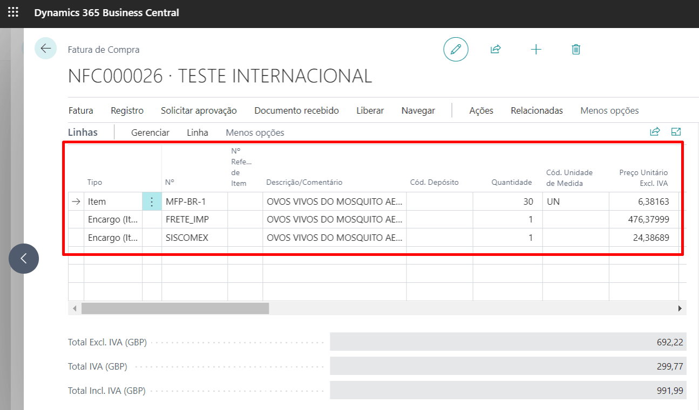

- **Internacional**: no grupo **Importação**, **Importação Direta** e **Nº Fornecedor Despachante** vêm do fornecedor. Informe o **Nº Invoice**.

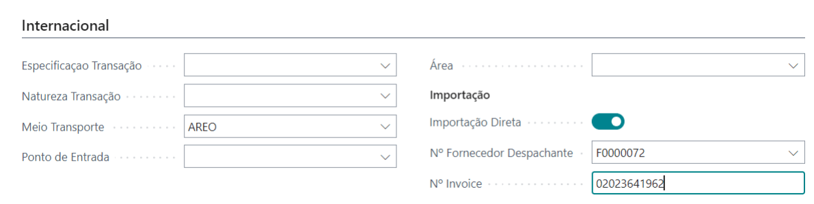

Em seguida, confira os **Dados Fiscais**:

1. **Dados Fiscais** > **NF-e**: preencha os dados da seção **Transporte**.

   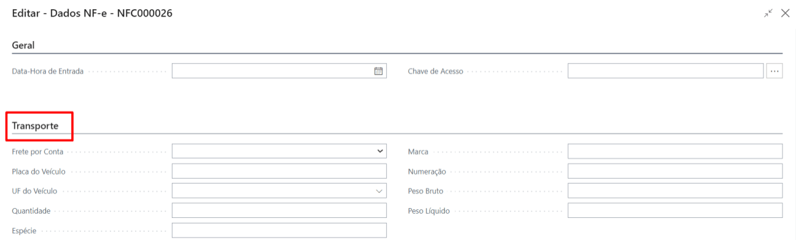

2. **Dados Fiscais** > **Importação Direta**: os dados da declaração de cada linha (**Nº DI**, datas e local de desembaraço, UF, exportador, adição e fabricante) já vêm preenchidos.

   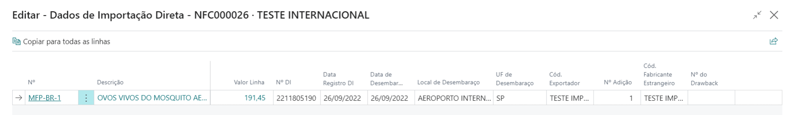

> **Nota**: a ação **Importação Direta** de **Dados Fiscais** só fica habilitada quando o campo **Importação Direta** da fatura está marcado.

Por fim, confira os impostos em **Estatísticas**:

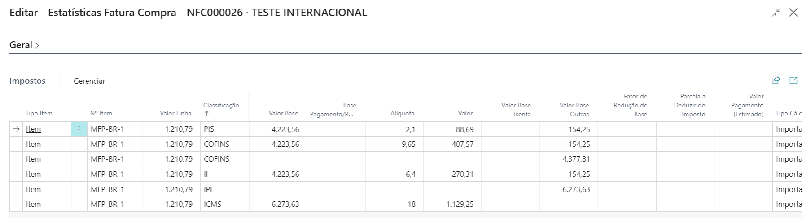

---

## 10. Emissão da NF-e

Com tudo conferido, valide e emita a NF-e normalmente. Além do texto personalizado da nota, as informações complementares trazem:

- o número da DI e o número da invoice, gerados automaticamente (veja [Importação Direta: Observações Automáticas do Nº DI e da Invoice](Localization-for-Brazil_User-Manual_DI-Observacoes-Automaticas.md));
- com **Mostrar Impostos e Encargos** marcado na **Config. NF-e**, os valores de encargos e impostos da importação.

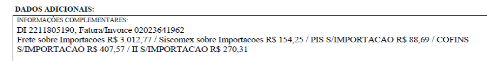

Para estornar uma nota gerada a partir da declaração preservando os impostos modificados, veja [DI: Flag adicionada na Cópia de Documentos de Compra para copiar linhas de Imposto Modificadas](Localization-for-Brazil_User-Manual_DI-Copia-Documentos-Impostos-Modificados.md).

---

## 11. Fluxo resumido

```
Siscomex / Despachante
        │
        ├── DUIMP (API)  →  Importar DUIMP por número e versão
        │                        │
        └── XML da DI   →  Importar XML
                                 │
                          Declaração de Importação
                          (fornecedor, filial, moeda, itens; Consultar ICMS na DUIMP)
                                 │
                          Criar Documento
                                 │
                          Fatura(s) de Compra
                          (dados fiscais, impostos, NF-e, registro)
```
