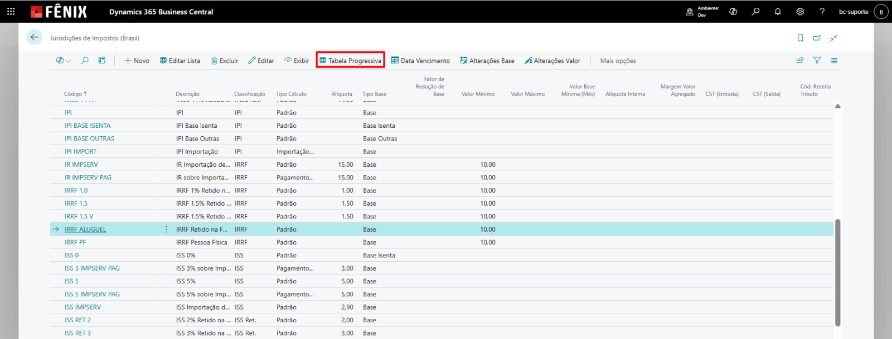
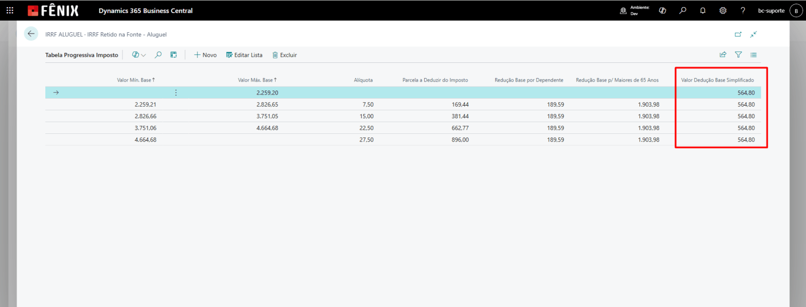

# Desconto Simplificado - Base IRPF

Selecione a linha da jurisdição de imposto desejada, clique em Tabela Progressiva e cadastre o valor do desconto simplificado na coluna **Valor Dedução Base Simplificado.**

