# Documento Fiscal: Alteração de Status do Documento Fiscal Registrado

**Data**: Maio/2022

---

## Sumário

As ações **Alterar Status para Cancelado** e **Alterar Status para Registrado** mudam manualmente o status de um **Documento Fiscal Registrado**, de compra ou de venda, sem gerar nenhum lançamento. O status é alterado só na parte fiscal: os movimentos de cliente, de fornecedor e da contabilidade permanecem como estavam. Cada alteração exige uma observação e fica registrada no log do documento.

## 1. Contexto

### Quando usar

A alteração manual de status é o recurso para corrigir exceções na parte fiscal, como um documento que precisa constar como cancelado nos livros fiscais quando não é possível registrar uma nota de crédito, por exemplo porque o período contábil já está fechado.

Para cancelar o documento com o estorno financeiro e contábil, use o cancelamento da fatura ou da nota de crédito registrada, descrito em [Vendas: Cancelamento de Fatura de Venda Registrada](Localization-for-Brazil_User-Manual_Cancelamento-Fatura-Venda-Registrada.md), [Compras: Cancelamento de Fatura de Compra Registrada](Localization-for-Brazil_User-Manual_Cancelamento-Fatura-Compra-Registrada.md), [Vendas: Cancelamento de Nota de Crédito e de Devolução](Localization-for-Brazil_User-Manual_Cancelamento-Nota-Credito-Devolucao-Venda.md) e [Compras: Cancelamento de Nota de Crédito e de Devolução](Localization-for-Brazil_User-Manual_Cancelamento-Nota-Credito-Devolucao-Compra.md).

### O que a alteração não faz

- Não estorna movimentos de cliente, de fornecedor nem contábeis.
- Não transmite nada à SEFAZ nem à prefeitura e não é bloqueada pelo prazo de cancelamento da NF-e.

Se o documento ficar com status **Cancelado** e a NF-e própria continuar autorizada na SEFAZ, ele passa a constar como cancelamento pendente. Veja [NF-e: Cancelamento na SEFAZ no Mesmo Fluxo, Prazo de Cancelamento por Filial e Cancelamentos Pendentes](Localization-for-Brazil_User-Manual_NFe-Cancelamento-SEFAZ-Prazo-Pendencias.md).

> **Nota**: a alteração grava o documento fiscal, por isso o usuário precisa de permissão de modificação nos documentos fiscais, como a dos conjuntos de permissões **BR - Fiscal** ou **BR - Documento Fiscal**. Os conjuntos **BR - Vendas** e **BR - Compras** dão apenas leitura dos documentos fiscais.

---

## 2. Alterar o status para cancelado

1. Pesquise por **Documentos Fiscais de Venda Registrados** ou **Documentos Fiscais de Compra Registrados** ou, no Centro de Funções, abra **Vendas** > **Documentos Fiscais Registrados** ou **Compras** > **Documentos Fiscais Registrados**.
2. Selecione o documento desejado.

   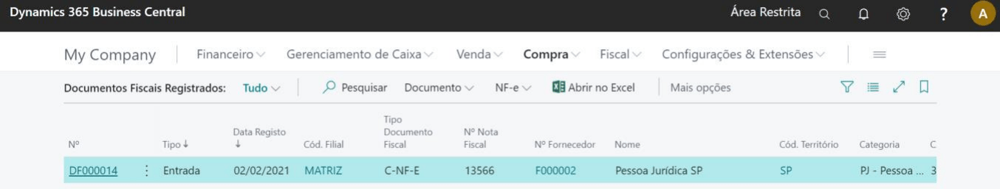

3. Abra o documento e confira o **Status** atual, na seção **Geral**.

   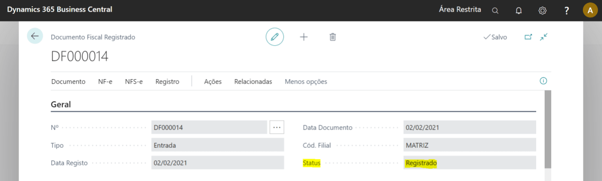

4. Clique em **Ações** > **Documento** > **Alterar Status para Cancelado**. A ação só aparece quando o documento está com o status **Registrado**.

   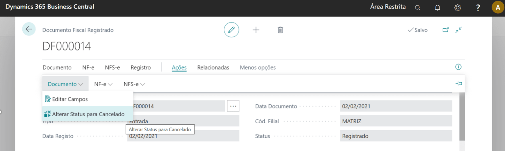

5. Na janela **Alterar Status do Documento Fiscal**, o campo **Novo Status** mostra o status que o documento vai receber. Informe o motivo da alteração no campo **Observações** e clique em **OK**. O campo é obrigatório, aceita textos longos e a janela não fecha com ele em branco.

   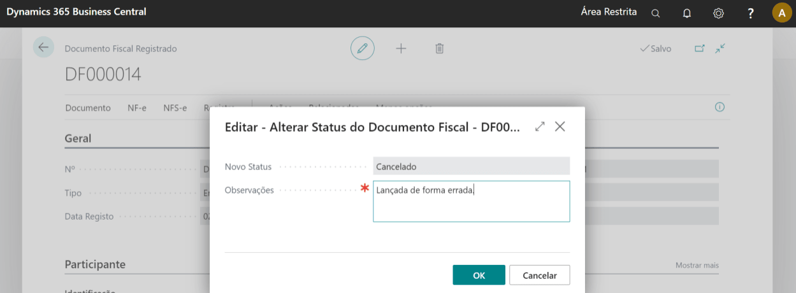

6. O status do documento passa a **Cancelado** e a notificação *"Status alterado para Cancelado"* é exibida no topo da página.

   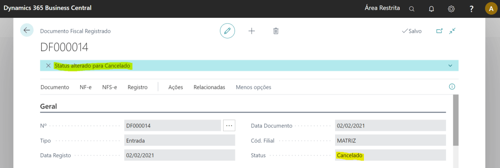

---

## 3. Voltar o status para registrado

Da mesma forma, um documento com o status **Cancelado** pode voltar ao status **Registrado**:

1. No documento fiscal, clique em **Ações** > **Documento** > **Alterar Status para Registrado**. A ação só aparece quando o documento está com o status **Cancelado**.
2. Informe o motivo em **Observações** e clique em **OK**.

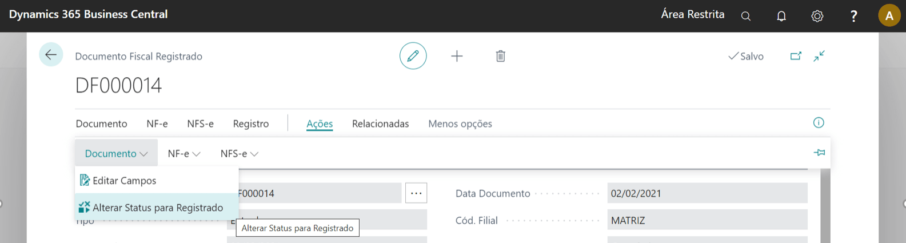

---

## 4. Movimentos financeiros e contábeis

A alteração de status não estorna o documento. Os movimentos de cliente ou de fornecedor e os movimentos contábeis continuam como foram registrados. Para estornar esses movimentos, cancele a fatura ou a nota de crédito registrada.

Movimentos de fornecedor do documento cancelado, ainda em aberto:

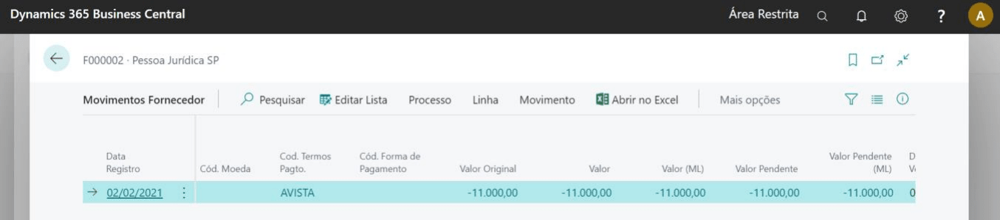

Movimentos contábeis do documento cancelado, sem estorno:

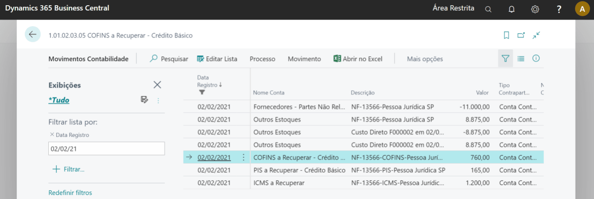

---

## 5. Log de alterações e log de atividade

Toda alteração de status fica registrada, mesmo que o log de alterações do Business Central não esteja ativado. Para consultar, abra o documento fiscal e use **Relacionadas** > **Log de Alterações** ou **Relacionadas** > **Log de Atividade**.

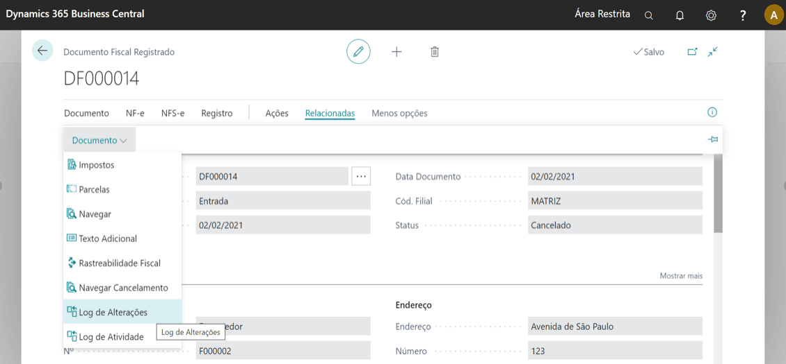

| Ação | O que mostra |
|------|--------------|
| **Log de Alterações** | Cada alteração do campo **Status**, com data e hora, usuário, valor antigo e valor novo. |
| **Log de Atividade** | Cada alteração de status com a descrição (*"Status alterado para Cancelado"* ou *"Status alterado para Registrado"*) e a observação informada na alteração. |

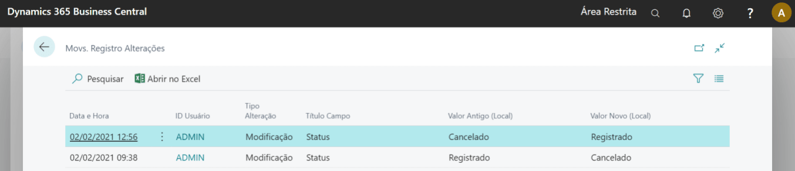

No **Log de Atividade**, a coluna **Mensagem de Atividade** mostra os primeiros 250 caracteres da observação. Quando o texto é maior, a coluna **Informação Detalhada Disponível** fica com **Sim**: clique nesse valor para baixar um arquivo de texto com a observação completa.

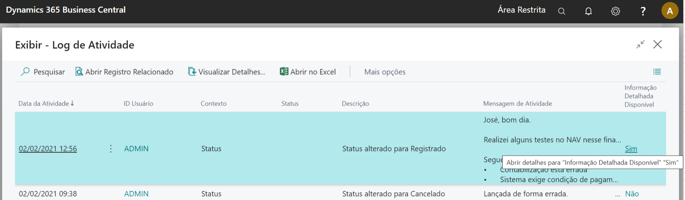
