# ECD: Escrituração Contábil Digital

**Data**: Junho/2022

---

## Sumário

A **Apuração ECD** gera o arquivo TXT da Escrituração Contábil Digital a partir do plano de contas e dos movimentos contábeis do Business Central, para validação, assinatura e transmissão no PVA da ECD (Programa Validador da Escrituração Contábil Digital). Este manual descreve as configurações, o mapeamento do plano de contas para o plano referencial, a aglutinação, os centros de custo, os signatários, a importação dos movimentos contábeis e a geração do arquivo.

Os conceitos da ECD e a visão geral dos blocos estão em [ECD — Escrituração Contábil Digital](Localization-for-Brazil_User-Manual_guia-fiscal-ecd.md).

## 1. Contexto

### Obrigatoriedade

Estão obrigadas à ECD:

- I - pessoas jurídicas sujeitas à tributação do Imposto sobre a Renda com base no lucro real;
- II - pessoas jurídicas tributadas com base no lucro presumido que distribuírem, a título de lucros, sem incidência do IRRF, parcela dos lucros ou dividendos superior ao valor da base de cálculo do imposto, diminuída de todos os impostos e contribuições a que estiver sujeita;
- III - pessoas jurídicas imunes e isentas que, em relação aos fatos ocorridos no ano-calendário, tenham sido obrigadas à apresentação da EFD-Contribuições, nos termos da Instrução Normativa RFB nº 1.252/2012;
- IV - Sociedades em Conta de Participação (SCP), como livros auxiliares do sócio ostensivo.

Para as demais sociedades empresárias a ECD é facultativa. Estão dispensadas as microempresas e empresas de pequeno porte optantes pelo Simples Nacional.

### Prazo de entrega

O prazo de entrega é anual e definido pela Receita Federal, e pode ser prorrogado. Confira o prazo vigente no guia prático da ECD, no site da Receita Federal.

### Registros gerados

| Bloco | Registros |
|-------|-----------|
| **0** - Abertura, Identificação e Referências | `0000`, `0001`, `0007`, `0020`, `0150`, `0180`, `0990` |
| **I** - Lançamentos Contábeis | `I001`, `I010`, `I020`, `I030`, `I050`, `I051`, `I052`, `I100`, `I150`, `I155`, `I157`, `I200`, `I250`, `I300`, `I310`, `I350`, `I355`, `I990` |
| **J** - Demonstrações Contábeis | `J001`, `J005`, `J100`, `J150`, `J210`, `J215`, `J800`, `J900`, `J930`, `J932`, `J935`, `J990` |
| **9** - Controle e Encerramento | `9001`, `9900`, `9990`, `9999` |

Os registros que dependem de informação do usuário:

| Registro | Onde é informado |
|----------|------------------|
| `0000` - Abertura e identificação | **Informações da Empresa**, **Configuração ECD** e **Apuração SPED Contábil** |
| `0007` - Outras inscrições cadastrais | **Outras Inscrições Cadastrais ECD** |
| `I010` - Identificação da escrituração | **Tipo Ident. Escrituração** da **Apuração SPED Contábil** |
| `I050` - Plano de contas | **Plano de Contas ECD** |
| `I051` - Plano de contas referencial | **Relação Entre Contas** |
| `I052` - Códigos de aglutinação | **Aglutinação** |
| `I100` - Centro de custos | **Cód. Dimensão Centro Custo** da **Configuração ECD** |
| `I157` - Transferência de saldos de plano de contas anterior | **Transferência de Saldos de Plano de Contas Anterior** |
| `J930` / `J932` - Signatários | **Signatários ECD** |
| `J935` - Auditores independentes | **Auditores Independentes** |

Os demais registros dos blocos I e J (saldos, lançamentos, partidas, balancetes, balanço patrimonial e demonstração do resultado) são gerados a partir dos movimentos contábeis importados.

---

## 2. Pré-requisito: encerramento do exercício

Antes de gerar a ECD, execute o encerramento do exercício no Business Central. Os períodos contábeis do ano da escrituração devem estar encerrados.

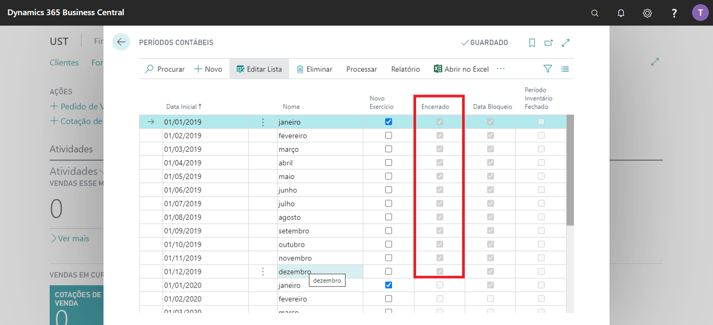

---

## 3. Bloco 0: abertura e identificação

### Dados da empresa (`0000`)

Parte dos dados do registro `0000` vem da empresa: nome, **C.N.P.J.**, inscrição estadual e inscrição municipal, por exemplo. Pesquise por **Informações da Empresa** e confira esses dados.

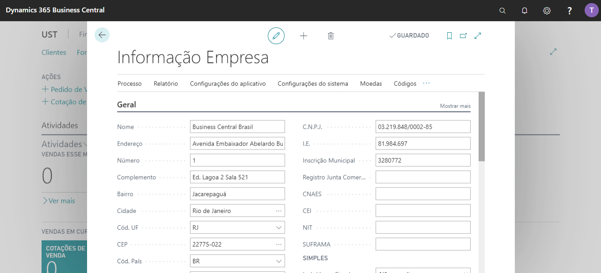

### Configuração ECD

Os dados da escrituração da empresa também compõem o registro `0000`.

1. Pesquise por **Configuração ECD** ou, no Centro de Funções, abra **Configurações** > **Fiscal** > **ECD/ECF** > **Configuração ECD**.

   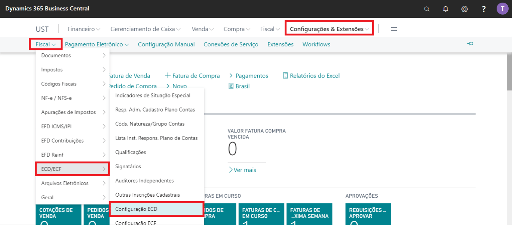

2. Preencha:

| Campo | Descrição |
|-------|-----------|
| **Nome Empresa** | Nome da empresa na escrituração |
| **Tipo Escrituração** | **Centralizada** ou **Descentralizada** |
| **Suprimir Contas Inativas** | Exclui da ECD as contas sem movimento e com saldo zero |
| **Data Arq. Atos Constitutivos** | Data de arquivamento dos atos constitutivos |
| **Data Arq. Atos Conversão de sociedade simples em sociedade empresária** | Data de arquivamento do ato de conversão, se houver |
| **Cód. Dimensão Centro Custo** | Dimensão usada como centro de custo (registro `I100`). Obrigatório para quem usa centros de custo na contabilidade: com ele preenchido, os movimentos são levados à ECD pelo centro de custo quando são importados |
| **Cód. Plano de Contas Ref.** | Plano de contas referencial usado no mapeamento das contas analíticas (veja a tabela abaixo). Deixe em branco se a empresa não fizer o mapeamento para o plano referencial |
| **Resp. Adm. Cadastro Plano Contas** | Instituição responsável pela administração do cadastro do plano de contas, se houver |
| **Utilizar Nº/Nome Conta SPED** | Para empresas com plano de contas internacional. Na importação do plano de contas, usa o **Nº Conta SPED** e o **Nome Conta SPED** informados na conta contábil, em vez do número e do nome da conta |
| **Nº Série ECD** | Série usada para numerar as apurações ECD (seção **Numeração**) |

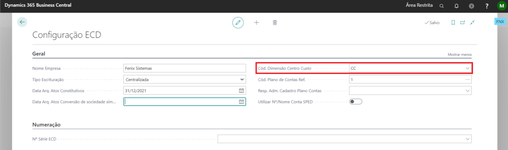

Códigos do plano de contas referencial (`COD_PLAN_REF`):

| Código | Plano referencial |
|--------|-------------------|
| 1 | PJ em Geral - Lucro Real |
| 2 | PJ em Geral - Lucro Presumido |
| 3 | Financeiras - Lucro Real |
| 4 | Seguradoras - Lucro Real |
| 5 | Imunes e Isentas em Geral |
| 6 | Imunes e Isentas - Financeiras |
| 7 | Imunes e Isentas - Seguradoras |
| 8 | Entidades Fechadas de Previdência Complementar |
| 9 | Partidos Políticos |
| 10 | Financeiras - Lucro Presumido |

Com **Utilizar Nº/Nome Conta SPED** marcado, preencha **Nº Conta SPED** e **Nome Conta SPED** no cartão de cada conta contábil, na seção **Fiscal**.

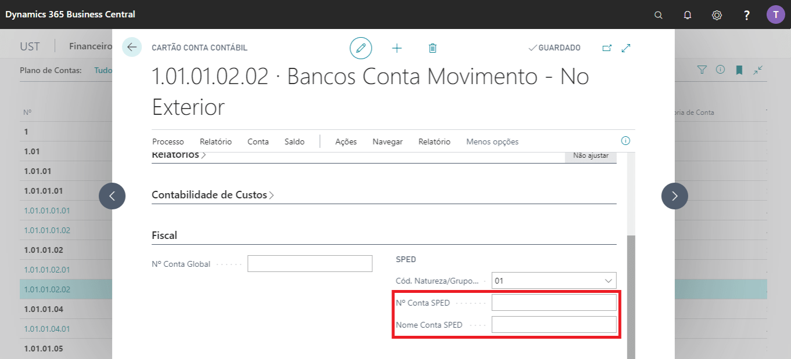

> **Nota**: com **Utilizar Nº/Nome Conta SPED** marcado, a importação do plano de contas para a ECD é interrompida com erro na primeira conta sem **Nº Conta SPED** ou **Nome Conta SPED**.

### Apuração ECD (`0000` e `I010`)

O restante do registro `0000` é informado na apuração.

1. Pesquise por **Apurações ECD** ou, no Centro de Funções, abra **Fiscal** > **Livros Fiscais** > **ECD/ECF** > **Apurações ECD**.

   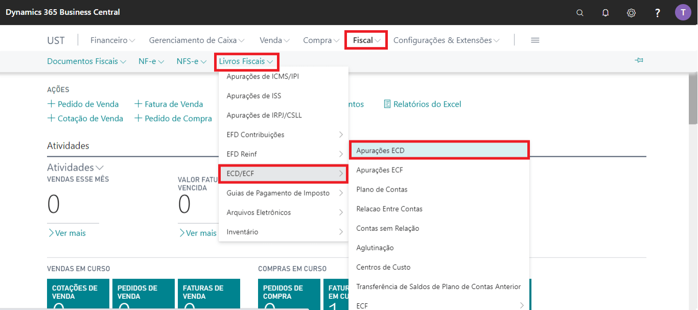

2. Clique em **Novo** para criar uma apuração, ou abra a apuração que deseja editar.
3. Na seção **Geral** do cartão **Apuração SPED Contábil**, preencha:

| Campo | Descrição |
|-------|-----------|
| **Nº** | Número da apuração. Com o **Nº Série ECD** configurado, é preenchido automaticamente |
| **Tipo Ident. Escrituração** | Tipo de escrituração do registro `I010` (por exemplo, **G** para Diário Geral). Também define a **Natureza Livro** |
| **Nº Ordem do Instrumento** | Número de ordem do livro |
| **Data Inicio** / **Data Final** | Primeiro e último dia do ano da escrituração |
| **Incluir Lançamentos Fechamento** | Marque para que os lançamentos de encerramento sejam considerados |
| **Fechamento Por** | **Ano** ou **Trimestre** |
| **Agrupar Documentos Por** | **Documento** ou **Dia** |
| **Indicador de Alteração no Plano de Contas** | Marque se o plano de contas sofreu alteração no período. É alteração a mudança de número de uma conta existente; a inclusão de contas novas não é |
| **Indicador Situação Especial** | Preencha somente se a empresa se enquadrar em um dos casos (veja a tabela abaixo) |
| **Situação no Início do Período** | **Normal**, **Abertura**, **Resultante de cisão/fusão ou remanescente de cisão ou realizou incorporação** ou **Início de obrigatoriedade no curso do ano calendário** |
| **Tipo Escrituração** | **Original** ou **Substituta** |
| **Hash Escrituração Substituída** / **NIRE da Escrituração Subst.** | Somente em caso de substituição da ECD |
| **Empresa Grande Porte** | Marque se a empresa for de grande porte |
| **Data de Encerramento do Exercício Social** | Data de encerramento do exercício social |

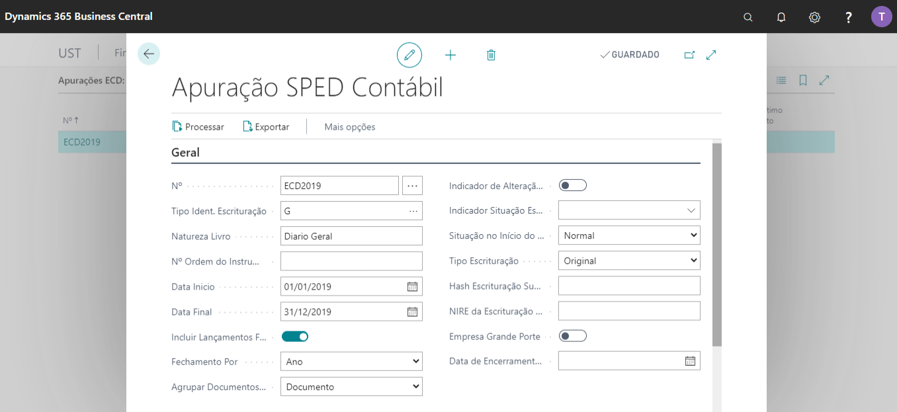

As opções do **Indicador Situação Especial** são cadastradas pelo usuário em **Indicadores de Situação Especial** (**Configurações** > **Fiscal** > **ECD/ECF**), conforme o guia prático da Receita Federal:

| Código | Descrição |
|--------|-----------|
| 1 | Cisão |
| 2 | Fusão |
| 3 | Incorporação |
| 4 | Extinção |

> **Nota**: com **Situação no Início do Período** igual a **Normal**, a **Data Inicio** precisa ser 1º de janeiro. Sem **Indicador Situação Especial**, a **Data Final** precisa ser 31 de dezembro. Fora disso, o sistema não aceita as datas.

### Auditores independentes (`J935`)

Se houver auditor independente, pesquise por **Auditores Independentes** ou abra **Configurações** > **Fiscal** > **ECD/ECF** > **Auditores Independentes**, e cadastre o **CPF/CNPJ**, o **Nome** e o **Nº Registro no CVM** do auditor.

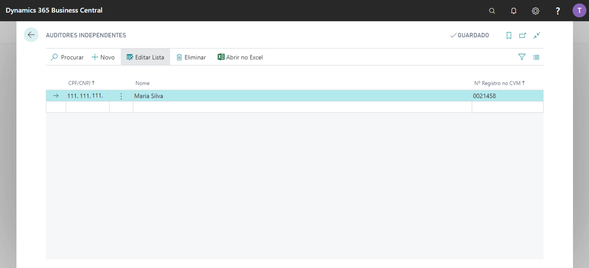

### Outras inscrições cadastrais (`0007`)

No registro `0007` entram as inscrições cadastrais da pessoa jurídica que, legalmente, dão direito de acesso ao livro contábil, exceto as informadas no registro `0000`.

1. Pesquise por **Outras Inscrições Cadastrais ECD** ou abra **Configurações** > **Fiscal** > **ECD/ECF** > **Outras Inscrições Cadastrais**.
2. Cadastre cada inscrição com o **Cód. Instituição Responsável** e o **Cód. Cadastral**, seguindo o guia prático da Receita Federal.

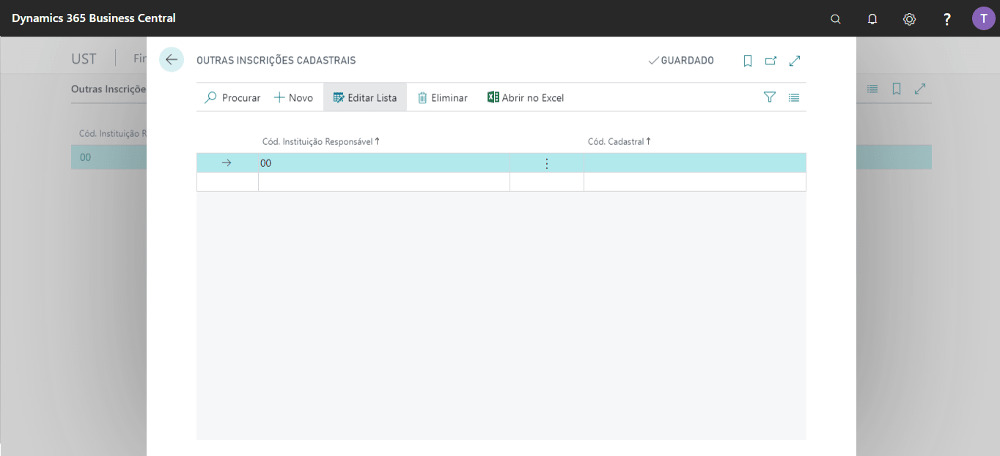

---

## 4. Bloco I: plano de contas

### Plano de contas (`I050`)

O plano de contas da empresa é importado para a ECD.

1. Pesquise por **Plano de Contas ECD** ou, no Centro de Funções, abra **Fiscal** > **Livros Fiscais** > **ECD/ECF** > **Plano de Contas**.
2. Clique em **Importar Plano Contas**.

   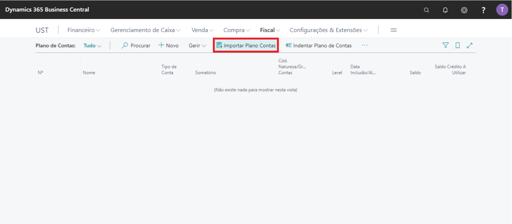

3. Na página **Importar Plano Contas ECD**, deixe o filtro **Nº** vazio para importar todo o plano de contas e clique em **OK**. Use o filtro quando o plano já foi importado e faltam apenas algumas contas: informe essas contas para importar somente elas.

   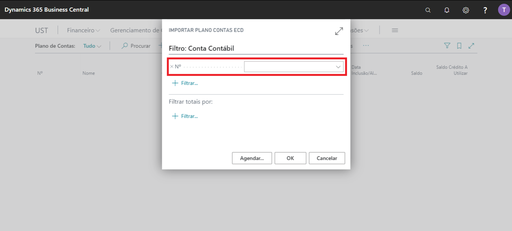

O plano de contas da empresa precisa seguir as regras da ECD:

- os níveis e o **Cód. Natureza/Grupo Contas** devem estar configurados nas contas;
- os níveis das contas devem ser sequenciais, sem pular nível, com no mínimo 4 (quatro) níveis. Na importação, o nível é calculado pelo tamanho do número da conta;
- a **Data Inclusão/Alteração** vem da data da última alteração da conta e deve ser anterior ao ano-calendário da ECD. Se for posterior, é considerado o último dia da escrituração. Exemplo: para a escrituração de 01/01/2019 a 31/12/2019, uma conta alterada em 01/02/2020 é considerada em 31/12/2019;
- o somatório deve ser sequencial, sem pular contas;
- no Brasil existem apenas os tipos de conta **Sintética** e **Analítica**.

Sempre que usar **Importar Plano Contas**, confira se todas as contas importadas estão relacionadas com o plano referencial:

1. Pesquise por **Contas sem Relação** ou abra **Fiscal** > **Livros Fiscais** > **ECD/ECF** > **Contas sem Relação**.
2. Relacione as contas exibidas com o plano referencial, conforme a [Relação entre contas](#relação-entre-contas).

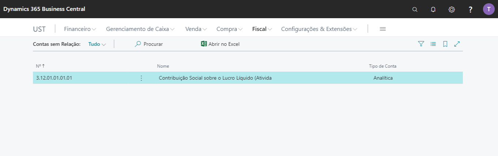

### Plano de contas referencial (`I051`)

1. Pesquise por **Plano de Contas Referencial**.
2. Para cadastrar ou alterar as contas referenciais, clique em **Novo** ou **Editar Lista**.

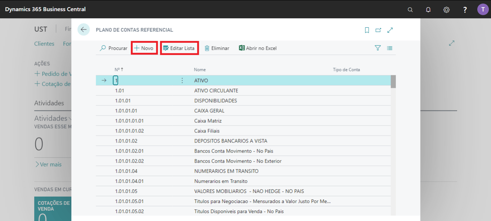

> **Importante**: manter o plano de contas referencial atualizado no Business Central, de acordo com a tabela publicada pela Receita Federal, é responsabilidade do usuário.

### Relação entre contas

Depois de conferir o plano referencial e importar o plano de contas, relacione as contas:

1. Pesquise por **Relação Entre Contas** ou abra **Fiscal** > **Livros Fiscais** > **ECD/ECF** > **Relação Entre Contas**.
2. Selecione a conta do plano referencial na lista superior, **Plano de Contas Referencial (Governo)**.
3. Na lista inferior, **Relacionado com a Seguinte Conta do Plano Original**, informe em **Nº Conta Contábil ECD** as contas do plano da empresa relacionadas à conta referencial selecionada.

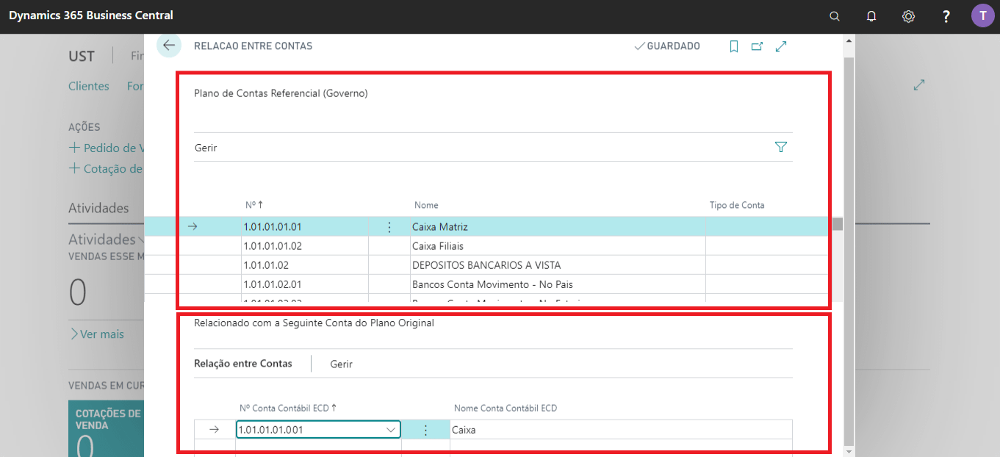

A ação **Abrir Planilha de Relação** abre a **Planilha de Relação entre Contas ECD**, onde a conta referencial, a conta da empresa e o centro de custo são informados na mesma linha.

### Aglutinação (`I052`)

Depois da relação entre contas, gere a aglutinação, em que as contas sintéticas que representam o somatório das contas analíticas são aglutinadas.

1. Pesquise por **Aglutinação** ou abra **Fiscal** > **Livros Fiscais** > **ECD/ECF** > **Aglutinação**.
2. Clique em **Gerar Aglutinação**.

   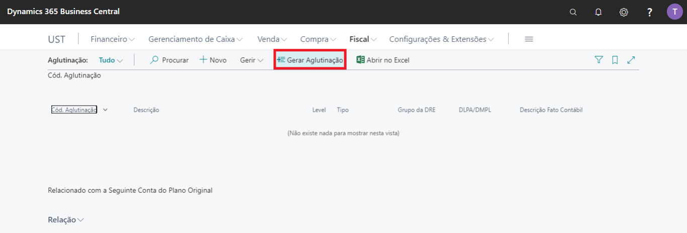

3. Na página **Gerar Aglutinação ECD**, informe em **Nº de Níveis** a quantidade de níveis do plano de contas e clique em **OK**.

   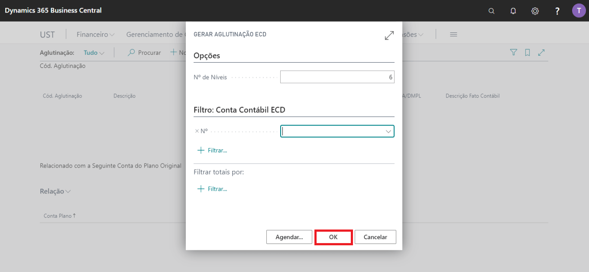

4. Confira o resultado: a lista superior, **Cód. Aglutinação**, mostra as contas sintéticas; a lista inferior, **Relacionado com a Seguinte Conta do Plano Original**, mostra as contas analíticas que compõem o somatório da conta selecionada.
5. Na lista superior, complete:
   - no último nível das contas de patrimônio líquido, **DLPA/DMPL** (**DLPA** ou **DMPL**) e a **Descrição Fato Contábil**;
   - nas aglutinações de contas de resultado, o **Grupo da DRE** (**Receita** ou **Despesa**).

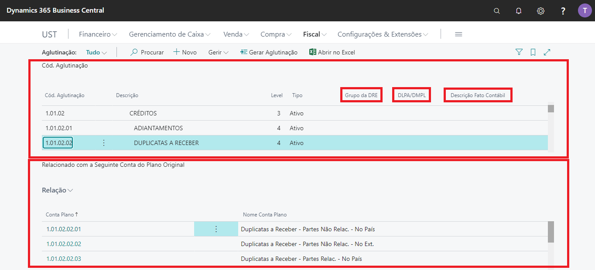

### Centro de custos (`I100`)

O registro `I100` é obrigatório para quem usa centros de custo na contabilidade. Os centros de custo são os valores da dimensão informada em **Cód. Dimensão Centro Custo** na **Configuração ECD** (seção [Configuração ECD](#configuração-ecd)).

### Transferência de saldos de plano de contas anterior (`I157`)

Se contas do plano de contas mudaram de número, além de marcar **Indicador de Alteração no Plano de Contas** na apuração, relacione a conta nova com a anterior:

1. Pesquise por **Transferência de Saldos de Plano de Contas Anterior** ou abra **Fiscal** > **Livros Fiscais** > **ECD/ECF** > **Transferência de Saldos de Plano de Contas Anterior**.
2. Clique em **Novo** ou **Editar Lista** e informe, em cada linha, a conta atual (**N° Conta**, do plano de contas ECD), o **Cód. Centro Custo** (se houver), o **Período Mudança**, o **Nº Conta Anterior** e o **Saldo Final**.

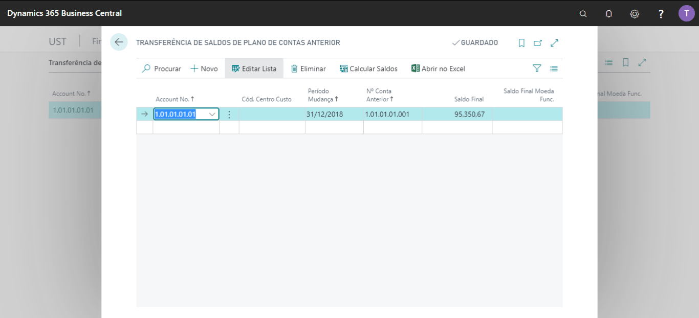

A ação **Calcular Saldos** calcula o **Saldo Final** de cada conta anterior até o período da mudança.

> **Nota**: o `I157` só é gerado com **Indicador de Alteração no Plano de Contas** marcado na apuração, e só entram as linhas com **Período Mudança** anterior à **Data Inicio** da escrituração: informe a data final do período anterior. Exemplo: para a escrituração de 01/01/2019 a 31/12/2019, o **Período Mudança** deve ser 31/12/2018.

### Centros de custo nas partidas do lançamento (`I250`)

O `I250` traz as contrapartidas de cada lançamento do `I200`: para uma conta e um centro de custo, a soma das partidas a débito e a crédito deve ser igual. Para que o `I250` saia com os centros de custo corretos:

1. Abra o **Plano de Contas ECD**, selecione a conta que tem centro de custo e clique em **Centros de Custo**.

   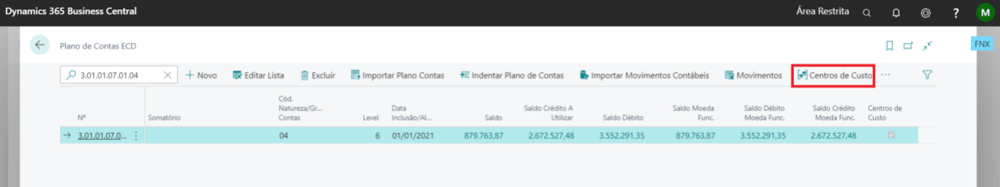

2. Informe os centros de custo da conta em **Cód. Centro Custo**.

   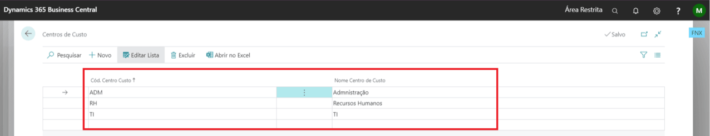

3. Repita para cada conta. O campo **Centros de Custo** do **Plano de Contas ECD** fica marcado nas contas com centro de custo informado.

   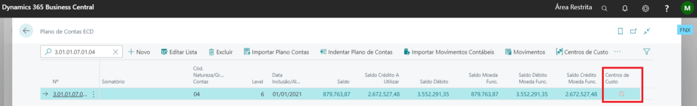

4. Informe os centros de custo também na **Relação Entre Contas**. A coluna **Cód. Centro Custo** da lista inferior fica oculta por padrão; para exibi-la:
   1. Abra **Relação Entre Contas**, clique no ícone de engrenagem e em **Personalizar**.

      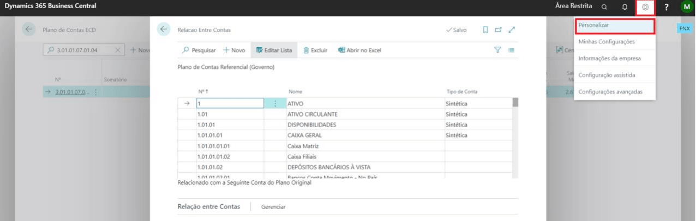

   2. Clique em **+ Campo**.

      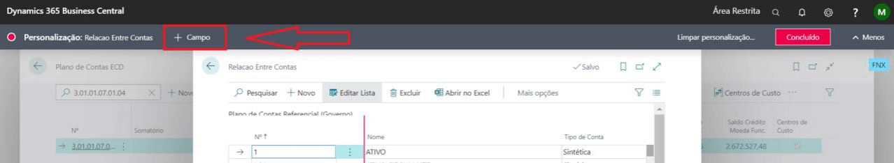

   3. Arraste o campo **Cód. Centro Custo** para a lista inferior e clique em **Concluído**.

      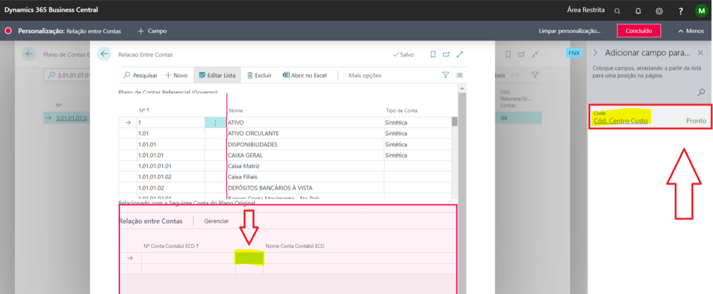

5. Para cada conta referencial, relacione as contas da empresa na lista inferior, informando o **Cód. Centro Custo** em cada linha.

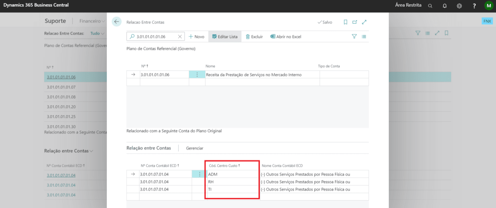

---

## 5. Bloco J: signatários da escrituração (`J930`)

1. Pesquise por **Signatários ECD** ou abra **Configurações** > **Fiscal** > **ECD/ECF** > **Signatários**.
2. Clique em **Novo** para cadastrar um signatário, ou em **Editar Lista** para alterar os existentes.
3. Preencha os dados de cada signatário. A **Qualificação** segue a tabela da Receita Federal.
4. Marque **Signatário da Escrituração** nos signatários que devem constar do arquivo.

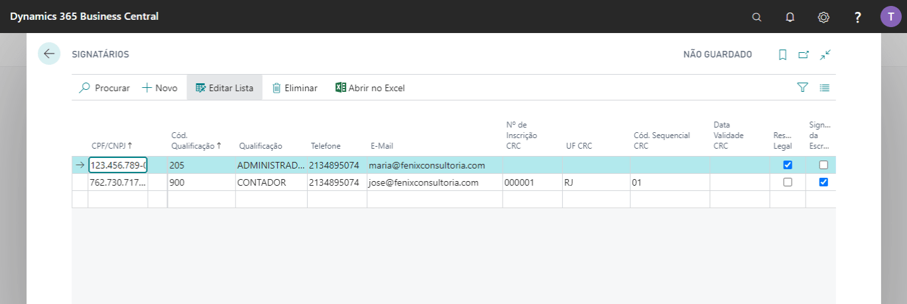

> **Importante**: toda ECD deve ser assinada por, no mínimo, dois signatários: um contador/contabilista e o responsável pela assinatura da ECD. Para o contador, informe **Telefone**, **E-Mail**, **Nº de Inscrição CRC**, **UF CRC**, **Data Validade CRC** e **Cód. Sequencial CRC**; sem esses dados o PVA não valida, assina nem transmite a ECD.

> **Nota**: o `J930` leva apenas os signatários com **Signatário da Escrituração** marcado. Os marcados em **Signatário do Termo de Substituição** formam o registro `J932`.

---

## 6. Importar os movimentos contábeis

Depois do encerramento do exercício e da importação do plano de contas, importe os movimentos contábeis.

1. Pesquise por **Importar Movimentos Contábeis ECD**, ou clique em **Importar Movimentos Contábeis** no **Plano de Contas ECD**.
2. Informe o filtro de **Data Registro** e clique em **OK**.

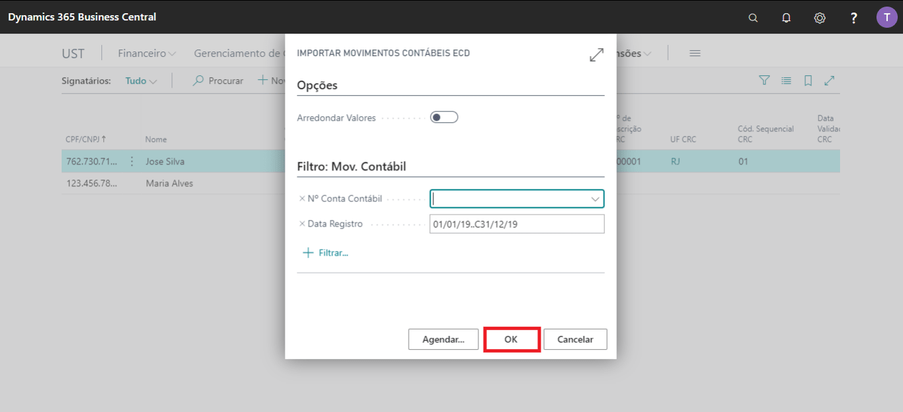

> **Importante**: os movimentos de encerramento são obrigatórios e também devem ser importados. Para isso, use a letra `C` na data final do filtro, por exemplo `01/01/2019..C31/12/2019`.

> **Nota**: todos os movimentos contábeis da empresa devem estar importados para a ECD. Na primeira importação, deixe o filtro de data vazio para trazer todos os movimentos, desde o início da empresa.

---

## 7. Processar e exportar o arquivo

1. Abra a **Apuração SPED Contábil** do ano desejado (**Fiscal** > **Livros Fiscais** > **ECD/ECF** > **Apurações ECD**).
2. Clique em **Processar**. O sistema lê os registros para montar o arquivo, o que pode levar alguns minutos.

   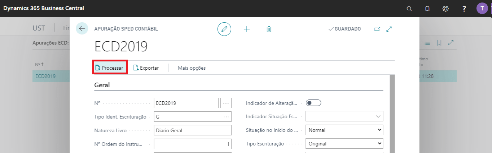

3. Ao final, é exibida a mensagem **ECD processado com sucesso.**, e a data e hora ficam em **Data/Hora Último Processamento**.

   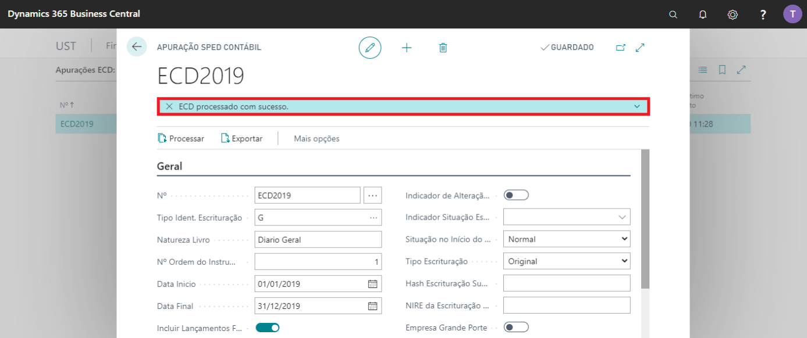

4. Clique em **Exportar**. É gerado um arquivo TXT para importação no PVA da ECD, disponível no site da Receita Federal.

   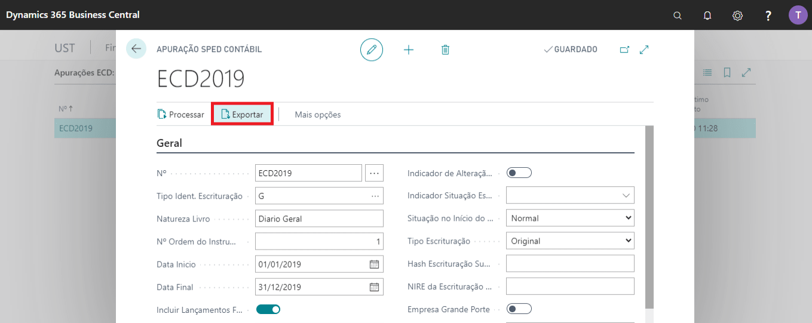
