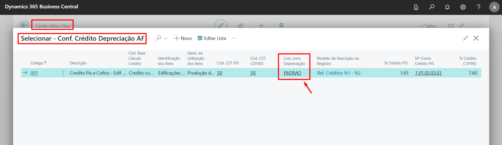

# EFD Contribuições: Crédito de PIS/COFINS sobre Deprec./Amortiz. - inclusão de coluna Cód. Livro Depreciação

No cartão do ativo fixo, no campo **Código de Crédito de Depreciação** (tela Conf. Crédito Depreciação AF), foi incluída a coluna **Cód Livro Depreciação**, para que seja possível indicar de que livro o valor do crédito deverá ser considerado.

