# EFD-ICMS/IPI: Registros C195/C197 e D195/D197

**Data**: Março/2023

---

## Sumário

Os registros C195/C197 (notas fiscais) e D195/D197 (conhecimentos de transporte) do EFD-ICMS/IPI trazem as observações do lançamento fiscal e os ajustes de ICMS de cada documento. A localização gera esses registros a partir das **Definições de Observação EFD**: cada definição diz quais documentos recebem a observação (filtros), como as linhas são agrupadas, qual é o texto da observação e, para o C197/D197, qual código de ajuste e quais valores são informados. As mesmas definições também podem levar a observação para os livros fiscais.

## 1. Contexto

### Os registros

- **C195/D195**: observação do lançamento fiscal. Deve ser informada quando, por legislação estadual, houver ajustes nos documentos fiscais, informações sobre diferencial de alíquota, antecipação de imposto e outras situações.
- **C197/D197**: detalham outras obrigações tributárias, ajustes e informações de valores dos documentos dos registros C195/D195, que podem ou não alterar o cálculo do imposto.

Exemplo dos registros gerados:

```text
C195|TLC001|ICMS Base Outras 5.102
C197|SP66666666|5102||||1000,00|
```

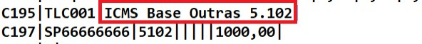

### C ou D

O registro é escolhido pelo modelo do documento fiscal: notas fiscais (modelos 01, 1B, 04, 55 e 65) geram C195/C197; documentos de frete, como o CT-e, geram D195/D197. A mesma definição serve para os dois.

---

## 2. Definições de observação

1. Pesquise por **Definições de Observação EFD** ou, no Centro de Funções, abra **Configurações** > **Fiscal** > **EFD ICMS/IPI** > **Definições de Observação**.
2. Escolha **Novo** e preencha os campos:

| Campo | Descrição |
|-------|-----------|
| **Código** | Código de livre escolha que identifica a definição |
| **Cód. EFD** | Código de três caracteres que numera as observações no arquivo, como `OUT`, `ISE`, `DIF`. No C195 o código sai seguido de um sequencial de três dígitos (`OUT001`, `OUT002`), e também identifica a observação no registro 0460 |
| **Descrição** | Descrição da operação |
| **Texto da Observação** | Texto que vai para o C195/D195. Pode conter variáveis entre chaves, como `{CFOP}` ou `{OutrosICMS}`, que são trocadas pelos valores do documento. O botão **...** do campo lista as variáveis disponíveis |
| **Livros Fiscais** | Leva a observação para a coluna de observações dos livros fiscais |
| **EFD 195/197** | Leva a observação para os registros C195/C197 ou D195/D197 do EFD |
| **Filtros**, **Agrupado Por**, **Map. Detalhado** | Quantidade de filtros, agrupamentos e mapeamentos da definição. Eles são editados pelas ações de mesmo nome, descritas abaixo |

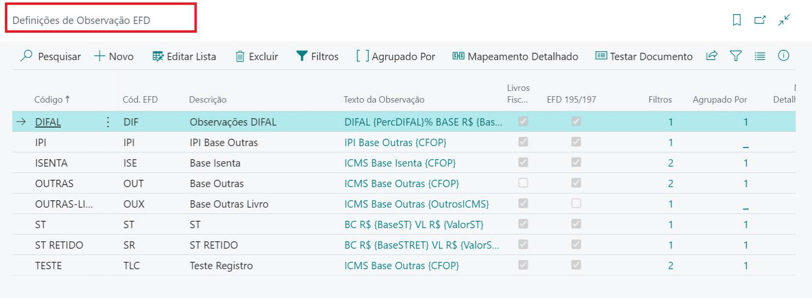

> **Nota**: o **Cód. EFD** precisa ser único entre as definições; repetir um código dá o erro *Cód. EFD deve ser unico.* As definições são comuns a todas as empresas do banco de dados.

### Observação sem C197 (DIFAL)

Uma observação que só deve sair no C195, sem ajuste no C197, como a do DIFAL, precisa apenas de **Código**, **Cód. EFD**, **Descrição**, **Texto da Observação** e **EFD 195/197** ligado, sem mapeamento detalhado:

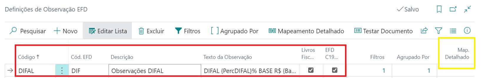

> **Nota**: sem nenhuma definição que gere observação para o documento, a localização continua gerando automaticamente as observações de DIFAL e de ICMS-ST. Quando ao menos uma definição com **Livros Fiscais** ou **EFD 195/197** ligado gera observação para um documento, as observações automáticas deixam de ser geradas para esse documento, e só valem as das definições.

### Filtros

A ação **Filtros** limita os documentos e linhas que recebem a observação. Em cada linha, escolha o campo em **Nome Campo** e informe o filtro em **Texto do Filtro**, como `>0` para valores. Todos os filtros precisam ser atendidos.

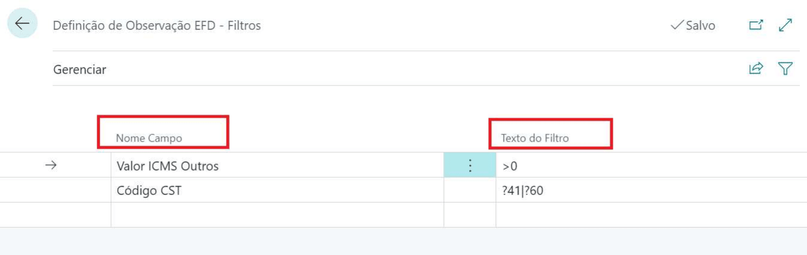

No **Código CST**, use `?` antes do código para aceitar qualquer origem da mercadoria, por exemplo:

```text
?41|?60|?90
```

### Agrupado por

A ação **Agrupado Por** define os campos que separam as observações. No exemplo, agrupando por **Código CFOP**, o documento recebe uma observação para cada CFOP, com os valores somados por CFOP.

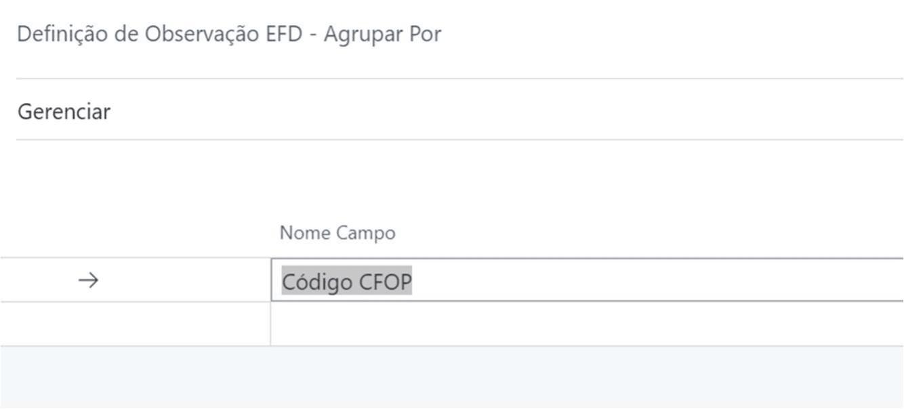

### Mapeamento detalhado (C197/D197)

A ação **Mapeamento Detalhado** define o que vai para o C197/D197. Na parte de cima, informe o **Código de Ajuste** da tabela de ajustes da UF e a **Descrição**.

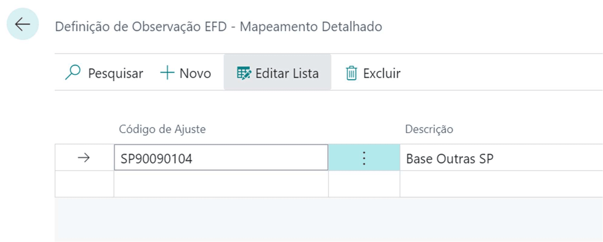

> **Nota**: só são usados os códigos de ajuste que começam pela UF da filial do documento. Uma definição pode ter códigos de várias UFs (por exemplo, um `SP...` e um `RJ...`), e cada filial usa o da sua UF.

Na parte **Campos**, diga como preencher cada campo do registro, conforme o leiaute do ajuste. No exemplo do ajuste da Portaria CAT 66 de SP, o registro leva o CFOP na descrição complementar e o valor do imposto:

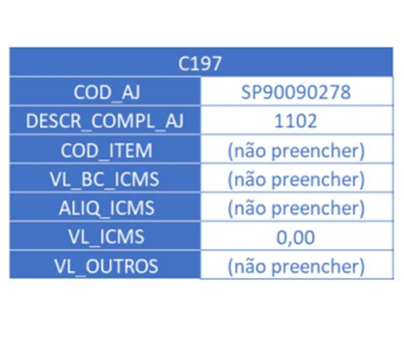

| Campo | Descrição |
|-------|-----------|
| **Campo EFD** | Campo do C197/D197: **Descrição Complementar**, **Cód. Item**, **Base ICMS**, **Alíquota ICMS**, **Valor ICMS** ou **Valor Outros** |
| **Tipo de Mapeamento** | **Branco** deixa o campo vazio; **Texto Fixo** usa o texto informado; **Variável** usa um valor do documento |
| **Texto Fixo** | Texto ou valor fixo, editável quando o tipo é **Texto Fixo**. Nos campos de base, alíquota e valores ele precisa ser um número |
| **Nome da Variável** | Variável do documento, como `{CFOP}` ou `{OutrosICMS}`, editável quando o tipo é **Variável**. A lista do campo mostra as variáveis disponíveis |

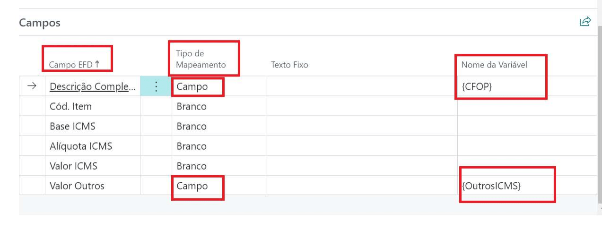

> **Nota**: a imagem é de uma versão anterior, em que o tipo **Variável** se chamava **Campo**.

---

## 3. Testar documento

Antes de gerar o arquivo, é possível ver como ficará o registro de um documento:

1. Em **Definições de Observação EFD**, selecione a definição e escolha **Testar Documento**.
2. Selecione um documento fiscal com o cenário da observação e escolha **OK**.

   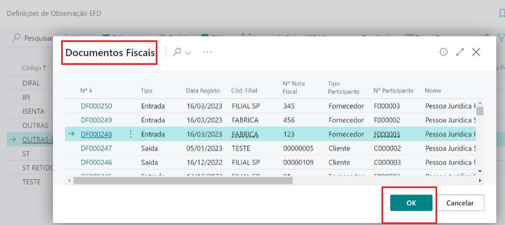

3. Confira a observação e o C197/D197 que o documento geraria.

   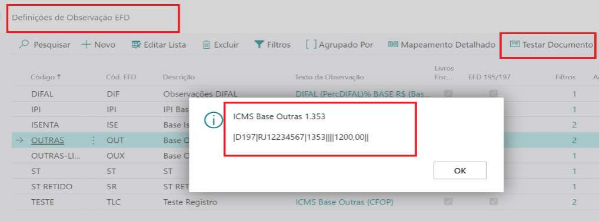

Se a definição não gera observação para o documento escolhido, a mensagem é *Nenhuma observação foi criada para o documento selecionado.*

---

## 4. ST retido (CST 60)

Os valores do ICMS-ST retido anteriormente (CST 60) não entram no cálculo de impostos da localização: são dados informativos da NF-e. Eles podem ser informados no documento e levados ao C197 com o código de ajuste próprio da UF.

### Informar os valores no documento

1. Na ordem de compra ou de venda, informe **60** no **CST ICMS** da linha.

   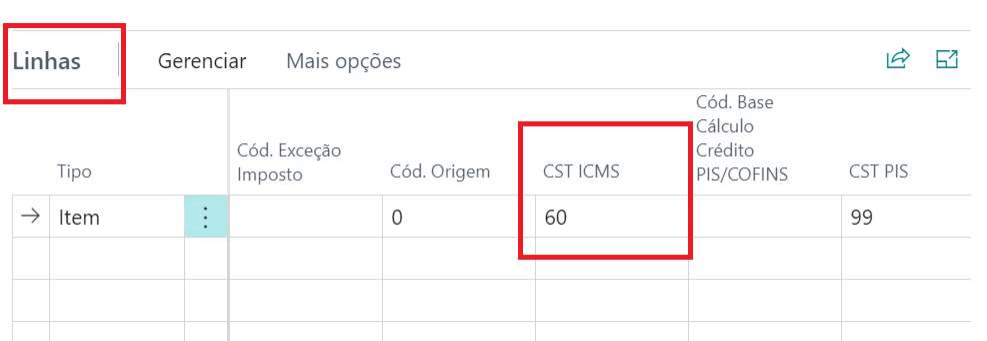

2. No painel **Dados Fiscais**, abra **NF-e**.

   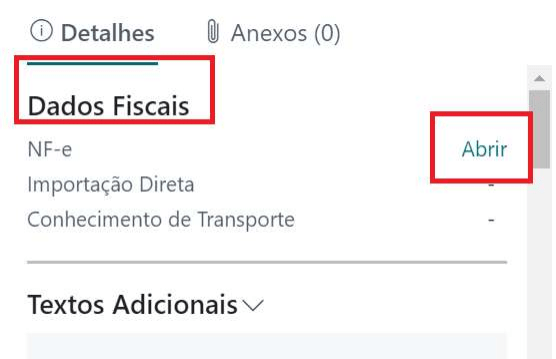

3. Na seção **Linhas CST ICMS 60**, informe **Base ST Ret.**, **Valor ST Ret.**, **% ST Ret.** e **Valor ICMS Substituto** de cada item.

   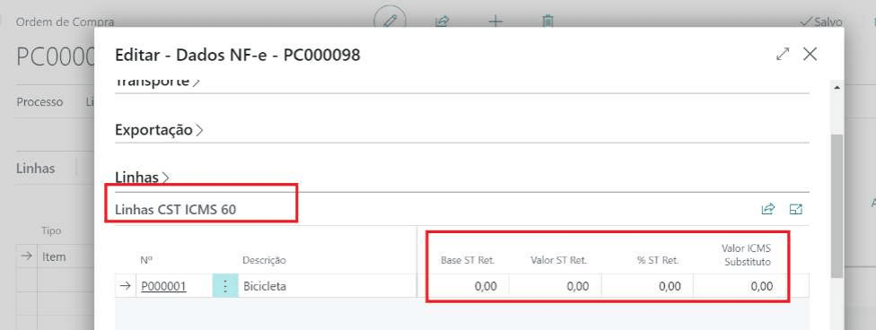

4. Confira a contabilização e registre o documento.

> **Nota**: a seção **Linhas CST ICMS 60** só aparece quando ao menos uma linha do documento tem **CST ICMS** 60.

### Definição de observação do ST retido

As variáveis `{BaseSTRet}` e `{ValorSTRet}` trazem esses valores para o texto e para o mapeamento. Exemplo de definição:

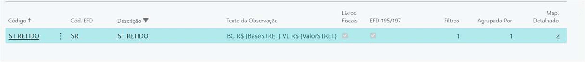

Filtro pelo valor do ST retido:

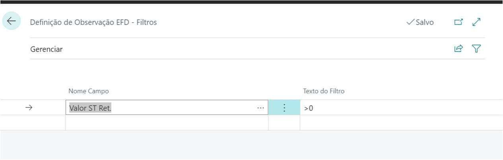

Mapeamento detalhado com o código de ajuste do ST retido:

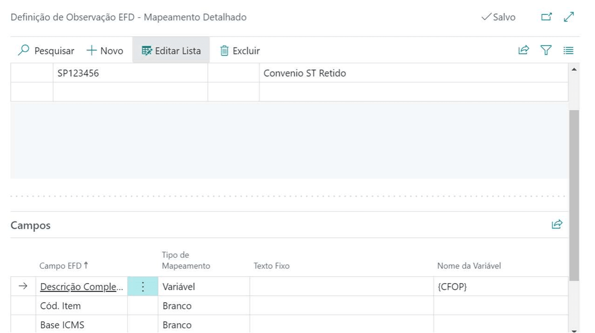

---

## 5. Apuração ICMS/IPI

Na apuração do ICMS/IPI feita da forma habitual, as observações das definições com **Livros Fiscais** ligado aparecem na coluna de observações dos livros:

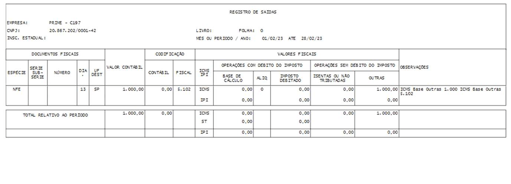

No arquivo exportado, as definições com **EFD 195/197** ligado geram o registro 0460 e os registros C195/C197 (ou D195/D197) de cada documento:

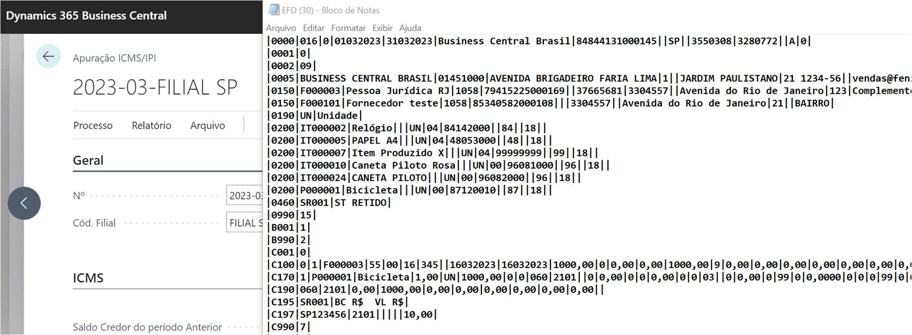

Para o processo de apuração e geração do arquivo, veja [Apuração ICMS/IPI: Configuração, Processamento e Arquivo EFD](Localization-for-Brazil_User-Manual_Apuracao-ICMS-IPI.md) e [EFD-ICMS/IPI (SPED Fiscal)](Localization-for-Brazil_User-Manual_guia-fiscal-efd-icms-ipi.md).
