# EFD-Reinf: Configuração, Geração e Envio dos Eventos

**Data**: Agosto/2023

---

## Sumário

A localização gera e transmite os eventos da EFD-Reinf (Escrituração Fiscal Digital de Retenções e Outras Informações Fiscais) direto do Business Central. Os eventos de cadastro (R-1000 e R-1070) são enviados a partir das informações da empresa e dos processos cadastrados. Os eventos periódicos das séries R-2000 (retenções de INSS, CPRB e produção rural) e R-4000 (retenções de IR, PIS, COFINS e CSLL) são sugeridos a partir dos documentos fiscais do mês, conferidos e enviados à Receita Federal, e o período é encerrado com os eventos de fechamento R-2099 e R-4099. Cada evento é assinado com o certificado digital da empresa e validado pela Receita no momento da transmissão.

Os conceitos da obrigação estão no [Guia Fiscal: EFD-Reinf](Localization-for-Brazil_User-Manual_guia-fiscal-efd-reinf.md).

## 1. Contexto

### Obrigatoriedade

A EFD-Reinf deve ser entregue por:

- prestadores de serviços mediante cessão de mão de obra ou empreitada;
- empresas que fizeram retenções na fonte (IR, CSLL, COFINS, PIS/PASEP) sobre pagamentos a pessoas físicas e jurídicas;
- empresas optantes pela CPRB (desoneração da folha de pagamento, Lei 12.546/2011).

A obrigação pode variar conforme o faturamento da empresa e a atividade exercida.

### Prazo de entrega

A EFD-Reinf é entregue até o dia 15 de cada mês, com as informações do mês anterior. As entidades promotoras de espetáculos desportivos transmitem o evento correspondente em até 2 dias úteis após a sua realização.

### Assinatura e transmissão

Os eventos são assinados digitalmente com o e-CNPJ do contribuinte, o e-CPF do seu representante legal ou o e-CPF ou e-CNPJ do seu procurador. O certificado usado é o informado em **Configurações Reinf** (seção 2.3).

Os eventos seguem uma ordem lógica: o R-1000 e, quando houver, o R-1070 precisam ter sido aceitos antes do envio dos eventos periódicos.

### Eventos contemplados

| Evento | Descrição |
|--------|-----------|
| **R-1000** | Informações do contribuinte |
| **R-1070** | Tabela de processos administrativos/judiciais |
| **R-2010** | Retenção de contribuição previdenciária - serviços tomados |
| **R-2020** | Retenção de contribuição previdenciária - serviços prestados |
| **R-2050** | Comercialização da produção por produtor rural PJ/agroindústria |
| **R-2055** | Aquisição de produção rural |
| **R-2060** | Contribuição previdenciária sobre a receita bruta (CPRB) |
| **R-2098** | Reabertura dos eventos da série R-2000 |
| **R-2099** | Fechamento dos eventos da série R-2000 |
| **R-4010** | Pagamentos/créditos a beneficiário pessoa física |
| **R-4020** | Pagamentos/créditos a beneficiário pessoa jurídica |
| **R-4099** | Fechamento/reabertura dos eventos da série R-4000 |
| **R-9000** | Exclusão de evento enviado |

### O que cada evento informa

- **R-1000**: dados cadastrais do contribuinte (regime tributário, contato do responsável, desoneração da folha, obrigatoriedade da ECD). É o primeiro evento a ser transmitido e só é enviado de novo quando esses dados mudam.
- **R-1070**: processos administrativos ou judiciais que suspendem a retenção ou o recolhimento de tributos (validade, tipo, número do processo e dados complementares). É transmitido até o dia 15 do mês seguinte ao de referência ou antes de qualquer evento que informe o processo.
- **R-2010**: serviços contratados mediante cessão de mão de obra ou empreitada com retenção previdenciária (art. 31 da Lei 8.212/1991), inclusive quando o prestador está na CPRB. Entram as notas com retenção na data de competência, mesmo que um processo impeça a retenção; notas sem retenção não são informadas. Notas fora do prazo de competência são enviadas como retificação, depois da reabertura do período.
- **R-2020**: o equivalente do R-2010 para os serviços prestados pela empresa com retenção de INSS, redução de base ou sem INSS por força de processo.
- **R-2050**: comercialização da produção rural ou agroindustrial quando o produtor rural PJ ou a agroindústria contribui sobre a receita bruta (art. 25, §7º da Lei 8.870/1994 e art. 22-A da Lei 8.212/1991), inclusive nos casos do art. 167 da IN RFB 971/2009.
- **R-2060**: contribuição previdenciária sobre a receita bruta (CPRB) das empresas que desenvolvem as atividades do art. 7º ou fabricam os produtos do art. 8º da Lei 12.546/2011. Órgãos públicos não enviam este evento.
- **R-2099**: encerra os eventos periódicos da série R-2000 do período e consolida as informações enviadas, alimentando a DCTFWeb. Depois dele, inclusões, retificações e exclusões só são aceitas após o R-2098.
- **R-2098**: reabre um período já encerrado da série R-2000 para retificações ou novos eventos.
- **R-4010** e **R-4020**: pagamentos, créditos, entregas, empregos ou remessas a beneficiários pessoa física e pessoa jurídica, mesmo sem retenção de imposto de renda, nos casos previstos na legislação. Alimentam a DCTFWeb e a malha fiscal da Receita Federal. Rendimentos do trabalho pagos pelo empregador são informados no eSocial, não aqui.
- **R-4099**: encerra ou reabre a série R-4000 do período. No fechamento, as informações são consolidadas e encaminhadas à DCTFWeb.

---

## 2. Configuração

### 2.1 Códigos de serviço (R-2010 e R-2020)

O item de serviço considerado na EFD-Reinf precisa ter o campo **Cód. Serviço** preenchido no **Cartão Item**, seção **Fiscal**.

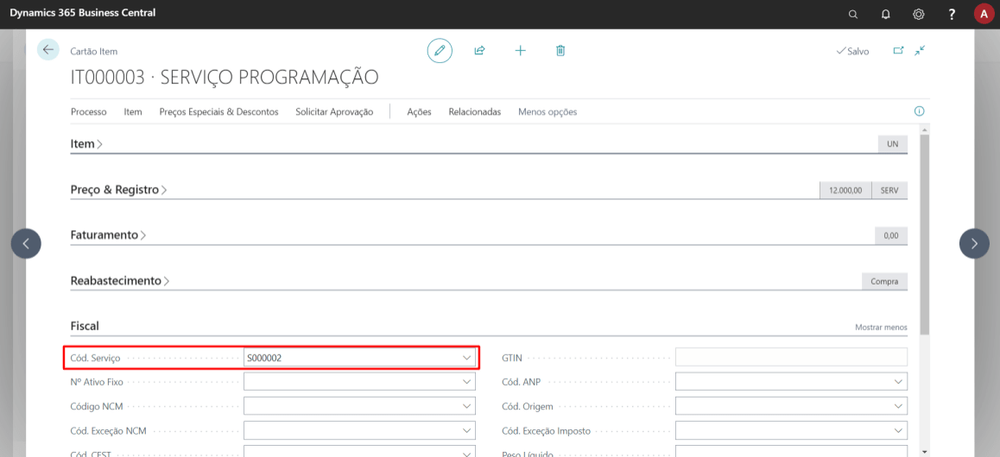

O código de serviço, por sua vez, precisa do campo **Cód. Cessão de Mão de Obra Reinf**, que é o tipo de serviço enviado nos eventos R-2010 e R-2020.

1. Pesquise por **Códigos de Serviço NFS** ou, no Centro de Funções, abra **Configurações** > **Fiscal** > **EFD Reinf** > **Códigos de Serviço**.
2. Preencha o **Cód. Cessão de Mão de Obra Reinf** de cada serviço sujeito à retenção.

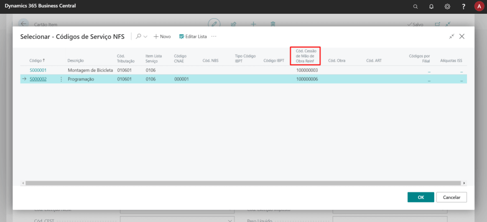

> **Nota**: sem o **Cód. Cessão de Mão de Obra Reinf**, a montagem do XML do evento R-2010 ou R-2020 é interrompida com erro.

### 2.2 Natureza de rendimento (R-4010 e R-4020)

Os eventos da série R-4000 informam o código de natureza de rendimento de cada pagamento, definido numa matriz por fornecedor e serviço.

1. Pesquise por **Configurações de Fornecedores Reinf** ou, no Centro de Funções, abra **Configurações** > **Fiscal** > **EFD Reinf** > **Configurações de Fornecedores**.

   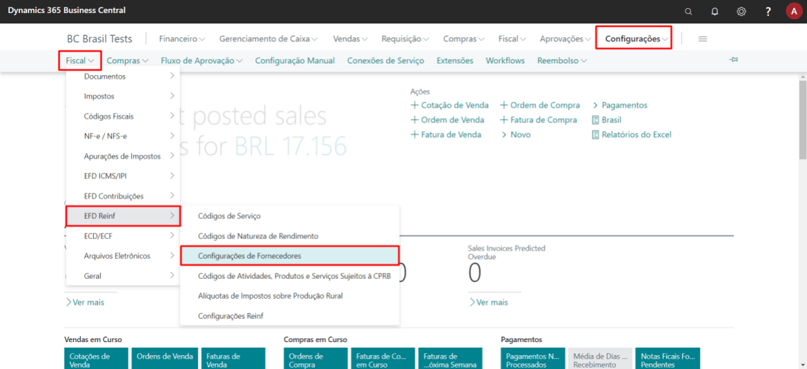

2. Cadastre as combinações:

| Campo | Descrição |
|-------|-----------|
| **Nº Fornecedor (Opcional)** | Fornecedor ao qual o código se aplica. Em branco, vale para qualquer fornecedor |
| **Cód. Serviço NFS (Opcional)** | Código de serviço ao qual o código se aplica. Em branco, vale para qualquer serviço |
| **Cód. Natureza Receita** | Código da Tabela 01 (Natureza dos Rendimentos) do manual da EFD-Reinf, publicado em http://sped.rfb.gov.br |
| **Cód. Relação Beneficiário no Exterior** | Relação entre a fonte pagadora e o beneficiário no exterior. Preencha só para fornecedor com beneficiário no exterior |
| **Cód. Trib. IRRF (Benef. no Exterior)** | Forma de tributação do IRRF do beneficiário no exterior. Preencha só para fornecedor com beneficiário no exterior |

Na imagem, a linha em vermelho define o código só pelo serviço, as linhas em azul definem o código sempre usado para um fornecedor, e a linha em verde combina fornecedor e serviço.

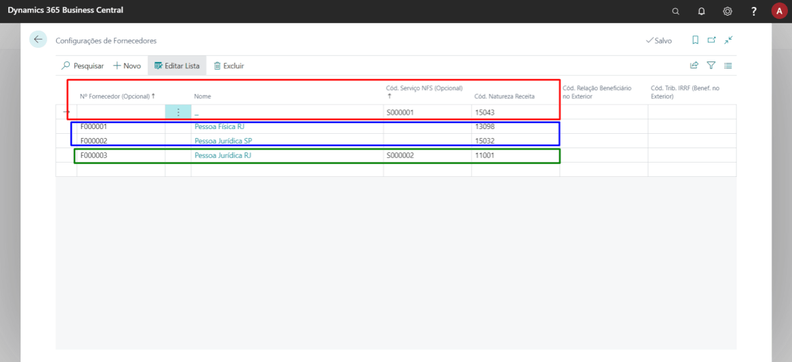

> **Nota**: quando mais de uma linha se aplica ao documento, a sugestão usa a mais específica: fornecedor e serviço, depois só o fornecedor, depois só o serviço.

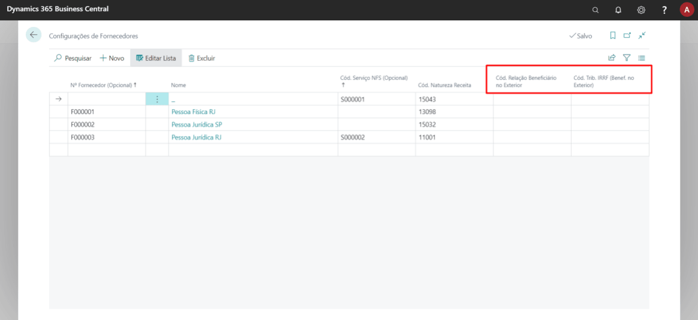

### 2.3 Configurações Reinf

1. Pesquise por **Configurações Reinf** ou, no Centro de Funções, abra **Configurações** > **Fiscal** > **EFD Reinf** > **Configurações Reinf**.
2. Preencha as seções da página:

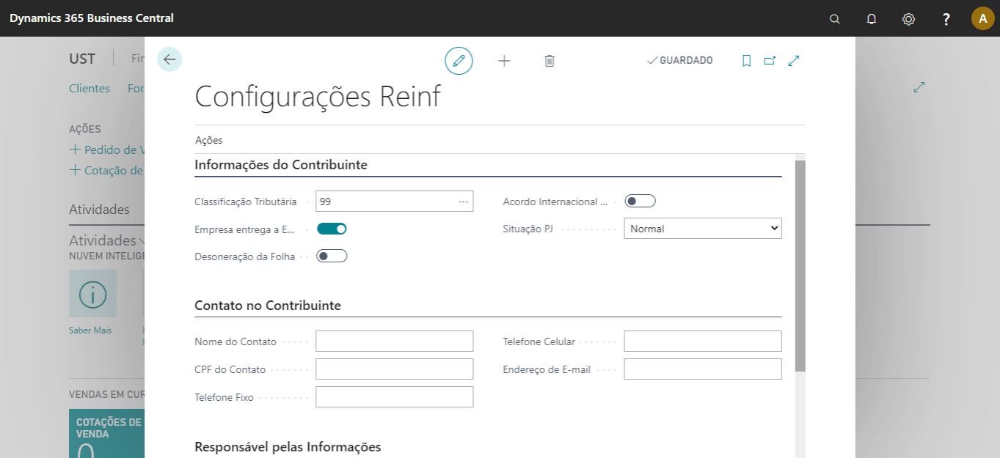

| Seção | Campo | Descrição |
|-------|-------|-----------|
| **Informações do Contribuinte** | **Classificação Tributária** | Código de classificação tributária do contribuinte, escolhido na lista oficial (por exemplo, `99`) |
| | **Empresa entrega a ECD** | Marque quando a empresa entrega a ECD |
| | **Desoneração da Folha** | Marque quando a empresa é optante pela desoneração da folha (CPRB). Sem ela, o evento R-2060 não é sugerido |
| | **Acordo Internacional de Isenção de Taxas** | Marque quando a empresa tem acordo internacional de isenção de contribuições |
| | **Situação PJ** | **Normal**, **Extinção**, **Fusão**, **Cisão** ou **Incorporação** |
| **Registros** | **Filtro de Data** (grupo **R-4000**) | Data usada para selecionar os documentos dos eventos R-4000: **Data de Registro** ou **Data de Documento** |
| **Contato no Contribuinte** | **Nome do Contato**, **CPF do Contato**, **Telefone Fixo**, **Telefone Celular**, **Endereço de E-mail** | Contato do responsável pela EFD-Reinf |
| **Responsável pelas Informações** | **Nome do Responsável**, **CPF do Responsável** | Responsável legal pelas informações enviadas |
| **Web Service** | **Ambiente do Web Service** | **Produção** ou **Produção Restrita (Teste)**. A troca de ambiente pede confirmação |
| | **URL do Web Service** | Endereço do serviço de transmissão. Só altere sob orientação do suporte |
| | **Certificado** | Certificado digital usado para assinar os eventos. Clique em **...** para importar o arquivo e informar a senha |
| | **Data/Hora de Vencimento do Certificado** | Lida do próprio certificado na importação |
| | **Data Inicial** | Início da EFD-Reinf na empresa. A página **Reinf - Períodos** lista os meses a partir desta data |

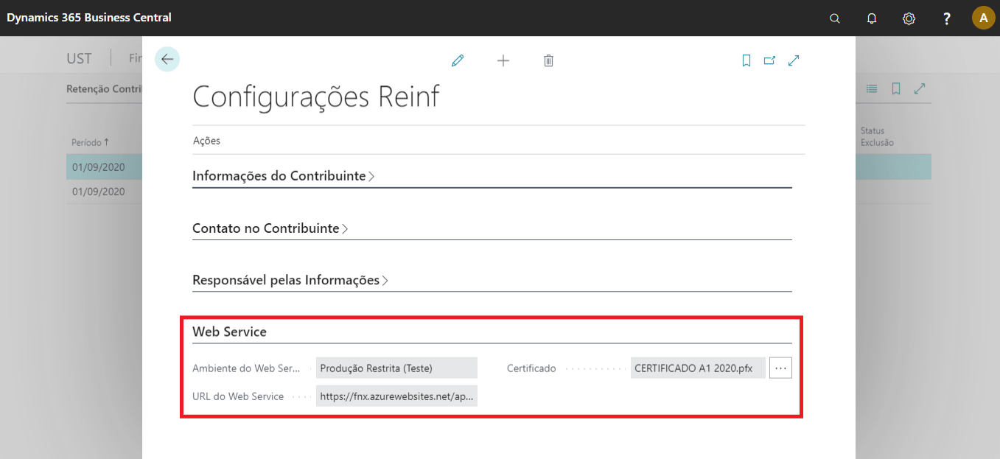

> **Nota**: os campos da página podem ser editados diretamente, sem permissão SUPER. A ação **Permitir Edição**, mostrada nas versões antigas, não tem mais efeito. O aviso de vencimento e o bloqueio da transmissão com certificado vencido estão em [Certificado Digital: Validade no Cadastro, Aviso de Vencimento e Bloqueio da Transmissão](Localization-for-Brazil_User-Manual_Certificado-Digital-Validade-Aviso-Vencimento.md).

As demais páginas do menu **Configurações** > **Fiscal** > **EFD Reinf** são tratadas nas seções dos eventos que as usam: **Códigos de Atividades, Produtos e Serviços Sujeitos à CPRB** (R-2060), **Alíquotas de Impostos sobre Venda de Produção Rural** (R-2050), **Alíquotas de Impostos sobre Compra de Produção Rural** (R-2055) e **Configuração de INSS Adicional**, que define por jurisdição de imposto o adicional de INSS de aposentadoria especial (15, 20 e 25 anos) separado da retenção nos eventos R-2010 e R-2020.

### 2.4 Dados da empresa e das filiais

Os demais dados do evento R-1000 vêm das **Informações da Empresa** (pesquise por **Informações da Empresa**) e, quando a empresa tem filiais, da **Lista Filiais** (pesquise por **Lista Filiais** e abra a filial).

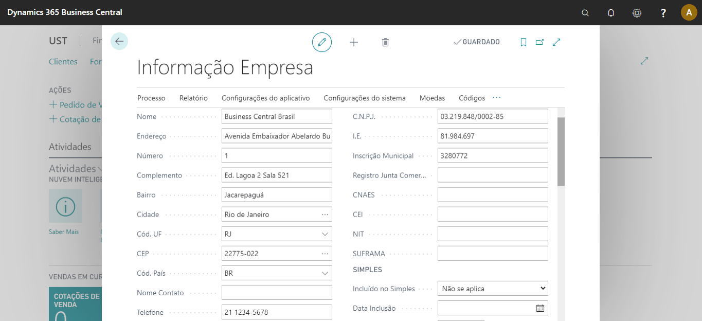

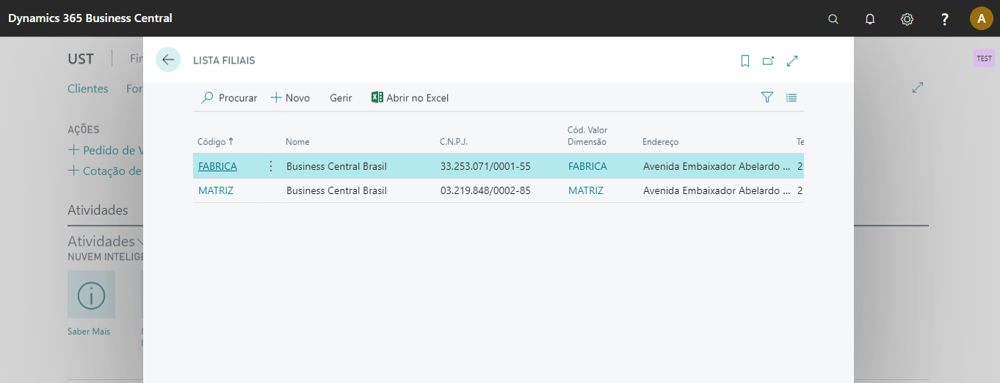

---

## 3. Eventos iniciais

As páginas de eventos ficam no menu **Fiscal** > **Livros Fiscais** > **EFD Reinf**.

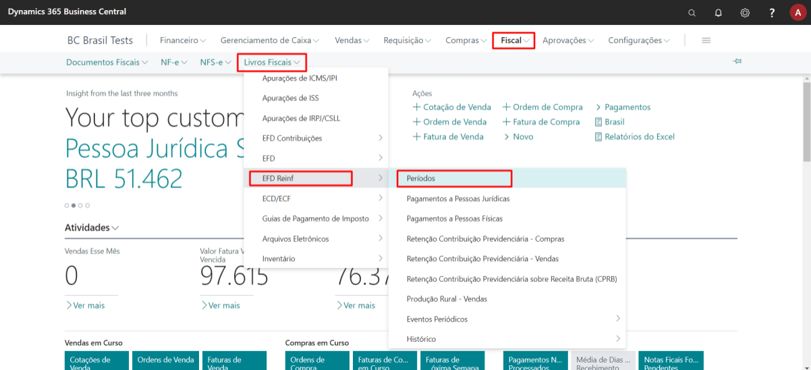

### 3.1 R-1000 - Informações do contribuinte

1. Pesquise por **Reinf - Informações do Contribuinte** ou, no Centro de Funções, abra **Fiscal** > **Livros Fiscais** > **EFD Reinf** > **Eventos Periódicos** > **Informações do Contribuinte**.
2. Clique em **Novo** e informe o **Período Inicial** da EFD-Reinf.
3. Clique em **Processo** > **Enviar Evento Inclusão** e confirme o envio.
4. Clique em **Processo** > **Consultar Evento** e confira as colunas **Status** e **Último Status de Evento**.

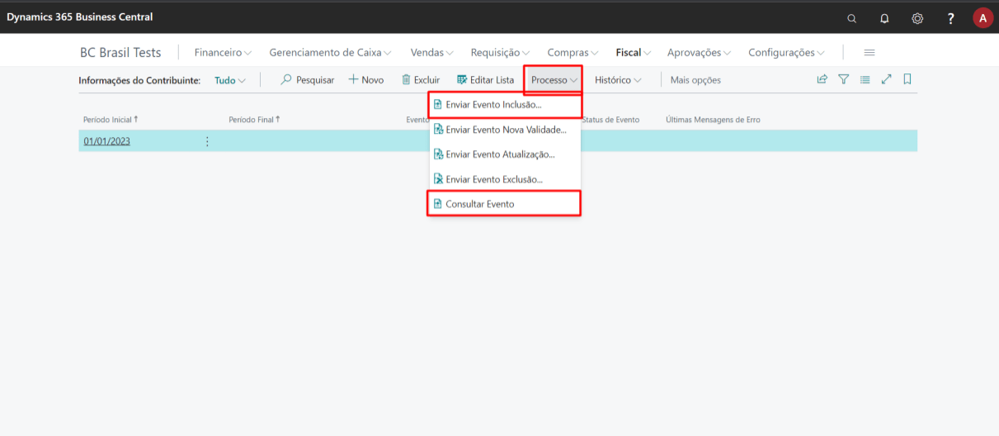

O R-1000 é enviado no primeiro mês da EFD-Reinf e só é enviado de novo quando a empresa altera algum dado do cadastro, pelas ações **Enviar Evento Atualização** ou **Enviar Evento Nova Validade**. Quando o evento não é aceito, a coluna **Últimas Mensagens de Erro** traz o motivo.

> **Nota**: depois do envio, os períodos da linha não podem mais ser editados. Com o **Ambiente do Web Service** em **Produção Restrita (Teste)**, a página mostra também a ação **Enviar Evento de Limpar Base de Testes**, que apaga os dados enviados ao ambiente de testes.

### 3.2 R-1070 - Processos administrativos/judiciais

1. Pesquise por **Reinf - Processos Administrativos/Judiciais** ou, no Centro de Funções, abra **Fiscal** > **Livros Fiscais** > **EFD Reinf** > **Eventos Periódicos** > **Processos Administrativos/Judiciais**.
2. Clique em **Novo** e preencha o processo:

| Campo | Descrição |
|-------|-----------|
| **Tipo** | **Administrativo** ou **Judicial** |
| **Nº do Processo** | Número do processo |
| **Descrição** | Descrição do processo |
| **Início da Validade** / **Fim da Validade** | Período de validade. O fim é opcional |
| **Autoria** | **Contribuinte** ou **Outra entidade ou Empresa** |
| **Cód. Identificação da Vara**, **UF da Vara**, **Município da Vara** | Dados da vara. Só ficam editáveis em processo **Judicial** |

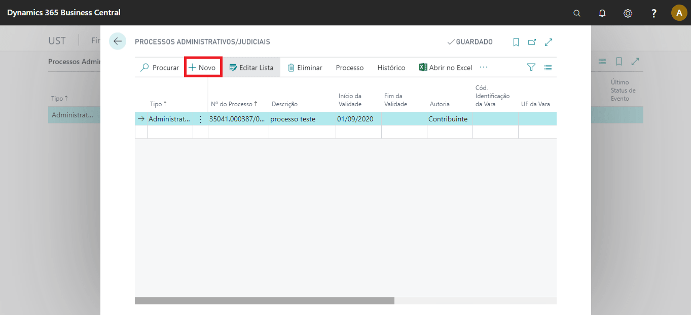

3. Clique em **Processo** > **Informações de Suspensões de Tributos** e informe o **Código Suspensão**, o **Cód. Indicador de Suspensão**, a **Data da Decisão/Sentença/Despacho** e se há **Depósito do Montante Integral**.

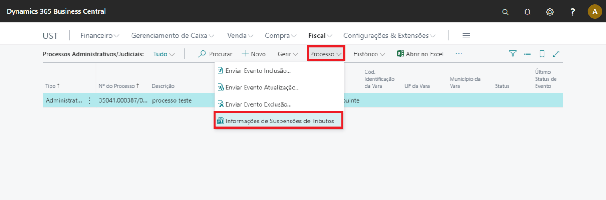

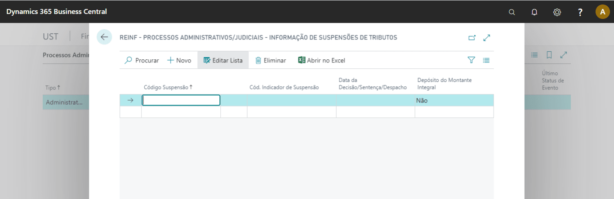

4. Clique em **Processo** > **Enviar Evento Inclusão** e, depois, em **Processo** > **Consultar Lote** para confirmar o **Status** e o **Último Status de Evento**.

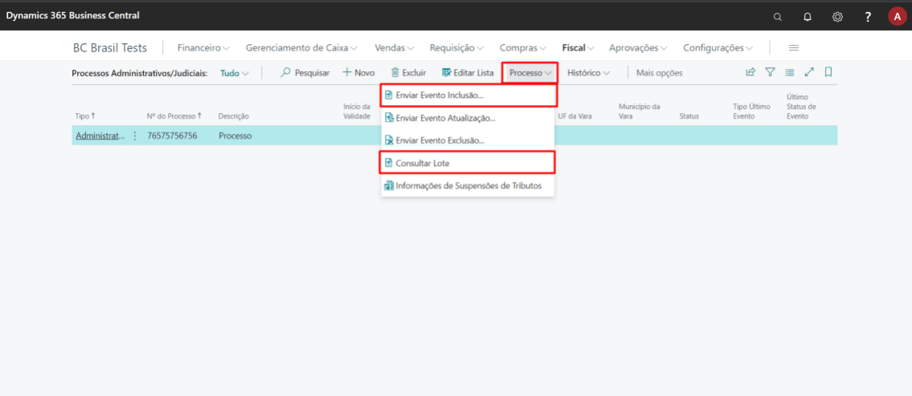

> **Nota**: cada processo é cadastrado e enviado individualmente. O envio é recusado com erro quando o processo não tem informações de suspensão de tributos.

---

## 4. Sugerir os eventos mensais

Os eventos periódicos de cada mês são criados pela sugestão, na página de períodos.

1. Pesquise por **Reinf - Períodos** ou, no Centro de Funções, abra **Fiscal** > **Livros Fiscais** > **EFD Reinf** > **Períodos**.
2. Selecione o mês. A lista mostra os meses desde a **Data Inicial** das **Configurações Reinf** até a data de trabalho, e os períodos com as duas séries fechadas ficam ocultos.
3. Clique em **Processo** > **Sugerir Eventos Mensais** e confirme a mensagem "Deseja sugerir os eventos mensais para o período ...?".

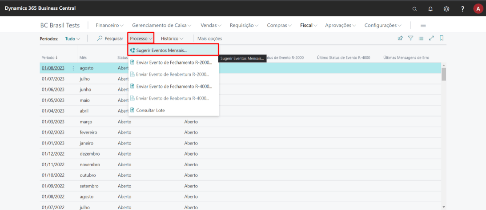

4. A mensagem final mostra a quantidade de linhas criadas para cada página de eventos. No exemplo, só houve um pagamento a pessoa jurídica.

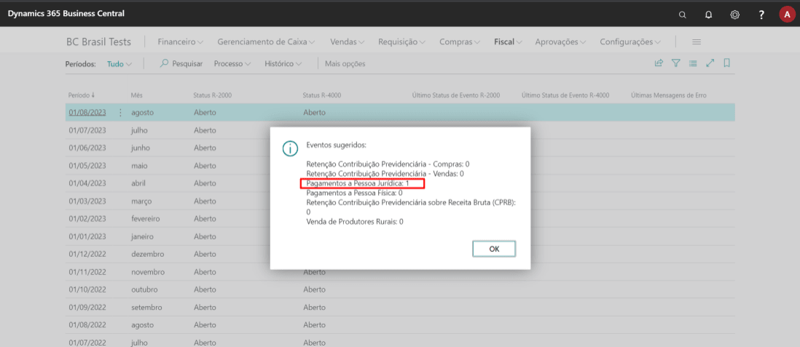

> **Nota**: na versão atual, a mensagem também traz a linha **Compra de Produtores Rurais** (R-2055). Quando nada novo é encontrado, a mensagem é "Nenhum evento novo foi sugerido.". Depois da sugestão, as linhas são conferidas e enviadas em cada página de eventos, como descrito nas seções seguintes.

---

## 5. Série R-2000

As páginas da série R-2000 têm as mesmas ações no menu **Processo**:

| Ação | Uso |
|------|-----|
| **Enviar Eventos Pendentes** | Envia todas as linhas ainda não transmitidas ou em erro, em lotes de até 50 eventos |
| **Enviar Evento** | Envia a linha selecionada. Disponível enquanto a linha não está em **Sucesso** |
| **Enviar Evento de Retificação** | Envia a correção de uma linha já aceita |
| **Enviar Evento de Exclusão** | Exclui o evento de uma linha já aceita |
| **Consultar Lote** | Consulta o resultado do lote e atualiza o **Status** da linha |

O envio em lotes e todos os resultados possíveis do **Consultar Lote** estão em [EFD-Reinf: Envio de Eventos em Lotes e Resultado do Consultar Lote](Localization-for-Brazil_User-Manual_EFD-Reinf-Envio-Lotes-Consultar-Lote.md).

### 5.1 R-2010 - Retenção de contribuição previdenciária - compras

1. Pesquise por **Reinf - Retenção Contribuição Previdenciária - Compras** ou, no Centro de Funções, abra **Fiscal** > **Livros Fiscais** > **EFD Reinf** > **Retenção Contribuição Previdenciária - Compras**.
2. As linhas são criadas por filial, fornecedor (**Nº Participante**) e obra (**Cód. Obra**). Para ver os documentos de uma linha, selecione-a e clique em **Documentos** > **Documentos**.

   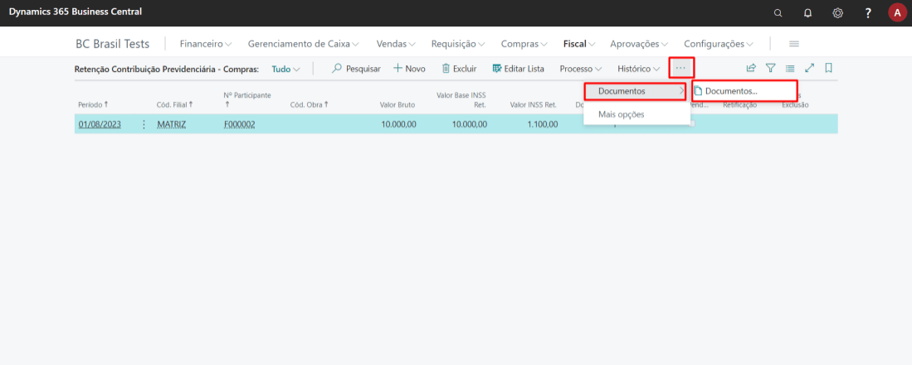

3. Para enviar, selecione a linha e clique em **Processo** > **Enviar Evento**. Depois, clique em **Processo** > **Consultar Lote** e confira o campo **Status**.

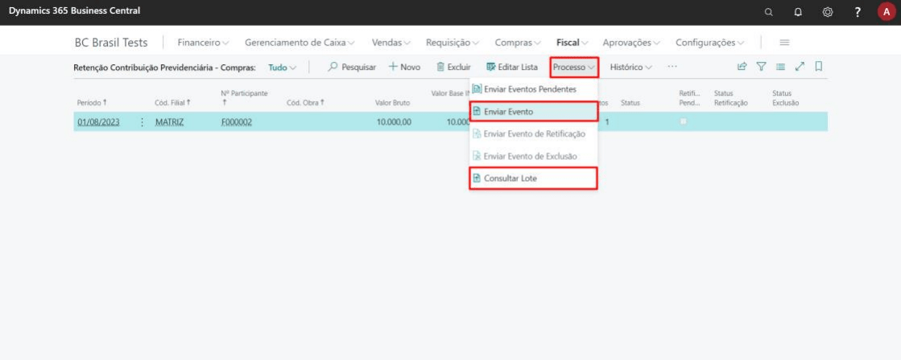

### 5.2 R-2020 - Retenção de contribuição previdenciária - vendas

O procedimento é o mesmo do R-2010, para os serviços prestados.

1. Pesquise por **Reinf - Retenção Contribuição Previdenciária - Vendas** ou, no Centro de Funções, abra **Fiscal** > **Livros Fiscais** > **EFD Reinf** > **Retenção Contribuição Previdenciária - Vendas**.
2. As linhas são criadas por filial, cliente (**Nº Participante**) e obra. Os documentos de cada linha ficam em **Documentos** > **Documentos**.
3. Selecione a linha, clique em **Processo** > **Enviar Evento** e, depois, em **Processo** > **Consultar Lote**. Confira o campo **Status**.

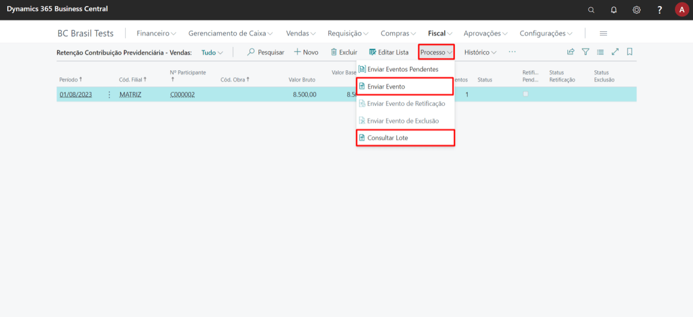

> **Nota**: assim como no R-2010, o R-2020 precisa do **Cód. Serviço** no item e do **Cód. Cessão de Mão de Obra Reinf** no código de serviço (seção 2.1).

### 5.3 R-2050 - Comercialização da produção rural

O R-2050 só é sugerido quando a **Classificação Tributária** das **Configurações Reinf** é `06` (agroindústria) ou `07` (produtor rural pessoa jurídica).

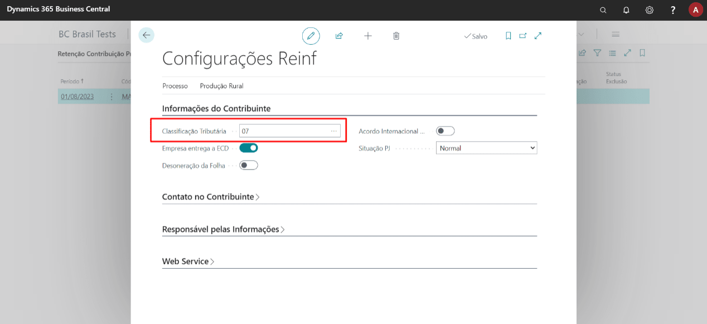

1. Nas **Configurações Reinf**, clique em **Produção Rural** > **Conf. Filtro de Venda Produção Rural** e defina quais documentos fiscais entram no registro, por exemplo por tipo de documento, item, NCM ou CFOP.

   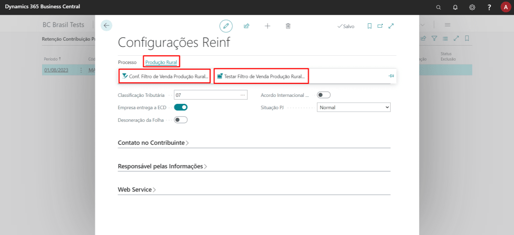

   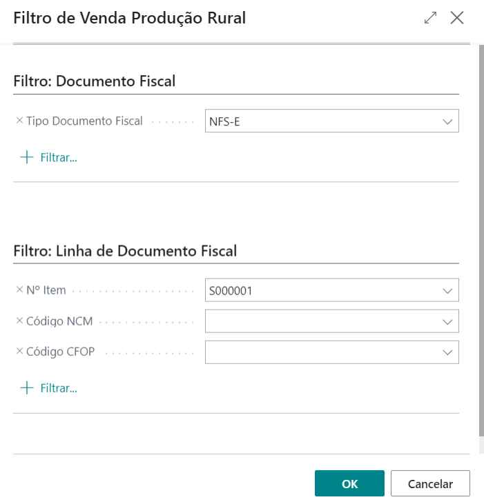

2. Clique em **Produção Rural** > **Testar Filtro de Venda Produção Rural** para ver as linhas de documento fiscal que entram no registro. Sem nenhum filtro, todas as notas fiscais entram.

   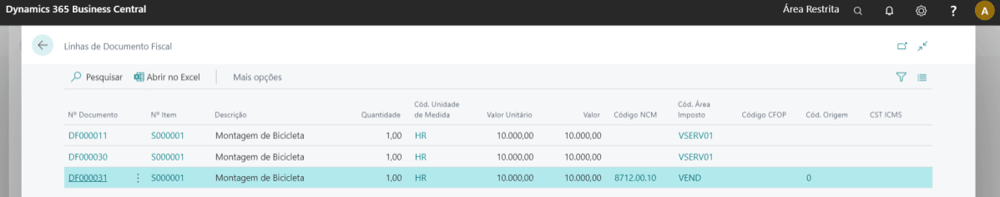

3. Cadastre as alíquotas: pesquise por **Reinf - Alíquotas de Impostos sobre Venda de Produção Rural** ou abra **Configurações** > **Fiscal** > **EFD Reinf** > **Alíquotas de Impostos sobre Venda de Produção Rural**, e informe a **Data Inicial**, a **% INSS** (contribuição previdenciária, 2,5%), a **% GILRAT** (0,1%) e a **% SENAR** (0,25%).

   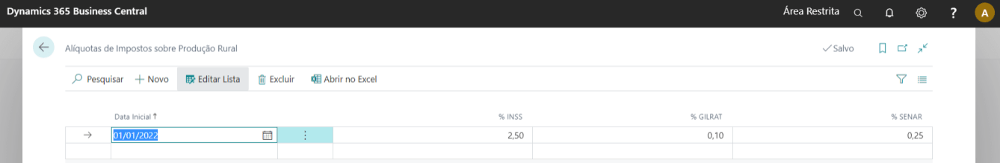

4. Sugira os eventos do mês (seção 4).
5. Pesquise por **Reinf - Vendas de Produção Rural** ou abra **Fiscal** > **Livros Fiscais** > **EFD Reinf** > **Produção Rural - Vendas**, selecione a linha e clique em **Processo** > **Enviar Evento**. Depois, clique em **Processo** > **Consultar Lote** e confira o campo **Status**.

> **Nota**: as ações de filtro só ficam habilitadas com a classificação tributária `06` ou `07`. A aquisição de produção rural (R-2055) segue o mesmo modelo, com as ações **Conf. Filtro de Compra Produção Rural** e **Testar Filtro de Compra Produção Rural**, a página **Alíquotas de Impostos sobre Compra de Produção Rural** e a página de eventos **Produção Rural - Compras**.

### 5.4 R-2060 - CPRB

O R-2060 só é sugerido quando o campo **Desoneração da Folha** está marcado nas **Configurações Reinf**. A sugestão cria uma linha por filial.

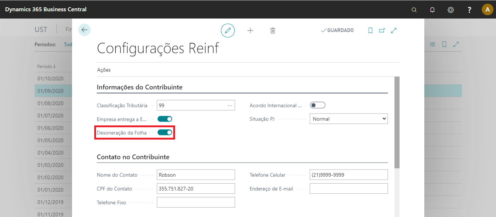

1. Cadastre os códigos de atividade e as alíquotas: pesquise por **Códigos de Atividades, Produtos e Serviços Sujeitos à CPRB** ou abra **Configurações** > **Fiscal** > **EFD Reinf** > **Códigos de Atividades, Produtos e Serviços Sujeitos à CPRB**, e informe o **Código**, a **Descrição** e a **Alíquota CPRB**.

   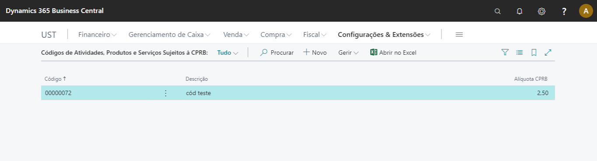

2. Depois da sugestão, pesquise por **Reinf - Retenção Contribuição Previdenciária sobre Receita Bruta** ou abra **Fiscal** > **Livros Fiscais** > **EFD Reinf** > **Retenção Contribuição Previdenciária sobre Receita Bruta (CPRB)**.
3. Selecione o período e a filial e clique em **Processo** > **Receita Bruta por CNAE**.

   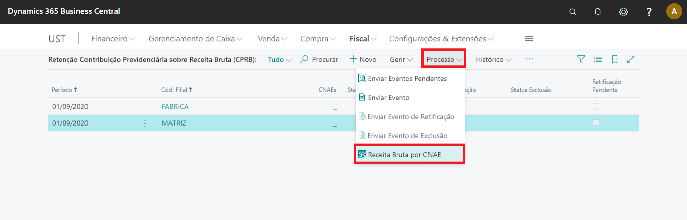

4. Selecione o **Cód. Atividades, Produtos e Serviços.** e informe o **Valor Receita Bruta**. A **Base de Cálculo**, a **Alíquota** e o **Valor do Imposto** são calculados.
5. Se houver ajustes, clique em **Ajustes** e informe o **Tipo** (**Exclusão** ou **Inclusão**), o **Código de Ajuste**, a **Descrição**, a **Data** e o **Valor**.

   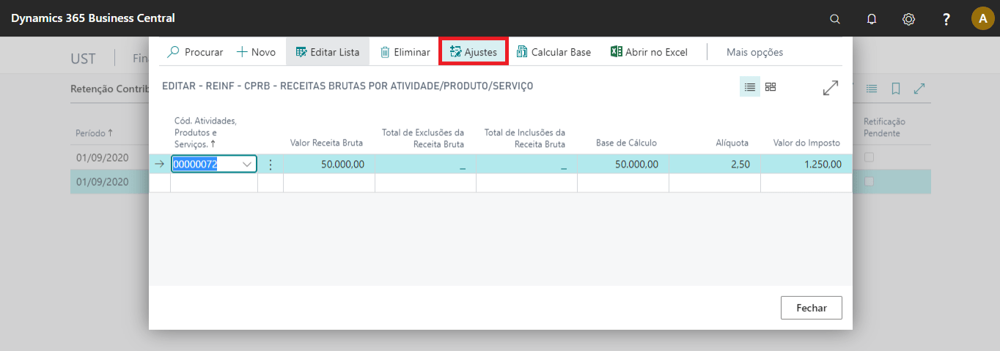

   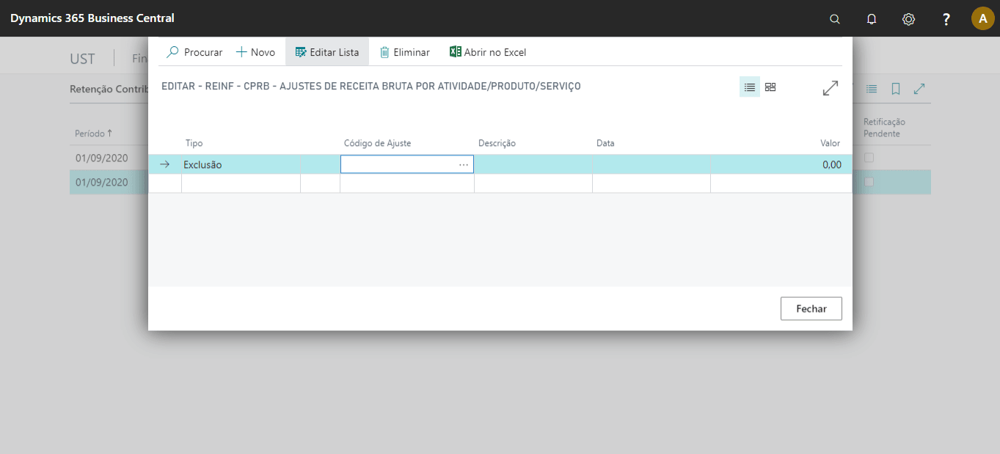

   Os ajustes atualizam o **Total de Exclusões da Receita Bruta** ou o **Total de Inclusões da Receita Bruta** e, com eles, a **Base de Cálculo** e o **Valor do Imposto**. A ação **Calcular Base** refaz o cálculo.

6. Volte à página da CPRB, selecione a linha e clique em **Processo** > **Enviar Evento**. Depois, clique em **Processo** > **Consultar Lote** e confira o campo **Status**.

### 5.5 R-2099 - Fechamento da série R-2000

1. Na página **Reinf - Períodos**, selecione o período.
2. Clique em **Processo** > **Enviar Evento de Fechamento R-2000** e, depois, em **Processo** > **Consultar Lote**.

   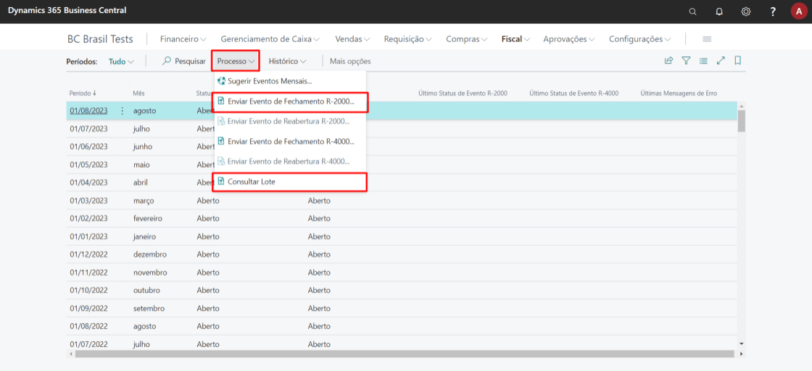

3. Com o lote aceito, o **Status R-2000** passa a **Fechado** e o **Último Status de Evento R-2000** a **Sucesso**.

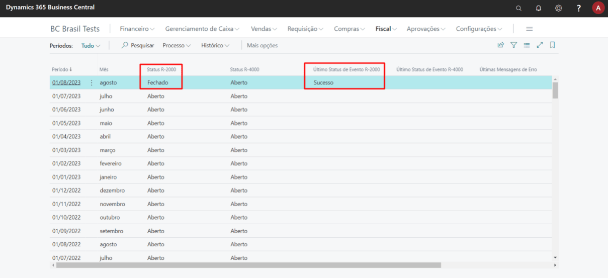

Enquanto a série R-4000 não é fechada, o período continua na lista com a série R-2000 **Fechado**. Quando as duas séries são fechadas, o período sai da lista e volta a aparecer com **Histórico** > **Mostrar Períodos Fechados**.

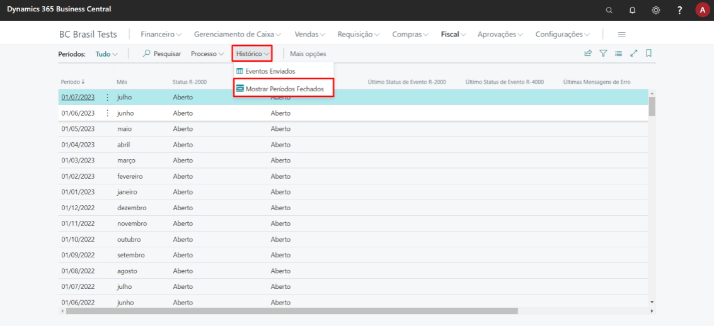

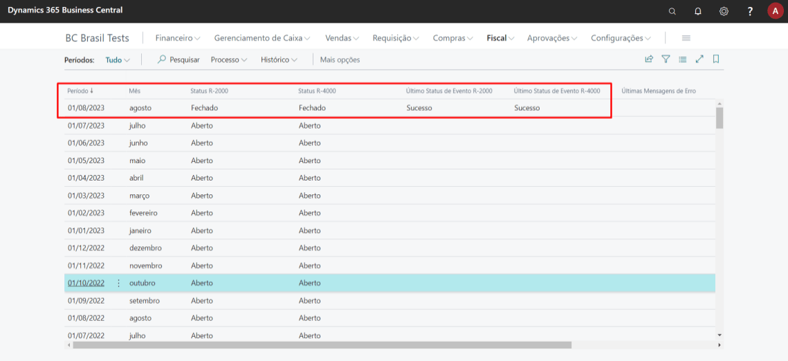

### 5.6 R-2098 - Reabertura da série R-2000

1. Na página **Reinf - Períodos**, clique em **Histórico** > **Mostrar Períodos Fechados**.
2. Selecione o período e clique em **Processo** > **Enviar Evento de Reabertura R-2000**.

   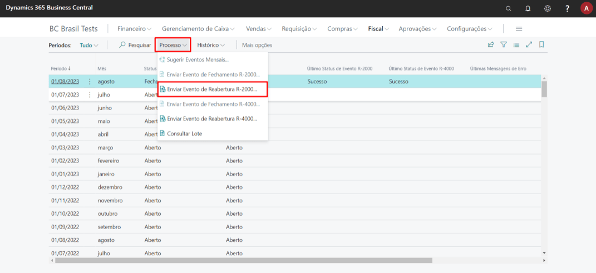

3. Clique em **Processo** > **Consultar Lote**. Até a consulta, o status da série fica **Consulta Pendente**; com o lote aceito, passa a **Reaberto**.

   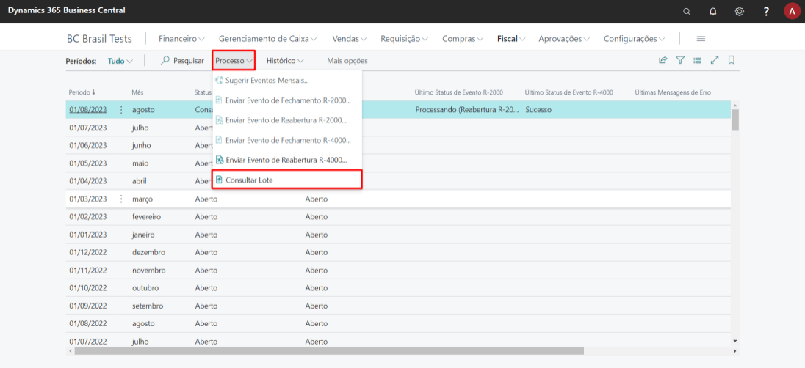

4. Faça as correções e envie de novo o evento de fechamento R-2000.

---

## 6. Série R-4000

As páginas da série R-4000 têm as mesmas ações de envio da série R-2000, no menu **Processar**. Elas têm também o menu **Informe de Rendimentos**, descrito em [EFD-Reinf: Informe de Rendimentos](Localization-for-Brazil_User-Manual_EFD-Reinf-Informe-Rendimentos.md).

### 6.1 R-4010 - Pagamentos a pessoas físicas

1. Pesquise por **Reinf - Pagamentos a Pessoas Físicas** ou, no Centro de Funções, abra **Fiscal** > **Livros Fiscais** > **EFD Reinf** > **Pagamentos a Pessoas Físicas**.
2. As linhas são criadas por filial, fornecedor (**Nº Fornecedor**) e beneficiário. Para ver os documentos de uma linha, clique em **Documentos** > **Documentos**.

   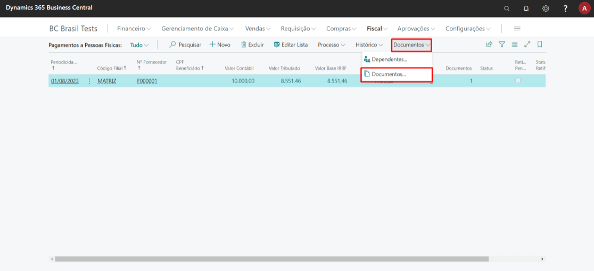

3. Na página **Reinf - Documentos Pagamento**, informe as deduções do imposto em **Deduções**: o **Tipo**, o **Valor** e, quando for o caso, o **Nº Inscrição Previdência Complementar**.

   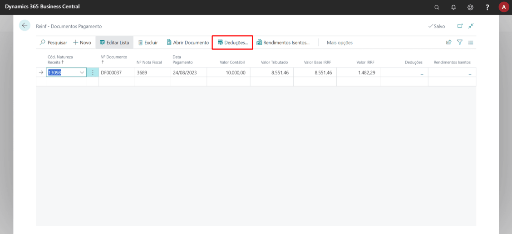

   Para os tipos `5` (pensão alimentícia) e `7` (dependentes), informe os valores por dependente em **Valores por Dependentes**. A ação só fica habilitada para esses dois tipos.

   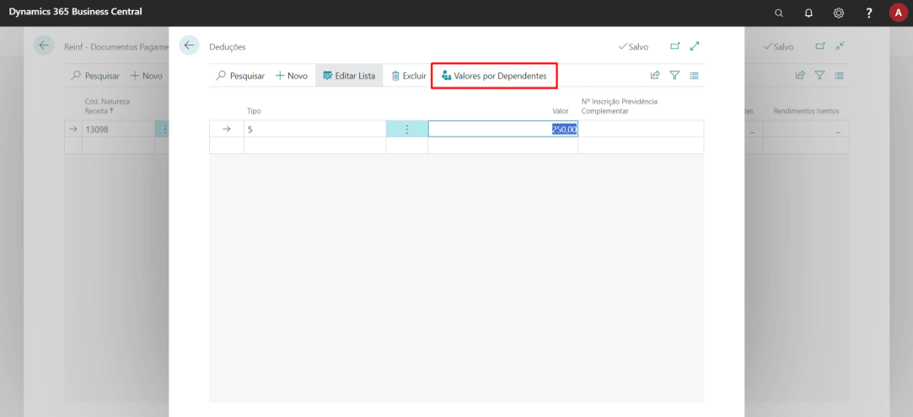

4. Informe os rendimentos isentos em **Rendimentos Isentos**: o **Tipo**, o valor isento e a descrição. Para rendimento isento por moléstia grave, informe a data do laudo.

   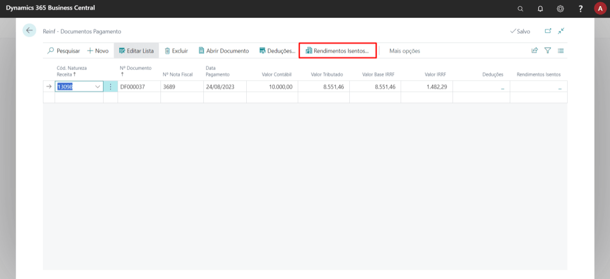

   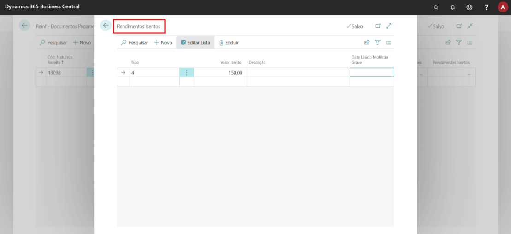

5. Se o fornecedor tem dependentes, cadastre-os na página de pagamentos em **Documentos** > **Dependentes**, com o **CPF** e a **Relação** de cada dependente. A **Descrição** só é editável para a relação `99`. A quantidade aparece na coluna **Dependentes**.

   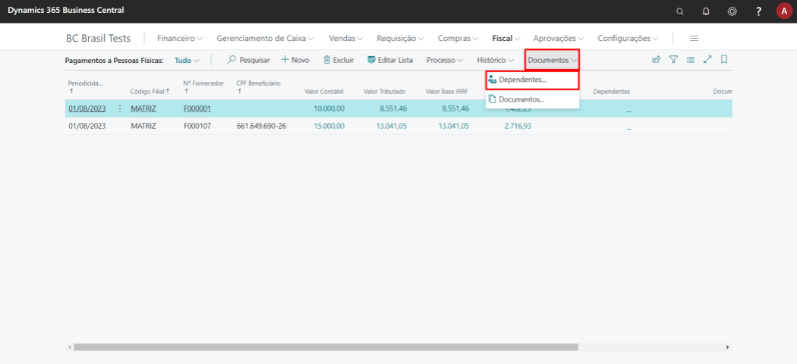

   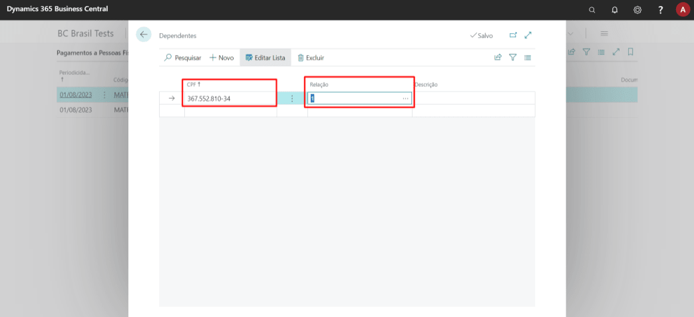

   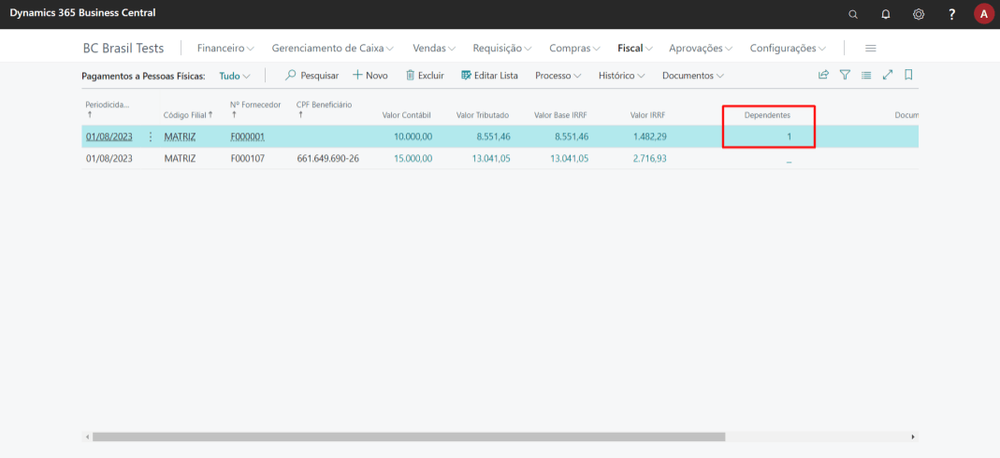

6. Selecione a linha e clique em **Processar** > **Enviar Evento**. Depois, clique em **Processar** > **Consultar Lote** e confira o campo **Status**.

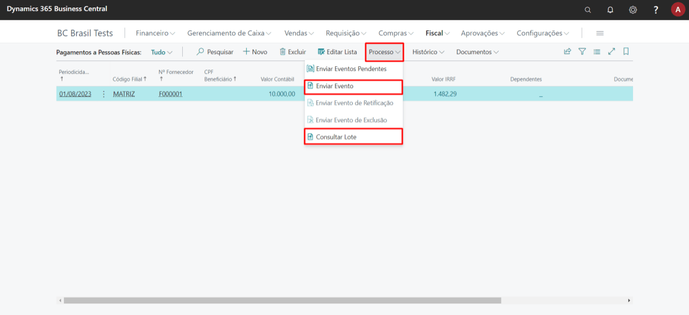

#### Beneficiário do fornecedor

Quando o pagamento é feito a um beneficiário diferente do fornecedor, informe o **CPF/CNPJ Beneficiário** no cartão do fornecedor. O beneficiário vai para o documento lançado e, dele, para a coluna **CPF Beneficiário** do evento.

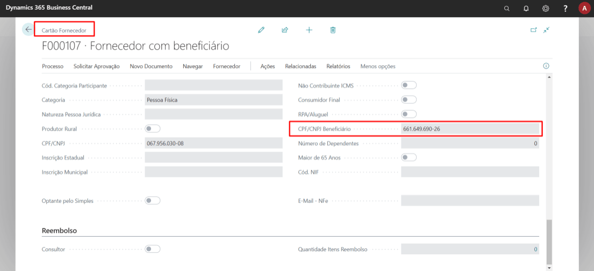

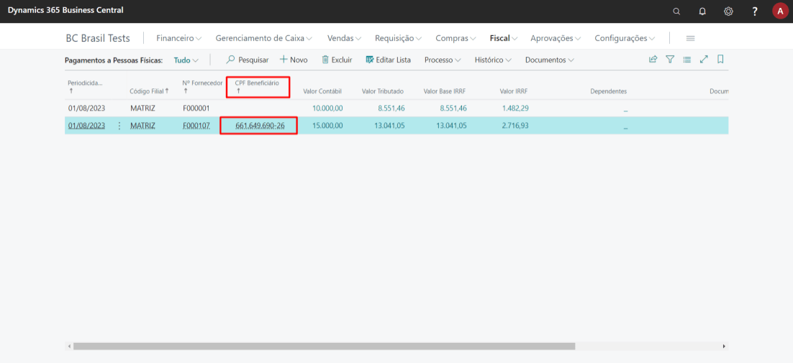

> **Nota**: na versão atual, o **CPF/CNPJ Beneficiário** é escolhido entre os beneficiários cadastrados para o fornecedor na ação **Beneficiários Impostos Retidos** do cartão do fornecedor. Cadastre o beneficiário lá antes de selecioná-lo.

### 6.2 R-4020 - Pagamentos a pessoas jurídicas

1. Pesquise por **Reinf - Pagamentos a Pessoas Jurídicas** ou, no Centro de Funções, abra **Fiscal** > **Livros Fiscais** > **EFD Reinf** > **Pagamentos a Pessoas Jurídicas**.
2. As linhas são criadas por filial e fornecedor (**Nº Fornecedor**). Os documentos de cada linha ficam em **Documentos** > **Documentos**.

   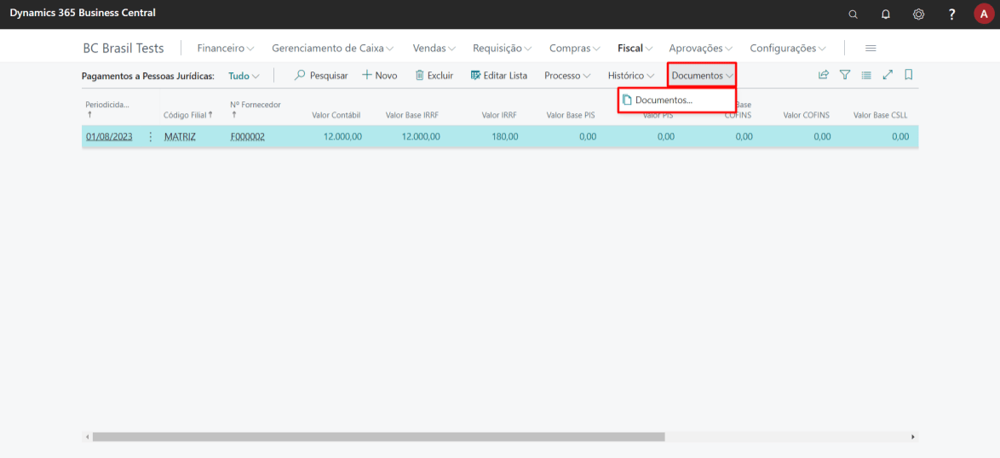

3. Selecione a linha e clique em **Processar** > **Enviar Evento**. Depois, clique em **Processar** > **Consultar Lote** e confira o campo **Status**.

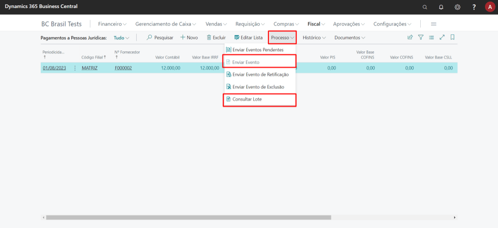

> **Nota**: as informações de processos judiciais e de SCP (Sociedade em Conta de Participação) do R-4020 não são preenchidas nem enviadas pelo Business Central.

### 6.3 R-4099 - Fechamento e reabertura da série R-4000

1. Na página **Reinf - Períodos**, selecione o período e clique em **Processo** > **Enviar Evento de Fechamento R-4000**.
2. Clique em **Processo** > **Consultar Lote**. Com o lote aceito, o **Status R-4000** passa a **Fechado**.

   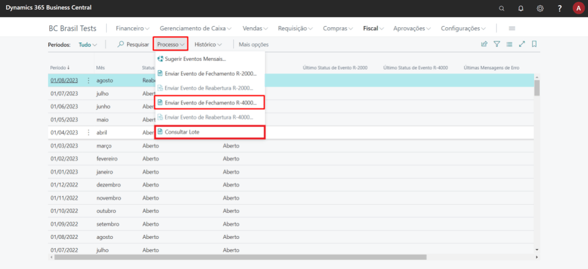

Assim como na série R-2000, o período só sai da lista quando as duas séries estão fechadas, e volta a aparecer com **Histórico** > **Mostrar Períodos Fechados**.

Para reabrir a série R-4000:

1. Clique em **Histórico** > **Mostrar Períodos Fechados** e selecione o período.
2. Clique em **Processo** > **Enviar Evento de Reabertura R-4000** e, depois, em **Processo** > **Consultar Lote**.

   

   

3. Faça as correções e envie de novo o evento de fechamento R-4000.

---

## 7. Acompanhamento, retificação e exclusão

### 7.1 Eventos enviados e erros

Os eventos transmitidos podem ser acompanhados de duas formas:

- em qualquer página de eventos, pela ação **Histórico** > **Eventos Enviados** da linha;
- no menu **Fiscal** > **Livros Fiscais** > **EFD Reinf** > **Histórico** > **Eventos** (ou **Eventos de Exclusão**).

Nas páginas de histórico, as ações **Visualizar Erros**, **Visualizar XML de Envio**, **Visualizar XML de Resposta** e **Visualizar XML de Consulta ao Lote** mostram o motivo da recusa e os XMLs trocados com a Receita.

### 7.2 Retificação e exclusão

- Para alterar um evento já aceito, use **Enviar Evento de Retificação**. Se o período da série já está fechado, reabra-o antes. Depois do envio, use **Consultar Lote** e confira o **Status Retificação**.
- Para excluir um evento já aceito, use **Enviar Evento de Exclusão** (evento R-9000). Depois do envio, use **Consultar Lote** e confira o **Status Exclusão**.

### 7.3 Sugestão com uma das séries fechada

Com uma série fechada e a outra aberta ou reaberta, a sugestão de eventos continua disponível e considera só a série que não está fechada. No exemplo, a série R-2000 está **Fechado** e a R-4000 **Reaberto**: a sugestão cria apenas os eventos da série R-4000.

