# Guias de Impostos: Apuração e Emissão do DARF

**Data**: Outubro/2021

---

## Sumário

A **Apuração Guias de Impostos** reúne os impostos a pagar do período, como os impostos retidos nas compras, agrupados por jurisdição, período de apuração e fornecedor do imposto. A partir dela o sistema cria as **Guias de Pagamento de Imposto** e imprime o DARF (Documento de Arrecadação de Receitas Federais) para o pagamento dos débitos. Antes do pagamento, a guia pode ser reaberta para incluir juros e multa.

## 1. Contexto

A apuração lê os movimentos de fornecedor em aberto que o registro dos documentos fiscais gera para cada imposto a pagar (a provisão do imposto contra o fornecedor configurado em **Contas Impostos**). Entram os movimentos:

- de jurisdições com o **Tipo Guia Pagamento** preenchido;
- com data de registro dentro do período da apuração;
- ainda sem guia de pagamento e sem bloqueio de pagamento (**Em Espera**).

Cada linha da apuração soma os movimentos de uma jurisdição, de um período de apuração (calculado pela **Periodicidade** da jurisdição) e de um fornecedor do imposto. A **Data Vencimento** da guia é calculada pela data de vencimento configurada na jurisdição.

As jurisdições com **Tipo Guia Pagamento** = **DCTFWeb** também entram na apuração, mas não geram guia: elas são declaradas pelo arquivo MIT e provisionadas na própria apuração. Veja [MIT — Módulo de Inclusão de Tributos](Localization-for-Brazil_User-Manual_MIT-Modulo-Inclusao-Tributos.md) e [Guias de Impostos DCTFWeb: Provisão por Data de Vencimento](Localization-for-Brazil_User-Manual_DCTFWeb-Provisao-Data-Vencimento.md).

---

## 2. Configuração

### 2.1. Número de série das guias

1. Pesquise por **Configurações Fiscais** ou abra **Configurações** > **Fiscal** > **Geral** > **Configurações Fiscais**.
2. Na seção **Impostos**, preencha **Nº Série Guia de Pagamento de Imposto** com o número de série que numera as guias.

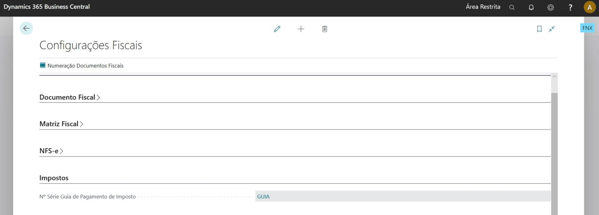

> **Nota**: sem esse número de série, a criação das guias é interrompida com erro.

### 2.2. Jurisdições de impostos

Pesquise por **Jurisdições de Impostos (Brasil)** ou abra **Configurações** > **Fiscal** > **Impostos** > **Jurisdições Impostos**. Em cada jurisdição que gera guia, preencha na seção **Pagamento**:

| Campo | Descrição |
|-------|-----------|
| **Tipo Guia Pagamento** | **DARF**, **DCTFWeb** ou **Outro**. Em branco, a jurisdição não entra na apuração |
| **Cód. Receita Tributo** | Código de receita do tributo, impresso no DARF |
| **Periodicidade** | Período de apuração: **Diário**, **Decendial**, **Quinzenal**, **Mensal** ou **Trimestral**. Obrigatória para processar a apuração |
| **Data Venc. em Dias Não Úteis** | **Antecipar** ou **Postergar** o vencimento que cair em dia não útil |

Defina também o vencimento do imposto pela ação **Data Vencimento** da jurisdição. Os campos e a ação estão detalhados em [Configuração Fiscal: Cadastros Fiscais e Impostos](Localization-for-Brazil_User-Manual_Configuracao-Fiscal.md), seções 5 e 6.

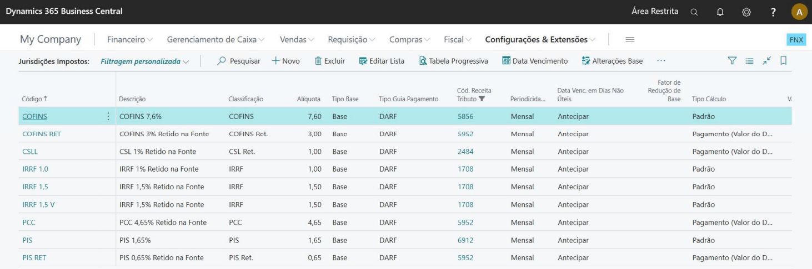

> **Nota**: os códigos de receita são cadastrados e mantidos pelo usuário, na página **Códigos Receita Tributo**.

### 2.3. Contas impostos

O imposto a pagar precisa ser lançado contra um fornecedor específico, como a Secretaria da Receita Federal. Pesquise por **Contas Impostos** ou abra **Configurações** > **Fiscal** > **Impostos** > **Contas Impostos** e, para cada imposto (ou para cada jurisdição, com **Tipo Filtro** = **Jurisdição**), informe **Tipo Conta a Pagar** = **Fornecedor** e o fornecedor do imposto em **N° Conta a Pagar**. Veja [Configuração Fiscal: Cadastros Fiscais e Impostos](Localization-for-Brazil_User-Manual_Configuracao-Fiscal.md), seção 9.

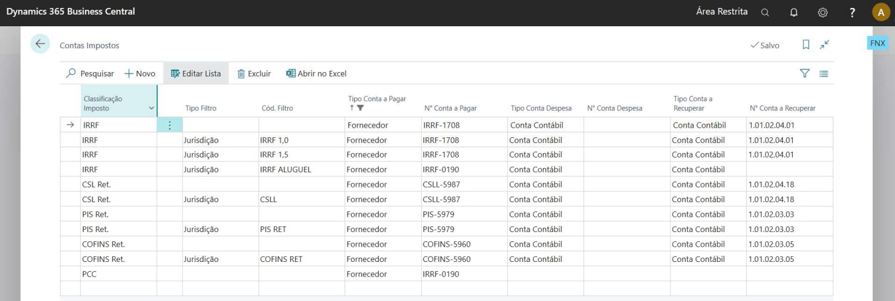

> **Nota**: o **C.N.P.J.** da empresa precisa estar preenchido para processar a apuração. O IPI e a CIDE de uma filial saem em guia separada, emitida com o C.N.P.J. da filial.

---

## 3. Apurar as guias de impostos

### 3.1. Criar a apuração

Pesquise por **Apurações de Guias de Impostos** ou, no Centro de Funções, abra **Fiscal** > **Livros Fiscais** > **Guias de Pagamento de Imposto** > **Apurações de Guias de Impostos**.

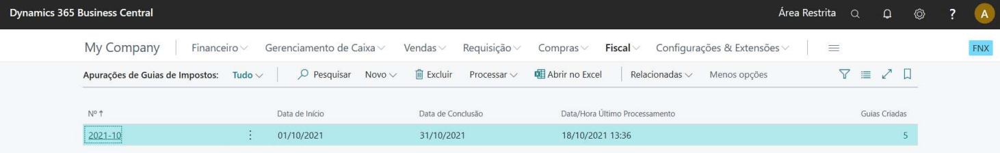

Crie a apuração de uma destas formas:

- use **Criar Apuração**, informe o **Ano** e o **Mês** e clique em **OK**: o sistema cria a apuração do mês, numerada `AAAA-MM`;
- ou use **Novo** e informe **Nº**, **Data de Início** e **Data Final**.

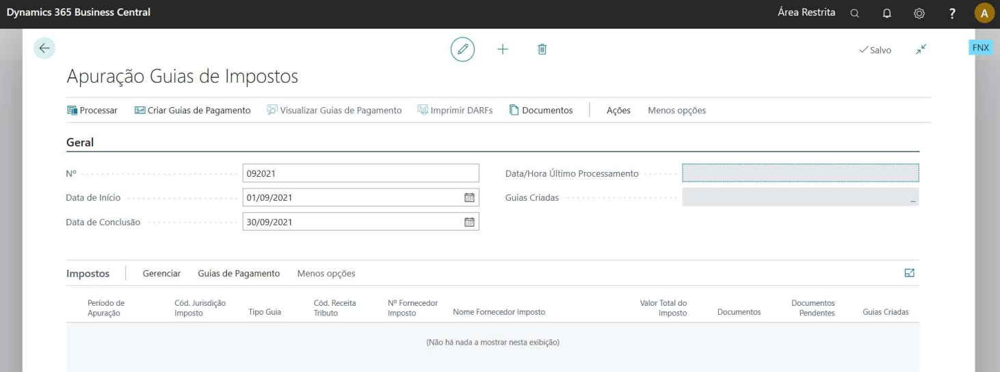

### 3.2. Processar

No cartão, use **Processo** > **Processar**. O sistema mostra a mensagem **Apuração &lt;nº&gt; processada com sucesso.** e preenche a **Data/Hora Último Processamento**.

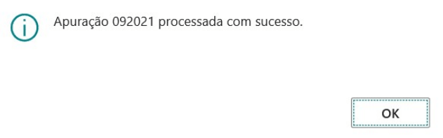

A parte **Impostos** passa a mostrar uma linha por jurisdição e período, com o **Valor Total do Imposto**, a quantidade de **Documentos**, os **Documentos Pendentes** (ainda sem guia) e as **Guias Criadas**.

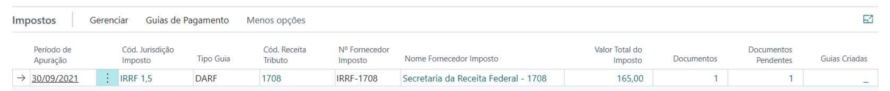

Reprocesse a apuração quando houver novos documentos no período. Os documentos que já estão em uma guia são mantidos.

### 3.3. Conferir os documentos

Para ver os documentos de uma linha, selecione-a na parte **Impostos** e use **Guias de Pagamento** > **Documentos**. A ação **Documentos** do cartão mostra os documentos de todas as linhas.

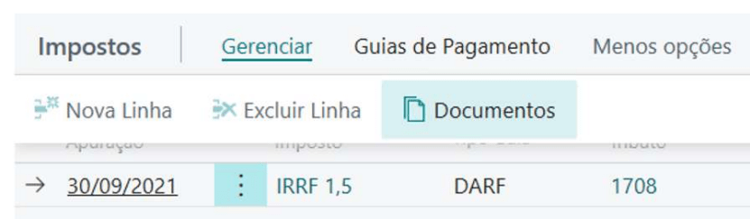

A página **Documentos de Apuração de Guias de Impostos** traz, por documento, o fornecedor do imposto, o documento e a nota fiscal de origem, o participante, a **Data Vencimento** e o **Valor do Imposto**. Use **Abrir Documento**, **Abrir Provisão** e **Abrir Guia de Pagamento** para navegar até o documento fiscal, o movimento do fornecedor do imposto e a guia.

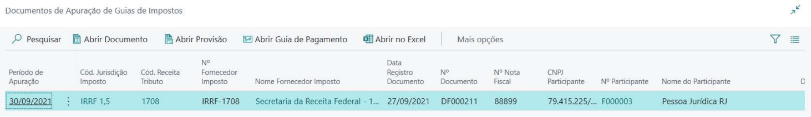

> **Nota**: na imagem, a ação **Documentos** aparece no grupo **Gerenciar** da parte **Impostos**. Hoje ela fica no grupo **Guias de Pagamento**.

---

## 4. Criar as guias de pagamento

1. No cartão, use **Guias de Pagamento** > **Criar Guias de Pagamento**. Para criar a guia de uma só linha, use a mesma ação na parte **Impostos**.

   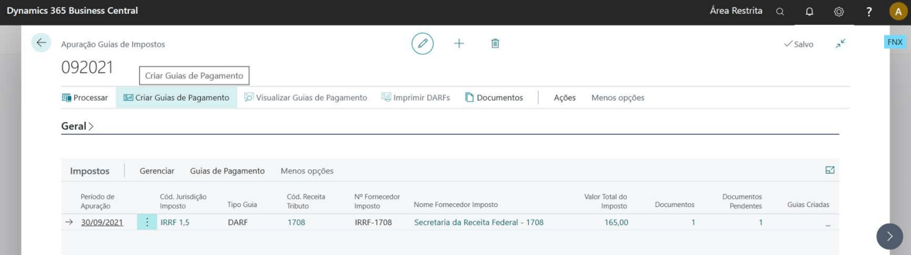

2. Escolha como gerar as guias:
   - **Agrupado**: uma guia por linha da apuração, somando todos os documentos pendentes;
   - **Não Agrupado**: uma guia para cada documento.

   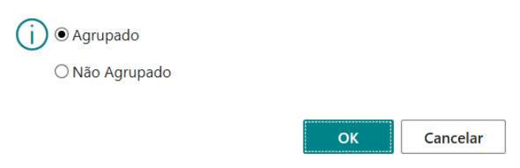

As guias são criadas com status **Liberado**, e a coluna **Guias Criadas** é atualizada.

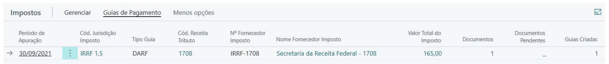

> **Nota**: as linhas de **Tipo Guia** = **DCTFWeb** não geram guia; a ação fica desabilitada nessas linhas.

Também é possível criar as guias sem a apuração, pelo relatório **Criar Guias Pagamento Impostos** (**Fiscal** > **Livros Fiscais** > **Guias de Pagamento de Imposto** > **Criar Guias Pagamento Impostos**). Ele pede **Data Início** e **Data Fim** (obrigatória), aceita filtros por jurisdição e, com **Agrupar por Jurisdição**, cria uma guia por jurisdição. As guias saem liberadas, mas não ficam vinculadas a nenhuma apuração.

---

## 5. Visualizar e imprimir o DARF

Use **Guias de Pagamento** > **Visualizar Guias de Pagamento** para abrir as guias da apuração (com uma só guia, abre direto o cartão **Guia de Pagamento de Imposto**).

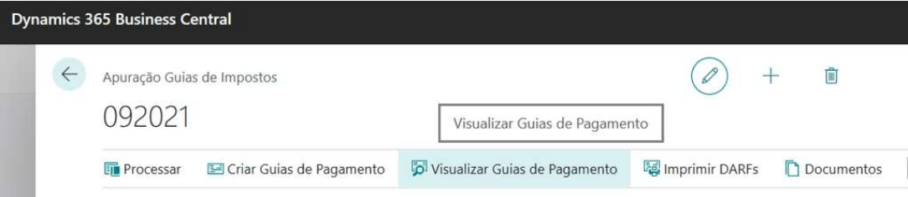

O cartão mostra os dados da guia: **Status**, **Descrição**, **Nº Fornecedor**, **Cód. Jurisdição Imposto**, **Tipo de Guia**, **Cód. Receita Tributo**, **Período de Apuração**, **Data Vencimento**, **CNPJ/CPF** e, na seção **Valores**, **Valor Principal**, **Valor Juros**, **Valor Multa** e **Valor Total**.

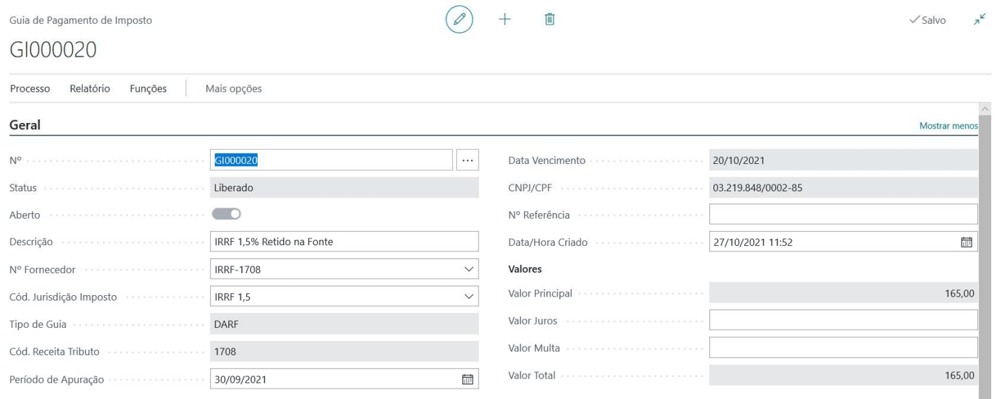

Para imprimir, use **Guias de Pagamento** > **Imprimir DARFs** no cartão da apuração, ou **Relatório** > **Imprimir DARF...** no cartão da guia.

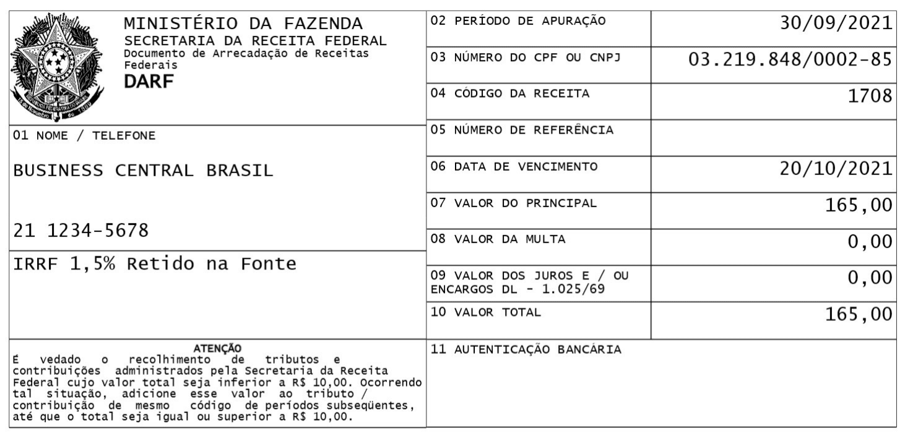

> **Nota**: o DARF é impresso sem código de barras. Só guias com **Tipo de Guia** = **DARF** e status **Liberado** são impressas, e a impressão exige o telefone e o **C.N.P.J.** da empresa (ou o **Telefone** da filial, quando a guia é emitida pela filial).

---

## 6. Incluir juros e multa

Quando o pagamento for feito com atraso, atualize a guia antes de imprimir:

1. No cartão da guia, use **Processo** > **Reabrir**.

   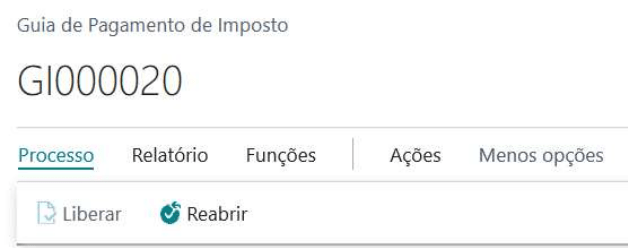

2. Preencha **Valor Juros** e **Valor Multa**. O **Valor Total** é recalculado.

   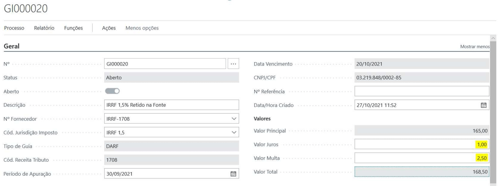

3. Use **Processo** > **Liberar**.

   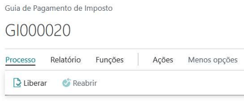

4. Use **Relatório** > **Imprimir DARF...**.

   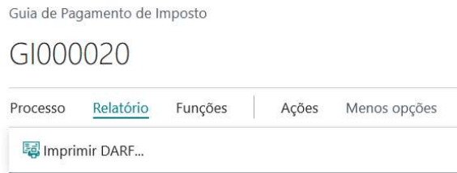

O DARF sai com os novos valores.

> **Nota**: **Valor Juros** e **Valor Multa** só podem ser alterados com a guia aberta. Uma guia cujos movimentos de fornecedor já foram fechados (pagos) não pode ser reaberta.
