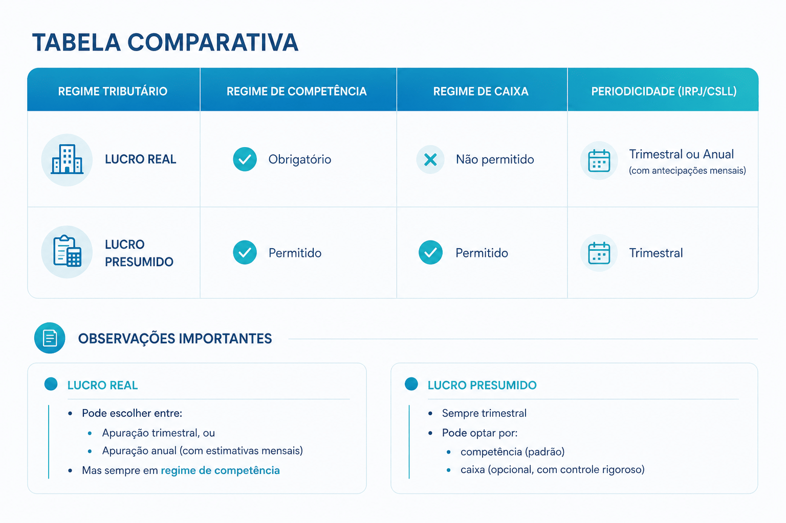

# Apuração de IRPJ e CSLL — Regime de Caixa

## Visão Geral

Este documento descreve o processo completo de configuração e utilização da apuração de IRPJ e CSLL na Localização Brasil, para o cenário de **Lucro Presumido com Regime de Caixa**.

## 1. Pré-requisito: Criar a DRE (Esquema de Contas)

Antes de configurar a apuração, é necessário ter uma DRE (Demonstração do Resultado do Exercício) criada no sistema. A DRE é criada pela funcionalidade padrão do Business Central chamada **Esquema de Contas**.

### 1.1 Criar o Esquema de Contas

1. Pesquise e abra a página **Esquema de Contas**
2. Crie um novo esquema com um código identificador (ex.: `DRE`)
3. Configure as linhas do esquema representando a estrutura da DRE: receitas, custos, despesas operacionais, receitas financeiras, resultado etc.
4. Cada linha deve referenciar as contas contábeis correspondentes do plano de contas
5. Anote os números das linhas que representam:
   - **Resultado para IRPJ**: a linha cujo valor será usado como base de cálculo do IRPJ
   - **Resultado para CSLL**: a linha cujo valor será usado como base de cálculo da CSLL (pode ser a mesma do IRPJ ou diferente)
   - **Receita Financeira** (se aplicável): a linha que totaliza as receitas financeiras

### 1.2 Criar o Layout de Coluna

1. Pesquise e abra a página **Nome Layout Coluna**
2. Crie um layout de coluna que será utilizado para calcular os valores da DRE
3. Anote o número da coluna de resultado que será usada no cálculo

> **Importante:** no regime de caixa, a DRE não é utilizada para obter a receita bruta, que vem dos recebimentos de caixa. Porém, a DRE ainda é utilizada para calcular o **Valor Lucro DRE** exibido na apuração e as **Receitas Financeiras**, que entram 100% na base de cálculo. Portanto, é obrigatório configurar a DRE mesmo no regime de caixa.

---

## 2. Configuração da Apuração (Configuração Apuração IRPJ/CSLL)

Pesquise e abra a página **Configuração Apuração IRPJ/CSLL**.

### 2.1 Aba "Geral"

| Campo | Valor / Orientação |
|-------|-------------------|
| **Período de Apuração** | Selecione `Trimestral`. No Lucro Presumido a apuração é sempre trimestral; com `Anual`, o sistema não aplica o saldo do limite trimestral (§ 4º), o ajuste anual do Q4 (§ 5º) nem o **Modo Híbrido de Acréscimo** |
| **Regime de Tributação** | Selecione `Lucro Presumido` |
| **Pagamento por Antecipação** | Marque se a empresa faz pagamentos mensais por antecipação dentro do trimestre. Quando ativado, apurações mensais intermediárias geram lançamentos de antecipação |
| **Critério de Escrituração do Regime Cumulativo** | Selecione `Regime de Caixa`. Este campo só fica habilitado quando o regime é Lucro Presumido |
| **% Presunção IRPJ do Reg. Caixa** | Informe o percentual de presunção do IRPJ aplicável à atividade (ex.: 8% para comércio e indústria, 32% para serviços) |
| **% Presunção CSLL do Reg. Caixa** | Informe o percentual de presunção da CSLL aplicável à atividade (ex.: 12% para comércio e indústria, 32% para serviços) |

> **Particularidade do Regime de Caixa:** os percentuais de presunção são informados diretamente nos campos **% Presunção IRPJ do Reg. Caixa** e **% Presunção CSLL do Reg. Caixa**. A ação **Percentuais de Presunção**, que permite configurar múltiplas alíquotas por tipo de atividade ou linha da DRE, fica desabilitada no regime de caixa. Ela só está disponível para o regime de competência.

### 2.2 Aba "Lucro/Prejuízo" (DRE)

| Campo | Valor / Orientação |
|-------|-------------------|
| **Nome Esquema Contas DRE** | Selecione o esquema de contas criado no passo 1 |
| **Nº Linha Resultado DRE IRPJ** | Selecione a linha da DRE que representa o resultado para IRPJ |
| **Nº Linha Resultado DRE CSLL** | Selecione a linha da DRE que representa o resultado para CSLL |
| **Nº Linha Receita DRE** | Não se aplica ao regime de caixa (a receita vem dos recebimentos). Pode ser deixado em branco |
| **Nº Linha Receita Financeira DRE** | Se a empresa possui receitas financeiras, selecione a linha correspondente na DRE. As receitas financeiras entram **integralmente (100%)** na base de cálculo, sem aplicar percentual de presunção |
| **Nome Layout Coluna DRE** | Selecione o layout de coluna criado no passo 1 |
| **Nº Coluna Resultado DRE** | Selecione a coluna de resultado do layout |

### 2.3 Aba "Percentuais de Impostos"

**Grupo IRPJ:**

| Campo | Valor / Orientação |
|-------|-------------------|
| **% IRPJ** | Alíquota do IRPJ, normalmente `15,00` |
| **% IRPJ Adicional** | Alíquota do IRPJ adicional, normalmente `10,00` |
| **Base Mensal Isenta IRPJ Adicional** | Valor mensal isento do adicional de IR (normalmente R$ 20.000,00). O sistema multiplica automaticamente pelo número de meses do período |

**Grupo CSLL:**

| Campo | Valor / Orientação |
|-------|-------------------|
| **% CSLL** | Alíquota da CSLL, normalmente `9,00` |

**Grupo Presunção Acrescida IRPJ (opcional):**

| Campo | Valor / Orientação |
|-------|-------------------|
| **% Acréscimo** | Percentual de acréscimo sobre a presunção normal, quando a receita excede o limite trimestral |
| **Limite Trimestral** | Valor trimestral de receita até o qual se aplica a alíquota normal. Acima desse limite, aplica-se a alíquota acrescida |

**Grupo Presunção Acrescida CSLL (opcional):**

| Campo | Valor / Orientação |
|-------|-------------------|
| **% Acréscimo** | Mesmo conceito acima, para a CSLL |
| **Limite Trimestral** | Mesmo conceito acima, para a CSLL |

> **Como funciona a presunção acrescida:** quando os limites trimestrais estão configurados, o sistema calcula a presunção em duas faixas. A receita até o limite trimestral recebe a alíquota de presunção normal. A receita que excede o limite recebe uma alíquota acrescida (percentual normal multiplicado pelo fator de acréscimo). Em apurações mensais intermediárias (com pagamento por antecipação), o sistema calcula a receita dos meses anteriores do trimestre para determinar quanto do limite já foi consumido.

### 2.4 Aba "Contas Contábeis"

Configure todas as contas contábeis e fornecedores para os lançamentos:

**Provisões IRPJ:**

| Campo | Descrição |
|-------|-----------|
| **Nº Conta Débito Provisão IRPJ** | Conta de despesa para provisão do IRPJ |
| **Nº Conta Crédito Provisão IRPJ** | Conta de passivo para provisão do IRPJ |

**Provisões CSLL:**

| Campo | Descrição |
|-------|-----------|
| **Nº Conta Débito Provisão CSLL** | Conta de despesa para provisão da CSLL |
| **Nº Conta Crédito Provisão CSLL** | Conta de passivo para provisão da CSLL |

**Antecipações IRPJ:**

| Campo | Descrição |
|-------|-----------|
| **Nº Conta Débito Antecipação IRPJ** | Conta contábil de débito para antecipações de IRPJ |
| **Nº Conta Crédito Antecipação IRPJ** | Conta contábil de crédito para antecipações de IRPJ |
| **Nº Fornecedor Crédito Antecipação IRPJ** | Fornecedor (Receita Federal) para gerar o contas a pagar das antecipações |
| **Cód. Jurisdição Guia Pag. Antecipação IRPJ** | Código da jurisdição para geração da guia de pagamento (DARF) da antecipação |

**Antecipações CSLL:**

| Campo | Descrição |
|-------|-----------|
| **Nº Conta Débito Antecipação CSLL** | Conta contábil de débito para antecipações de CSLL |
| **Nº Conta Crédito Antecipação CSLL** | Conta contábil de crédito para antecipações de CSLL |
| **Nº Fornecedor Crédito Antecipação CSLL** | Fornecedor para gerar o contas a pagar das antecipações |
| **Cód. Jurisdição Guia Pag. Antecipação CSLL** | Código da jurisdição para geração da guia de pagamento da antecipação |

**Retenções:**

| Campo | Descrição |
|-------|-----------|
| **Filtro Conta Retenção IRPJ** | Filtro de conta(s) contábil(is) onde estão registradas as retenções de IRPJ na fonte |
| **Filtro Conta Retenção CSLL** | Filtro de conta(s) contábil(is) onde estão registradas as retenções de CSLL na fonte |

**Apuração IRPJ:**

| Campo | Descrição |
|-------|-----------|
| **Nº Conta Débito IRPJ** | Conta de débito para o lançamento final do IRPJ no encerramento do período |
| **Nº Conta Débito IRPJ Adic.** | Conta de débito específica para o IR adicional |
| **Nº Fornecedor Crédito IRPJ** | Fornecedor (Receita Federal) para gerar o contas a pagar do IRPJ |
| **Nº Conta Crédito Per/Dcomp IRPJ** | Conta contábil para compensações via PER/DCOMP de IRPJ |
| **Cód. Jurisdição Guia Pagamento IRPJ** | Código da jurisdição para geração da guia de pagamento (DARF) do IRPJ |

**Apuração CSLL:**

| Campo | Descrição |
|-------|-----------|
| **Nº Conta Débito CSLL** | Conta de débito para o lançamento final da CSLL |
| **Nº Fornecedor Crédito CSLL** | Fornecedor para gerar o contas a pagar da CSLL |
| **Nº Conta Crédito Per/Dcomp CSLL** | Conta contábil para compensações via PER/DCOMP de CSLL |
| **Cód. Jurisdição Guia Pagamento CSLL** | Código da jurisdição para geração da guia de pagamento da CSLL |

### 2.5 Aba "Demonstrativos"

| Campo | Valor / Orientação |
|-------|-------------------|
| **Cód. Modelo Declaração IRPJ** | Selecione o modelo de demonstrativo fiscal para IRPJ (deve ser previamente cadastrado na página Declarações de Impostos) |
| **Cód. Modelo Declaração CSLL** | Selecione o modelo de demonstrativo fiscal para CSLL |
| **Sem Aprovação de Provisão** | Se marcado, os demonstrativos de provisão (meses intermediários sem antecipação) não exigem aprovação e são liberados automaticamente |

---

## 3. Configuração de Deduções/Incentivos (Opcional)

Se a empresa possui deduções ou incentivos fiscais que devem ser abatidos automaticamente do IRPJ ou da CSLL:

1. Pesquise e abra a página **Conf. Deduções Apuração IRPJ/CSLL**
2. Para cada dedução, informe:
   - **Tributo**: IRPJ ou CSLL
   - **Código**: selecione o código da dedução (conforme tabela ECF N630 para IRPJ ou N670 para CSLL)
   - **Descrição**: preenchida automaticamente a partir do código
   - **Nº Linha Dedução DRE**: selecione a linha da DRE que contém o valor da dedução

O sistema calcula automaticamente o valor das deduções configuradas a cada cálculo da apuração.

---

## 4. Criação da Apuração

1. Pesquise e abra a página **Apurações de IRPJ/CSLL**
2. Clique em **Novo** para criar uma nova apuração
3. Preencha os campos:

| Campo | Valor / Orientação |
|-------|-------------------|
| **Nº** | Informe um código identificador para a apuração |
| **Tributo** | Selecione `IRPJ/CSLL` para apurar ambos simultaneamente, ou `IRPJ` / `CSLL` separadamente |
| **Período de Apuração** | Preenchido automaticamente a partir da configuração (Trimestral ou Anual) |
| **Ano** | Informe o ano da apuração |
| **Trimestre** | Selecione o trimestre (visível apenas quando o período é trimestral) |
| **Mês** | Informe o mês específico. Quando preenchido, apura apenas aquele mês. Quando em branco, apura o período completo (trimestre ou ano) e é considerado **encerramento do período** |
| **Pagamento por Antecipação** | Preenchido automaticamente a partir da configuração. Disponível apenas quando o mês é informado (apuração mensal intermediária) |

### Regras de datas importantes:

- **Apuração de encerramento do período** (mês em branco): as datas inicial e final cobrem o período completo (ex.: 01/01 a 31/03 para o 1º trimestre)
- **Apuração mensal com antecipação** (mês preenchido e antecipação marcada): a data inicial retrocede ao início do período, e a data final é o último dia do mês informado. Isso é necessário porque a base de cálculo é acumulada desde o início do período
- **Apuração mensal sem antecipação** (provisão): apura apenas o mês isoladamente

---

## 5. Cálculo da Apuração

1. Na página do cartão da **Apuração IRPJ/CSLL**, clique na ação **Calcular**

O sistema executa as seguintes etapas:

### 5.1 Cálculo da Receita (Regime de Caixa)

No regime de caixa, a receita não vem da DRE. O sistema busca os **recebimentos efetivos** do período:

- Consulta os documentos fiscais que tiveram recebimento (pagamento pelo cliente) no período da apuração
- Considera apenas documentos que possuem tributação de PIS e COFINS (documentos sem PIS/COFINS não são considerados)
- O valor utilizado é o **valor de receita pelo regime de caixa** de cada linha de documento
- Esses documentos são exibidos na aba **Linhas de Documento** do cartão da apuração (visível apenas no regime de caixa)

### 5.2 Aplicação da Presunção

- O valor total dos recebimentos é o **Lucro antes da Presunção**
- Aplica-se o **% Presunção IRPJ do Reg. Caixa** para obter o valor da presunção do IRPJ
- Aplica-se o **% Presunção CSLL do Reg. Caixa** para obter o valor da presunção da CSLL
- Se a **presunção acrescida** estiver configurada, o sistema verifica se a receita excedeu o limite trimestral (descontando a receita dos meses anteriores do trimestre) e aplica a alíquota acrescida sobre o excedente

### 5.3 Receitas Financeiras

Se o campo **Nº Linha Receita Financeira DRE** estiver configurado:
- O sistema calcula as receitas financeiras via DRE para o período
- Esse valor é somado **integralmente (100%)** à base de cálculo, sem aplicar percentual de presunção

### 5.4 Adições, Exclusões e Compensações

- **Adições**: buscadas dos registros contábeis vinculados a códigos de lançamento ECF do tipo Adição
- **Exclusões**: buscadas dos registros contábeis vinculados a códigos de lançamento ECF do tipo Exclusão
- **Compensações**: buscadas dos registros de compensação de prejuízo (Parte B da ECF)

### 5.5 Base de Cálculo

A fórmula da base de cálculo é:

**Base = Presunção + Receitas Financeiras + Adições + Exclusões + Compensações**

### 5.6 Cálculo do IRPJ

- **IRPJ** = Base de Cálculo x % IRPJ (normalmente 15%)
- **IR Adicional** = (Base de Cálculo - Base Mensal Isenta x nº de meses) x % IRPJ Adicional (normalmente 10%). Calculado apenas se a base exceder a isenção
- **Valor Antes Deduções** = IRPJ + IR Adicional
- (-) **Retenções na Fonte**: buscadas das contas configuradas no filtro de retenção
- (-) **Imposto pago por Antecipação**: buscado das contas de antecipação configuradas
- (-) **Per/Dcomp**: compensações informadas manualmente na apuração
- (-) **Deduções/Incentivos**: deduções calculadas automaticamente e informadas manualmente
- **Imposto a Pagar/Suspender** = resultado final

### 5.7 Cálculo da CSLL

- **CSLL** = Base de Cálculo x % CSLL (normalmente 9%)
- (-) **Retenções na Fonte**
- (-) **Imposto pago por Antecipação**
- (-) **Per/Dcomp**
- (-) **Deduções/Incentivos**
- **Imposto a Pagar/Suspender** = resultado final

---

## 6. Ajustes Manuais (Opcional)

Após o cálculo, é possível informar ajustes manuais antes de gerar os demonstrativos:

### 6.1 Per/Dcomp

1. No cartão da apuração, acesse a ação **Per/Dcomp IRPJ** ou **Per/Dcomp CSLL**
2. Informe os valores de compensações via PER/DCOMP, incluindo o número do processo

### 6.2 Deduções/Incentivos

1. No cartão da apuração, acesse a ação **Deduções/Incentivos IRPJ** ou **Deduções/Incentivos CSLL**
2. As deduções configuradas na tela de configuração já aparecem calculadas automaticamente (marcadas como criadas pelo sistema)
3. É possível adicionar deduções manuais adicionais

Após informar ajustes, clique em **Calcular** novamente para recalcular os valores finais.

---

## 7. Geração do Demonstrativo Fiscal

1. No cartão da apuração, clique na ação **Declaração IRPJ** ou **Declaração CSLL**
2. O sistema cria (ou atualiza) o demonstrativo fiscal correspondente com:
   - Detalhes do cálculo (linhas descritivas com todos os componentes)
   - Lançamentos contábeis a serem registrados

### Tipos de lançamentos gerados conforme o cenário:

| Cenário | Lançamentos Gerados |
|---------|-------------------|
| **Mês intermediário SEM antecipação** (provisão) | Lançamento de provisão: débito na conta de despesa, crédito na conta de provisão |
| **Mês intermediário COM antecipação** | Lançamento a pagar: débito na conta de antecipação, crédito no fornecedor (gera título a pagar) |
| **Encerramento do período** (fim do trimestre ou do ano) | Estorno das provisões anteriores + estorno de retenções e antecipações + lançamento final a pagar contra o fornecedor |

> **Particularidade da aprovação no regime de provisão:** se o campo **Sem Aprovação de Provisão** estiver marcado na configuração, demonstrativos de provisão (meses intermediários sem antecipação) são liberados automaticamente, sem necessidade de aprovação. Demonstrativos de encerramento de período e de antecipação sempre seguem o fluxo de aprovação configurado.

---

## 8. Aprovação do Demonstrativo

1. Abra o demonstrativo fiscal gerado (a partir do cartão da apuração, clicando em **Declaração IRPJ** ou **Declaração CSLL**)
2. O demonstrativo abre com status **Aberto**
3. Se houver fluxo de aprovação configurado, envie para aprovação. O status muda para **Pendente de Aprovação**
4. Após a aprovação, o status muda para **Liberado**

---

## 9. Registro dos Lançamentos Contábeis

1. No cartão do demonstrativo fiscal, com status **Liberado**, clique na ação **Registrar**
2. O sistema registra os lançamentos contábeis no razão geral:
   - As contas de débito e crédito seguem a configuração feita no passo 2.4
   - A data de registro é a data final do período da apuração
   - Para lançamentos contra fornecedor, o sistema calcula a data de vencimento com base na jurisdição configurada
3. O status do demonstrativo muda para **Registrado**

> Se for necessário reverter, existe a ação **Estornar**, que cria lançamentos inversos e marca o demonstrativo como **Estornado**.

---

## 10. Resumo do Fluxo para Apuração Trimestral com Antecipação Mensal

Exemplo para o 1º trimestre de 2026:

| Etapa | Mês | Ação |
|-------|-----|------|
| 1 | Janeiro | Criar apuração: Ano=2026, Trimestre=Primeiro, Mês=1. Calcular → Gerar demonstrativo → Aprovar → Registrar (gera antecipação ou provisão) |
| 2 | Fevereiro | Criar apuração: Ano=2026, Trimestre=Primeiro, Mês=2. Calcular → Gerar demonstrativo → Aprovar → Registrar |
| 3 | Março (encerramento) | Criar apuração: Ano=2026, Trimestre=Primeiro, Mês em branco. Calcular → Gerar demonstrativo → Aprovar → Registrar (estorna provisões, compensa antecipações e retenções, gera valor final a pagar) |

---

## Particularidades do Regime de Caixa — Resumo

1. **A receita é obtida pelos recebimentos efetivos**, não pela DRE. Somente valores efetivamente recebidos no período são considerados
2. **Apenas documentos com tributação de PIS/COFINS** são incluídos na base de receita. No regime de caixa, a receita para IRPJ/CSLL vem dos documentos fiscais que tiveram recebimento no período, e não da DRE. Documentos sem incidência de PIS/COFINS, como reembolsos, não são considerados receita operacional para fins de cálculo da base de presunção do IRPJ e da CSLL. Em resumo, a presença de PIS/COFINS no documento indica que aquela operação é uma receita tributável genuína e, portanto, deve compor a base de receita bruta sobre a qual será aplicado o percentual de presunção
3. Os **percentuais de presunção são únicos** (um para IRPJ e um para CSLL), configurados diretamente na tela de configuração. A funcionalidade de múltiplas alíquotas por tipo de atividade não está disponível no regime de caixa
4. As **receitas financeiras** continuam sendo calculadas pela DRE e entram 100% na base, sem presunção
5. As **Linhas de Documento** ficam visíveis no cartão da apuração, permitindo conferir quais documentos e valores de recebimento compõem a base de cálculo
6. Na **presunção acrescida** com apurações mensais intermediárias, o sistema busca automaticamente os recebimentos dos meses anteriores do trimestre para determinar corretamente o consumo do limite trimestral

---
