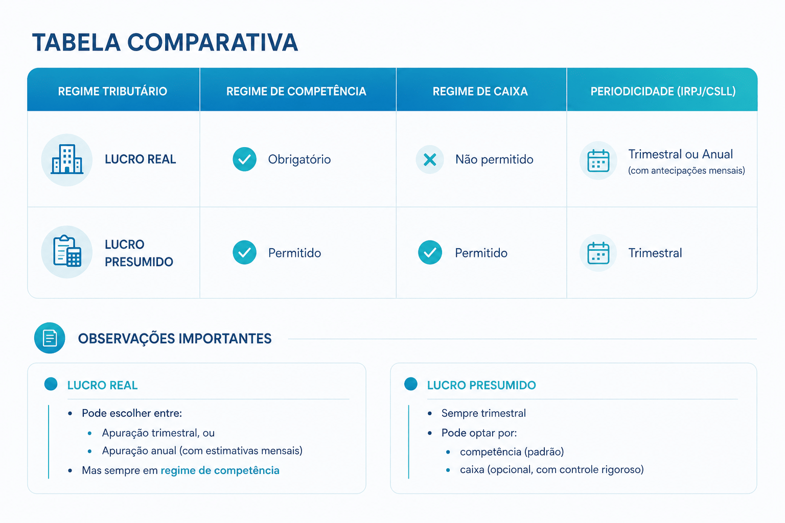

# Apuração de IRPJ e CSLL — Regime de Competência

## Visão Geral

A apuração avançada de IRPJ (Imposto de Renda Pessoa Jurídica) e CSLL (Contribuição Social sobre o Lucro Líquido) permite calcular os tributos federais devidos com base nos resultados contábeis da empresa. No **Regime de Competência**, a receita é reconhecida no período em que foi gerada (faturada), independentemente do recebimento financeiro.

**Importante:** o Regime de Competência pode ser utilizado tanto para empresas de **Lucro Real** quanto de **Lucro Presumido**. O que muda entre os dois regimes de tributação é a forma de cálculo da base tributável. No Lucro Real, parte-se do resultado contábil (lucro ou prejuízo). No Lucro Presumido, aplica-se um percentual de presunção sobre a receita bruta.

## Parte 1 — Pré-requisitos

### 1.1. Criar a DRE (Esquema de Contas)

A DRE utilizada pela apuração **deve ser criada pela funcionalidade padrão do Business Central chamada "Esquema de Contas"** (menu Relatórios Financeiros). Não se trata de uma funcionalidade específica da localização. É um recurso nativo do sistema.

O Esquema de Contas da DRE deve conter, no mínimo, as seguintes linhas:

- **Linha de resultado para IRPJ**: totalizador do lucro ou prejuízo utilizado como base do IRPJ
- **Linha de resultado para CSLL**: totalizador do lucro ou prejuízo utilizado como base da CSLL (pode ser a mesma linha do IRPJ ou uma diferente, conforme a necessidade)
- **Linha de receita bruta** (obrigatória para Lucro Presumido no Regime de Competência): totaliza a receita bruta do período, que será a base para aplicação do percentual de presunção
- **Linha de receita financeira** (opcional): se configurada, as receitas financeiras serão somadas integralmente (100%) à base de cálculo, sem aplicação de percentual de presunção

Além do Esquema de Contas, deve existir um **Layout de Coluna** correspondente, também criado pela funcionalidade padrão do Business Central. Esse layout define como os valores serão calculados (ex.: saldo líquido no período).

### 1.2. Criar os Templates de Demonstrativo

Na página **Declarações de Impostos** (lista de templates), devem ser criados dois templates:

- Um template com tipo de imposto **IRPJ**
- Um template com tipo de imposto **CSLL**

Para cada template, configure:
- Série numérica dos demonstrativos
- Contas de débito e crédito (ou fornecedor) para os lançamentos contábeis
- Conta de ajuste, se necessário
- Código de jurisdição para geração de guia de pagamento
- Template de descrição do lançamento (opcional)

**Observação:** na página de templates, os campos de conta de débito e crédito ficam ocultos para templates do tipo IRPJ e CSLL, pois as contas contábeis são configuradas diretamente na Configuração da Apuração IRPJ/CSLL (próximo passo).

---

## Parte 2 — Configuração da Apuração IRPJ/CSLL

Acesse a página **Configuração Apuração IRPJ/CSLL**. Essa página está dividida em várias seções:

### 2.1. Seção "Geral"

| Campo | Valor para Regime de Competência |
|-------|----------------------------------|
| **Período de Apuração** | Anual ou Trimestral, conforme o enquadramento da empresa. No Lucro Presumido a apuração é sempre trimestral |
| **Regime de Tributação** | Lucro Real ou Lucro Presumido |
| **Pagamento por Antecipação** | Ativar se a empresa faz recolhimento mensal antecipado (estimativa mensal) |
| **Critério de Escrituração do Regime Cumulativo** | Selecionar **Regime de Competência**. Este campo só fica habilitado quando o Regime de Tributação é Lucro Presumido. Para Lucro Real, este campo não se aplica e fica desabilitado |

**Particularidade do Lucro Real no Regime de Competência:** quando o regime de tributação é Lucro Real, o campo "Critério de Escrituração do Regime Cumulativo" fica desabilitado, porque no Lucro Real o sistema sempre usa o resultado da DRE (lucro ou prejuízo contábil) como base de cálculo. O conceito de regime de competência versus caixa para receita bruta não se aplica, já que o resultado contábil já é apurado naturalmente pelo regime de competência.

### 2.2. Seção "Lucro/Prejuízo" (DRE)

| Campo | Descrição |
|-------|-----------|
| **Nome Esquema Contas DRE** | Selecione o Esquema de Contas (DRE) criado no pré-requisito |
| **Nº Linha Resultado DRE IRPJ** | Selecione a linha da DRE que contém o resultado (lucro ou prejuízo) para base do IRPJ |
| **Nº Linha Resultado DRE CSLL** | Selecione a linha da DRE que contém o resultado para base da CSLL |
| **Nº Linha Receita DRE** | Selecione a linha da DRE que contém a receita bruta. **No Regime de Competência com Lucro Presumido, este campo é fundamental:** o sistema usa essa linha para obter a receita bruta sobre a qual aplica o percentual de presunção |
| **Nº Linha Receita Financeira DRE** | Opcional. Se preenchido, as receitas financeiras do período serão somadas integralmente (100%) à base de cálculo, sem aplicação de percentual de presunção. Se não preenchido, as receitas financeiras não entram separadamente na base |
| **Nome Layout Coluna DRE** | Selecione o Layout de Coluna associado à DRE |
| **Nº Coluna Resultado DRE** | Selecione a coluna do layout que contém o valor a ser utilizado no cálculo |

### 2.3. Seção "Percentuais de Imposto"

**Grupo IRPJ:**

| Campo | Descrição | Valor típico |
|-------|-----------|--------------|
| **% IRPJ** | Alíquota básica do IRPJ | 15% |
| **% IRPJ Adicional** | Alíquota do adicional de IRPJ | 10% |
| **Base Mensal Isenta IRPJ Adicional** | Valor mensal isento do adicional (o sistema multiplica pelo número de meses do período) | R$ 20.000,00 |

**Grupo CSLL:**

| Campo | Descrição | Valor típico |
|-------|-----------|--------------|
| **% CSLL** | Alíquota da CSLL | 9% |

**Grupo Presunção Acrescida IRPJ** (apenas para Lucro Presumido):

| Campo | Descrição |
|-------|-----------|
| **% Acréscimo** | Percentual adicional sobre a presunção (caso aplicável) |
| **Limite Trimestral** | Valor de receita trimestral a partir do qual o acréscimo passa a incidir |

**Grupo Presunção Acrescida CSLL** (apenas para Lucro Presumido):

| Campo | Descrição |
|-------|-----------|
| **% Acréscimo** | Percentual adicional sobre a presunção para CSLL |
| **Limite Trimestral** | Valor de receita trimestral a partir do qual o acréscimo passa a incidir |

### 2.4. Percentuais de Presunção (apenas Lucro Presumido)

Na Configuração da Apuração, há uma ação **Percentuais de Presunção** que abre uma página para cadastrar múltiplas alíquotas de presunção por tipo de atividade. Essa ação só fica habilitada quando o critério de escrituração **não** é Regime de Caixa.

Para cada linha, informe:

| Campo | Descrição |
|-------|-----------|
| **Nº Linha Receita DRE** | Linha da DRE que contém a receita daquela atividade |
| **Descrição** | Descrição da atividade |
| **% Presunção IRPJ** | Percentual de presunção para IRPJ (ex.: 8% para comércio, 32% para serviços) |
| **% Presunção CSLL** | Percentual de presunção para CSLL (ex.: 12% para comércio, 32% para serviços) |

**Particularidade importante:** quando existem linhas cadastradas nesta tabela de percentuais de presunção, o sistema utiliza o cálculo de **múltiplas alíquotas** (multi-rate). Nesse modo, o sistema calcula a receita de cada linha da DRE separadamente, aplica o respectivo percentual de presunção e soma os resultados. Se a tabela estiver vazia, o sistema obtém a receita bruta do campo **Nº Linha Receita DRE** e aplica os campos **% Presunção IRPJ do Reg. Caixa** e **% Presunção CSLL do Reg. Caixa**, que ficam desabilitados fora do Regime de Caixa; sem valor neles, a presunção resulta zero. Por isso, no Regime de Competência, cadastre os percentuais nesta tabela (ao menos uma linha).

### 2.5. Seção "Contas Contábeis"

Configure as contas para os lançamentos gerados pela apuração:

**Provisões IRPJ:**

| Campo | Descrição |
|-------|-----------|
| **Nº Conta Débito Provisão IRPJ** | Conta de despesa de provisão do IRPJ |
| **Nº Conta Crédito Provisão IRPJ** | Conta de provisão (passivo) do IRPJ |

**Provisões CSLL:**

| Campo | Descrição |
|-------|-----------|
| **Nº Conta Débito Provisão CSLL** | Conta de despesa de provisão da CSLL |
| **Nº Conta Crédito Provisão CSLL** | Conta de provisão (passivo) da CSLL |

**Antecipações IRPJ:**

| Campo | Descrição |
|-------|-----------|
| **Nº Conta Débito Antecipação IRPJ** | Conta de antecipação (ativo) do IRPJ |
| **Nº Conta Crédito Antecipação IRPJ** | Contrapartida da antecipação do IRPJ |
| **Nº Fornecedor Crédito Antecipação IRPJ** | Fornecedor utilizado para gerar o título a pagar da antecipação |
| **Cód. Jurisdição Guia Pag. Antecipação IRPJ** | Código de jurisdição para geração da guia de pagamento |

**Antecipações CSLL:**

| Campo | Descrição |
|-------|-----------|
| **Nº Conta Débito Antecipação CSLL** | Conta de antecipação (ativo) da CSLL |
| **Nº Conta Crédito Antecipação CSLL** | Contrapartida da antecipação da CSLL |
| **Nº Fornecedor Crédito Antecipação CSLL** | Fornecedor utilizado para gerar o título a pagar da antecipação |
| **Cód. Jurisdição Guia Pag. Antecipação CSLL** | Código de jurisdição para geração da guia de pagamento |

**Retenções:**

| Campo | Descrição |
|-------|-----------|
| **Filtro Conta Retenção IRPJ** | Filtro de conta(s) contábil(is) onde são registradas as retenções de IRPJ na fonte |
| **Filtro Conta Retenção CSLL** | Filtro de conta(s) contábil(is) onde são registradas as retenções de CSLL na fonte |

**Apuração IRPJ:**

| Campo | Descrição |
|-------|-----------|
| **Nº Conta Débito IRPJ** | Conta de débito do IRPJ no encerramento do período |
| **Nº Conta Débito IRPJ Adic.** | Conta de débito do IRPJ adicional |
| **Nº Fornecedor Crédito IRPJ** | Fornecedor para gerar o título a pagar do IRPJ |
| **Nº Conta Crédito Per/Dcomp** | Conta para registrar compensações via PER/DCOMP |
| **Cód. Jurisdição Guia Pagamento IRPJ** | Código de jurisdição para geração da DARF |

**Apuração CSLL:**

| Campo | Descrição |
|-------|-----------|
| **Nº Conta Débito CSLL** | Conta de débito da CSLL no encerramento do período |
| **Nº Fornecedor Crédito CSLL** | Fornecedor para gerar o título a pagar da CSLL |
| **Nº Conta Crédito Per/Dcomp** | Conta para registrar compensações via PER/DCOMP |
| **Cód. Jurisdição Guia Pagamento CSLL** | Código de jurisdição para geração da DARF |

### 2.6. Seção "Demonstrativos"

| Campo | Descrição |
|-------|-----------|
| **Cód. Modelo Declaração IRPJ** | Template de demonstrativo do IRPJ criado no pré-requisito |
| **Cód. Modelo Declaração CSLL** | Template de demonstrativo da CSLL criado no pré-requisito |
| **Sem Aprovação de Provisão** | Se ativado, os demonstrativos de provisão mensal (que não são encerramento de período nem antecipação) não exigem aprovação |

### 2.7. Configuração de Deduções (opcional)

Na página **Conf. Deduções Apuração IRPJ/CSLL**, é possível cadastrar deduções e incentivos que serão calculados automaticamente a partir de linhas da DRE. Para cada dedução, informe:

| Campo | Descrição |
|-------|-----------|
| **Tributo** | IRPJ ou CSLL |
| **Código** | Código da dedução (referência aos códigos da ECF: N630 para IRPJ ou N670 para CSLL) |
| **Descrição** | Descrição da dedução |
| **Nº Linha Dedução DRE** | Linha da DRE que contém o valor da dedução |

---

## Parte 3 — Processo de Apuração

### 3.1. Criar a Apuração

1. Acesse a lista **Apurações de IRPJ/CSLL**
2. Crie um novo registro informando um **Nº** identificador
3. Preencha os campos:

| Campo | Descrição |
|-------|-----------|
| **Tributo** | Selecione IRPJ/CSLL (apura ambos), IRPJ (apenas IRPJ) ou CSLL (apenas CSLL) |
| **Período de Apuração** | Preenchido automaticamente conforme a configuração (Anual ou Trimestral) |
| **Ano** | Ano da apuração |
| **Trimestre** | (Apenas se período trimestral) Primeiro, Segundo, Terceiro ou Quarto trimestre |
| **Mês** | Mês específico dentro do período. Se deixado em branco, significa encerramento do período (o sistema marca como "Fim do Período") |

**Particularidade do campo Mês:**
- Se o **Mês** é preenchido, as datas de início e fim são calculadas para aquele mês específico. O sistema entende que é uma apuração parcial (provisão mensal ou antecipação)
- Se o **Mês** é deixado em branco, o sistema calcula para o período inteiro (trimestre completo ou ano completo), marcando como encerramento do período
- Para apuração trimestral, o mês informado deve estar dentro do trimestre selecionado

**Pagamento por Antecipação:**
- O campo **Pagamento por Antecipação** só fica habilitado quando a apuração **não** é de encerramento do período, ou seja, quando o Mês está preenchido
- Quando ativado, os lançamentos gerados são de antecipação (gerando título a pagar contra o fornecedor de antecipação), em vez de provisão
- Quando ativado, a data inicial do cálculo retroage ao início do período (início do trimestre ou início do ano), acumulando os valores

**Situação Especial:**
- O campo **Situação Especial** permite registrar eventos como Cisão, Incorporação, Fusão ou Extinção
- Quando uma situação especial é informada junto com sua data, a data final do período é ajustada para a data da situação especial

### 3.2. Calcular a Apuração

Na página do cartão da **Apuração IRPJ/CSLL**, execute a ação **Calcular**.

O sistema executa os seguintes passos:

1. **Calcula o Lucro/Prejuízo:**
   - **Lucro Real:** obtém o resultado diretamente das linhas da DRE configuradas (Nº Linha Resultado DRE IRPJ e CSLL)
   - **Lucro Presumido com Regime de Competência:** obtém a receita bruta da linha da DRE configurada (Nº Linha Receita DRE) e aplica os percentuais de presunção. Se houver percentuais de presunção cadastrados na tabela de múltiplas alíquotas, cada linha é calculada separadamente com seu respectivo percentual

2. **Calcula Receitas Financeiras** (se configurado): soma integralmente à base de cálculo

3. **Calcula Provisões:** busca os registros contábeis nas contas de provisão do período anterior ao mês corrente

4. **Calcula Antecipações:** busca registros contábeis nas contas de antecipação do período

5. **Calcula Adições e Exclusões:** obtém os valores dos registros de adições e exclusões da ECF (Parte A do LALUR/LACS) para o período

6. **Calcula Compensações:** obtém compensações de prejuízos fiscais (Parte B do LALUR/LACS)

7. **Calcula Deduções:** para cada dedução configurada na Conf. Deduções, calcula o valor a partir da respectiva linha da DRE

8. **Calcula a Base de Cálculo:**
   - **Lucro Real:** Lucro/Prejuízo + Adições + Exclusões + Compensações
   - **Lucro Presumido:** Valor da Presunção + Receitas Financeiras + Adições + Exclusões + Compensações

9. **Calcula IRPJ:**
   - IRPJ = Base de Cálculo x % IRPJ
   - IRPJ Adicional = (Base de Cálculo - Base Mensal Isenta x Nº de Meses) x % IRPJ Adicional (se a base exceder o limite)
   - IRPJ a Pagar = IRPJ + IRPJ Adicional - Retenções - Antecipações - Per/Dcomp - Deduções

10. **Calcula CSLL:**
    - CSLL = Base de Cálculo x % CSLL
    - CSLL a Pagar = CSLL - Retenções - Antecipações - Per/Dcomp - Deduções

11. **Atualiza os Demonstrativos** (se já existirem)

### 3.3. Visualizar a DRE na Apuração

O cartão da apuração exibe uma subpágina com a DRE calculada para o período. É possível navegar nos valores (drill-down) para verificar os registros contábeis de origem. Há também ações para **Editar Esquema de Contas** e **Editar Layout de Coluna** diretamente da apuração.

### 3.4. Registrar Ajustes Manuais

Antes ou depois de calcular, é possível registrar ajustes na apuração por meio das ações disponíveis no cartão:

- **Per/Dcomp IRPJ** e **Per/Dcomp CSLL**: para registrar compensações via PER/DCOMP, informando o número do PER/DCOMP e o valor
- **Deduções/Incentivos IRPJ** e **Deduções/Incentivos CSLL**: para registrar deduções ou incentivos fiscais adicionais (com código ECF)

Ao recalcular, o sistema considera esses ajustes no valor final a pagar.

### 3.5. Gerar os Demonstrativos

No cartão da apuração, utilize as ações **Declaração IRPJ** e **Declaração CSLL**. Na primeira vez, o sistema cria automaticamente o demonstrativo a partir do template configurado. Nas vezes seguintes (após recálculos), o demonstrativo é atualizado automaticamente enquanto estiver no status "Aberto".

O demonstrativo gerado contém:
- Detalhes do cálculo (lucro ou prejuízo ou base de cálculo, adições, exclusões, compensações, alíquotas, impostos, retenções, antecipações, valor a pagar)
- Lançamentos contábeis (entries) que serão registrados no momento do posting

**Tipos de lançamentos gerados conforme a situação:**

| Situação | Lançamentos gerados |
|----------|---------------------|
| **Provisão mensal** (mês preenchido, sem antecipação, sem encerramento) | Lançamento de provisão: débito na conta de despesa, crédito na conta de provisão |
| **Antecipação** (mês preenchido, com pagamento por antecipação) | Lançamento a pagar contra fornecedor de antecipação + débito na conta de antecipação |
| **Encerramento do período** (mês em branco ou último mês) | Estorno das provisões anteriores + compensação de retenções e antecipações + lançamento definitivo a pagar contra fornecedor |

### 3.6. Aprovar o Demonstrativo

O demonstrativo segue o ciclo de vida: **Aberto > Pendente de Aprovação > Liberado > Registrado**.

1. No cartão do demonstrativo, envie para aprovação (se houver fluxo de aprovação configurado)
2. O aprovador recebe notificação e aprova ou rejeita
3. Após a aprovação, o demonstrativo fica com status "Liberado"

**Particularidade:** se o campo **Sem Aprovação de Provisão** estiver ativado na configuração, os demonstrativos de provisão mensal (que não são encerramento de período nem antecipação) não exigem aprovação.

### 3.7. Registrar os Lançamentos

Com o demonstrativo no status "Liberado", execute a ação **Registrar** no cartão do demonstrativo. O sistema:

1. Para cada lançamento (entry) do demonstrativo, cria uma linha no Diário Geral
2. A data de registro é a data final do demonstrativo
3. Para lançamentos contra fornecedor, calcula a data de vencimento com base no código de jurisdição
4. Propaga as dimensões configuradas
5. Registra o diário e marca o demonstrativo como "Registrado"

Após o registro, o demonstrativo fica imutável. Caso necessário, é possível **Estornar** os lançamentos, o que cria lançamentos de reversão e coloca o demonstrativo no status "Estornado".

---

## Parte 4 — Particularidades do Regime de Competência

1. **Sem linhas de documento:** no Regime de Competência, a subpágina de linhas de documento (que existe no Regime de Caixa para mostrar os recebimentos) não é exibida. O cálculo é feito inteiramente a partir do Esquema de Contas (DRE).

2. **Receita obtida da DRE:** a receita bruta é obtida da linha da DRE configurada no campo "Nº Linha Receita DRE". No Regime de Caixa, a receita vem dos documentos de recebimento; no Regime de Competência, vem diretamente da contabilidade.

3. **Múltiplas alíquotas de presunção:** quando há percentuais de presunção cadastrados na tabela dedicada, cada tipo de receita (conforme a linha da DRE) recebe seu percentual específico. Isso é especialmente útil para empresas com atividades mistas (ex.: comércio e serviços).

4. **Acréscimo de presunção com limite trimestral:** se o percentual de acréscimo e o limite trimestral estiverem configurados, o sistema calcula a presunção normal para a receita dentro do limite e aplica o percentual acrescido sobre a receita excedente. Em apurações mensais dentro de um trimestre, o sistema considera a receita dos meses anteriores do mesmo trimestre para determinar o saldo remanescente do limite.

5. **Receitas financeiras:** quando a linha de receita financeira está configurada, o valor é somado integralmente (100%) à base de cálculo, sem redução por percentual de presunção. Isso vale tanto para IRPJ quanto para CSLL.

6. **Aplicação para Lucro Real e Lucro Presumido:** no Lucro Real, o sistema usa o resultado da DRE diretamente como lucro ou prejuízo, sem aplicar percentuais de presunção. No Lucro Presumido, aplica os percentuais de presunção sobre a receita bruta. Em ambos os casos, adições, exclusões e compensações (LALUR/LACS) são consideradas.

---
