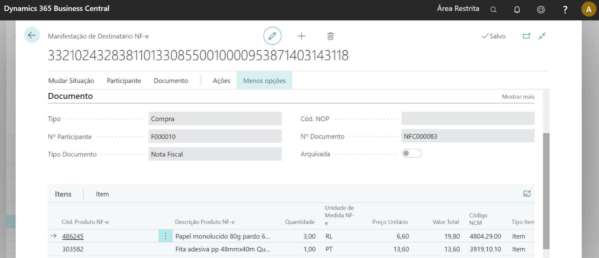
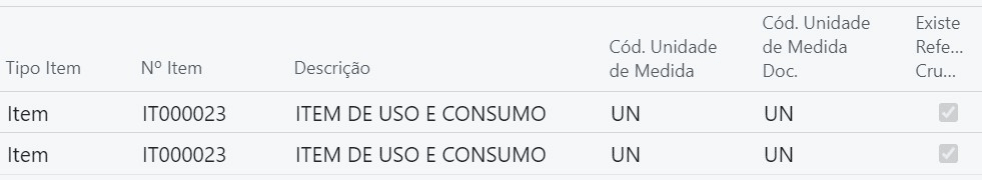
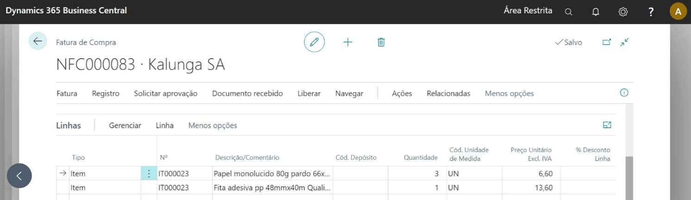
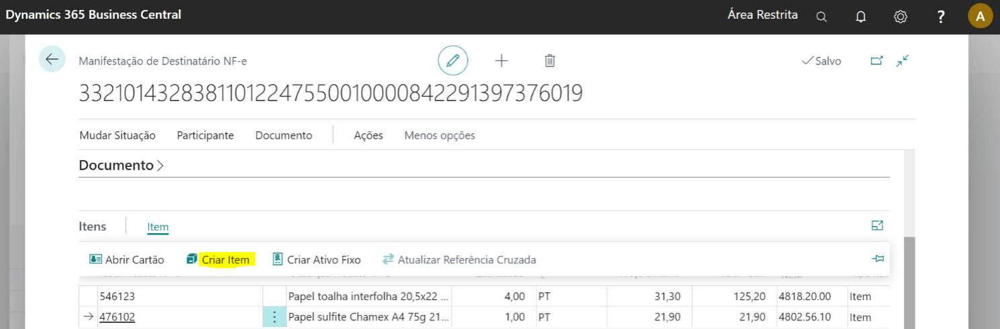
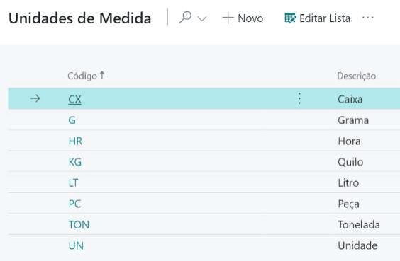
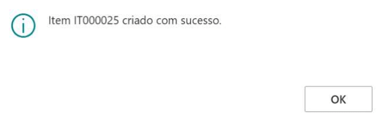
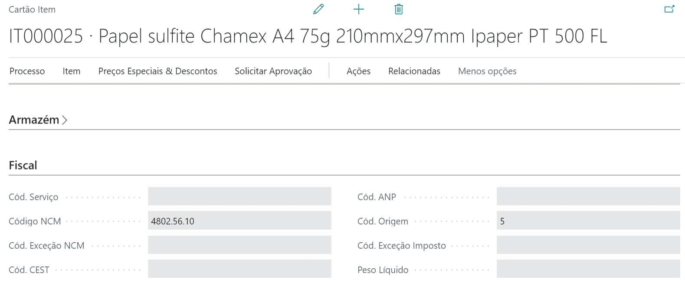

# MD-e: Conversão de Unidade de Medida e Criação de Item

**Data**: Abril/2021

---

## Sumário

Na **Manifestação de Destinatário NF-e**, cada produto da nota do fornecedor é relacionado a um item. Quando o fornecedor vende em uma unidade de medida diferente da usada pela empresa, a quantidade e o preço são convertidos na criação do documento de compra. Quando o item ainda não existe, ele pode ser criado a partir da própria MD-e, com o **Código NCM** e o **Cód. Origem** da nota.

## 1. Contexto

Os itens da nota ficam na parte **Itens** da página **Manifestação de Destinatário NF-e**. Para cada produto, a nota traz o **Cód. Produto NF-e**, a **Unidade de Medida NF-e**, a quantidade, o preço e o **Código NCM**. As colunas à direita fazem o relacionamento com o item do Business Central.

---

## 2. Converter a unidade de medida

Exemplo: o fornecedor fatura em rolo (`RL`) ou pacote (`PT`), e a empresa controla o item em peça (`PC`).

1. Cadastre no item as duas unidades, em **Unids. Medida Item**, com a **Qtd. por Unidade Medida** de cada uma.
2. Nos **Itens** da MD-e, relacione o produto ao item no **Nº Item**. O **Cód. Unidade de Medida** é sugerido com a unidade de compra do item ou, sem ela, com a unidade base. Ajuste os campos:

| Campo | Descrição |
|-------|-----------|
| **Cód. Unidade de Medida** | Unidade do item que corresponde à unidade da nota do fornecedor (no exemplo, `RL` ou `PT`) |
| **Cód. Unidade de Medida Doc.** | Unidade em que a linha deve ser criada no documento de compra (no exemplo, `PC`) |

Ao criar o documento de compra pela MD-e, a linha sai na **Cód. Unidade de Medida Doc.**: a quantidade é convertida pela unidade base do item e o preço unitário é ajustado para manter o valor total da linha.

> **Nota**: se **Cód. Unidade de Medida Doc.** estiver em branco ou for igual a **Cód. Unidade de Medida**, não há conversão. As duas unidades precisam existir nas unidades de medida do item.

---

## 3. Criar o item pela MD-e

1. Nos **Itens** da MD-e, selecione o produto sem item relacionado e clique em **Item** > **Criar Item**.

   

2. Se a **Conf. Importação NF-e** não tiver um **Cód. Modelo Item**, o sistema oferece os modelos de item existentes para escolher.
3. Se o **Cód. Unidade de Medida** da linha estiver em branco, escolha a unidade de medida base do item.

   

4. O item é criado e relacionado ao produto da nota.

   

O novo item recebe:

- a descrição do produto na nota, continuada em **Descrição 2** quando passa do tamanho do campo;
- a unidade de medida base escolhida;
- o **Código NCM** e o **Cód. Origem** da nota;
- os demais campos do modelo de item.

Quando o fornecedor da MD-e é conhecido, a referência cruzada entre o código do produto do fornecedor e o novo item também é gravada.

Para a localização do fornecedor a partir do emitente da nota, veja [MD-e: Emitente Pessoa Física (CPF)](Localization-for-Brazil_User-Manual_MDe-Emitente-CPF-Pessoa-Fisica.md).
