# MD-e: Manifestação do Destinatário

---

## Sumário

A **Manifestação de Destinatário NF-e** (MD-e) consulta na SEFAZ as NF-e emitidas contra o CNPJ da empresa, envia as manifestações do destinatário (ciência, confirmação, desconhecimento e operação não realizada) e baixa o XML completo das notas. A partir do XML, a localização cria o fornecedor, os itens e as referências de item que faltam e gera o documento de compra, que depois é registrado normalmente.

## 1. Contexto

### Pré-requisitos

- O módulo de MD-e contratado. Ele é uma das funcionalidades opcionais da localização (veja [Licenciamento Companial e Funcionalidades Opcionais da Localização](Localization-for-Brazil_User-Manual_Licenciamento-Companial-Funcionalidades-Opcionais.md)).
- O certificado digital da empresa informado no **ID Certificado** do grupo NF-e da **Config. NF-e**. É o mesmo certificado usado na emissão da NF-e (veja [Certificado Digital: Validade e Aviso de Vencimento](Localization-for-Brazil_User-Manual_Certificado-Digital-Validade-Aviso-Vencimento.md)).
- Um único sistema consultando a SEFAZ para o mesmo CNPJ. Dois sistemas consultando ao mesmo tempo perdem ou duplicam notas (veja [Boas práticas na Consulta MD-e](Localization-for-Brazil_User-Manual_Boas-praticas-na-Consulta-MD-e.md)).

### Como funciona

O processo tem estas etapas:

1. **Consultar Documentos**: traz da SEFAZ o resumo das notas emitidas contra o CNPJ da empresa.
2. **Consultar Chave de Acesso**: busca uma nota específica que não veio na consulta.
3. **Ciência**: informa à SEFAZ que a empresa tomou conhecimento da nota e libera o download do XML completo.
4. **Confirmação**: confirma que a operação aconteceu como descrita na nota.
5. **Desconhecimento** ou **Operação Não Realizada**: recusa a nota.
6. **Transmitir Pendentes**: envia à SEFAZ as manifestações marcadas nas etapas 3 a 5.
7. Criação do fornecedor, dos itens e do documento de compra a partir do XML.

---

## 2. Configuração

Pesquise por **Conf. Importação NF-e** ou, no Centro de Funções, abra **Configurações** > **Fiscal** > **NF-e / NFS-e** > **Conf. Importação NF-e**.

### Guia MD-e

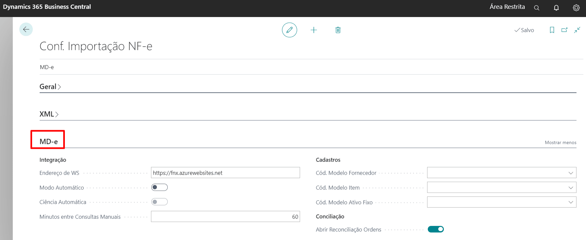

> **Nota**: a imagem é de uma versão anterior. O campo **Minutos entre Consultas Manuais** não existe mais na página, e a guia ganhou os campos **Cód. Modelo Fornecedor Pessoa Física** e **Habilitar Registro Automático**, descritos abaixo.

| Grupo | Campo | Descrição |
|-------|-------|-----------|
| **Cadastros** | **Cód. Modelo Fornecedor** | Modelo de configuração usado pela ação **Criar Fornecedor** quando o emitente é identificado por CNPJ. Revise sempre o fornecedor criado, principalmente se ele não seguir o padrão do modelo |
| **Cadastros** | **Cód. Modelo Fornecedor Pessoa Física** | Modelo usado quando o emitente é pessoa física, identificado por CPF (veja [MD-e: Emitente Pessoa Física (CPF)](Localization-for-Brazil_User-Manual_MDe-Emitente-CPF-Pessoa-Fisica.md)) |
| **Cadastros** | **Cód. Modelo Item** | Modelo de configuração usado pela ação **Criar Item** |
| **Cadastros** | **Cód. Modelo Ativo Fixo** | Modelo de configuração usado pela ação **Criar Ativo Fixo** |
| **Compra** | **Abrir Reconciliação Ordens** | Ao criar uma fatura de compra pela MD-e, abre a página **Reconciliar Nota Fiscal com Ordem de Compras** para aplicar a nota às ordens de compra liberadas |
| **Documento Fiscal (Simples)** | **Habilitar Registro Automático** | Registra automaticamente os documentos fiscais simples criados pela MD-e quando os dados estão completos |
| **Integração** | **Endereço de WS** | Endereço do web service da Fênix que consulta a SEFAZ e envia as manifestações. Não altere |
| **Integração** | **Modo Automático** | Cria as tarefas que consultam a SEFAZ automaticamente, uma por filial |
| **Integração** | **Ciência Automática** | Com o **Modo Automático** ligado, envia a ciência de cada nota nova sem intervenção do usuário. Só pode ser ligado com o **Modo Automático** |

Quando o campo **Cód. Modelo Fornecedor**, **Cód. Modelo Item** ou **Cód. Modelo Ativo Fixo** fica em branco, o sistema abre a lista de modelos na hora da criação para você escolher um.

### Modo automático

Ao ligar o **Modo Automático**, o sistema pergunta *Deseja que os movimentos de fila de tarefas sejam criados?*. Respondendo **Sim**, ele cria um movimento de fila de tarefas **Consultas MD-e** para cada filial, que roda a cada 60 minutos. Os movimentos são criados em espera: abra-os pela ação **Movs. de Fila de Tarefas** da própria página e coloque-os em execução.

A cada execução, a tarefa:

1. consulta a SEFAZ, se a consulta estiver liberada (veja a seção 4);
2. com a **Ciência Automática** ligada, marca a ciência das notas novas e transmite as manifestações de ciência pendentes;
3. com o **Habilitar Registro Automático** ligado, registra os documentos fiscais simples prontos.

> **Nota**: com o **Modo Automático** ligado, as ações **Consultar Documentos** e **Consulta por Nº Útimo NSU** não aparecem na página **Manifestações de Destinatário NF-e**. Com a **Ciência Automática** ligada, a ação **Ciência** também não aparece.

### Guia Geral

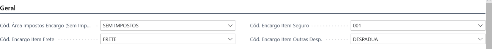

| Campo | Descrição |
|-------|-----------|
| **Cód. Área Impostos Encargo (Sem Impostos)** | Área de impostos genérica, sem impostos, usada nas linhas de encargo criadas a partir do XML |
| **Cód. Encargo Item Frete** | Encargo de item usado para o frete da nota |
| **Cód. Encargo Item Seguro** | Encargo de item usado para o seguro da nota |
| **Cód. Encargo Item Outras Desp.** | Encargo de item usado para as outras despesas da nota |
| **Cód. Encargo Item AFRMM** | Encargo de item usado para o AFRMM nas notas de importação |

Crie os encargos de item e associe-os aos campos. Eles são usados nas notas com frete, seguro e outras despesas, e nas notas de importação.

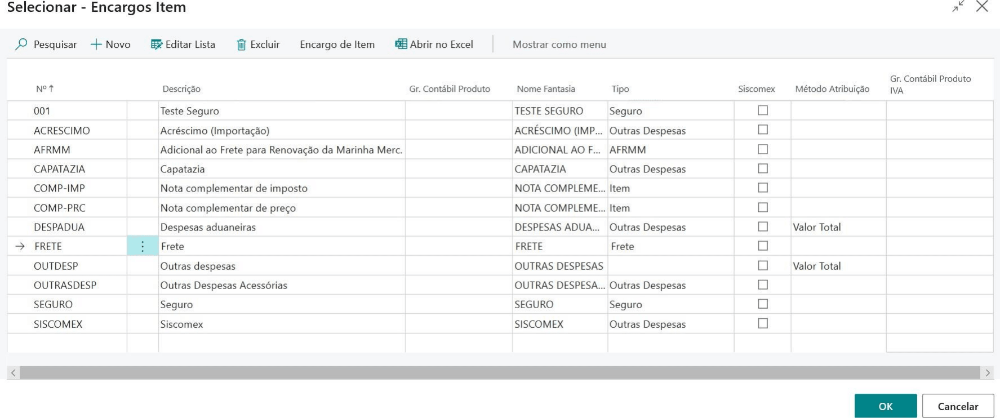

> **Nota**: os campos **Cód. Área Impostos Encargo (Sem Impostos)**, **Cód. Encargo Item Frete**, **Cód. Encargo Item Seguro** e **Cód. Encargo Item Outras Desp.** são obrigatórios para criar o documento de compra a partir do XML.

### Guia XML

A guia XML define como o documento de compra é montado a partir do XML. Use uma configuração padrão e, depois que o documento for criado, ajuste os campos conforme a operação.

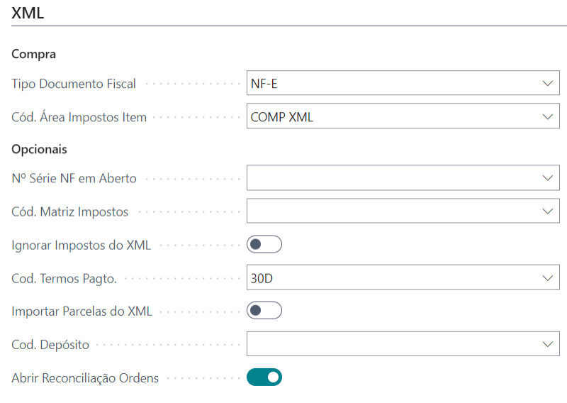

Por padrão, o sistema traz os valores e as alíquotas dos impostos do XML para as estatísticas do documento criado, como se tivessem sido informados manualmente. Para ignorar os impostos do arquivo e calcular pela área de impostos do campo **Cód. Área Impostos Item**, ligue a opção **Ignorar Impostos do XML**:

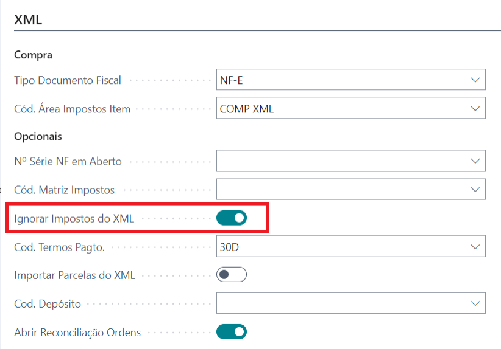

Os demais campos da guia estão descritos em [Compras: Importar Arquivo XML da NF-e](Localization-for-Brazil_User-Manual_NFe-Importar-XML-Compra.md).

---

## 3. Status da MD-e

Cada nota da lista tem dois campos de situação:

- **Situação da Manifestação**: a manifestação marcada pelo usuário e ainda não transmitida (**Ciência**, **Confirmação**, **Desconhecimento** ou **Operação Não Realizada**). Depois da transmissão, ela é limpa e o valor enviado passa para o campo **Última Manifestação Enviada**.
- **Status MD-e**: o resultado na SEFAZ.

| Status MD-e | Significado |
|-------------|-------------|
| (em branco) | Só o resumo da nota foi recebido. Nenhuma manifestação foi aceita ainda |
| **XML Pendente** | A manifestação foi aceita e o XML completo ainda não chegou |
| **Ciência** | A ciência foi aceita e o XML completo chegou. É possível conferir as linhas da nota |
| **XML** | A nota foi confirmada e o XML completo está disponível. É possível criar o documento de compra |
| **Desconhecido** | O desconhecimento foi aceito |
| **Operação Não Realizada** | A operação não realizada foi aceita |

---

## 4. Consultar documentos

1. Pesquise por **Manifestações de Destinatário NF-e** ou, no Centro de Funções, abra **Fiscal** > **NF-e** > **Manifestações de Destinatário NF-e**.
2. Se a empresa tem filiais, escolha a filial no campo **Cód. Filial**. As consultas e transmissões valem para a filial escolhida.
3. Clique em **NF-e** > **Consultar Documentos**.

A consulta traz da SEFAZ todos os documentos emitidos contra o CNPJ da filial desde o último NSU recebido. Nesse momento a lista mostra apenas o cabeçalho de cada nota (emitente, valor, data e situação da NF-e), sem os itens.

> **Nota**: quando a SEFAZ responde que não há documentos novos, ou acusa consumo indevido, o sistema bloqueia novas consultas da filial por 1 hora e 5 minutos, conforme a regra da SEFAZ. Uma consulta feita antes disso para com a mensagem *Você está fora do período de consulta permitido. Próximo horário: …*.

### Detalhes da nota

Para ver os dados de uma nota, selecione-a e clique em **NF-e** > **Detalhes**, ou clique no **Nº NF-e**.

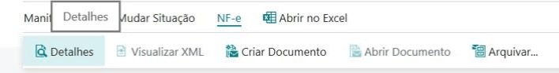

A página **Manifestação de Destinatário NF-e** tem as seções:

| Seção | Conteúdo |
|-------|----------|
| **Geral** | **Cód. Filial**, **Chave Acesso**, **Status NF-e**, **Nº Protocolo** e **Status MD-e** |
| **Resumo** | Dados da NF-e e do **Emitente**. O endereço do emitente é preenchido quando o XML completo chega |
| **Documento** | Dados para criar o documento no Business Central. Preenchida pelo usuário depois da confirmação |
| **Itens** | Linhas da nota. Preenchida quando o XML completo chega |
| **Manifestação** | **Situação da Manifestação** |
| **Números Sequenciais Únicos (NSU)** | Os NSU recebidos da SEFAZ para a nota: o resumo, o XML completo e os eventos |

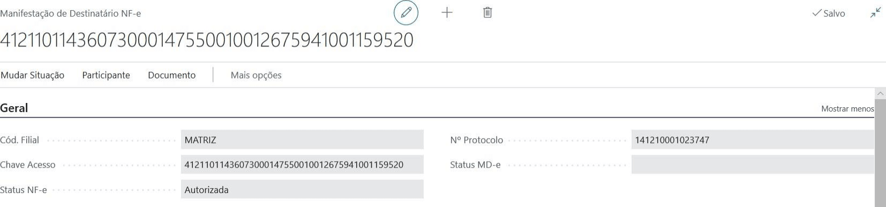

### Consultar uma chave de acesso

Se uma nota não veio na consulta, busque-a pela chave de acesso:

1. Na página **Manifestações de Destinatário NF-e**, clique em **Ações** > **Consultar Chave de Acesso**.
2. Cole a chave de acesso e clique em **OK**.

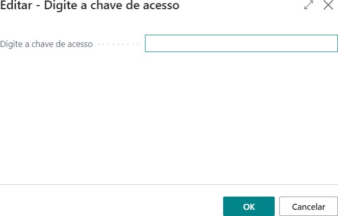

O documento é incluído na lista.

> **Nota**: a SEFAZ limita a consulta por chave de acesso a 20 consultas por hora. Passado o limite, a SEFAZ recusa a consulta e é preciso aguardar uma hora. Fonte: [Portal da NF-e](https://www.nfe.fazenda.gov.br/portal/informe.aspx?ehCTG=false&Informe=0cu/yBLKrCs=).

---

## 5. Ciência

A ciência informa à SEFAZ que a empresa tomou conhecimento da nota, sem confirmar a operação. Ela libera o download do XML completo, para conferir as linhas antes de confirmar.

1. Selecione as notas e clique em **Mudar Situação** > **Ciência**.

   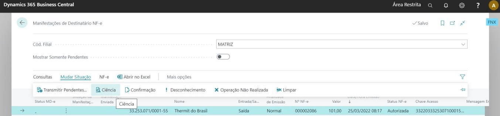

   A **Situação da Manifestação** das notas fica **Ciência**.

   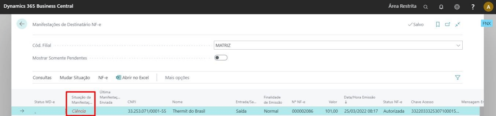

2. Clique em **Mudar Situação** > **Transmitir Pendentes**.

   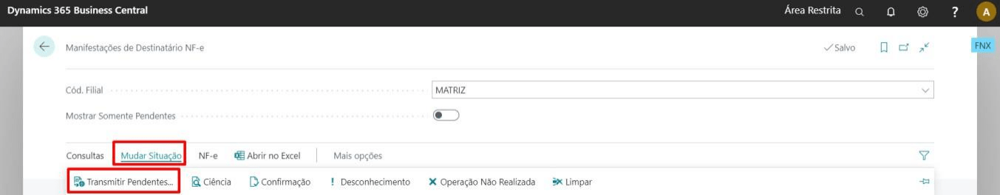

3. Responda **Sim** à pergunta *Deseja transmitir os documentos pendentes?*.

   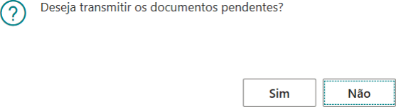

   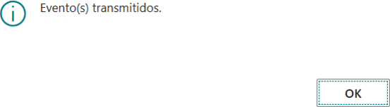

O **Status MD-e** muda para **XML Pendente**. Quando o XML completo chega, em uma consulta seguinte, o **Status MD-e** muda para **Ciência** e as linhas da nota aparecem na seção **Itens**:

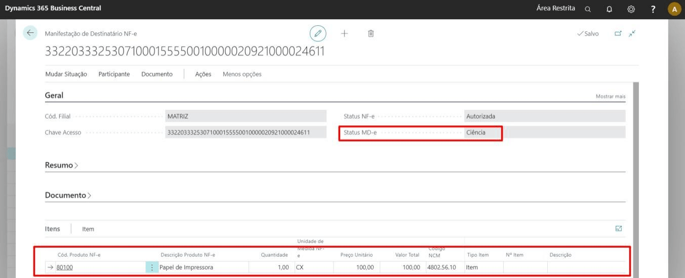

Para ver o XML, clique em **Documento** > **Visualizar XML**. O XML abre no visualizador, que também permite baixar o arquivo (veja [NF-e: Visualizador de XML no Business Central](Localization-for-Brazil_User-Manual_NFeXmlViewer.md)).

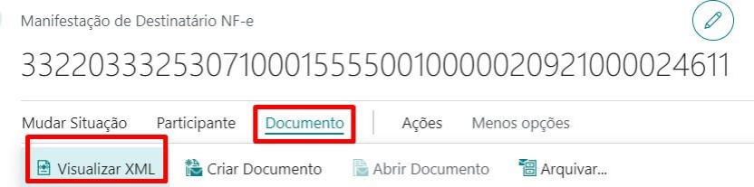

> **Nota**: a ação **Ciência** só se aplica a notas com o **Status MD-e** em branco. Ela também não aparece quando a **Ciência Automática** está ligada.

Se a nota estiver de acordo, siga com a confirmação.

---

## 6. Confirmação

1. Na página **Manifestações de Destinatário NF-e**, selecione as notas e clique em **Mudar Situação** > **Confirmação**. A **Situação da Manifestação** fica **Confirmação**.

   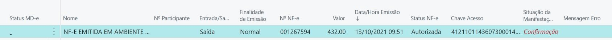

2. Clique em **Mudar Situação** > **Transmitir Pendentes** e responda **Sim**.

Se o XML completo já tinha chegado com a ciência, o **Status MD-e** muda direto para **XML**. Se não, ele fica **XML Pendente** até o XML chegar em uma consulta seguinte e então muda para **XML**:

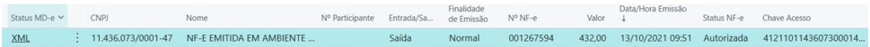

> **Nota**: na página **Manifestação de Destinatário NF-e**, as ações do menu **Mudar Situação** só ficam habilitadas enquanto o **Status MD-e** está em branco. Para confirmar uma nota que já está com **Status MD-e** **Ciência**, use a ação **Confirmação** da lista **Manifestações de Destinatário NF-e**.

> **Nota**: se a SEFAZ recusar uma manifestação, o motivo aparece no campo **Mensagem Erro** e a **Situação da Manifestação** é limpa. Corrija o problema, marque a manifestação de novo e transmita. A ação **Limpar** desfaz uma manifestação marcada e ainda não transmitida.

---

## 7. Desconhecimento e operação não realizada

Use **Desconhecimento** para uma nota que a empresa não reconhece, e **Operação Não Realizada** para uma nota cuja operação não aconteceu.

1. Selecione as notas e clique em **Mudar Situação** > **Desconhecimento** ou **Mudar Situação** > **Operação Não Realizada**.

   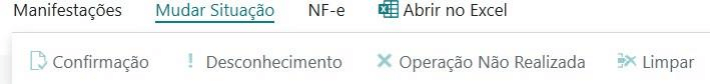

2. Na **Operação Não Realizada**, informe a justificativa. Ela precisa ter pelo menos 15 caracteres.
3. Clique em **Mudar Situação** > **Transmitir Pendentes** e responda **Sim**.

Depois da transmissão, o **Status MD-e** fica **Desconhecido** ou **Operação Não Realizada**.

---

## 8. Dados da nota depois da confirmação

Com o XML completo, a página **Manifestação de Destinatário NF-e** mostra todos os dados da nota.

Na seção **Geral**, o **Status MD-e** **XML** indica que o XML foi baixado da SEFAZ:

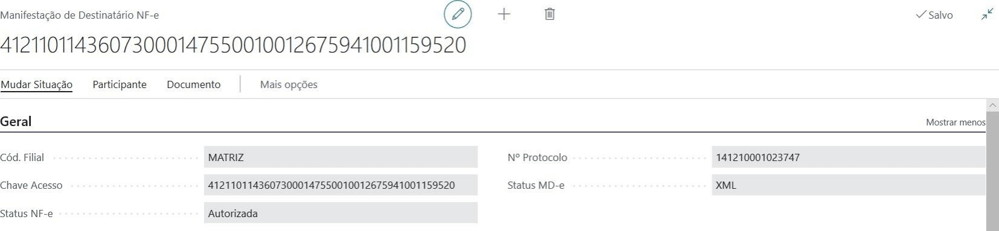

A seção **Resumo** passa a ter o endereço do emitente:

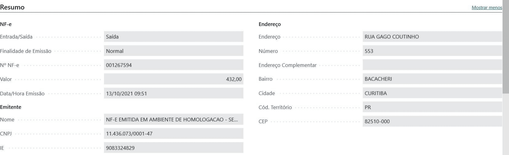

Na seção **Documento**, informe os dados para criar o documento:

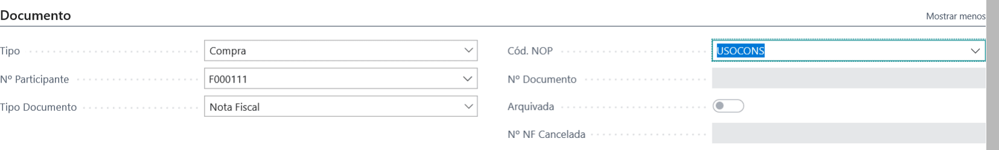

| Campo | Descrição |
|-------|-----------|
| **Tipo** | **Compra** ou **Venda**. Uma nota de devolução emitida por um cliente vem como **Venda** |
| **Nº Participante** | Fornecedor (ou cliente, na devolução). É preenchido automaticamente quando o CNPJ ou CPF do emitente já está cadastrado |
| **Tipo Documento** | Documento a criar. Na compra: **Ordem**, **Fatura** ou **Simples** (documento fiscal simples). Na venda: **Nota de Crédito**, **Devolução** ou **Simples** |
| **Cód. NOP** | Natureza de operação usada no documento |

A ação **Documento** > **Aplicar Matriz** preenche o **Tipo Documento** e o **Cód. NOP** pela **Matriz MD-e**, quando ela está configurada.

A seção **Itens** traz as linhas do XML. Para criar o documento, cada linha precisa ter o item da empresa no **Nº Item**, e a referência entre o produto do fornecedor e o item precisa existir (**Existe Referência Cruzada**):

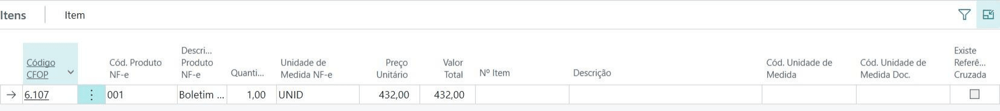

A seção **Números Sequenciais Únicos (NSU)** passa a mostrar também o NSU do XML completo:

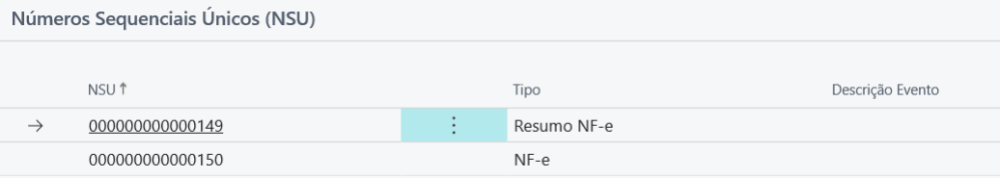

---

## 9. Fornecedor e itens

### Criar o fornecedor

Se o emitente não está cadastrado, o **Nº Participante** fica em branco. Para criar o fornecedor a partir da nota:

1. Clique em **Participante** > **Criar Fornecedor**.

   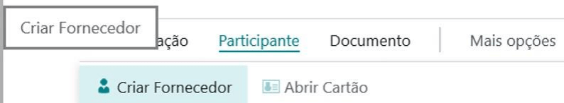

2. Responda **Sim** à pergunta de confirmação.

   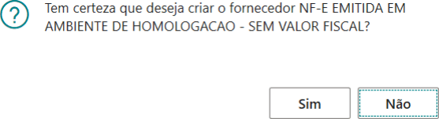

   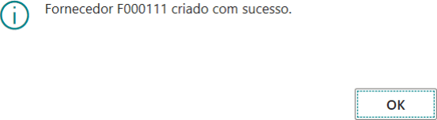

O fornecedor é criado com o modelo do **Cód. Modelo Fornecedor** e com o nome, o endereço, o CNPJ e a Inscrição Estadual da nota, e passa a ser o **Nº Participante**. Se já existir um fornecedor com o mesmo CNPJ ou CPF, o sistema pergunta se deve usá-lo em vez de criar outro. As regras do emitente pessoa física estão em [MD-e: Emitente Pessoa Física (CPF)](Localization-for-Brazil_User-Manual_MDe-Emitente-CPF-Pessoa-Fisica.md).

Confira o cadastro criado pela ação **Participante** > **Abrir Cartão** e preencha os campos que faltam, como os grupos contábeis:

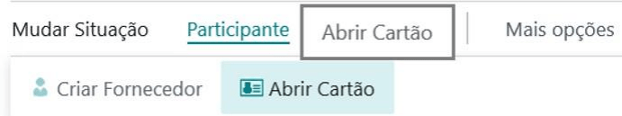

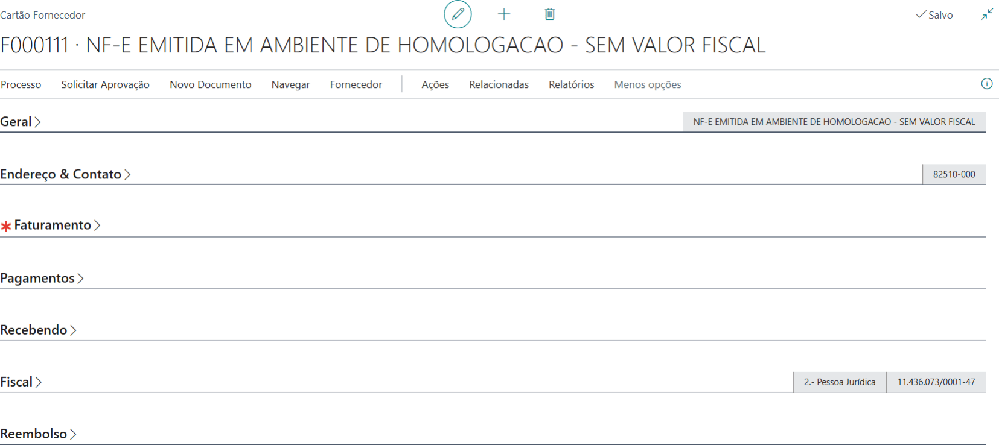

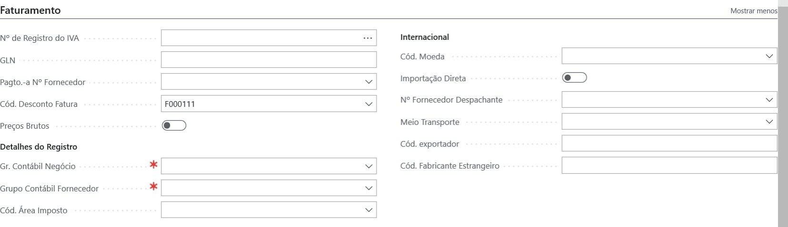

### Relacionar os itens

Para cada linha da seção **Itens**, informe o **Tipo Item** e o **Nº Item** da empresa e crie a referência entre o produto do fornecedor e o item:

1. Na linha, informe o **Nº Item**.
2. Clique em **Item** > **Atualizar Referência Cruzada**.

   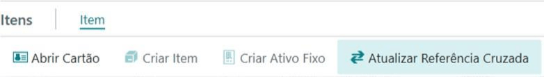

   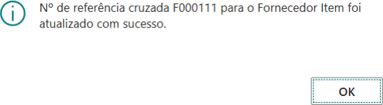

A referência de item é gravada para o fornecedor, com o **Cód. Produto NF-e** como número de referência e a unidade de medida da nota. Nas próximas notas desse fornecedor, o item é encontrado automaticamente e o campo **Existe Referência Cruzada** fica marcado:

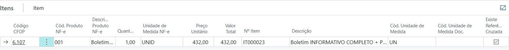

Para criar as referências de todas as linhas que já têm item de uma vez, use **Participante** > **Atualizar Referências de Itens**.

> **Nota**: a referência só pode ser criada com o **Nº Participante** preenchido, o **Tipo Item** **Item** e o **Cód. Unidade de Medida** informado.

### Criar o item

Se o item não está cadastrado:

1. Na linha, clique em **Item** > **Criar Item**.

   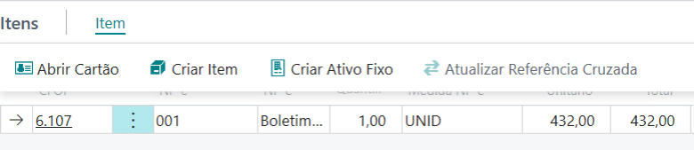

2. Se a linha não tem **Cód. Unidade de Medida**, escolha a unidade de medida do item.

   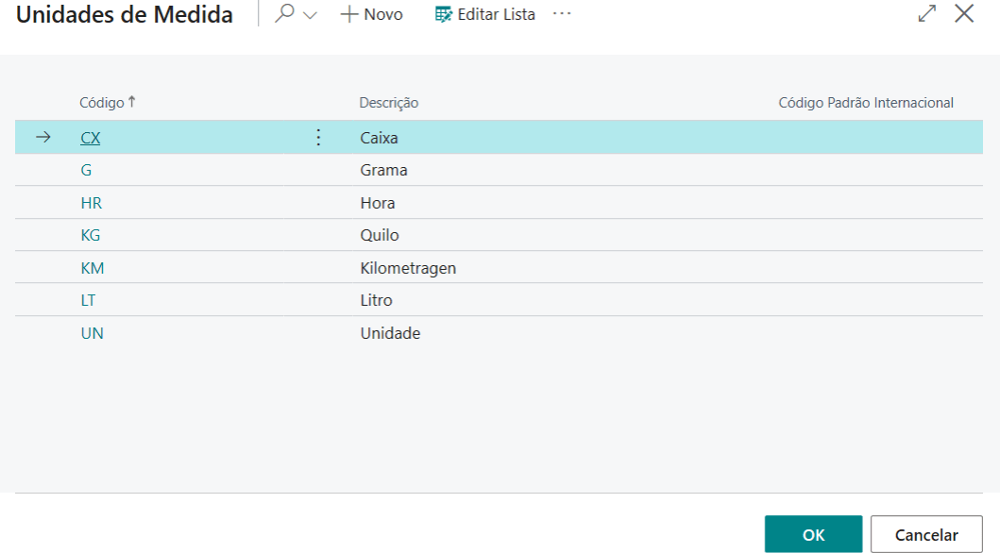

   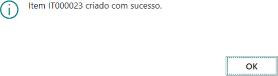

O item é criado com o modelo do **Cód. Modelo Item** e com a descrição, o NCM e a origem da nota. Com o **Nº Participante** preenchido, a referência de item também é criada. Confira o item pela ação **Item** > **Abrir Cartão** e ajuste o que for preciso:

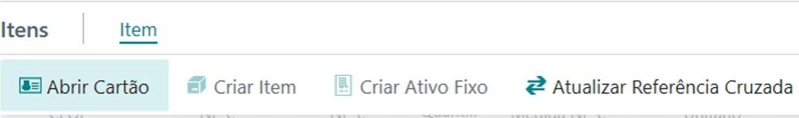

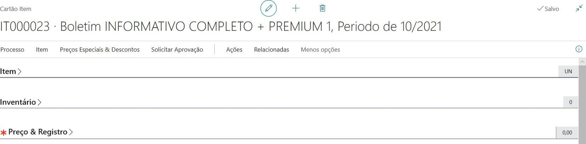

Para uma compra de ativo fixo, use **Item** > **Criar Ativo Fixo**, que cria o ativo com o modelo do **Cód. Modelo Ativo Fixo**.

---

## 10. Criar o documento de compra

Com a nota confirmada, o fornecedor informado e os itens relacionados:

1. Clique em **Documento** > **Criar Documento**.

   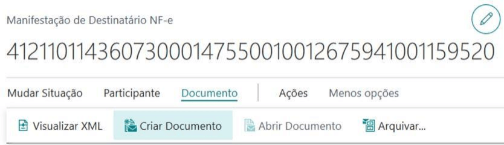

2. Com a opção **Abrir Reconciliação Ordens** do grupo **Compra** da guia MD-e ligada e o **Tipo Documento** **Fatura**, abre a página **Reconciliar Nota Fiscal com Ordem de Compras**, com as linhas do XML e as ordens de compra liberadas do fornecedor. Use **Sugerir Aplicações** para aplicar a nota às ordens, ou feche a página se não houver o que reconciliar.

   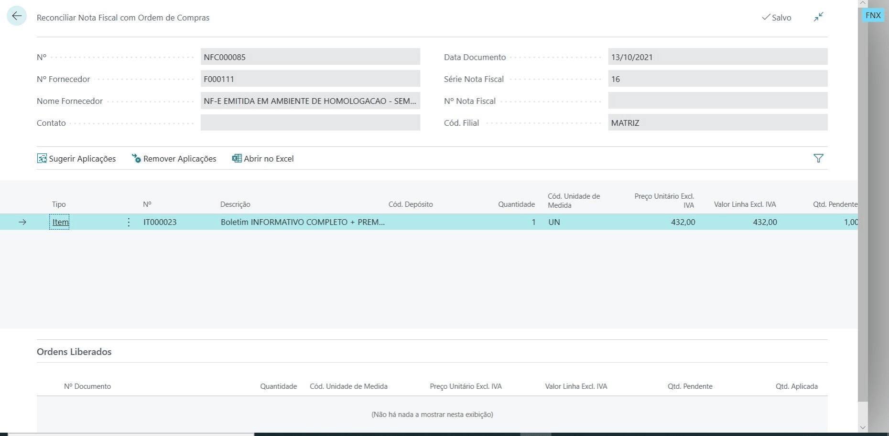

3. Clique em **Documento** > **Abrir Documento** para abrir o documento criado.

   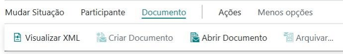

   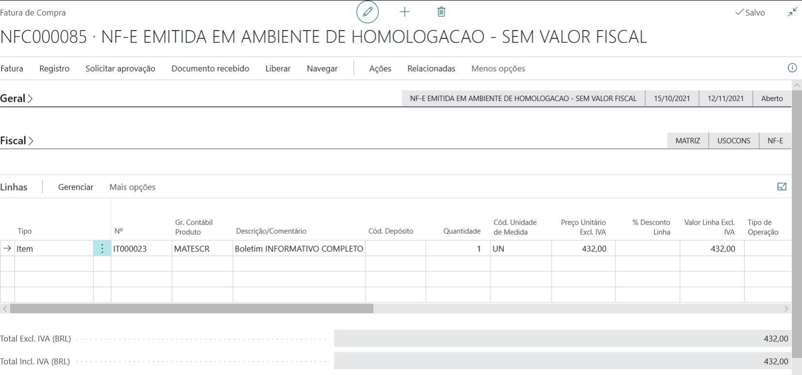

4. Confira o documento e registre-o.

### Reconciliar com recebimentos

Quando o recebimento físico foi registrado antes da nota, por exemplo com quantidades diferentes, aplique a nota aos recebimentos antes de criar o documento: selecione a nota e clique em **NF-e** > **Reconciliar com Recebimentos**.

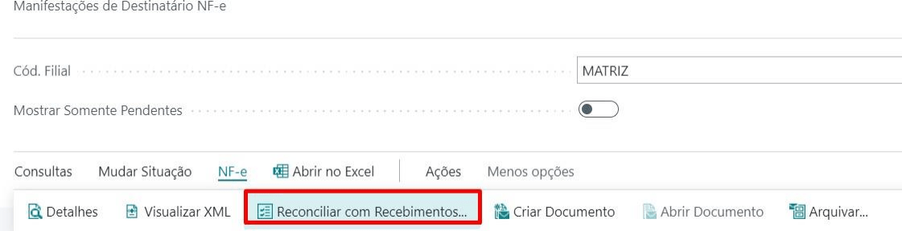

A ação fica habilitada para notas de **Compra** com o XML disponível, sem documento criado e com **Tipo Documento** diferente de **Simples**.

Também é possível reconciliar depois, dentro da fatura criada, pela ação **Reconciliar com Ordens** da fatura de compra (veja [Compras: Importar Arquivo XML da NF-e](Localization-for-Brazil_User-Manual_NFe-Importar-XML-Compra.md)).

---

## 11. Arquivo de manifestações

Quando o documento criado pela MD-e é registrado, a nota é marcada como **Registrado** e **Arquivado** e sai da lista **Manifestações de Destinatário NF-e**. Notas que não vão gerar documento podem ser arquivadas pela ação **NF-e** > **Arquivar**.

Para consultar as notas arquivadas, pesquise por **Arquivo de Manifestações de Destinatário NF-e** ou, no Centro de Funções, abra **Fiscal** > **NF-e** > **Arquivo** > **Arquivo de Manifestações de Destinatário NF-e**.

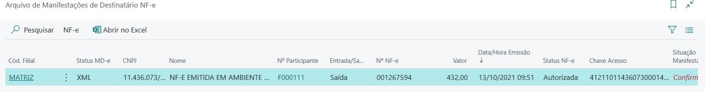

Para devolver notas à lista de trabalho, selecione-as e clique em **Desarquivar**:

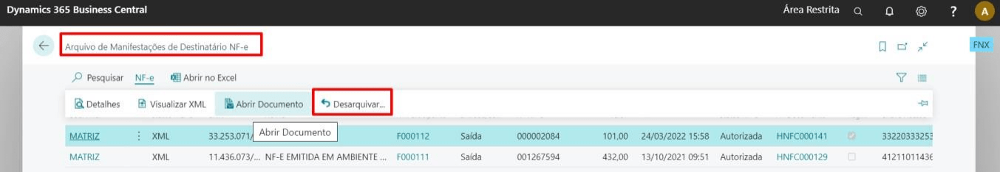

As ações **Exportar XMLs** das duas listas baixam os XML das notas selecionadas em um arquivo ZIP.

---

## 12. Pontos de atenção

- **Estorno da fatura**: se a fatura registrada precisar ser revertida, registre uma nota de crédito marcada como **Cancelamento** e aplicada à fatura. A nota volta para a lista **Manifestações de Destinatário NF-e**, sem documento, e pode gerar um novo documento.
- **Documento excluído**: se o documento criado pela MD-e for excluído antes do registro, a nota fica sem **Nº Documento** e pode gerar outro documento.
- **Nota com encargo**: quando uma nota com encargo, como frete ou seguro, precisar ser revertida, crie uma nota de crédito corretiva e atribua o encargo para poder registrar o documento.
- **Reconciliação com as ordens**: há duas formas:
  - **Reconciliar com Recebimentos**, na MD-e, quando o recebimento físico é diferente do fiscal;
  - **Reconciliar Nota Fiscal com Ordem de Compras**, que abre ao criar a fatura ou pela ação **Reconciliar com Ordens** da fatura de compra.
- **Recebimento reconciliado**: um recebimento de compra reconciliado com uma MD-e não pode ser desfeito enquanto a reconciliação existir.
