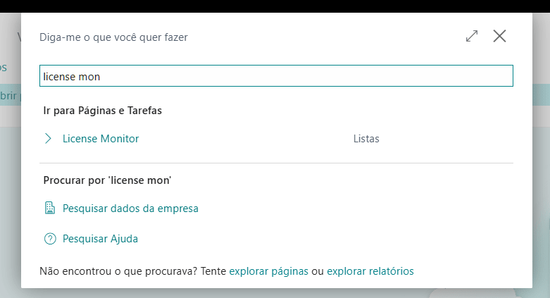
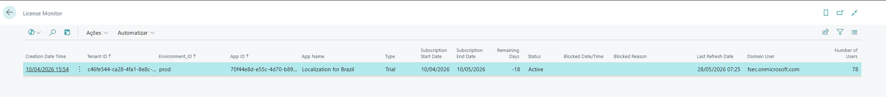
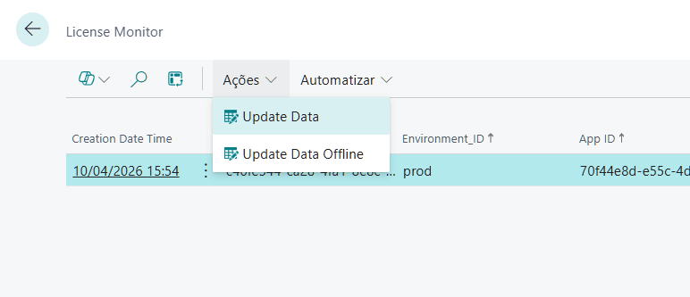

<!-- Source: loc/Basic/CheckLicenseMonitor.Codeunit.al + .github/workflows/al-build-apps-native.yml -->
# Monitoramento de Licença da Localização Brasileira

**Data**: Maio/2026

---

## Sumário

A **Localização Brasileira** (`Localization for Brazil`) é distribuída na Microsoft AppSource em modelo de assinatura, com período de teste (*trial*) gratuito seguido de licenciamento ativo. O controle do ciclo de vida da licença é feito por um aplicativo dedicado, o **License Monitor**, publicado na AppSource pela **Arquiconsult SA** (Portugal). Este documento descreve como o monitoramento funciona, quais funcionalidades da localização ficam bloqueadas após o término do trial sem licença ativa, e quais operações continuam disponíveis mesmo nesse cenário.

---

## 1. Contexto

A Localização Brasileira é um aplicativo publicado na Microsoft AppSource sob o modelo de **SaaS Offer**, sujeito ao período de teste padrão do canal AppSource. Para administrar de forma consistente o estado da licença ao longo de todo o ciclo de vida do cliente, desde a contratação inicial em modo trial até a renovação contratual, utilizamos um aplicativo auxiliar desenvolvido pela **Arquiconsult SA** (Portugal).

Esse aplicativo, chamado **License Monitor** ([registro AppSource](https://marketplace.microsoft.com/en-us/product/saas/pubid.arquiconsultsa%7Caid.arqui_bc_0009%7Cpappid.99387aec-4505-4d59-b7ff-78fd74a49a9a?tab=overview)), atua como um serviço de validação acessório. Ele é instalado em conjunto com a Localização Brasileira no ambiente do cliente e, em pontos estratégicos da operação fiscal, é consultado para verificar se a licença está vigente.

> **Licenciamento Companial**: conforme o mercado e o contrato do cliente, a licença da Localização pode ser controlada pelo License Monitor, descrito aqui, ou pelo **Companial License Management**, que licencia por usuário. A escolha é feita por ambiente: com a funcionalidade opcional **Licenciamento Companial** desligada, vale o License Monitor. Veja [Licenciamento Companial e Funcionalidades Opcionais da Localização](Localization-for-Brazil_User-Manual_Licenciamento-Companial-Funcionalidades-Opcionais.md).

## 2. Quando a Verificação Acontece

A verificação de licença é executada **apenas em ambientes Cloud (SaaS) com interação de usuário**. O monitoramento se aplica a quem usa a Localização Brasileira através do Business Central na nuvem da Microsoft, em chamadas iniciadas a partir de uma sessão de usuário (tela, ações de menu, registro manual de documento, etc.).

A verificação **não é executada** nos seguintes cenários:

- **Ambientes On-Premises**: instalações locais do Business Central não passam pelo License Monitor.
- **Processamento em segundo plano (background jobs)**: rotinas automáticas, integrações via job queue e tarefas programadas continuam operando normalmente.
- **Pré-visualização de Registro** (Posting Preview): a checagem é ignorada durante a simulação de lançamentos, para não interferir na inspeção contábil e fiscal.

---

## 3. Funcionalidades Sujeitas à Verificação

Após o término do período de teste, se a licença da Localização Brasileira não estiver ativa, as funcionalidades abaixo ficam bloqueadas no ambiente Cloud do cliente. Em todas elas, o usuário recebe uma mensagem de erro indicando que a licença expirou.

### 3.1. Cálculo de Impostos

O motor de **Cálculo do Imposto** é o componente central da localização. Ele calcula ICMS, IPI, PIS, COFINS, ISS, IBS, CBS, retenções e demais tributos brasileiros sobre cada linha de documento de venda, compra ou transferência. Sem licença ativa, qualquer operação que dispare o recálculo de impostos é interrompida.

Isso afeta:

- Registro de documentos de venda e compra (pedidos, faturas, notas de crédito, devoluções)
- Recálculo de impostos nas linhas de Diários Gerais com partes fiscais
- Geração de impostos em operações de Adiantamento (*prepayment*)
- Aplicação de adiantamentos com retenções
- Cálculos de impostos em transferências entre filiais

### 3.2. Transmissão de NF-e (Modelo 55)

A ação **Transmitir NF-e Pendentes**, usada para enviar lotes de Notas Fiscais Eletrônicas ao web service da SEFAZ, fica indisponível. Tanto a transmissão **síncrona** (lotes pequenos com retorno imediato) quanto a **assíncrona** (lotes com consulta posterior por recibo) são bloqueadas no ponto de envio à SEFAZ.

Documentos fiscais já registrados internamente permanecem no sistema, mas não podem ser autorizados pela SEFAZ enquanto a licença não for regularizada.

### 3.3. Manifestação de Destinatário NF-e (MD-e)

A ação **Consultar Documentos** na página **Manifestações de Destinatário NF-e** (`NFeMDe`) fica indisponível. Essa ação consulta, junto à SEFAZ, as NF-e em que a empresa figura como destinatária, viabilizando o ciclo de manifestação (Ciência, Confirmação, Desconhecimento, Operação Não Realizada).

Sem licença, a consulta periódica de novos documentos MD-e é interrompida.

### 3.4. Transmissão de NFS-e

A ação **Transmitir Lote**, usada para enviar lotes de Notas Fiscais de Serviço Eletrônicas aos web services municipais, fica indisponível. Isso atinge tanto a transmissão via web service quanto a geração de arquivo TXT alternativo (quando o município não exige web service), pois o ponto de checagem precede ambos os caminhos.

### 3.5. Consultar CNPJ

A ação **Consultar CNPJ**, disponível no cadastro de Clientes, Fornecedores e na página de consulta avulsa, fica indisponível. Essa ação chama o serviço de CNPJ para obter razão social, endereço, situação cadastral e demais dados públicos da Receita Federal a partir de um CNPJ informado.

Sem licença, o preenchimento automático de dados de participantes a partir do CNPJ deixa de funcionar. O cadastro continua possível com digitação manual.

---

## 4. Funcionalidades NÃO Afetadas

As demais funcionalidades da Localização Brasileira continuam plenamente operacionais mesmo sem licença ativa, inclusive durante e após o trial. Entre elas:

- Cadastros mestres (Clientes, Fornecedores, Itens, Filiais, CNPJ, NCM, CFOP, NOP)
- Configuração fiscal (áreas de impostos, matriz fiscal, jurisdições)
- Consulta a documentos fiscais já registrados
- Impressão de DANF-e e DANFS-e (relatórios)

> **Observação**: atualmente o monitoramento via License Monitor está ativo somente no app principal **Localization for Brazil**. Os apps **Tax Books**, **Banking** e **Advanced Pack** ainda não passam por essa verificação, mas a previsão é estendê-la progressivamente a todos os apps da Localização Brasileira.

---

## 5. Como Verificar e Regularizar a Licença

1. Verifique se o aplicativo **License Monitor** está instalado no ambiente Business Central da sua empresa.
2. Para consultar o status atual da licença, abra o recurso **Diga-me** (atalho **Alt+Q**) e pesquise por *License Monitor*. Selecione a entrada **License Monitor** na seção *Ir para Páginas e Tarefas*:

   

   A página exibe, para cada app monitorado no ambiente, informações como **Subscription Start Date**, **Subscription End Date**, **Remaining Days**, **Status** (`Active`, `Blocked`), **Last Refresh Date**, **Type** (`Trial` ou licença comercial) e **Number of Users**:

   

   Para **forçar a atualização do status** sem aguardar o ciclo automático de 24 horas (por exemplo, logo após a contratação ou renovação da licença), utilize a ação **Update Data** no menu **Ações**. A opção **Update Data Offline** revalida apenas o cache local, sem consultar o serviço externo:

   

3. Caso o trial tenha expirado, entre em contato com a **Fênix Sistemas & Consultoria** ou com o seu parceiro implementador para formalizar a contratação e ativar a licença definitiva.
4. Após a regularização, as operações listadas na seção 3 voltam a executar normalmente, sem necessidade de reinstalação do app principal.

---

## 6. Resumo das Funcionalidades Verificadas

| Área | Operação | Status sem Licença |
|------|----------|--------------------|
| Fiscal | Cálculo de Impostos (todas as operações que recalculam tributos) | Bloqueada |
| NF-e | Transmissão à SEFAZ (síncrona e assíncrona) | Bloqueada |
| MD-e | Consulta de documentos na SEFAZ | Bloqueada |
| NFS-e | Transmissão de lote a web service municipal | Bloqueada |
| Cadastros | Consulta CNPJ a partir do serviço da Fênix | Bloqueada |
| Demais funcionalidades | Cadastros, relatórios, importações, registros locais | Disponível |

---

## 7. Considerações Finais

O License Monitor é uma camada leve de verificação cuja única função é validar a vigência do contrato comercial. Ele não armazena dados fiscais do cliente, não interfere no conteúdo dos documentos e não envia informações a serviços externos além da própria validação do tenant junto à infraestrutura da Arquiconsult.

### 7.1. Verificação Offline e Cache de 24 Horas

A validação da licença opera em **modo offline com cache local**: o resultado de cada consulta ao serviço de licenciamento da Arquiconsult fica armazenado no próprio ambiente do cliente por **24 horas**. Durante esse intervalo, as operações listadas na seção 3 executam a checagem localmente, sem qualquer chamada à internet. O ponto de verificação simplesmente lê o status já validado e segue adiante.

Apenas após o término dessas 24 horas, na próxima operação verificada, o License Monitor entra em contato com o serviço externo para renovar o status. Em outras palavras, uma única consulta ao serviço externo por dia é suficiente para manter todas as funcionalidades da localização operando normalmente.

Esse desenho oferece três benefícios práticos:

- **Performance**: o impacto da verificação no tempo de registro de documentos é praticamente nulo, pois a maior parte das operações do dia consulta apenas o cache local.
- **Resiliência**: oscilações momentâneas de conectividade ou eventuais janelas de manutenção do serviço de licenciamento não interrompem o trabalho do dia a dia. O sistema continua operando com base no último status válido em cache.
- **Privacidade**: o tráfego entre o ambiente do cliente e a infraestrutura da Arquiconsult é mínimo (uma única chamada por tenant a cada 24 horas), restrito à identificação do ambiente (tenant + environment + app ID) e sem qualquer dado fiscal ou comercial.

A arquitetura foi desenhada para que, em situações inesperadas (falha prolongada de conectividade, indisponibilidade do serviço de validação além do prazo de cache), o impacto fique restrito às operações listadas na seção 3, preservando a continuidade dos cadastros e da consulta histórica. Mesmo nesse cenário, a regularização da licença restabelece as funcionalidades sem qualquer intervenção técnica no ambiente.
