# NFS-e: Cliente sem Identificação

**Data**: Agosto/2021

---

## Sumário

Algumas prefeituras dispensam a identificação do tomador quando a empresa presta serviços a um grande número de pessoas físicas: em vez de uma nota por CPF, emite-se uma NFS-e geral, sem tomador, só para reconhecer a receita e recolher o ISS. A localização atende esse caso com um cliente de categoria **Não Identificado**, que dispensa CPF/CNPJ e endereço no cadastro, no registro da fatura e na geração da NFS-e.

---

## 1. Contexto

A emissão sem identificação do tomador depende da legislação do município. Antes de usar este recurso, confirme com a prefeitura se ela aceita a NFS-e sem tomador e quais dados ela ainda exige. As particularidades de cada município estão em [NFS-e: Manuais de Emissão por Município e Plataforma](Localization-for-Brazil_User-Manual_NFSe-Manuais-por-Municipio.md).

O cliente **Não Identificado** é um cadastro comum de cliente. O que muda é a **Categoria**:

- o **CPF/CNPJ** fica desabilitado e precisa ficar em branco;
- o endereço (**Endereço**, **Número**, **Bairro**, **Cidade**, **CEP** e **Cód. Unidade Federal**) não é exigido no cadastro, no registro da fatura nem na geração da NFS-e;
- no cálculo dos impostos, a operação é tratada como dentro do estado da filial emitente.

---

## 2. Cadastrar o cliente

1. Pesquise por **Clientes** ou, no Centro de Funções, abra **Vendas** > **Clientes**, e clique em **Novo**.
2. Na guia **Geral**, preencha o **Nome**. Sugestão: "Não identificado".

   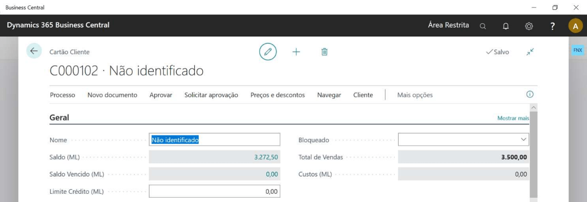

3. Na guia **Endereço & Contato**, preencha o **Cód. País** com **BR**. É o único campo de endereço obrigatório para essa categoria.

   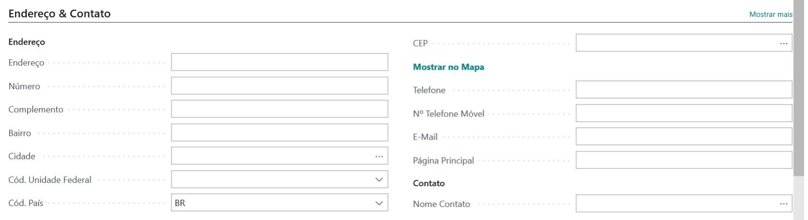

   > **Nota**: algumas prefeituras exigem também a UF do tomador. Nesse caso, preencha o **Cód. Unidade Federal**.

4. Na guia **Faturamento**, preencha o **Gr. Contábil Negócio** e o **Grupo Contábil Cliente**, obrigatórios para qualquer cliente.

   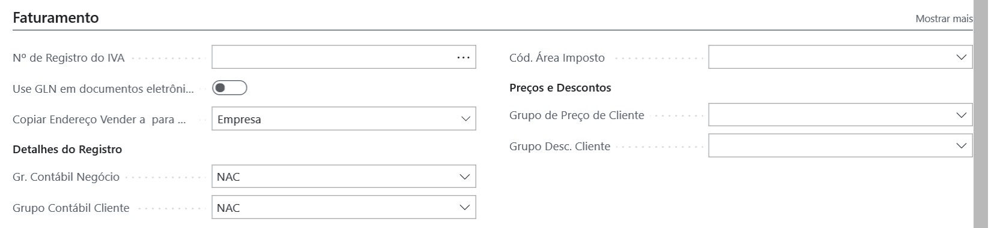

5. Na guia **Fiscal**, selecione **Não Identificado** no campo **Categoria** e ative **Não Contribuinte ICMS**.

   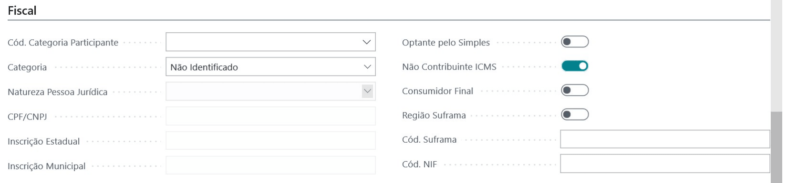

> **Nota**: escolher a **Categoria** não ativa o **Não Contribuinte ICMS** sozinho. Ative o campo manualmente ou use um **Cód. Categoria Participante** configurado com **Não Contribuinte ICMS**: ao informar o código, o sistema preenche a **Categoria** e o **Não Contribuinte ICMS** a partir dele.

---

## 3. Emitir a NFS-e

1. Pesquise por **Faturas de Venda** ou, no Centro de Funções, abra **Vendas** > **Faturas de Venda**, e clique em **Novo**.
2. Na guia **Geral**, selecione o cliente não identificado.

   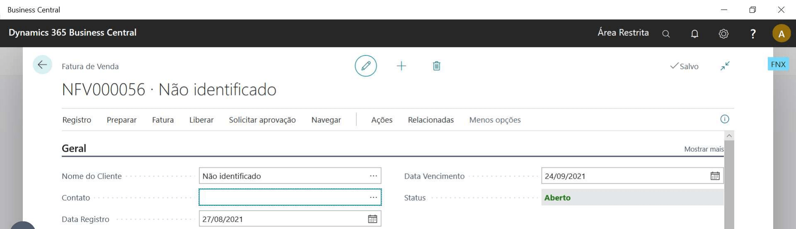

3. Na guia **Fiscal**, preencha os dados fiscais da prestação de serviço: **Cód. Filial**, **Cód. NOP**, **Cód. Matriz Impostos**, **Cód. Área Imposto**, **Tipo Documento Fiscal** de NFS-e e **Série**.

   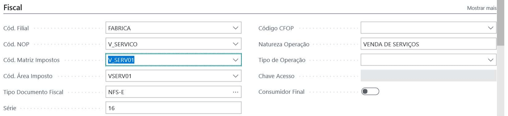

4. Nas **Linhas**, informe os serviços prestados.

   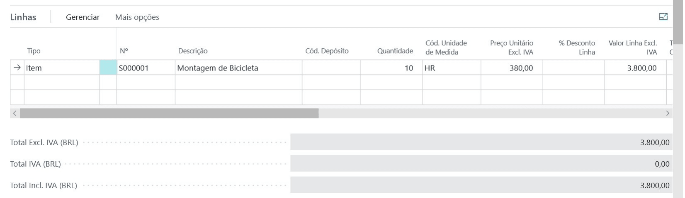

5. Na guia **NFS-e**, preencha a **Data Prestação Serviço**, o **Município Prestação Serviço** e o **Cód. Tributação NFS-e**.

   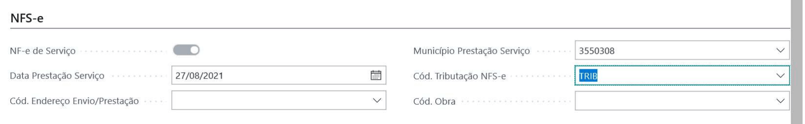

   > **Nota**: o registro de uma NFS-e exige o **Município Prestação Serviço** (exceto em exportação de serviço) e o **Cód. Tributação NFS-e**.

6. Registre a fatura.

---

## 4. Transmitir e imprimir o RPS

Depois do registro, a NFS-e é transmitida pela página **NFS-e - Envio de Lote**, como qualquer outra:

1. Pesquise por **NFS-e - Envio de Lote** e informe o **Cód. Filial**.
2. Para conferir o documento antes da transmissão, selecione-o e use **RPS** > **Imprimir**.

   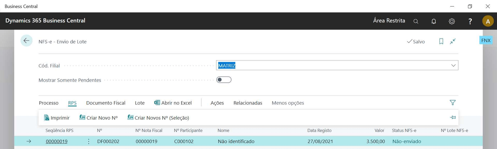

   O RPS sai sem CPF/CNPJ e sem endereço do tomador, só com o nome do cliente.

   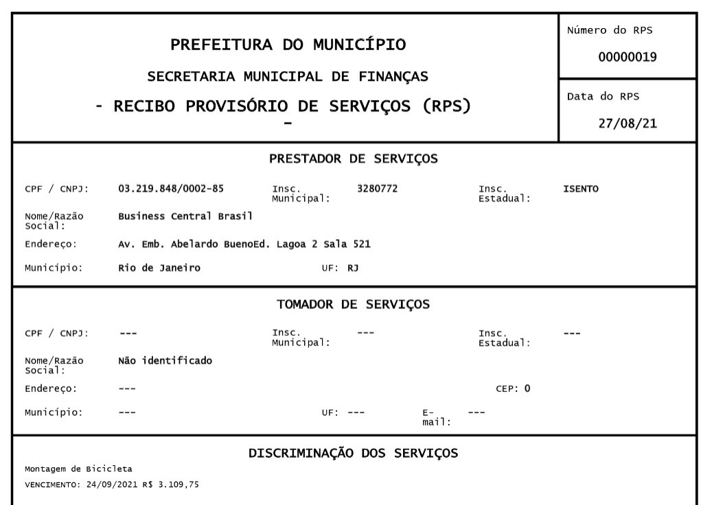

> **Nota**: quando a filial usa o layout padrão nacional, **Imprimir** gera a prévia no layout do DANFSe em vez do RPS. Com o provedor PlugNotas, a ação **Imprimir** não aparece.

Exemplo de NFS-e autorizada pela prefeitura para um tomador não identificado:

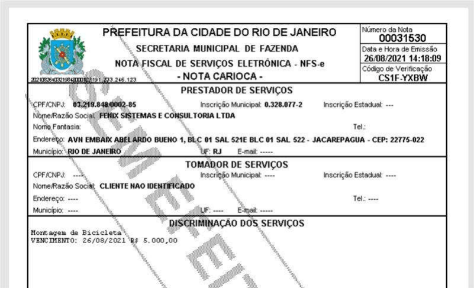
