# NFS-e: Documentos de Venda com Linhas do Tipo Recurso

**Data**: Março/2021

---

## Sumário

Um documento de venda de serviço pode ter linhas do tipo **Recurso**, como horas de um técnico. Na NFS-e, cada recurso é representado por um item fiscal: o **Tipo Trabalho** da linha indica qual item do tipo **Serviço** sai no documento fiscal, com o código de serviço e a tributação desse item.

## 1. Contexto

O recurso é a forma padrão do Business Central de registrar e faturar mão de obra e equipamentos. O documento fiscal, porém, precisa de um item com os dados fiscais do serviço. A ligação entre os dois é feita pelo campo **Nº Item Fiscal** do **Tipo Trabalho**:

1. O recurso tem um **Cód. Tipo Trabalho Padrão**.
2. O tipo de trabalho aponta para um **Nº Item Fiscal**, um item do tipo **Serviço** com o **Cód. Serviço** da NFS-e.
3. No registro da venda, a linha do recurso vira, no documento fiscal, uma linha desse item fiscal.

---

## 2. Configurar os recursos

### Numeração

1. Pesquise por **Configuração Recursos**.
2. Informe a numeração dos recursos no campo **Nº Série Recurso**.
3. Opcionalmente, ative **Copiar Descrições do Item Fiscal para Documentos**: ao informar o tipo de trabalho na linha de venda, a descrição da linha passa a ser a descrição do item fiscal, que é a que sai na NFS-e.

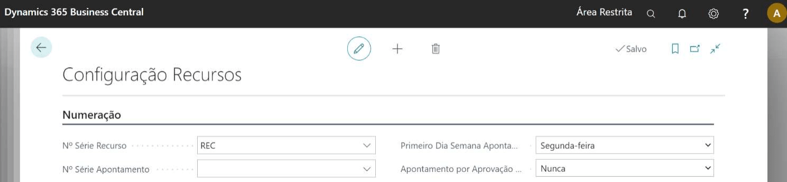

### Tipo de trabalho

1. Pesquise por **Tipos Trabalho**.
2. Para cada tipo de trabalho faturado em NFS-e, informe no campo **Nº Item Fiscal** o item de serviço que representa o recurso no documento fiscal.

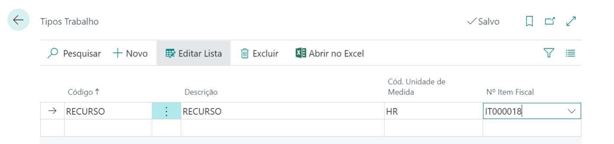

### Recurso

1. Pesquise por **Recursos** e crie o recurso com **Novo**.
2. Na seção **Geral**, preencha os dados do recurso, como **Nome**, **Tipo** e **Unidade de Medida Base**.

   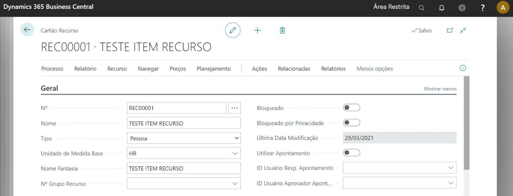

3. Na seção **Faturamento**, informe o **Gr. Contábil Produto** e o **Cód. Tipo Trabalho Padrão**.

   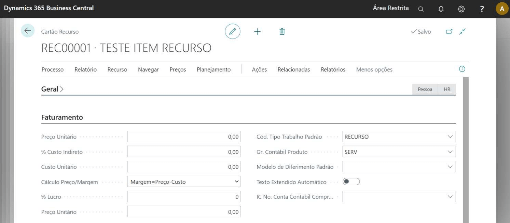

4. Na seção **Dados Pessoais**, informe o endereço do recurso, com **Número**, **Bairro** e **Cód. UF**.

   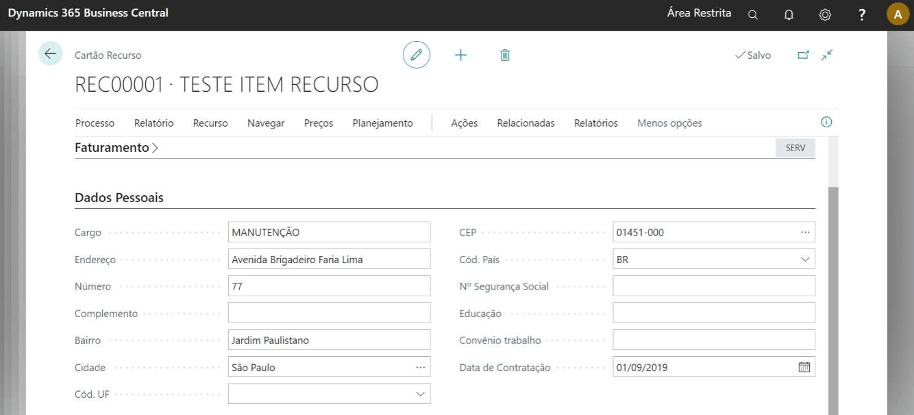

---

## 3. Emitir a NFS-e

1. Crie a fatura ou ordem de venda e informe o cliente.

   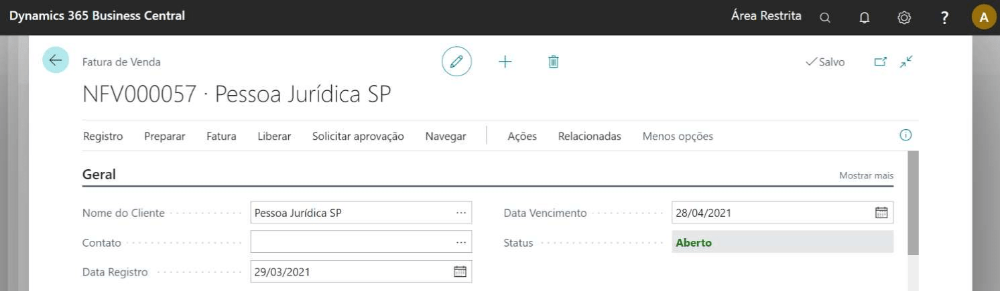

2. Na seção **Fiscal**, informe o **Cód. Área Imposto** e um **Tipo Documento Fiscal** de NFS-e.

   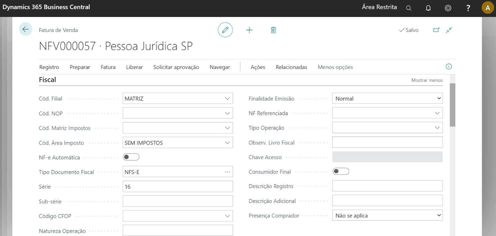

3. Nas **Linhas**, use o **Tipo** **Recurso** e selecione o recurso. O **Cód. Tipo Trabalho** da linha é preenchido com o **Cód. Tipo Trabalho Padrão** do recurso.

   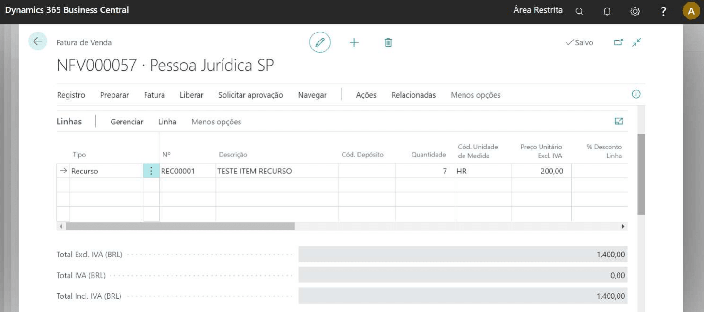

4. Na seção **NFS-e**, preencha os dados do serviço, como **Data Prestação Serviço**, **Município Prestação Serviço** e **Cód. Tributação NFS-e**.

   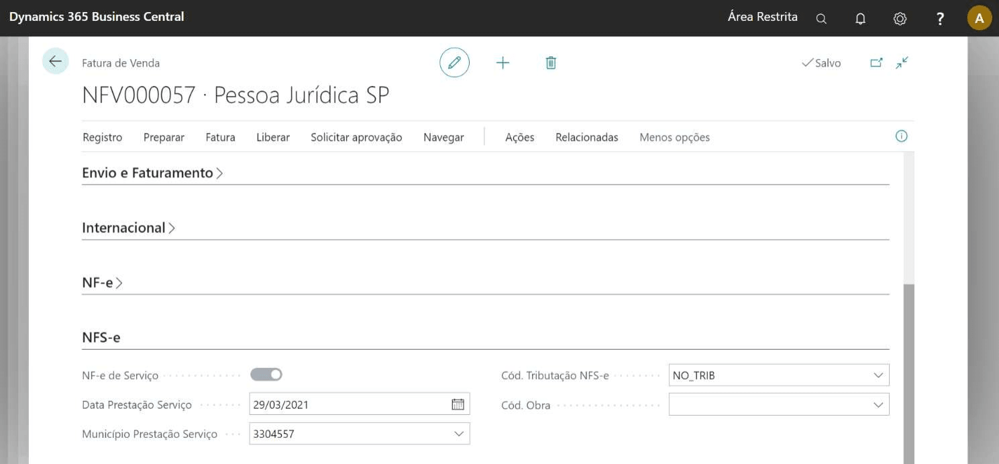

5. Confira as estatísticas e registre o documento.

> **Nota**: a seção **NFS-e** só aparece quando o **Tipo Documento Fiscal** é de NFS-e (campo **NF-e de Serviço** marcado).

> **Nota**: no registro, a linha do tipo **Recurso** precisa ter o **Cód. Tipo Trabalho** preenchido, e o tipo de trabalho precisa ter o **Nº Item Fiscal**. Sem eles, o registro é interrompido com a indicação do campo que falta.

---

## 4. Resultado

Na **Fatura Venda Registrada**, a linha continua sendo do tipo **Recurso**:

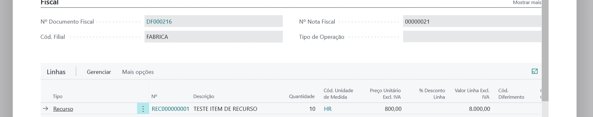

No **Documento Fiscal Registrado**, o **Nº Item** da linha é o **Nº Item Fiscal** do tipo de trabalho. A descrição é a da linha de venda:

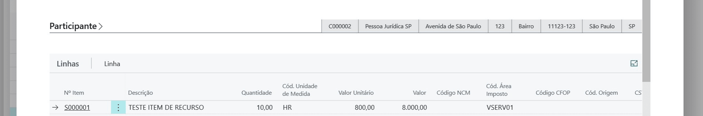

A NFS-e segue o fluxo normal de transmissão, por exemplo na página **NFS-e - Envio de Lote**, onde a ação **Documento Fiscal** > **Imprimir** mostra como a descrição do serviço sai no RPS:

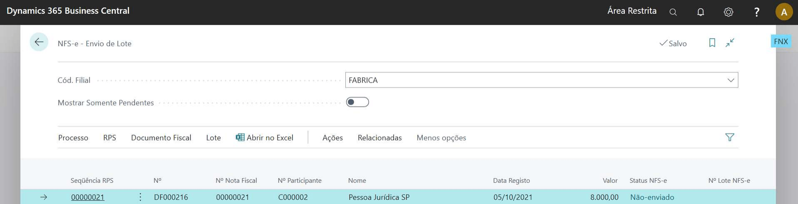

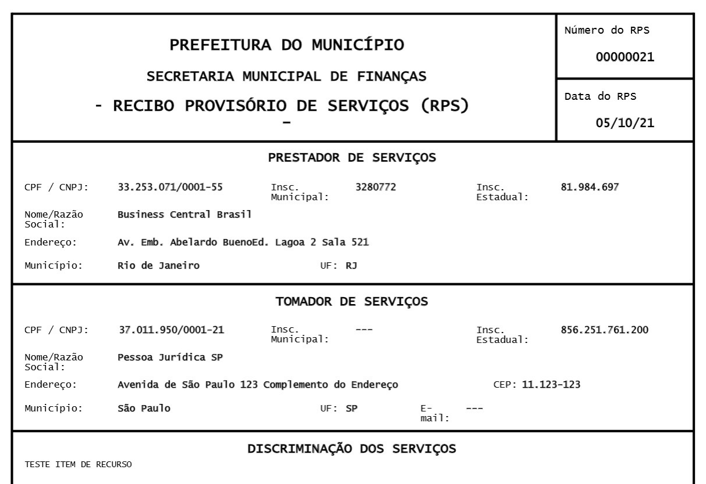
