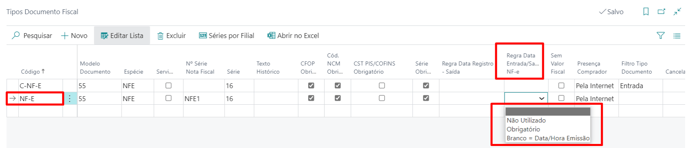
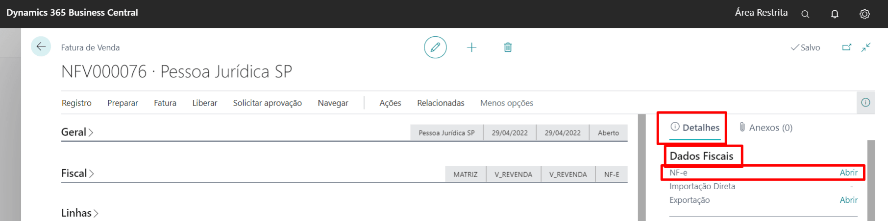
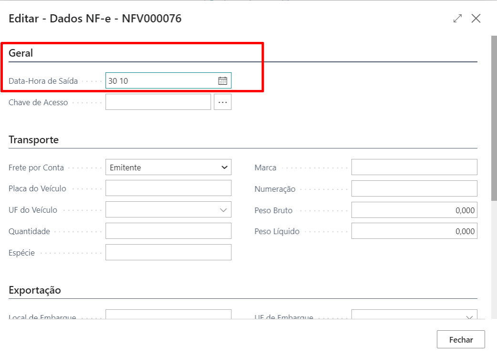
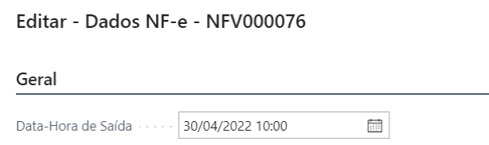
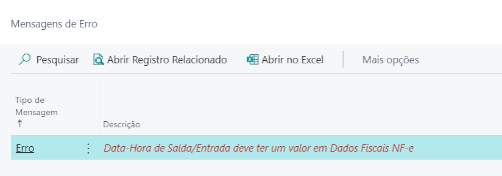
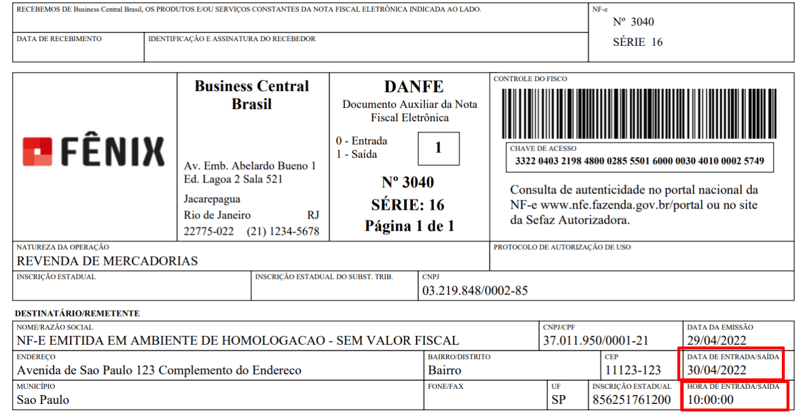
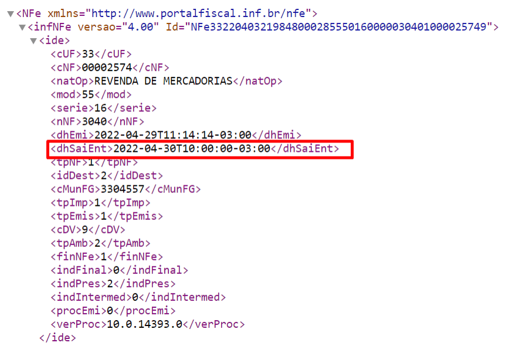

# NF-e: Data/Hora de Entrada/Saída

**Data**: Abril/2022

---

## Sumário

A data e a hora de saída ou de entrada da mercadoria vão para a tag `dhSaiEnt` do XML da NF-e e para o DANFE. O tipo de documento fiscal define como o sistema trata esse campo: livre, obrigatório, não usado ou preenchido com a data/hora de emissão quando ficar em branco.

## 1. Contexto

Aplica-se às NF-e de emissão própria, transmitidas pela empresa à SEFAZ. A regra é definida por tipo de documento fiscal, e a data/hora é informada em cada documento de venda ou de compra.

---

## 2. Configuração

1. Pesquise por **Tipos Documento Fiscal** ou, no Centro de Funções, abra **Configurações** > **Fiscal** > **Documentos** > **Tipos Documento Fiscal**.
2. Selecione o tipo de documento fiscal da NF-e e escolha a opção na coluna **Regra Data Entrada/Saída NF-e**.



| Opção | Comportamento |
|-------|---------------|
| (em branco) | Sem regra. O campo é opcional e a data/hora informada no documento é usada como está |
| **Não Utilizado** | A data/hora não é usada: o documento fiscal é registrado sem ela, mesmo que tenha sido informada no documento |
| **Obrigatório** | O documento só pode ser registrado com a data/hora preenchida |
| **Branco = Data/Hora Emissão** | Se o campo ficar em branco, o documento fiscal recebe a data/hora de emissão da nota |

> **Nota**: a coluna **Regra Data Entrada/Saída NF-e** não pode ser alterada em um tipo de documento fiscal marcado como cancelamento.

---

## 3. Informar a data/hora no documento

1. No documento de venda ou de compra, abra **Dados Fiscais** > **NF-e**. Na fatura, o painel **Detalhes** também tem o grupo **Dados Fiscais**, com o link **Abrir** ao lado de **NF-e**.

   

2. Na página **Dados NF-e**, seção **Geral**, preencha o campo **Data-Hora de Saída**.

   

   Para uma data do mês corrente, basta digitar o dia, um espaço e a hora. Por exemplo, `30 10` vira 30/04/2022 10:00 em abril de 2022:

   

> **Nota**: o nome do campo acompanha o sentido da nota. Em uma venda ele é **Data-Hora de Saída** e, em uma nota de crédito ou devolução de venda, **Data-Hora de Entrada**. Na compra é o contrário: **Data-Hora de Entrada** na fatura e **Data-Hora de Saída** na nota de crédito ou devolução.

### Campo obrigatório

Com a regra **Obrigatório**, registrar ou validar o documento sem a data/hora mostra o erro:



Preencha o campo na página **Dados NF-e** e registre de novo.

---

## 4. Conferir no DANFE e no XML

Depois do registro, a data e a hora aparecem no DANFE, nos campos **DATA DE ENTRADA/SAÍDA** e **HORA DE ENTRADA/SAÍDA**:



No XML da NF-e, elas saem na tag `dhSaiEnt` do grupo `ide`:

```xml
<ide>
  ...
  <dhEmi>2022-04-29T11:14:14-03:00</dhEmi>
  <dhSaiEnt>2022-04-30T10:00:00-03:00</dhSaiEnt>
  ...
</ide>
```



No documento fiscal registrado, o valor fica no campo **Data-Hora de Saída/Entrada**.
