# Compras: Importar Arquivo XML da NF-e

**Data**: Junho/2021

---

## Sumário

Além da digitação manual, a fatura de compra pode ser criada a partir do arquivo XML da NF-e enviado pelo fornecedor. A importação lê o XML, encontra o fornecedor pelo CNPJ ou CPF do emitente e os itens pelas referências de item, cria a fatura com as linhas, os impostos e os encargos da nota e, se configurado, abre a reconciliação com as ordens de compra.

## 1. Contexto

A importação do arquivo é o caminho para uma nota recebida como arquivo, por e-mail por exemplo. Quando a empresa usa a MD-e, as notas emitidas contra o CNPJ chegam direto da SEFAZ e o documento de compra é criado na própria MD-e (veja [MD-e: Manifestação do Destinatário](Localization-for-Brazil_User-Manual_MDe.md)). Um XML recebido fora da SEFAZ também pode entrar na MD-e pela ação **Importar XML Manualmente** da página **Manifestações de Destinatário NF-e**.

O arquivo precisa ser o XML autorizado da NF-e, com o protocolo de autorização da SEFAZ (grupo `nfeProc`), e ter a empresa ou uma de suas filiais como destinatária.

---

## 2. Configuração

Pesquise por **Conf. Importação NF-e** ou, no Centro de Funções, abra **Configurações** > **Fiscal** > **NF-e / NFS-e** > **Conf. Importação NF-e**.

### Guia Geral

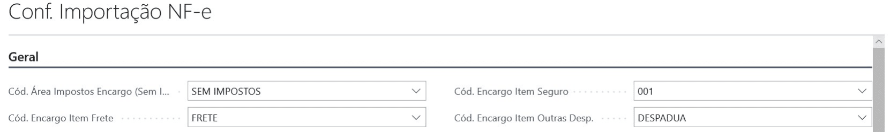

| Campo | Descrição |
|-------|-----------|
| **Cód. Área Impostos Encargo (Sem Impostos)** | Área de impostos genérica, sem impostos, usada nas linhas de encargo |
| **Cód. Encargo Item Frete** | Encargo de item usado para o frete da nota |
| **Cód. Encargo Item Seguro** | Encargo de item usado para o seguro da nota |
| **Cód. Encargo Item Outras Desp.** | Encargo de item usado para as outras despesas da nota |
| **Cód. Encargo Item AFRMM** | Encargo de item usado para o AFRMM nas notas de importação |

Crie os encargos de item e associe-os aos campos. Eles são usados nas notas com frete, seguro e outras despesas, e nas notas de importação.

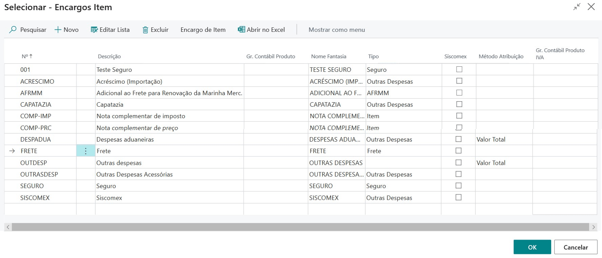

> **Nota**: os campos **Cód. Área Impostos Encargo (Sem Impostos)**, **Cód. Encargo Item Frete**, **Cód. Encargo Item Seguro** e **Cód. Encargo Item Outras Desp.** são obrigatórios. Com qualquer um deles em branco, a importação para com erro, mesmo que a nota não tenha frete, seguro ou outras despesas.

### Guia XML

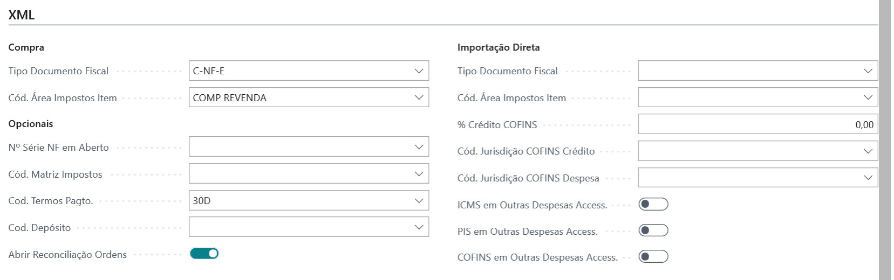

Use uma configuração padrão e, depois de importar o XML, ajuste a fatura conforme a operação.

| Grupo | Campo | Descrição |
|-------|-------|-----------|
| **Compra** | **Tipo Documento Fiscal** | Tipo de documento fiscal da fatura criada |
| **Compra** | **Cód. Área Impostos Item** | Área de impostos aplicada a cada linha. Em branco, vale a área que o sistema define para a linha |
| **Compra** | **Priorizar NCM XML** | Ligado, a linha recebe o NCM do XML. Desligado, recebe o NCM do cadastro do item, quando ele tem um |
| **Opcionais** | **Nº Série NF em Aberto** | Série de numeração da fatura criada. Em branco, vale a série padrão de faturas de compra |
| **Opcionais** | **Cód. Matriz Impostos** | Matriz de impostos de compra informada na fatura |
| **Opcionais** | **Ignorar Impostos do XML** | Ligado, os impostos são calculados pela configuração da fatura. Desligado, os valores e as alíquotas dos impostos do XML vão para as estatísticas da fatura, como se tivessem sido informados manualmente |
| **Opcionais** | **Cod. Termos Pagto.** | Termos de pagamento informados na fatura |
| **Opcionais** | **Importar Parcelas do XML** | Cria as parcelas da fatura com os vencimentos e os valores do XML (veja [NF-e: Parcelas do XML e Tipo de Pagamento](Localization-for-Brazil_User-Manual_NFe-Parcelas-XML-PaymentType.md)) |
| **Opcionais** | **Cod. Depósito** | Depósito das linhas de item de estoque, quando o fornecedor não tem depósito no cadastro |
| **Opcionais** | **Cód. Depósito Devolução** | Depósito das linhas na devolução de venda criada a partir de um XML |
| **Opcionais** | **Abrir Reconciliação Ordens** | Depois de criar a fatura, abre a página **Reconciliar Nota Fiscal com Ordem de Compras** |

O grupo **Importação Direta** é usado na importação de mercadorias do exterior (veja [Declaração de Importação (DI/DUIMP)](Localization-for-Brazil_User-Manual_Declaracao-de-Importacao-DI-DUIMP.md)).

---

## 3. Cadastros necessários

A importação não cria cadastros. Antes de importar, garanta que:

- **o fornecedor está cadastrado** com o CNPJ ou CPF do emitente no campo **CPF/CNPJ**. Para cadastrar um fornecedor novo, use a ação **Consultar CNPJ** do cartão do fornecedor;
- **cada produto da nota tem uma referência de item** do tipo fornecedor, para esse fornecedor, com o código do produto do fornecedor como número de referência, o item e a unidade de medida da empresa e a unidade de medida da nota no campo **Unidade Medida NF-e Fornecedor**.

Na MD-e, o fornecedor, os itens e as referências podem ser criados a partir da própria nota (veja a seção 9 de [MD-e: Manifestação do Destinatário](Localization-for-Brazil_User-Manual_MDe.md)).

---

## 4. Importar o arquivo

1. Pesquise por **Faturas de Compra**.
2. Clique em **Ações** > **NF-e** > **Importar Arquivo XML da NF-e**.

   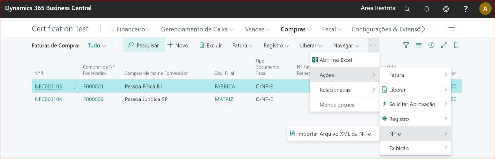

3. Clique em **Escolher...** e selecione o arquivo XML.

   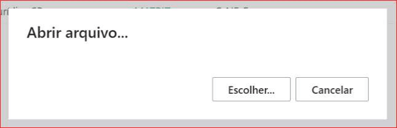

### Mensagens na importação

A importação para com erro, sem criar a fatura, quando falta um cadastro:

- **Fornecedor não cadastrado**: a mensagem informa que não há fornecedor com o CPF/CNPJ do emitente. Cadastre o fornecedor e importe de novo.

  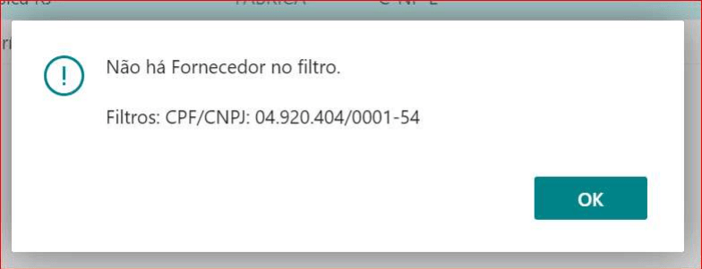

- **Referência de item não cadastrada**: a mensagem informa que não há referência de item com o fornecedor, o código do produto e a unidade de medida da nota. Cadastre a referência e importe de novo.
- **Nota de outro destinatário**: a mensagem *Nota fiscal emitida contra o CNPJ …* indica que o destinatário da nota não é a empresa.

---

## 5. Reconciliar com as ordens de compra

Com a opção **Abrir Reconciliação Ordens** ligada, depois de criar a fatura o sistema abre a página **Reconciliar Nota Fiscal com Ordem de Compras**. A parte de cima traz as linhas da fatura e a parte **Ordens Liberados**, as ordens de compra liberadas do fornecedor para o item da linha selecionada.

1. Clique em **Sugerir Aplicações** para aplicar as linhas da fatura às ordens liberadas, ou em **Remover Aplicações** para desfazer.

   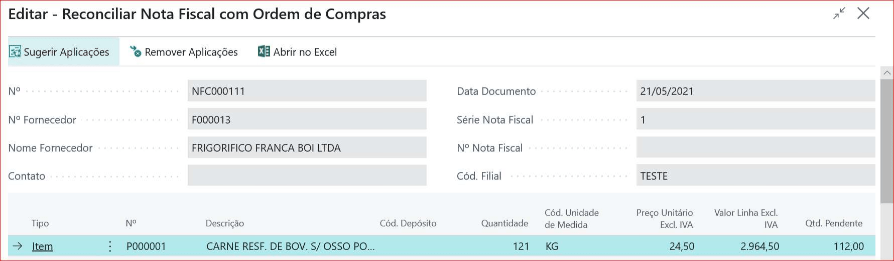

   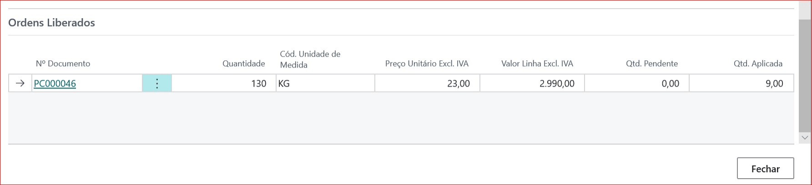

2. Clique em **Fechar**. Se não houver ordem para aplicar, apenas feche a página.

A fatura de compra criada abre em seguida:

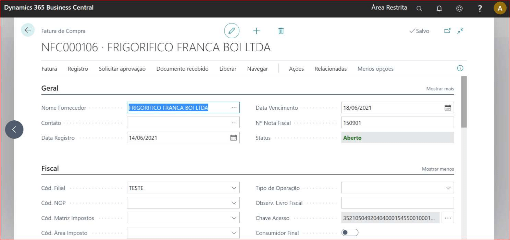

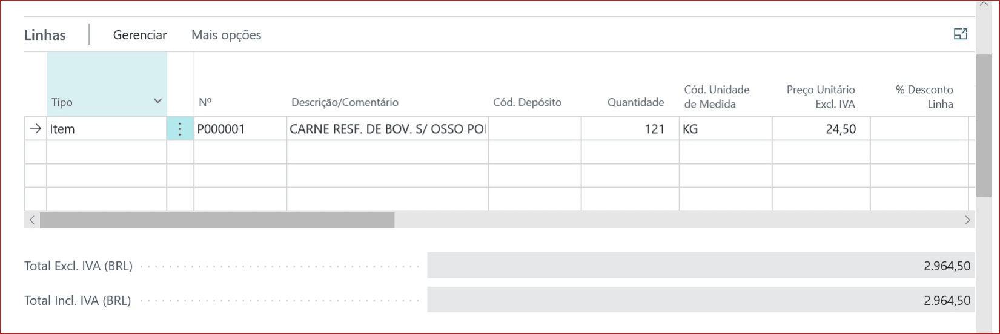

Com a opção desligada, a fatura abre direto, sem a reconciliação.

Para ajustar a reconciliação depois, abra a fatura e clique em **Ações** > **Funções** > **Reconciliar com Ordens...**:

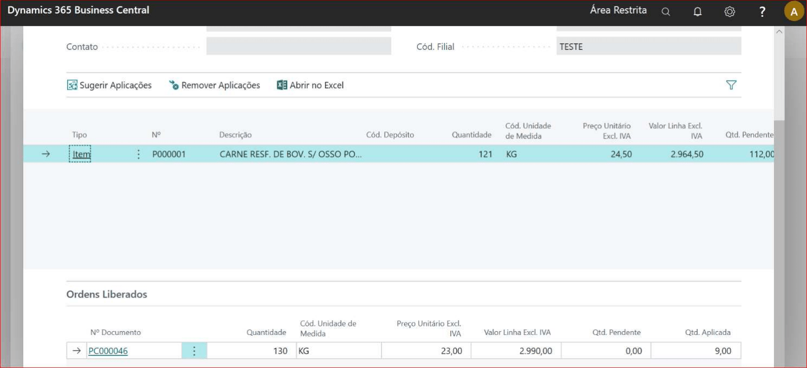

Confira a fatura e registre-a normalmente.
