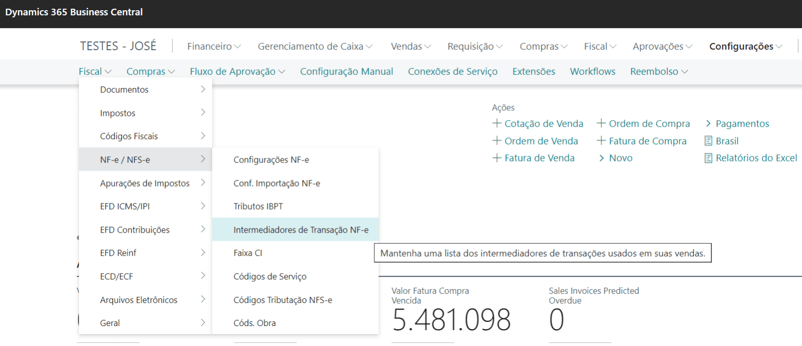
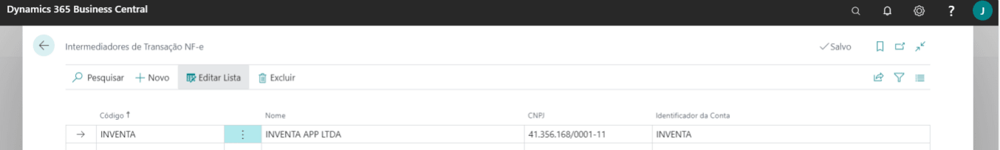
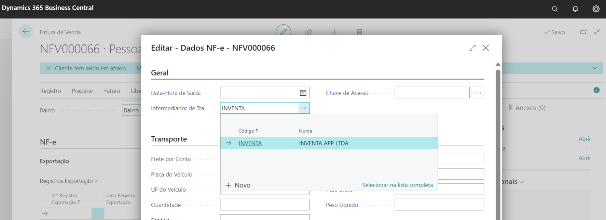
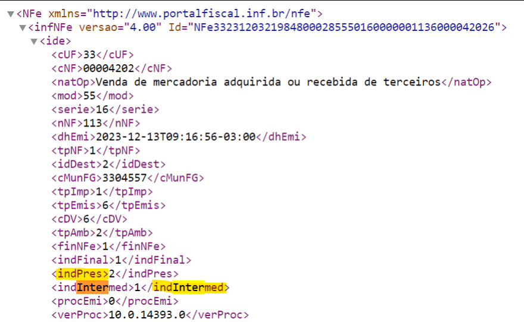
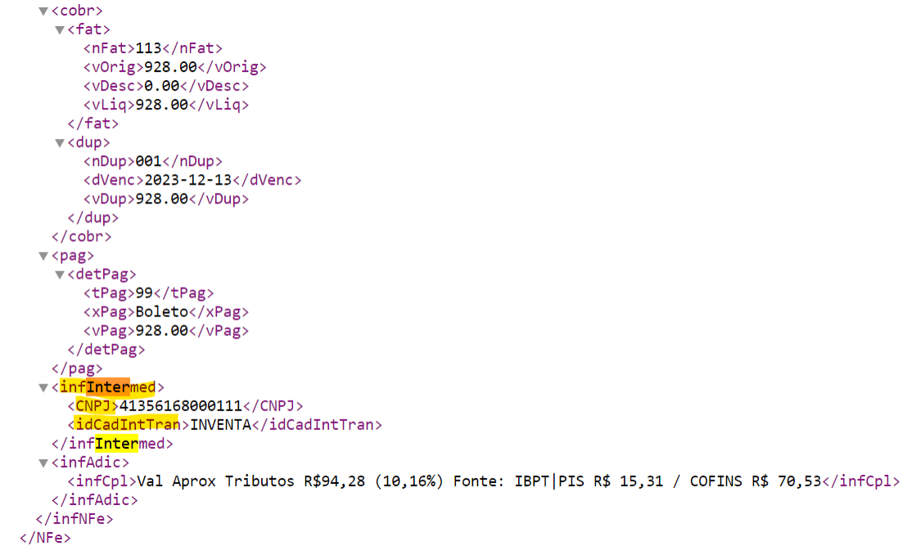

# NF-e: Intermediador de Transação

**Data**: Dezembro/2023

---

## Sumário

A NF-e identifica o intermediador ou marketplace por onde a venda foi feita quando a operação não é presencial. A localização mantém um cadastro de **Intermediadores de Transação NF-e** e permite indicar, em cada documento de venda, qual intermediador participou da operação. Os dados do intermediador saem no XML da NF-e no grupo `infIntermed`.

## 1. Contexto

### O que é

O campo intermediador da operação foi criado pela SEFAZ para identificar as notas emitidas em vendas feitas por meio de um intermediador ou marketplace, como plataformas de comércio eletrônico e prestadores que fazem a transação comercial em nome do vendedor.

### Quando se aplica

O intermediador é informado quando a venda passa por uma plataforma ou marketplace que faz a transação em nome do vendedor. O campo fica disponível quando o indicador de presença do comprador (`indPres`) for:

- **2**: operação não presencial, pela internet;
- **3**: operação não presencial, teleatendimento;
- **4**: NFC-e em operação com entrega a domicílio;
- **9**: operação não presencial, outros.

Uma venda não presencial sem intermediador, como a feita no site próprio do vendedor, deixa o campo em branco: a nota sai sem os dados de intermediador.

---

## 2. Cadastrar os Intermediadores

1. Pesquise por **Intermediadores de Transação NF-e** ou, no Centro de Funções, abra **Configurações** > **Fiscal** > **NF-e / NFS-e** > **Intermediadores de Transação NF-e**.

   

2. Cadastre cada intermediador com os campos abaixo:

| Campo | Descrição |
|-------|-----------|
| **Código** | Código de livre escolha que identifica o intermediador nos documentos |
| **Nome** | Nome completo do intermediador, como consta no cartão CNPJ |
| **CNPJ** | CNPJ do intermediador, enviado na tag `CNPJ` do grupo `infIntermed` |
| **Identificador da Conta** | Identificador cadastrado do vendedor junto ao intermediador, enviado na tag `idCadIntTran`. Confira com o intermediador se há um código específico |



---

## 3. Indicar o Intermediador no Documento de Venda

1. Na ordem ou fatura de venda, abra **Dados Fiscais** > **NF-e**.
2. Na página **Dados NF-e**, seção **Geral**, selecione o intermediador no campo **Intermediador de Transação**.



> **Nota**: o campo **Intermediador de Transação** só aparece quando a **Presença Comprador** do documento indica uma operação não presencial, como **Pela Internet**, **Por Telefone** ou **Não presencial - Outros**. Em operações presenciais ele fica oculto.

O documento fiscal gerado no registro leva o intermediador escolhido, e ele também pode ser conferido na página do documento fiscal.

---

## 4. Tags no XML da NF-e

Com um intermediador informado, o XML da NF-e leva:

| Tag | Conteúdo |
|-----|----------|
| `indPres` | Indicador de presença do comprador, por exemplo `2` para operação pela internet |
| `indIntermed` | `1` quando a operação tem intermediador |
| `infIntermed` / `CNPJ` | CNPJ do intermediador cadastrado |
| `infIntermed` / `idCadIntTran` | **Identificador da Conta** do intermediador cadastrado |

```xml
<ide>
  ...
  <indPres>2</indPres>
  <indIntermed>1</indIntermed>
  ...
</ide>
...
<infIntermed>
  <CNPJ>41356168000111</CNPJ>
  <idCadIntTran>INVENTA</idCadIntTran>
</infIntermed>
```

Exemplo de XML de uma NF-e com intermediador:




