# NF-e: Números de Série no DANFe

**Data**: Março/2021

---

## Sumário

Assim como os números de lote, os números de série dos itens vendidos podem sair na NF-e, nas informações adicionais do produto (tag `infAdProd`), que o DANFe imprime abaixo da descrição do item. A opção é ligada por filial, na configuração da NF-e.

## 1. Contexto

Os números de série vêm da rastreabilidade de itens do Business Central: o item precisa de um código de rastreabilidade que controle número de série, e os números são informados na entrada e escolhidos na saída. Na emissão da NF-e, os números da linha são reunidos no texto `Série: <nº>, <nº>, ...`.

Para os números de lote, a data de fabricação e a data de validade, veja [NF-e: Data de Fabricação no DANFe](Localization-for-Brazil_User-Manual_NFe-Data-Fabricacao-DANFe.md).

---

## 2. Configurar a NF-e

1. Pesquise por **Config. NF-e** e abra a configuração da filial.
2. Na seção **DANFe**, ative **Mostrar Nº Série**.

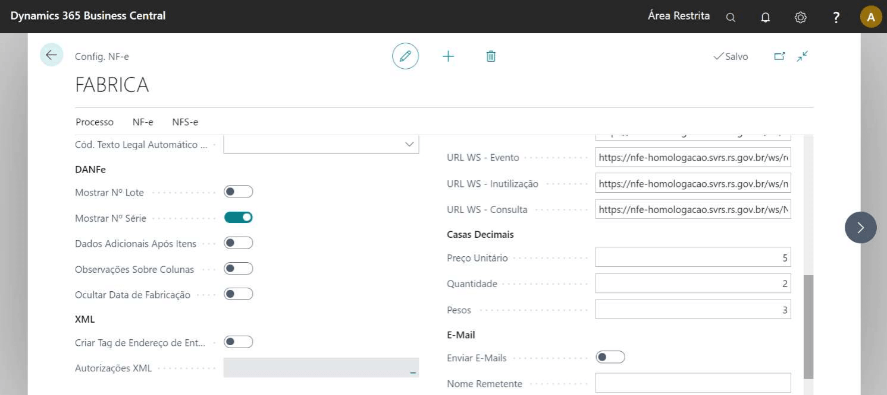

> **Nota**: quando **Mostrar Nº Lote** também está ativo e o item tem lote, os números de série saem junto com o lote a que pertencem, no texto do lote. Quando não há informação de lote a imprimir, saem só os números de série.

---

## 3. Configurar o item

No **Cartão Item**, seção **Rastreabilidade Item**, informe:

| Campo | Descrição |
|-------|-----------|
| **Cód. Rastreabilidade Item** | Código de rastreabilidade que controla número de série |
| **Nº Série** | Série numérica usada para gerar os números de série. Deixe em branco para informar os números manualmente |
| **Nº Série Lote** | Série numérica dos lotes, quando o item também é controlado por lote |

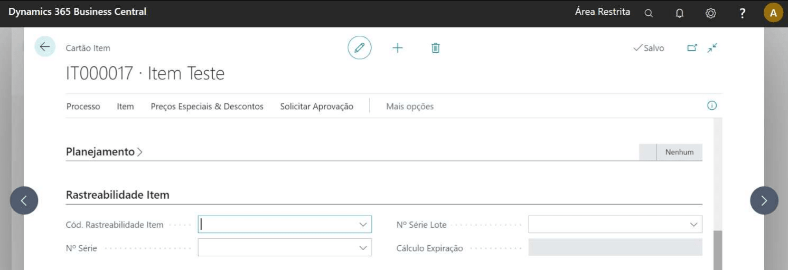

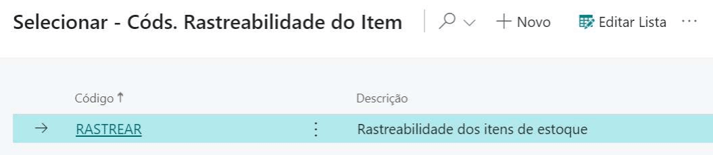

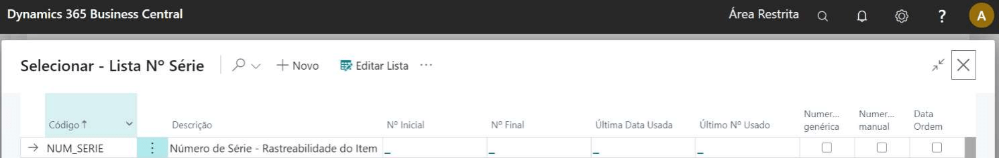

---

## 4. Entrada dos números de série

A entrada do item pode ser feita, por exemplo, por uma fatura de compra.

1. Crie a fatura de compra e informe o item, a quantidade e o preço nas **Linhas**.

   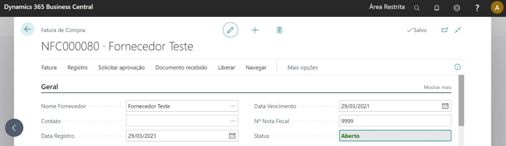

2. Na linha, abra **Linha** > **Informação Relacionada** > **Linhas Rastreabilidade Item**.

   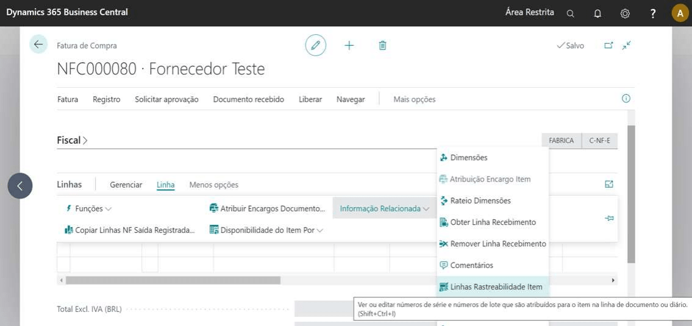

3. Informe um número de série para cada unidade.

   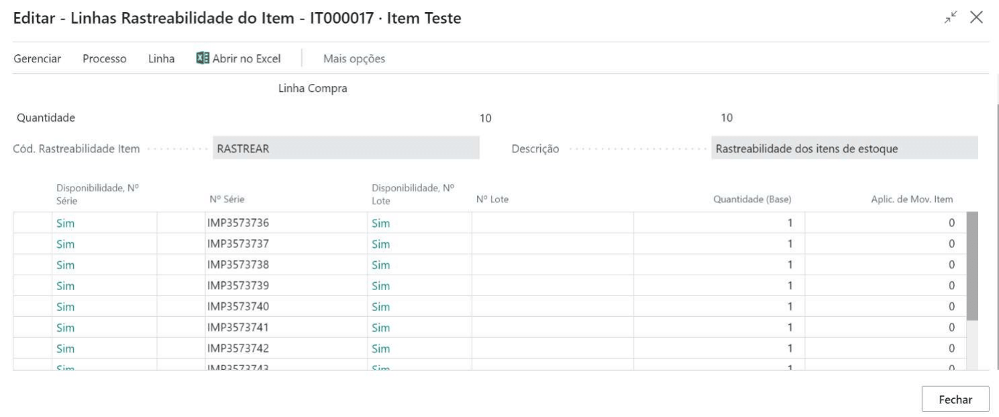

4. Registre a fatura. Os movimentos de item ficam com o **Nº Série** de cada unidade.

   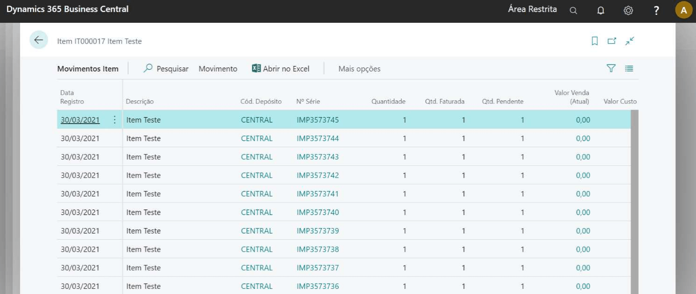

---

## 5. Venda com números de série no DANFe

1. Crie a fatura ou ordem de venda com o item.
2. Na linha, abra **Linha** > **Informação Relacionada** > **Linhas Rastreabilidade Item**.

   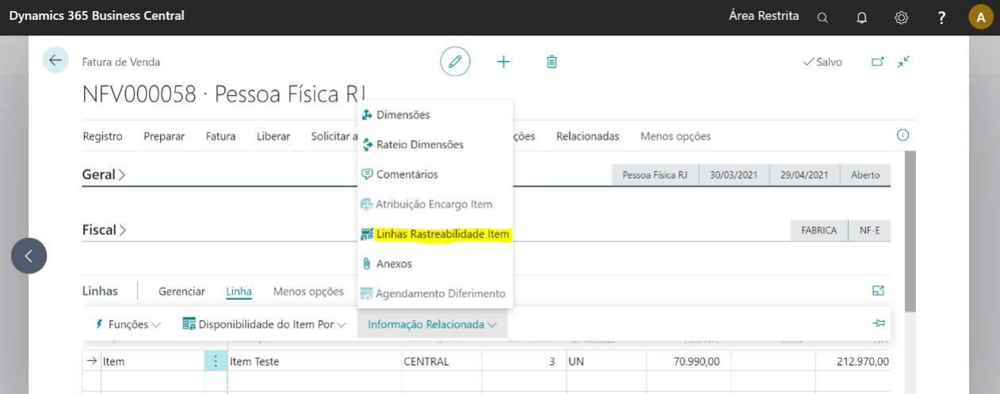

3. Clique em **Selecionar Lançamentos**.

   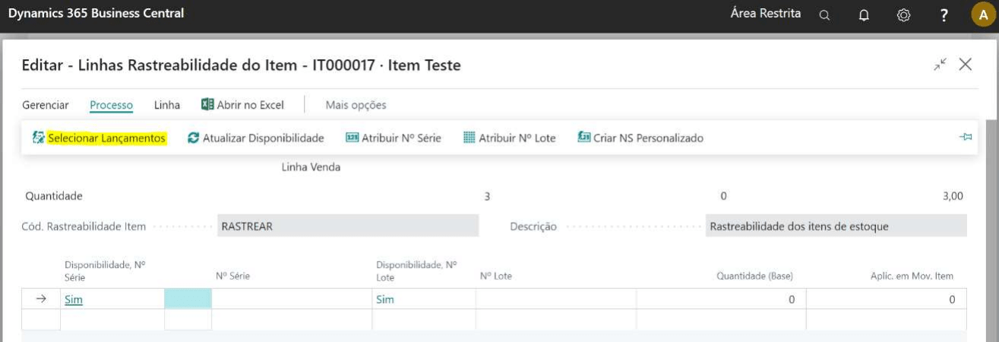

4. Selecione os números de série vendidos, clique em **OK** e feche a página.

   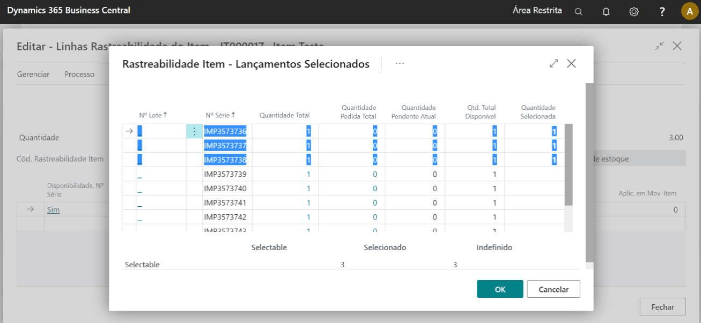

5. Para conferir antes de registrar, use **Fiscal** > **NF-e** > **Validar NF-e** e, sem erros de validação, **Visualizar DANFe (Teste)**.

   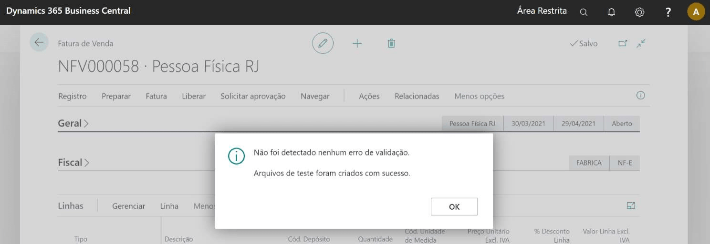

No DANFe, os números de série aparecem abaixo da descrição do item:

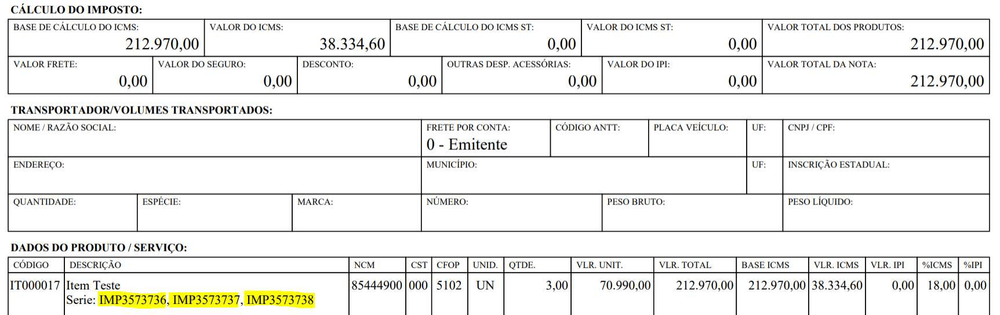
