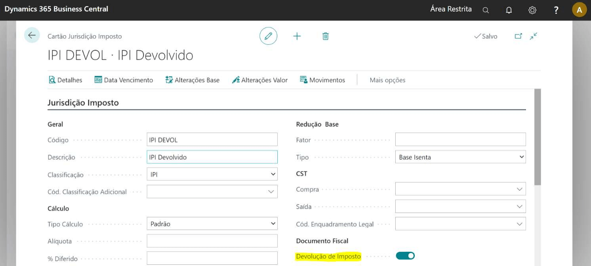
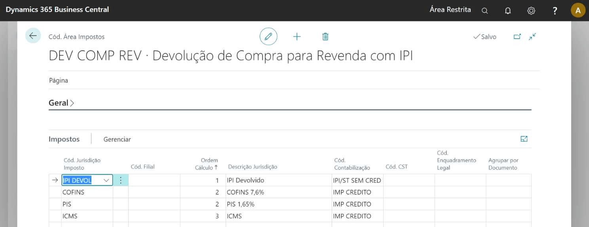
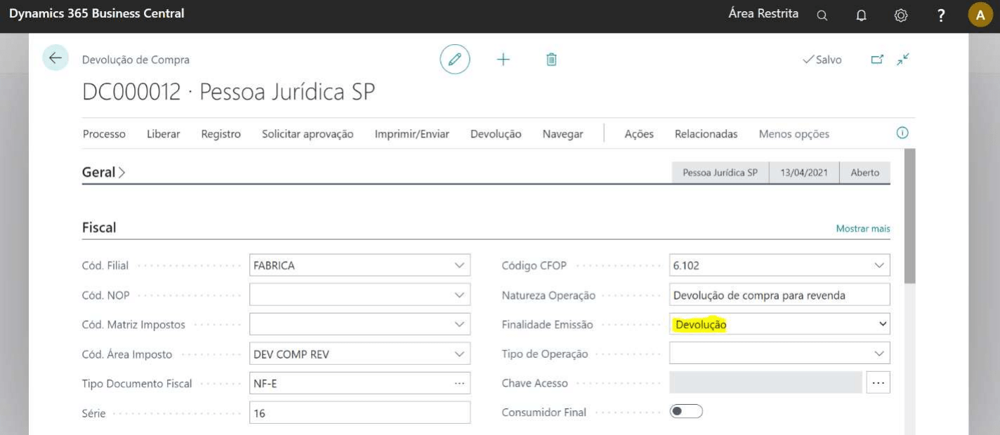
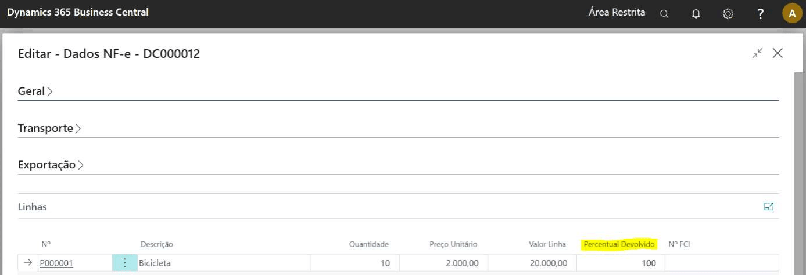
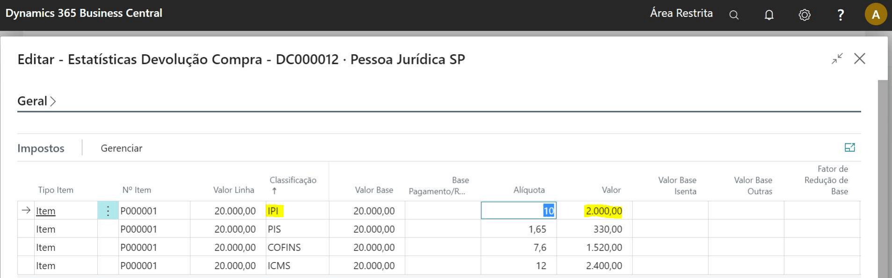
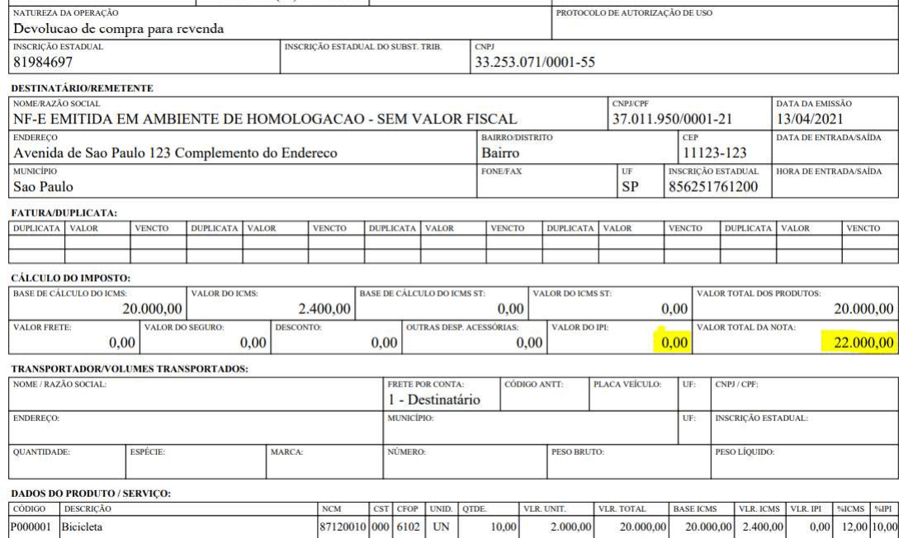
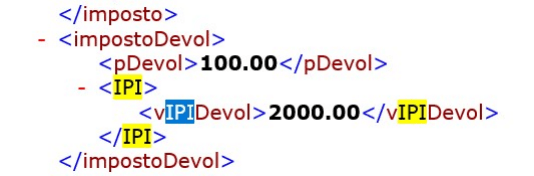

# NF-e: Tags pDevol e vIPIDevol na Devolução de Compra

**Data**: Abril/2021

---

## Sumário

Na NF-e de devolução de compra, o grupo `impostoDevol` de cada item informa o percentual da mercadoria devolvida (`pDevol`) e o valor do IPI devolvido (`vIPIDevol`). É o caso típico da devolução, por quem não é contribuinte do IPI, de mercadoria comprada com IPI. O percentual é informado por linha nos dados da NF-e, e o IPI devolvido vem de uma jurisdição de IPI marcada como devolução de imposto.

## 1. Contexto

| Tag | Origem no Business Central |
|-----|----------------------------|
| `impostoDevol` / `pDevol` | Campo **Percentual Devolvido** da linha, em **Dados NF-e**. A tag só é gerada quando o percentual é maior que zero |
| `impostoDevol` / `IPI` / `vIPIDevol` | Soma do IPI da linha calculado por jurisdições com **Devolução de Imposto** ativado. A tag só é gerada quando esse valor não é zero |

---

## 2. Configurar a jurisdição do IPI devolvido

1. Pesquise por **Jurisdições Impostos** ou, no Centro de Funções, abra **Configurações** > **Fiscal** > **Impostos** > **Jurisdições Impostos**.
2. Crie uma jurisdição específica para o IPI devolvido, com **Classificação** **IPI**.
3. Na seção **Documento Fiscal**, ative **Devolução de Imposto**.



---

## 3. Configurar a área de imposto da devolução

1. Pesquise por **Áreas de Impostos** ou abra **Configurações** > **Fiscal** > **Impostos** > **Áreas de Impostos**.
2. Crie uma área de imposto para a devolução e inclua a jurisdição do IPI devolvido junto com os demais impostos da operação.



---

## 4. Emitir a devolução

1. Crie a **Devolução de Compra** (ou a **Nota Crédito Compra**) com a área de imposto da devolução e, na seção **Fiscal**, a **Finalidade Emissão** **Devolução**.

   

2. Abra **Dados Fiscais** > **NF-e** e, nas **Linhas** da página **Dados NF-e**, informe o **Percentual Devolvido** de cada item.

   

3. Confira nas **Estatísticas** o IPI calculado pela jurisdição de IPI devolvido.

   

> **Nota**: a coluna **Percentual Devolvido** só aparece na página **Dados NF-e** quando a **Finalidade Emissão** do documento é **Devolução**.

---

## 5. Resultado na NF-e

O IPI devolvido entra no valor total da nota. No exemplo, o DANFe mostra o valor do IPI zerado e o total da nota com o IPI devolvido:



No XML, cada item leva o grupo `impostoDevol`:

```xml
<impostoDevol>
  <pDevol>100.00</pDevol>
  <IPI>
    <vIPIDevol>2000.00</vIPIDevol>
  </IPI>
</impostoDevol>
```


