# Nota de Crédito: Espelhamento dos Impostos do Documento Original

**Data**: Junho/2021

---

## Sumário

Uma nota de crédito que cancela uma fatura registrada repete os impostos do documento fiscal original, linha a linha. O cancelamento desfaz exatamente o que a fatura lançou, mesmo que a área de imposto, as alíquotas ou outra configuração tenham mudado depois. Devoluções, que são uma nova operação, continuam com os impostos calculados pela configuração do documento.

## 1. Contexto

### Quando os impostos são espelhados

O espelhamento acontece em uma nota de crédito de compra ou de venda que:

- usa um **Tipo Documento Fiscal** de cancelamento (com **Cancelamento** marcado na página **Tipos Documento Fiscal**);
- está aplicada à fatura registrada, pelos campos **Aplicado por Tipo Doc.** e **Aplicado-em Nº Doc.**;
- tem as linhas copiadas da fatura, pela ação **Copiar Documento** da nota de crédito ou pelas ações **Corrigir** > **Cancelar** e **Corrigir** > **Criar Nota de Crédito Corretiva** da fatura registrada. A cópia guarda em cada linha o vínculo com a linha do documento fiscal original.

Com essas condições, a nota de crédito mostra a notificação de que o documento fiscal original será cancelado por ela.

### O que é conferido

Para cada linha com a mesma quantidade da linha original, os impostos são copiados do documento fiscal original. O tipo e o número do item, o valor e o desconto precisam ser os mesmos do original. Uma diferença interrompe o cálculo com a mensagem:

```
Há uma diferença no documento de cancelamento.
Campo: <campo>
Valor a ser cancelado: <valor original>
Valor de cancelamento: <valor da nota de crédito>
```

O participante do documento também precisa ser o mesmo do original.

> **Nota**: uma linha com quantidade diferente da original não é espelhada: os impostos dessa linha são calculados pela configuração atual do documento, como em uma nota de crédito comum.

---

## 2. Exemplo: nota de crédito de compra

1. A fatura de compra foi registrada com a área de imposto da época, com IPI, ICMS, PIS e COFINS.

   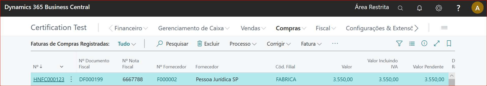

   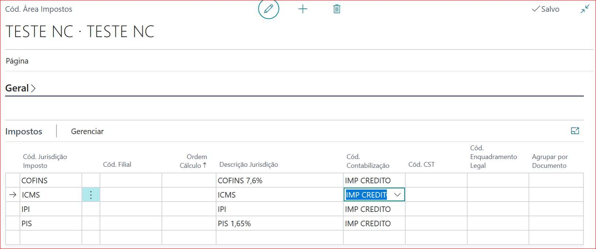

   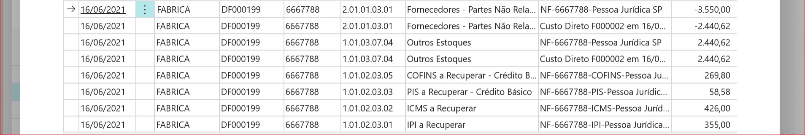

2. A nota de crédito de cancelamento, com as linhas copiadas da fatura, mostra nas **Estatísticas** os mesmos impostos da fatura.

   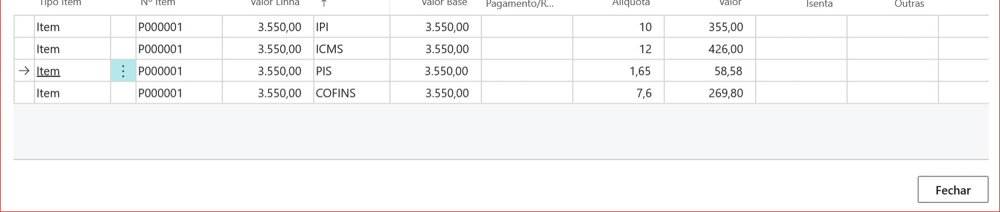

3. A contabilização é o inverso da entrada.

   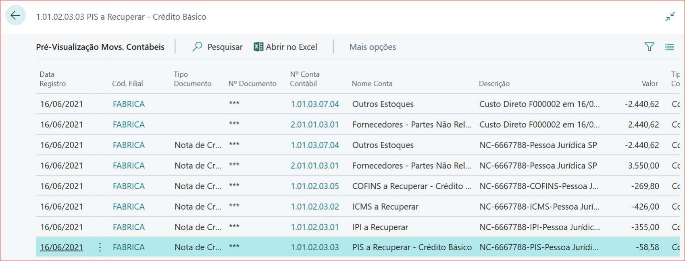

4. Mesmo que a área de imposto seja alterada depois do registro da fatura, por exemplo trocando a jurisdição da COFINS, a nova nota de crédito continua com os impostos da fatura original.

   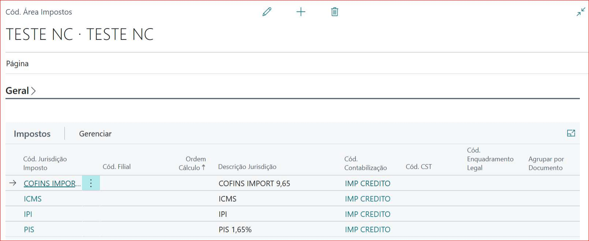

   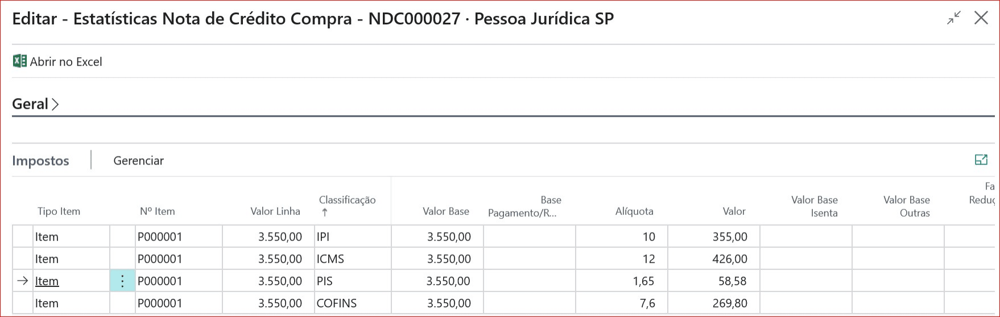

---

## 3. Alterar os impostos nas estatísticas

Ao alterar um imposto nas **Estatísticas** de um documento de cancelamento, o sistema pede confirmação: *Tem certeza de que deseja modificar os impostos deste Documento de Cancelamento?*. Os valores alterados ficam em vermelho.

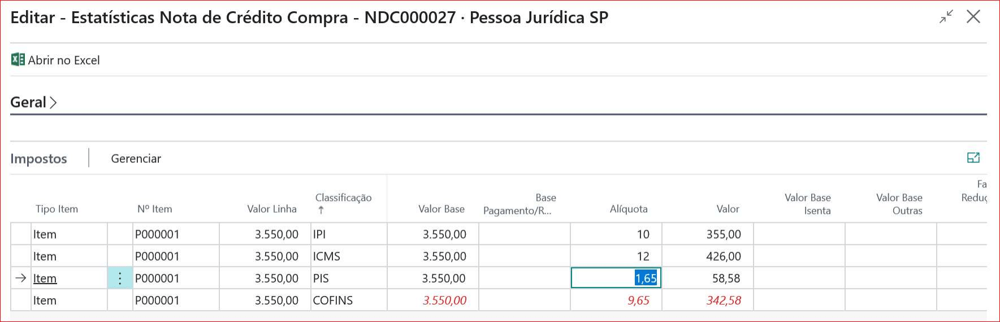

O resultado depende do tipo de documento:

| Documento | O que acontece com a alteração |
|-----------|--------------------------------|
| **Nota de crédito de compra** | A alteração é mantida e a linha deixa de ser espelhada: valem os impostos modificados. É o que permite, por exemplo, estornar notas de importação com impostos modificados, como em [DI: Cópia de Documentos de Compra com Impostos Modificados](Localization-for-Brazil_User-Manual_DI-Copia-Documentos-Impostos-Modificados.md) |
| **Nota de crédito de venda** | O espelhamento prevalece. Ao fechar e reabrir as **Estatísticas**, os impostos voltam a ser os do documento original |

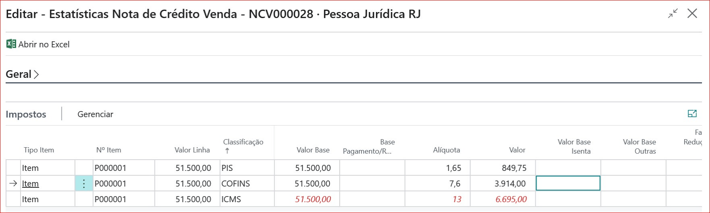

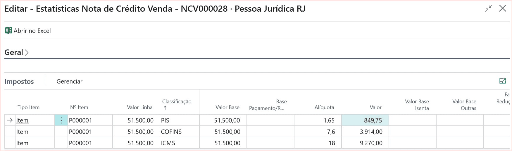

---

## 4. Devoluções

As devoluções de compra e de venda não são cancelamentos: são operações novas, de saída ou de entrada. Nelas, a área de imposto e os demais dados fiscais podem ser alterados, e os impostos são calculados pela configuração do documento.

Quando as linhas são copiadas do documento original com o vínculo ao movimento de item, o Business Central não deixa devolver uma quantidade maior que a do documento de origem:

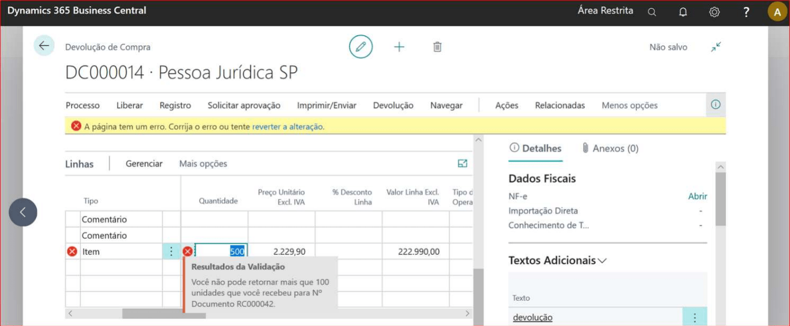
