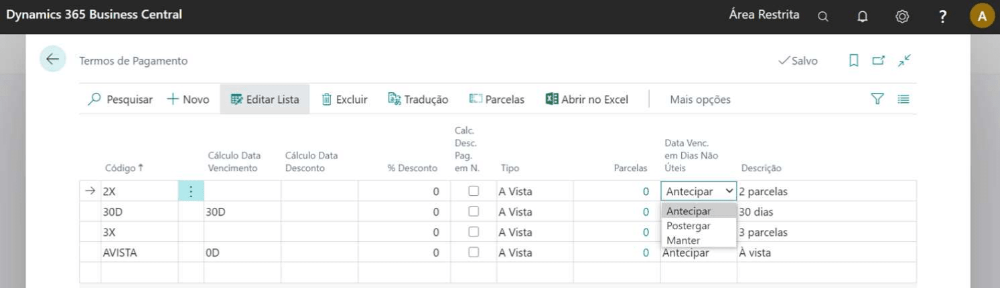

# Termos de Pagamento: Vencimento em Dia Não Útil

**Data**: Março/2021

---

## Sumário

Cada termo de pagamento define o que acontece quando a data de vencimento calculada cai em um sábado, domingo ou feriado nacional: antecipar para o dia útil anterior, postergar para o próximo dia útil ou manter a data calculada. A regra vale para o vencimento dos documentos de compra e venda e para o vencimento de cada parcela.

## 1. Contexto

O vencimento é calculado a partir da **Data Documento** e do **Cálculo Data Vencimento** do termo de pagamento, ou do cálculo de cada parcela quando o termo tem parcelas. Quando essa data não é dia útil, o campo **Data Venc. em Dias Não Úteis** do termo decide o ajuste.

São dias não úteis:

- sábados e domingos;
- as datas cadastradas na página **Feriados Nacionais**.

---

## 2. Configurar o termo de pagamento

1. Pesquise por **Termos de Pagamento**.
2. Para cada termo, escolha a opção no campo **Data Venc. em Dias Não Úteis**:

| Opção | Comportamento |
|-------|---------------|
| **Antecipar** | Move o vencimento para o dia útil anterior |
| **Postergar** | Move o vencimento para o próximo dia útil |
| **Manter** | Mantém a data calculada, mesmo que não seja dia útil |

> **Nota**: **Antecipar** é o valor inicial do campo. Um termo novo, ou um termo que existia antes desta funcionalidade, antecipa o vencimento até que outra opção seja escolhida.

---

## 3. Cadastrar os feriados

Os feriados considerados no ajuste vêm da página **Feriados Nacionais**, comum a todas as empresas do banco de dados.

1. Pesquise por **Feriados Nacionais** ou, no Centro de Funções, abra **Configurações** > **Fiscal** > **Impostos** > **Feriado Nacional**.
2. Cadastre cada feriado com a **Data** e a **Descrição**.

Uma data que não estiver nessa lista é tratada como dia útil, exceto sábado e domingo.

---

## 4. Onde o ajuste é aplicado

- **Documentos de compra e venda sem parcelas**: a **Data Vencimento** calculada ao informar o termo de pagamento ou a **Data Documento** é ajustada conforme o termo.
- **Termos com parcelas**: o vencimento de cada parcela é ajustado da mesma forma.
