# NF-e e NFS-e: Texto Estendido por Linha e por Item

**Data**: Fevereiro/2024

---

## Sumário

O texto estendido é uma descrição complementar de cada item da nota. Na NF-e ele sai na tag `infAdProd` do XML e no DANFE, logo abaixo da descrição do produto; na NFS-e ele entra na discriminação dos serviços. O texto vem das linhas de comentário colocadas abaixo do item no documento de venda, que podem ser digitadas na hora ou inseridas a partir dos textos estendidos do cadastro do item. O item também pode ter uma informação adicional fixa para a NF-e, que sai em toda nota.

## 1. Contexto

O texto de cada item da nota pode ter três origens:

| Origem | Onde se cadastra | Depende da configuração |
|--------|------------------|-------------------------|
| Linhas de comentário no documento | Linhas do pedido ou da fatura de venda, tipo **Comentário** | Sim: **Utilização do Texto Estendido** (NF-e) ou **Utilizar Textos Estendidos** (NFS-e) |
| Textos estendidos do item | **Textos Estendidos** do cartão do item, inseridos no documento como linhas de comentário | Sim, a mesma das linhas de comentário |
| Informação adicional do item | **Informações Adicionais NF-e** do cartão do item | Não: sai sempre na NF-e |

Todos os textos do item vão para a mesma tag `infAdProd` da NF-e, que aceita até 500 caracteres.

---

## 2. Configuração da NF-e

1. Pesquise por **Configurações NF-e** ou, no Centro de Funções, abra **Configurações** > **Fiscal** > **NF-e / NFS-e** > **Configurações NF-e**.

   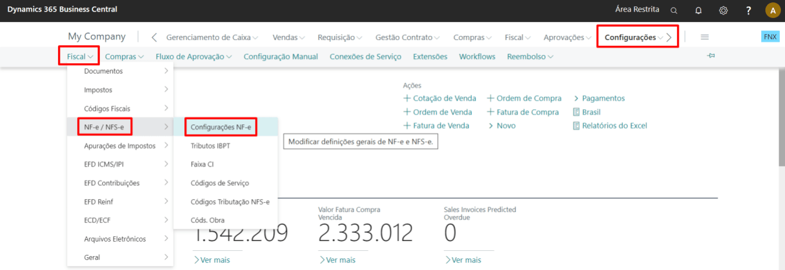

2. Escolha a filial e, na guia **NF-e**, grupo **Observações**, preencha **Utilização do Texto Estendido**:

| Opção | Resultado |
|-------|-----------|
| **Nenhuma** | As linhas de comentário do documento não vão para a NF-e |
| **DANFe/Info. Adicional Produto** | As linhas de comentário abaixo de cada item vão para a tag `infAdProd` do item no XML e aparecem no DANFE, abaixo da descrição do produto |

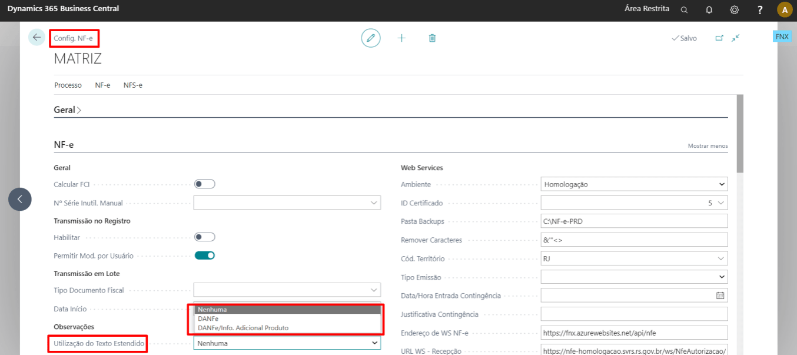

> **Nota**: a opção **DANFe**, que aparece na imagem, não é mais oferecida no campo. Uma filial que ainda a tenha gravada funciona como **DANFe/Info. Adicional Produto**.

---

## 3. Configuração da NFS-e

1. Pesquise por **Configurações NF-e** e escolha a filial.
2. Na guia **NFS-e**, grupo **Discriminação Serviços**, ligue **Utilizar Textos Estendidos**.

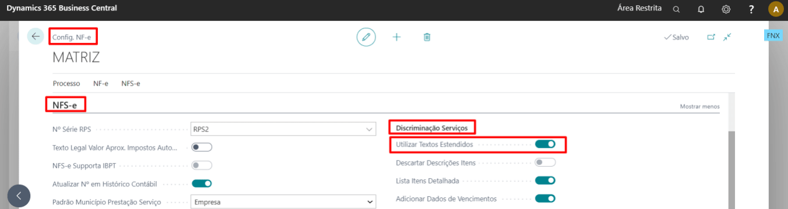

---

## 4. Linhas de comentário no documento de venda

### NF-e

Na ordem ou fatura de venda, inclua abaixo do item uma linha do tipo **Comentário** com o texto na **Descrição**. No registro, as linhas de comentário que estão logo abaixo de um item são juntadas como texto estendido daquele item.

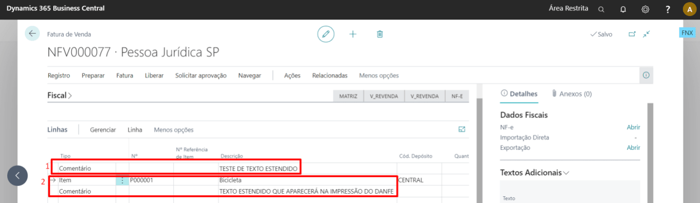

> **Nota**: só os comentários colocados **depois** de um item entram na nota. Um comentário no início do documento, antes de qualquer item (o 1 da imagem), é desconsiderado. O comentário colocado abaixo de uma linha que não gera linha no documento fiscal também é descartado com ela.

O texto sai no DANFE, abaixo da descrição do produto:

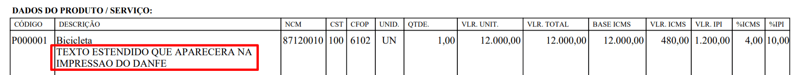

E no XML, na tag `infAdProd` do item:

```xml
  <infAdProd>TEXTO ESTENDIDO QUE APARECERA NA IMPRESSAO DO DANFE</infAdProd>
</det>
```

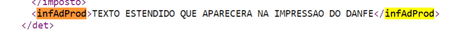

O texto estendido de cada linha também pode ser conferido no documento fiscal, na coluna **Texto Estendido** das linhas.

### NFS-e

Da mesma forma, inclua as linhas do tipo **Comentário** abaixo do serviço na fatura de venda. A regra é a mesma: só os comentários abaixo de um item entram na nota.

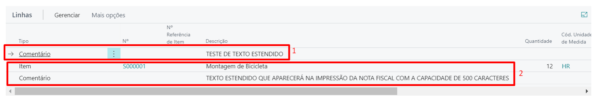

O texto entra na discriminação dos serviços, abaixo da linha do item:

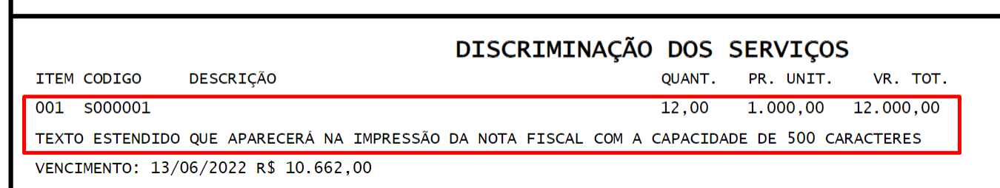

> **Nota**: a forma como a discriminação aparece na nota impressa depende do layout de cada prefeitura.

---

## 5. Textos estendidos do item

Um texto que deve sair sempre com o item pode ser cadastrado no próprio item, sem digitar o comentário a cada venda.

1. No cartão do item, abra **Relacionadas** > **Item** > **Textos Estendidos**.

   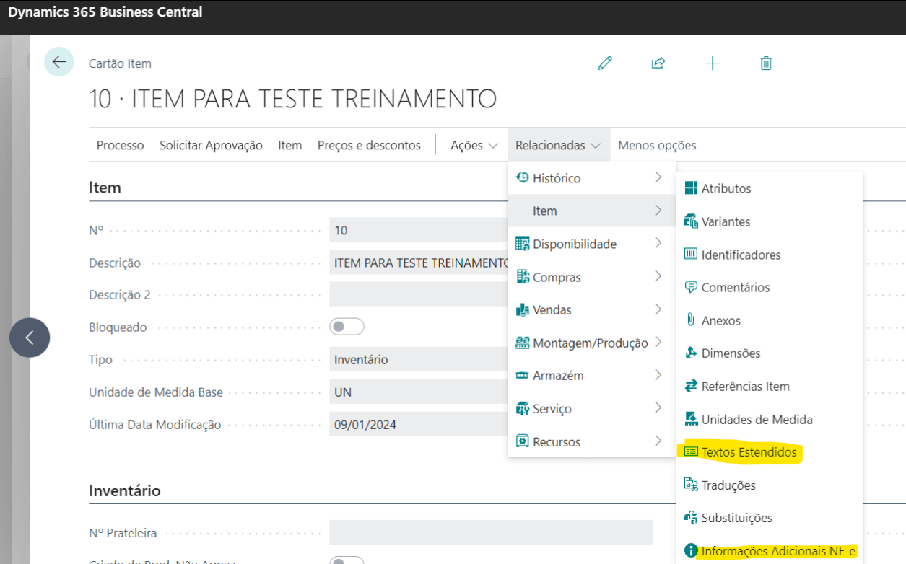

2. Crie o texto na **Lista Textos Estendidos**.

   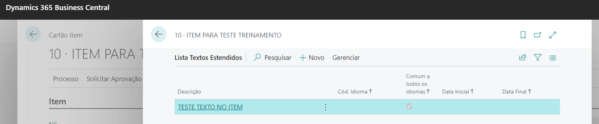

3. No cartão do item, ligue **Texto Estendido Automático**.

   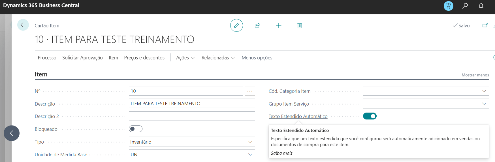

Ao incluir o item na ordem ou fatura, o texto entra como linhas de comentário abaixo dele e, no registro, vai para a nota como as linhas da seção 4. Por isso ele também depende da **Utilização do Texto Estendido** na NF-e e de **Utilizar Textos Estendidos** na NFS-e.

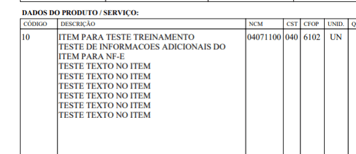

---

## 6. Informações adicionais NF-e do item

Para um texto fixo da NF-e do item, use a informação adicional:

1. No cartão do item, abra **Relacionadas** > **Item** > **Informações Adicionais NF-e**.
2. Escreva o texto na coluna **Informação Adicional**.

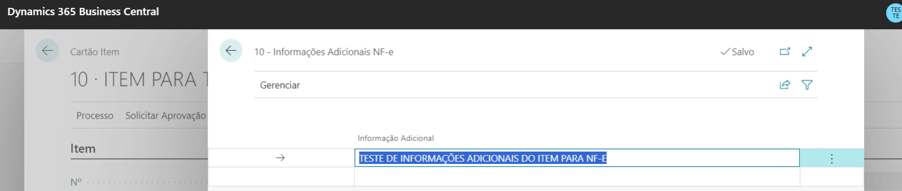

O texto sai automaticamente na tag `infAdProd` e no DANFE de toda NF-e com o item, sem linha de comentário no documento e independentemente da **Utilização do Texto Estendido**. Quando o item também tem texto estendido, a informação adicional vem primeiro.

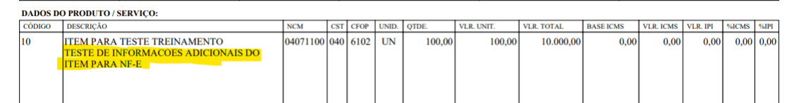
