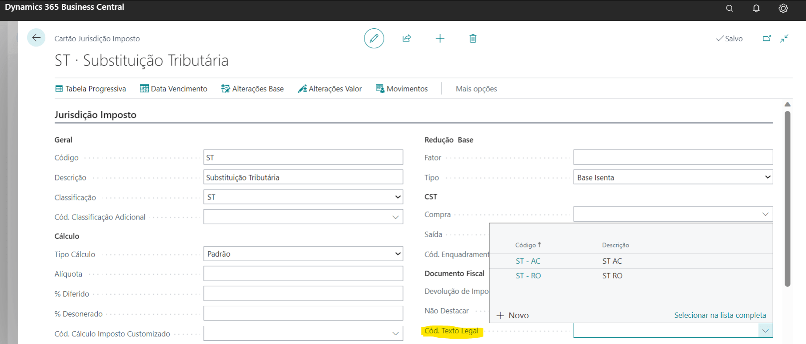
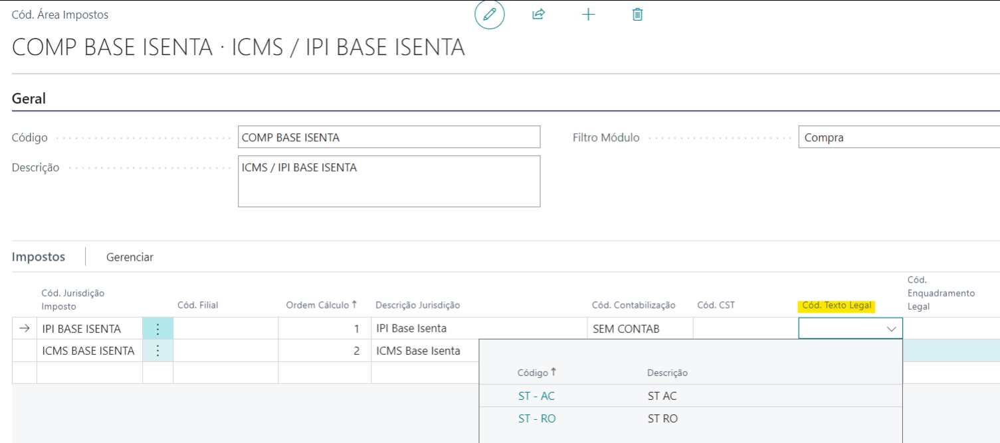
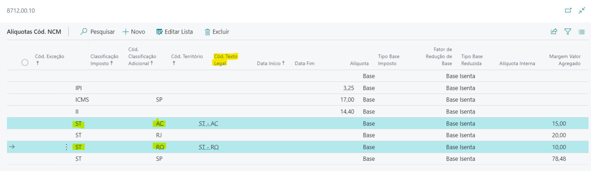
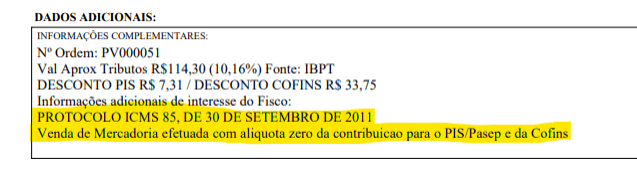

# Impostos: Texto Legal na Jurisdição, no NCM ou na Área de Impostos

**Data**: Setembro/2023

---

## Sumário

Um texto legal padrão, como o protocolo de ICMS que fundamenta uma substituição tributária ou o dispositivo de uma alíquota zero, pode ser ligado à configuração do imposto, e não só ao documento. Com o **Cód. Texto Legal** preenchido na jurisdição de impostos, na linha da área de impostos ou na alíquota do NCM por estado, o texto entra sozinho nos dados adicionais da NF-e sempre que aquele imposto é calculado no documento.

## 1. Contexto

### Como o texto chega à nota

No registro do documento de venda ou de compra, o cálculo dos impostos junta os textos legais de todas as configurações que participaram do cálculo:

- a **Jurisdição de Impostos** de cada imposto calculado;
- a linha da **Área de Impostos** do documento;
- a linha de **Alíquotas Cód. NCM** que o cálculo escolheu para o NCM do item.

Cada texto entra uma única vez nos textos adicionais do documento fiscal, mesmo que o mesmo código apareça em várias linhas ou configurações. Os textos podem ser conferidos no documento fiscal, em **Texto Adicional**.

O texto vai para as **Informações adicionais de interesse do Fisco** (`infAdFisco`) quando o texto legal padrão tem **Interesse do Fisco** marcado, e para as **Informações Complementares** (`infCpl`) quando não tem.

> **Nota**: a **Matriz Impostos** e as **Alíquotas Exceção Imposto** (em **Exceções Imposto**) também têm um **Cód. Texto Legal**. O da exceção entra no cálculo como os três acima; o da matriz entra nos textos do documento de venda ou de compra quando a matriz é aplicada.

### Pré-requisito

O texto precisa estar cadastrado como texto legal padrão. Pesquise por **Textos Legais Padrão** ou, no Centro de Funções, abra **Configurações** > **Fiscal** > **Documentos** > **Textos Legais Padrão**. Em cada texto, informe o **Código**, a **Descrição**, marque **Interesse do Fisco** quando for o caso, e escreva o texto nas linhas.

---

## 2. Jurisdição de impostos

Use a jurisdição quando o texto vale para todas as operações que calculam aquele imposto.

1. Pesquise por **Jurisdições Impostos** ou, no Centro de Funções, abra **Configurações** > **Fiscal** > **Impostos** > **Jurisdições Impostos**.
2. Abra a jurisdição e, no **Cartão Jurisdição Imposto**, grupo **Documento Fiscal**, escolha o texto no campo **Cód. Texto Legal**.

---

## 3. Área de impostos

Use a área de impostos quando o texto vale só para as operações que usam aquela área, por exemplo uma área de compras com base isenta.

1. Pesquise por **Áreas de Impostos** ou, no Centro de Funções, abra **Configurações** > **Fiscal** > **Impostos** > **Áreas de Impostos**.
2. Abra a área e, na linha do imposto, escolha o texto na coluna **Cód. Texto Legal**.

---

## 4. NCM por estado

Use as alíquotas do NCM quando o texto depende do produto e do estado, como os protocolos de ICMS-ST de cada UF.

1. Pesquise por **Códigos NCM** ou, no Centro de Funções, abra **Configurações** > **Fiscal** > **Códigos Fiscais** > **Códigos NCM**.
2. Selecione o NCM e abra **Alíquotas**.
3. Na página **Alíquotas Cód. NCM**, na linha do imposto e do estado (**Classificação Imposto** e **Cód. Território**), escolha o texto na coluna **Cód. Texto Legal**.

> **Nota**: o cálculo procura a linha do NCM pelo estado onde o imposto é devido, que em geral é o estado de destino; quando não há linha para esse estado, usa a linha sem **Cód. Território**. O texto legal só entra quando a linha do NCM é usada no cálculo: se a jurisdição já define o imposto com **Tipo Base** **Base Isenta** ou **Base Outros**, a linha do NCM não é aplicada e o texto dela não entra.

---

## 5. Dados adicionais do DANFE

Com a configuração feita, o texto aparece nos dados adicionais do DANFE das notas que calcularam o imposto. No exemplo, uma venda com ST para o Acre traz o texto do protocolo de ICMS do estado nas informações de interesse do Fisco:

Para a configuração completa de jurisdições, áreas de impostos e NCM, veja [Configuração Fiscal: Cadastros Fiscais e Impostos](Localization-for-Brazil_User-Manual_Configuracao-Fiscal.md) e [Jurisdições, Áreas de Impostos e Contabilizações](Localization-for-Brazil_User-Manual_guia-fiscal-jurisdicoes-areas-impostos.md).
