# **User manual for KSeF**

## Contents

- [Configuration Checklist](#configuration-checklist)
- [Prerequisites and general KSeF configuration](#prerequisites-and-general-ksef-configuration)
  - [Company Information](#company-information)
  - [Feature Management](#feature-management)
  - [HTTP Client Access](#http-client-access)
- [Permission sets](#permission-sets)
- [Configuration – KSeF Setup](#configuration--ksef-setup)
  - [KSeF Setup - General Description](#ksef-setup---general-description)
    - [Tabs containing data visible in the structured invoice](#tabs-containing-data-visible-in-the-structured-invoice)
    - [KSeF System Tabs and Configuration Fields](#ksef-system-tabs-and-configuration-fields)
    - [Import KSeF Visualization from an XSL File](#import-ksef-visualization-from-an-xsl-file)
  - [KSeF VAT rates mapping](#ksef-vat-rates-mapping)
  - [KSeF Reverse Charge](#ksef-reverse-charge)
    - [Logic for Filling Field P_18](#logic-for-filling-field-p_18)
  - [Country/Region Setup](#countryregion-setup)
  - [Bank accounts setup and mechanism description](#bank-accounts-setup-and-mechanism-description)
    - [Bank Account for Split Payment Mechanism (SP)](#bank-account-for-split-payment-mechanism-sp)
  - [Generating and converting KSeF certificates](#generating-and-converting-ksef-certificates)
  - [Managing KSeF Connection Sessions and Official Receipt Confirmation (UPO)](#managing-ksef-connection-sessions-and-official-receipt-confirmation-upo)
- [Generating and sending documents to KSeF](#generating-and-sending-documents-to-ksef)
  - [Additional fields on Posted Sales Invoices](#additional-fields-on-posted-sales-invoices)
  - [KSeF document creation](#ksef-document-creation)
  - [Skipping Sending to KSeF for a Sales Invoice](#skipping-sending-to-ksef-for-a-sales-invoice)
  - [Correction of customer data in KSeF](#correction-of-customer-data-in-ksef)
    - [Issuing customer data correction for KSeF](#issuing-customer-data-correction-for-ksef)
    - [Notes](#notes)
  - [Descriptive Corrections in KSeF](#descriptive-corrections-in-ksef)
    - [Issuing descriptive correction for KSeF](#issuing-descriptive-correction-for-ksef)
  - [KSeF - Invoice List](#ksef---invoice-list)
  - [KSeF - Invoice List – QR Code II](#ksef---invoice-list--qr-code-ii)
- [Automatic Sending of Documents to KSeF](#automatic-sending-of-documents-to-ksef)
  - [Logic of Automatic Sending](#logic-of-automatic-sending)
  - [Job Queue Configuration for Sending to KSeF](#job-queue-configuration-for-sending-to-ksef)
  - [Scope of Documents Processed by Job Queue](#scope-of-documents-processed-by-job-queue)
  - [KSeF Invoice Creation Mode](#ksef-invoice-creation-mode)
  - [KSeF Document Processing](#ksef-document-processing)
  - [Relation between Job Queue and Document Statuses](#relation-between-job-queue-and-document-statuses)
  - [Monitoring Sending](#monitoring-sending)
- [Receiving and Processing Documents from KSeF](#receiving-and-processing-documents-from-ksef)
  - [KSeF Connection Setup – receiving KSeF Purchase Invoices](#ksef-connection-setup--receiving-ksef-purchase-invoices)
  - [Sending a Request to the Ministry of Finance](#sending-a-request-to-the-ministry-of-finance)
  - [Processing purchase invoices](#processing-purchase-invoices)
    - [Corrections with “Before/After” Lines – Behavior during KSeF import](#corrections-with-beforeafter-lines--behavior-during-ksef-import)
  - [Creating the purchase invoice header](#creating-the-purchase-invoice-header)
  - [Automatic Creation of Purchase Document Headers](#automatic-creation-of-purchase-document-headers)
  - [KSeF Invoice Preview](#ksef-invoice-preview)
  - [KSeF Preview on Purchase Invoice](#ksef-preview-on-purchase-invoice)
  - [KSeF Preview on Posted Purchase Invoice](#ksef-preview-on-posted-purchase-invoice)
  - [Monitoring KSeF Documents Imports](#monitoring-ksef-documents-imports)
    - [Enabling KSeF Import Logging](#enabling-ksef-import-logging)
    - [KSeF Receive Log](#ksef-receive-log)
  - [Automation of Cyclical Import of KSeF Documents](#automation-of-cyclical-import-of-ksef-documents)
  - [Partner 3 Internal ID field](#partner-3-internal-id-field)
  - [Incorrect Active Sessions](#incorrect-active-sessions)
    - [Incorrect invoice status (Sent instead of Error)](#incorrect-invoice-status-sent-instead-of-error)

**Localization for Poland**

<figure>

<figcaption>
Microsoft Dynamics 365 Business Central
</figcaption>
</figure>

companial.com

**Legal notice:** This document is intended solely for internal use by partners and users of Microsoft Dynamics 365 Business Central. Companial is the author of the document and holds exclusive copyright to its content. Unauthorized copying, modification, or sale of the document or its contents is strictly prohibited without prior written consent from the author.

The access paths to the described features or settings in the system are always presented in this manual in the following format:

→ name of the location in the system

# Configuration Checklist

This chapter provides a step-by-step checklist for configuring KSeF functionality in Microsoft Dynamics 365 Business Central. All steps should be completed in the order presented below to ensure correct operation of KSeF-related processes.

Step 1 – Verify and Complete Company Information

→ Company Information

Complete at least the following data:

- Full company name

- Registered address (street, postal code, city, country)

- Country/Region Code = PL

- VAT Registration No. (NIP) – without country prefix

If the company uses a GLN number, set the parameter Use GLN in electronic documents to True.

Step 2 – Enable Required Features

→ Feature Management

Ensure that all features related to E-Document Services are enabled.

→ Feature Management – Localization for Poland

Ensure that KSeF functionality is enabled.

Step 3 – Allow HTTP Communication (Ministry of Finance API)

→ Extension Management / Environment Configuration

Allow outgoing HTTP communication for the following applications:

- Localization for Poland

- Localization for Poland Extended

- E-Documents Core

- all other E-Documents applications used for communication with KSeF

Step 4 – Assign Permissions to Users

Assign the following permission set to users working with KSeF documents:

- EXW KSeF

Additional standard Business Central permission sets may be required depending on VAT configuration and E-Documents setup.

Step 5 – Configure KSeF Settings

→ KSeF Settings

Complete data on the tabs that are transferred to the structured invoice XML file

(general data, address data, contact data, footer – according to company requirements).

→ KSeF Settings → KSeF tab

Configure key system parameters, including:

- KSeF document numbering

- KSeF invoice creation mode

- KSeF start date

- Allowed editing of document number, document type, and document status

- Additional parameters (e.g. skipping comment lines, backward period for sending documents to KSeF)

Step 6 – Map VAT Rates for KSeF

→ VAT Posting Setup

Assign the appropriate KSeF VAT Rate for relevant VAT posting combinations.

Selecting *None* means that the given combination will not be exported to KSeF.

Step 7 – Configure Countries/Regions

→ Countries/Regions

For EU countries, complete the EU Country/Region Code field to ensure correct country classification in generated XML documents.

Step 8 – Configure Bank Accounts for KSeF

→ Bank Account Card

On the KSeF tab, complete the following fields for bank accounts used on invoices:

- KSeF Bank Account Name

- KSeF Own Bank Account Type

These values are transferred to KSeF instead of the standard bank account name.

Step 9 – Configure E-Document Service (Export to KSeF)

→ E-Document Service

Create a new service for KSeF and set:

- Document Format = KSeF FA(3)

- Service Integration = KSeF – Polish National e-Invoicing System

Then select Service Integration Setup and choose the environment (Test / Demo / Production).

The system automatically fills in the API base URL.

Step 10 – KSeF Certificate: Generation, Conversion, and Import

Generate a certificate in the KSeF Taxpayer Application and download the .crt and .key files.

Convert the .key file to .pem format using OpenSSL.

In Business Central, go to:

→ E-Document Service → KSeF service → Service Integration Setup → Configuration Wizard

Import the certificate (.crt) and private key (.pem), then download public certificates.

Step 11 – Configure KSeF Connection for Receiving Purchase Documents

→ KSeF Connection Settings

- Paste the authorization token

- In the Receiving section, select Entity 2

- Set Initial synchronization days

- Set Query page size according to business requirements

Step 12 – Verify Connection (Import Test)

→ E-Document Service → Receive

or

→ E-Documents → Download KSeF Documents

Downloaded documents should appear on the Incoming Documents page.

# Prerequisites and general KSeF configuration

Before starting any configuration related to KSeF, the following general prerequisites must be fulfilled.

## Company Information

→ Company Information

The following data must be completed correctly, as they are transferred to the structured invoice (XML file) and are validated by KSeF.

Minimum data required to send invoices to KSeF:

- Company name

- Registered address (street, postal code, city, country)

- Country/Region Code = PL

- VAT Registration No. – without country prefix

Conditionally required data (depending on scenario):

- Registration number

- GLN number

- **Use GLN in Electronic Documents** – this parameter must be set to True if the company wants the GLN number to be visible on invoices sent to KSeF.

If the required data is not completed, KSeF validation will fail and invoices will not be sent to KSeF.

## Feature Management

→ Feature Management

Make sure that all features related to E-Document Services are enabled.

→ Localization for Poland Feature Management

Ensure that all features related to Localization for Poland are enabled (e.g. KSeF).

## HTTP Client Access

→ Extension Management / Environment configuration

Since communication with KSeF is based on API calls to the Ministry of Finance, outbound HTTP communication must be allowed for the following applications:

- Localization for Poland

- Localization for Poland Extended

- E-Document Core

- All other E-Documents apps used by the company for communication with KSeF.

# Permission sets

The following permission set is required for users working with KSeF documents:

- **EXW KSeF** – a full set of permissions required for creating and processing KSeF documents, generating XML files, and sending documents to the governmental KSeF application.\
  This permission set provides access to all tables related to KSeF functionality, including KSeF Settings.

Additional permissions (e.g. within E-Document Services) are required to properly configure the KSeF connection and to set up other areas of Business Central, such as VAT Posting Setup. These permissions are available in standard Business Central tables and are therefore not covered by the dedicated KSeF permission set.

# Configuration – KSeF Setup

## KSeF Setup - General Description

→ KSeF Setup

The KSeF Setup page is used to enter the company’s identification data and to configure settings related to the integration with the National e-Invoicing System (Krajowy System e‑Faktur – KSeF). Correct completion of the fields on this page is a prerequisite for the proper operation of all subsequent KSeF-related processes, including: generation, receiving and processing of KSeF documents.

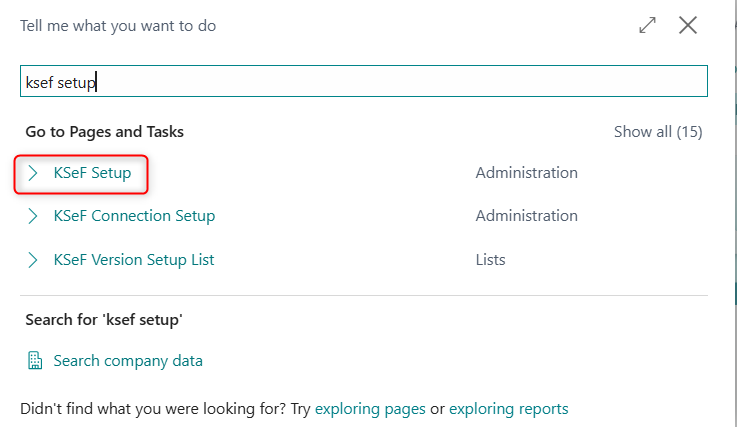

### Tabs containing data visible in the structured invoice

The KSeF Setup page contains tabs whose values are transferred directly to the structured invoice XML file and are visible both to the invoice recipient and to tax authorities. Fields marked as mandatory must be completed to ensure successful validation in KSeF. Other fields, although optional from a technical validation perspective, **may still be required for specific companies or business scenarios**. **The responsibility for ensuring that all legally required data is provided to KSeF lies solely with the company**.

**General**

**Full name** – company’s full registered name

**Country Code** – company’s registered seat country

**Taxpayer Prefix** - optional

**Address** – no formatting required, min. one character required: usually street + number

**Address 2** – optional; usually post code and city

**EORI No.** – optional,

**Taxpayer Status** – leave None or choose appropriate option from drop down list

**National Court Register No. (KRS number)** – optional, validated by KSeF if filled in

**BDO No.** - optional

**Cash Method** - information on the use of the cash accounting method (True/False)

**Default Unit of Measure** – not strictly required for sending invoices to KSeF; however, completing this field is recommended. The value from the Default Unit of Measure field is applied to invoice lines for which no unit of measure is specified when sending the invoice to KSeF. KSeF will not accept an invoice if no unit of measure is specified on an invoice line. .

**Correspondence Address**

This tab can be completed with address data used for correspondence purposes, including country/region, address, additional address line, and GLN number. None of the fields on this tab are mandatory; however, they may be required for certain companies or specific business scenarios.

**Contact**

This tab can be completed with the company’s contact details, such as e‑mail addresses and phone numbers. None of the fields on this tab are mandatory; however, they may be required for certain companies or specific business scenarios.

**Footer**

This tab can be completed with information that the company wants to display in the invoice footer. This may include standard information placed in the invoice printout footer, such as company registration details, website address, etc. KSeF does not impose any specific requirements in this area.

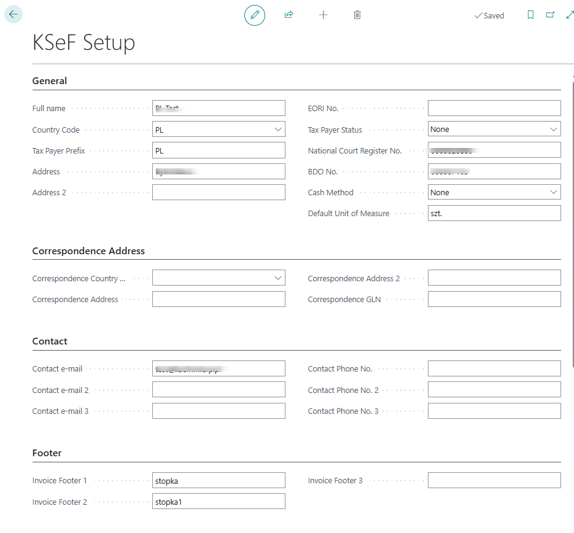

### KSeF System Tabs and Configuration Fields

**KSeF**

This tab allows configuration of parameters specific to communication with KSeF and management of documents transmitted to KSeF.

- **Current KSeF Version** – selection of the KSeF schema version that the system should use when generating and sending invoices

- **KSeF Document Nos.** – for outbound KSeF documents, a separate number series must be assigned.\
  This number series is used for a new document type (introduced by Localization for Poland) – KseF invoices. This setting applies only to sales documents.

- **KSeF Invoice Creation Mode** – set this field to *Automatically* if KSeF invoices should be created automatically at the moment of posting a sales invoice. If *Create manually* is selected, then after posting a sales invoice the user must manually create the KSeF invoice, or it will be created automatically when the Job Queue for sending documents to KSeF is executed.

- **Edit KSeF No. Allowed** – allows manual editing of the KSeF document number.\
  This may be required in situations where an invoice has been successfully sent to KSeF, but for some reason (e.g. connection issues) the KSeF ID number was not returned.

- **Edit Document Processing Method Allowed** – allows changing the method of document processing in KSeF. If this field is set to *True*, the user can edit the processing method on the customer card and on the document (before posting). If it is set to *False*, the user can set the processing method only at the **Customer Posting Group** level, in the **KSeF Document Processing** field. The value from that field is then automatically transferred to customer cards and sales documents.

- **Edit Invoice Type Allowed** – allows changing the KSeF document type, e.g. from a VAT invoice (VAT) to a prepayment invoice (ZAL). The invoice type is filled in automatically based on the document type created in Business Central. When this field is set to *True*, the user can manually change the invoice type for a specific document.

- **Edit KSeF Document Status Allowed** – allows manual change of the KSeF invoice status.

- **KSeF Start Date** – sets the starting date for documents covered by the KSeF system.\
  Documents issued before this date will not function correctly in KSeF. Appropriate document print layouts are also applied depending on this date.

- **Use Before/After Lines** – determines how correction lines of type *before* and *after* are presented and transmitted for correction invoices sent to KSeF. This setting affects both the data structure transferred to KSeF and how the correction invoice is presented to the recipient in the governmental KSeF application.

- If **Use Before/After Lines** is set to *True*:

- correction invoices are sent to KSeF with *before* and *after* lines,

- these lines reflect:

- the state of data before correction,

- the state of data after correction,

- the recipient sees a detailed comparison of values before and after correction in the KSeF application.

- If Use Before/After Lines is set to *False*:

- correction invoices are sent to KSeF without *before* and *after* lines,

- only the resulting correction values are transferred to KSeF,

- the document is presented in a simplified form, without a breakdown into before and after states.

- **Skip Comment Lines** – determines whether lines marked as comments are skipped when sending the document to KSeF.

- **Backward Period for Sending to KSeF (days)** – determines the time range (in days) for which the Job Queue searches for documents awaiting and qualifying for sending to the National e‑Invoicing System (KSeF). The value of this field is interpreted as the number of days backwards from the moment the Job Queue is executed, within which the system analyzes sales documents for KSeF sending. If the field is not filled in (empty or equal to 0), the Job Queue:

- analyzes only documents from the last 24 hours,

- sends documents issued within that period that meet the conditions for sending to KSeF.

  If the field contains a value greater than 0, the Job Queue:

- analyzes documents issued from the Job Queue execution date minus the specified number of days,

- searches all documents from that period that:

- have not yet been sent to KSeF,

- are not marked as *Skip in KSeF*,

- have a processing method and status that allow sending.

**KSeF Version Setup**

This tab allows managing the use of **KSeF logical structure versions** in accordance with the requirements of the Ministry of Finance.

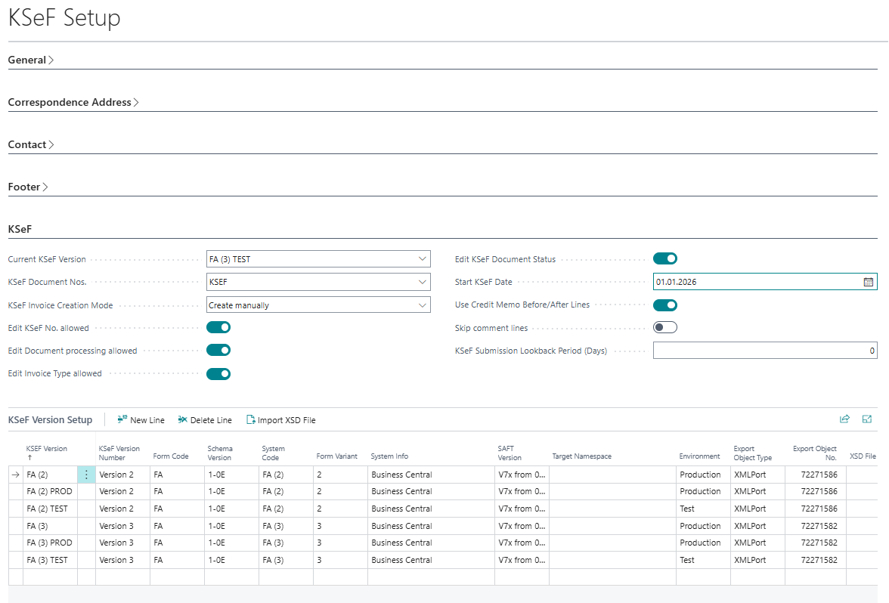

### Import KSeF Visualization from an XSL File

This functionality allows to import a custom visualization contained in an XSL file.

To import a file, select:

Actions → Import Visualization XSL File

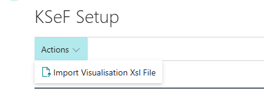

## KSeF VAT rates mapping

→ VAT Posting Setup

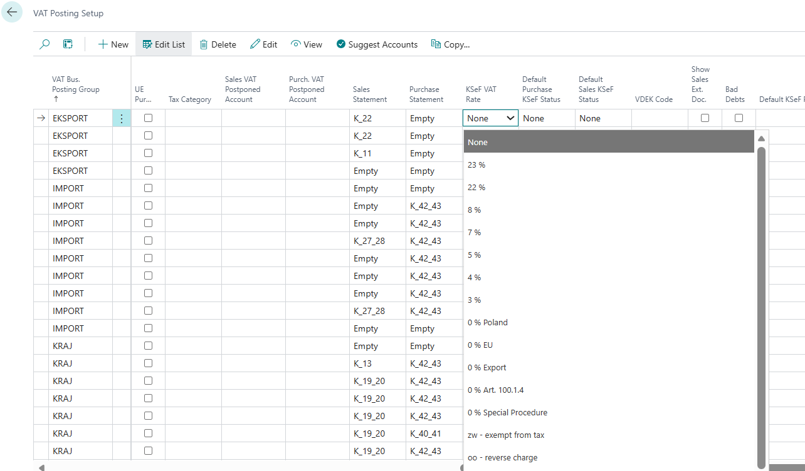In the **KSeF VAT Rate** field, VAT rates must be assigned to the appropriate VAT posting combinations that are to be exported to KSeF in structured invoices. Each relevant VAT posting combination should have the appropriate **KSeF VAT Rate** assigned, which will be transmitted to KSeF. Selecting the value *None* means that the given posting combination will not be exported to KSeF. Correct assignment of VAT rates is required to ensure that generated invoices comply with KSeF requirements.

It is possible to define the fields **Default KSeF Purchase Status** and **Default KSeF Sales Status** for the relevant posting combinations. The values from these fields will be applied to documents for which the KSeF status has not been specified. These may include, for example, documents that do not exist in KSeF. For such documents, values such as **BFK – Invoice outside KSeF** or **DI – Other document** can be selected. If a document does not have any KSeF status assigned and does not have a KSeF ID number, errors may occur during the creation of **SAFT VAT (JPK)** declarations.

To define the legal basis for VAT exemption that affects the population of fields **P_19_A / P_19_B / P_19_C** in KSeF, its description must be entered in the appropriate column for the given posting combination in **VAT Posting Setup**.

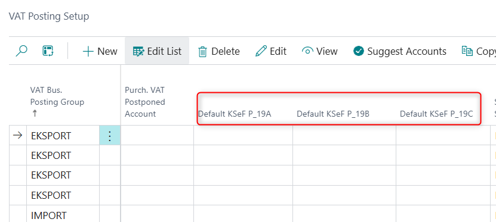

## KSeF Reverse Charge

Field name P_18 - Annotation “reverse charge”

Field **P_18** in the KSeF structured invoice indicates whether a given invoice is subject to the **reverse charge mechanism**.

If the buyer is obliged to settle VAT (or a tax of a similar nature), field **P_18** must take the value **“1”**.\
In all other cases, the value **“2”** is transmitted.

**Localization for Poland fully supports this field and can populate it based on configuration or automatically, in accordance with system logic.**

Field **P_18 – “reverse charge” annotation** must be completed as follows:

- value **“1”** – if the invoice documents the supply of goods or services for which the buyer accounts for VAT,

- value **“2”** – in all other cases.

This field applies to both:

- international transactions, and

- domestic reverse charge cases, including those resulting from **Article 145e of the VAT Act**, where the invoice must contain the annotation “reverse charge” (Article 106e(1)(18) of the Act).

<u>Note</u>: this also includes **“historical” reverse charge** based on Article 17(1)(7) or (8) of the VAT Act (in the wording applicable before 1 November 2019).

Field **P_18** is fully supported in the **FA(3)** KSeF structure. Localization for Poland always transmits to KSeF the value **“1”** or **“2”**, in accordance with the applicable regulations.

### Logic for Filling Field P_18

**Priority: VAT Configuration**

→ VAT Posting Setup

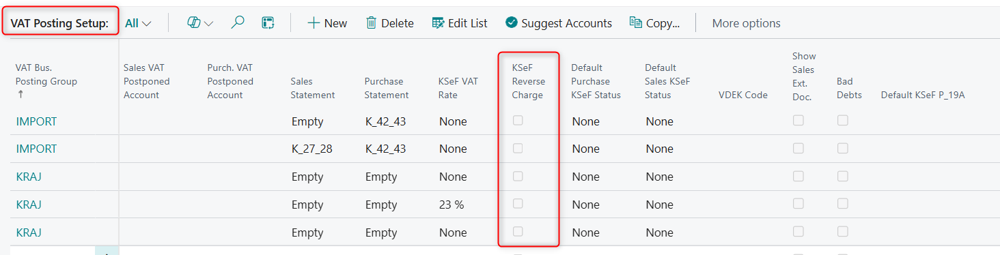If, in **VAT Posting Setup**, at the level of VAT posting combinations, the field **KSeF Reverse Charge** is set to *True*, the system respects this setting and uses it unconditionally when generating the KSeF invoice.

This means that the user can enforce the behavior of field **P_18** for specific business scenarios.

If the **KSeF Reverse Charge** field is set to *False* in the configuration, Localization for Poland automatically determines whether the transaction meets the conditions for reverse charge and sets the value accordingly:

- **P_18 = “1”** – when VAT is settled by the buyer,

- **P_18 = “2”** – in all other cases.

This logic is based on:

- the type of transaction (domestic / foreign),

- the tax status of the parties,

- VAT and country/region configuration,

## Country/Region Setup

→ Countries/Regions

The **Countries/Regions** page must be configured correctly so that KSeF functionality can properly determine whether a given country should be classified as:

- a European Union member state,

- a domestic country (Poland) or

- a non‑EU country.

Correct country classification is required to ensure the correctness of the **XML structure** generated for KSeF documents.

For each country belonging to the European Union, the **EU Country/Region Code** field must be completed.

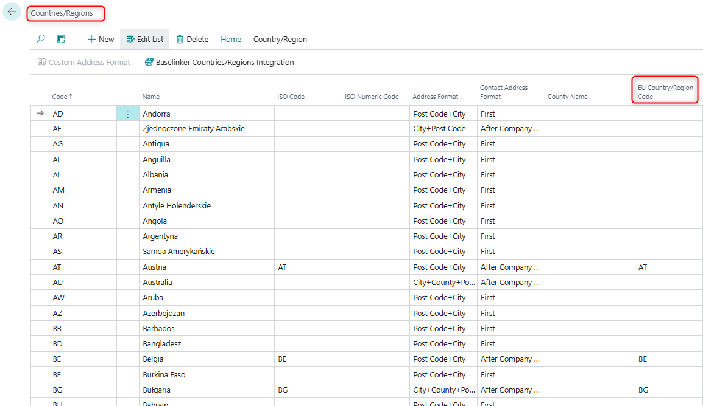

## Bank accounts setup and mechanism description

→ Bank Account Card

An additional tab dedicated to **KSeF** is available on the **Bank Account Card**.\
This tab should be completed **only for bank accounts that are used on invoices sent to KSeF**.

For such bank accounts, the following fields must be completed:

- KSeF Bank Account Name

- KSeF Own Bank Account Type

The remaining fields on this tab are optional.

The bank account name and description provided on the **KSeF** tab are transmitted to KSeF **instead of** the value from the **Name** field on the General tab.

To avoid KSeF validation errors during invoice export, **Localization for Poland** introduces a mechanism that determines which bank account is used on KSeF invoices based on priorities and available data.

This mechanism works as follows:

- The bank account specified directly on the **sales invoice** is transmitted to KSeF.

- If no bank account is specified on the sales invoice, the system uses a bank account in the **same currency as the document**, but only if the fields **KSeF Bank Account Name** and **KSeF Own Bank Account Type** are completed for that account.

- If no such bank account is found, the system uses the **default bank account** specified on the **Company Information** page for the given sales invoice and transmits it to KSeF.

If no bank account can be determined using the above rules, **KSeF validation may fail**.

### Bank Account for Split Payment Mechanism (SP)

**Localization for Poland** allows indicating a **dedicated bank account** used for the **Split Payment Mechanism**, which can then be used on sales invoices and transmitted to the KSeF document.

<u>Important</u>:

In order to be able to indicate an split payment account, such an account must first be created as a **separate Bank Account Card** in Business Central. Only an existing bank account can be selected in the **Bank Account for Split Payment** field on other bank account cards.

The bank account for the split payment mechanism is indicated on the **Bank Account Card**:

→ Bank Account Card → General tab → field “Bank Account for Split Payment”

In this field, another previously defined bank account is selected, which serves as the MPP account.

After indicating the MPP account:

- the system automatically proposes this account on sales invoices for which the split payment mechanism is applied,

- if the MPP account is used on an invoice, it is:

- included on the sales document,

- transmitted to the KSeF document as the payment account.

Indicating a Split Payment account does **not** replace the standard KSeF settings on the Bank Account Card (fields **KSeF Bank Account Name** and **KSeF Own Bank Account Type**).

The bank account actually used on the invoice is **always transmitted to KSeF**, including – if applicable – the account marked as Split Payment.

\
KSeF Connection Configuration
-----------------------------

The **E‑Document Service** page is used, among other things, to select settings for exporting and importing files to and from KSeF. After opening the page, a **new service dedicated to KSeF** must be created by adding a new line.

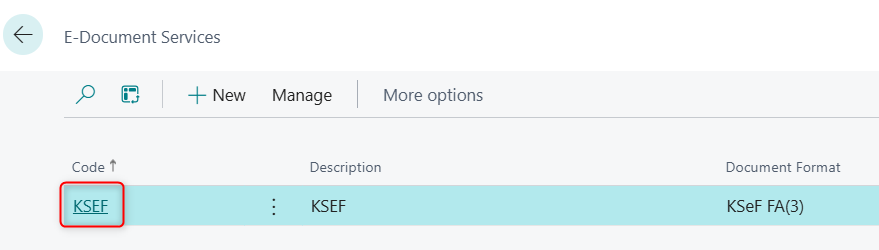

In the **Document Format** field, select **KSeF FA(3)** and choose **KSeF – Polish National e‑Invoicing System** in the **Service Integration** field.

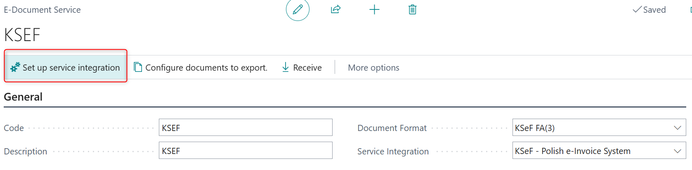

After selecting **Service Integration Setup**, it is possible to choose the environment: Test, Demo or Production using the **Environment** option. Based on the selected environment, the KSeF system automatically fills in the **API Base URL** field.

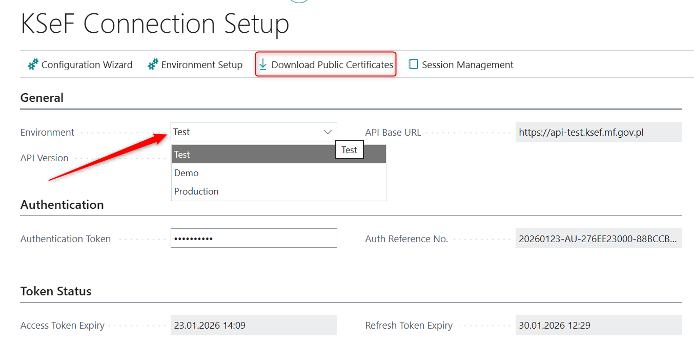

It is also possible to download public certificates using the **Download Public Certificates** option. However, this is **not required at this stage**, as it is one of the steps performed within the **KSeF Configuration Wizard**, which is described in subsequent chapters of this guide. Public certificates can be downloaded multiple times and are overwritten each time.

## Generating and converting KSeF certificates

To correctly use KSeF functionality that requires a KSeF certificate, the **certificate must first be generated in the KSeF Taxpayer Application** (Aplikacja Podatnika KSeF), assigning it a name and a password.

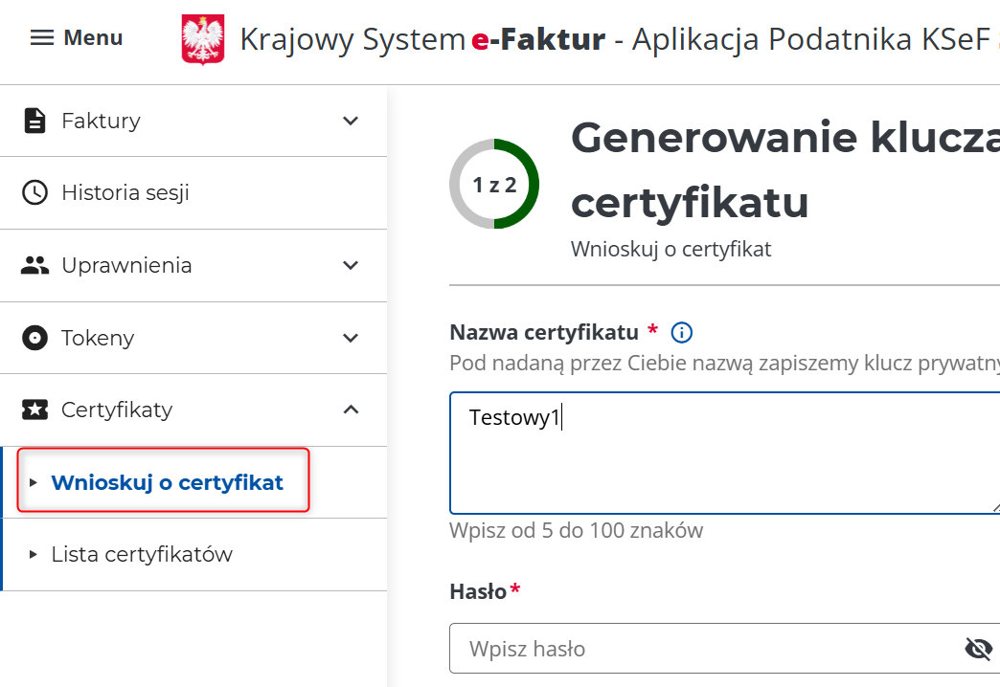

After generating the certificate, it must be downloaded. Two files will be downloaded: one in **.crt** format and the other in **.key** format.

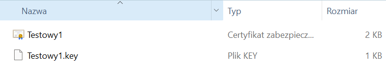

**\*The following steps should be performed by an IT administrator or with their assistance.**

- The certificate downloaded from KSeF requires conversion to work correctly in Microsoft Business Central.

- First, you need to ensure that **OpenSSL** software is installed on the user's computer.

- If **OpenSSL** is already installed, you need to open the **Windows PowerShell** tool.

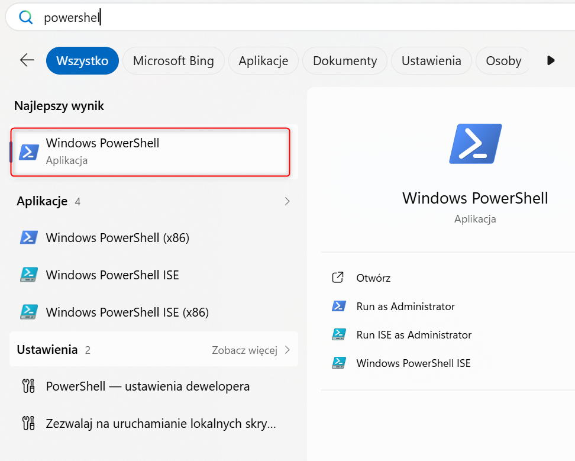

- After opening the **Windows PowerShell** tool, the user will be able to enter commands

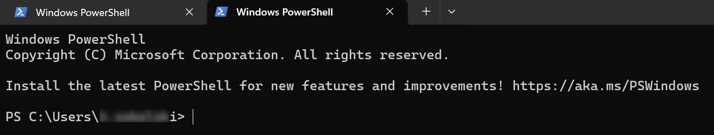

- Navigate to the folder where openssl.exe is located, for example:

> cd C:\OpenSSL-Win64\bin

- To correctly convert the certificate, type in appropriate command into the tool and then press ENTER:

**.\openssl.exe pkcs8 -in \<path to the certificate to be converted\> -out \<path to the output certificate\>.pem**

- For example, for a certificate named 'Testowy1', saved in the folder with the path „C:\CertyfikatyKSeF” the command should be:

**.\openssl.exe pkcs8 -in C:\CertyfikatyKSeF\Testowy1.key -out C:\CertyfikatyKSeF\Testowy1.pem**

- Next, the user will be prompted to enter the certificate password. At this point, enter the same password that was provided during certificate generation and then press ENTER.

<u>Important</u>:

While typing the password, it will not be visible in any form: not as letters, digits, or special characters, nor as dots, asterisks or any other symbols that usually appear in password input fields.

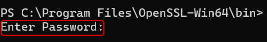

- After completing the above steps, an additional file in .pem format will appear in the folder where the certificate files downloaded from the KSeF Taxpayer Application were previously stored.

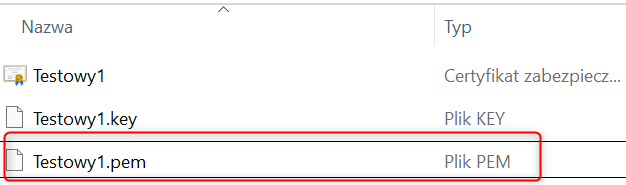

- Next, in Microsoft Business Central, go to the **E-Document Services** page, select the **KSEF** entry, then choose the **Set up service integration** option, followed by the **Configuration Wizard.**

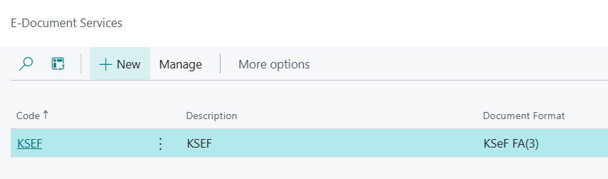

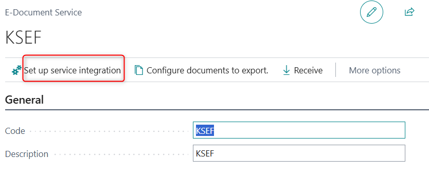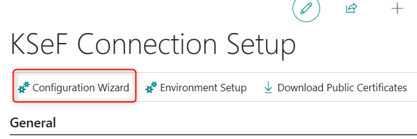

- In the **KSeF Environment Configuration Wizard** go to the step 'Import the ECDSA signing certificate'. In the Certificate Action field, select **Import New Certificate**, and click Next.

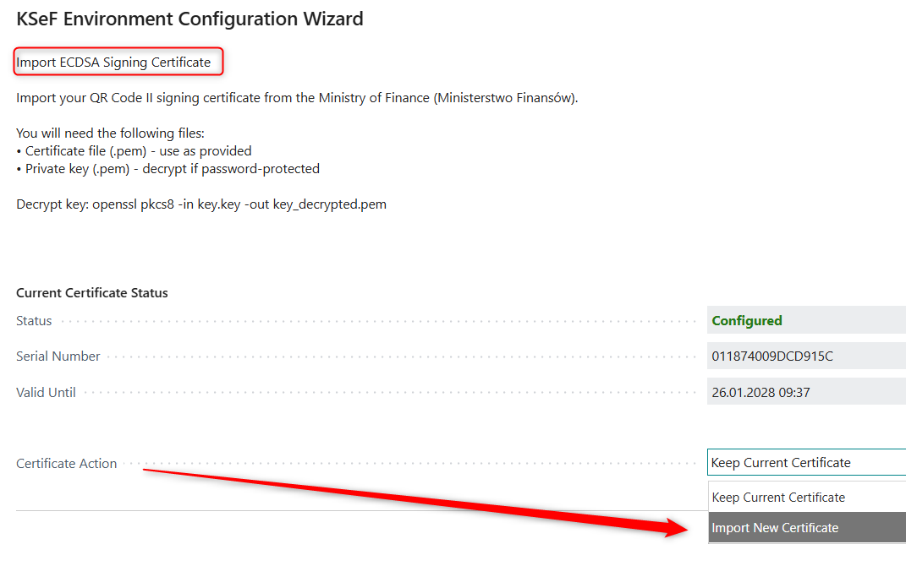

- In the next step select **Click here to load certificate file.** and select the certificate file with the .crt extension, then choose **Next**.

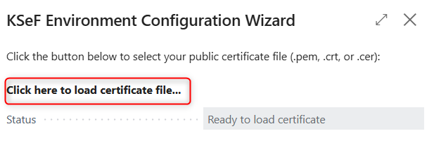

- In the next step, use the option **Click here** **to load the private key file**, select the certificate file in .pem format, and choose **Next.**

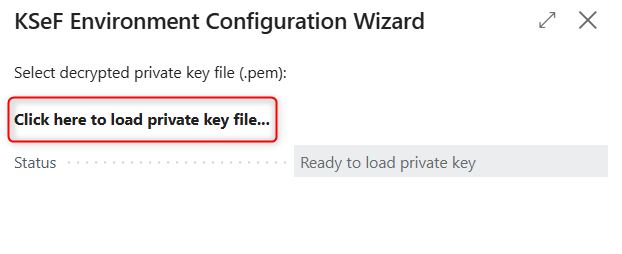

- The user will be informed that the Certificate has been successfully imported.

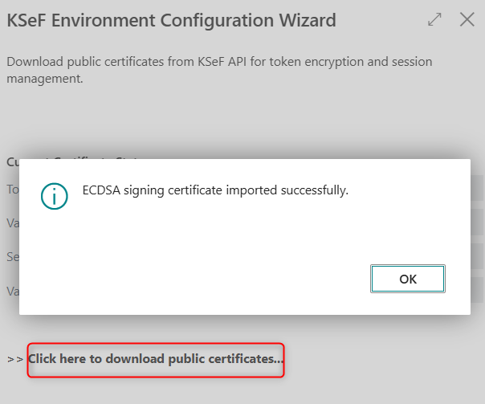

- Next, the public certificates must be downloaded by clicking \>\> **Click here to download public certificates.** After this, the user will be informed that the public certificates have been successfully downloaded.

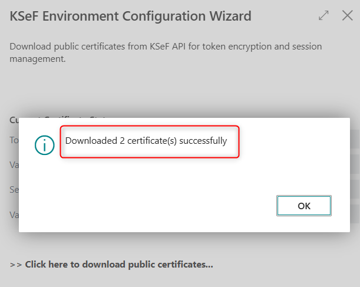

- In the final step, the user must confirm the completion of the configuration. A message will be displayed indicating that the KSeF environment has been successfully configured.

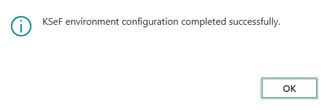

## Managing KSeF Connection Sessions and Official Receipt Confirmation (UPO)

Using the **Session Management** action takes the user to the **session manager view**, where all connection sessions and their statuses can be reviewed. During the process of sending a KSeF file, the system establishes a session. Based on this session, the system sends the file, retrieves the Official Receipt Confirmation (Urzędowe Potwierdzenie Odbioru – UPO), and stores it in this view. The session management view allows the user to check, among other things: the session environment, session type, session status and status code, the total number of files sent within the session and how many of them were sent successfully, unsuccessfully or whether the session has been completed.

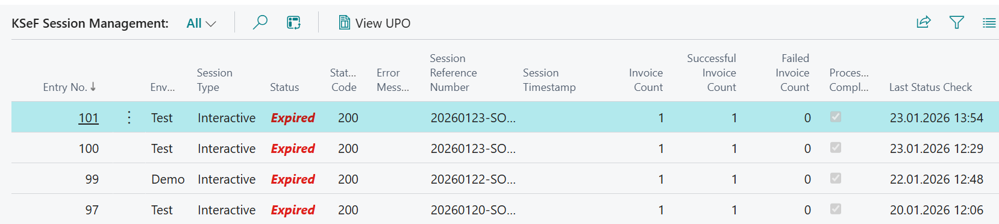

To access the UPO preview, select the appropriate session in the **KSeF Session Management** view and choose the **View UPO** action**.**

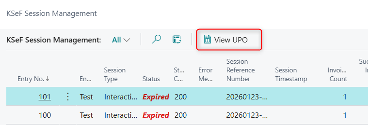

UPO for sent KSeF documents can also be checked from the level of a specific document on the **KSeF – Invoice** page, in the **UPO** section. This section contains information about whether the UPO has been processed, when it was sent, and the encoded UPO number.

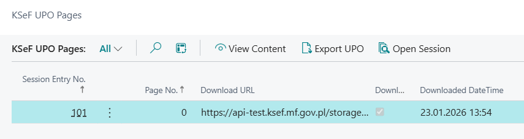

In the **Session** section, the user can check the session number in which a given document was sent, as well as the date and time of sending.

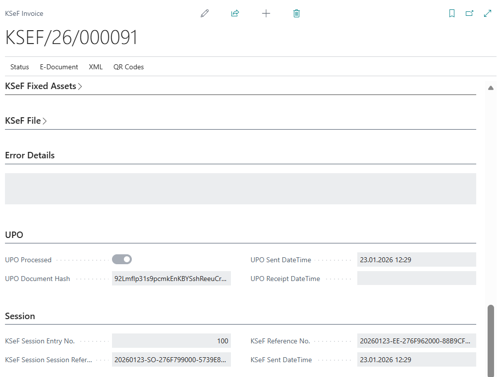

If the **UPO** and **Session** sections are not visible to the user, they must be added using the **Personalize** option.

# Generating and sending documents to KSeF

The process of generating and sending documents to the National e‑Invoicing System (KSeF) begins with issuing a sales invoice or a sales credit memo. A document can be created from the following pages: **Posted Sales Invoice, Posted Sales Invoices, KSeF – Invoice List, Sales Order, Sales Return Order, or Sales Credit Memo**. The invoice is issued in the standard way, by completing all required fields and posting the document. Posting the document itself does not automatically send it to KSeF, unless automatic sending to KSeF has been configured to run each time an invoice is posted. In all cases, posting and sending to KSeF are completely separate processes in Business Central.

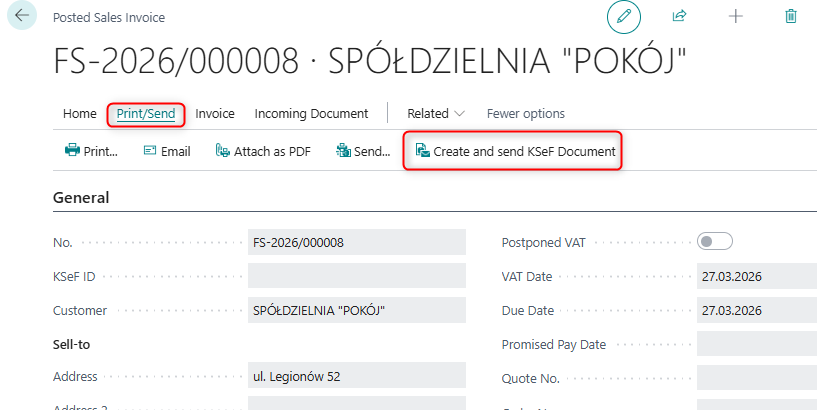

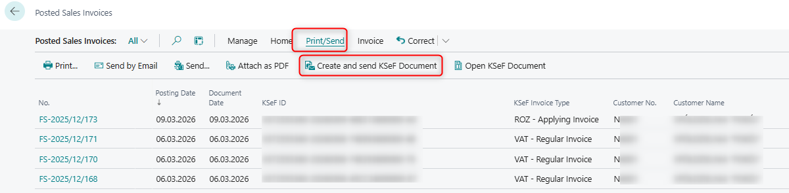

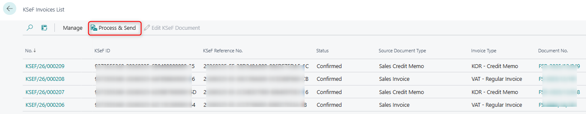

## Additional fields on Posted Sales Invoices

On posted sales invoices, additional fields related to KSeF are available:

**KSeF ID** – a unique number assigned by the Ministry of Finance. This number appears automatically on the posted invoice after the document has been sent and successfully verified in KSeF. Once assigned, the KSeF ID is visible on the following pages: **KSeF – Invoice**, **Posted Sales Invoice**, **Posted Sales Invoices** and **VAT Entries**.

**KSeF Document Processing** – specifies how the document is processed after it is created. This field is hidden by default. To use it, you must add it via the **Personalize** option. The following options are available:

- **Create and Send** – the invoice is intended for automatic sending to KSeF without additional user actions. The actual sending is performed by background processes (**Job Queue**). If the required Job Queue entries are not configured or not running, the document is not sent automatically after posting. This option results in posting the invoice, creating the KSeF document, and sending it to KSeF.

- **Create and Edit** – the document receives status **New** and waits for a manual status update. The status must be changed to **Ready to Send** in order for the document to be sent to KSeF. The Job Queue sends to KSeF only documents with status **Ready to Send**.

- **Create and set Ready to Send -** results in posting the invoice and creating the KSeF document with status **Ready to Send**. The Job Queue sends the document to KSeF.

- **Skip in KSeF –** the invoice will not be sent to KSeF. Used for documents that are excluded from KSeF reporting.

**KSeF Invoice Type** – the invoice type is selected automatically. If required, it is possible to change the invoice type after posting, but before sending it to KSeF. This field may also be hidden by default. To use it, you must add it via th**e Personalize** option.

## KSeF document creation

After posting the invoice, a KSeF document must be created. To do this, from the posted sales invoice or the credit memo, select:

**Related → KSeF**

**Open KSeF document** – if the KSeF document has already been created earlier, it is displayed.

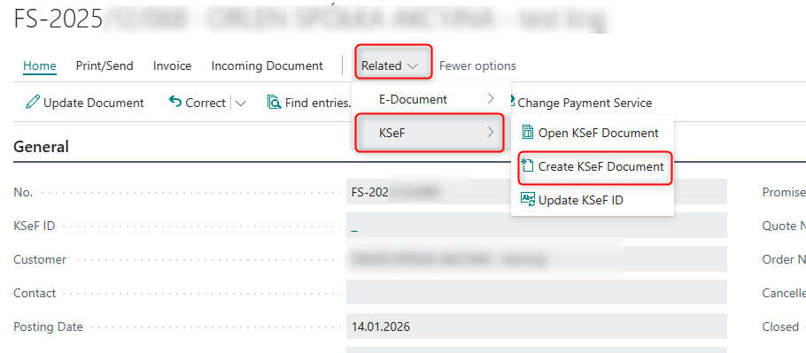**Create KSeF document** – if the KSeF document does not exist, it must be generated using this option. If a KSeF document already exists, running this action creates a new document and deletes the previous one, provided that the document has not yet been sent.

After selecting **Open KSeF document** or **Create KSeF document**, the **KSeF – Invoice** page opens. This page presents the data of the document prepared for sending to KSeF. The form contains information retrieved from the source invoice and additional elements from the XML structure sent to KSeF.

The **KSeF – Invoice** page can also be accessed from the **KSeF – Invoice List** page by selecting a document and clicking its number in the **No.** column.

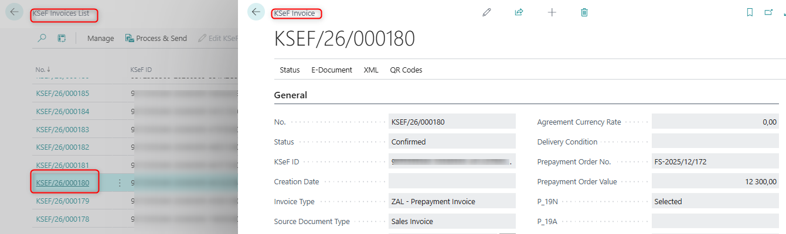

On the **KSeF – Invoice** page, selected fields can be edited before sending the document. The data shown corresponds to the structure of the XML file that will be transmitted to the KSeF system.

If the **Create and Edit** processing option was selected, the KSeF document initially receives status **New**. In this case, the user can change the document status to **Ready to Send** or **Cancelled** by selecting **Actions → Status**.

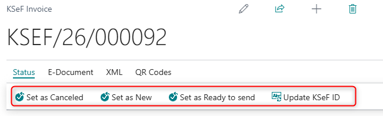

Additionally, from the **KSeF – Invoice** page, operations related to the XML file are also available, including creation of the XML document, export of the file, import of an external file, validation of the structure and preview of the XML file.

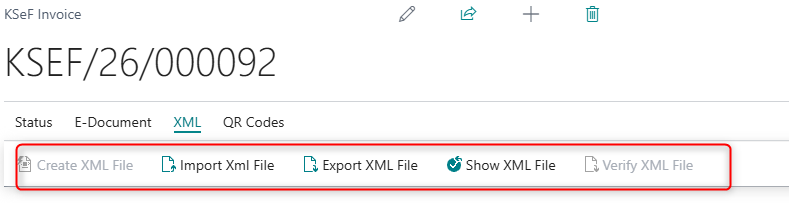

## Skipping Sending to KSeF for a Sales Invoice

If the **Edit Document Processing Method Allowed** option is enabled in **KSeF Setup**, then on the sales invoice or posted sales invoice that has not yet been sent to KSeF, the **KSeF Document Processing** field includes the **Skip in KSeF** option. This option allows the document to be excluded from the KSeF sending process.

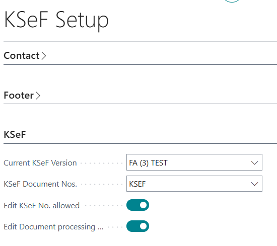

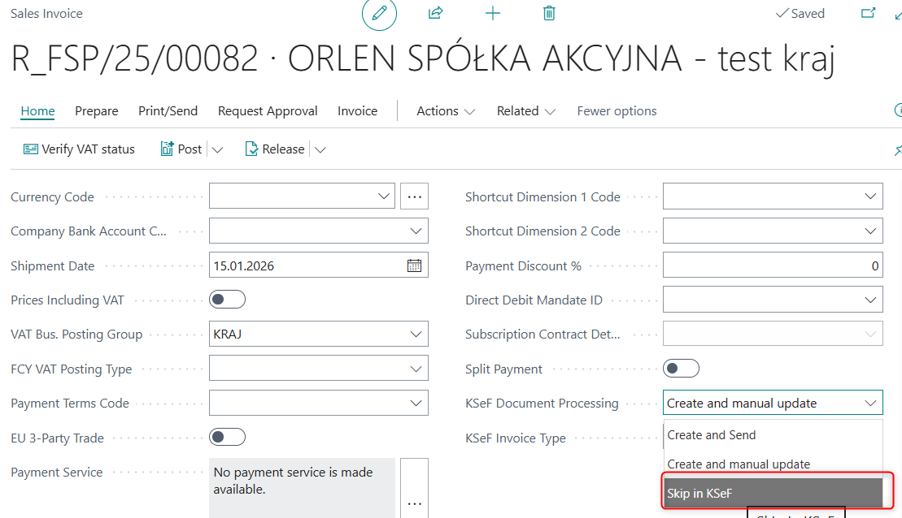

It is also possible to define the document processing method on the customer card. For a selected customer, it can be specified that documents should be skipped in KSeF. In this case, the **Skip in KSeF** option is automatically applied to all invoices issued for that customer.

## Correction of customer data in KSeF

**Correction of Customer Data** is a specific type of descriptive correction used to correct a customer's identification details without affecting any document values.

Unlike other descriptive corrections, such as changes to the payment due date, delivery date, or document remarks, a customer data correction requires the presentation of the updated customer information in the dedicated **Podmiot2K** section of the **KSeF FA(3)** structure.

This section is generated exclusively for customer data corrections issued with the correction reason **DANE (Data)**.

Other descriptive corrections, such as changes to the payment due date, delivery date, or document remarks, do not result in the generation of the **Podmiot2K** section.

The **Podmiot2K** section:

- presents the customer data before the correction, retrieved from the original invoice,

- is generated exclusively for customer data corrections,

- 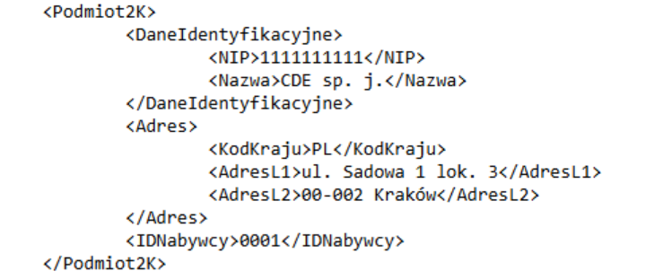ensures compliance of the document with the requirements of the KSeF FA(3) structure.

### Issuing customer data correction for KSeF

A detailed description of how to create a customer data correction (including updating customer information and issuing a corrective sales invoice) is available in the main Localization for Poland documentation:

**→ Localization for Poland User Guide → Sales Credit Memos → Customer Data Correction**

### Notes

- If the appropriate correction reason type is not selected, the Podmiot2K section will not be generated in the XML structure.

- A customer data correction does not affect the financial values of the document.

## Descriptive Corrections in KSeF

This functionality allows users to issue corrective invoices intended to modify descriptive information on a sales document without affecting its value, such as the payment due date or delivery date. These types of corrections are also supported in the KSeF document generation process.

### Issuing descriptive correction for KSeF

Detailed instructions on how to create a descriptive correction are available in the Localization for Poland User Guide:

**→ Localization for Poland User Guide → Sales Credit Memos → Descriptive Corrections of Sales Documents**

## KSeF - Invoice List

The **KSeF – Invoice List** page presents all documents prepared for or sent to KSeF.

The list view allows quick verification of document statuses and includes, among others, the following information:

- **No.** – internal KSeF document number,

- **KSeF ID** – unique number assigned by the Ministry of Finance after the document is accepted,

- **Status** – current document status (e.g., New, Ready to Send, Sent, Cancelled)

- **Source Document Type –** the type of the source document in the system (e.g., Sales Invoice, Sales Credit Memo),

- **Source Document Type** – type of the source document in the system (e.g., VAT – sales invoice, ZAL – prepayment invoice, KOR – corrective invoice/credit memo),

- **Document No.** – number of the source document,

- **Document Date** – document issue date,

- **Currency Code** – document currency,

- **P_15** – gross amount of the document ,

- **Customer No. / Customer Name / Customer Address / Customer Country Code** – customer identification data.

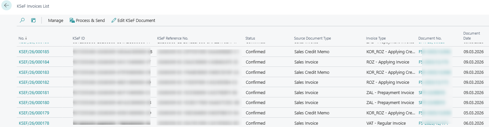

This view allows monitoring all invoices reported to KSeF in one place, controlling their statuses, and identifying documents that require sending.

If a document has status **Validation Error**, it means that the document did not pass validation.\
The error description can be viewed by opening the document on the **KSeF – Invoice** page, in the **Error Details** section.

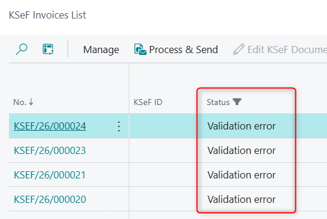

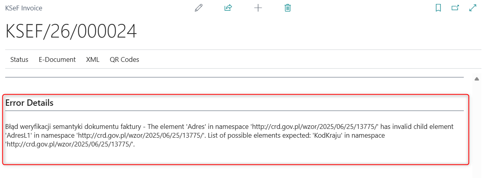

## KSeF - Invoice List – QR Code II

On the **KSeF – Invoice List** page, an additional action **Generate QR Code II for Work Date** is available. This action allows generating **QR Code II** for all KSeF documents at once, based on the work date.

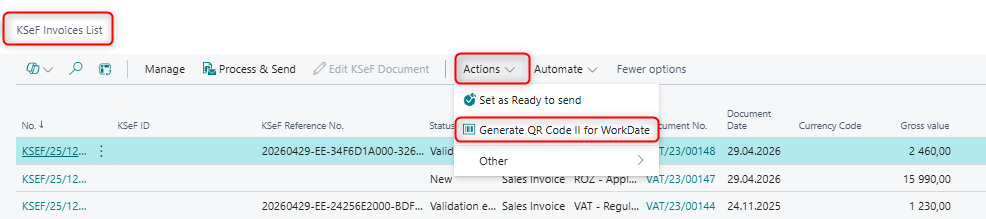

If an invoice does not have a **KSeF ID** (offline mode), it must be printed manually.\
Otherwise, the document would be sent without the **QR Code II**.

# Automatic Sending of Documents to KSeF

Automatic sending of documents to the National e‑Invoicing System (KSeF) enables structured invoices to be created and transmitted from Microsoft Dynamics 365 Business Central to KSeF without manual user intervention.

The automatic sending mechanism is based on:

- configuration of **KSeF Setup**,

- definition of the **KSeF Document Processing** method,

- use of **Job Queue** and the standard **E‑Documents** mechanism.

This mechanism allows both current document sending and sending of overdue documents from a defined period, and provides full control over which documents are sent to KSeF.

## Logic of Automatic Sending

Automatic sending is executed by a dedicated Job Queue, which cyclically:

- identifies KSeF documents that meet the conditions for sending,

- generates XML files in the **FA(3)** structure,

- sends documents to KSeF,

- processes responses returned from KSeF (document status, **KSeF ID**, **UPO**).

The entire process is based on the standard **E‑Documents** mechanism in Business Central, extended with logic required by **Localization for Poland** to support KSeF.

## Job Queue Configuration for Sending to KSeF

For automatic sending of sales documents to KSeF, the following codeunit is used:

- **EXW KSeF Sales Job**

This codeunit is responsible for processing sales documents subject to KSeF and can be run cyclically using the standard **Job Queue**.

To enable automatic sending, a Job Queue entry must be created with the following parameters:

- **Object Type**: Codeunit

- **Object ID**: EXW KSeF Sales Job

- **Status**: Ready

- **Schedule**: according to organizational requirements

The Job Queue can run in the background and process documents without user involvement.

## Scope of Documents Processed by Job Queue

The scope of documents analyzed during Job Queue execution depends on the configuration in **KSeF Setup**.

→ KSeF Setup

If the backward period is **not defined** in **KSeF Setup**, the Job Queue:

- analyzes documents from the **last 24 hours**,

- includes documents issued within this period that meet the conditions for sending.

This corresponds to the standard scenario of current, immediate sending of documents to KSeF.

If the backward period **is defined** in **KSeF Setup**, the Job Queue:

- analyzes documents issued from the Job Queue execution date minus the specified number of days,

- sends all documents from this period that:

- have not yet been sent to KSeF,

- are not marked as Skip in KSeF,

- have a processing method and status that allow sending.

This mechanism is used, among others, in the following scenarios:

- working in offline mode,

- first activation of automatic sending,

- the need to send overdue documents from a previous period.

## KSeF Invoice Creation Mode

The **KSeF Invoice Creation Mode** field defines when a KSeF document is created based on a sales document.

→ KSeF Setup → KSeF tab

Available values:

**Automatically**

- KSeF document is created automatically at the moment of posting the sales invoice.

- KSeF document is created regardless of whether it is sent immediately or by the Job Queue.

- further processing of the document (sending or holding) depends on the KSeF Document Processing method.

**Create Manually:**

- The KSeF document is not created automatically when the sales invoice is posted.

- The document can then be:

- created manually by the user from the posted sales document (**Posted Sales Invoice → Related → KSeF → Create KSeF Document**)

  or

- created automatically when the Job Queue is executed.

**In this mode, the Job Queue performs a dual role:**

- it creates KSeF documents for posted invoices,

- it sends them to KSeF according to further configuration.

## KSeF Document Processing

**Field: KSeF Document Processing\**
(available on posted sales documents after view personalization)

**Available values:**

**Create and Send**

- the KSeF document is created automatically,

- the document is automatically sent to KSeF,

- the **Job Queue** includes the document without additional conditions.

**Create and Edit**

- the KSeF document is created automatically,

- the document receives status **New**,

- before sending, the status must be manually changed to **Ready to Send**,

- the **Job Queue** sends the document only after the status change.

**Skip in KSeF**

- the document is not sent to KSeF,

- the **Job Queue** skips the document regardless of the date range.

The value **Skip in KSeF** can be set:

- directly on the document,

- on the **Customer Card** (applies by default to all documents for that customer).

## Relation between Job Queue and Document Statuses

The **Job Queue** processes only documents that:

- fall within the analyzed date range,

- have a document processing method that allows sending,

- have the appropriate KSeF document status – **Ready to Send**.

Documents marked as **Skip in KSeF** are not included in the automatic sending process.

## Monitoring Sending

The statuses of documents sent to KSeF can be monitored on the KSeF – Invoice List page, where the following information is available, among others:

- document status,

- KSeF ID,

- sending session information,

- UPO information.

# Receiving and Processing Documents from KSeF

In the module for receiving and processing documents from KSeF, the system enables downloading purchase invoices from KSeF to Business Central after the connection has been configured in advance.

## KSeF Connection Setup – receiving KSeF Purchase Invoices

To be able to download purchase invoices from KSeF, it is necessary to first configure the connection settings on the **KSeF Connection Setup** page. The generated authorization token must be pasted there. In the **Receiving** section, it is required to indicate for which entity invoices will be retrieved. For purchase invoices, **Entity 2 (Podmiot 2)** must be selected.

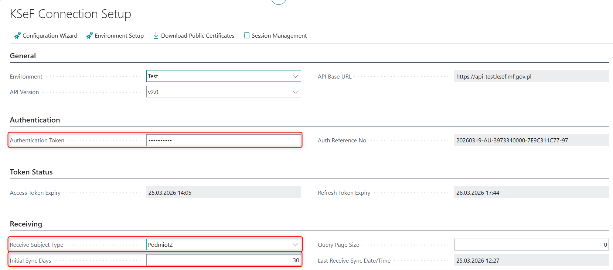

In the **Initial Sync Days** field, there is an option to specify the number of days from which synchronization should start during the first document download. This makes it possible to define how many days back the system will check and retrieve purchase invoices from KSeF. The **Query Page Size** field specifies how many documents will be retrieved and checked during a single API call. If the field is set to the value **0**, the default number of **100** documents is used.

## Sending a Request to the Ministry of Finance

To send a request to retrieve invoices from KSeF, go to the **E-Document Services** page and select the **Receive** action.

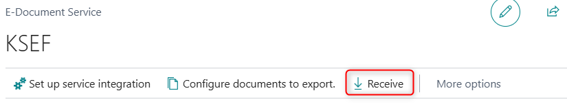

Alternatively, you can use the **E-Documents** menu and select **Receive KSeF Documents**. In both cases, the system starts the communication process with KSeF and retrieves available documents according to the connection settings and the synchronization range defined in the configuration.

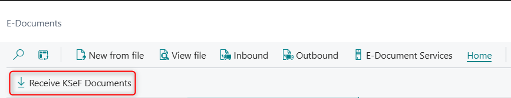

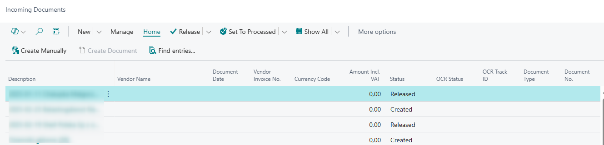

Downloaded documents will be visible on the **Inbound E-Documents** page.

## Processing purchase invoices

After opening a selected document from the **Inbound E-Documents** page, the user is taken directly to the detailed view of that **E‑document**.

This view displays the key **header data** taken from the invoice, such as: document number, KSeF number, issue date, due date, net amount, gross amount, currency code, vendor number and name, as well as the **received purchase document line data**.

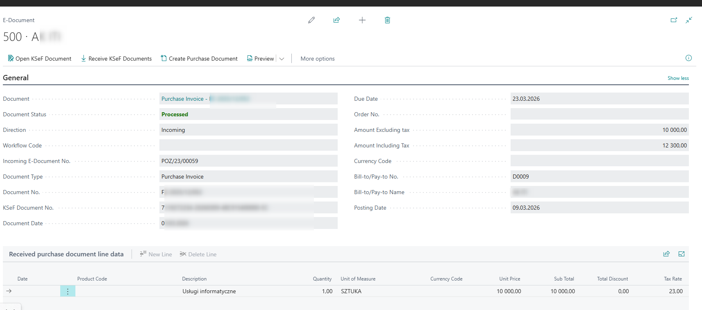

To process the entire invoice - both the header and the lines - it is necessary to create mappings that link line descriptions to the appropriate general ledger accounts using the **Map Text to Account** function.

 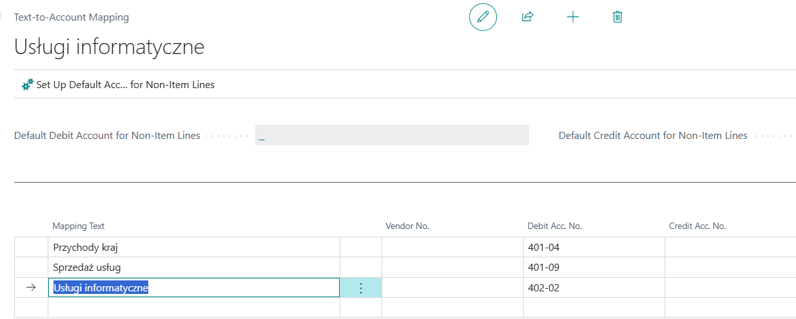

If any of the invoice lines are not mapped correctly, an error will appear during document processing and will be displayed in the **Error Messages** section.

Next, select **Reprocess Document**. If no errors are detected during reprocessing, the system will create a purchase invoice based on the processed e‑document.

After successful processing, the document status is automatically changed to **“Processed”**. In the document view, a link to the created purchase invoice will also appear, containing the completed header information and invoice lines.

 

### Corrections with “Before/After” Lines – Behavior during KSeF import

When importing credit memos from KSeF that contain “before/after” lines, the creation of the purchase document in the system differs from the standard process.

After the e-document has been processed:

- the document header information is populated correctly,

- however, the document lines section remains empty.

This behavior results from limitations of the standard Business Central mechanism, which does not correctly interpret “before/after” correction lines. Such lines may be treated as standard document lines, potentially leading to incorrect calculations and aggregation of amounts.

To prevent:

- incorrect amount calculations,

- distortion of document values,

- inconsistencies in the resulting purchase document,

the solution includes a mechanism that omits document lines when creating the purchase document.

**Notes**

- The absence of document lines does not indicate an import error.

- All document data remains available in the KSeF XML structure.

- If further processing of the document in Business Central is required, the document lines should be entered manually based on the invoice visualization available in KSeF.

## Creating the purchase invoice header

To create only the purchase invoice header without the lines, select **Create Purchase Document** on the e‑document. After selecting this option, you will be able to choose the document type - **Purchase Invoice**, **Purchase Order** or **Purchase Credit Memo**. Once the selection is confirmed, the system will create a document with the header information filled in. Invoice lines are skipped and are not processed within this mode.

 

 

## Automatic Creation of Purchase Document Headers

For large volumes of incoming documents, manually creating a header for each document becomes inefficient. To automate this process, specify how imported documents should be processed on the **KSeF Setup** page:

The following options are available in the **Processing Inbound Documents** field:

- **Manually**- the user manually creates a purchase document header for each imported document.

- **All Documents**- purchase document headers are automatically created for all imported documents.

- **By Vendor Setup**- the processing method for imported documents depends on the configuration defined on the individual vendor card.

If purchase documents should be created automatically only for selected vendors, choose the By Vendor Setup option. Then, on the relevant vendor card, set the **Create KSeF Headers** field to **Automatic**:

To automatically create purchase document headers for documents that have already been imported, select the Create Purchase Documents action on the E-Documents page.

## KSeF Invoice Preview

On the e-document, the **Preview** option is available, which allows visualization of the KSeF invoice based on data from the structured XML invoice. Additionally, the user can display the XML file itself.

 

## KSeF Preview on Purchase Invoice

PDF preview of KSeF document is also available from the Purchase Invoice page. To open it, go to the Prepare section and select **KSeF Preview**.

## KSeF Preview on Posted Purchase Invoice

On the Posted Purchase Invoice page, go to the Invoice section and select KSeF Preview.

## Monitoring KSeF Documents Imports

To improve the reliability of the KSeF document synchronization process and facilitate the diagnosis of potential document import issues, logging and synchronization verification mechanisms are available within the localization app.

### Enabling KSeF Import Logging

**→ KSeF Setup**

To enable KSeF import logging, go to the KSeF Setup page and set the Log E-Document Import field to True. After this option is enabled, the system records detailed information about the process of importing documents from KSeF.

### KSeF Receive Log

A new page, KSeF Receive Log, has been added to allow users to review and analyze document synchronization activities.

The following information is recorded for each operation:

- date and time of the operation,

- user ID,

- KSeF document number,

- name of the processed file,

- informational messages,

- error messages generated during the import process,

- logged events.

The following events are recorded in the log:

- date and time of the synchronization process,

- number of processed invoice metadata records,

- successful document download,

- document download failure,

- metadata processing error,

- KSeF number parsing error,

- authorization or access token errors,

- information indicating that a document with the same KSeF number already exists in the system.

Examples of log messages:

- “Starting KSeF document retrieval process from %1 to %2.”

- “Processed %1 invoice metadata records.”

- “Failed to download the invoice by KSeF number.”

- “A document with the same KSeF number already exists in the system.”

## Automation of Cyclical Import of KSeF Documents

For companies processing a large number of purchase documents, manual import of documents from KSeF may be insufficient. In such scenarios, a mechanism for automatic, cyclical import of KSeF documents is available, implemented using the **Job Queue**.

Automatic import allows periodic checking of the KSeF system and retrieval of incoming documents without user involvement. This process can be scheduled to run at specified intervals, including outside users’ working hours.

For automation of purchase document import from KSeF, the following codeunit is used:

- **Codeunit 72271608 – EXW KSeF Purchase Job**

This codeunit is intended to be run within the **Job Queue** and is responsible for:

- communication with the KSeF system for incoming documents,

- downloading available KSeF documents,

- registering downloaded documents in the standard **E‑Documents** mechanism in Business Central.

To configure cyclical import of KSeF documents, perform the following steps:

→ **Job Queue**

Create a new entry with the following parameters:

- Object Type: Codeunit

- Object ID: 72271608 (EXW KSeF Purchase Job)

- Status: Ready

- Schedule: according to organizational requirements (for example, cyclically)

After starting the Job Queue entry, the system automatically retrieves purchase documents from KSeF in line with the connection configuration and synchronization range defined in the settings.

## Partner 3 Internal ID field

The field: **Partner 3 Internal ID** on the Customer Card is used to store the customer’s internal identifier.

The value from this field is transferred to the NSEI into the **\<Podmiot3\>** section.

## Incorrect Active Sessions

**Active sessions marked as sent but not processed**

There are cases where individual sessions remain in the “Active” state and are not processed to KSeF:

- number of documents = 0

- successful documents = 0

- failed documents = 0

- These sessions are incorrectly marked with status “Sent”, even though no documents have been processed or transmitted to KSeF. As a result, they appear to be “blocked” in the system and are not forwarded to KSeF at all. This suggests a gap in session handling, where empty or unprocessed sessions are not properly finished or closed.

### Incorrect invoice status (Sent instead of Error)

Some invoices are marked with the status “Sent”, even though they were not processed correctly by KSeF and the system did not receive error information.

In case of issues with further processing, an additional Close Session action has been added on the session list page.
